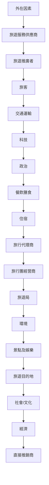
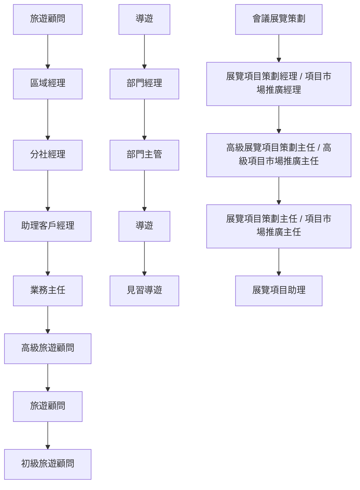
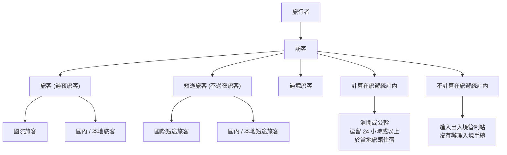
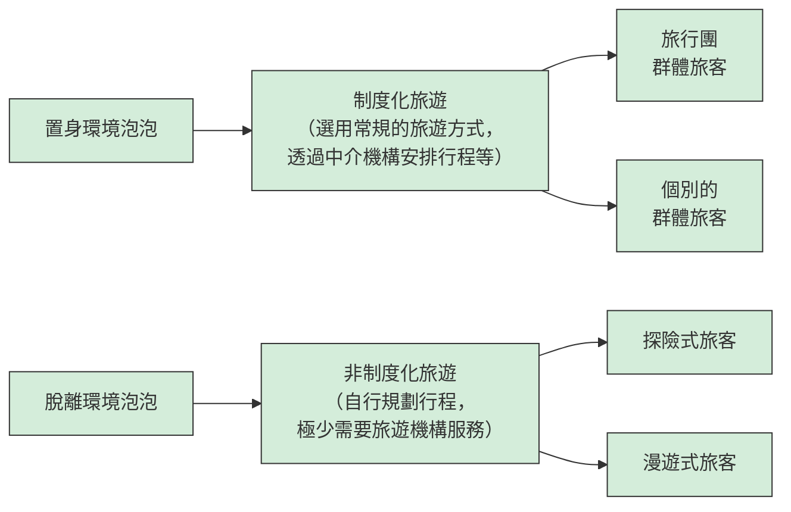

#

# 旅遊 款待 與

# 旅遊導論

# 1

顧問 Ray Pine

# 編輯要旨

natural_image

Illustration of global travel and transportation themes including iconic landmarks like the Statue of Liberty, World Map, and airplane (no text or symbols)

《新里程旅遊與款待》一至四冊，是依照香港課程發展議會與香港考試及評核局於2007年聯合編訂，並於2015 年更新的《旅遊與款待課程及評估指引（中四至中六）》的內容和精神編寫而成，適合香港中學四至六年級旅遊與款待科教學之用。

《新里程旅遊與款待》一至四冊課本共分四本，各分冊課題分配如下：

<table><tr><td>分冊</td><td>課題</td><td>單位</td></tr><tr><td>第一冊</td><td>課題(一)旅遊導論</td><td>1. 旅遊的概念與原理2. 本地旅遊業3. 會議、獎勵、商務、展覽是旅遊業中的一個界別</td></tr><tr><td>第二冊</td><td>課題(二)款待導論</td><td>1. 款待業2. 住宿業3. 餐飲業</td></tr><tr><td>第三冊</td><td>課題(三)地理名勝</td><td>1. 地理名勝</td></tr><tr><td rowspan="2">第四冊</td><td>課題(四)客務關係及服務</td><td>1. 顧客服務2. 客務關係3. 溝通技巧</td></tr><tr><td>課題(五)旅遊與款待業趨勢及議題</td><td>1. 旅遊與款待業的熱門議題2. 旅遊業的趨勢3. 款待業的趨勢</td></tr></table>

為配合探究式教學模式，本書有以下欄目及特色：

<table><tr><td>探究重點</td><td>點列每單元的學習重點,使學生容易掌握學習重心,提高研習旅遊與款待科的能力。</td></tr><tr><td>資料室</td><td>配合課文內容,補充相關的教學資料和旅遊與款待科新知識,幫助學生對課題有更深入、全面的認識。</td></tr><tr><td>例子庫</td><td>配合課文內容,提供大量旅遊與款待業最新例子,協助學生充分理解相關內容和概念。</td></tr><tr><td>提示箱</td><td>提示一些與課題相關的小知識,或不同課題之間的聯繫,提高學生的旅遊與款待科知識,以及加強了解各課題的關聯性。</td></tr><tr><td>思考點</td><td>針對課文內容及補充資料,提出一些具啟發性和思考性的問題,以刺激學生思考,培養他們理解、分析等能力。</td></tr><tr><td>活動站</td><td>針對課文內容,設計各式各樣的課堂活動,例如:行程設計、個案規劃、分組討論、個人分享、配對、計算等,活動設計輕巧實用,適切課堂教學需要,並能讓學生愉快學習。</td></tr><tr><td>練習場</td><td>根據各章的學習重點,適當地編制相關的選擇題練習,讓學生鞏固所學及進行自我評估。</td></tr><tr><td>網絡台</td><td>提供一些與課文相關的旅遊與款待科網站,方便學生作進一步探究。</td></tr><tr><td>基本法教育</td><td>說明與旅遊與款待科有關的《基本法》條文,幫助學生理解《基本法》與促進香港旅遊業發展的關係。</td></tr></table>

本書加插了大量相關圖片、示意圖和地圖，以配合教學，有助增加學生對旅遊與款待科的認識，以及提升學習本科的興趣。

本書末另附有「香港旅遊業大事年表」及「世界地圖」，供學生作為參考。

本書編輯時已力求完善，如有疏漏，敬祈指正。

本社網站內的學與教資源並未經教育局評審。

學生可掃瞄二維條碼，在本社網站「用戶登入」選擇「學生」，輸入用戶「Student」及密碼「TH」，使用學生資源。

# 目 錄

# 課題一 旅遊導論

# 單元1 旅遊的概念與原理 2

旅遊導論  
2 「旅行」、「旅遊」與「旅客」 14  
3 旅遊的動機. 33  
4 旅遊規劃  
5 旅遊業的不同界別及其角色.  
6 旅遊業的分銷途徑. .. 106  
7 旅遊業的影響 .122

# 單元2 本地旅遊業 151

本地旅遊業的概況 .152  
2本地公營及私營機構在旅遊業的角色 .193

# 單元3 會議、獎勵、商務、展覽是旅遊業中的一個界別 208

1會議、奬勵丶商務及展覽旅遊概況 ..209  
2與會議、勵、商務及展覽旅遊相關的行業...229  
3會議丶獎勵丶商務及展覽旅遊的規劃 ..243

# 附錄 261

香港旅遊業大事年表 .

世界地圖 .

# 課題一

# 旅遊導論

natural_image

Aerial view of a cruise ship docked at a modern port with city skyline in the background (no visible text or symbols)

# 單元

# 旅遊的概念與原理

# 探究重點

● 了解旅遊與旅遊業為綜合學科。

● 認識推動或阻礙旅遊發展的因素。

● 探討旅遊業的出路。

● 區分「旅行」、「旅遊」的定義。

● 了解「旅客的不同定義」。

● 認識旅客應有的行為表現。

● 識別旅遊時旅客所需注意的事項及其特殊需要。

● 檢視不同類型的旅遊形式及其分別。

● 認識高恆（Cohen）及蒲樂（Plog）定義所劃分的主要旅客類型。

● 了解旅客流量概念及其對解釋旅客或潛在旅客對旅遊渴望的關係。

● 探討及應用不同的旅遊動機理論。

● 了解旅遊產品及其目的地規劃概念。

● 探討承載力概念概述旅遊規劃的主要考慮。

● 識別旅遊業的主要工作界別及其角色。

● 認識旅遊業的分銷途徑。

● 探討旅遊業對東道社區所帶來的正面及負面影響。

# 1.1 綜合性的學科— 旅遊與旅遊業

旅遊在古時的東西方已出現。進入近代，旅遊業快速發展，並成為一項專門的經濟活動和研究。

目前，旅遊業已是世界其中一個重要產業，亦是一種經濟、社會、文化、科技等方面的綜合現象。 C

旅遊學科與地理、經濟、歷史、心理、社會、資訊科技、市場、管理及財務等學科有一定關係，堪稱一門綜合學科。因此，我們研習旅遊學科時，會應用到不同學科的知識。

旅遊學科綜合模式示例  

```mermaid
graph TD
    A["旅遊學科"] --> B["經濟學"]
    A --> C["歷史"]
    A --> D["心理學"]
    A --> E["社會學"]
    A --> F["資訊科技"]
    A --> G["市場學"]
    A --> H["旅游業收支"]
    A --> I["就業"]
    A --> J["自然地理"]
    A --> K["人文地理"]
    A --> L["地理"]
    A --> M["從業員管理"]
    A --> N["管理及財務學"]
    A --> O["景點開發及發展"]
    A --> P["旅遊產品周期"]
    A --> Q["旅遊產品推廣"]
    A --> R["全球分銷系統"]
    A --> S["全球訂位系統"]
    A --> T["公共衛生"]
    A --> U["旅遊業影響"]
    A --> V["文化旅遊"]
    A --> W["名勝古跡"]
    A --> X["文化景點"]
    A --> Y["旅客行為"]
```

flowchart

圖 1.1

# 1.2 旅遊業整合模式

旅遊業被稱為「無煙工業」。原則上，旅遊業不需要如製造工業般利用原料生產，所造成的污染也遠較製造工業為低。

# 思考點

旅遊業有哪些直接關連行業？又有哪些相關支援行業？

旅遊業雖然被稱為「工業」，但旅遊業實際上是由不同行業結合而成。

旅遊業涉及的範圍廣泛，持份者眾多，包括旅客、旅遊服務供應商、旅遊業推廣機構、政府部門等。各持份者在旅遊業中，彼此息息相關，同時與各種外在因素相互影響。

旅遊業整合模式示意圖  

flowchart

資料來源：Cook, Roy A., Yale, Laura J., Marqua, Joseph J., Tourism - The Business of Travel

# 旅客

由於有旅客才會有旅遊活動，因此，旅客是整個旅遊業整合模式的核心，也是所有與旅遊業相關活動的中心。

# 旅遊推廣者

旅遊推廣者與旅客的聯繫最密切、最直接，屬於整合模式的第一環。它們包括旅遊局、直接推銷商、旅行代理商（傳統和線上）、旅行團經營商及會議獎勵旅遊策劃者等。

# 例子庫

• 旅遊局及直接推銷商主要為旅客提供市場資訊及支援服務等；  
• 旅行代理商主要向旅客銷售旅遊產品，如機票、酒店、套票等；  
• 旅行團經營商主要向旅客提供旅行團行程、導遊和領隊服務等；  
• 會議獎勵旅遊策劃者主要向主辦單位提供構思、策劃、組織、宣傳和管理會議及獎勵旅遊活動等服務。

# 3 旅遊服務供應商

旅遊服務供應商屬於整合模式的第二環，他們會直接服務及聯繫旅客，亦會通過旅遊推廣者向旅客提供服務。

natural_image

Composite image showing a cruise ship, an airplane, and a modern bus with a star-shaped roof (no text or symbols)

旅遊服務供應商包括航空公司、旅遊巴營運商、汽車出租公司、鐵路公司、郵輪營運商、酒店、餐廳和主題公園等。他們會獨立地提供服務給旅客，也會聯合其他供應商提供組合式套票服務給旅客。

圖 1.3 旅遊服務供應商提供交通、酒店等服務給旅客。  

# 例子庫

• 航空公司會向旅客提供航機運輸服務，把旅客送抵目的地，過程中亦會為旅客提供餐飲等服務。  
• 旅遊服務供應商提供的組合式套票有「機票連酒店住宿」、「景點門票連來回交通接送」、「特色活動連餐飲服務」等。

# 外在因素

外在因素屬於整合模式的第三環，包括經濟、政治、社會及文化、環境和科技等。旅客、旅遊推廣者、旅遊服務供應商等持份者，均受到這些外在因素影響。

# 1.3 推動或阻礙旅遊業發展的因素

# 經濟因素

個人收入：旅客的個人收入和負擔能力對旅遊業有直接影響。當民眾收入較高，會較樂意花費在旅遊上，尤其是海外旅遊；相反，當民眾收入較低，旅遊的意欲較低，或多傾向選擇費用較低的本地旅遊。

# 例子庫

歐美、香港等經濟發達地區民眾的收入較高，旅遊意欲較高，對航空服務、酒店住宿等旅遊產品的要求也較經濟落後地區的民眾高。

經濟表現：經濟盛衰也會影響旅遊業的起落。在經濟繁榮時，民眾收入普遍較高，會較樂於花費在旅遊上，旅遊業相對興旺；相反，在經濟不景時，民眾收入減少，旅遊消費意欲降低，或花費較謹慎，旅遊業相對低沉。

# 例子庫

• 根據香港旅遊發展局的數字，受到 1997 年亞洲金融風暴影響，次年訪港旅客人數下跌 9.9%，整體旅遊收入更大跌 23.4%。在

2008年全球金融危機影響下，該年來自長途城市的訪港旅客人數錄得4%的跌幅。

text_image

Financial market chart with candlestick patterns and price data, overlaid with red trend lines and arrows indicating price movement

圖 1.4 根據聯合國資料，2008年的全球金融危機令全球旅遊業產值下降 10% 至 20%。

經濟元素：經濟元素如匯率的升跌、外匯管制等，會影響旅客的旅遊意欲。至於一地的經濟發達程度，同樣會影響當地政府對旅遊業的支援幅度，從而影響旅遊業的發展。

# 例子庫

當人民幣升值，香港貨品（若以人民幣計算）會變得較便宜。這可能會刺激內地旅客來港旅遊消費的意欲，令內地訪港旅客人數隨之上升。當日元貶值，會增加香港旅客前往日本旅遊的意欲，香港遊日旅客人數隨之增加。  
• 澳門特區政府成立以來，庫稅收入持續上升，加上政府積極發展旅遊業，投入大量資源於相關項目的建設，令澳門旅遊業近年蓬勃發展，旅客人數較過去大幅攀升。

text_image

5000
G958778M
日本銀行券
五千円
日本銀行券
10000
ES422073H
日本銀行券
萬万円
日本銀行券
YUAN
2005年

▲ 圖1.5 人民幣及日元匯率的升跌，對本港旅遊業均有影響。

# 政治因素

政治穩定性：一個國家或地區政治穩定和治安良好，能夠吸引旅客前往旅遊，同時能營造有利的經營環境，吸引旅遊相關行業投資，促進旅遊業發展。相反，假如一地政局動盪，治安欠佳，會打擊當地旅遊業形象，旅客或為了安全而避免前往，或取消行程。

# 例子庫

埃及在 2011 至 2014 年間，政局持續動盪，接連發生政府與示威者的衝突和暴力事件，旅遊環境嚴重惡化，外地旅客大幅減少，旅遊從業員的生計大受打擊。

旅遊政策：旅遊目的地政府積極推動旅遊業發展，有效監管旅遊行業的服務水平，採取寬鬆的出入境政策，如容許免簽證入境，有利推動旅遊業發展。有些國家或地區為了避免太多海外旅客，會實施入境旅遊人數限制，局限了當地旅遊業的進一步發展。

# 例子庫

在 2003 年內地與香港簽訂的自由貿易協議《內地與香港關於建立更緊密經貿關係的安排》（CEPA）下，中央政府於同年宣布推出《港澳個人遊計劃》，允許內地指定城市的居民以個人遊的方式前往香港、澳門旅遊。此計劃為香港旅遊業帶來超過 15 年的增長，其間訪港旅客大幅上升，而本港有多間新酒店和新景點落成，旅遊業持續發展。  
• 不丹採用每日固定收費方式來控制入境旅客量，淡季每人每日200 美元，旺季收費為 250 美元。  
北韓對旅客人數採取限制，每天外地旅客人數上限為一千人。另外，旅客如要進入當地旅遊，必須經指定的旅行社申請及辦理簽證，行程也由當局安排。

# 思考點

近年香港不少夫婦選擇不生育或推遲生育，造成本港出生人口下降，這會對旅遊產品及服務的類型有何影響？

natural_image

Back view of an elderly couple walking together, with a cruise ship in the background (no visible text or symbols)

# 社會及文化因素

人口結構：人口發展趨勢對旅遊業的發展有重要影響。隨着經濟條件改善及人均壽命延長，越來越多長者在退休之後，四出遊歷，令「銀髮市場」受到市場的關注。另外，年輕一代教育水平提高，期望獲得良好的旅遊體驗，亦改變旅遊產品及服務的類型。

# 例子庫

• 郵輪旅遊形式符合長者慢活、樂活的旅遊需求，加上郵輪公司及旅行社等的推廣，近年相當受長者旅客的喜愛。  
• 近年，旅行社針對年輕人的旅遊喜好，推出了不同類型的個性化「自由行」旅遊套票，如自駕遊、文化體驗活動等。

圖1.6 長者是郵輪公司重要的推廣對象發展程度：一個國家或地區的社會發展程度高，民眾的收入水平相對會較高，對旅遊的需求也會較高。同時，當地的交通基礎建設會較完善，能讓旅客便捷地往返，有助促進旅遊業發展。反之，當地社會發展程度低，旅遊基建較落後，對旅客的吸引力亦較低。

假期數目：一個國家或地區的假期日數較多，民眾能夠旅遊的時間會較多，對旅遊的需求也較大。相反，假期日子較少的地區，民眾的旅遊日子會受到局限。此外，一些全球性或地區性的長假期，亦能推動旅遊業發展。

# 例子庫

復活節或聖誕節是不少國家或地區的法定假期，當地民眾在這些節日的外遊需求會急增。 。  
內地每年的春節、勞動節及國慶節等長假期，均有大批民眾前往各省市以至世界各地旅遊。

natural_image

Nighttime view of a European Christmas market with illuminated buildings and a decorated Christmas tree (no visible text or signage)

圖1.7大量旅客到訪的德國聖誕市焦

旅遊文化：一地如具有濃厚而獨特的文化色彩，對旅客的吸引力會較大，有助推動當地的旅遊業發展。另外，旅遊從業員服務態度優質，以及民眾對旅客友善，亦有利推動當地旅遊業發展。

# 例子庫

香港旅遊發展局多年來推出「優質旅遊服務」計劃，鼓勵本地旅遊相關從業員以友善態度待客，提升旅客對香港的印象，有助推廣香港旅遊業。

natural_image

Person wearing a face mask and adjusting a mask, with a stylized world map and virus particles in the background (no text or symbols)

公共衞生：全球大型公共衞生事件，如疫病大流行，會威脅旅客的健康，使旅客出行意欲下降，各地政府甚至會作出相應的出入境限制措施，不利全球旅遊業的發展。

圖 1.8 2019 冠狀病毒病疫情令全球旅遊業陷入停滯

# 例子庫

2019 年底爆發的冠狀病毒病疫情，令全球數以萬計民眾受到感染。為了防止病毒傳播及擴散，多國政府實施出入境限制，各地旅遊業均受到沉重打擊，多間航空公司、旅行社、酒店等倒閉。原定 2020 年夏天於日本舉行的東京奧運會，亦受到疫情影響，要順延至2021年舉行。

natural_image

A kangaroo standing in a misty forest with a fallen tree in the background (no text or symbols visible)

圖 1.9 澳洲山火造成當地空氣污染嚴重，野生動物家園受破壞。

# 環境因素

景點資源：地方擁有高知名度、歷史悠久文化景點，或獨特壯麗、珍貴生態自然景點，對旅客的吸引力較大，旅客前往的意欲也較高。

環境質素：現時，民眾的環保意識提高，較過去重視環境質素。一地如環境污染、交通擠塞等問題嚴重，會降低旅客前往的意欲。相反，一地政府及社會重視環境保護，會為當地營造良好的旅遊環境，有助吸引旅客前往，推動旅遊業的發展。

# 例子庫

內地北方多個地區於 2015 年冬天發生嚴重霧霾，其中北京成為重災區。英國政府向國民發出旅遊警示，呼籲赴華的旅客注意身體狀況。隨着內地政府積極推動環境保護，近年北京等地的空氣質量已有所改善。  
澳洲多個地區於 2019 至 2020 年初發生嚴重山火，部份地區更進入緊急狀態，當地空氣質素亦受到嚴重影響。澳洲旅遊出口委員會於 2020 年初表示，山火帶來的污染及安全問題令國際旅客卻步，估計導致澳洲該年旅遊業收益損失約240億港元。

氣候變化：極端天氣、氣候現象引發的天災，會導致交通受阻、景點受損等問題出現，減低旅客外遊的頻率，嚴重阻礙旅遊業發展。

# 例子庫

位於玻利維亞的查卡塔雅山滑雪場，曾以世界上海拔最高、最接近赤道、南美洲第一個滑雪場而聞名。可是，當地冰川受厄爾尼諾現象影響而徹底消失，該滑雪場在2009年停止營運。  
• 澳洲於 2017 年受超強熱帶氣旋黛比吹襲，其中白日夢島的碼頭被摧毀，有300名旅客受困，物資更一度短缺。

# 5 科技因素

交通科技應用：交通運輸工具如鐵路、飛機等廣泛應用新科技，使旅客的交通時間較以往縮減，有助旅遊業的進一步發展，以及開闢新的長途旅遊路線。

natural_image

Side profile of CRH high-speed train cars on tracks, no visible text or symbols on the image itself

▲ 圖 1.10 截至 2020 年，國家高鐵營運里程超過 3 萬公里，佔世界高鐵總量的三分二。

# 例子庫

國家近年大力發展高速鐵路網絡，令民眾的陸路出行時間大為縮短，刺激了國內旅遊業的發展。以北京至天津的城際高速鐵路為例，開通營運後，天津接待旅客的數量短時間內增加了35%。

資訊科技應用：網絡資訊科技的廣泛應用，有助旅遊業界提升營運效率，同時為旅客帶來方便，能有效推動旅遊業發展。

# 例子庫

• 全球訂位系統的出現，使全球旅遊業界能夠協調運作，讓旅客享受便捷高效的旅遊服務。  
• 互聯網的應用，便利旅客搜集旅遊資訊，甚至直接向航空公司、酒店或旅遊景點等訂購旅遊產品。

# 1.4 旅遊業的出路

# 就業機會

旅遊業是綜合性的經濟產業，涉及交通運輸業、住宿業、餐飲業、零售業、娛樂業等多個社會行業，亦與政府旅遊部門及相關公營推廣機構有密切關係。

修讀旅遊與款待業，同學可以學到十分廣泛的知識及技能，包括款待理論、市場學、人事管理、溝通技巧、團隊精神、顧客服務、會議展覽統籌及質量管理等 。

因此，同學畢業後可選擇的行業非常廣泛，包括：旅行社、航空公司、酒店、餐飲、主題公園、會所、食品採購、會議展覽、宴會統籌、客戶服務、市場推廣等。

# 香港旅遊業界適合修畢「旅遊與款待科」學生的基本職位

# 旅遊服務

• 導遊  
• 領隊  
• 旅遊顧問  
• 獎勵旅遊顧問  
• 企業旅遊顧問  
• 旅遊學院導師  
會議策劃人等

# 旅遊運輸

• 飛機師  
• 機艙服務員  
• 飛機維修員  
• 地勤服務員  
• 空中交通管制員  
• 控制室助理  
• 郵輪員工等

# 住宿

• 款接員  
• 禮賓司  
• 管家  
• 訂房部員工  
• 康樂部指導員  
• 行李員  
• 房務員等

# 餐飲

• 侍應生  
• 宴會部服務員  
• 客務主任  
• 廚師  
• 調酒員  
• 收銀員  
• 接待員等

# 景點

• 遊樂設施服務員  
• 票務服務員  
• 場地服務員

• 賓客服務款待員  
• 商品銷售服務款待員  
• 園林服務員等

# 資料室

# 旅遊業產生的就業職位數量

世界旅遊觀光協會（World Travel and Tourism CouncilWTTC）估計，旅遊行業及其相關產業為全球直接創造了超過 1億個就業機會，間接產生的就業機會近 3 億個。即旅遊業佔了全球就業職位約一成。

香港方面，WTTC估計旅遊業直接提供了約19萬個職位，佔總就業人數 5%；加上間接或附帶就業，更提供了近 56 萬個職位，佔本港總就業人數近 15%。

# 事業發展

各事業途徑會因應市場上不同職位而有所不同。

旅遊顧問、導遊及會議展覽策劃的事業途徑例子  

flowchart

# 2.1 「旅行」和「旅遊」的定義

# 1 「旅行」與「旅遊」的概念

「旅行」和「旅遊」在意思上有相似的地方，亦有相異之處。

「旅行」：指人們從一個地方到另一個地方的旅程，消閒、工作、居住、學習或過境的旅程，都屬於旅行。

「旅遊」：指人們離開原本生活及工作的地方，前往另一地方作短時期的逗留，在目的地期間進行的活動。

值得留意的是，旅遊的定義應指在該目的地逗留少於一年的短暫活動，其旅行目的也不是在當地工作賺取金錢。

旅行與旅遊分別示意圖

所有旅遊都被看成某種形式的旅行，但不是所有旅行均屬於旅遊。

text_image

旅行
旅遊

圖 1.11

# 甚麼是「旅遊」？

按照聯合國旅遊組織的定義，「旅遊」是指人們由於度假、公幹等原因，短暫離開原居地，前往另一個地方，逗留少於一年，並最終返回原居地的活動。

根據有關定義，「旅遊」有以下五個特徵：

• 離開原居地：目的地不是原居地，而是本國其他地方或他國。  
• 自願性：旅客出行屬個人意願，不同於被迫流亡在外的難民。  
• 有時間性：少於一年的活動，但並非於原居地附近數小時的活動。  
• 性質：活動包括度假、公幹，但不包括到外地謀生等。  
• 往返：「旅遊」活動結束後，會返回原居地。

# 3 「旅遊」的分類

按照聯合國旅遊組織的分類，「旅遊」可按目的地分為：國內/本地旅遊和國際旅遊。

國內 / 本地旅遊：指一個國家的居民離開其本身居住的地方，到本國境內其他地方的旅遊。

# 例子庫

• 一名居住在北京的中國人到上海公幹。  
• 一名居住在東京的日本人到北海道度假。

國際旅遊：指兩國之間的旅遊，即一名居民離開其本身居住的國家，進入其他國家的旅遊。這包括出境和入境旅遊。對居民所在國家而言，其到他國的旅遊是出境旅遊；對居民所前往國家而言，其到該國的旅遊是入境旅遊。

# 例子庫

一名新加坡居民前往英國旅遊，對新加坡而言，這名居民是出境旅遊的出境旅客；對英國而言，這名新加坡居民是入境旅遊的入境旅客。

# 出境旅遊與入境旅遊示意圖

flowchart

圖 1.12

# 2.2 「旅客」的定義

除了「旅客」一詞，「旅行者」、「短程旅客」及「訪客」等用語，也經常被用來形容人們到訪其居住及工作以外的目的地。不過，這些用語的意思稍有不同。

# 1 「旅行者」

「旅行者」泛指任何在所居住地或在其他地方進行旅程的人。

# 2 「旅客」（過夜旅客）

「旅客」是指為了消閒或公幹，在旅遊目的地逗留 24 小時或以上，並於當地旅館住宿最少一晚的旅客。

「旅客」又分為「國際旅客」和「國內 / 本地旅客」。

國際旅客：指離開其本身居住地，進入其他國家旅遊，並在所遊覽國家旅館住宿最少一晚的旅客。

國內 / 本地旅客：指離開其本身居住地，到本國境內其他地方旅遊的人士，並在目的地旅館住宿最少一晚的旅客。

# 例子庫

國際旅客與非國際旅客

<table><tr><td>國際旅客</td><td>非國際旅客</td></tr><tr><td>為娛樂、家庭或健康等原因而到他國旅行的人。</td><td>到他國謀求職業或長期居住的人。</td></tr><tr><td>參加短期課程(不到一年)的學生。</td><td>寄宿在他國學校一年或以上的學生。</td></tr><tr><td>為商業原因而到他國旅行的人。</td><td>居住在邊境地區而跨越國界到鄰國工作的人。</td></tr><tr><td>在郵輪旅遊中停靠他國的人。</td><td>途經他國機場,僅在機場禁區停留的人。</td></tr><tr><td>在他國住院不足一年的病人。</td><td>在他國住院一年或以上的病人。</td></tr><tr><td>到他國參加國際會議的人。</td><td>流浪者及難民。</td></tr><tr><td rowspan="2"></td><td>公共交通工具的工作人員,包括航空公司的機組人員。</td></tr><tr><td>外交官、軍事人員及隨行家屬,以及派駐外海的軍隊或武裝部隊。</td></tr></table>

# 3 「短程旅客」（入境不過夜旅客 / 即日來回的旅客）

「短程旅客」是指為了消閒或公幹，在旅遊目的地逗留少於24小時，且不會於當地旅館住宿過夜的旅客。

「短程旅客」同樣可分為「國際短程旅客」和「國內 / 本地短程旅客」。

# 提示箱

乘坐郵輪到訪目的地，日間上岸觀光，晚上在郵輪住宿的旅客，按照聯合國旅遊組織的定義，會被視為短程旅客。

國際短程旅客：指離開其本身居住的地方，進入其他國家旅遊，但不在所遊覽國家旅館住宿過夜的旅客。

國內 / 本地短程旅客：指離開其本身居住的地方，到本國境內其他地方旅遊的人士，但不在目的地旅館住宿過夜的旅客。

# 例子庫

• 一名馬來西亞居民在早上前往新加坡觀光，於晚上返回馬來西亞，不在新加坡住宿，這名馬來西亞居民就是國際短程旅客。  
一名廣州居民即日來回深圳購物，該名廣州居民就屬於國內 / 本地短程旅客。

# 4 「訪客」

「訪客」是指離開其慣常生活的環境空間，前往另一個地方，並在當地逗留少於十二個月，而其旅行的目的不是在當地工作賺取金錢。

text_image

離港
南面
South
離港 Departures

過境旅客：指持有效旅遊證件，從境外某地進入境內的機場或港口等出入境管制站，沒有辦理入境手續便直接出境前往境外另一地方的旅客。

圖 1.13 香港國際機場離境大堂。旅客經安檢後，即進入禁區。

旅客類型示意圖  

flowchart

圖 1.14

# 資料室

# 「郵輪旅客」的不同分類

根據聯合國旅遊組織的分類，郵輪旅客在目的地逗留不論是否少於一天，他們均被視作短程旅客。香港旅遊發展局則把郵輪旅客作一獨立分類，劃為「乘坐同一郵輪進出香港的郵輪旅客」，而不歸入「過夜旅客」或「入境不過夜旅客 。

# 活動站

# 旅客類型來連線

試配對以下不同類型的旅客，用線把答案連起來。

國際旅客

本地旅客

國際短程旅客

本地短程旅客

過境旅客

一名澳門居民到香港購物，即日來回。

· 一名英國倫敦居民到法國巴黎公幹，即日來回。

· 一名居住在曼谷的泰國人到清邁度假三天。

· 一名南韓旅客搭飛機到香港機場，再轉機到越南。

一名居住在紐約的美國人到法國觀光九天。

# 2.3 「旅客」的分類

不少學者嘗試以不同的角度把旅客分類。以下將介紹社會學家高恆（Eric Cohen）及心理學家蒲樂（Stanley Plog）的旅客分類模式。

# 高恆的旅客分類模式

高恆根據人們對旅遊方式的喜好及旅程安排的方式，將旅客分為四種模式：旅行團群體旅客、個別的群體旅客、探險式旅客和漫遊式旅客。

高恆的旅客分類模式示意圖  

flowchart

圖 1.15

# 資料室

# 「環境泡泡」

「環境泡泡」指旅客即使身仍被一些與其日常生活環境相近事物包圍，例如住宿現代化酒店搭乘觀光巴士及船、進食與日常相同的食物、由導遊帶領參觀等。這可減低旅客遇上不愉快經驗的機會，同時增加他們的安全感。

natural_image

Illustration of a couple enjoying a meal at a table with wine glasses and flowers, set against a tropical beach and island (no text or symbols)

圖 1.16 環境泡

高恆的旅客分類模式簡表

<table><tr><td rowspan="3" colspan="2"></td><td colspan="4">旅客模式</td></tr><tr><td>旅行團群體旅客</td><td>個別的群體旅客</td><td>探險式旅客</td><td>漫遊式旅客</td></tr><tr><td></td><td></td><td></td><td></td></tr><tr><td rowspan="3">對旅遊方式的喜好</td><td>偏好與目的地</td><td>最少的冒險偏向熱門的旅遊目的地</td><td>欠缺冒險精神偏向熱門的旅遊目的地,遊覽景點與旅行團群體旅客接近,同時期望有新景點</td><td>會審慎進行冒險偏向非傳統的旅遊目的地</td><td>最富冒險精神偏向較少旅客前往的國家或地區</td></tr><tr><td>行程</td><td>追求舒適的旅程絕大部分時間置身於其「環境泡泡」享受旅行社一站式的旅遊產品服務由領隊和導遊帶領</td><td>行程大部分時間置身於其「環境泡泡」預先透過旅行代理商代辦或使用旅遊應用程式來安排交通、住宿等主要行程</td><td>仍著重舒適的住宿和可靠的交通工具,以及保留原有的生活常規與旅行團群體旅客及個別群體旅客相比,較勇於離開其「環境泡泡」</td><td>遠離「環境泡泡」和原居地的生活習慣隔絕與旅遊機構的連繫,如酒店及旅遊巴士等在當地找工作以賺取繼續行程的費用</td></tr><tr><td>與當地人接觸</td><td>與當地人接觸最少</td><td>與當地人接觸有限</td><td>嘗試投入當地人的生活和學習當地人的語言</td><td>試圖融入當地人的生活方式,說當地人的語言,與當地人一同食住</td></tr><tr><td rowspan="2">對旅程安排的方式</td><td>行程安排</td><td>由旅行社預先決定旅遊路線由導遊帶領到預先安排的景點及購物場所</td><td>旅客行程並不是完全固定旅客可適當控制行程和活動時間</td><td>自行安排行程和活動時間行程或時間表不是固定</td><td>自行安排行程和活動時間沒有固定行程或時間表,視乎情況隨時作出改變</td></tr><tr><td>自由度</td><td>旅客往往不能脫離團隊自由活動</td><td>不一定以群體方式進行活動</td><td>對旅程安排有完全的決定權</td><td>對旅程安排有完全的決定權</td></tr></table>

#

<table><tr><td>偏好與目的地</td><td>最少的冒險偏向熱門的旅遊目的地</td><td>欠缺冒險精神偏向熱門的旅遊目的地,遊覽景點與旅行團群體旅客接近,同時期望有新景點</td><td>會審慎進行冒險偏向非傳統的旅遊目的地</td><td>最富冒險精神偏向較少旅客前往的國家或地區</td></tr><tr><td>行程</td><td>追求舒適的旅程絕大部分時間置身於其「環境泡泡」享受旅行社一站式的旅遊產品服務由領隊和導遊帶領</td><td>行程大部分時間置身於其「環境泡泡」預先透過旅行代理商代辦或使用旅遊應用程式來安排交通、住宿等主要行程</td><td>仍著重舒適的住宿和可靠的交通工具,以及保留原有的生活常規與旅行團群體旅客及個別群體旅客相比,較勇於離開其「環境泡泡」</td><td>遠離「環境泡泡」和原居地的生活習慣隔絕與旅遊機構的連繫,如酒店及旅遊巴士等在當地找工作以賺取繼續行程的費用</td></tr><tr><td>與當地人接觸</td><td>與當地人接觸最少</td><td>與當地人接觸有限</td><td>嘗試投入當地人的生活和學習當地人的語言</td><td>試圖融入當地人的生活方式,說當地人的語言,與當地人一同食住</td></tr><tr><td>行程安排</td><td>由旅行社預先決定旅遊路線由導遊帶領到預先安排的景點及購物場所</td><td>旅客行程並不是完全固定旅客可適當控制行程和活動時間</td><td>自行安排行程和活動時間行程或時間表不是固定</td><td>自行安排行程和活動時間沒有固定行程或時間表,視乎情況隨時作出改變</td></tr><tr><td>自由度</td><td>旅客往往不能脫離團隊自由活動</td><td>不一定以群體方式進行活動</td><td>對旅程安排有完全的決定權</td><td>對旅程安排有完全的決定權</td></tr></table>

# 蒲樂的旅客分類模式

蒲樂根據對旅客性格的研究，把旅客分為探奇型、保守型及中庸型三類。他指出，旅遊目的地的受歡迎程度，和旅客的性格有着密切關係。

蒲樂的旅客分類模式簡表

<table><tr><td>旅客模式</td><td>旅客的性格</td><td>對旅程的要求</td></tr><tr><td>保守型旅客</td><td>不愛冒險;傾向抑制;重視安全和保安;喜愛預知行程的內容。</td><td>喜歡到熟悉的旅遊目的地;喜歡有計劃及預先編排好的行程;享受全包的旅行團服務;喜好熟悉的環境,入住連鎖式酒店,以及在餐廳進食具家鄉風味的食物;偏好陽光充沛的目的地及具玩樂性的景點;偏好悠閒、不太消耗體力的活動;希望沒有壓力的旅遊,可放鬆自己;喜歡在目的地的旅遊熱點活動;對接觸不同文化沒甚麼興趣。</td></tr><tr><td>中庸型旅客</td><td>不太喜歡冒險,但不抗拒嘗試新事物;性格介乎探奇型和保守型之間。</td><td>旅遊要求介乎探奇型和保守型之間;喜歡到已發展成熟但自己認知不高的旅遊目的地;喜歡前往熟悉的目的地,發掘新奇的景點;喜歡輕鬆、娛樂活動,並與朋友和家人度過美好時光;願意嘗試新鮮或不一樣的酒店,但對舒適度有一定程度的要求;在可控的環境下,會嘗試了解不同文化;偏好與當地人有所接觸;既喜歡自由行,亦會參加旅行團;有常規的旅遊行程,但可加插一些新鮮、刺激的活動。</td></tr><tr><td>探奇型旅客</td><td>外向、獨立;充滿自信;愛冒險;喜愛探索新體驗。</td><td>喜歡到冷門的旅遊目的地;喜歡發掘尚未開發的新景點;偏好動態的活動;喜歡乘搭飛機去旅行;樂於接觸不同文化背景的人;喜愛自由度高的旅行團,享受自行安排活動和景點,不希望限制於固定的行程;只需要基本的食宿及交通安排。</td></tr></table>

蒲樂旅客性格分類模式與旅客人口分布  

area

| 类别       | 数值   |
| ---------- | ------ |
| 中庸型     | 三分二 |
| 探近探奇型 | 三分一 |
| 探守型     | -      |
| 探奇型     | -      |

圖 1.17

# 提示箱

旅客的分類複雜，取決於很多因素，難以只用一種模式涵蓋。在分析旅客的需求、動機和喜好等時，應配合旅遊業市場的轉變，綜合適用的理論來研究。

高恆與蒲樂的旅客分類模式，雖然旅客模式的名稱有所不同，但兩者的分類方法有接近的地方。

<table><tr><td>高恆的旅客分類模式</td><td>蒲樂的旅客分類模式</td></tr><tr><td>旅行團群體旅客</td><td>保守型旅客</td></tr><tr><td>個別的群體旅客、探險式旅客</td><td>不同程度的中庸型旅客</td></tr><tr><td>漫遊式旅客</td><td>探奇型旅客</td></tr></table>

# 2.4 旅客的行為守則

旅客作為旅遊業的核心，在滿足自己旅遊需求的同時，要留意個人行為操守對社會、文化、環境等方面產生的影響，以及旅遊時需要關注的基本事項。

# 旅客應有的行為表現

聯合國旅遊組織（UN Tourism）的「全球旅遊業道德標準」，對旅客的旅遊行為提出了八點建議，以豐富旅客的旅程體驗。

一、對其他文化和傳統持開放態度，包容和尊重社會、文化傳統及習俗的多樣性。 。  
二、尊重人權，不剝削及侵凌旅遊目的地的人。  
三、保護自然環境、野生動物及其棲息地，不購買瀕危動植物製成的產品。  
四、尊重文化資源，包括尊重藝術、古跡及文化遺產。  
五、促進經濟和社會發展，以公平交易原則，購買旅遊目的地生產的手工藝品及產品。

natural_image

Illustration of children interacting in a decorated gallery hallway, no text or symbols visible

六、出發前了解旅遊目的地的醫療衞生狀況，以及如何聯絡緊急和領事服務，確保個人的健康和人身安全。  
七、花時間了解旅遊目的地，認識目的地的習俗、規範和傳統， 避免作出可能冒犯當地民眾的行為。  
八、出發前了解旅遊目的地的法例，避免觸犯當地法例下所定的犯罪行為，以及不要攜帶毒品、武器、古董、受保護物種和產品等違禁品。

▲ 圖1.18 旅客不應在博物館等景點大聲喧嘩，影響他人。

# 資料室

# 其他學者提倡的旅客應有行為表現

學者 O'Grady.R 提倡的旅客應有行為表現：

一、 虛心了解旅遊目的地的文化，對當地文化具有求知精神。  
顧及旅遊目的地居民的感受，避免作出無禮的行為，拍照時要注意景點、當地人是否允許拍攝。  
三、 認真聆聽和觀察旅遊目的地的情況，不要漫不經心地聽和看。  
四、 理解旅遊目的地居民與旅客存在不同的生活模式和時間觀念，尊重彼此間的差異。  
五、 不應只尋求名勝和娛樂場所，嘗試探索不同的生活方式及其樂趣。

六、 認識旅遊目的地的風土人情及生活習俗，有需要時可向當地人請教。

七、 明白自己與來自世界不同地區的旅客同等，不應期待獲得特別優待。

學 者 Davidson, Rob 提 倡 旅 客 應 有 的 行 為表現：

一、尊重文化差異。

明白 欣賞 保護

、不要破壞旅遊目的地的自然環境和文物設施。

natural_image

Illustration of children playing outdoors in a rustic village setting with thatched-roof huts (no text or symbols)

▲ 圖 1.19 欣賞不同文化風俗的旅客

旅客來自不同國家和地區，與旅遊目的地居民的社會文化、生活方式、價值觀，可能有很大差別。旅客的到訪，或會對旅遊目的地社會的文化和環境帶來衝擊。

旅遊組織及學者提倡旅客應有行為表現，旨在減少旅客對旅遊目的地的負面影響。旅客如能執行，可有以下好處：

• 減少旅客與旅遊目的地居民在接觸過程中，可能產生的衝突；  
• 使旅客建立對旅遊目的地文化和環境的尊重，減低破壞；  
• 為旅遊目的地居民的生活帶來正面影響；  
• 有助旅遊業的可持續發展。

# 活動站

# 分組討論：旅客應有的行為

試分組討論旅客在目的地時應有的行為，把它們分點列出，看看各組有何相同及不同的見解。

# 旅客需要注意的事項

旅客在外地旅遊時，除了要注意自己的行為和表現外，也要關注人身安全、個人健康和財物。

# A 人身安全

出發安全：避免前往發生戰爭、受恐怖份子威脅，以及罪案率高的地區。

行為安全：了解目的地的法例、風俗和禁忌，避免作出觸犯當地法例或當地社會不容許的行為。

住宿安全：主動了解入住酒店的走火通道和路線，以便遇火警時逃生；檢查門窗能否鎖好，並確保鎖好門窗，以保安全。

活動安全：參與旅遊活動時，注意設施的安全性；出行時搭乘安全可靠的交通工具，晚上避免單獨外出等。

# B 個人健康

防疫注射：了解旅遊目的地是否疫區，如需前往常發生疾病的地區，應先作防疫注射。

預防疾病：保護自己免被蚊子、蟲蟎叮咬，以及避免接觸動物（尤其野味）、禽鳥或其糞便。

帶備藥物：宜帶備個人所需藥物及應急藥物；長期病患者及老年人，更宜帶備醫療紀錄和常服藥物清單。

注意飲食：避免飲用不潔淨的水及進食不衞生的食品。

# C 財物

分開收藏：將信用卡及現金分開放置，以策安全。可多帶幾個小錢包，放在衣物暗袋；手袋和背包可放在身前，以防扒手。

貴重物件保管：貴重物品或現金可放於酒店的保險箱；如要攜帶出外，必須隨身，並避免在人多地方顯露。

證件保管：旅行證件要隨身攜帶和小心保管，避免遺失；亦可預先影印旅行證件副本，以防萬一。

# 網絡台

香港衞生署旅遊健康服務

# 提示箱

香港特別行政區政府保安局會因應各地情況，不時更新外遊警示級別，旅客外遊前可到相關網頁查詢。

# 資料室

# 外遊警示制度

香港特別行政區政府保安局設立了「外遊警示制度」，以協助香港居民了解前往較多港人到訪的海外國家 / 屬地時，可能面對的人身安全風險。當局會評估風險的性質（例如是否針對旅客）、程度及持續性，考慮是否需發出外遊警示。

若有公共衞生的理由，保安局亦會按食物及衞生局建議的警戒級別，對受傳染病嚴重影響的國家 / 屬地發出外遊警示。

本港的外遊警示分為黑、紅、黃三個級別。

<table><tr><td colspan="2">外遊警示</td><td>國家/屬地例子(2021年8月)</td></tr><tr><td>有嚴重威脅</td><td>不應前赴</td><td>•敘利亞</td></tr><tr><td>有明顯威脅[有關2019冠狀病毒病]</td><td>調整行程如非必要,避免前赴</td><td>•所有海外國家/屬地(更新:30/08/2021)</td></tr><tr><td>有明顯威脅[其他風險]</td><td>調整行程如非必要,避免前赴</td><td>•埃及 •伊朗•黎巴嫩 •巴基斯坦•土耳其(東南部省份)</td></tr><tr><td>有威脅跡象[其他風險]</td><td>留意局勢提高警惕</td><td>•巴林 •孟加拉•比利時 •法國•印度 •印尼•以色列 •日本(福島第一核電廠附近區域)•肯尼亞 •馬來西亞•緬甸 •尼泊爾•菲律賓 •俄羅斯•沙特阿拉伯 •斯里蘭卡•泰國 •突尼斯•土耳其 •英國</td></tr></table>

# D 其他注意事項

充足準備：出發前要了解旅遊目的地的天氣、交通等情況， 帶備所需證件、衣物和金錢等。

旅遊保險：出發前購買旅遊保險，並了解條款保障範圍，如意外、行程取消及個人財物損失的賠償等。

提高警覺：旅遊時，不要隨便接受陌生人提供的飲品或食物，也不要委託陌生人看管財物和行李，並小心被騙。

量力而為：衡量個人的身體狀況和能力，不要參加超出個人體力和能力的高風險活動，以避免發生意外。

# 資料室

# 外遊提示登記服務

香港特別行政區政府設有「外遊提示登記服務」。凡持有有效香港身份證的香港居民，並且已登記成為「我的政府一站通」帳戶，便可免費使用「外遊提示登記服務」。

旅客登記個人的聯絡方法及行程後，當身處外地而發生緊急情況時，香港入境事務處就可根據旅客提供的資料，與旅客聯絡，並提供切實可行的協助。如外遊目的地是香港特別行政區政府「外遊警示制度」所覆蓋的國家或地區，旅客更可經「政府一站通」或手機短訊，接收特區政府發出的最新外遊警示及相關公開資料。

text_image

GOVHK 香港政府一站通
外遊提示登記服務
香港身份信息及管理
香港特區銀行器件
民生·死亡及婚婚登记
海外永久性居家提供的服務
出入境管制
境外在外的香港居家服務
中國國籍
新春大吉
青我愛
我的信用卡和敬請！
分享： 1788
前往外遊發展前，你可使用網上匯會登記你的聯絡方法及行程，富身或外地居民發生雙合情況時。香港人隨事致處（“入清處”）「獨取在外遊居民小組」，可根據你提供的資料與具職給能提供切實可行的啟動。如你的令節目的就是香港特區銀行「外遊警示制度」所覆盖的商業地區，但要可借於「我的取同一站頭」內的「我的訊息」接收香港特區政府證友的最寄外遊警示及相關公館資訊，而視字情況、回溯經你登記的香港語變遷或海外公開電話接收有關警備話知識，如你已在「我的取同一站頭」內的「我的設定」中表示同意收取電郵訊息，最多向您警示及相關公館資料存備物至你的電視地址，請按以下經審查有關「外遊警示制度」，提出主辦的外遊警示及其審查提出：
「外遊警示制度」。
「外遊警示制度」，審查決定
讓人可使用「外遊提示登記服務」？
如果你是持有有效香港身份的香港居民，由自己登記成為「我的政府一社通」，被戶，便可使用「外遊提示登記服
教」。如與鑑記地址，費用全免。
如何尚未登記成為「我的取同一站頭」，被戶，便按以下確認登記：
客人或登記「我的取同一站頭」，被戶
如果你已登記成為「我的取同一站頭」，被戶，便按上述確認登入。
如何使用「外遊提示登記服務」？

▲ 圖1.20 入境事務處自2010年起，向市民提供「外遊提示登記服務」。

# 基本法教育

# 「一國兩制」與境外求助

香港《基本法》第二章第十二條列明：「香港特別行政區是中華人民共和國的一個享有高度自治權的地方行政區域，直轄於中央人民政府。」第十三條則列明：「中央人民政府負責管理與香港特別行政區有關的外交事務。

香港居民一旦不幸在境外遇上困難，可向當地的中華人民共和國大使館或領事館尋求協助，當中包括：在旅遊遭遇意外時，領事官員會協助香港旅客通知親屬；發生重大突發事件時，領事官員會向香港旅客提供諮詢和撤離危險地區的必要協助；推薦律師、翻譯員和醫生，以幫助香港旅客進行訴訟或尋求醫療救助等。

因此，在「一國兩制」下，國家是香港居民的堅實後盾，即使外遊時也能得到國家的協助。

# 提示箱

雖然每一名機艙服務員必須考取急救證書，以應對飛機航行時乘客的緊急情況，但是服務員不可以為病患旅客提供藥物注射、餵食藥物等醫療服務。病患旅客及其家屬，在登機前，有責任為航行旅程作好安排，並應知會航空公司。 C

text_image

Airport terminal scene with passengers, a person in a wheelchair, and visible signage for 'Aurora en el Compañera' and 'Alters del Parte'

圖 1.21 航空公司職員協助輪椅旅客登機

# 旅客的特殊需要

有些旅客因各種原因而有特殊需要，服務提供者需調整現有服務或提供額外服務去照顧他們。這些特殊旅客包括重要人物、長者或長期病患者、孕婦、嬰幼兒、傷健人士、宗教信徒等。

<table><tr><td>類型</td><td>特殊需要</td></tr><tr><td>重要人物</td><td>·在機場需要特別通道進出,航空公司會安排職員協助他們辦理離境或入境手續,而他們亦會獲較一般乘客優等的海關檢查。
·酒店方面會安排入住特別樓層,並會加強保安工作。</td></tr><tr><td>長者或長期病患者</td><td>·航空公司職員會提供較體貼的照顧,如享有優先登機安排、特別的餐飲。
·可能需要輪椅輔助或職員協助登機及進出酒店。
·酒店、商場、博物館等服務提供者,會設有專供長者使用的洗手間或浴室。
·可能要求酒店安排位於較低樓層,或靠近升降機的無障礙客房。
·旅行社安排輕鬆、悠閒的行程,避免他們過於舟居勞頓。</td></tr><tr><td>孕婦</td><td>·航空公司一般不接受懷孕超過28星期的女乘客登機(能提供醫生證明者仍可辦理登機手續)。
·航空公司職員會提供較體貼的照顧,如享有優先登機安排、特別的餐飲。
·旅行社避免安排較長的行程,使孕婦免於舟居勞頓。</td></tr></table>

# 思考點

香港旅遊業界還有哪些照顧特殊旅客的服務？

natural_image

Interior view of a modern airport terminal with people walking and accessibility signs (no readable text)

▲ 圖 1.22 位於機場的傷健人士洗手間

<table><tr><td>嬰幼兒、兒童</td><td>·航機及酒店一般備有嬰兒搖籃、尿布等嬰兒用品及嬰兒食品。
·航空公司職員會幫助攜同嬰兒的旅客離境或入境；酒店職員會協助攜同嬰兒的旅客進出酒店。
·航空公司會為兒童提供玩具、兒童餐飲。
·航空公司職員會特別看顧沒有成人同行的兒童完成各項登機程序。
·酒店可提供親子友善用品，如嬰兒床、嬰兒枕頭、嬰兒澡盆和奶樽消毒器等。
·航空公司、酒店和景點提供價格優惠的兒童餐。
·旅行社安排迎合兒童及嬰幼兒需要的行程，如主題公園或遊樂場等。</td></tr><tr><td>傷健人士(包括肢體、視聽障礙的旅客)</td><td>·機場、酒店、商場、博物館等服務提供者，會提供無障礙設施給傷健人士。
·為行動不便者提供輪椅服務，以及協助他們登機和進出場所。
·為視聽障礙者鋪設觸覺引路帶，安裝點字告示及話音提示等。
·准許失明人士人攜帶導盲犬登機及入住酒店。
·聽力障礙者由機組人員獨立講解安全須知，以及提供航機更新資訊。
·酒店提供無障礙設計的客房，讓乘坐輪椅的住客輕鬆、安全進出洗手間和沐浴間。
·旅行社規劃的景點設有無障礙設施，並安排具備照顧傷健人士經驗的導遊，如能夠透過唇語、手語溝通的導遊。</td></tr><tr><td>宗教信徒</td><td>·航空公司會為猶太教徒、伊斯蘭教徒、印度教徒等，提供宗教餐單。
·機場、火車站、碼頭等交通樞紐提供空間，供宗教人士作祈禱之用。
·酒店需在伊斯蘭教徒入住的客房，指示伊斯蘭教聖城的方向，以便住客祈禱。
·酒店在客房提供《聖經》、《可蘭經》及《佛經》，方便宗教人士祈禱或翻閱。
·旅行社因應不同宗教或信仰人士的需要，可能要安排男女分開坐。</td></tr></table>

text_image

祈祷室
Prayer Room
祈祷室 / 100室

▲ 圖 1.23 位於機場供不同宗教人士使用的祈禱室

# 提示箱

「旅遊目的」請參附錄頁 270 。

# 2.5 旅遊的形式

根據旅客旅遊的目的，旅遊活動可分為不同形式。

<table><tr><td>旅遊形式</td><td>要點</td><td>例子</td></tr><tr><td>閒暇/度假式旅遊</td><td>·分為輕鬆式旅遊及觀光式旅遊兩種。·輕鬆式旅遊:行程通常有美麗的風景,旅遊目的地多是沿海地區、沙灘、郊野及山區。·觀光式旅遊:一般會遊覽及停留不同的城市和景點,旅遊的目的是為了增廣見聞。</td><td>·輕鬆式旅遊:到泰國芭堤雅的度假酒店入住三天。·觀光式旅遊:到中國北京旅行五天,參觀市內的各類景點。</td></tr><tr><td>公幹旅遊/商務旅遊</td><td>·以公務為主要目的,例如到異地進行會議、洽談貿易、出席展覽等商務活動,並順道作其他形式的旅遊活動,以及購買旅遊產品,花費在娛樂和消遣等方面。·這類旅客的出行與旅遊價格變動的關係不大,他們不會因為費用上升而減少出門,也不會由於出現特惠價格而增加出遊次數。·季節性因素(如氣候變化)或假期等,對公幹旅遊影響不大。·行程時間通常較短。·要求的服務與其他形式不同,如會要求通訊設備、秘書服務及洗熨服務等。·通常期望獲得較高質素和較高效率的服務,例如乘坐航機商務客位,入住商務酒店客房等。</td><td>·出席在廣州舉辦的中國進出口商品交易會。·出席跨國企業舉辦的周年會議。</td></tr><tr><td>文化旅遊</td><td>·為獲得關於某地文化的知識而旅遊。·這類旅客會學習和體驗異地文化,喜歡參觀博物館、追尋文化名人遺跡或參加文化活動等。</td><td>·參觀德國、奧地利等地貝多芬的遺跡。·參加新西蘭毛利族文化體驗之旅。</td></tr><tr><td>環保旅遊
</td><td>·又稱綠色旅遊,主要景觀為自然生態環境,透過開展生態體驗、生態教育、生態認知,獲得心身愉悅的旅遊。
·旅遊期間會盡量減低對環境造成的傷害,小心保護天然資源。</td><td>·參加香港世界地質公園一天遊。
·遊覽美國黃石國家公園。</td></tr><tr><td>學習旅遊
</td><td>·學生到海外學習而參加短期或假期課程的旅遊活動。</td><td>·參加前往英國的英語遊學團。
·參加前往新加坡的STEM學習交流團。</td></tr><tr><td>宗教朝聖
</td><td>·受宗教信仰感召而前往宗教聖地或景觀的旅遊活動。</td><td>·伊斯蘭教徒前往沙特阿拉伯聖城麥加朝聖。
·天主教徒前往梵蒂岡朝聖。</td></tr><tr><td>保健旅遊
</td><td>·往外地保養身體或就醫,並藉此機會在當地遊覽、觀光的旅遊模式,以達到身心健康的目
的。</td><td>·到意大利進行溫泉及水療旅遊。
·參加馬來西亞醫療保健旅遊。</td></tr><tr><td>探訪親友
</td><td>·旅遊的主要目的是探訪親戚朋友。
·可能在親戚朋友家中住宿,不一定會入住酒店。</td><td>·到澳洲探望公公和婆婆。
·到上海探望在當地工作的朋友。</td></tr><tr><td>運動旅遊
</td><td>·指為了運動而旅遊,可以是參與體育活動或觀賞體育賽事。</td><td>·到東京參加馬拉松比賽或到加拿大滑雪。
·到法國巴黎觀看2024年奧林匹克運動會。</td></tr></table>

# 練習場

# 選擇題

# 頁 3 至頁 31

1旅遊導論  
2「旅行」、「旅遊」與「旅客

選取各題最恰當的答案，把英文字母代號填寫在方格內。

1. 根據旅遊業整合模式，下列哪一個機構可被視為香港旅遊業的推廣者？

A 國泰航空  
B 香港半島酒店  
C 香港迪士尼樂園  
D 香港旅遊發展局

2. 以下哪一項是對旅遊與款待業相關界別事業發展的正確描述？

<table><tr><td></td><td>界別</td><td>事業途徑的例子</td></tr><tr><td>A</td><td>酒店</td><td>房務員→領班→助理管家</td></tr><tr><td>B</td><td>旅遊服務</td><td>導遊→領隊→部門主管</td></tr><tr><td>C</td><td>航空公司</td><td>機艙服務員→副機長→機長</td></tr><tr><td>D</td><td>會議展覽策劃</td><td>展覽項目助理→展覽項目策劃經理→展覽項目主任</td></tr></table>

4. 湯先生一家以自駕遊方式到日本北海道旅遊，並留宿於著名的温泉旅館及五星級酒店。根據高恆 (Cohen) 的遊客分類模式，下列哪一項旅客分類最適合形容湯先生一家？

A 探險式旅客  
B 漫遊式旅客  
C 個別的群體旅客  
D 旅行團群體旅客

5. 根據香港特別行政區保安局發出的「外遊警示制度」，當香港對某地區發出黃色旅遊警示時，這代表市民應採取下列哪一種行動？

A 調整行程  
B 留意當地局勢  
C 不應前赴當地  
D 立即從當地撤離

6. 以下哪些屬於航空公司為照顧兒童乘客而設的服務？

（1） 安排獨自乘坐航班的兒童到商務客位  
（2） 協助獨自乘坐航班的兒童完成登機手續  
（3） 讓兒童乘客在機場特別通道進出  
（4） 為兒童乘客提供兒童餐

A 只有（1）和（2）  
B 只有（1）和（3）  
C 只有（2）和（4）  
D 只有（3）和（4）

3. 以下哪一位人士可被視為中國的國際旅客？

A 從澳洲飛抵廣州機場後，留在禁區等待飛往英國的旅客。  
B 從北京乘坐飛機抵達深圳，準備參加大型會議的商人。  
C 在外國寄宿學校讀書的上海中學生。  
D 乘坐郵輪於海南三亞港口停留兩日一夜的日本旅客。
