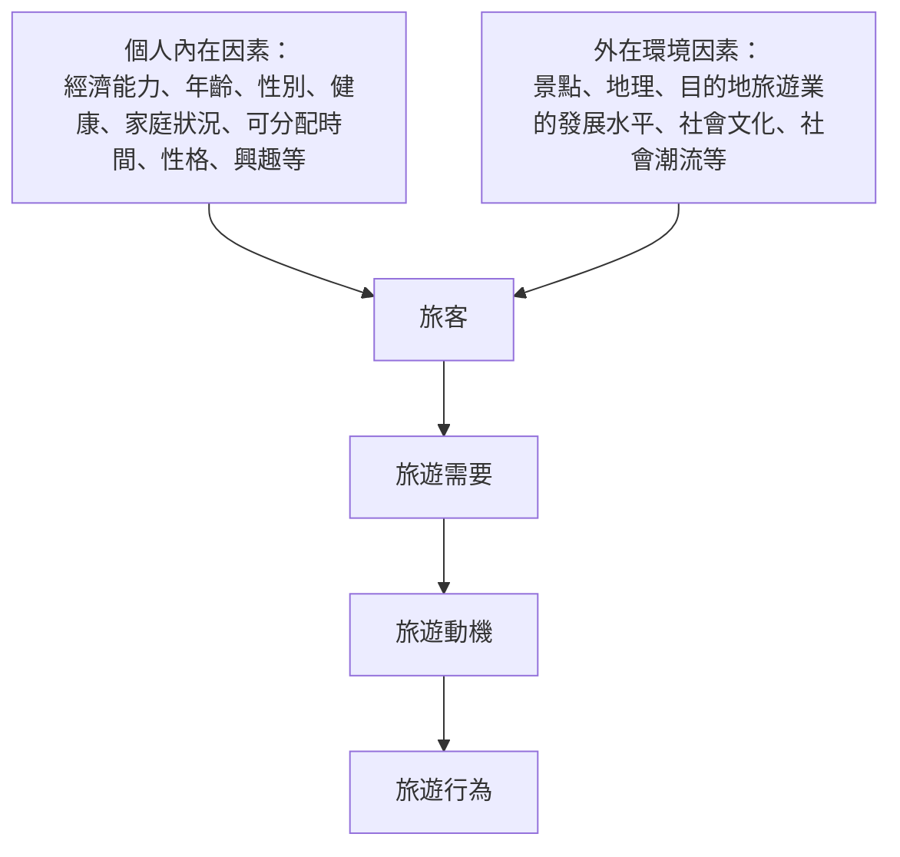
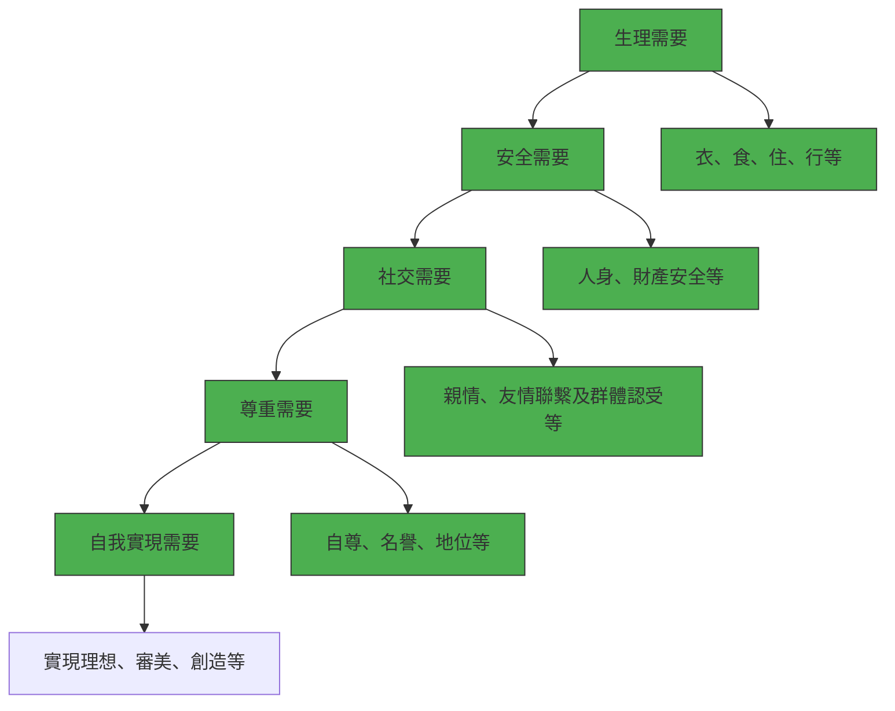
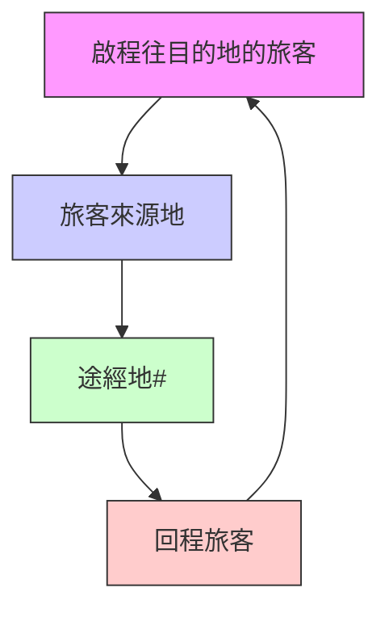

動機是指人們由於生理或心理的需要，引發個人從事某種行為的驅動力。旅客展開各種旅遊活動前，都必然有動機驅使他們作出旅遊行為。

# 3.1 旅客的旅遊動機

# 甚麼是旅遊動機？

旅遊動機是推動一個人作出旅遊行為的內部原動力。當人的內心產生旅遊需要，而在客觀條件許可下，為了滿足生理及心理需要，動機就會驅使人們從事旅遊活動。

綜合不同學者的看法，旅遊動機類型大概分為以下四類：

<table><tr><td>旅遊動機類型</td><td>要點</td></tr><tr><td>生理誘因</td><td>放鬆身心,參與運動,遊憩娛樂活動,及其他與健康有關的誘因。</td></tr><tr><td>文化誘因</td><td>想了解其他地區的欲望,如某些地區的民俗、藝術、音樂、舞蹈和宗教等。</td></tr><tr><td>人際誘因</td><td>想認識新朋友,探訪親友,或遠離人群。</td></tr><tr><td>地位與聲望誘因</td><td>想受到重視、被注意、被欣賞及有好名聲。</td></tr></table>

# 旅遊動機的形成

旅客被驅使去滿足其旅遊需要時，他們清楚何種東西能滿足自己所需。旅客會了解目的地有何吸引之處，衡量該地景點能否滿足其需要。如能滿足所需，便可驅使旅客產生到該目的地一遊的意欲。

# 提示箱

如客觀條件（時間、經濟能力等）不允許，個人即使產生旅遊需要，也不會出現旅遊動機和行為。

# 影響旅遊動機的因素

在現實生活中，從出現旅遊需要到產生旅遊動機，再到旅遊行為，是一個複雜的過程。旅遊動機則在旅遊需要和旅遊行為之間，扮演着重要的中介角色。

即使人們有了旅遊需要，還必須具備相應的個人內在因素和外在環境因素；否則這種旅遊需求只會停留在心理上，不會轉化為旅遊動機，更不會成為真正的旅遊行為。

# A 影響旅客旅遊動機的個人內在因素

經濟能力：旅遊是一種消費行為，因此旅客的經濟能力會影響他們對旅遊產品的選擇。當個人的收入越高，其旅遊意欲越大，旅遊次數及消費力也越高 。

# 例子庫

• 收入較高的人士，他們負擔外出旅遊開支的能力較高，會偏好選擇質素較好但費用較高的旅遊產品，並較多參與長途旅遊。  
• 收入較低的人士，他們負擔外出旅遊開支的能力較低，會偏向選擇交通開支及生活指數較低的國家或地區。

年齡、性別、健康與家庭狀況：不同年齡、性別、健康與家庭狀況的旅客，旅遊的目的和對旅遊的期望等各有不同。

# 例子庫

• 年輕人大多較年長者喜歡冒險及參與刺激的活動，年長者則較傾向悠閒的旅遊活動。  
• 女性普遍較男性喜歡購物旅遊，會希望在行程中有較多購物點及購物時間。  
• 身體較差的人士，旅遊目的地和環境的限制較多，如不宜前往青藏高原等高海拔地區、空氣質素差的城市。  
• 有孩子的家庭大多會選擇前往治安及衞生情況較佳的城市，如新加坡、東京等，並會安排有主題公園的行程。

可分配時間：旅客在日常生活、工作、學習等以外享有的可分配時間，其長短會左右旅客選擇旅遊目的地與旅遊產品。當個人擁有的空閒時間和假期越長，其旅遊意欲便較大，旅遊次數也較多，亦可到距離較遠的地方遊覽。

# 例子庫

• 生活在勞工假期較少國家或地區的民眾，大多只能選擇短途旅遊。  
• 生活在勞工假期較多國家或地區的民眾，可選擇長途的旅遊。

性格與興趣：旅遊動機屬於一種心理活動，其產生必然受到旅客性格、興趣、生活態度等方面的影響。

# 例子庫

• 有些旅客性格保守，並喜歡歷史文化，會傾向到訪羅馬、西安等歷史名城。 C  
• 有些旅客愛好冒險，並喜歡自然環境，會到亞馬遜森林、北極等地方探險。  
有些旅客樂於與不同文化背景的人士進行文化、價值觀、生活方式的交流，會喜歡到訪原始部落。

# B 影響旅客旅遊動機的外在環境因素

景點與地理：景點是令旅客心儀而且決定前往的原因，是旅客到訪的旅遊動機。如景點的知名度及質素高，對旅客相對吸引。另外，目的地是否擁有優越的氣候條件，以及目的地的位置與旅客居住地的距離，亦會影響旅客的旅遊動機。

# 例子庫

• 有些旅客傾向前往沿海風景區，或擁有歷史古跡的旅遊目的地。  
• 有些旅客不喜歡乘搭長途飛機或長途巴士，會選擇前往航班飛行時間較短及擁有完善鐵路系統的城市。

目的地旅遊業的發展水平：目的地的交通基建、住宿餐飲、通訊設施、服務和法制水平，以及入境簽證、外匯管制等，是否符合旅客的要求，會影響旅遊動機的產生。

# 例子庫

• 日本東京、大阪航空交通方便，旅遊設施完備，吸引不少香港旅客每年前往旅遊。  
一些非洲國家的交通基建、住宿餐飲等，未符合多數香港旅客的要求，因此較少香港旅客前往。

社會文化：旅遊目的地的社會文化，如文化開放程度、生活方式、風俗、宗教禁忌等，亦會影響旅客選擇是否前往旅遊。

# 例子庫

伊朗等一些信奉伊斯蘭教、民風保守的國家，會要求女遊客在公眾場合必須配戴頭巾，而不論男女遊客，都不可穿短褲，令部分旅客卻步。

社會潮流：社會潮流也會影響人們的旅遊動機。例如網絡紅人、電視旅遊節目的推介，親友、同事的旅遊經歷分享，都可能會促使人們產生旅遊動機。

# 例子庫

• 受韓流文化影響，近年不少香港旅客選擇到南韓旅遊。

# 「旅遊需要—動機—行為」的形成過程示意圖

flowchart

# 赫曼的旅遊動機模式

學者赫曼（Hudman）歸納出旅客九項不同的旅遊動機，用來解釋其旅遊行為：

<table><tr><td>旅遊動機</td><td>要點</td><td>例子</td></tr><tr><td>好奇心</td><td>人們對不同地區的人文資源、自然奇觀產生興趣,為了滿足自己的好奇心、求知欲或冒險精神而旅遊。</td><td>參觀原始部落、觀賞極光、進行極地探險等</td></tr><tr><td>健康</td><td>人們在繁囂或煩悶的日常生活中,希望透過旅遊活動,促進身心的健康。</td><td>閒暇旅遊、度假療養、文化旅遊等</td></tr><tr><td>運動</td><td>人們藉旅遊時參與運動或現場觀看大型賽事,以減輕生活壓力,結交志趣相投的新朋友。</td><td>參與滑雪、潛水等運動,到現場觀看英格蘭足球聯賽等</td></tr><tr><td>快樂</td><td>人們藉旅遊時嘗試和享受日常生活以外的新事物,以打破刻板的生活,尋求開心的體驗。</td><td>到主題樂園玩、觀賞馬戲表演、參與賭博等</td></tr><tr><td>宗教信仰及精神審美</td><td>人們藉參加宗教活動、前往宗教聖地,或透過欣賞自然景觀、歷史文明和觀賞藝術表演、美術館展品等,以獲得心靈上的滿足。</td><td>宗教朝聖之旅、參觀歷史遺跡、觀賞歌舞劇等</td></tr><tr><td>專業及公商務</td><td>人們因工作或洽談商貿而進行各種商務及公務旅遊,又或因參與學術會議、科學考察、遊學團等而到外地旅遊。</td><td>商務會議、學術交流團等</td></tr><tr><td>親友交往</td><td>人們藉探訪親戚朋友,以表達對家人及朋友的關懷,以及連繫感情。</td><td>回鄉探親和研究族譜、出席海外婚禮等</td></tr><tr><td>尋根</td><td>人們為了尋找家族的根源、認識家鄉和祖國的歷史文化等而旅遊。</td><td>尋根旅遊、國情交流團等</td></tr><tr><td>自我/尊重的需求</td><td>人們希望透過旅遊得到其他人的尊重和羨慕,以展示其社會地位;或藉旅遊以滿足其自我心靈的價值。</td><td>環球之旅、禪修之旅等</td></tr></table>

# 馬思勞的需求理論

學者馬思勞（Maslow）把人們的心理需要劃分為五個不同層次。根據其理論，當基本需要得到滿足，人們才會追求更高層次的需要。

# 提 箱

馬思勞的「需求層次理論  

flowchart

一般而言，當人們的生理需要、安全需要得到滿足後，才能出現旅遊動機，並引起旅遊行為，以實現社交需要、尊重需要及自我實現需要。因此，旅遊本身是一種能滿足高階需要的行為。

# 資料室

# 生理需要與安全需要

生理需要：是人類維持自身生存和延續生命的最基本需要，也是級別最低的需要，包括對食物、水、氧氣、睡眠、居所、避寒，以及衣、食、住、行、性愛等方面的需要。如果這些需要得不到滿足，人的生存就會出現問題。

安全需要：是人類希望保護自身肉體和精神不受傷害，確保生活在安穩環境的需要，例如對健康、工作、財產的安全和避免疾病侵襲、意外事件發生等的需要。當一個人的生理需要得到滿足後，便希望滿足安全需要。

根據「需求層次」理論，旅遊動機的出現可從社交需要、尊重需要和自我實現需要三個高階層次進行分析。

<table><tr><td>層次</td><td>旅遊動機</td><td>例子</td></tr><tr><td>自我實現需要</td><td>希望實現個人的理想和抱負,充分發揮自己的潛能,挑戰自我,以及追求審美、創造、成就的需求。</td><td>·進行環球旅行,完成到世界七大洲觀光的目標。
·到外地拍攝雪山、極光等自然風景的照片。</td></tr><tr><td>尊重需要</td><td>希望得到別人的尊重,獲得滿意的地位,以及有應得的人身權利、名譽、威望,以提高個人自信和成就感。</td><td>·到法國巴黎觀光購物,讓別人認同個人的經濟能力和生活品味。
·旅遊業界設立獎賞計劃,劃分不同級別會員,給予會員尊貴地位。</td></tr><tr><td>社交需要(歸屬感和愛的需要)</td><td>包括歸屬感的需要和愛的需要。歸屬感的需要是指每一個人都希望在群體內能得到承認、接納、重視,以及關懷或支持。愛的需要指每一個人都希望與朋友、同事達致融洽或友愛的關係,能愛別人及被愛。</td><td>·到外地探望親友,或與親友一同旅遊,以聯繫感情。
·到異地旅遊,結交不同國籍和志同道合的朋友。</td></tr></table>

# 活動站

# 旅行團中的「需求層次」

試從以下的「台北—宜蘭」旅行團行程表中，找出各項安排如何滿足旅客的「需求層次」。

# 第一天

香港 ✈ 台北─宜蘭─鵝山茶園有機體驗農埸\~採茶體驗

午餐：航機上；

晚餐：田園茶餐；

住宿：台北四星級酒店。

# 第二天

「斑比山丘」梅花鹿園區─明池國家森林遊樂區（須轉乘景區內接駁車往返）

早餐：酒店內；

午餐：宜蘭風味；

晚餐：山林饗宴。

# 第三天

棲蘭神木生態之旅（全程專人導覽）─貔貅展示館─台灣伴手禮專賣店─鳳梨酥DIY─寧夏夜市

早餐：酒店內；

午餐：養生五行餐；

晚餐：/；

住宿：台北四星級酒店。

# 第四天

山地特產中心─南門市場─珍珠養殖中心─士林官邸─台北✈ 香港

早餐：酒店內；

午餐：/；

晚餐：航機上。

# 6 丹恩的推拉理論

學者丹恩（Dann）提出推拉理論，說明旅遊動機與行為受到「推動因素」及「拉動因素」所影響。

「推」、「拉」因素將旅客的旅遊動機和行為分成兩種力量，「推」是決定是否要去，而「拉」是決定要去哪裏。就時間性而言，旅客先有了「推」的因素，才會受「拉」的因素所影響。

# 推動因素與拉動因素示意圖

# 推動因素

包括心理因素（放鬆身心、個人興趣、冒險意欲、休息、逃避、社交需要、健康需要、自尊、優越感等）、個人因素（年齡、體能、性別、收入、家庭等）。

# 拉動因素

包括目的地的特色（景物、氣候、地理環境、政治環境、經濟環境、安全、社會文化、活動等）、設施、交通、服務質素、潮流、形象等。

natural_image

Illustration of two children walking with backpacks, separated by a large hand (no text or symbols)

natural_image

Illustration of a U-shaped magnet with magnetic field lines indicating current direction (no text or symbols)

# A 推動因素

「推動因素」是旅客一種無形的、內在的旅遊欲望，旅客為了滿足個人的願望而產生旅遊動機，並決定採取旅遊行動。不過，在「推動因素」影響下，旅客即使有了旅遊動機，也並不一定已具有明確的旅遊決策。

# 例子庫

旅客希望去一趟温泉之旅，以舒緩生活壓力，促進健康。但該名旅客未必已選定了目的地，任何有温泉的旅遊目的地，而符合其經濟能力、分配時間等，都可以成為其選擇地。

# B 拉動因素

「拉動因素」指影響旅客選擇旅遊目的地的因素，是一種外在的景點特質。當旅客從各種途徑得知旅遊目的地的特色，再根據對目的地的了解，會被目的地吸引，最終作出到當地旅遊的明確選擇。

# 例子庫

對新婚夫婦打算到有陽光與海灘的地方度蜜月，他們在聽取朋友的分享和查看旅遊網站後，被環境優美的印度洋島國馬爾代夫吸引，最後選擇了馬爾代夫作為度蜜月的目的地。

natural_image

Beach scene with two lounge chairs under a white umbrella, palm trees and a blue sky in the background (no text or symbols visible)

▲ 圖1.27 水清沙幼的馬爾代夫吸引不少新婚夫婦到當地度蜜月。

# 3.2 旅客流量

# 旅客流量的概念

「旅客流量」指在某一段時間內進入或離開某目的地的旅客人數和流動模式。

flowchart

圖 1.28  
#途經地是指前往目的地的時間和路經的中轉地方。

# 提示箱

蒐集旅客流量的方法有：

1.於邊境口岸進行調查；  
2.收集旅客抵港申報表；  
3.紀錄旅客出入境紀錄。

「旅客流量」可為旅遊業界提供規模、方向、時間三項重要的指標。

• 規模：到訪旅客的人數，包括不同類型的旅客人數（如性別、年齡、旅遊目的等）。  
方向：旅客流動的方向，即前往的旅遊目的地（如來源地、中轉旅客等） 。  
時間：旅客流動的時間，即流動的規律（如逗留時間、旺季和淡季到訪情況） 。

# 提示箱

「旅客流量概念下的行程模式」請參附錄頁271。

# 旅客流量的作用

監察旅客流量，可知道旅客數目的升跌情況、旅客出遊的模式，以及對旅遊產品的需求。這有助旅遊業界預測未來旅客數量及分辨旅客來源地，並為未來旅遊業作出規劃和發展足夠的設施，也能協助相關部門向具潛力市場推廣本地旅遊業。

# 影響旅客流量的因素

# A 地理位置與可達度

旅遊目的地的位置與旅客居住地的距離、交通時間、交通費用、體能需要等有直接關係。距離較近的目的地，交通時間較短、費用較便宜、地理氣候較接近，會有較多人考慮前往。

旅遊目的地的可達度，即交通便利情況，如擁有完善的機場、鐵路、公路網絡，無需轉乘交通工具即可往來，也會影響旅客是否前往當地。

# 例子庫

東南亞地區與香港的距離較中亞地區近，香港旅客前往的直航航班選擇較多，航機費用也較低，因此較多香港旅客前往東南亞地區。至於前往東南亞的香港旅客中，較多選擇交通基建較完善的泰國、馬來西亞，交通基建有待發展的柬埔寨、越南，則相對較少旅客前往。

text_image

緬甸
老撾
香港
泰國
柬埔寨
越南
菲律賓
馬來西亞
汶萊
新加坡
印尼

▲ 圖1.29 香港到東南亞各國航班只需約2至4小時

# B 旅遊目的地特性對旅客的吸引力

旅遊目的地的自然環境（天然景點、氣候）、經濟環境（富裕程度、通訊設施）、文化環境（歷史景點、風俗習慣、宗教）、旅遊設施（酒店、娛樂場所、旅遊人才）等，均影響旅客的流量。擁有優越而獨特環境和設施的地方，會成為旅客嚮往的地方，因為旅客會期望得到不同於居住地的體驗。

# 例子庫

旅客較傾向前往擁有優越旅遊資源的地方（如沿海風景區、歷史景點等）。因此，中國、泰國、意大利、西班牙等旅遊資源豐富的國家，每年都吸引大量旅客前往。

# C 政治、商貿、文化、宗教的聯繫

兩地政府在政治、商貿上聯繫緊密，入境簽證、外匯管制等會較寬鬆，人員的往來亦會相對頻仍，整體旅遊活動也會較頻繁。另外，兩地在文化背景、語言、宗教上相同，旅客在當地會較易適應，前往的動機較高。

# 例子庫

美國和加拿大國土相鄰，政治、商貿聯繫緊密，文化、語言相近，兩國之間的旅遊活動因而十分頻繁。  
穆斯林只要有能力，生要到聖城麥加朝覲次，因此各地均有大量穆斯林前往當地作宗教旅遊。

text_image

ARCTIC
OCEAN
North Marjorie
Buenos Aires
Cairoo de Santa Cruz
Toronto
Buenos Aires
Cairoo de Santa Cruz
Toronto
Buenos Aires
Cairoo de Santa Cruz
Toronto
Buenos Aires
Cairoo de Santa Cruz
Toronto
Buenos Aires
Cairoo de Santa Cruz
Toronto
Buenos Aires
Cairoo de Santa Cruz
Toronto
Buenos Aires
Cairoo de Santa Cruz
Toronto
Buenos Aires
Cairoo de Santa Cruz
Toronto
Cairoo Aires
Cairoo de Santa Cruz
Toronto
Cairoo Aires
Cairoo de Santa Cruz
Toronto
Cairoo Aires
Cairoo de Santa Cruz
Toronto
Cairoo Aires
Cairoo de Santa Cruz
Toronto
Cairoo Aires
Cairoo de Santa Cruz
Toronto
Cairoo Aires
Cairoo de Santa Cruz
Toronto
Cairoo Aires
Cairoo de Santa Cruz
Toronto
Cairoo Aires

圖 1.30 美國和加拿大地理上國土相鄰，人員往來頻繁。

# D 收入水平與旅遊開支

旅客需要利用其收入購買旅遊產品和服務，因此收入的多寡會影響一地的整體旅客外遊數目。收入水平較高的國家和地區，旅客外遊活動會較活躍，並通常較多流向生活指數較低的地區；收入水平較低的國家和地區，旅客外遊活動相對較沉寂。

匯率、消費稅等的變動，同樣影響旅客的流量。當一地貨幣貶值，到訪旅客的購買力相對提高，會吸引更多旅客前往旅遊。相反，當一地貨幣升值，並提高消費稅，到訪旅客的購買力相對下降，旅客前往的意欲亦會減低。

# 例子庫

• 改革開放以來，國家經濟快速增長，民眾收入水平不斷上升，內地旅客外遊的人數也持續增加。  
‧ 日本政府於 2019 年調高消費稅至 10%，加上日元匯率上升，便打擊了外地旅客前往當地旅遊消費的意欲。

# E 社會穩定與區內競爭

一地如社會局勢不穩定，治安情況欠佳，或出現恐怖主義襲擊，以及爆發重大公共衞生事件，均會令旅客卻步，流量因而減少。

鄰近旅遊城市的競爭，包括增建旅遊設施、提升旅遊產品及服務質素、加強旅遊推廣等，會吸引更多旅客前往，從而攤薄當地的客源，導致旅客流量減少。

圖 1.31 呼籲孕婦不要到寨卡病毒（Zika）地區的宣傳板  

# 例子庫

南美洲於 2015 至 2016 年爆發寨卡病毒，受症情影響，部分旅客取消在2016年到巴西觀看奧運會的行程。  
‧ 近年，鄰近香港的澳門、新加坡等城市，大力發展旅遊業，對香港旅遊業造成一些挑戰。

text_image

Pregnant?
Don't travel to Zika areas.
KNOW ZIKA VIRUS.
health.ny.gov/zika
OUTFRONT
B-3060

# F 旅遊文化與民眾質素

一地提供的旅遊服務水平，以及民眾的質素和對待旅客的態度，也會影響旅客的流量。由於旅客會期望得到良好的旅遊體驗，當地如能提供優質的旅遊服務，加上民眾質素較高，對待旅客親善、誠實，對旅客的吸引力較大；相反，一地的旅遊服務水平低下，民眾質素較低，對待旅客無禮，甚至欺詐旅客，會令旅客反感，導致旅客流向其他地方。

# 例子庫

泰國擁有熱情好客的旅遊文化，不少旅客在當地得到良好的旅遊體驗，盡興而歸，使泰國成為全球其中一個最受歡迎的度假旅遊勝地。

# G 旅遊潮流與旅遊推廣能力

旅遊需求容易受到旅遊潮流的影響。一些旅遊目的地在潮流文化影響下，在某一段時期很受旅客歡迎，旅客流量會出現大幅增長，其他旅遊目的地的受歡迎程度則相應下降，旅客流量隨之減少。

旅遊業的發展，可為當地創造更多就業職位，並推動當地經濟發展，因此不少旅遊目的地為了吸引旅客到當地觀光，會投入大量資源於旅遊推廣，為當地建立旅遊勝地的形象，刺激旅客流量增長。

text_image

KSTAR ROAD
GANG NAM

▲ 圖1.32 位於韓國首爾江南的K StarRoad

# 例子庫

近年韓國潮流文化興起。有見及此，韓國旅遊當局加強向各地推廣韓國旅遊業，又邀請影視明星擔任旅遊大使，令不少東亞、東南亞等地民眾嚮往到韓國旅遊，到當地觀光的旅客人數因而大增。

旅遊規劃對於成功的旅遊發展和管理是不可缺少的。世界各地旅遊區的經驗已經證明，研究和規劃旅遊產品和目的地，有助我們更好地利用旅遊資源，從而延長旅遊產品的生命週期，促進旅遊目的地的合理開發和保護，令目的地均衡而可持續地發展。

# 4.1 旅遊產品的規劃

# 旅遊產品

旅遊產品是一種組合性的產品，指旅遊企業在旅客的旅遊消費過程中，所提供的食、住、行、遊、娛、購等各種服務，由交通運輸、住宿服務、餐飲服務、旅遊景點、旅遊設施、旅遊服務、旅遊購物、娛樂活動等構成。

旅客會根據他們感覺中的服務質素，在不同旅遊企業提供的旅遊產品中，選購合適他們的產品。因此，旅遊企業必須規劃符合旅客期望的產品，提高旅客的滿意程度，以增加旅客選購產品的意欲。

text_image

交通運輸（行）
住宿（住）
購物（購）
景點（遊）
餐飲（食）
娛樂（娛）

▲ 圖1.33 旅客在旅遊消費過程中的六大服務需求

# 旅遊產品的特性

旅遊產品具有無形性、生產與消費不可分割性、差異性、不可保存性、互補性及替代性、不可擁有及不可轉移性、需求與價格不固定性、不確定與風險性的特性。這些特性均會對旅客選購產品的行為產生影響。

# A 無形性

旅客選購旅遊產品的目的，是為了無形的效益，例如放鬆心情、尋求快樂等。旅客享用旅遊產品時，如乘搭飛機、住宿酒店、參觀景點等，並不能把這些有形的東西帶走，他們得到的只有旅遊帶來的體驗，以及腦海的回憶。

# B 生產與消費不可分割性

一般產品的生產與消費過程是分開的，即由製造商在甲地製造，再由銷售商在乙地銷售，供消費者購買使用。旅遊產品卻是在同一地點和時間，完成生產與消費。因為旅遊業界向旅客提供服務時，正是旅客消費服務的時刻，兩者同時存在和發生。

# 例子庫

當航機飛行時，航空公司的機師和服務員正在提供航空運輸服務，而旅客在同時消費和享用有關服務，可見旅遊產品的生產和消費無法分開。

natural_image

Interior of an airplane cabin with flight attendant serving food to seated passengers (no visible text or signage)

▲ 圖1.34 機艙服務員的生產與旅客的消費不可分割

# C 差異性

由於旅遊的生產和消費具有不可分割性，因此旅客必然會介入整個服務的生產過程，成為服務的核心。這讓旅遊業界與旅客之間的互動關係更為密切，而這種互動關係更會直接影響產品的服務水平，導致同一個旅遊產品之間存在很大的差異。

即使旅遊業界為服務人員訂明在不同服務場合的行為標準，但是員工的工作經驗、工作態度、性格情緒各有不同，使產品的服務質素容易受到各種環境因素影響而出現變動，難以一致。

旅客的性格、背景、喜好、旅遊目的等各異，他們在享用旅遊業界提供的同一服務時，觀感和滿意度亦會出現差異。

# 例子庫

• 酒店員工在接待有小朋友的家庭旅客時，與接待一對情侶住客時，向他們解說酒店的設施重點會有所不同，前者可能接收較多兒童設施資訊，後者可能接收較多健身設施資訊。前者如首次入住，可能會有興趣了解，後者如已多次入住，可能會對講解感到煩厭。

text_image

LAST MINUTE
SEND
CHANGE
DESTINATION CHECK ON CHECKOUT

▲ 圖 1.35 正在預訂「最後一刻訂房」的旅客

# D 不可保存性

旅遊產品不能像實物產品般，可提前製造出來，或先儲存起來，待日後再出售。它是無法儲存的，容易造成產品的供給和需求無法配合的現象，具有不可保存性。

# 例子庫

• 酒店的客房如沒有旅客入住，當晚便失去銷售的機會，酒店不能把當天空置的客房留待旅遊旺季才出售。近年，越來越多酒店預約網站在淡季時，提供「最後一刻訂房（Last MinuteBooking）」功能，用優惠價格吸引更多顧客入住，以提高酒店的入住率。  
‧ 主題公園的門票如沒有旅客購買，當天便失去銷售的機會，主題公園不能把當天的門票留待應付明天的旅客。

# E 互補性及替代性

旅遊由食、住、行、遊、娛、購等活動組合而成。一般而言，旅客每次旅遊都需要選購由不同旅遊業界提供的旅遊產品。雖然這些產品並非由同一機構提供，但各產品之間卻互相連繫，具有互補性。當一個旅遊產品出現問題時，往往會影響其他旅遊產品。

# 例子庫

• 當航空公司的員工舉行罷工，導致航班取消，旅客未能到訪目的地，當地酒店、餐飲及景點的收益就會減少。

不少旅遊產品同時具有替代性。當旅客不滿意原有的旅遊產品，他們往往可以轉為選購其他旅遊產品。

# 例子庫

• 當某汽車租賃公司的服務欠佳，汽車質素未如理想，旅客會尋找另一間汽車租賃公司，替代原本的公司。

# F 不可擁有性及不可轉移性

旅客在選購旅遊產品時，只可使用該服務及設施，在過程中沒有產品的擁有權。即使產品服務結束後，也不具有產品的擁有權及轉移權。這不同於選購了其他有形的產品後，擁有了該產品，並可把它轉交其他人使用。

text_image

AIR TICKET
AIRLINE
PASSenger
Moria Smith
DATE: 34
DEPARTURE
6:45 23 FEB 2017
MARATHING TIME
6:30
PASSenger
Moria Smith
DATE: 34
DEPARTURE
FL589
DESTINATION
NYC TO SEA
BUSINESS CLASS
AIRLINE
BUSINESS CLASS
AIRLINE
Sue Airl to
Germany
11 Jul is
(1 pm)
not in the

# 例子庫

旅客選購了機票及乘搭該航班，只能使用由一地搭載到另一地的服務，中途不可轉予他人使用，航班到達後亦不再擁有任何東西。

圖1.36 機票具有不可轉移性

# G 需求與價格不固定性

旅遊產品的需求與價格經常受到淡旺季、經濟環境等因素影響。當需求高於供應時，價格很多時會大幅調高；當需求遠低於供應時，價格便會大為下降。

# 例子庫

香港旅遊業旺季時，酒店一般會調高價格。受 2019 冠狀病毒病疫情影響，2020年訪港旅客大幅減少，各酒店紛紛調低價格，以吸引本地旅客入住。

# H 帶有不確定與風險性

旅遊產品都是先購買，後使用。旅客往往無法預計使用時的情況，有時可能受到天氣、意外等影響，導致產品服務未能符合預期，甚至最終未能如期享用服務。

# 例子庫

旅客選購入住附有泳池的酒店，本來打算在酒店泳池游泳，可是由於雷暴警告的關係，酒店方面要關閉泳池，以致旅客未能使用設施。  
‧ 旅客預訂了演唱會門票，可是當日路上發生交通意外，造成行程受阻，未能準時到達演唱會場地，觀看偶像的演出。

text_image

P
S
NO
SWIMMING
0 M

圖 1.37 酒店泳池開放帶有不確定性

natural_image

Man in blue shirt talking on phone while another man is on a red car in the background (no visible text or symbols)

圖1.38 交通意外造成不確定性 ▲

# 4.2 旅遊產品規劃概念

旅遊產品在不同發展階段，需因應不同的情況運用相應的策略作規劃，而產品生命週期是一個常用的規劃概念。

# 產品生命週期與特點

產品生命週期（PLC, Product Life Cycle）指新產品由投入市場到被市場淘汰的整個過程，是一個市場學概念，現在經常用來解釋服務業和旅遊業產品。產品生命週期一般可分為四個階段：引入期、成長期、成熟期、衰退期。

line

產品生命週期
| 階段 | 營業額 |
| :--- | :--- |
| 引入 | 0 |
| 成長 | 楼 |
| 成熟 | 楼 |
| 衰退 | 楼 |

圖 1.39

產品生命週期各階段的特點

<table><tr><td>特點\階段</td><td>引入期</td><td>成長期</td><td>成熟期</td><td>衰退期</td></tr><tr><td>成本及投入資本</td><td>成本非常高,要投入大量資本於市場開發和促銷</td><td>市場開發逐漸完成,產品在市場站穩陣腳,成本下降</td><td>市場發展成熟,產品標準化及大量生產,成本進一步下降</td><td>產品已在市場老化,效益下降,成本上升</td></tr><tr><td>銷售額</td><td>銷售額低</td><td>銷售額快速增大</td><td>銷售額高,但增長放緩,甚至趨於平穩</td><td>銷售額不斷下跌</td></tr><tr><td>市場競爭</td><td>競爭者少,甚至沒有競爭者</td><td>少量競爭者進入市場,產品價格可能下調</td><td>更多競爭者加入,競爭加劇,價值可能再下調</td><td>企業可能會因為無利可圖而退出市場,競爭減少</td></tr><tr><td>市場需求</td><td>產品吸引力低,銷量有限</td><td>市場需求大幅增長,銷量急增</td><td>市場需求趨向飽和,需要提高產品質素,以維持市場佔有率</td><td>市場萎縮,產品不再適應市場需求,銷售量下降</td></tr><tr><td>顧客接受程度</td><td>顧客對產品還不了解,接受程度低,只有少數嘗試新事物的顧客</td><td>顧客逐漸接受產品,購買者越來越多</td><td>顧客熟知產品,購買者增多,但市場有更多選擇</td><td>顧客消費習慣改變,逐漸摒棄產品,轉為購買其他新產品,購買者多為對市場慢熱的後隨者</td></tr><tr><td>盈利</td><td>通常未有盈利,甚至虧損</td><td>開始有盈利,盈利迅速增長</td><td>盈利到頂,甚至可能開始下降</td><td>盈利持續下跌,甚至虧損</td></tr></table>

產品生命週期還有以下特點：

• 各個階段的起點和止點的劃分標準不容易確認。  
• 不是所有產品的生命週期曲線和時間性都是相同的，在不同的環境因素影響下，有些產品在某個階段的時間會延長或縮短。  
• 產品衰退並不表示無法重生。如透過適當的商業策略，產品可能會出現新的生命週期。

# 旅遊產品的生命週期

基本上，產品生命週期的典型演變階段「引入期 - 成長期 -成熟期 - 衰退期」，可用於描述旅遊產品的發展歷程。但為了對旅遊業各類產品由產生到終結的歷程作更準確的描述，學者Rusu與Sabau（2008）在「引入期」前加入「（產品）發展期」，成為「五個階段」的產品生命週期。

「五個階段」的產品生命週期  
  
圖 1.40

# A （產品）發展期

指旅遊產品由設計投產至投入市場前的階段。這個階段旅遊企業需投入大量資金，只有開支而沒有收入和盈利。

企業在此階段，需做好市場調查研究，了解旅客的需求，並確立產品的市場定位。

假如企業在此階段沒有做好規劃，在引入期便可能需要投入更多資金於產品宣傳推廣，甚至造成產品以失敗收場。

# B 引入期

旅遊企業在此階段需要花大量資金於產品宣傳推廣，以增加產品的知名度，吸引旅客購買。

# C 成長期

產品已在市場得到旅客認同，但同時面對一些競爭對手的加入。旅遊企業需要提升產品的質素，增加產品的特色，以搶佔市場，擴大市場佔有率。

# D 成熟期

產品獲大量旅客購買，但同時面對激烈的市場競爭。旅遊企業除了要維持顧客的忠誠度，亦要透過各種策略吸引新顧客。另外，企業需進一步提升產品的質素，以及為產品加添新元素，以延長產品的壽命。

# E 衰退期

產品日漸老化，旅遊企業需研究產品在市場的真實需求，以決定是否繼續經營，還是放棄經營。

如繼續經營，企業需降低旅遊產品的成本及價格，並增加產品的功能，甚至改造產品，為產品開拓新的市場，使產品得到重生，進入另一個產品生命週期。

text_image

Ocean
Hong Kong
Palmi

▲ 圖 1.41 香港海洋公園於 1977 年開幕，曾進行過數次改造工程，提升設施及吸引力。

# 4.3 旅遊目的地的規劃

旅遊目的地與旅遊產品一樣，都會經歷生命週期。對旅遊目的地加以規劃，有助目的地的平衡和長遠發展。

# 旅遊目的地生命週期

學者巴特勒（Butler）最先提出將產品生命週期應用到目的地的分析中。他認為旅遊目的地的生命週期，與旅遊產品的生命週期相似，但一般經歷六個階段，可稱為「旅遊目的地生命週期」。

旅遊目的地生命週期  

line

| 時間     | 旅客人數 |
| -------- | -------- |
| 發掘     | 將值     |
| 投入     | 將值     |
| 發固     | 將值     |
| 停滯     | 將值     |
| 停滯之後 | 將值     |
| 衰落     | 將值     |
| 重生     | 將值     |

圖 1.42

旅遊目的地在生命週期中的各階段，分別有以下特性：

<table><tr><td>階段</td><td>特性</td></tr><tr><td>發掘投入</td><td>目的地由旅客自行發現,當地尚未有計劃開發;尚未有旅遊設施;只有少量漫遊式或探險式旅客到訪;旅客被純自然特性吸引而到訪當地;目的地國家或地區社群所受影響很小,生活沒有多大改變。·到訪旅客增多,以探險式旅客為主;·當地居民與發展中的旅遊業保持有限度互動,並開始提供基本旅遊設施和服務予旅客,以賺取收入;·增加宣傳後,出現較明顯的旅遊季節性變化;·市場逐漸變得明確;·旅客對目的地國家或地區社群的正面和負面影響慢慢浮現。</td></tr><tr><td>發展</td><td>·當地開發更多旅遊設施和服務,並加強推廣工作;·當地的旅遊形象確立,旅客人數急劇上升;·目的地國家或地區社群需引入外來投資發展旅遊業,才能支持當地旅遊業發展,並保持增長趨勢;·外來企業對當地旅遊業的控制增加;·旺季旅客人數遠超過目的地國家或地區社群人數,導致部分當地人對旅客產生敵視;·旅客對目的地國家或地區社群的正面和負面影響日漸明顯。</td></tr><tr><td>鞏固</td><td>·旅客人數持續增加,但增長速度開始放緩;·旅遊業已成為當地經濟的重要部分,當地盡力去延長旅遊旺季;·旅遊設施和服務日益完善,具良好規劃的商業區成形,大部分由大企業提供;·本地的收益大多流向大企業,以及支援旅遊業的進口產品和服務;·旅遊業發展為目的地國家或地區社群帶來的社會和文化衝突出現,旅客和當地人甚至出現對立的情況,但不常見。</td></tr><tr><td>停滯</td><td>·旅客人數已達到最高點,增長速度大為放緩;·各項設施逐漸老化,對旅客吸引力下降;·當地需持續進行推廣工作,以保持目的地的良好形象,維持旅客數量;·目的地國家或地區社群對旅客的不滿進一步增加,雙方對立的情況不時出現。</td></tr><tr><td>停滯之後</td><td>·旅客人數減少,市場開始減退,旅遊收益下跌;·當地需加強推廣工作,才能避免設施空置;·當地到了「重生」及「衰落」的十字路口,需當地管理層決策和選擇:·「重生」:為目的地重新定位,作新的投資,更換設施和服務,吸引旅客重投當地,令旅客人數再次增長;·「衰落」:變革未能成功吸引旅客,當地旅遊業形象進一步下降,旅客人數持續減少,旅遊業職位流失。</td></tr></table>

# 規劃在旅遊目的地發展方面的作用及重要性

旅遊目的地生命周期作為了解旅遊目的地演變的工具，可為旅遊目的地採取長遠規劃提供指示。世界各地成功和失敗的旅遊區經驗，證明了對目的地進行全面的規劃是不可或缺的。

採取良好的規劃，可平衡當地在經濟、社會、文化、環境等方面的發展，使當地持續成為一個令旅客滿意的觀光區，而且不會對當地社群產生嚴重的負面影響。

規劃對旅遊目的地的作用和重要性主要包括以下數項：

# A 定下目標及提高效率

• 規劃能幫助目的地建立旅遊業的整體發展目標和政策，融入國家或地區的整體發展策略，讓當地旅遊業明白要實現甚麼目標，以及如何實現目標。  
• 規劃能為公營和私營旅遊業界提供決策的合理基礎，促進業界的有效協調，並提高當地旅遊業的管理效率。

# B 協調旅遊業均衡發展

• 旅遊業的發展

展，包括旅遊

以及人力資源

把各持份者連

確保他們的參

投入互相配合

支持目的地旅

遊業的運作。

text_image

展需要不同元素的協調發
景點、設施、服務，
原等，規劃可以
繫起來，
與和
，
底

▲ 圖1.43 旅遊業需要協調均衡發展

• 旅遊業的組成涉及多個行業，規劃可避免「一窩蜂式」的發展，造成資源的大量浪費，以及個別行業的惡性競爭，為目的地旅遊業帶來負面影響。  
• 規劃能為目的地的各項設施和服務建立指引與標準，讓各公營和私營旅遊業界跟從，從而提高設施和服務的一致性及質素。

# C 調和社會的整體利益

• 規劃能平衡和優化旅遊目的地的經濟、社會和環境效益，並使這些效益公平地分配給當地社群，避免效益僅流向旅遊企業。  
• 規劃有助減少旅遊業帶來的各種負面問題，盡量降低對當地社群的影響。

natural_image

Exterior view of the Ruins of St. Paul's in Macau under a clear blue sky, featuring historic stone architecture and surrounding greenery (no signage visible)

圖 1.44 澳門歷史城區於2005年獲列入聯合國《世界文化遺產》名錄。

# D 達致可持續的長遠發展

• 規劃能為目的地旅遊業發展建立所需的組織和架構，可為有效實施發展目標和政策，以及持續的管理奠定基礎。  
規劃能為目的地的旅遊業建立持續監測的基礎，確保社會、文化、環境等資源的可持續發展。

# 例子庫

澳門特別行政區政府旅遊局經歷兩年研究及編制，於 2017 年公布《澳門旅遊業發展總體規劃》，制定了澳門短、中、長期旅遊業發展藍圖和行動綱領，以配合國家「一帶一路」的倡議及澳門建設「世界旅遊休閒中心」的願景。

沒有規劃的旅遊目的地，往往會出現當地無法承受的環境和社會問題，不符合當地社群的利益，同時會影響旅客的旅遊體驗，導致目的地無法保持競爭力。雖然這些目的地可以通過規劃來重新發展，但是目的地的形象已受損，並需要花費大量的資金和時間作投資。

# 例子庫

菲律賓的知名度假區長灘島，因欠缺規劃，加上旅客和外來人口急增、開發過度等原因，導致旅遊相關活動嚴重污染當地環境，於2018年被菲律賓政府勒令封島半年進行改善工程及整頓行業，包括興建排水、垃圾處理設施，拆除林地和濕地上的建築物，完善交通網絡等，以期島嶼能夠成為可持續的旅遊景點。

# 4.4 旅遊目的地承載力與旅遊規劃

旅遊目的地規劃和發展旅遊業後，需付出一定的代價。當旅客超出當地的承載力時，便會為各方面帶來負面影響。因此，認識承載力的概念與相關的旅遊規劃是重要的。

# 提示箱

承載力沒有精確的科學定義，所以設定旅客數量限制只能作為一種指引。

# 甚麼是承載力？

承載力又稱旅遊容量，指一個旅遊目的地在不會導致當地實際環境出現不可接受的變化、不會導致旅客體驗的品質出現不可接受的下跌的大前提下，在某一時段內可以容納的最高旅客數目。

有研究發現，當旅客的數量和活動超出旅遊目的地的承載力，會影響當地對旅客的吸引力，甚至打擊旅客的到訪意欲，妨礙旅遊業的可持續發展。

# 資料室

# 承載力問題的出現

以下情況會造成承載力的問題：

旅客目的地太受歡迎。一些旅遊目的地，例如北京故宮、巴黎羅浮宮等，每天都吸引大量旅客到訪，面臨巨大的使用率壓力。  
旅客到訪時間集中。例如不少國家或地區都有復活節、聖誕節，或農曆新年等公眾假期，於是旅客外遊需求便集中在這些時段，導致不少旅遊目的地出現承載力問題。  
過境路線或中途站出現樽頸現象。例如珠江三角洲、長江三角洲每逢長假期，會有很多自駕遊旅客出行，而當地的道路交通系統無法負荷急增的車流量，於是產生樽頸現象，嚴重的塞車問題隨之出現。

三园1.45，北京故宮的大量遊各  

natural_image

Exterior view of a traditional Chinese palace with golden roof and red walls, surrounded by crowds under clear blue sky (no signage)

圖1.46 巴黎羅浮宮的大量遊客  

natural_image

Exterior view of a grand neoclassical building with visitors gathered in front under a blue sky (no signage or text visible)

# 承載力的種類

承載力可分為五類：空間、環境、心理、經濟及社會文化。

# A 空間承載力

• 指旅遊目的地的空間，如特定場所、交通系統、住宿設施、餐飲服務設施等，可容納的最高旅客數量。  
• 當超出最高的承載力，表示當地無法再容納更多的旅客，出現過於擠擁的問題。

# B 環境承載力

• 指旅遊目的地的生態環境，對旅客活動的支持能力。  
• 當目的地的生態環境受到破壞與損害，如郊野草地被踐踏、野生動物受滋擾、名勝古跡遭破壞，表示當地的旅客數目已超出目的地的環境承載力，自然環境出現難以自我修復的情況。

natural_image

Street scene with pedestrians walking on a paved sidewalk, modern buildings and glass reflections visible in the background (no signage or text)

▲ 圖 1.47 大量旅客到訪的香港尖沙咀

# C 心理承載力

• 指旅遊目的地的旅客數目過多，超越旅客容忍的心理，旅客所感受的樂趣隨之下降。  
• 心理承載力屬主觀的判斷，包括旅客對喧嘩等不文明行為，以及對擠迫環境、污染和破壞的容忍程度，而各人的感受不。

# D 經濟承載力

• 指旅遊目的地的經濟發展、建設規模、就業人口等，能否滿足持續增長的旅客數目。  
• 當旅客的到訪數量超出當地的經濟承載力，或會對目的地的社群產生負面影響。例如日常用品因為旅客需求的增長，造成價格持續上升，居民經濟負擔加重；越來越多店鋪售賣旅客所需的商品，導致餘下的店鋪無法滿足居民的日常所需。

natural_image

Woman arranging colorful ceramic vases and decorative items at an outdoor market (no visible text or symbols)

圖1.48　製作傳統手工藝品的婦女

# E 社會文化承載力

• 指旅遊目的地的居民，對持續增長的旅客是否接納。接受程度取決於旅遊業為目的地所帶來的好處和經驗。  
• 當超出社會文化承載力，如旅客的數目及行為對居民的日常生活造成干擾，並超出居民的容忍程度，居民會對旅遊業發展和到訪的旅客產生厭惡的情緒。  
• 旅遊目的地的文化，也可能由於超出承載力，而難以承傳下去。例如為了應付大量旅客對傳統手工藝品的需求，生產方式被工廠的機器取代，導致傳統工藝技術慢慢失傳。

# 3 管理和規劃承載力

為旅遊目的地進行規劃時，評估承載力，並不意味要限制目的地的旅遊業發展。規劃者可通過各種策略來提升、改善目的地的承載力。

提升、改善承載力的例子

<table><tr><td>空間承載力</td><td>環境承載力</td></tr><tr><td>興建更多酒店,滿足旅客的需求擴建機場、車站、停車場等設施加密公共交通工具的班次延長口岸、景點開放時間調高景點旺季的門票價格利用資訊科技調節客流量</td><td>改善污水及廢物處理設施提供垃圾分類設施設立環保告示牌,提高旅客環境保育意識興建環境保護設施,防止旅客進入野生動植物棲息地在生態脆弱區實施休養期,禁止旅客進入,並積極修復場地</td></tr></table>

<table><tr><td>心理承載力</td><td>經濟承載力</td><td>社會文化承載力</td></tr><tr><td>制定減少或控制需求的策略,如設入城税等鼓勵淡季旅遊,並以低價增加需求增加洗手間、座椅、電梯等設施利用資訊科技讓旅客了解景點排隊時間</td><td>確保旅遊從業員的工資水平透過低稅率政策鼓勵行業發展或增加收入設立邊境購物區,避免旅客集中在市區購物,及市區商店單一化監控民宿發展,減低租金房價上漲壓力</td><td>鼓勵當地人參與旅遊業規劃就新旅遊項目展開公眾諮詢限制旅客人數及旅遊巴士數量制定方案分流旅客及採取人流管制措施教導旅客保持地方清潔和通道暢順等</td></tr></table>

# 選擇題

頁 33 至頁 62

3旅遊的動機  
4旅遊規劃

選取各題最恰當的答案，把英文字母代號填寫在方格內。

1. 根據學者赫曼（Hudman）的解釋，到新加坡環球影城的香港旅客，屬於以下哪一種旅遊動機模式？

A 尋根  
B 快樂  
C 親友交往  
D 自我 ／尊重的需求

2. 根據馬思勞 (Maslow) 的需求層次理論，以下哪些是旅遊服務與客人需求層次的最佳組合？

# 旅遊服務

# 客人需求層次

（1） 獲優先乘搭交通工具

尊重需要

（2） 享用優質的美酒佳餚

生理需要

（3） 多重保安措施的酒店

安全需要

（4） 提供景點門票折扣

自我實現需要

A 只有（1）和（3）  
B 只有（1）和（4）  
C 只有（2）和（3）  
D 只有（2）和（4）

3. 下列哪一項有關旅客流量的描述是正確的？

A 旅遊目的地增加消費稅會強化旅遊的拉動因素  
B 旅客流量只計算入境旅客的人數  
C 收入水平較低地方的外遊活動相對較少  
D 推動因素較拉動因素更能決定旅遊目的地

4. 「環島之星」是台灣的觀光列車，有旅客在列車的活動車廂輕鬆觀賞風景，有旅客在卡拉 OK 包廂興高彩烈地唱歌。這反映了旅遊產品的哪些特性？

A 差異性  
B 無形性  
C 替代性  
D 不可保存性

5. 根據巴特勒（Butler）的目的地生命週期，以下哪一項是目的地在「投入」階段的特徵？

（1） 旅客人數急劇增長  
（2） 到訪者以探險式旅客為主  
（3） 當地旅遊收益多流向大企業  
（4）當地出現較明顯的旅遊季節性變化

A 只有（1）和（2）  
B 只有（1）和（3）  
C 只有（2）和（4）  
D 只有（3）和（4）

6. 祇園是日本京都著名的旅遊景點。2019年，當地居民設立了告示牌，寫上「未經允許拍攝者罰款一萬日圓」。這反映當地出現下列哪些承載力問題？

（1）經濟承載力 （2） 環境承載力  
（3）心理承載力 （4） 社會文化承載力

A 只有（1）和（2）  
B 只有（1）和（3）  
C 只有（2）和（4）  
D 只有（3）和（4）

