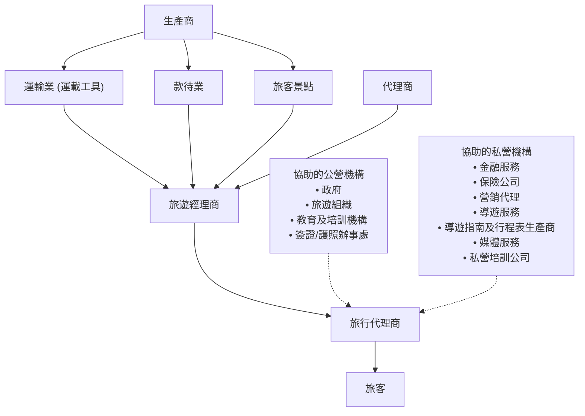

# 5 旅遊業的不同界別及其角色

旅遊業的主要工作界別，包括款待業、交通運輸業、公營機構和私營機構。它們在旅遊業中扮演着獨有的角色。

# 5.1 旅遊業的不同界別及連繫

在旅客到訪目的地的過程中，旅遊業的不同界別會緊守自己的崗位，以滿足旅客在三個主要階段的體驗。

<table><tr><td>主要階段</td><td>涉及界別(例子)</td></tr><tr><td>一、策劃安排</td><td>旅遊服務供應商(航空公司、酒店、主題樂園等)中介機構(旅行代理商、旅行團營辦商等)</td></tr><tr><td>二、送抵目的地</td><td>運輸業經营商(航空公司、鐵路公司、巴士公司、汽車租賃公司、渡輪公司等)</td></tr><tr><td>三、在目的地</td><td>款待業經营商(住宿、餐飲等)旅遊服務供應商(外幣兌換、零售店舖等)景點(歷史古跡、自然景觀、主題樂園等)</td></tr></table>

# 提示箱

私營機構泛指在商業活動中，以賺取盈利為首要目標的企業；公營機構是指為民眾提供公共服務的政府部門，以及由政府出資成立，負責特定公共服務的半官方機構，如香港旅遊發展局、香港旅遊業議會等。

以上旅遊業的界別又可分為兩類：「私營機構」和「公共機構」 。

<table><tr><td>私營機構</td><td>公營機構</td></tr><tr><td>款待業經营商運輸業經营商旅遊服務供應商中介機構景點其他協助的私營機構</td><td>政府旅遊組織其他支援的公營機構</td></tr></table>

值得留意的是，這些旅遊業的界別並不會各自工作，而是需要與其他相關界別保持緊密連繫。例如，作為中介機構的旅行代理商，會與航空公司、酒店等機構緊密合作，為旅客安排旅程所需。

旅遊業不同界別之間的連繫  

flowchart

圖 1.49

# 資料室

# 公營機構參與旅遊項目

公營機構亦會參與一些景點、運輸及款待機構，如海洋公園和香港迪士尼樂園便是由香港政府投資興建；香港歷史博物館、香港藝術館等則由政府擁有及管理。

natural_image

Exterior view of a modern glass building at dusk with illuminated facade and palm trees (no signage)

圖 1.50 於 2019 年完成重建翻新工程的香港藝術館

# 5.2 私營機構：款待業

款待業包括為顧客提供住宿或飲食的機構。這些機構可劃分為住宿業與餐飲業。

# 住宿業

旅客的旅遊活動往往需要多日，由酒店、賓館、營地、宿舍等組成的「住宿業」，便為旅客提供短期住宿的地方和服務，並從中收取費用。

住宿業界提供的設施和服務各有不同，簡單如只提供安全床位的留宿地方，完備至可滿足旅客餐飲、娛樂、商務、通訊等需要的套房。不過，住宿業界所提供的設施和服務，收費差別可以很大，在營運上也有非常大的差異。有關住宿業的內容，在課題二「款待導論」將有詳細析述。

酒店  

natural_image

Interior view of a modern hotel room with a double-decker bed, built-in desk, and large windows overlooking the sea (no visible text or symbols)

圖1.51

賓館  

natural_image

Interior view of a two-tinatal room with woven bamboo walls and a small table, no visible text or symbols

圖1.52

營地  

natural_image

Scenic outdoor camping setup with yellow tents, wooden benches, and a fire pit in a forested area (no visible text or symbols)

圖1.53

宿舍  

natural_image

Interior of a classroom with multiple bunk beds and a red metal locker, no visible text or symbols

圖 1.54

# 餐飲業

餐飲業包括高級餐廳、休閒餐廳、快餐店、咖啡室、酒吧等，在旅遊業中同樣扮演重要角色。餐飲業界既滿足了旅客最基本的飲食需要，而且可透過不同的食物、味道、裝潢等，向旅客反映當地文化。

旅客除了會光顧機場、火車站、酒店、主題公園及其他旅遊景點的餐廳外，也會到訪一些有特別主題或以提供優質食物和環境而聞名的餐廳。有關餐飲業的內容，在課題二「款待導論」將有詳細析述。

西餐廳  

natural_image

Interior of a luxurious restaurant with round dining table, ornate chairs, and framed artwork on walls (no visible text or signage)

圖 1.55

natural_image

Interior of a banquet hall with red circular tables, white plates, and yellow cutlery arranged around a central table (no visible text or signage)

中餐廳  
圖1.56

快餐店  

natural_image

Interior view of a commercial restaurant with food section, menu board, and display counter (no visible text or signage)

圖 1.57

咖啡室  

natural_image

Interior view of a modern café or cafe with purple sofas, chandeliers, and display cases (no visible text or signage)

圖1.58

酒吧  

natural_image

Interior view of a vintage-style bar with wooden stools, glass display cases, and signage (no readable text in focus)

圖1.59

# 5.3 私營機構：交通運輸業

交通運輸業為旅客實現空間位置的移動，旅客可根據需要，透過各種交通運輸方式，實現從居住地到目的地或在旅遊活動地點之間的移動。

natural_image

Illustration of transportation modes including airplane, bus, and ferry with a globe and road (no text or symbols)

▲ 圖1.60 旅客會根據需要，選擇以空、陸、海交通模式出行。

根據交通模式，大致可分為空、陸、海三類：

• 空：航空運輸（航空公司）；  
• 陸：鐵路運輸（鐵路公司）、公路運輸（私家車、巴士公司、汽車租賃公司等）；  
海：郵輪運輸（郵輪公司）、渡輪運輸（渡輪公司） 。

# 航空運輸

航空運輸是現時旅客展開長距離旅程常用的交通模式。

# A 航班編排

「國際航線」與「國內航線」：「國際航線」指不同國家或地區之間的飛行航線，旅客需要辦理出入境手續。一般而言，首都及大城市擁有較多國際航線，擔當了國際航空樞紐的角色。

「國內航線」指同一國家內不同城市間的飛行航線，旅客無需辦理出入境手續。

「定期航班」與「不定期航班」：「定期航班」指按預先設定的航班時間表、班次及目的地飛行的航班，主要往來重要的航空交通樞紐及旅遊目的地。

「不定期航班」亦稱包機，沒有固定的航班時間表、目的地及價目。這些航班經常是固定航線於旺季時的輔助。一些沒有航線的地區，又或者需要運送傷者、撤僑等緊急情況下，也依賴不定期的包機接載乘客往返。

「直達航班」 1 「直飛航班」與「轉機航班」：「直達航班」指航機由出發地一直飛到目的地，中途不會有任何轉機、停機加油等問題，乘客的飛行時間最短。

「直飛航班」指航機在飛抵目的地前，會停留中轉站，讓部分乘客登機或下機，或加油等。前往目的地的乘客無須轉機，但飛行時間較長。

「轉機航班」指乘客需要在中轉站轉乘其他航機，才能抵達目的地。乘客在轉機期間需要停留一段時間，飛行時間最長。

「直達航班」 、「直飛航班」與「轉機航班」示意圖  

text_image

莫斯科
羅馬
迪拜
香港

圖 1.61

# 直達航班：

乘客由香港直飛羅馬，中途不會有任何轉機、停機加油。乘客所花時間最短。

# 直飛航班：

乘客由香港飛抵迪拜後，同機部分乘客下機，航機再飛往羅馬。

# 轉機航班：

乘客由香港飛抵莫斯科後，要轉乘另一班航機，再飛往羅馬。乘客所花時間最長。

# B 客位及配套服務

傳統經營模式的航空公司，一般會在客機提供三種級別的客位：頭等、商務及經濟客位。這些客位的票價，已包含乘客的餐飲、娛樂等服務費用，但各級別所享的設施和服務有所不同。

<table><tr><td></td><td>頭等客位</td><td>商務客位</td><td>經濟客位</td></tr><tr><td>票價</td><td>最貴</td><td>較貴</td><td>最便宜,但票價不劃一,視乎購買時間、購買渠道等</td></tr><tr><td>登機前服務</td><td>可享用頭等貴賓室的設施和服務,如餐飲、辦公間、閱覽間、淋浴間、按摩服務等</td><td>可享用商務貴賓室的設施和服務,如餐飲、辦公間、閱覽間、淋浴間等</td><td>/</td></tr><tr><td>辦理手續</td><td>專用櫃位,輪候時間最短</td><td>專用櫃位,輪候時間較短</td><td>一般櫃位,輪候時間較長</td></tr><tr><td>登機及下機</td><td>最先</td><td>其次</td><td>最後</td></tr><tr><td>座位</td><td>設於客機前端,最寬敞、豪華,可調校幅度及活動空間最大,座椅可平放成床</td><td>設於客機前中端,較寬敞,可調校幅度及活動空間較大,座椅可供躺臥</td><td>設於客機中後端,較狹窄,可調校幅度及活動空間最小</td></tr><tr><td>設備</td><td>娛樂系統的螢幕較大,娛樂選項較豐富,專屬洗手間,一次性拖鞋、高級個人護理包等</td><td>娛樂系統的螢幕較大、節目選項較經濟客位豐富,個人護理包</td><td>娛樂系統的螢幕較小,節目選項較少,部分航班沒有娛樂系統提供</td></tr><tr><td>服務</td><td>專屬的空中服務員,服務主動</td><td>空中服務員與乘客的比例較經濟客位高,服務較主動</td><td>空中服務員與乘客的比例較商務客位低,服務較被動</td></tr><tr><td>餐飲</td><td>餐點由主廚精心設計和烹調,餐飲選擇最多,上餐時的餐具精美</td><td>餐點選擇較經濟客位多,餐飲質素較佳</td><td>餐點選擇有限,多數有兩款主食選擇</td></tr><tr><td>行李限重</td><td>重量限制最寬鬆</td><td>重量限制較寬鬆</td><td>一般重量限制約20至30公斤,超重或件數超出規定需額外付款</td></tr></table>

頭等客位  

natural_image

Interior view of a high-speed train cabin with multiple flight suits and digital screens (no visible text or symbols)

商務客位  

natural_image

Interior view of an airplane cabin with blue flight seats and white overhead seating (no visible text or symbols)

圖 1.63  
圖 1.62

經濟客位  

natural_image

Interior view of an airplane cabin with rows of blue seats and passengers seated (no visible text or symbols)

圖 1.64

# 資料室

# 特選經濟客位

特選經濟客位又稱豪華經濟客位，是一種近年在航空業興起，介乎經濟客位與商務客位之間的機艙客位。這種客位根據不同航空公司及航班會有少許不同，一般都較經濟客位舒適，並有以下特點：

• 座位較經濟客位寬敞及有更多腿部伸展空間；  
• 座位桌板較經濟客位有更大面積；  
• 指定航機有 Wi-Fi 服務；  
• 有特設登機櫃位；  
• 較經濟客位有更多寄艙行李限額；  
• 或會有升級餐點，享用與經濟客位不同的餐單；  
• 長途航班上提供旅行護理套裝（包括襪子、眼罩、耳塞、牙刷和牙膏）。

# 提示箱

有關廉價航空公司的內容，將在課題五「旅遊與款待業趨勢及議題」的「旅遊業的趨勢」詳述。

廉價航空公司，又稱低成本航空公司（Low-cost Carrier，簡稱 LCC）。它的營運模式與傳統經營模式的航空公司不同。為了降低成本，廉價航空公司沒有貴賓室服務，航站樓一般較遠，乘客需乘搭接駁巴士前往；航班的出發和抵達時間大多在清晨或深夜時段。

票價方面，廉價航空公司的機票不包含餐點、娛樂設施、行李寄艙服務等，乘客需另行付費購買。乘客如要挑選座位，亦要額外付費。

natural_image

Exterior view of a Hong Kong express aircraft parked at an airport gate, with no visible text or symbols on the plane beyond the aircraft branding.

▲ 圖 1.65 香港快運（Hong Kong Express）是以香港為基地的廉價航空公司

# 資料室

# 機票不等同登機證

現時乘客經互聯網或旅行社等中介機構訂購機票後，航空公司會向乘客發出電子機票與紙質機票。機票上會顯示航空公司代號、航班號碼、航班起飛城市與目的地城市、航班起飛和抵達日期及時間、出票日期、客位等級、機票號碼，以及持票人的英文姓名等資料。

不過，乘客到達機場後，並不能手持機票就可以前往辦理出境手續及登機。乘客需要先領取顯示了登機口、登機時間、條碼、航班座位、航班號碼等資料的登機證。過去，乘客需要到航空公司的櫃檯，由職員辦理登機手續，領取登機證，並寄運行李，再前往登機口。 C

今時今日，乘客可到機場的智能登機櫃檯，自行掃瞄護照上的資料或輸入電子機票編號，以檢索航班資料，然後選擇座位，列印登機證，再前往登機口。乘客亦可以使用航空公司的手機應用程式，自行辦理登機手續，之後利用電子登機證直接前往登機口。無論使用智能登機櫃檯還是手機應用程式的乘客，如需託運行李，仍然要到指定行李託運櫃檯託運行李。

text_image

乘客姓名
航空公司代號
航空班號碼
座位級別
條碼
Name of passenger:
JOHN DOE
Carrier:
AC
Flight No:
AC 2505
Class:
B
From: New Delhi D E L
To: Los Angeles KLAX
Date:
10/12/2017
Luggage:
Y
Seat:
5A
ETKT 555 1234567890
Name of passenger:
JOHN DOE
From: New Delhi D E L
To: Los Angeles KLAX
ETKT 555 1234567890
Seat:
5A
Date:
10/12/2017
GATE
BOARDING TIME
H22
07:45
登機口
航班日期
▲圖 1.66 登機證
Boarding Pass
登機時間
行李
座位號碼

# 鐵路運輸

鐵路是陸上重要的集體運輸工具，可大量運送乘客。由於列車使用固定的軌道或管道，不會像公路上的汽車般，面對塞車問題。現時各國都致力完善鐵路網絡，以方便民眾往來各地，使鐵路運輸在旅遊業中扮演着要緊的角色。

鐵路的班次等，視乎各地的編排。有很多人乘搭的路線，班次可以非常頻密；較少乘客的路線，班次會較為疏落。高速列車、傳統列車和觀光列車的行車速度、時間、中途站等，也有很大的分別。旅客如選擇以鐵路運輸出行，需要預先檢視班次、列車類型、出發時間和抵達時間，以便安排行程。

無論高速列車、傳統列車，還是觀光列車，都設有洗手間、餐飲等配套設施，供乘客使用。不過，各種列車上的設施各有不同。

# A 高速列車

高速列車的時速在二百公里以上，可以大大縮短乘客往返的時間。今時今日，很多城市興建了高速鐵路網絡連接機場和市區。中國、日本、美國和歐洲不少國家，近年更投放大量資源於發展高速鐵路網絡。這吸引了不少旅客以高速鐵路出行，甚至改以乘搭高速列車取代飛機前往旅遊目的地。

圖 1.67 日本新幹線高速列車  
高速列車大多設有兩種等級的座位供乘客選擇，分別主要在於乘客座位空間的大小。  

natural_image

High-speed train traveling on elevated tracks with snow-capped mountains in the background (no visible text or symbols)

# B 傳統列車

傳統列車的時速約在一百六十公里以下，運行速度較慢。由於傳統列車較早發展，車站往往設於城市的傳統中心區域，位置大多較高速鐵路優勝。另外，傳統列車一般設有硬座、軟座、硬臥、軟臥等檔次供乘客選擇。

natural_image

Interior view of a train carriage with neatly stacked beds and overhead fabric racks (no visible text or symbols)

圖1.68火車軟臥車廂，每個車廂設四個床位，較硬臥六個床位為少。

natural_image

Interior view of a train carriage with red seats and a person reading, overlooking a scenic lake and hills (no visible text or symbols)

圖1.69火車軟座車廂，座位較硬座舒適。

# C 觀光列車

觀光列車是專為旅客觀賞特定景色而開設的列車。旅客可乘坐列車遊歷著名的風景區，飽覽沿途美景。這些列車的設備大多舒適、豪華，服務完善。

# 例子庫

歐洲：瑞士伯爾尼納快車、冰河列車、黃金列車，歐洲東方快車，挪威弗洛姆觀光列車；  
• 亞洲：台灣環島之星列車，日本九州七星號列車、JR 西日本觀光列車；  
• 澳洲：甘號列車、印度洋- 太平洋列車。

natural_image

Group of people on a red and yellow platform viewing a scenic waterfall with autumn foliage in the background (no visible text or symbols)

圖1.70觀光列車上欣賞山谷美景的旅客

natural_image

Red train traveling on snow-covered tracks with mountain peaks in the background (no visible text or symbols)

■圖1.71穿越冰川的觀光列車

# 3 公路運輸

公路運輸是陸上較具彈性的一種集體運輸方法。現時，旅客可使用日益完善的公路網絡，乘搭旅遊巴士或自行駕駛汽車，便捷地往來各地。

# A 旅遊巴士 / 接駁巴士

旅遊巴士或接駁巴士有多種路線，如往返市區與景點、機場與市區、區內不同城市，以至國與國之間的快線服務等。這些巴士為了方便攜帶行李的旅客，車身下方都設有特大的行李儲存空間。現時，一些巴士更附設有洗手間、飲品機等設備，供長途旅客使用。

text_image

ASADA KANKO BUS

▲ 圖1.72 旅遊巴士

# B 私家車

隨着自由行旅遊模式的普及，為了追求更具自由度的旅遊體驗，越來越多旅客會在旅程中選擇私人汽車租賃服務，由租賃公司安排司機及私家車接載往返酒店和各景點；或會駕駛自己的私家車，或租用租賃公司的私家車，四處觀光遊玩。

natural_image

White RV camper van parked on a blue mat in a park with trees and tents in the background (no visible text or symbols)

# C 露營車

駕駛露營車旅遊在近年日漸流行。有駕駛執照的旅客，可租用車內搭載廚房、煮食設施、沐浴設施、睡床等設備齊全的露營車，與家人或朋友一同出行度假，享受郊野美景。

▲ 圖 1.73 露營車

# 提示箱

郵輪旅遊雖然對本地經濟有正面的作用，但郵輪旅遊會減少旅客對酒店住宿及觀光的需求，影響其他行業吸納旅客的能力。

# 郵輪運輸

今時今日，郵輪所提供的服務，不同於渡輪式的水上交通運輸，而是為旅客提供一種度假式的水上旅程。由於郵輪本身已是一個「目的地」，旅客可在郵輪上享用住宿、餐飲、娛樂、購物等多種設施和服務，並欣賞海上變幻不定的景色。

參加郵輪旅遊的旅客，可在一個港口出發，前往多個目的地，展開數天至數月不等的旅遊活動。很多海上郵輪都會循原路線，把旅客載返出發的港口。不過，也有一些海上郵輪的終點站不會設於出發的港口。

旅程中，當郵輪停泊不同的港口時，旅客可上岸進行觀光、購物等旅遊活動，晚上便返回郵輪住宿。旅客的行李上船後，可以一直放在房間內，途中不用執拾和搬運行李，使旅客可更好地投入舒適悠閒的旅程 。

text_image

DREAM CRUISES
星梦邮轮
CHECK-IN
办理登船
手续

圖1.74 郵輪旅客需要辦理登船手續，並出示身份證明及旅遊證件正本。

natural_image

3D rendering of a large white cruise ship sailing on calm water under a clear blue sky (no text or symbols visible)

▲ 圖1.75 可載客數千人的大型郵輪

現時大型郵輪會提供的設施和服務

<table><tr><td>郵輪的設施</td><td>郵輪的服務</td></tr><tr><td>客房餐廳賭場影院劇院的士高健身室游泳池兒童嬉水池按摩池蒸氣室電子遊樂中心卡啦OK包廂等</td><td>餐飲服務娛樂表演美髮及美容服務按摩服務洗衣服務醫療服務船上購物幼兒托管岸上觀光(旅客可在指定港口,於特定時段內登岸遊玩)</td></tr></table>

natural_image

Exterior view of a large cruise ship at sea with a pool and playground, featuring a distinctive dome structure and a colorful inflatable float (no signage visible)

圖1.76²郵輪上的水上樂園

natural_image

Outdoor basketball court with players in action, featuring a textured wall and hoop structure under clear blue sky (no signage or text)

郵輪上的籃球場和攀岩場

natural_image

Exterior view of a ship deck with green artificial turf and people playing on it, overlooking the ocean (no visible text or symbols)

圖1.78 郵輪上的迷你高爾夫球場

text_image

OASIS OF THE SEAS
▲圖 1.79 鄭轮上傳

1圖1.79郵輪上的水上劇院圓形劇場及高穴渦索

# 例子庫

「雲頂夢號」是第一艘全年以香港為母港的豪華郵輪 ，於 2016年起正式首航。

排水量 : 150 695 噸 長度 : 335 米 寬度 : 40 米

甲板層數 : 18 載客量 :3 352 人（下鋪床位） 客房數量 : 1 674 間

船員：2 000人 餐飲：35種

<table><tr><td>餐廳及酒吧</td><td>樓層</td></tr><tr><td>棕櫚閣</td><td>19</td></tr><tr><td>露天吧</td><td>17</td></tr><tr><td>麗都自助餐廳*</td><td>16</td></tr><tr><td>池畔吧</td><td>16</td></tr><tr><td>水晶生活·健康餐吧</td><td>15</td></tr><tr><td>星夢餐廳*上層</td><td>8</td></tr><tr><td>戶外火鍋</td><td>8</td></tr><tr><td>海馬日本料理</td><td>8</td></tr><tr><td>海珍舫</td><td>8</td></tr><tr><td>1號扒房</td><td>8</td></tr><tr><td>意式手作冰</td><td>8</td></tr><tr><td>酒吧天地</td><td>8</td></tr><tr><td>星宴</td><td>8</td></tr><tr><td>星頌樂廊</td><td>8</td></tr><tr><td>星夢餐廳*下層</td><td>7</td></tr><tr><td>藍湖美食</td><td>7</td></tr><tr><td>紅獅酒廊</td><td>7</td></tr><tr><td>360吧</td><td>6</td></tr><tr><td>大堂咖啡</td><td>6</td></tr><tr><td>絲路花舞中餐廳</td><td>6</td></tr><tr><td>*免費餐廳</td><td></td></tr></table>

<table><tr><td>康體設施</td><td>樓層</td></tr><tr><td>綜合運動場</td><td>19</td></tr><tr><td>迷你高爾夫</td><td>18</td></tr><tr><td>攀岩牆</td><td>18</td></tr><tr><td>繩索場</td><td>18</td></tr><tr><td>夜光保齡球場</td><td>17</td></tr><tr><td>日光甲板</td><td>17</td></tr><tr><td>緩跑徑</td><td>17</td></tr><tr><td>水上滑梯樂園</td><td>17</td></tr><tr><td>主泳池甲板</td><td>16</td></tr><tr><td>兒童嬉水區</td><td>16</td></tr><tr><td>悠閒大道</td><td>8</td></tr></table>

<table><tr><td>購物</td><td>樓層</td></tr><tr><td>臻品廊</td><td>8</td></tr><tr><td>星夢精品廊</td><td>7、6</td></tr><tr><td>星夢禮品屋</td><td>6</td></tr></table>

<table><tr><td>娛樂</td><td>樓層</td></tr><tr><td>Zouk私人派對甲板</td><td>18</td></tr><tr><td>Zouk海灘派對俱樂部</td><td>17</td></tr><tr><td>Zouk派對俱樂部</td><td>17</td></tr><tr><td>海上雲頂世界</td><td>8、7</td></tr><tr><td>星座劇院</td><td>7</td></tr><tr><td>卡拉OK</td><td>6</td></tr><tr><td>國際廳</td><td>6</td></tr><tr><td>尊尚廳</td><td>6</td></tr></table>

<table><tr><td>皇宮</td><td>樓層</td></tr><tr><td>皇宮池畔咖啡座</td><td>18</td></tr><tr><td>皇宮泳池及日光甲板</td><td>18</td></tr><tr><td>皇宮健身房及多功能活動室</td><td>18</td></tr><tr><td>皇宮水療</td><td>18</td></tr><tr><td>皇宮餐廳</td><td>17</td></tr><tr><td>皇宮接待處</td><td>17</td></tr></table>

<table><tr><td>青少年及兒童設施</td><td>樓層</td></tr><tr><td>小小夢想家天地</td><td>16</td></tr><tr><td>電子遊樂中心</td><td>16</td></tr><tr><td>小小夢想家遊樂中心</td><td>6</td></tr></table>

<table><tr><td>雲頂俱樂部</td><td>樓層</td></tr><tr><td>俱樂部</td><td>16</td></tr></table>

<table><tr><td>美容與養生</td><td>樓層</td></tr><tr><td>水晶生活·健身中心</td><td>15</td></tr><tr><td>水晶生活·水療</td><td>15</td></tr><tr><td>淑女沙龍</td><td>15</td></tr><tr><td>紳士沙龍</td><td>15</td></tr><tr><td>水晶生活·東方理療</td><td>5</td></tr></table>

<table><tr><td>其他服務</td><td>樓層</td></tr><tr><td>商務中心</td><td>19</td></tr><tr><td>船長室觀景廊</td><td>15</td></tr><tr><td>直升機坪候機室</td><td>9</td></tr><tr><td>8號宴會廳(多用途場地)</td><td>8</td></tr><tr><td>星頌樂廊</td><td>8</td></tr><tr><td>行政會議室1及2</td><td>7</td></tr><tr><td>接待處</td><td>6</td></tr><tr><td>岸上遊櫃檯</td><td>6</td></tr><tr><td>船票預定中心及「星夢薈」會員諮詢櫃位</td><td>6</td></tr><tr><td>醫務室</td><td>5</td></tr><tr><td>會議室</td><td>5</td></tr></table>

# A 郵輪假期

# a 郵輪概況

郵輪假期套票的費用，視乎不同套票的內容，各有不同：

. 交通費用：旅客參加郵輪從母港出發的郵輪假期，部分套票會包括他們來回的經濟客位機票，部分則不包括在內。如一名香港旅客參加了由意大利威尼斯出發的地中海郵輪假期，購買的是不包括機票在內的套票，便需要自費前往威尼斯，並在返航後自費回港。  
. 住宿費用：郵輪的住宿按景觀、大小和設施等，主要分為露台套房、露台房、海景房和內艙房。當中以沒有海景的內艙房收費最便宜。  
. 飲食費用：郵輪上的餐廳一般分為免費餐廳、付費餐廳。套票的費用包括了旅客在主餐廳、自助餐廳、小吃餐廳等免費餐廳的餐飲，旅客可隨意選用自己想吃的餐點。個別特色餐廳或高級餐廳，則需要旅客另行付費。  
? 活動費用：旅客可以免費享用郵輪上指定的娛樂、休閒設施，包括健身室、游泳池、影院，以及劇院的大部分表演和船上的演唱項目等。按摩、美髮、水療等活動，以及個別歌星的演出，則需要另行收費。部分套票的費用更會包括享用指定的收費設施和表演，旅客甚至可享用專屬樓層及設施。  
. 岸上費用：大部分的郵輪套票都不包括岸上的觀光活動。旅客可按需要聯絡岸上的旅行社，安排岸上的觀光團，或自費在碼頭乘搭交通工具前往觀光、購物。

natural_image

Interior view of a modern hotel room with two large beds, a blue patterned bed, and a window with curtains (no visible text or symbols)

圖1.80  
露台套房，有私人露台及梳化。

natural_image

Interior view of a hotel room with a double-decker bed and two white pillows, no visible text or symbols.

圖1.81內鶬房，沒有窗戶。

# b 旅客選擇郵輪假期的原因

旅程輕鬆：郵輪假期有完整的旅程編排，可滿足旅客住宿、餐飲、觀光、娛樂、購物等不同需要，讓旅客在船上輕鬆享受假期。  
. 設施齊全：時下的郵輪，設施相當齊全，有多種娛樂、康體設施，並有中西美食餐飲提供，旅客亦可選擇觀看船上不同的表演節目。  
一程多站：郵輪假期在一個船程中，會停泊數個旅遊目的地，並提供時間讓旅客上岸遊覽，能吸引希望到多個地方觀光的旅客。  
. 無須轉住宿：在傳統的旅遊假期中，旅客往往要不斷轉換酒店，並需要頻密地收抬行李。選擇郵輪假期的旅客，旅途中不需要轉換客房，可節省許多轉換酒店和收拾行李的時間和精力。  
. 旅遊新體驗：海上的郵輪假期，對於很多經常乘搭飛機及火車出行的旅客，是頗有新鮮感的旅遊新體驗。

# c 旅客不選擇郵輪假期的原因

? 多隱藏費用：旅客在支付郵輪假期的套票費用外，在船上還容易產生不少額外的支出。例如旅客面對船上林林總總的收費餐廳和娛樂、康體等設施，容易衝動消費；如要到岸上觀光，不少旅客會由郵輪代為安排，這類服務需要額外付款。  
岸上觀光急促：郵輪停泊在每一個目的地的時間有限，旅客到岸上觀光的時間較為短促，或需匆匆往返景區，以致未能盡興和無法真正了解當地。

• 擔心遇風浪：郵輪在海上行駛，始終要面對變幻莫測的海上天氣。有些旅客會擔心一旦遇上颱風等惡劣天氣，即使大型郵輪也無法抵禦，輕則承受顛簸暈浪之苦，重則遇上郵輪事故，後果不堪設想。

. 客艙價錢差別大：郵輪假期價錢相宜的客房都是沒有窗的內艙房，向海有窗的海景房及有露台的陽台房，價錢相對較昂貴，旅客需要衡量是否物有所值。

# B 內河遊輪

內河指處於一國境內的河流。不少國家的著名河流，都有內河遊輪服務提供，讓旅客飽覽兩岸的風景。

# 例子庫

• 亞洲：中國的長江、東南亞的湄公河；  
• 歐洲：多瑙河、萊茵河；  
• 非洲：埃及的尼羅河；  
• 美洲：南美洲的亞馬遜河、美國的密西西比河等。

natural_image

Scenic river view with a cruise ship sailing on calm water, flanked by steep, forested mountains (no text or symbols visible)

圖1.82長江三峽遊輪

natural_image

Aerial view of a large cruise ship sailing on a wide river, with green shoreline and distant industrial buildings in the background (no visible text or symbols)

圖1.83多瑙河遊輪

圖 1.84 來往香港與澳門之間的渡輪  
內河遊輪的交通、住宿、餐飲、活動和岸上活動等費用安排，與海上郵輪相似。不過，內河遊輪的船身較海上郵輪小，所提供的各項設施也較少，載客量亦相對較少。另外，內河遊輪大多不會循原路線，把旅客載返出發的港口。  

natural_image

Blue patrol boat with '金光飛航' branding sailing on water with a city skyline and mountain in the background (no signage visible)

# C 渡輪運輸

渡輪運輸指港口與港口之間的短距離海上運輸，為本地市民和旅客提供運輸服務。渡輪作為基本的交通運輸工具，班次相對頻密，設施相對簡單。有些渡輪甚至連普通的餐飲和娛樂設施也沒有，有些則會提供小食櫃檯及電視錄影等，部分渡輪甚至有小型客房供旅客選購使用。

航空、鐵路、公路與水路旅遊運輸比較表

<table><tr><td></td><td>航空</td><td>鐵路</td><td>公路</td><td>水路</td></tr><tr><td>速度</td><td>八百至九百公里/小時,最快</td><td>數十至二百多公里/小時,較快</td><td>數十至一百多公里/小時,較慢</td><td>數十至一百公里/小時,最慢</td></tr><tr><td>載客量</td><td>中等至大量</td><td>最多,可運載大量旅客</td><td>較少</td><td>中等至大量</td></tr><tr><td>環境影響</td><td>人均碳排放多</td><td>人均碳排放最少</td><td>人均碳排放最多</td><td>人均碳排放少</td></tr><tr><td>班次</td><td>設有定期及不定期航班,可視乎需求增加班次</td><td>設有定期班次,可視乎需求增加班次</td><td>接駁巴士設有定期班次,旅遊巴士視乎需要而定</td><td>設有定期班次,可視乎需求增加班次</td></tr><tr><td>準時度</td><td>有時會因空中管制、天氣問題或航機故障等而誤點</td><td>受天氣問題影響較少,使用固定軌道,較準時</td><td>容易受大霧、降雪等天氣問題,以及塞車問題等影響</td><td>較準時,但有時會因風暴等天氣問題而略為延誤</td></tr><tr><td>可達度</td><td>航點遍及全球主要城市</td><td>鐵路網遍及各地大中城市</td><td>公路網遍及各地大中小城市及城鎮</td><td>以沿海、沿岸港口為停泊點</td></tr><tr><td>靈活度</td><td>機場離市區較遠,旅客需轉乘坐其他交通工具進入市區</td><td>鐵路站多位於市區,較機場方便;設有固定鐵路站位置,靈活度較低</td><td>旅遊巴士、私家車及露營車靈活度大,能深入目的地;接駁巴士可點對點到達市區</td><td>碼頭一般鄰近市區或在市區;設有固定港口停泊點,靈活度較低</td></tr><tr><td>餐飲服務</td><td>傳統航空公司的票價已包含,廉價航空公司的票價不包括</td><td>有餐車卡提供餐飲,需額外付款;亦有手推車售賣食物和飲品</td><td>私家車及露營車沒有,部分旅遊巴士有飲品設施</td><td>郵輪有多項提供,渡輪較少提供</td></tr><tr><td>娛樂休閒設施</td><td>傳統航空公司的客機大多有提供,廉價航空公司需額外購買</td><td>較少</td><td>私家車及旅遊巴士有限,露營車較多</td><td>郵輪相當多,渡輪較少提供</td></tr><tr><td>欣賞沿途風景</td><td>升降以外,旅客無法飽覽旅程的風景</td><td>旅客可飽覽沿途的風景</td><td>旅客可飽覽沿途的風景</td><td>旅客可飽覽海上或河岸的風景</td></tr><tr><td>活動空間</td><td>有限</td><td>較大</td><td>有限</td><td>最大</td></tr><tr><td>身體適應度</td><td>飛機升降時,個別旅客因氣壓問題而耳鳴、耳痛,或出現乾燥、久坐而血液循環不暢順等問題</td><td>旅客容易適應,環境較舒適,旅客有較多空間舒展身體</td><td>旅客容易適應,但環境較局促,個別旅客可能因久坐而血液循環不暢順</td><td>環境舒適,旅客容易適應,但個別旅客可能會暈船浪</td></tr><tr><td>對旅遊業影響</td><td>可促進國際間大規模旅遊</td><td>能運載大量旅客出行</td><td>可方便旅客更有彈性地計劃行程</td><td>可為旅客提供休閒的旅遊模式</td></tr></table>

# 5.4 政府及公營機構在旅遊業的角色

旅遊業牽涉多個社會行業，又可促進經濟，創造就業職位，以及提升一地的形象，更涉及國際或地域間的合作與交流，因此政府及相關的公營機構在旅遊業中扮演了重要的角色。

# 政府在旅遊業的角色

政府在旅遊業的主要角色包括：計劃及促進旅遊業、管制及監察旅遊業、直接經營旅遊業項目、對外推廣旅遊業、研究及支援旅遊業等。

# A 計劃及促進旅遊業

制定政策及計劃：政府會為旅遊業的發展制定目標和計劃，並為有關的發展和管理提供策略，以達致目標和計劃實現。例如為旅遊業發展制定短、中、長期的目標；推出生態旅遊發展計劃，並提供管理方式指引等。

協調及分配資源：政府會評估旅遊業的發展需求，並協調各公私營部門，以有效分配所需的資源，及減少資源浪費。例如由旅遊局負責向海外宣傳和推廣旅遊業；協調大型體育旅遊活動主辦單位與交通、住宿等業界的安排。

規劃基礎建設：旅遊業的發展需要基礎建設的配合。政府會規劃基建計劃及大型旅遊項目，並開展工程。例如政府會興建機場、鐵路、道路、港口，以方便旅客到訪；為酒店業提供電力、供水和排污等基礎設施等。

natural_image

Construction site with concrete bridge piers and an oil rig, surrounded by traffic barriers and yellow-and-white striped barriers (no visible text or symbols)

▲ 圖 1.85 政府興建公路等基礎建設，能便利旅客到訪。

# B 管制及監察旅遊業

制定發牌制度：為了防止旅遊業的不良發展，維持業界的質素，政府會透過發牌制度，監管航空公司、旅行代理商、酒店、導遊等。例如不少地區的監管部門，會對違規旅行社及導遊實施扣分制度，當扣滿一定分數便會停止牌照，甚至吊銷牌照。

設立投訴機制：為了保障旅客的合法權益，政府會設立旅客投訴渠道及機制，並會將違法個案轉介海關、警方等相關部門處理。

# 例子庫

訪港旅客可向香港旅遊業議會轄下的消費者關係委員會，或公營機構消費者委員會等，投訴旅行社或店鋪的不良營銷行為。

text_image

投诉途径 | 认购者须用
consumer.org.hk/ies.chi/complaints_and_advice/how_to_complaints/how@company.html
消费者委员会
CONSUMER COUNCIL
最新资讯
消费电商
投诉及保障
政策及研判
關於我們
投寄
投诉途径
商品说明（修订）案例
投诉查询
常见问题
标题实例
其他投诉途径
消费者投诉基金
被提到的资质
EN
章
登记《排序》快讯
A A
主要 > 投诉及保障
投诉途径
消费者如何向消费者委员会投诉？
消费者是否遇到不公平的交易，例如：搞不相联、违规不交货、射胶能不漏、规则丢失不足不便，消费者需自行向
警告或者建议投诉，本表以调单人的身份或电话邮寄投诉，须到用户及投诉人解决纠纷。
致電
(052) 2029-2222
参会时间：使用一正常期五
09:00 - 17:30
电子表格
本表网站正推行本次维修工程，使用电子表格可能受到超前影音。消费者使用电子表也要作出此新
视套餐将提供任何问题，可致电本會热线2029-2222留言，或邮箱cad@consumer.org.hk -
本表阅读会提供问题。
• 款讯
• 活洁
订阅優惠
订阅優惠
推介文章
全程环保专人拒口罩？倒挂？
回复？洗手？
漂白水必读10亿
漂白水
《离心悦度》免费下载的反文

▲ 圖1.86 消費者委員會網站提供投訴途徑，可讓旅客作出投訴。

審批發展項目：政府在發展旅遊項目上，往往擔當審批的角色，以確保發展旅遊業的同時，在本地環境、經濟及社會文化方面保持平衡。

# 例子庫

• 香港立法會曾於 2006 年，大比數否決在大嶼山興建綜合消閒博彩娛樂中心的動議。

# C 直接經營旅遊業項目

完善營商環境：政府會制訂旅遊業相關法例法規，完善旅遊政策，為旅遊業界營造良好的營商環境，吸引本地或海外投資者發展旅遊項目。

# 例子庫

• 中國海南近年積極發展旅遊業，實施離島免稅政策，並致力提升當地旅遊服務水平。

開發旅遊景點：政府會研究開發新的旅遊景點或項目，甚至會與大型企業合作開發新旅遊設施，以增加當地旅遊業對旅客的吸引力。

# 例子庫

• 香港政府興建啟德郵輪碼頭，發展郵輪旅遊，以豐富香港的旅遊產業。

參與項目營運：不少旅遊相關設施，如文物古跡、博物館、藝術中心、郊野公園等，由政府擁有。政府會直接參與這些設施和資源的營運及保育。

text_image

Flagstaff House
Museum of Tea Ware
茶具文物館
陳樂及文化事務署
Leisong and Cultural Services Department
香港借新部分館
A branch of the Hong Kong Museum of Art
10 紅棉路十號
COTTON TREE DRIVE

圖1.87，香港康樂文化事務署管轄的茶具文物館

text_image

AGRICULTURE, FISHERIES
AND CONSERVATION DEPARTMENT
SAI KUNG COUNTRY PARK
PAK TAM CHUNG MANAGEMENT CENTRE
漁晨自然護理署
西貫郊野公園
北潭涌管理站

■圖1.88 香港漁農自然護理署管轄的西貢郊野公周

# D 對外推廣旅遊業

宣傳及推廣旅遊業：旅遊是一種消費行為，為了刺激旅客作出旅遊決定，吸引他們到訪，各地政府均會有計劃地向外宣傳及推廣本地旅遊業。例如先設定推廣主題，再拍攝宣傳短片、刊登廣告、舉辦展覽、推出各種大型活動和優惠等，向外地旅客作宣傳及推廣。

合作推廣旅遊業：為了增加旅客數量，各地政府會與鄰近地區合作，加強對外推廣區域旅遊。例如香港會與澳門等鄰近城市合作，推廣「一程多站」的旅遊。

提供旅遊資訊：為了方便旅客掌握旅遊資訊，以及讓他們擁有良好的旅遊體驗，各地政府會透過多種方式，向旅客提供旅遊資訊。例如政府會設立網站、手機應用程式等，便利旅客掌握資訊和規劃行程；在機場、碼頭、景點等設置旅客諮詢中心，處理旅客的查詢及提供支援，並向旅客提供旅遊地圖、旅遊刊物、旅客優惠劵等。

text_image

HONG KONG TOURISM BOARD
香港旅遊發展局

▲ 圖1.89 香港旅遊發展局設立在機場的旅客諮詢中心

# 活動站

# 策劃對外推廣香港旅遊業

試分成小組，為香港旅遊發展局策劃一個向海外旅客介紹香港地道文化的推廣活動，然後向全班介紹。

# E 研究及支援旅遊業

分析旅遊市場：各地政府的旅遊部門都會分析研究旅遊業市場，以掌握市場未來發展及預測到訪旅客趨勢，從而調整發展旅遊業的策略，以及作出針對性的宣傳推廣。例如政府發現某新興市場的旅客潛力較大，便會投放較多資源在當地展開宣傳推廣。

檢討旅遊計劃：政府旅遊部門會不時檢討旅遊計劃，以了解計劃的成效，再加以調整。有關部門亦需要對景點、設施等作出評估，以優化景點和設施，提高本地旅遊業的競爭力。

支援旅遊業界：旅遊業界在發展旅遊業時，會面對不少困難。政府需要協助業界解決有關問題，以及在業界面對困難時，推出紓緩措施。例如各地旅遊業界在 2019 冠狀病毒病疫情下大受打擊，很多政府都推出了現金援助、退稅等支援措施，協助業界渡過難關。

培訓旅遊人才：政府會對旅遊業的人力資源作出評估，並為業界培訓足夠的旅遊業人才。例如政府會資助旅遊業團體開辦職業培訓課程，支援專上院校興建旅遊人才培訓設施和開辦相關課程等。部分國家或地區如缺乏旅遊人才，會透過由海外引入的方式，解決問題。

text_image

polyU JUPAS Consultation Do
polyu.edu.hongdai/school-of-hotel-and-tourism-management/
THE HONG KONG
POLYTECHNIC UNIVERSITY
香港理工大學
Live Events Study@PolyU University Life Contact Us Privacy Policy
30 May 2020 (Saturday)
2020年5月30日(星期六)
REGISTER
報名
POLYU
ONLINE JUPAS
Consultation Day
Admissions Strategies
2020
2:00 - 5:00 pm
下午二時至五時
Zoom
School of Hotel and Tourism Management
酒店及旅遊業管理學院
Hotel Management - BSc (Hons)
酒店業管理(榮譽)理學士學位 [JS1882]
Info Seminar & Consultation Session 3:00 - 3:40 p.m.
講座及個別選科輔導 Click here to view

▲ 圖 1.90 香港理工大學酒店及旅遊管理學院提供了「酒店業管理（榮譽）理學士學位」及「旅遊業及會展管理（榮譽）理學士學位」等，供學生選讀。

# 其他支援旅遊業的政府部門及公營機構

在旅遊業的發展中，需要多個政府部門及公營機構提供各種支援和服務，如推廣旅遊業、安排旅客出入境、保障旅客安全和健康、監管旅遊行業、培訓旅遊業人才、保育旅遊文化資源等。

與旅遊業相關的政府部門及公營機構的例子

<table><tr><td>政府部門及公營機構</td><td>例子</td></tr><tr><td>國家級旅遊部門</td><td>國家文化和旅遊部</td></tr><tr><td>地區性旅遊部門</td><td>澳洲新南威爾斯省旅遊局</td></tr><tr><td>大都會市旅遊機構</td><td>香港旅遊發展局</td></tr><tr><td>旅遊業機構</td><td>香港旅遊業議會、香港酒店業協會</td></tr><tr><td>旅遊政策部門</td><td>香港文化體育及旅遊局:旅遊事務署</td></tr><tr><td>貿易部門</td><td>香港商務及經濟發展局</td></tr><tr><td>入境部門</td><td>香港入境事務處</td></tr><tr><td>海事部門</td><td>香港海事處</td></tr><tr><td>海關部門</td><td>香港海關</td></tr><tr><td>運輸部門</td><td>香港運輸署</td></tr><tr><td>航空部門</td><td>香港民航處</td></tr><tr><td>衛生部門</td><td>香港衛生署</td></tr><tr><td>漁農部門</td><td>香港漁農自然護理署</td></tr><tr><td>康樂及文化部門</td><td>香港康樂及文化事務署</td></tr><tr><td>環境部門</td><td>香港環境保護署</td></tr><tr><td>規劃部門</td><td>香港規劃處</td></tr></table>

# 提示箱

香港直接與旅遊業相關的政府部門、公營機構，以及支援旅遊業的政府部門，將在本書單元 2「本地旅遊業」頁 193至204 加以闡述。

text_image

入境事務處出境大堂
Immigration Departure Hall

▲ 圖1.91 香港入境事務處出境大堂

事實上，由旅客到訪目的地至返回原居地，不同的政府部門已在為旅客提供各種服務。以下會以出入境的過程為例子，展示一些政府部門的支援和服務。

# A 護照

護照是重要的旅遊證件，由一個國家或地區向公民所簽發，是旅客出入境時用來證明其公民身分的官方證明文件，有效期通常為五至十年。

一般而言，護照上會列明以下資料：

# 提示箱

不少國家或地區會對護照的有效期有所規定，通常要求旅客入境時，所持護照有效期至少為3至 6 個月，旅客出遊時宜多加留意。

• 護照持有人的姓名  
• 護照持有人的相片  
• 護照持有人的個人資料（如國籍、出生日期、性別）  
• 護照的簽發日期  
• 護照的簽發機構  
• 護照的有效期

另外，每本護照內均設有空白頁，當旅客到訪其他國家或地區時，當地的出入境部門會核對護照持有人的身分，並在護照蓋上出入境日期。基於出入境安全理由，護照均會採用一系列精密的防偽特徵，以防止偽造及假冒他人身份。

# 網絡台

香港特別行政區護照免簽證或落地簽證情況覽表

以香港為例，由入境事務處向持有香港永久性居民身分證的中國公民申請者簽發香港特別行政區護照。入境事務處亦會與世界各國 人入境當地可享免簽證安排。最長可逗留期由 14 天至 180 天不等，視乎本港與各國家或地區的協議。

圖1.92 香港特別行政區護照  

text_image

中华人民共和国
香港特别行政区
HONG KONG
SPECIAL ADMINISTRATIVE ECONOM
PEOPLE'S REPUBLIC OF CHINA
護
PAY
護
PASSPORT
中國人民共和國
香港特別行政区
HONG KONG
HONG KONG
香港特别行政区
HONG KONG

# 資料室

# 全球「最好用」護照

根據「亨氏護照指數」（Henley Passport Index）對全球護照的統計，在 2023 年，新加坡護照持有人在 192 個國家和地區享有免簽證待遇，全球排名第一，成為「最好用」護照。德國、意大利、西班牙護照以 190 個免簽證國家和地區並列第二位。日本、韓國、芬蘭、法國、瑞典、奧地利和盧森堡以189 個免簽證國家和地區並列第三位。英國、荷蘭、愛爾蘭、麥並列第四位；瑞士、葡萄牙、挪、新西蘭、馬爾他、捷克、比利時並列第五位。至於香港特別行政區護照排在第 17 位，持有人能免簽證進入 170 個國家和地區。

text_image

REPUBLIC OF
SINGAPORE
PASSPORT
日本国
韓東
JAPAN
PASSPORT
被護照▶

▲ 圖 1.94 日本護照

圖 1.93 新加坡  

# 基本法教育

# 《基本法》與出入境自由

香港《基本法》第一章第四條列明：「香港特別行政區依法保障香港特別行政區居民和其他人的權利和自由」；第三章第三十一條則列明：「香港居民有在香港特別行政區境內遷徙的自由，有移居其他國家和地區的自由。香港居民有旅行和出入境的自由。有效旅行證件的持有人，除非受到法律制止，可自由離開香港特別行政區，無需特別批准。」

現時，大部分香港永久性居民均持有《香港特別行政區護照》。根據《基本法》第七章第一百五十五條：「中央人民政府協助或授權香港特別行政區政府與各國或各地區締結互免簽證協議。」現時持有《香港特別行政區護照》的居民，前往超過160個國家不需簽證。

# 提示箱

不同國家或地區辦理簽證手續所需的時間不一，有些可能需時數星期，旅客宜確保已預留足夠時間於出發前領取簽證。

# B 簽證

簽證是一個國家或地區給予其他國家或地區民眾入境當地的入境許可。當一個國家或地區未有給予某國家或地區免簽證出入境安排，會要求護照持有人在入境前，先向領事館或代辦處申請簽證。簽證可以在旅客出發前簽發，或可以在旅客抵達該國時授予。當地出入境部門會於旅客入境時，在簽證上加蓋印確認，才會容許旅客入境。

簽證上會顯示該國家或地區容許護照持有人可逗留的時間、有效日期和入境次數。旅客如欲在當地延期逗留，必須在有效旅遊期內申請續期，否則會被懲處。

為了便利旅客出入境，以及增加旅客流量，入境部門會積極與其他國家或地區訂立免簽證安排。同時，入境部門有權拒絕不受歡迎的人士入境，以免他們濫用移民制度或對國家安全構成威脅。另外，有些國家基於旅遊業可能對該地構成安全和政治威脅，或要阻止非法移民等原因，而對其他國家的公民實施嚴格的簽證規定。

text_image

香港等行区政府入境申报
the Immigration Department the Government of
the Hong Kong Special Administrative Region
香港台灣/通貨(保留入)申證表
Application for Earty for Void Transit (Sponsor)
(川崎県人研究)
In Hong Kong (to be completed by the Suisse)
Union européenne
République française

▲ 圖1.95 香港特別行政區簽證表格

# 資料室

# 香港特別行政區護照持有人需簽證入境的國家和地區

截至 2023 年底，香港特別行政區護照持有人如前往亞洲的中國台灣、越南、柬埔寨、孟加拉、斯里蘭卡、不丹、沙特阿拉伯、北韓、阿富汗、伊拉克、敘利亞等；美洲的美國、古巴、危地馬拉、哥斯達黎加、巴拉圭等；大洋洲的澳洲等，均需要簽證入境。

# C 檢疫規定

為了預防及控制疫症的傳播，來自或曾到訪指定高風險地區的旅客，通常需要向目的地衞生部門出示由官方認可醫療機構或化驗所簽發的健康確認書。

若旅客於入境時未能出示有效的健康確認書，旅客可能會：

• 被拒絕入境；  
• 被留下作醫療觀察；  
• 被要求立即接受防疫注射；  
• 被要求隔離。

旅客如計劃前往出現嚴重傳染病高發病率的地方，衞生部門會建議旅客外遊前先了解旅遊健康風險，並檢視其疫苗接種紀錄及過往醫療紀錄，或需先接種有關疫苗。旅客入境某些非洲和南美洲國家，更需要出示由各地衞生機關依照世界衞生組織的規定及格式所核發的國際預防接種證明書。

香港衞生署衞生防護中心轄下的港口衞生科，會在海港、香港國際機場，以及陸路口岸執行各項防疫措施，防止疫症及其他嚴重傳染病傳入或帶離本港，以促進和保障旅客健康。

text_image

旅游健康资讯
衛生署 旅遊健康服務
輸入西向平台
主頁
關於我們
中心資料
旅遊情報
目的地
旅遊相關疾病
環境健康風動
旅遊健康資訊
疫苗网網地
村林社群
失港清境
常見問題
有用連結
下載中心
衛生署
易口衛生科
健康旅遊守則
出版館
數字中
旅程後
最熱具劇室
滙北食水的方法
旅遊破誘回 Web For All WC WAI-AA
20200 | 免費警報 | 反增演示 | 私獲政策 | 旅遊破誘回 最近修订日期: 2020年12月29日

▲ 圖 1.96 香港衞生署旅遊健康服務網頁，提供旅遊情報、旅遊相關疾病、旅遊健康資訊等信息。

# 提示箱

由於接種疫苗後，身體需時一至兩星期產生抗體來預防傳染病，旅客外遊前應及早計劃接種疫苗。

# D 關稅規定

基於貿易、衞生及保安等理由，不同國家或地區的海關部門均會制訂禁運或受管制物品名單，禁止海外旅客和本國公民攜帶禁運或受管制物品入境。

# 提示箱

《2018 年保護瀕危動植物物種（修訂）條例》於 2021 年 12 月在香港全面實施，除「古董象牙」外，進口、再出口或管有象牙，均屬違法，一經定罪，最高可被罰款港幣 1000 萬元、監禁10年及充公有關物品。

# 資料室

# 常見的禁運 ／受管制物品

常見的禁運 ／受管制物品包括危險藥物、精神藥物、受管制化學品、抗生素、槍械、彈藥、武器、爆竹煙花、戰略物品、未經加工鑽石、動物、植物、瀕危物種、電訊設備、野味、肉類、家禽、蛋類等。

香港政府自 2013 年起，禁止任何人從本港輸出 1.8 公斤以上，供 36 個月以下嬰幼兒食用的配方粉（包括奶粉或豆奶粉），除非該人士已獲發出口許可證。違例者一經定罪，可被罰款港幣 50 萬元及監禁 2 年。

旅客如沒有有效牌照、許可證、衞生證明書或書面准許，而把禁運或受管制物品帶進或帶離當地，可遭檢控，有關物品更會被充公。有關罰則，視乎各國家或地區規管這些物品進出口的法例而定。例如在泰國、印尼、新加坡等地，旅客如販運毒品， 經被定罪，最高可被判處死刑。

至於計劃攜帶寵物一同外遊的旅客，亦須事先向衞生部門申請批准，並可能要出示寵物的防疫注射證明。

圖 1.97 動物及動物產 ▲品進出口要向漁農自然護理署申請批准  

text_image

美食財団管理器
物語分析器
物語分析器
物語分析器
物語分析器
物語分析器
物語分析器
物語分析器
物語分析器
物語分析器
物語分析器
物語分析器
物語分析器
物語分析器
物語分析器
物語分析器
物語分析器
物語分析器
物語分析器
物語分析器
物語分析器
物語分享器
物語分享器
物語分享器
物語分享器
物語分享器
物語分享器
物語分享器
物語分享器
物語分享器
物語分享器
物語分享器
物語分享器
物語分享器
物語分享器
物語分享器
物語分享器
物語分享器
物語分享器
物語分享器
物語分享器
物語共享器
物語共享器
物語共享器
物語共享器
物語共享器
物語共享器
物語共享器
物語共享器
物語共享器
物語共享器
物語共享器
物語共享器
物語共享器
物語共享器
物語共享器
物語共享器
物語共享器
物語共享器
物語共享器
物語共享器
物語分享器
物語分享器
物語分享器
物語分享器
物語分享器
物語分享器
物語分享器
物語分享器
物語分享器
物語分享器
物語分享器
物語分享器
物語分享器
物語分享器
物語分享器
物語分享器
物語分享器
物語分享器
物語分享器
物語收藏器
物語收藏器
物語收藏器
物語收藏器
物語收藏器
物語收藏器
物語收藏器
物語收藏器
物語收藏器
物語收藏器
物語收藏器
物語收藏器
物語收藏器
物語收藏器
物語收藏器
物語收藏器
物語收藏器
物語收藏器
物語收藏器
物語收藏器
物語珍藏器
物語珍藏器
物語珍藏器
物語珍藏器
物語珍藏器
物語珍藏器
物語珍藏器
物語珍藏器
物語珍藏器
物語珍藏器
物語珍藏器
物語珍藏器
物語珍藏器
物語珍藏器
物語珍藏器
物語珍藏器
物語珍藏器
物语珍藏器

旅客攜帶煙草、飲用酒類等應課稅物品出境或入境，通常受到重量或容量等限制。旅客如攜帶非免稅物品入境，須填寫關稅申報表，並向海關部門申報，以及為有關應課稅物品繳交稅款。

# 資料室

# 香港的煙草及飲用酒類入境限制

自2010年起，年滿十八歲的旅客，可免稅攜帶19支香煙，或 1 支雪茄，或 25 克其他製成煙草，以及 1 升酒精濃度多於30% 的飲用酒類入境香港，供其本人自用。

現時，日本、新加坡、澳洲、法國、德國、英國、意大利等實行消費稅的國家或地區，會為旅客提供退稅優惠，以促進他們在當地購物消費。旅客在返回原居地前，可於機場、港口等關稅辦事處辦理退稅手續。

text_image

313-338
Customs
增值税退税
VAT
REFUND

▲ 圖1.98 外國機場的增值稅退稅指示牌

# 提示箱

香港擁有穩固的金融體系及簡單而明確的稅制，亦是全球稅率最低的地區之一，因此本港並沒有實施外匯管制，資金可自由進出香港而不受任何限制。

另外，世界上不少國家或地區為了保護其金融及經濟體系，會實行外匯管制，即對於外幣的供給和需求作出管制。在外匯管制下，旅客可攜帶入境或出境的本國或他國貨幣的數額會受到規限。旅客如攜帶超出限額的貨幣入境或出境而未有申報，可能會被海關部門充公，甚至構成走私犯罪。

# 網絡台

香港國際機場保安資訊

# 提示箱

基於航空交通安全，任何類型的備用電池，包括金屬鋰電池、鋰離子電池或鋰電池（如：充電器），禁止置於託運行李。因為行李在運送的過程中，可能會受到碰撞或擠壓而導致膨脹起火。旅客只能以手提行李或隨身攜帶方式將備用電池帶上機，而每家航空公司對攜帶數量和電池容量的規定不太一樣。

# E 公眾安全

公眾安全已成為全球各地政府共同關切的重大議題。為了

防範恐怖主義等對社會治安的威脅，各地政府都投入大量資源於加強出入境安全檢查。目前，全球各大機場、重要港口和車站等，均已實施嚴密的保安規定，提高安檢措施的級別，以確保旅客安全。

natural_image

Interior view of a medical or transportation checkpoint with travelers and service counters (no visible text or symbols)

圖1.99 泰國曼谷機場的安檢設施

# 資料室

# 旅客攜帶液體新規定

遵照國際民用航空組織（國際民航組織）的指引，香港國際機場由 2007 年起，對旅客手提行李中的液體、凝膠和噴霧類物品實施以下保安規定：

# 航空安全及保安要求

# Aviation Safetyand Security Requirements

不可攜蒂上飛機的物品ItemsNOTToBeTakenAboardAircratt

text_image

爆炸品
Explosives
壓縮氣體
Compressed Gases
易燃液體和固體
Flammable Liquids
and Solids
氧化劑
Oxidizers
毒藥
Poisons
傳染性物質
Infectious Substances
放射性物質
Radioactive Materials
腐蝕性物質
Corrosives
磁性物質
Magnetized Materials
其他危險品
Other Dangerous Goods
彈藥及武器
Ammunitions & Weapons
利器
Bladed Instruments
小刀
Small Knives
鈍器及體育用品
Blunt Instruments &
Sports Equipment

注意：請向你的航空公司查詢评情  
Note:Please ask your airline for details

text_image

手提行李中可以攪帶少量液體、
噴霧及凝膠分類物品，但必須
符合以下規定：
Passengers can carry a limited
quantity of Liquids, Aerosols and
Gels in their hand baggage
if the items are packed as follows:

每人只限一袋
One bag per person

膠袋應與其他手提行李分間，供保安人員另行檢查
Plastic bag to be presented separately from other
hand baggage for screening

每人只可攪帶一件手提行李進入機械
Only one piece of hand baggage is allowed to carry onboard the aircraft

體積：22 x 14 x 9 t /inches
Size：56 x 36 x 23 厘米/cm

所有旅客隨身攜帶的液體、凝膠及噴霧類物品，容器盛載容量均不可超過 100 毫升。  
所有盛載液體、凝膠及噴霧類物品的容器，都應儲存在一個容量不超過一公升、並可重複密封的透明塑膠袋內，而且要確保塑膠袋完全封妥。  
旅客行經安檢站時，裝有容器的塑膠袋應與隨身行李分開擺放，以便進行檢查。每名旅客只可攜帶一個裝有容器的塑膠袋。  
所有藥物、嬰兒奶粉和食品，以及特別飲食所需的物品，經查證後可獲豁免。

▲ 圖 1.100 香港國際機場的

「航空安全及保安要求

# 5.5 國際旅遊機構在旅遊業的角色

# 聯合國旅遊組織

聯 合 國 旅 遊 組 織（United Nations World TourismOrganization, UN Tourism）於 1975 年成立，是聯合國體系的一個國際性組織，負責促進負責任的、可持續的和人人可享受的旅遊業。聯合國旅遊組織總部設於西班牙馬德里，並在世界各地設有地區辦事處。

text_image

UN Tourism
UNITED NATIONS
WORLD TOURISM ORGANIZATION

▲ 圖1.101 聯合國旅遊組織標誌

在 2024 年，聯合國旅遊組織擁有正式會員 160 個，准會員6 個，以及 500 多個代表旅遊企業和機構、教育機構、旅遊協會和地方性旅遊部門的附屬會員。

# A 聯合國旅遊組織的宗旨和責任

作為聯合國旅遊業專門機構和在全球旅遊領域具領導地位的國際組織，聯合國旅遊組織推動透過旅遊業刺激世界經濟增長，以及提高個人福祉、保護環境可持續發展、促進國際社會和諧，並為在全球就提高旅遊業競爭力、促進知識建設和旅遊政策提供領導和支援。

# B 聯合國旅遊組織的優先事項

• 讓旅遊業成為全球議程的主流：倡導旅遊業作為社會經濟增長和發展動力的價值，將旅遊業納入國家和國際政策的優先事項，並為旅遊業發展和繁榮創造公平競爭環境。  
• 促進可持續旅遊的發展：支持可持續旅遊的政策和實踐，包括那些能善用環境資源、尊重東道社區社會文化原貌，以及為所有人帶來社會經濟效益的政策。  
• 促進知識、教育和能力建設：支援各國，評估和滿足各國在教育和培訓上的需要，並提供知識創造和交流網路。  
• 提高旅遊業的競爭力：透過知識創造和交流、人力資源發展，以及促進政策規劃、統計市場趨勢、可持續旅遊發展、行銷和推廣、產品開發、風險和危機管理等領域的卓越發展，提高聯合國旅遊組織成員的競爭力。  
• 促進旅遊業對減貧和發展的貢獻：透過將旅遊業作為發展工具，並納入發展議程，從而最大程度發揮旅遊業對減貧和達致可持續發展目標的貢獻。  
• 建立夥伴關係：與私營企業、區域和地方旅遊組織、學術和研究機構、民間社會和聯合國系統連繫，建設更可持續、更負責任和更具競爭力的旅遊業。

text_image

UN Tourism
UN Tourism to Bring the world closer
A UNITED NATIONS SPECIALIZED AGENCY
About Us Our Focus Resources & Data News
SUSTAINABLE DEVELOPMENT GOALS Search
UN Tourism to Make
Residents Focus of
Thassos Island's Tourism
Recovery

▲ 圖1.102 聯合國旅遊組織網站

# 亞太旅遊協會

亞太旅遊協會（Pacific Asia Travel Association, PATA）於1951 年成立，對亞洲太平洋地區旅行與旅遊業的盡責發展持續發揮著促進作用，是亞太地區旅遊業的權威機構。

text_image

PATA®

Pacific Asia Travel Association  
▲ 圖1.103 亞太旅遊協會標誌

亞太旅遊協會屬於民間性、行業性、非政府間的國際旅遊組織，其成員包括國家旅遊組織、旅遊協會，以及航空公司、郵輪公司、酒店、旅行代理商等旅遊企業。協會總部設在泰國曼谷，並於中國北京設有辦事處。

# A 亞太旅遊協會的宗旨和責任

推動世界各國旅客及本地區各國居民在本區內旅遊；  
. 促進亞太地區旅行與旅遊業的可持續增長；  
推動亞太地區旅遊業價值和品質的提升。

# B 亞太旅遊協會的主要工作

• 透過市場推廣計劃去促進亞太地區的旅遊業，吸引更多旅客到亞太地區旅遊；  
• 協助會員改良和促進亞太地區的旅遊設施及服務；  
• 增加現存亞太地區的旅客處理量；  
• 保存亞太地區的文物風貌和質素；  
• 主辦旅遊研究週年大會，促進亞太地區旅遊資源的融合；  
• 分析市場數據，出版亞太地區旅遊統計年報及調查研究；  
• 舉辦和資助亞太地區與旅遊相關的培訓課程；  
• 為會員提供最新的旅遊資訊。

text_image

IATA
NORTH
TES
PARSLEY & CO.INTERNATIONAL
THE WORLD OF THE AMERICA
THE 2014 SING OF THE COUNCING
THE 2015 ECONOMICS
THE 2016 ECONOMICS
THE 2017 ECONOMICS
THE 2018 ECONOMICS
THE 2019 ECONOMICS
THE 2020 ECONOMICS
THE 2021 ECONOMICS
THE 2022 ECONOMICS
THE 2023 ECONOMICS
THE 2024 ECONOMICS
THE 2025 ECONOMICS
THE 2026 ECONOMICS
THE 2027 ECONOMICS
THE 2028 ECONOMICS
THE 2029 ECONOMICS
THE 2030 ECONOMICS
THE 2031 ECONOMICS
THE 2032 ECONOMICS
THE 2033 ECONOMICS
THE 2034 ECONOMICS
THE 2035 ECONOMICS
THE 2036 ECONOMICS
THE 2037 ECONOMICS
THE 2038 ECONOMICS
THE 2039 ECONOMICS
THE 2040 ECONOMICS
THE 2041 ECONOMICS
THE 2042 ECONOMICS
THE 2043 ECONOMICS
THE 2044 ECONOMICS
THE 2045 ECONOMICS
THE 2046 ECONOMICS
THE 2047 ECONOMICS
THE 2048 ECONOMICS
THE 2049 ECONOMICS
THE 2050 ECONOMICS
THE 2051 ECONOMICS
THE 2052 ECONOMICS
THE 2053 ECONOMICS
THE 2054 ECONOMICS
THE 2055 ECONOMICS
THE 2056 ECONOMICS
THE 2057 ECONOMICS
THE 2058 ECONOMICS
THE 2059 ECONOMICS
THE 2060 ECONOMICS
THE 2061 ECONOMICS
THE 2062 ECONOMICS
THE 2063 ECONOMICS
THE 2064 ECONOMICS
THE 2065 ECONOMICS
THE 2066 ECONOMICS
THE 2067 ECONOMICS
THE 2068 ECONOMICS
THE 2069 ECONOMICS
THE 2070 ECONOMICS
THE 2071 ECONOMICS
THE 2072 ECONOMICS
THE 2073 ECONOMICS
THE 2074 ECONOMICS
THE 2075 ECONOMICS
THE 2076 ECONOMICS
THE 2077 ECONOMICS
THE 2078 ECONOMICS
THE 2079 ECONOMICS
THE 2080 ECONOMICS
THE 2081 ECONOMICS
THE 2082 ECONOMICS
THE 2083 ECONOMICS
THE 2084 ECONOMICS
THE 2085 ECONOMICS
THE 2086 ECONOMICS
THE 2087 ECONOMICS
THE 2088 ECONOMICS
THE 2089 ECONOMICS
THE 2090 ECONOMICS
THE 2091 ECONOMICS
THE 2092 ECONOMICS
THE 2093 ECONOMICS
THE 2094 ECONOMICS
THE 2095 ECONOMICS
THE 2096 ECONOMICS
THE 2097 ECONOMICS
THE 2098 ECONOMICS
THE 2099 ECONOMICS
THE 2100 ECONOMICS

圖1.104國際航空運輸恊會標誌

# 3 國際航空運輸協會

國 際 航 空 運 輸 協 會（International AirTransport Association, IATA）於 1945 年成立，總部設在加拿大蒙特利爾。國際航空運輸協會是全球航空公司的行業協會，其會員包括來自全球 120 個國家約 290 間國際航空公司，對全球航空運輸業的發展發揮巨大影響。

# A 國際航空運輸協會的宗旨和責任

• 代表、領導和服務航空業；  
• 促進安全、合符標準及經濟原則的航空運輸業發展；  
• 加強各國際航空運輸企業及其他國際組織的合作。

# B 國際航空運輸協會的主要工作

• 作為全球機票交換中心，監督全球銷售系統；  
• 制訂及統一國際航空運輸的規則和程式，包括訂位及機票處理程序、機場行李和貨物檢查等，令業界營運標準化，及提高營運效率；  
協助制定有關航空產業的政策；  
提高政府對航空運輸業的了解，為業界爭取最大的利益；  
• 協調國際商業航空運輸，磋商國際航空客貨運的價格；  
為航空運輸業界提供專業的技術支援、法律援助等；  
• 為業界提供全球航空運輸業的資訊；  
• 參與培訓航空人才，提供訓練課程等。

text_image

HX兩個字母代表香港航空公司
另外，CX代表國泰航空公司
TO
HX
HKG
0768 HONGKONG
24FEB
VIA
VIA
HKG 三個字母代表香港國際機場

▲ 圖 1.105 航空公司的寄艙行李標貼，上面的英文字母代碼便由國際航空運輸協會編定。

# 5.6 與旅遊業相關的私營機構和服務

今時今日，在旅遊活動的過程中，除了政府及公營機構、旅遊服務供應商和中介機構的參與外，保險公司、銀行及外幣找換店、零售商店、出版社、互聯網服務供應商等私營機構提供的服務，對旅遊業的運作同樣重要。

# 提示箱

旅客外遊時如受傷住院，要向醫院索取醫療報告；如遇財物及證件遺失、被盜等，必須在發現後24 小時內向當地公共機構或警方報告，並提取相關報告；如遇航班延誤，需向航空公司索取延誤證明；如遇財物受損，應立即拍照，以便返回原居地時，向保險公司索償。

# 旅遊保險

旅遊保險針對旅客在行程中可能發生的各種意外，提供了人身和財物的保障。旅客在外遊前可直接向保險公司購買旅遊保險，或由旅行代理商代為向保險公司購買。隨着資訊科技的發展，現時旅客可自行透過網站購買旅遊保險，並即時生效。

旅遊保險的承保範圍主要包括以下各項：

• 意外死亡或永久傷殘賠償（即就旅途中因意外造成死亡或永久性傷殘，給予保險單上預先約定的金額）；  
• 醫療及住院費用（即在旅途中因意外而引致的醫療費用開支，包括在外地住院的費用、使用緊急醫療運送返回原居地等）  
• 行李遺失、受損或延誤（即行李在旅途中因意外損毀、遺失或被盜竊所引致的經濟損失，以及行李在航機抵達目的地 12小時後仍未送達，按每12小時所得的賠償）；  
. 財物遺失、受損（即財物在旅途中因意外損毀、遺失或被盜竊所引致的經濟損失）；

證件遺失（即護照等旅行證件遺失而造成的損失）；  
因嚴重意外或疾病而取消行程（即由保單生效日至出發日內，因嚴重意外或疾病而不能成行，所有旅費訂金、機票等的損失）；  
• 行程延誤（即因天氣惡劣、機械故障、罷工行動、騎劫等而導致行程延誤，按時間得到的賠償）；  
• 個人責任（即因個人疏忽而造成他人身體受損或財物損失，需要負上法律責任所需要的賠償）。

text_image

旅遊保險索償書
Travel insurance claim form
Completed Claim Form together with supporting documents should be for
rejudice your claim under the policy.
於蒙受損失後三十天內填妥本表格連同一切有關文件交回本公司以便處理
ificate no. 臨單/證書號碼:
no. 保單號碼

▲ 圖1.106 旅遊保險索償書

# 資料室

# 旅遊保險注意事項

旅客在選擇和購買旅遊保險計劃時，要注意以下事項：

細閱保險的細則條款，了解保單的保障範圍，以及不保障範圍。戰爭、恐怖襲擊，自殺、企圖自殺或故意自我傷害，無可避免的惡劣天氣、自然災害，參與海拔 5 千米以上的高山遠足、超過 30 米水深的潛水、攀岩，以及任何空中活動，如跳傘、徒手滑翔等，保險公司一般不會受保。

natural_image

Two people in mid-air during a takeoff or landing, with a helicopter flying overhead against a mountainous landscape (no visible text or symbols)

natural_image

Underwater scene with two scuba divers swimming near a coral reef (no visible text or symbols)

投保時準確提供行程目的地、旅遊日子，以及保單生效日期等資料。任何非生效日期的意外，均不能獲得賠償。  
注意不同保險公司及旅遊保險計劃的投保條件、各項賠償金額都不盡相同，旅客簽署前要了解具體的規定。例如部分計劃會設最高投保年齡限制在 75 歲至85 歲，部分計劃則沒有年齡限制。

圖1.107、圖1.108 潛水、跳傘等高危活動均不受旅遊保險保障

# 貨幣服務

旅客在行程中最常用的貨幣服務有信用卡、電子錢包及外幣兌換等。

# A 信用卡

信用卡是一種國際性的電子貨幣，同時具備信貸與支付兩種功能。旅客在旅行期間進行消費，可使用信用卡支付費用。

圖 1.109 香港常見的 ▲信用卡品牌  

text_image

UnionPay
银联
MasterCard

信用卡的優點包括：

‧ 方便快捷；  
‧ 安全；  
‧ 國際通用；  
‧ 毋須攜帶大量現金；  
‧ 避免多次匯兌的損失。

text_image

Street photo of a Chinese payment counter with visible store signboards and staff assisting a customer

▲ 圖 1.110 使用電子錢包交易的顧客和商戶

不過，當旅客在外地使用信用卡時，旅客或需向信用卡公司支付一定比率的手續費，或出現兌換率稍高於找換店的情況。

# B 電子錢包

電子錢包是一種可以讓消費者透過電子交易系統，進行流動消費的工具。目前，全球多個國家和地區都建立了電子錢包系統，也有越來越多商店接受電子支付。旅客即使身處外地，亦能夠利用智能電話上的電子錢包應用程式，向商戶支付費用。

# 電子錢包的優點包括：

• 方便快捷；  
• 安全；  
• 國際日漸普及；  
• 毋須攜帶大量現金；  
• 避免多次匯兌的損失；  
• 不用面對收到偽鈔的風險。

不過，電子錢包的支付過程離不開智能電話，萬一智能電話突然沒有電力，或出現故障，或電話被盜，沒有攜帶現金的消費者就無法進行消費了。

# 提示箱

香港可供外幣兌換的地方十分多，但在某些國家或地區，旅客必須到銀行才能兌換外幣。旅客出發前應先行了解。

# C 外幣兌換

儘管信用卡及電子錢包日漸普及，但旅客為了應付旅行期間的小額開支，如小商店購物、繳付交通費等，還是會到銀行、找換店、酒店等地方兌換外幣，以避免一些商店、的士等不接受信用卡及電子錢包。

text_image

外幣找換
Currency Exchange
通濟隆
Travelex
環球貨幣
worldwide
money
WANTA
BETTER RATE!
COME IN AND
AM USD
WANTA
BETTER RATE!
COME IN AND
AM USD
外幣找換
外币兑换
兩營店
외국환 거래소

圖1.111 位於機場的外幣兌換店 ▲

text_image

歡迎使用 Welcome to use
Octopus
15年
Valid for 2021年
香港旅遊發展局
認可優質商戶
A Quality Merchant recognised
to the Hong/Kong Tourism Board
優
QUALITY TOURISM SERVICES
優興旅遊服務

圖 1.112 獲得「優質旅遊服務」認可的商戶

# 提示箱

現在旅遊業界大多把旅遊刊物電子化，旅客只要利用智能電話、平板電腦等，瀏覽相關旅遊界的網頁，或下載有關應用程式，就能輕鬆獲得最新的旅遊資訊，並可直接購買旅遊產品 。

# 零售商店

零售商店是旅遊業的重要一環。各旅遊目的地都會有各式各樣的商店，提供琳瑯滿目的商品，供旅客選購。商店及店員的服務，對旅客的旅遊體驗也相當重要。

以有「購物天堂」美譽的香港為例，購物是不少旅客訪港的首選活動。香港旅遊發展局便推出「優質旅遊服務」計劃，為旅客提供信心購物保證。香港海關等政府部門及消費者委員會等公營機構，則致力打擊欺騙旅客的商店。

# 旅遊刊物

旅遊刊物在旅遊業中扮演重要的推動角色。其核心功能是向旅客提供各種旅遊資訊，刺激旅客的旅遊動機，並促成旅客展開旅遊活動。

# A 旅遊指南

旅遊指南以旅遊目的地為主題，向旅客介紹目的地的氣候、地理、語言、歷史、文化、宗教和經濟等基本資料，以及景點的詳細資料。指南亦提供與行程有關的旅行手續和簽證、住宿、交通、匯兌、通訊及旅客服務中心等實用資料。這些均有助旅客在前往目的地前作好準備。

text_image

Chile
& Easter Island
Argentina
Sweden
Cuba
Thailand's
Islands & Beach
Bangkok

圖 1.113 Lonely Planet是知名的旅遊指南

# B 旅遊雜誌

旅遊雜誌定期出版，向旅客提供最新的旅遊資訊。雜誌通常刊載專題文章，或推廣不同範疇的旅遊主題及有關服務。航空公司、酒店等旅遊產品供應商，以及旅行社等中介機構，都會透過旅遊雜誌推廣其最新的產品和服務。

# C 旅遊網站

旅遊網站向電腦及智能電話用戶，提供最新最快的視聽旅遊資訊。現時，政府旅遊部門會建立旅遊網站，向旅客介紹當地旅遊資訊，以及宣傳和推廣當地旅遊業。航空公司、大型酒店集團、旅行社等私營機構，都會建立旅遊網站，向旅客宣傳及推廣最新的產品和服務。

# D 旅遊宣傳品

政府旅遊部門會印製由多國語言編寫的旅遊小冊子、地圖等，於機場、海陸口岸、旅遊熱點等地方向旅客發放。航空公司、酒店、主題公園等機構，也會印製由多國語言編寫的宣傳品，向旅客介紹最新的旅遊資訊及優惠。

text_image

Northernmost
Point of
WAKKANAI
Japan
从旭川出发
北海道北部
SHN TOKU
地川
From Asahikawa
Furano
Area
Guide
2018
EASTERN
HOKKAIDO
紋別
MOMBETSU
紋別
MOMBETSU
Takip Park
Guru
KAMIDU
通明及通明

▲ 圖1.114 日本北海道新千歲機場的旅遊宣傳品

# 提示箱

有關互聯網及資訊科技等方面對旅遊業的影響，將在課題五「旅遊與款待業趨勢及議題」的「旅遊業的趨勢」加以闡述。

# 5 互聯網服務

今時今日，互聯網服務已覆蓋旅客在旅行前、旅行中及旅行後的過程。透過網上銷售系統，航空公司、酒店、主題公園等服務供應者，以及旅行社等中介機構，可直接向旅客銷售產品與服務。旅客亦可通過互聯網，更方便、快捷地取得各種旅遊資訊，訂購各種旅遊產品和服務，甚至向相關機構查詢、溝通和投訴等。

# 選擇題

頁 64 至頁 104

5 旅遊業的不同界別及其角色

選取各題最恰當的答案，把英文字母代號填寫在方格內。

1. 以下哪些屬於旅遊業的公營機構？

（1） 航空公司  
（2） 入境事務處  
（3） 旅遊組織  
（4） 旅遊中介機構

A 只有（1）和（2）  
B 只有（1）和（4）  
C 只有（2）和（3）  
D 只有（3）和（4）

2. 小華乘搭由香港飛往巴黎的航班，航班中途曾停留迪拜。他乘坐的是哪一種航班？

A 直達航班  
B 直飛航班  
C 轉機航班  
D 包機航班

3. 以下哪些有關郵輪旅遊的陳述是正確的？

（1）旅行途中乘客不能改變日程  
（2）乘客可自行選擇是否參加岸上觀光  
（3）乘客支付套票費用後不需再繳付郵輪服務費  
（4）會為中途停泊地酒店帶來額外住宿需求

A 只有（1）和（2）  
B 只有（1）和（3）  
C 只有（2）和（4）  
D 只有（3）和（4）

4. 下列是一些與香港旅遊業相關的政府部門及其工作的描述。哪一項是錯誤的部門與工作配對？

# 政府部門

A 入境事務處

B 康樂及文化事務署

C 旅遊事務署

D 衞生署

# 相關工作

發出旅遊簽證

管理郊野公園

制定旅遊政策

負責邊境檢疫

5. 離開香港的旅客，攜帶以下哪些物件離境是恰當的？

（1）未經加工的鑽石  
（2）兩罐各一公斤的嬰兒奶粉  
（3）兩枝各一升的威士忌  
（4）一部最新款的智能電話

A 只有（1）和（2）  
B 只有（1）和（4）  
C 只有（2）和（3）  
D 只有（3）和（4）

6. 以下哪些是亞太旅遊協會（PATA）的正確描述？

（1） 是政府間的國際旅遊組織  
（2） 制訂國際性旅遊公約  
（3） 主辦旅遊研究週年大會  
（4） 出版亞太地區旅遊統計年報

A 只有（1）和（2）  
B 只有（1）和（4）  
C 只有（2）和（3）  
D 只有（3）和（4）

