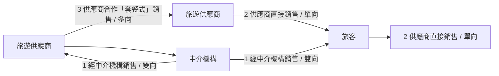
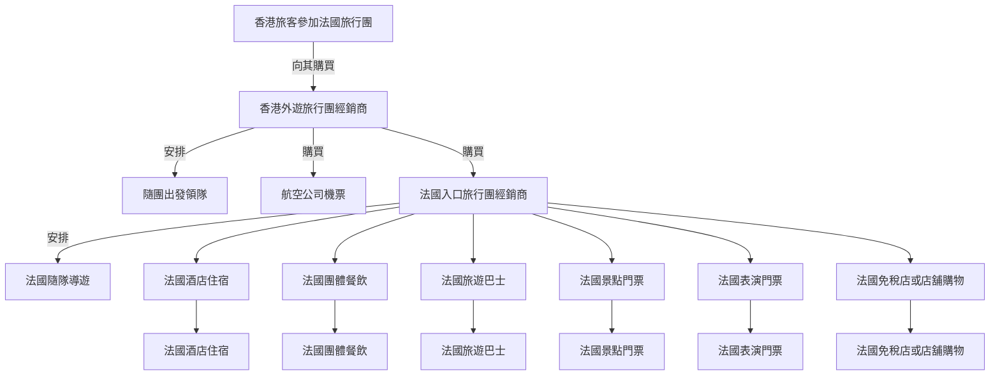
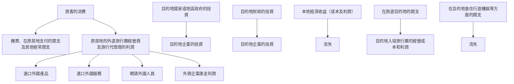
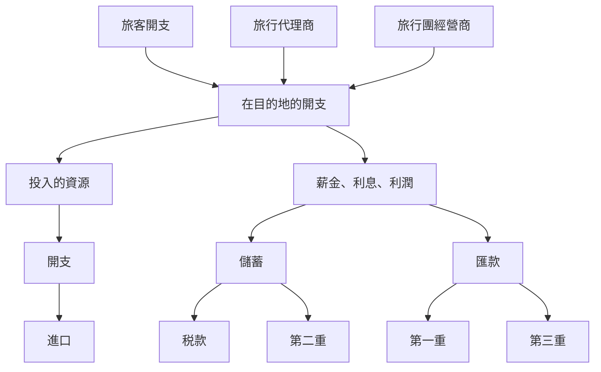
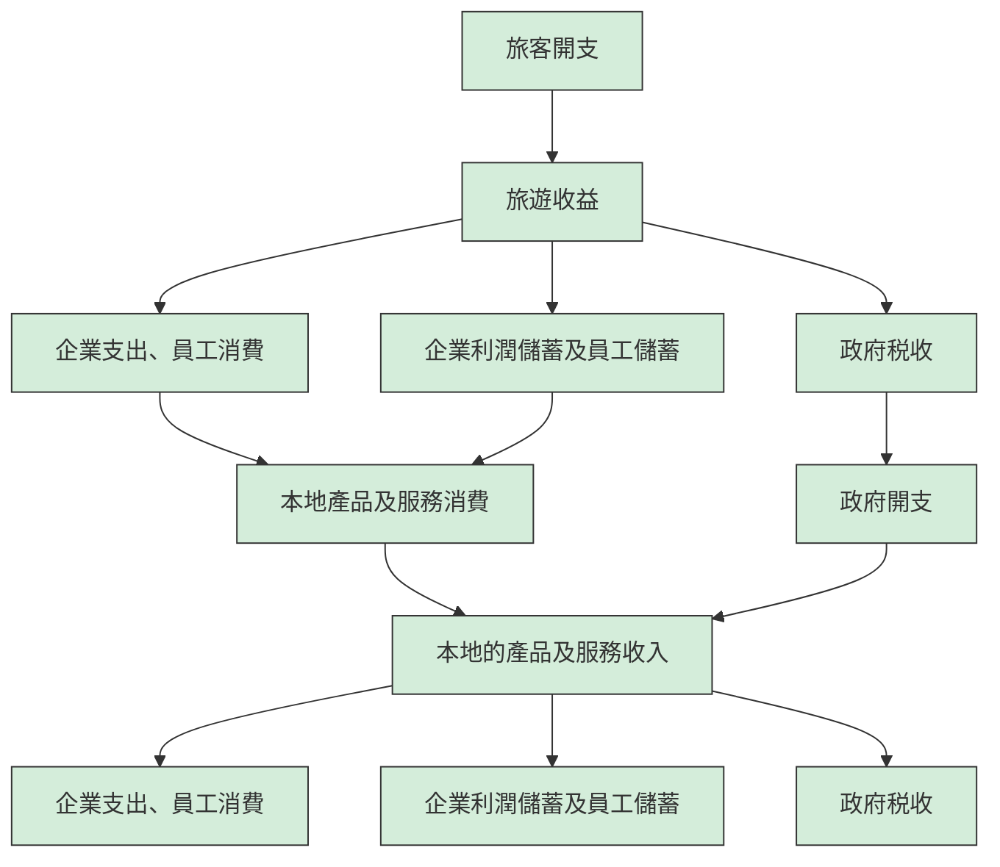
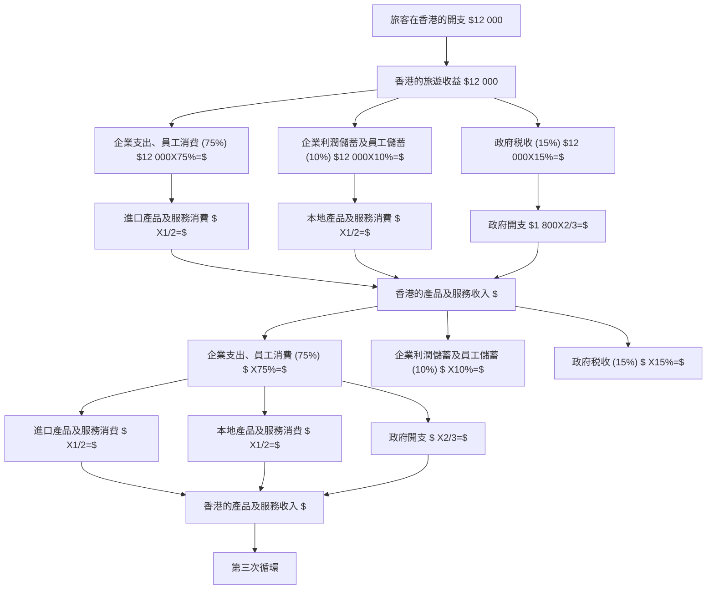

# 6

# 旅遊業的分銷途徑

natural_image

Colorful stylized city skyline illustration featuring iconic landmarks including the Eiffel Tower, Big Ben, and World landmarks (no text or symbols)

分銷是指商品通過交換，從供應者手中轉移到消費者手中的過程。航空公司、酒店、主題公園、郵輪公司、旅遊巴士、汽車租賃公司等旅遊供應商，為了把產品和服務分銷給旅客，會通過多種途徑作銷售。

# 6.1旅遊產品的分銷途徑種類

旅遊產品的分銷途徑主要有三類：經中介機構銷售 ／雙向、供應商直接銷售 ／單向和供應商合作「套餐式」銷售 ／多向。

# 經中介機構銷售 ／雙向

「中介機構」指服務供應商與消費者之間的聯繫者。旅行代理商及旅行團經營商等中介機構，一直在旅遊供應商和旅客之間充當中間人的角色。這些中介機構會整合交通、住宿、餐飲、娛樂等各種旅遊產品和服務，然後向旅客提供旅行團和「自由行」旅遊套票等。

旅客會按照需要，向中介機構購買旅遊產品和服務，而這些機構便可賺取佣金。不過，隨着旅遊產品銷售模式的不斷革新，中介機構在分銷上的重要性已較過去下降。

text_image

香港中国旅行社
CTS
CHINA TOURISM

▲ 圖1.115 旅行社是主要的旅遊中介機構

# 供應商直接銷售 ／單向

隨着資訊科技和互聯網的發展，很多消費者習慣使用智能電話、電腦搜尋及比較產品和服務，再於網上選購。現時不少航空公司、酒店、主題公園等旅遊供應商，都會透過互聯網直接向旅客銷售產品和服務，而不經中介機構。

這加強了旅遊供應商與世界各地旅客的聯繫，為雙方帶來便利。旅遊供應商更可減少給予中介機構佣金，這為供應商使用直接銷售途徑提供誘因，相信全球直接銷售的比例會持續增加。

# 提示箱

旅遊供應商會利用各種途徑銷售產品和服務，但給予不同途徑的折扣不一，旅客所購得產品和服務的價錢，便會因應不同的途徑而可能出現差異。

# 供應商合作「套餐式」銷售 ／多向

為了增加旅遊產品和服務的吸引力，各供應商會合作把產品和服務組合，然後以「套餐式」向旅客銷售。例如航空公司會與酒店合作，推出機票連酒店住宿的套票；郵輪公司會與航空公司合作，推出郵輪假期連往返機票的套票等。這些套票既會直接向旅客銷售，亦會通過中介機構售賣。

旅遊產品的三種分銷途徑示意圖  

flowchart

圖 1.116

# 6.2旅遊中介機構的種類

在旅遊產品和服務的分銷過程中，為了令產品和服務能接觸更多的旅客，不少供應商會透過中介機構把產品和服務轉移到旅客身上。因此，中介機構在分銷過程中扮演着重要的角色。

# 提示箱

在香港，有不少旅行社既是旅行代理商，也是旅行團經營商。

旅遊業的中介機構主要分為旅行代理商和旅行團經營商兩大類。旅行代理商和旅行團經營商又可細分為入口及外遊兩類。

<table><tr><td>旅行代理商</td><td>旅行團經營商</td></tr><tr><td>• 入口旅行代理商
• 外遊旅行代理商</td><td>• 入口旅行團經營商
• 外遊旅行團經營商</td></tr></table>

# 旅行代理商

旅行代理商獲旅遊供應商授權，向旅客出售相關的旅遊產品和服務。旅行代理商亦會向旅遊供應商訂購各類單項旅遊產品和服務，再對它們進行設計及組合，使它們成為一套旅遊產品，然後向旅客出售該產品。向旅客提供旅遊諮詢、代訂旅遊產品、按旅客要求提供產品和服務等，也是旅行代理商的經營範疇。

natural_image

Illustration of a family meeting at a service counter with a staff member, airplane, and beach scene in background (no text or symbols)

▲ 圖1.117 向顧客推介及出售旅遊產品及服務，是旅行代理商其中一項重要工作。

# A 入口旅行代理商

入口旅行代理商代理的是本地旅遊產品和服務，顧客主要是外地同業和外地旅客。

# B 外遊旅行代理商

外遊旅行代理商代理的是外地旅遊產品和服務，顧客主要是本地同業和本地旅客。

# 旅行團經營商

旅行團經營商除了經營旅行代理商的銷售等業務外，還會營辦旅行團，為旅客安排交通、觀光、住宿、餐飲、購物、娛樂，以及提供領隊或導遊等相關服務。

# A 入口旅行團經營商

入口旅行團經營商在本地經營旅行團，專門向抵達當地的旅行團或個別旅客提供觀光導賞服務，並會有導遊隨團講解。

text_image

规模远WMPKG
香港一天道 共9個產品
名称: 出登、欣赏奇映美景
年活动·露露·美食包邮·咖啡逊·咖
家海咖啡馆·珠宝佳肴相册
2014.16.25.21.23...
QHTA
27-16.25.21.23...
QHTD
27-16.25.21.23...
QHTB
27-16.25.21.23...
QHTC
27-16.25.21.23...
QHTD
27-16.25.21.23...
QHTE
27-16.25.21.23...
QHTF
27-16.25.21.23...
QHTG
27-16.25.21.23...
QHTH
27-16.25.21.23...
QHTI
27-16.25.21.23...
QHTJ
27-16.25.21.23...
QHTK
27-16.25.21.23...
QHTL
27-16.25.21.23...
QHTM
27-16.25.21.23...
QHTN
27-16.25.21.23...
QHTO
27-16.25.21.23...
QHTP
27-16.25.21.23...
QHTQ
27-16.25.21.23...
QHTR
27-16.25.21.23...
QHTS
27-16.25.21.23...
QHTU
27-16.25.21.23...
QHTV
27-16.25.21.23...
QHTW
27-16.25.21.23...
QHTX
27-16.25.21.23...
QHTY
27-16.25.21.23...
QHTZ
27-16.25.21.23...
QHTA
27-16.25.21.23...
QHTB
27-16.25.21.23...
QHTC
27-16.25.21.23...
QHTD
27-16.25.21.23...
QHTE
27-16.25.21.23...
QHTF
27- 16 <nl>
排名精选旅行圈
景点推荐：无影色小红眼
空中旅行：白鸽、好睡盆房
旅行时：春雪球
旅游时间：新晴天窗
Bangkok时：日本军人进场
Bangkok时：日本军人进场
Bangkok时：日本军人进场
Bangkok时：日本军人进场
Bangkok时：日本军人进场
Bangkok时：日本军人进场
Bangkok时：日本军人进场
Bangkok时：日本军人进场
Bangkok时：日本军人进场
Bangkok时：日本军人进场
Bangkok时：日本军人进场
Bangkok时：日本军人进场
Bangkok时：日本军人进场
Bangkok时:更多选项
景点·飞瀑·热轮游吧!
旅游性更优
景点·飞瀑·热轮游吧!
游客·飞瀑·热轮游吧!
游客·飞瀑·热轮游吧!
游客·飞瀑·热轮游吧!
游客·飞瀑·热轮游吧!
游客·飞瀑·热轮游吧!
游客·飞瀑·热轮游吧!
游客·飞瀑·热轮游吧!
游客·飞瀑·热轮游吧!
游客·飞瀑·热轮游吧!
游客·飞瀑·热轮游吧!
tourists接待:
游客接待: 火鸟报告之鸟
景点接待: 宋尚频旅·临湖游·黑球海
景点接待: 黑球生境游记
景点接待: 天氧报告之鸟
景点接待: 宋尚频旅·临湖游·黑球海
景点接待: 黑球生境游记
景点接待: 空闲夜·日宴·小食!
景点接待: 黑球生境游记十款贴心
景点接待: 空闲夜·日宴·小食!
景点接待: 黑球生境游记十款贴心
景点接待: 空闲夜·日宴·小食!
景点接待: 黑球生境游记十款贴心
景点接待: 空闲夜·日宴·小食!
景点接待: 黑球生境游记十款贴心
景点接待: 空闲夜·日宴 · 小食!
景点接待: 黑球生境游记十款贴心
景点接待: 空闲夜·日宴 · 小食!
景点接待: 黑球生境游记十款贴心
景点接待: 空闲夜·日宴 · 小食!
景点接待: 黑球生境游记十款贴心
景点接待: 空闲夜·日宴 · 小食!
景点接待: 黑球生境外游记十款贴心
景点接待: 空闲夜·日宴 · 小食!
景点接待: 黑球生境外游记十款贴心
景点接待: 空闲夜·日宴 · 小食!
景点接待: 黑球生境外游记十款贴心
景点接待: 空闲夜·日宴 · 小食!
景点接待: 黑球生境外游记十款贴心
景点接待: 全部行程，可从又方便
海洋公园·米芝莲一堂舒适贴心
景点接待: 国区、县、市、市、市、市、市、市、市、市、市、市、市、市、市、市、市、市、市、市、市、市、市、市、市、市、市、市、市、市、市、市、市、市、市、市、市、市、市、市、市、市、市、市、市、市、市、市、市、市、市、市、<nl>

當外地旅行團的團員抵達當地後，入口旅行團經營商便開始照料團員的起居飲食、交通娛樂等。

不少旅行團經營商會在各酒店大堂服務櫃檯，擺放各式當地旅行團的宣傳品，或透過旅遊應用程式，向個別旅客宣傳本地短期旅行團，以照顧不同類型旅客的需要。

▲ 圖1.118 旅行社介紹香港一天遊旅行團的網頁  

# 例子庫

香港世界地質公園一日遊、海洋公園 / 迪士尼樂園一日遊、維多利亞港遊船之旅等，是香港入口旅行團經營商為入境自由行旅客設計，而且是較熱門的本地旅行團。

# B 外遊旅行團經營商

外遊旅行團經營商會開設分行，向顧客銷售其旅行團產品，並會印製旅遊小冊子，讓旅客了解旅行團的時間、行程、交通工具、酒店住宿、餐飲及價錢等。

當顧客參加旅行團後，外遊旅行團經營商會安排領隊或導遊隨團出發，帶領本地旅客前往世界其他國家或地區，而當地接待的入口旅行團經營商則會按照旅行團的行程規格，為團員安排食、住、行、遊、娛和購等旅遊產品和服務。

外遊旅行團經營商經營方式示意圖  

flowchart

法國的旅遊供應商  
圖 1.119

# 資料室

# 旅遊批發商與旅遊零售商

旅遊中介機構又可分為批發商和零售商兩類。

旅遊批發商是主要從事旅遊批發業務的公司，會將航空公司機票、酒店住宿、景點門票等單項旅遊產品和服務整批購入，再批發給零售商，然後出售予旅客。批發商也會直接向旅客出售旅遊產品和服務。批發商的利潤主要來自批量購買和業務關係獲得旅遊供應商提供的折扣及優惠價格。

旅遊零售商是直接向旅客出售旅遊產品和服務的公司，會代理旅遊供應商或旅遊批發商的產品和服務。零售商不需要預先購入旅遊產品和服務，利潤主要來自售出產品和服務後，旅遊供應商或旅遊批發商給予的佣金。

# 6.3 旅遊中介機構的功能

旅行代理商和旅行團經營商等旅遊中介機構，把旅遊供應商和旅客連繫起來，具有作為旅遊產品和服務主要分銷途徑、組合旅遊產品、提供專業服務，以及促進旅遊業發展等功能。

# 作為主要分銷途徑

雖然旅遊供應商會利用互聯網等渠道直接向旅客出售產品和服務，但旅遊中介機構在旅遊供應商與旅客之間仍扮演重要的橋樑角色。現時，旅遊供應商還相當依賴中介機構，以便把她們的產品和服務分銷給更多旅客。因此，中介機構在旅遊業的主要功能是分銷產品和服務。

text_image

東歐+巴爾幹半島
11天浪漫風光之旅
東歐
中國長達
東歐
中國長達
東歐
中國長達
東歐
中國長達
東歐
中國長達
東歐
中國長達
東歐
中國長達
東歐
中國長達
東歐
中國長達
東歐
中國長達
東歐
中國長達
東歐
中國長達
東歐
中國長達
東歐
中國長達
東歐
中國長達
大乘區
新華區
新華區
新華區
新華區
新華區
新華區
新華區
新華區
新華區
新華區
新華區
新華區
新華區
新華區
新華區
新華區
新華區
新華區
新華區
新華區
新華區
新華區
新華區
新華區
新華區
新华區
新華區
新華區
新華區
新華區
新華區
新華區
新華區
新華區
新華區
新華區
新華區
新華區
新華區
新華區
新華區
新華區
新華區
新華區
新華區
新華區

▲ 圖1.120 旅行社介紹旅行團的網頁

# 2 組合旅遊產品

旅遊中介機構會將從旅遊供應商購入的不同產品和服務加以組合，並包裝成各種主題特色和優惠價格的一站式旅遊產品，如各式旅行團、自由行套票等，以迎合不同類型旅客的需要。

text_image

Travel Expert
專業旅遊
遊遊·Expert
搜索商品
Search
Search
Search
Search
Search
Search
Search
Search
Search
Search
Search
Search
Search
Search
Search
Search
Search
Search
Search
Search
Search
Search
Search
Search
Search
Search
Search
Search
Search
Search
Search
Search
Search
Search
Search
Search
Search
Search
Search
Search
Search
Search
Search
Search
Search
Search
Search
Search
Search
Search
Research & Research & Research & Research & Research & Research & Research & Research & Research & Research & Research & Research & Research & Research & Research & Research & Research & Research & Research & Research & Research & Research & Research & Research & Research & Research & Research & Research & Research & Research & Research & Research & Research & Research & Research & Research & Research & Research & Research & Research & Research & Research & Research & Research & Research & Research & Research & Research & Research & Research & Research & Raising & Raising & Raising & Raising & Raising & Raising & Raising & Raising & Raising & Raising & Raising & Raising & Raising & Raising & Raising & Raising & Raising & Raising & Raising & Raising & Raising & Raising & Raising & Raising & Raising & Raising & Raising & Raising & Raising & Raising & Raising & Raising & Raising & Raising &
Travel行程 · 當地玩樂 · 體驗文化
自由行 董事假題
觀賞工藝 本顧推介 四客 新園 航園 世界 東地店 表美·澳門 中國內地 聊地 欧洲·蘇西羅 美國
本顧推介
考言島外島Phi Phil island Village Beach Resort 1天自由行
Phi Phil island Village Beach Resort 旅游種可我們在世界快速、休憩有自然安樂的旅館中，與國語有多草式開啦。...
web:13,290 m

▲ 圖1.121 旅行社介紹自由行套票的網頁

# 提供專業服務

旅遊中介機構會為旅客提供旅遊資訊及專業意見，幫助旅客計劃行程；為旅客代辦護照、簽證、旅遊保險和食宿交通等手續，簡化所有旅遊產品的交易過程；派出領隊和導遊，照顧旅行團旅客在旅程期間的各項需要，包括食宿交通，以及病患和意外等突發事件。

text_image

康泰旅行社
200A

圖 1.122 旅行社職員在分行為旅客提供服務

# 促進旅遊業發展

旅遊中介機構會組合不同類型的旅遊產品和服務，為旅客節省搜集資料、向各供應商分多次購買產品和服務的時間，能增加旅客參與旅遊活動的動機。中介機構亦會向旅客廣泛宣傳旅遊產品，如推出廣告宣傳、銷售優惠活動等，扮演着推廣旅遊業的角色。

text_image

BANI BUKING
00 45%
BIGBlue
FIBULA AIR TRAVEL
www.fibula.cn
TURSKA
ALL TA
HOMENIA
KENTI KEG
RODOK

▲ 圖1.123 在塞爾維亞舉辦的旅遊博覽會

# 5 使用中介機構的好處

中介機構作為旅遊產品和服務的重要分銷途徑，有很多旅遊供應商會透過中介機構銷售產品和服務，也有不少旅客經中介機構購買產品和服務。旅遊供應商和旅客使用中介機構有以下好處：

# A 對旅遊供應商的好處

• 擴闊銷售：中介機構能有效接觸目標旅客，從而擴大供應商產品和服務的銷售市場。  
• 節省成本：供應商利用中介機構，在擴闊產品和服務銷售網絡的同時，能減省營銷和推廣成本。  
• 增加吸引力：中介機構會組合不同的產品和服務，能增加供應商單一產品和服務的吸引力，從而提高銷量。

text_image

MELONIE
OF THE RESISTIBLE
MILLONE
THE RESISTIBLE
MELONIE

▲ 圖1.124 正在閱讀旅行社宣傳單張的旅客

# B 對旅客的好處

• 節省時間：旅客可經中介機構一次性購買所需的旅遊產品和服務，節省時間和購買程序。  
• 方便行程：中介機構會向旅客提供各種旅遊資訊，為旅客規劃行程，以及協助旅客代辦簽證、購買保險等，能方便旅客。  
• 質素保證：中介機構組合的產品、策劃的旅行團等，經過市場分析和編排，質素較有保證。

# 提示箱

有關與顧客溝通技巧和客務服務工作等方面的內容，將在課題四「客務關係及服務」的「客務關係」加以闡述。

# 6.4旅行社從業員的工作

旅行社從業員在負責產品銷售的同時，需要向顧客提供專業的諮詢服務，以及參與旅遊行程規劃等。因此，從業員有必要裝備自己，掌握有關方面的知識，以配合行業的發展及更好地應對日常工作。

# 旅遊規劃者的工作概況

旅遊規劃者在日常工作中，需要為顧客提供諮詢服務，然後為顧客安排行程等，當中牽涉與顧客的溝通技巧。

# A 為顧客提供諮詢服務

顧客大多沒有專業的旅遊知識，本身可能只有一個基本的行程概念，不了解如何令行程具體落實，或怎樣合理安排行程。

規劃者在為顧客提供旅遊諮詢服務時，要與顧客有良好的溝通，通過提問清楚掌握顧客的要求和預算，並提醒他們行程的合理性。例如顧客可能不肯定自己希望入住的酒店類型、忽略景點與景點之間的距離和交通時間、心目中的行程項目過多等。

在掌握顧客的具體要求和預算後，旅遊規劃者會規劃行程，再依照顧客的回饋作出修訂，最終為顧客確定行程。

# B 為顧客安排和協調行程

旅遊規劃者在確定行程後，需要為顧客執行各項安排工作，包括預訂機票、汽車、酒店、餐廳、觀光景點門票、娛樂項目等。

為了能令行程順利進行，規劃者需要協調與行程相關的事宜。例如出現航機故障、酒店客房爆滿的情況，規劃者便要為顧客更改航班或轉到其他酒店。

▲ 圖 1.125 旅行社職員需為旅客預訂機票及處理航班延誤等事宜

natural_image

Travel passport and passenger plane on wooden surface, no visible text or symbols

# 策劃行程時需要考慮的因素

旅遊規劃者為顧客策劃行程時，需要注意的事項頗多，以下是一些重要的考慮因素：

# A 市場趨勢

策劃行程時，規劃者要對旅遊業市場進行研究，根據市場發展和潮流趨勢，結合服務特色，規劃及調整符合市場需要的旅程。

# 例子庫

• 香港生活壓力大，年輕人多喜愛舒緩壓力與玩樂的旅行方式，從業員可規劃吃、喝、玩、樂的旅遊套票，以配合市場趨勢。

# B 顧客需要

情侶、家庭、朋友、青年、長者等顧客群的興趣、體能及出遊季節等各有不同，對景點、住宿、餐飲、活動、設施和服務等的要求也有分別。規劃者在策劃行程時，應根據旅客的類型及了解他們的具體需要，為他們規劃適合的旅程。

# C 費用預算

費用預算會直接影響顧客對行程的選擇。在規劃行程時，需要了解顧客心目中大約的花費，然後確保目的地、交通工具、酒店類型、餐飲類別、景點和活動項目等，符合他們的預算範圍。

圖 1.126 旅行社職員要根據旅客的費用預算規劃行程，如行程超出預算，旅客也不會選購。  

text_image

"TRAVEL"

# D 旅程特性

規劃者在規劃行程時，要盡量突出旅程與別不同的主題形象和特色，令旅客有獨特的旅遊體驗。

# 例子庫

以意大利歷史深度遊為主題的旅行團，應安排旅客暢遊羅馬、佛羅倫斯等古城，參觀古羅馬遺址及文藝復興時期的建築和藝術品等。  
• 以北歐自然風光為主題的旅行團，應安排欣賞冰川、峽灣等行程。

natural_image

Large cruise ship sailing on a river with snow-capped mountains in the background (no visible text or symbols)

▲ 圖 1.127 挪威冰川、峽灣行程

natural_image

White bus driving through heavy snowfall, no visible text or symbols

▲ 圖1.128 規劃者要考慮雨雪等天氣的影響

# E 整體安排

在突出行程重點的同時，規劃者要充分考慮各項細節，如目的地的社會治安、天氣狀況、不同季節的景觀、節慶日子的旅客量、服務和設施水平，以及對旅程作出合理的時序安排等，才能讓旅客經歷一個稱心愉快的旅程。

# F 經營情況

規劃者在規劃行程時，應根據機構本身的專長、人力資源和經營狀況等，營辦較擅長和有能力應付的行程。

# 例子庫

• 有些旅行團經營商與內地的旅遊供應商關係密切，較為專注營辦內地旅行團。  
• 有些旅行團經營商與日本、南韓的旅遊供應商關係密切，較為專注營辦日本、南韓旅行團。  
• 有些旅行團規模大、資金和人才充裕、合作夥伴多，既會營辦東南亞短線團，亦會營辦歐美長線團

# 活動站

# 為旅客策劃行程

以下有兩組俄羅斯旅客需要旅行社為他們策劃在香港的行程。試根據他們的資料，策劃適合他們的行程，當中要包括航空及海陸交通、住宿、餐飲、觀光。

# 第一組

身分：一對中年的高收入夫婦

要求：豪華、舒適的行程

# 第二組

身分：一對年輕的大學生朋友

要求：經濟、地道的行程

# 第一組

# 第二組

# 3 旅行社從業員所需的產品知識

一名專業的旅行社從業員，應對旅遊目的地、旅程交通、住宿及餐飲、景點、銷售技巧，以及業內營運情況等方面，具有充分的知識。

# A 旅遊目的地

• 地理環境：目的地的地理知識，包括位置、氣候、山川地理、時差、自然特性等情況。  
• 政治形勢：目的地的政治制度、政黨政治、政局情勢等。  
經濟匯率：目的地的經濟發展、主要產業、收入水平、匯率變化、貨幣流通情況等。  
• 社會文化：目的地的語言、人口、民族結構、宗教信仰、飲食習慣、文化風俗、社交禮儀、重要節慶、公眾假期等。  
法律法規：目的地的出入境物品限制、與旅客原居地不同的法律法規等。  
• 衞生治安：目的地的公共衞生情況、醫院位置和聯絡方法、治安情況、警局的位置和聯絡方法。

text_image

DEPARTURES
Time Destination Flight
19:30 NEW YORK R4 4509
19:30 BERLIN EB 7134
19:45 CHARLOTTE DN 0045
19:40 GENEVA OD 7158
19:50 HONG KONG NP 6890
20:05 PHOENIX UC 1207
20:10 MEXICO CITY EB 3436
20:20 SEATTLE R4 4581
20:45 PRAGUE NP 1976

▲ 圖 1.129 旅行社職員要掌握旅程交通等資訊

# B 旅程交通

交通安排：往返原居地與旅遊目的地、往返酒店與景點等的交通運輸安排。  
機場：機場的位置和與市區的距離、候機時間、主要設施、海關和出入境條例、違禁品種類、安全檢查程序、退稅程序等。

• 航空運輸：訂位系統及程序、營運航線、航班起飛和抵達時間、飛行時差、票價、飛機型號、機艙設施和服務、接駁航班、行李限制等。

• 陸路及水路運輸：訂位系統及程序、營運路線、沿途景觀、車輛開車及船隻開船和抵達時間、票價、車輛及船隻設施和服務、接駁點、行李安放等。

• 運輸成本：各種交通運輸工具的成本和效益的知識等。

# C 住宿及餐飲

• 住宿資料：酒店等級、酒店設施和服務概況、酒店位置等。  
餐飲資料：餐廳類別、特色餐飲、餐廳位置等。  
• 訂購資料：訂購方法和程序、訂購折扣等。

text_image

Group of people observing a historical exhibition panel with Chinese text and architectural illustrations.

# D 景點

參觀資料：主要景點的特色、位置、開放時間、收費、交通情況等。  
訂票資料：訂票方法和程序、訂票折扣等。

圖 1.130 旅行社職員要對景點資訊有所認識，才能向旅客解說。

# E 營銷技巧

• 銷售技巧：對產品和服務的認識、向旅客展示和銷售產品的策略和技巧等。  
銷售流程：吸引顧客，並向顧客展示、推廣和銷售產品的服務流程，以及使用訂購系統的流程等。

# F 業內營運情況

• 行業概況：旅遊行業的旺淡季、術語，同業的定價和市場定位等。  
• 營運概況：各同事的工作範疇（如領隊、導遊等）、行政和文書程序所需表格及時間等。  
• 服務質素：所工作旅行社及同業的服務質素，包括服務水平、服務範圍等。

另外，旅行社從業員擁有良好的語言表達能力、文書溝通能力，以及具備電腦軟件操作知識等，均有助日常工作和提高顧客的服務體驗。

# 蒐集旅遊目的地或景點的相關信息

在日常工作中，旅行社從業員在策劃行程、向顧客介紹行程，以及回應顧客查詢時，都需要掌握旅遊目的地或景點的相關資訊。以下是旅行社從業員取得旅遊目的地或景點信息的主要途徑：

# A 目的地的旅遊部門或相關機構

世界各地的旅遊部門會向外界提供景點、交通、氣候、節日文化、活動盛事、注意事項等旅遊資訊。旅行社從業員除了可以像旅客般，在相關旅遊部門的網站查閱外，亦可透過專為業界提供的接洽方法，直接向相關旅遊部門查詢出入境安排、社會治安等資訊。

text_image

澳門心感受
澳門心旅行滙滙政府旅遊局
INVESTING 2020 SERVICE OF TURNSO
NACAO GOVERNMENT TOURISM OFFICE
智能行程規劃 新劇行程 > 觀光購物 > 美食風情 芭日盛事 住宿
外觀旅客：禁止入境（申請受騒者及予測）守續內駐、香港、台灣服務：入境前21人內電話的過半線，禁止入境（申請受騒條件及予測）入境前25人內電話到港香港，求持有24小時內運行的新型送客車寄便搬搬機器...

▲ 圖1.131 澳門旅遊局網頁，提供智能行程規劃、觀光購物、美食風情、節日盛事等資訊。

# B 旅遊業協會及國際性組織

旅行社等中介機構可以通過聯絡目的地的旅遊業協會，了解當地某個界別提供的優惠和特別活動。旅行社等也可以透過參加國際性組織舉辦的會議、展覽，以及從有關旅遊網站、旅遊刊物等，獲得各種最新的旅遊資訊。

# C 供應商及目的地同業

旅行社等中介機構平時需要與目的地的旅遊供應商，如航空公司、酒店、主題公園、購物商場等，以及目的地的旅行代理商、旅行團經營商等，保持緊密聯繫。通過交流，旅行社從業員可定期向供應商及目的地同業交換最新的旅遊產品、折扣優惠、特色活動、交通安排等資訊。

# D 旅行社資源

旅行社有時會派職員到目的地實地視察，了解可配合旅程的各項旅遊資源和服務。另外，部分旅行社甚至會在目的地設立分行，在拓展業務之外，協助搜集最新的旅遊資訊，以及發掘具特色的旅遊項目。

# E 其他途徑

隨着資訊科技的發展，旅行社從業員可利用互聯網科技，透過瀏覽旅遊網站或旅遊博客的網誌，搜集目的地的資訊、找尋旅客發現的新景點及新體驗等。從業員亦可閱讀目的地的旅遊雜誌、小冊子等，獲得目的地的旅遊資料。

text_image

Best of the week
TRAVEL

▲ 圖 1.132 旅遊網站或旅遊博客的網誌已成為不少旅行社從業員獲得目的地旅遊資料的途徑

旅遊業涉及多個不同的行業，既有大企業的參與，也有中小企的營運，對一地的發展起着舉足輕重的作用，其影響涵蓋經濟、社會、文化、環境等方面。

# 7.1 旅遊業對經濟的影響

隨着社會的發展，旅遊業在全球經濟中的地位日益重要，並為目的地國家或地區的經濟帶來正面和負面影響。

# 旅遊業對經濟的正面影響

旅遊業對經濟的正面影響包括製造就業職位、增加稅務收入、改善國際收支差距、帶動經濟增長、提高生活水平，以及產生乘數效應等

natural_image

Interior scene with a customer at a counter and a man in a blue suit jacket, alongside a blue suitcase and staircase (no visible text or symbols)

▲ 圖 1.133 酒店前堂部員工屬旅遊業製造的直接職位

# A 製造就業職位

旅遊業是勞工密集的產業，主要透過提供旅遊服務給旅客來賺取利潤。因此，與其他產業相比，旅遊業明顯需要聘用較多的人力，可製造大量就業機會。

旅遊業製造的就業職位，可分為直接職位和間接職位。直接職位來自直接為旅客提供服務的行業，包括酒店業、餐飲業、交通運輸業、娛樂業，以及旅遊代理商和旅行團經營商等。間接職位來自與旅遊相關行業，為旅遊機構和商店生產商品及提供服務。

# 例子庫

• 直接職位有酒店前堂部和客務部的員工、旅行社的領隊和導遊、旅遊景點的接待員等。  
間接職位有為酒店提供日用品和食材的供應商和運輸工人、為主題公園製造紀念品的生產商和工人等。

# B 增加稅務收入

發展旅遊業可以起到增加目的地政府稅務收入的作用。與旅客直接相關的酒店房租稅、機場離境稅，以及旅遊服務供應商、中介機構等旅遊相關企業的利得稅，旅遊從業員的個人入息稅等，都能增加政府的稅項收入。

text_image

Easy Tax Refund
Easy Tax Refund
简 Arabic 繁 漢語
(国語) (默語)
E English あ 日本語
atanTora B Bahasa
Malaya
Bahasa Indonesia Pyrconinksa 英姆亞洲
Innatek Español 水和歌
支付宝
LIBAY
✓ 即时到账
✓ 直退人民币
✓ 到账有通知
用支付宝退税
请提前准备
支付宝条形码

▲ 圖 1.134 韓國機場的自助退稅機

部分國家，如日本、新加坡、英國、德國、法國等，會開徵銷售稅，而這些稅項會轉嫁到旅客身上。不過，為了避免打擊旅客的消費意欲，不少國家會給予旅客退稅優惠，當旅客購買超過指定金額的商品，可在離境前辦理退稅手續。

政府稅收的來源

<table><tr><td>直接稅</td><td>間接稅</td></tr><tr><td>入息稅(來自個人收入)利得稅(來自公司收入)旅客的開支會增加:旅遊從業員的收入;公司東主的利潤,能增加政府的税項收入。</td><td>銷售稅離境稅酒店房間稅應課税品税項</td></tr></table>

# 提示箱

香港自 2008 年 7 月 1 日起免收酒店房租稅。但由 2025 年 1 月 1 日 起政府將重徵酒店房租稅，稅率為 3%。

# 資料室

# 免稅店

免稅店指經政府部門批准，在機場、港口、車站和邊境口岸等指定地點設立，向出入境旅客銷售免稅進口商品的場所。免稅店銷售的商品，一般存放在海關的指定地點，免繳交進口稅款，並受到海關部門的監管和核對。由於有關商品不需繳交稅款，因此旅客能夠以比本地更低的價格購買。

text_image

TAX FREE & TRAVEL
Special
after
0%

▲ 圖1.135 比利時機場的免稅店

# C 改善國際收支差額

國際收支差額指在一段時間內，一個國家在對外貿易中，貨物、服務和資金的流入和流出情況。當一個國家在對外貿易中賺取的收入多於支出，代表該國在收支差額上有盈餘。當一個國家的對外貿易支出高於其賺取的收入，代表該國在收支差額上出現赤字。

旅遊業可以為一地帶來外匯收入，有助改善當地的收支差額。其中入境旅遊透過提供旅遊產品和服務給海外旅客，使當地從對外貿易中賺取金錢。入境旅客前來消費，往往需要兌換當地貨幣，亦令當地的外匯收入增加。旅遊業在外匯收入方面的貢獻，對發展中國家尤其重要。

# D 帶動經濟增長

旅遊業涉及「食、住、行、遊、購、娛」等多個行業，因此旅遊業的發展能夠促進各行各業的進一步發展。例如興建酒店、道路等基礎設施需要建築業，接載旅客需要交通運輸業，售賣旅遊手信需要食品製造業和工藝品製造業等。可見發展旅遊業，可以帶動整體經濟增長，以及有助經濟多元化發展。

text_image

送禮

圖1.136售賣紀念品的非洲婦女

text_image

送禮佳品
MACAU
澳門
馬門特產
▲圖1.137 澳門旅遊業帶到

澳門旅遊業帶動了當地食品製造業的發屏

# E 提高生活水平

旅遊業的蓬勃發展，可以為當地從事旅遊業的員工帶來更高的收入，使他們能夠購買更多商品和服務，從而提高個人及家庭的生活水平。至於當地政府為了推動旅遊業發展，會致力改善交通、電力、排污、通訊等設施，當地居民亦能夠受惠，生活質素得到提高。

natural_image

Rural road scene with a man pulling a hay-drawn cart and a car, surrounded by greenery and a paved road (no visible text or symbols)

▲ 圖1.138 旅遊業推動政府改善公路交通基建，令居民受惠。

# 提示箱

有關乘數效應的內容，將在本書頁 129 至 132加以闡述。

# F 產生乘數效應

無論是當地政府、企業的投資，還是旅客在目的地的消費，都是對旅遊行業的投入。在乘數效應的帶動下，這些投資和收入會流入當地的經濟活動中，為當地產生加倍擴大的連鎖反應，使經濟效益以倍數增加。

# 例子庫

旅客在當地的消費，可以讓旅遊企業賺取利潤，使旅遊企業能夠有資金進一步擴展業務，如旅行社可開設更多分行、酒店可興建更多酒店、旅遊巴公司可購置更多巴士等。  
從事旅遊業的員工，可以利用薪金進行各種消費，如能夠存錢購置私家車、購買智能電話、與家人到餐廳用餐等，為其他行業帶來生意，需要聘請更多人手等。

# 旅遊業對經濟的負面影響

旅遊業對經濟的負面影響包括造成通脹壓力、依賴旅遊業、增加機會成本，以及造成資金流失等。

# A 造成通脹壓力

隨着旅遊業蓬勃發展和大量旅客到訪，會對當地土地、物資、人力等方面造成壓力。在需求持續增加的情況下，容易導致通貨膨脹，推高價格，對當地居民造成負面影響。

# 例子庫

• 酒店、服務旅客的商店和餐廳等，會爭相在地理位置優越的地段開業，帶動當地租金和地價上漲。  
旅遊業需要大量物資、食品、交通運輸工具等，來服務越來越多的旅客，加上旅遊區租金、人力等成本上漲，會推高商品價格。一些無法負擔生活成本上升的原居民，可能要被迫遷離旅遊區。  
‧ 旅遊業是需要大量勞工的產業，隨着旅客數量上升，需要的人力資源也越多，這會造成勞工市場短缺，工資水平隨之上漲。

# 思考點

對比其他旅遊城市，香港對旅遊業有沒有過分依賴的情況？

# B 過分依賴旅遊業

旅遊業容易受到外在環境變化的影響。當外圍經濟不景氣，或大規模傳染病爆發，或目的地吸引力消退，旅客人數大減，以旅遊業為支柱產業的地區，經濟便會因為對旅遊業依賴程度過高，而受到嚴重衝擊。

# 例子庫

• 受到 2008 年環球金融海嘯影響，全球經濟不景氣，前往加勒比

海度假的歐美旅客大減，當地不少酒店、旅行社倒閉，經濟大受打擊。

受到 2019 年爆發的冠狀病毒病疫情影響，全球旅遊業幾乎陷於停頓。其中以旅遊業為支柱產業的泰國，當地酒店業協會於 2020 年9月表示，已有約100萬名酒店業員工在疫情下被裁。

text_image

TOUR SERVICE

圖 1.139 2019 冠狀病毒病疫情下的泰國曼谷機場

# C 增加機會成本

當政府將土地、資金、人力資源等投入到發展旅遊業時，其他產業及社區福利的投入會相對減少，例如發展工商農業的土地會被用於發展旅遊業，教育和醫療的開支由於需投入資金發展旅遊業而未能上調。因此，發展旅遊業會增加目的地國家或地區經濟發展的機會成本。

# D 造成資金流失

雖然旅遊業可為目的地國家或地區帶來外匯收入，以及改善國際收支差距，但是在旅遊業發展過程中，可能出現資金流失的情況，使目的地國家或地區的經濟利益受損。資金流失的情況主要有以下幾項：

• 目的地國家或地區旅遊業未能提供入境旅客所需的產品和服務，需要從外地進口，以滿足旅客的需要，過程中造成外匯的流出。  
• 目的地國家或地區興建旅遊設施，如機場、碼頭、酒店、主題公園等，需要從外國進口器材，並聘請外國的專業人員，導致當地要為此花費大筆外匯。  
在目的地國家或地區擁有旅遊設施的外資企業，會把賺取的利潤轉回本國，或投放到海外市場；在當地從事旅遊業的外國員工，亦會把薪金匯返本國。

text_image

Rotel Tours
Das Rollende Hotel
Rotel Tours Das Rollende Hotel

▲ 圖1.140 不少發展中國家需要從發達國家購入汽車，接待旅客。

# 資料室

# 旅客應多選用目的地國家或地區的旅遊資源

資金流失的情況，在缺乏物資、人才的落後發展中國家最為常見，因為當地往往需要大量進口物資和引進外地人才，才能進一步發展旅遊業。根據聯合國的數據，部分發展中國家所得的旅遊收益，可能只有旅客在當地總消費的 5 至 20%。

為了減少發展中國家在發展旅遊業時所產生的資金流失，聯合國世界旅遊組織建議旅客多選用目的地國家或地區的旅遊資源。原因是這樣可以令當地的旅遊收入在乘數效應下，發揮最大的經濟效益，從而幫助發展中國家發展。

目的地國家或地區旅遊資金流失過程示意圖  

flowchart

圖 1.141

# 量度旅遊業對經濟的影響

要了解旅遊業對目的地國家或地區帶來的經濟收益，可以從旅客消費資金的流量過程及旅遊業的乘數效應兩方面進行探討。

# A 資金流動的三重效應

從旅客消費的資金進入目的地國家或地區後，資金流量就會經過三個階段，產生三重效應。

# 第一重效應：資金進入目的地國家或地區

旅客在經濟鏈的開端開始消費，其直接或間接地購買旅遊產品及服務，會令資金流入目的地國家或地區。

不過，資金流入目的地國家或地區的多寡，視乎旅行代理商和旅行團經營商在當地的開支百分比。假如代理商和經營商議價時爭取到較大的折扣，目的地國家或地區的資金流入會減少。

# 例子庫

一名入境旅客在整個行程花費了二萬五千元，機票和出發地旅行社的成本和利潤佔去了一萬五千元，用於目的地國家或地區的資金便只有一萬元。

# 第二重效應：目的地國家或地區的旅遊開支

目的地國家或地區的旅遊業界在收取到旅客，或旅行代理商和旅行團經營商的開支後，會接力將收入投入到各項營運消費，以及支付從業員的薪金、資金的貸款利息等，餘下的將會是企業的利潤。

# 第三重效應：企業和從業員的資金運用

至於企業和從業員在收到款項後，會按各自的需要運用資金。例如企業會把利潤再作投資，從業員會把薪金用於個人消費、儲蓄、繳稅等。

旅客資金流量的三個階段示意圖  

flowchart

在旅客資金流動的過程中，要注意以下幾個地方出現漏損：進口產品和服務的多寡直接影響漏損：旅遊業對國際收支差額的貢獻，不能單看初期的開支金額，更要關注進口產品和服務所導致的漏損資金。假如當地旅遊業需要從外地大量進口產品和服務，漏損就會相對嚴重，即使旅客數量大增，乘數效應亦不明顯。

儲蓄及稅款會回流到經濟體系：儲蓄及稅款可被視作開支週期中漏損的部份。不過，實際上儲蓄屬於延後消費，而部份稅款會以政府開支的形式回流到經濟體系中，因此這兩種漏損情況都是短暫的。

匯款的多少視乎外國企業和員工的人數：至於匯出利潤的多寡，要視乎外國企業及外國員工的參與情況。假如旅遊企業大多由本地居民所擁有，或僱員大部分是本地人，匯出的利潤會較少，漏損的資金便較少。

# B 旅遊業的乘數效應

旅客在東道國家或地區的每一次開支，都會在當地經濟系統中產生不少乘數效應，有助促進當地的經濟發展。

# 例子庫

當一名訪港旅客在餐廳和手信店消費後，餐廳和手信店便賺取了一筆收入。餐廳和手信店會把收入用作員工的薪金、繳付租金、交納稅款，部分會用來向本地或外地供應商購買貨品及服務，些利潤會用於儲蓄。

當員工收到餐廳或手信店的薪金後，他們又會利用這些金錢購買貨品及服務、交納稅款、儲蓄等。本地供應商及業主收到餐廳或手信店支付的金錢後，也會作上述用途。此後，這些開支還會不斷使用下去。

因此，當該名旅客在港消費後，本港得到的收益便會在經濟中循環使用。過程中，由於不同經濟活動之間緊密聯繫，而當越多收入用於購買本地貨品及服務，乘數效應對香港經濟產生的效益便會越大。

旅客開支的乘數效應示意圖  

flowchart

圖 1.143

# 活動站

# 計算經濟效益

以下是一名旅客在香港消費了一萬二千元，然後有關開支在乘數效應中產生兩次循環的例子。試計算該名旅客的開支，在香港經濟產生的效益。

flowchart

經過兩次循環，本港的稅收達： ；儲蓄達：

；本地產品及服務收入達：

該名旅客的\$12 000開支帶來的經濟效益合共： C

# 7.2旅遊業對社會文化的影響

旅遊業為目的地國家或地區帶來旅客，而旅客的到來為當地的社會文化帶來正面和負面影響。

# 旅遊業對社會的正面影響

旅遊業對目的地國家或地區社會的正面影響，包括改進社區設施、改善民眾生活，以及拓闊民眾視野等。

# A 改進社區設施

政府為了發展旅遊業，會興建及完善交通、通訊、衞生等基礎設施；企業亦會投資創建酒店、餐廳、購物商場、娛樂場所等配合旅遊業的設施。這些基礎設施的出現，可提高當地民眾的生活素質。

# 例子庫

香港政府為了方便居民及旅客由香港國際機場、港珠澳大橋往返新界西地區，興建了屯門至赤鱲角連接路，並於2020年底通車，大大縮短了屯門至赤鱲角的行車時間。

natural_image

People rowing boats on a tropical beach with palm trees and sailboats in the background (no visible text or symbols)

▲ 圖 1.144 出海為酒店捕魚的漁民

# B 改善民眾生活

旅遊業能為社區創造不少就業機會，有助吸納一批低技術勞工，發揮扶助貧窮的作用。另外，旅遊業及相關行業眾多，不少對資金的需求不多，較容易讓當地民眾透過創業發展，達到收入重新分配的效果。

# 例子庫

• 酒店和主題公園的清潔、保安等職位，可吸納低技術勞工；本地漁民和農夫，可把收穫售賣給當地旅遊區的餐廳，以獲得利潤。  
‧ 在一些發展中國家，部分家庭主婦會利用空閒時間，製作紡織品、竹織品等手工藝品，然後售賣給旅客或紀念品商店，以賺取收入，幫補家計。

# C 拓闊民眾視野

目的地國家或地區民眾與旅客接觸、交往，有更多機會相互認識，增進了解，從而減少雙方的誤解和成見，建立正確的相處態度。當地民眾在與旅客的交流過程中，能吸收新的知識、思想、價值觀及生活方式，也有助擴闊他們的視野，進而提升生活品味。

# 旅遊業對社會的負面影響

旅遊業對目的地國家或地區社會的負面影響，包括影響居民生活、改變社會結構、增加傳染病風險、產生社會治安問題，以及帶來道德衝擊等。

natural_image

Crowded beach scene with many people relaxing on colorful beaches, no visible text or signage

▲ 圖1.145 滿佈旅客的沙灘

# A 影響居民生活

旅客過多，會造成社區過度擠迫、 佔用社區設施和資源等問題，影響居民正常生活，甚至令居民產生心理、空間、生態承受力問題。另外，一些旅客漠視居民的感受，如嘈吵和不禮貌，更會導致雙方發生衝突。

# 例子庫

假日是旅客數目最多的日子，大批旅客湧到海灘、購物商場等，可能會令當地居民寧願留在家中，也不想前往擠擁的公共空間。旅客的車輛不當佔用道路，造成交通阻塞等，亦會引起當地居民不滿。

# B 改變社會結構

旅遊業在創造大量就業職位的同時，會吸引各行各業的工人投身其中。例如農民、漁民等不再從事農耕或捕魚，寧願到酒店、主題公園等環境較佳的地方工作。這會改變社會的就業結構，以至影響產業發展前景。

發展旅遊業，可以為不少女性帶來工作或發展事業的機會。她們在經濟上有自主的能力，但照顧家庭的角色減退，令社會階級出現轉變。加上旅遊業的旺季多為假期，以致婦女往往無法在假期與子女相處，對子女的成長可能產生負面影響。

# C 增加傳染病風險

旅遊業把旅客帶到世界各地促進了人員的往來，會增加冠狀病毒病、寨卡病毒、登革熱、瘧疾及愛滋病等傳染病的傳播風險，對各地

natural_image

Two girls standing outdoors holding colorful handmade crafts, surrounded by leafy ground (no text visible)

圖1.146不少發展中國家的旅游景點有兒童販賣紀念品的現象。

natural_image

Illustration of a group of children reacting to a fire at night, with buildings and streetlights in the background (no text or symbols)

▲ 圖 1.147 醉酒的旅客可能會騷擾居民

# D 產生社會治安問題

旅客攜帶的現鈔較多，對目的地情況了解有限，容易成為不法分子搶劫、盜竊的對象。在旅遊季節，隨着旅客人數的增加，搶劫、盜竊等罪案往往隨之上升。另外，旅遊區聚集了各地旅客，人流較為複雜，較多出現酗酒、打鬥、賭博、吸毒等治安問題。

# E 帶來道德衝擊

賣淫活動是不少國家或地區存在的社會問題。一些旅客到訪其他國家或地區後，為了追求擺脫束縛的感覺，會在當地尋歡作樂，令旅遊區的賣淫活動增多。當地部分人士為了賺取較高收入，不惜投身賣淫行業。賣淫活動甚至牽涉兒童色情、非法人口販賣等衝擊社會道德的議題。

在旅遊業巨大經濟利益的吸引下，民眾為了賺取更多金錢，或會欺詐旅客，導致原本淳樸的民風消失。

# 例子庫

• 的士司機濫收旅客車資的情況，在世界各地旅遊城市不時發生。  
‧ 有一些在旅遊區經營的餐廳，會刻意向旅客提供較本地顧客收費高昂的餐單，或以平價的死海鮮替換貴價的活海鮮。

# 3 旅遊業對文化的正面影響

旅遊業對目的地國家或地區文化的正面影響，包括促進文化交流、加強文化保育，以及帶來文化保育資金等。

# A 促進文化交流

旅遊業能增進目的地民眾與旅客之間的接觸和交往，從而加深雙方的了解，減低對彼此的誤解及成見。同時，目的地國家或地區民眾和旅客多接觸，有助學習外來文化風俗，增加文化交流，培養尊重和接納不同文化的態度。

# B 加強文化保育

旅客對目的地文化表示欣賞，會培育出當地民眾對自身文化的自豪感，以及願意將當地文化發揚光大。同時，為了吸引更多旅客，當地政府及民眾會重視對文物建築的保育，加強對傳統文化遺產的保護研究和管理。

# C 帶來文化保育資金

旅遊業帶來的經濟收益，可讓當地政府及企業用於保護和恢復名勝古跡。旅客購買目的地民眾製作的傳統手工藝品，或付費觀賞當地傳統表演、參加文化學習班等，均可吸引當地年輕一代投身相關文化事業，使傳統文化得到延續。

# 例子庫

中國四川的樂山大佛於 1996 年被列入世界文化遺產，每年吸引大量中外旅客到訪。當地政府的稅收隨着旅遊業的增長而上升，並撥款於佛像的修復工作，以及修築防水牆等，以阻擋江水對佛像的直接沖刷。

natural_image

Group of performers in traditional Thai costumes dancing on stage with a yellow temple backdrop (no visible text or symbols)

圖 1.148 向旅客表演民族舞蹈的泰國舞蹈員

# 旅遊業對文化的負面影響

旅遊業對目的地國家或地區文化的負面影響，包括產生示範效應、出現文化衝突、傳統文化商業化，以及損害文物古跡等。

# A 產生示範效應

示範效應是指旅客的消費行為與生活模式對目的地國家或地區民眾的影響作用，包括比較及模仿。示範效應對較易接受新事物的青少年影響較大，當他們過分模仿旅客的文化及生活，如衣着打扮、飲食習慣等，可能會導致本身的文化失傳。另外，當地民眾可能會因為無法追上旅客的生活水平及方式，或長期要服務旅客而產生自卑感，甚至對旅客懷有敵意心態。

text_image

為什麼要我服務這些人？上天太不公平。
◀圖 1.149 服務旅客可能會令部分人產生自卑感。
B 出現文化衝突
旅客與目的地民眾之間的文化和風俗或存在較大差異，雙方的不良接觸，可能會令居民對旅客產生負面看法及誤解，甚至出現文化衝突。

▲ 圖 1.150 旅客未經同意而拍攝當地人家居，引起居民不滿。

# 例子庫

一些旅客可能未經當地居民的同意，便闖入當地居民的家中，拍攝當地人的生活或家中擺設等，或會引起當地居民的不滿。  
部分信奉伊斯蘭教的國家，對婦女衣着和言行的要求較為保守，而歐美等西方國家的女性，在原居地時衣着較為隨意，又可四處活動，到訪伊斯蘭教國家時，或容易違反當地規則及習俗。

# C 傳統文化商業化

旅客經常會在目的地購買傳統工藝品作紀念。由於供不應求的關係，工藝品需要在工廠大量生產，以致手工藝品在過程中失去原有的文化意義。為了迎合旅客的喜好，目的地製造商往往會把工藝品加以改造，令工藝品失去其文化內涵。

另外，為了應付越來越多的旅客，目的地的傳統文化習俗或表演在需求下，也需要作出改變，導致傳統文化失去本來的意義。

# 例子庫

為了迎合時下旅客普遍使用智能電話及平板電腦的生活習慣，些製造商會把工藝品改造成適合放置上述電子產品的擺設或配飾。  
夏威夷等南太平洋島國的土著，喜歡用鮮花來歡迎賓客。但由於旅客人數越來越多，加上鮮花成本高昂，不少地方改用以人造物料製造的可循環再用花圈。

# D 損害文物古跡

旅客身體、 照相機及電話閃光燈的熱力等，會對壁畫、油畫等文化古跡造成破壞。因此，不少景點已實施參觀人數限制，以及禁止旅客拍攝。另外，一些旅客不當使用自拍桿，或亂塗亂畫等惡劣行為，更會直接損害文物古跡。

text_image

××到此一道

▲ 圖1.151 旅客在文物古跡上塗鴉或寫字，對其造成直接破壞。

# 5 量度旅遊業對社會的影響

在與旅客接觸的過程中，目的地居民對旅客的態度，會隨着情況的轉變而出現變化。

學者多克西（Doxey）於1975年提出「對旅客的情緒指標」，去量度目的地國家或地區民眾對旅客態度經歷的五個轉變階段：興奮愉快、理所當然、煩厭不快、敵對感覺、得不償失。當旅客人數不斷上升，對當地社會帶來壓力，最終超出當地居民所能容忍的限度，居民的情緒便由正面轉趨負面。

對旅客的情緒指標

<table><tr><td rowspan="5">階段</td><td>1. 興奮愉快</td><td>· 目的地的旅遊業尚未發展,旅客的到訪為當地製造了賺錢的機會,因此居民歡迎外來旅客的到訪,相信旅客能為本地發展帶來好處。· 在這一階段,居民與旅客都能從中得到滿足。</td></tr><tr><td>2. 理所當然</td><td>· 隨着旅遊業的逐漸發達,目的地居民開始視旅客的到訪為理所當然的事,而旅客亦成為居民賺取金錢的目標。· 在這一階段,居民與旅客的交往變得形式化。</td></tr><tr><td>3. 煩厭不快</td><td>· 隨着旅遊業發展至接近飽和水平,或目的地社區的設施和資源已不足以應付旅客的增長時,當地居民就會對旅客產生煩厭不快的情緒。</td></tr><tr><td>4. 敵對感覺</td><td>· 當目的地居民的煩厭不快情緒日益高漲,他們就會將旅客視作一切問題的始作俑者,對旅客原有的尊重轉化為敵視。· 旅客受欺詐和敵視的情況越來越多,到訪的意欲下降。</td></tr><tr><td>5. 得不償失</td><td>· 目的地居民接受當地社會已改變及無法復原的現實,繼續在已改變的環境中生活下去。· 目的地或許仍能吸引旅客,但吸引旅客的已非當年受歡迎的特色,到訪的旅客也不是當年鐘愛這地方的旅客群。</td></tr></table>

多克西的旅客情緒指標  

line

| 游緒     | 旅客數目 |
| -------- | -------- |
| 興奮愉快 | 1        |
| 理所當然 | 2        |
| 煩厭不快 | 3        |
| 敵對感覺 | 4        |
| 得不償失 | 5        |

圖 1.152

# 資料室

# 多克西旅客情緒指標與巴特勒旅遊目的地生命週期理論

多克西旅客情緒指標的各階段，可在此前學過的巴特勒旅遊目的地生命週期的階段出現。

<table><tr><td>多克西旅客情緒指標</td><td>巴特勒旅遊目的地生命週期</td><td>旅遊目的地對旅客的反應</td></tr><tr><td>興奮愉快</td><td>發掘投入</td><td>此階段目的地旅客人數不算多,旅客對當地社群的影響較小,當地居民的生活沒有太大改變,對旅客持歡迎態度,旅客感到興奮愉快。</td></tr><tr><td>理所當然</td><td>發展</td><td>此階段目的地旅客人數急增,當地居民對旅客的到來視為理所當然,居民視旅客為賺錢的工具,交往變得形式化,而旅客對目的地社群的負面影響慢慢浮現。</td></tr><tr><td>煩厭不快</td><td>鞏固</td><td>目的地旅客人數持續增長,進入鞏固階段,但旅客對目的地社群的負面影響日漸明顯,當地居民的不滿日增,開始與旅客出現對立的情況。</td></tr><tr><td>敵對感覺</td><td>停滯衰落</td><td>此階段目的地社群對旅客的不滿進一步增加,居民把旅遊業看作各種問題的原因,旅客與居民對立的情況不時出現,而當地旅遊業發展停滯,甚至衰落。</td></tr></table>

# 多克西旅客情緒指標與蒲樂旅客分類模式理論

多克西旅客情緒指標的各階段，同樣可配對到蒲樂的旅客分類模式。

<table><tr><td>多克西旅客情緒指標</td><td>蒲樂旅客分類模式</td></tr><tr><td>興奮愉快</td><td>探奇型</td></tr><tr><td>理所當然</td><td>接近探奇型</td></tr><tr><td>煩厭不快</td><td>中庸型</td></tr><tr><td>敵對感覺</td><td>接近保守型</td></tr><tr><td>得不償失</td><td>保守型</td></tr></table>

旅遊目的地開始發展階段 ，服務和設施未完備，但能夠吸引探奇型旅客，而當地居民感到興奮愉快；當目的地發展日趨成熟，中庸型旅客的到訪人數比例持續增加；直至目的地的服務和設施完備，成為熱門的旅遊目的地，對保守型旅客的吸引力增加，但當地居民的旅客情緒也變得敵對。

# 7.3 旅遊業對環境的影響

旅遊業對目的地國家或地區的環境有多個正面影響，但同時會產生多種負面影響。

# 旅遊業對環境的正面影響

旅遊業對環境的正面影響，包括帶來環境保育資金、改善旅遊環境，以及提高環境保育意識等。

text_image

TSAVO EAST NATIONAL PARK
VOI GATE
Theatre de la NAVA
NOTICE

# A 帶來環境保育資金

旅遊業的興盛，可以增加當地政府的稅收，並推動當地政府撥出更多款項，用於保育和復原吸引旅客的自然資源。這有助自然資源的保育，使景觀得到維持或改善。

圖1.153 肯尼亞為保護野生動物而設立的國家公園  

# 例子庫

東非的肯尼亞、坦桑尼亞等國家，以自然環境和野生動物吸引旅客。當地政府為了維持和促進旅遊業，設立了大型的國家自然公園和野生動物保護區，以保護自然環境和野生動物。

# B 改善旅遊環境

不少目的地以自然景觀吸引旅客。因此，政府會致力改善旅遊景區的環境，如種植花草樹木、控制污染等，打造環境優美的景觀。

# 例子庫

中國山西大同的雲岡石窟於 2001 年被列入世界文化遺產，每年吸引大量旅客到訪。當地政府多年來努力為石窟展開修復工作，並禁止運煤車經過當地，關閉附近的小型煤礦，同時擴建景區，以及植樹植草，令當地景觀大為改善。

# C 提高環境保育意識

政府會加強對當地居民和旅客的環境保育教育，如設立環境保育告示牌，建立環保教育中心等，以提高他們的環境保育意識。目的地居民也會由於當地的自然景觀能吸引旅客，而產生出保育的責任感，進而關注當地的環境污染問題，減少破壞環境的行為。

# 旅遊業對環境的負面影響

旅遊業對環境的負面影響，包括帶來環境污染、破壞環境資源，以及危害生物生存等。

# A 帶來環境污染

隨着旅遊業發展及大量旅客到訪，空氣污染、水質污染、土壤污染、噪音污染、視覺污染等問題隨之而來。

text_image

Photo of a ship's deck with visible Chinese characters overlaying the image, showing smoke and red life vests against a clear blue sky.

圖1.154廢氣正從郵輪排放

空氣污染：旅客在旅程中使用交通工具，會引致廢氣排放，造成空氣污染。如旅客流量上升引致飛機升降量增長，大批旅客乘坐私家車、巴士等穿梭景點，會令目的地的空氣質素下降。

水質污染：接載旅客的船隻如溢出油污，會污染河流、湖泊和海洋；旅遊區的餐廳、食肆排放未經處理的污水，會破壞景區的環境。

natural_image

A white boat with 'Bayer' logo navigating a coastal waterway, creating a large green algae or seaweed on the seabed (no visible text or symbols)

■圖1.155受污染的海水

土壤污染：旅客隨意丟棄垃圾，以及旅遊企業不當處置污水、固體廢物等，均會造成土壤污染。

噪音污染：大批旅客在景區遊覽，會產生大量人聲；接載旅客的汽車、飛機、船隻等，亦會發出噪音，造成噪音污染。

natural_image

Street scene with people sitting on a beach, surrounded by trash bags and colorful plastic bags (no visible text or symbols)

圖1.156 泰國布吉遊客區堆積的垃圾

視覺污染：景區興建與當地環境不配合的建築物，架設電纜、天線，以及使用耀眼的霓虹燈箱等，都會導致視覺污染。

natural_image

Exterior view of utility workers performing maintenance on power lines under a blue sky (no signage or text visible)

■圖1.157　供電人員正在架設大型雷缰

# B 破壞環境資源

在發展旅遊業的過程中，一些缺乏規劃的旅遊設施和基建配套，如不當興建酒店、餐廳、道路等，容易對植被等自然環境造成破壞，繼而引發山泥傾瀉、河道淤塞等災害。

圖 1.158 被山泥傾瀉破壞的中國四川山區房屋  

text_image

双石桥农家乐
餐饮住宿
休闲娱乐
电话：13541079658

# C 危害生物生存

旅遊業發展對生物生存的危害，可分為野生動物及野生植物兩方面。

危害野生動物生存：在景區興建酒店等旅遊設施，以及道路等基礎配套，可能會收窄野生動物的活動範圍，進而影響食物鏈的分布，不利野生動物生存。

野生動物及其棲息地會因旅客的到來而受到滋擾。一些動物的繁殖習慣可能會改變，甚至導致繁殖下一代的數量下降。

旅客在景區餵哺動物的行為，可能會令部分野生動物喪失獵食的本能，變得依賴旅客供養，最終無法在大自然環境生存。

旅客在景區、河流、海洋丟棄的垃圾，如膠袋、包裝紙等，不但會污染環境，一些動物誤食後，更會因而死亡。

# 例子庫

哥斯達黎加每年 9 至 10 月是海龜上岸產卵的時候，但不少旅客沒有與敏感的母海龜保持距離，更用電筒等燈光干擾母海龜的產卵，甚至觸摸母海龜，使當地海龜的繁殖數量下降。  
• 日本奈良公園有一些鹿，曾因為吞下膠袋而死亡。其中一隻鹿的胃部便發現有超過四公斤的垃圾，包括了膠袋和食品包裝紙。

natural_image

A hand feeding a small deer in a park with autumn trees and other animals in the background (no visible text or symbols)

▲ 圖1.159 奈良公園的鹿正進食旅客餵飼的食物

text_image

DO NOT DISTURB WILDLIFE

▲ 圖 1.160 提醒旅客不要打擾野生動植物的告示  
▲圖 1.161 提醒旅客不要生火的告示  

text_image

No crossing
Campfire

危害野生植物生存：旅客在自然景區採摘野生植物，可能會令植物受到永久破壞，影響植物的品種。

旅客的踐踏，以及車輛的行駛，可能會破壞自然公園或保護區的植被，並妨礙植物的生長。露營人士砍伐樹木作營火燃料，若不小心引發山火，將會焚毀大片林地，嚴重危害野生植物和動物的生存。

在景區興建酒店等旅遊設施，以及道路等基礎配套，可能會改變河道溪流的走向，甚至導致水源減少，不利部分野生植物的生長。

# 量度旅遊業對環境的影響

現時，很多國家或地區都越來越重視旅遊業對環境的長遠影響，並採取措施評估和保育環境。

# A 環境影響評估的重要性

旅客及旅遊業需要持續消耗有限的環境資源，並對目的地國家或地區的環境產生廣泛影響。今時今日，各地的公營及私營機構，都十分關注旅遊業對環境造成的影響，並進行環境影響評估。

這些評估主要針對新旅遊項目對環境所構成的影響，希望透過及早採取預防措施，減低新項目對環境帶來的負面影響；同時會對現有項目進行規管和監察，對已造成破壞的項目採取補救行動。

環境破壞最嚴重的旅遊業情況

<table><tr><td>旅遊景點出現急速而不受規管的發展</td><td>旅遊項目有明顯的季節性,旅遊活動在旺季時遠超過當地的承載力</td></tr><tr><td>當地出現不當甚至沒有規劃的盲目發展</td><td>當地缺乏資金和技術,未能提供適當的基礎設施配合發展</td></tr></table>

# B 環境影響評估的要點

儘管各地已廣泛評估旅遊業對環境的影響，但現時各地的準則和要求不一，尚未有一套被普遍接受的模式。不過，無論採用那一種模式，在執行環境影響評估前，有以下幾個要點需要注意：

• 選擇適合的評估方法前，應充份了解執行環境評估的動機，是否著重於改善環境的成本。如此，環境影響評估便須針對評估旅遊活動可帶來的經濟收益，並嘗試從業界取回部分成本。  
• 進行環境影響評估，是要就不同的發展計劃作出比較，以便更有效地分配資源。這既能提高發展項目所帶來的經濟效益，也能減低項目對環境所造成的負面影響。  
• 環境影響評估具有提高民眾關注環境保護的功能。

# C 經濟合作及發展組織的評估旅遊業環境與環境壓力架構

最早及公認評估旅遊業與環境壓力的架構，來自經濟合作及發展組織（OECD） 。這個架構列出了一系列引致環境壓力的旅遊相關活動，活動帶來的問題或困擾，以及問題或困擾下環境作出的初步反應，人類作出的深層反應。

以上整理自「 經濟合作發展組織 」Pearce, 1991:P230-231  
評估旅遊業與環境壓力的架構

<table><tr><td>引致環境壓力的相關活動</td><td>活動帶來的問題/困擾</td><td>初步反應(環境方面)</td><td>深層反應(人類方面)</td></tr><tr><td>1.永久性的環保變動(a)主要的建築活動-城市擴建-交通網絡-旅遊設施-遊艇停泊港、滑雪裝置、海堤(b)土地用途的改變-擴大康樂設施用途</td><td>當地環境的重建-擴大人造環境-取用天然生產用地</td><td>-自然環境的改變-生物種類數量的改變-人類的健康和福祉的改變-外觀質素的改變</td><td>個人—影響美學價值集體性措施-開支用作改善環境-開支用作環保管理-規劃野生生物保護區及郊野公園-管制康樂用地的人流</td></tr><tr><td>2.製造殘餘廢物-都市化-交通運輸</td><td>大量污染-排洩物-污水排放-固體廢物處理-噪音(交通、飛機)</td><td>大自然媒介的質素改變-空氣-水-土壤生物健康人類健康</td><td>個人的防禦措施本地人-使用空調-廢物循環再用-抗議及改變態度旅客-改變對環境的態度-旅遊收益的減少集體性防禦措施-開支用作減低因旅遊有關工業造成的污染-管制康樂用地的人流</td></tr><tr><td>3.旅客活動-滑雪-散步-狩獵-越野單車-收集物品</td><td>-踩踏植物和土地-摧毀動植物</td><td>-改變自然環境(棲息地)-改變生物種類數量</td><td>集體性防禦措施-開支用作環保管理-規劃野生生物自然保護區及郊野公園-管制康樂用地的人流</td></tr><tr><td>4.對人口影響-人口增長(包括旅客及外來勞工)</td><td>-人口密度(季節性)</td><td>擁擠情況對天然資源的需求土地和水能源</td><td>個人-對擁擠情況和環境的態度集體性-支援服務的增加,例如:用水供應、電力供應</td></tr></table>

# 練習場

# 選擇題

# 頁 106 至頁 147

6旅遊業的分銷途徑  
7旅遊業的影響

選取各題最恰當的答案，把英文字母代號填寫在方格內。

1. 以下哪些是本港旅行代理商在經營上的特色？

（1） 受到獨立法定機構直接監管  
（2） 向旅客提供旅遊諮詢服務  
（3） 只會向顧客提供組合式旅遊產品服務  
（4） 在酒店大堂櫃檯擺放本地旅行團宣傳品

A 只有（1）和（2）  
B 只有（1）和（4）  
C 只有（2）和（3）  
D 只有（3）和（4）

4. 以下哪類的航空公司開支是香港旅遊業「流失」的最恰當例子？

（1）向飛機製造公司訂購十架大型客機  
（2）向巴士公司訂購五年員工接送服務  
（3）為生日員工送贈兩張港產電影票  
（4）為頭等艙乘客提供優質紅酒

A 只有（1）和（3）  
B 只有（1）和（4）  
C 只有（2）和（3）  
D 只有（2）和（4）

2. 對旅行社而言，提供全包旅行團有甚麼好處？

A 提升旅客再次購買服務的機會  
B 透過綑綁銷售增加營業額  
C 提高導遊的服務素質  
D 有助吸納探奇型旅客

5. 以下哪些項目可被視為旅遊業對社會文化造成的負面影響？

（1）造成物價上漲（2）帶來環境污染  
（3）產生示範效應（4）增加傳染病風險  
A 只有（1）和（2）  
B 只有（1）和（4）  
C 只有（2）和（3）  
D 只有（3）和（4）

3. 一名旅遊從業員為了規劃新旅行團行程，正在瀏覽知名旅遊博客及天文台的網頁。他最有可能在考慮甚麼因素？

（1） 顧客需要 （2）市場趨勢  
（3） 整體安排 （4）費用預算

A 只有（1）和（2）  
B 只有（1）和（4）  
C 只有（2）和（3）  
D 只有（3）和（4）

6. 根據經濟合作及發展組織（OECD）的評估旅遊業環境與環境壓力架構，除了旅客活動和對人口影響，還有哪兩項是引致環境壓力的相關活動？

（1）能源消耗 （2）摧毀動植物  
（3） 製造殘餘廢物 （4）永久性的環境變動

A 只有（1）和（2）  
B 只有（1）和（4）  
C 只有（2）和（3）  
D 只有（3）和（4）

# 資料回應題

細閱以下資料，然後回答問題。

黃先生及其太太是退休人士，他們計劃到外地旅遊。為此，黃先生前往旅行社索取了一些旅遊產品的宣傳單張。同時，黃先生亦委託他的外孫在網上搜集了一些旅遊產品的資料，列於以下兩項資料中。最後，黃先生夫婦報名參加了夢想旅行社的四日泰國豪華之旅。

# 資料1

# 夢想旅行社夏日特價優惠

# 優惠一！

四日泰國豪華之旅（乘坐直達航班、每晚住宿五星級酒店、包夢幻世界入場門券、酒店SPA服務乙次、乘船遊湄南河），現特價\$3 888，先到先得，售完即止。

# 優惠二！

香城航空機票優惠，5 月 13 至 17 日，曼谷←→香港來回經濟艙機票只售\$2 800（未包稅項及附加費）。

# 資料2

# 歡迎來臨香城航空公司網站

香港來回曼谷航班經濟艙票價\*

<table><tr><td>日期</td><td>5月13日星期四</td><td>5月14日星期五</td><td>5月15日星期六</td><td>5月16日星期日</td><td>5月17日星期一</td></tr><tr><td>票價</td><td>$2 350</td><td>$2 700</td><td>$2 780</td><td>$2 420</td><td>$2 200</td></tr></table>

\*票價未包括稅項及附加費

(a) 根據蒲樂（Plog）的旅客分類模式，黃先生夫婦最有可能屬於哪一類旅客？試從單張及背景資料提供證據，加以解釋。（2分）

(b) 航空公司一方面透過公司網站直接出售機票，另一方面透過旅行社銷售。在航空公司角度出發，指出兩種銷售途徑的各兩項好處。（4分）  
(c) 根據資料2，指出航空公司機票存在的兩項典型旅遊產品特性。（2分）  
(d) 指出黃先生透過旅行社購買旅遊產品的兩項原因。（2分）

# 論述題

巴特勒（Butler）旅遊目的地生命週期所述階段與多克西（Doxey）的旅客情緒指標理論有頗為一致又可以互相印證的觀點。

(a) 由透過將旅遊目的地生命週期的其中五個階段（由發掘期到停滯期）與旅客情緒指標的五個階段作配對，解釋旅遊目的地的發展如何影響東道國民眾的情緒反應。（10分）  
(b) 指出及解釋一個旅遊目的地的生命週期如進入停滯期，會對旅遊業界造成的四項負面影響，並提出適當的建議以減少相關影響。（8 分）
