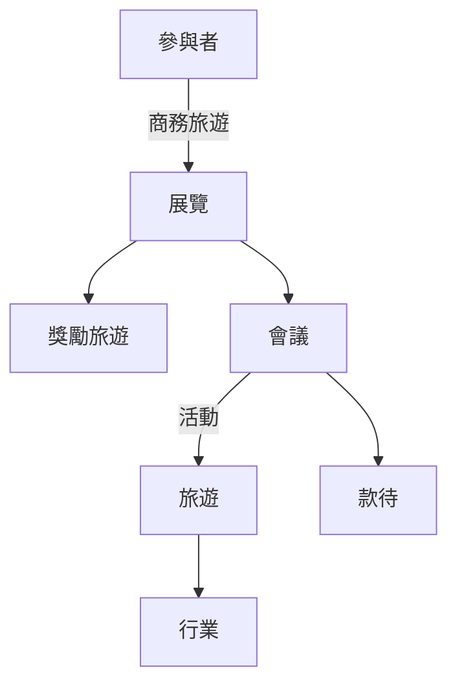
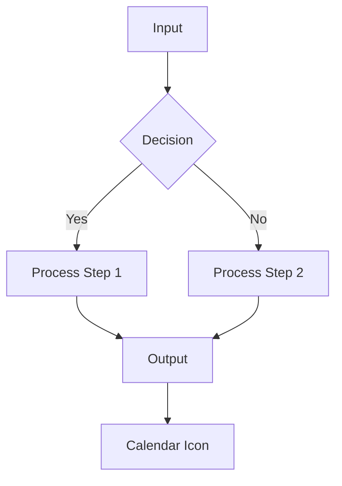
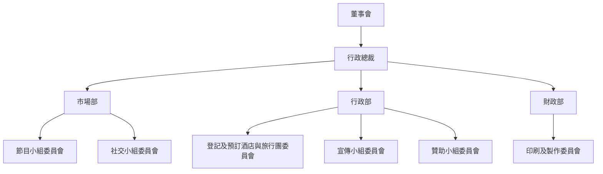

# 單元3

# 會議、 獎勵、 商務、 展覽是旅遊業中的一個界別

# 探究重點

● 了解會議、獎勵、商務、展覽和旅遊與款待行業的聯繫。  
● 識別會議、獎勵、商務、展覽的區別。  
● 了解會議、獎勵、商務、展覽旅遊的決定因素。  
● 認識會議、獎勵、商務、展覽規劃過程的組成部分。  
● 探討會議、獎勵、商務、展覽旅遊的貢獻。

# 會議、獎勵、商務及展覽旅

text_image

旅遊概況

商務旅遊在旅遊業中屬於高增值旅遊，高消費的商務旅客更向來是全球旅遊業大力爭取的客源。

商務旅遊的旅客，出行的目的除了到旅遊目的地觀光外，更主要出於商業的考慮。他們需要聚集在一個地點舉辦活動，形式包括簡稱為 MICE 的四類活動：會議、獎勵、大型會議和展覽。

# 思考點

參加會議展覽活動的商務人士，會需要哪些方面的服務和支援？

M 會議（Meeting）  

natural_image

Illustration of a business meeting with people seated around a table (no text or symbols visible)

圖 1.235

I 獎勵（Incentive）  

natural_image

Illustration of a group of people celebrating with a blue flag, no text or symbols present

圖 1.236

C 大型會議（Convention）  

natural_image

3D illustration of a curved conference room with multiple people seated at desks (no text or symbols visible)

圖 1.237

E 展覽（Exhibition）  

natural_image

Isometric illustration of a busy tech exhibition hall with attendees, booths, and signage (no readable text or symbols)

圖 1.238

會議、獎勵及展覽業務的性質  

flowchart

圖 1.239

MICE 旅遊除了像一般觀光旅遊能刺激酒店、零售、餐飲及景點服務的需求外，同時能推動其他高增值的商業服務發展，如會議場地租賃、活動統籌、市場推廣、場地管理、保險、旅行社等。

根據聯合國旅遊組織（UN Tourism）的數據，目前 MICE 活動以歐洲和北美地區最多，而經濟發展迅速的亞太地區，增長速度則最快。

natural_image

Audience seated in a conference hall facing a presentation screen (no visible text or symbols)

▲ 圖1.240 參與會議的人士

# 1.1 會議旅遊

# 甚麼是會議？

根據聯合國旅遊組織（UN Tourism）及其他相關機構和學者的定義，會議是指一群人在特定的時間與地點相聚的活動，以分享資訊、互相討論和尋求解決問題的方法為目的。

在 MICE 的活動範疇，會議包含由企業、專業團體等召開的各類會議活動。

# 會議的例子

會議參與的人數和規模大小不一，類型也各有不同。對旅遊與款待業較重要的會議，主要包括以下：

<table><tr><td>類型</td><td>情況</td></tr><tr><td>股東大會</td><td>由股份有限公司定期召開的股東會議,讓持有公司股份的人士,於每年或每季進行會面。一些跨國企業的股東大會,大多在總部所在城市的酒店或會議中心舉行,股東可能來自世界各地,更要接待採訪的傳媒。</td></tr><tr><td>員工大會</td><td>由公司主辦,或向員工介紹公司的最新營運策略、成就和未來計劃,讓員工向管理層提問,又或讓員工聚首一堂,頒贈獎項予員工,以提升士氣、凝聚向心力等。</td></tr><tr><td>產品發布會</td><td>公司在新產品推出市場時,往往會舉辦發布會,廣邀分銷商、零售商,甚至傳媒、公眾等出席,以營造聲勢。</td></tr><tr><td>培訓研討會</td><td>公司在有需要時,為了培訓管理層或新入職員工而舉辦的培訓活動,讓他們更了解公司的背景、文化、產品內容和營運方法等。</td></tr><tr><td>集思會</td><td>公司會安排高級行政人員或部門主管等,到會議酒店或度假村等,在悠閒的氣氛下,共同進行團隊活動,以加強管理層的溝通,或共商公司的發展策略,以集思廣益。</td></tr></table>

# 1.2 獎勵旅遊

# 甚麼是獎勵旅遊？

根據國際獎勵旅遊管理協會（Society for Incentive TravelExcellence）的定義，獎勵旅遊是指由企業提供經費，以獎賞旅遊的形式，回饋及鼓勵企業員工、批發商、分銷商，甚至顧客。

不過，獎勵旅遊不同於一般的旅遊，它是一種商業管理手法，目的是協助企業達到特定的目標，並對達到目標的參與者提供旅遊假期，作為獎賞。

# 提示箱

獎勵旅遊在 MICE 活動中，與會議、大型會議和展覽這三類活動有個重大的分別，就是獎勵旅遊以度假為主，工作性質相對較低。

行程方面，企業通常者，安排酒店住宿、餐飲、設計旅遊活動，以進一步極性，增強企業的凝聚力。

text_image

會委託專業旅遊業
、交通，以及精心
提高員工的積
。

▲ 圖1.241 企業目標達到才會有獎勵旅遊

# 資料室

# 獎勵旅遊與員工旅遊的分別

獎勵旅遊不同於員工旅遊，兩者在舉辦目的、經費來源、旅遊目的地等方面，都有區別。

<table><tr><td></td><td>獎勵旅遊</td><td>員工旅遊</td></tr><tr><td>舉辦目的</td><td>是要達到企業目標才能實現的獎勵計劃,目的是要獎賞達標的員工,不是所有員工都能參與旅遊。</td><td>是企業本身的一種福利,全體同事都可以參加的旅遊,目的是要促進同事之間關係融洽。</td></tr><tr><td>經費來源</td><td>經費來源自增長的營業額,或從達標的盈利中撥出款項作旅遊之用。</td><td>經費來源自經常性的營運開支,與營業額表現未必掛鉤。</td></tr><tr><td>旅遊目的地</td><td>目的地大多為境外,境內旅遊相對較少。</td><td>目的地大多是本地,境外旅遊相對較少。</td></tr></table>

獎勵旅遊還具有以下特點：

<table><tr><td>特點</td><td>描述</td></tr><tr><td>集體獎賞</td><td>大多數的獎勵旅遊都是企業提供的集體獎賞,很少只會給予個別員工、商業夥伴或顧客。</td></tr><tr><td>事前宣傳</td><td>企業推出獎勵旅遊計劃,必定會有宣傳配合,並預先通知員工、商業夥伴或顧客,讓他們得知獲得獎賞的條件,以努力達致目標成績,獲得獎勵旅遊。</td></tr><tr><td>表揚活動</td><td>在獎勵旅遊的過程中,企業會安排宴會,讓管理層公開表揚優秀的員工、良好的商業夥伴或忠誠的顧客,並藉此向參加者發表鼓勵士氣的演說。</td></tr><tr><td>重視特色</td><td>為了吸引員工、商業夥伴或顧客努力達致目標成績,以爭取旅遊機會,獎勵旅遊的行程安排設計,一般具有與別不同的特色。</td></tr><tr><td>狂喜因素</td><td>獎勵旅遊重視加入狂喜因素(wow factor),以吸引員工、商業夥伴或顧客爭取獲得旅遊的機會,一同歡樂。</td></tr></table>

# 活動站

# 分辨「獎勵旅遊」與「員工旅遊」

根據所學，試分辨以下的旅遊個案屬於「獎勵旅遊」還是「員工旅遊」，並加以解釋。

# 個案一：

出版社每年都會有一次秋季旅行，今年到長洲一天遊，包遊船往來市區與長洲及海鮮午餐，大部分員工報名參加。

# 個案二：

保險公司今年推出計劃，將根據銷售情況，由公司出資，安排最高銷售額的百名員工，到澳洲參加七天旅行團。

# 個案三：

餐廳全年營業額超乎理想，東主決定答謝員工的付出，出資請全部員工在新春期間到日本旅遊。

# 個案四：

貿易公司向員工公布，由於公司經營困難，年初推出的傑出員工旅遊獎賞計劃將終止，全體員工更要凍薪一年。

個案一：獎勵旅遊 ／員工旅遊

理 由：

個案二：獎勵旅遊 ／員工旅遊

理 由：

個案三：獎勵旅遊 ／員工旅遊

理 由：

個案四：獎勵旅遊 ／員工旅遊

理 由：

# 資料室

# 獎勵旅遊較現金獎賞優勝之處

近年來，越來越多企業透過舉辦獎勵旅遊獎賞員工。為何這些企業不選擇現金獎賞，而要選取獎勵旅遊呢？這主要是獎勵旅遊有以下幾方面的好處：

• 宣傳效果更大：獎勵旅遊較容易成為員工之間的熱話，相反現金獎賞多被員工視作一種佣金，且具有私隱性，同事之間談論較少。另外，一次大規模的獎勵旅遊，如包機搭乘員工、包場參觀旅遊景點等，能吸引社會大眾的目光，成為企業向外宣傳自身實力和形象的大好機會。因此，獎勵旅遊較現金獎賞的宣傳效果更大。  
• 鼓勵時效更長：根據研究，現金獎賞對受獎者的激勵時效較為短暫。獎賞旅遊所產生的積極作用則較現金獎賞要強。因為在獎賞旅遊的活動過程中，受獎者在所營造的「榮譽感」和「成就感」氛圍中，記憶會更持久。而且，受獎者在過程中，與管理層的交流時間較多，能激勵受賞者更好地為企業服務。

企業親和力更佳：獎勵旅遊為員工和管理層創造了一個輕鬆、隨意的接觸環境，使雙方以種朋友的方式交流。同時，管理層可在交流過程中，向員工灌輸企業的價值觀或對員工的期盼，從而增強企業的親和力。這些都是現金獎賞較難產生的效果。

圖1.242 受獎賞旅遊激勵的員工 ▲  

natural_image

Group of people raising fists in a meeting room, no visible text or symbols

# 影響獎勵旅遊決定的因素

企業決定獎勵旅遊，受到以下因素影響：

# A 企業的考慮

經費開支：企業需要考慮整個獎勵旅遊的經費開支，即企業對行程規劃、交通運輸、酒店住宿、餐飲、景點、娛樂等活動成本的考慮。

經濟狀況：企業所處國家或地區的經濟發展狀況，亦會影響企業是否組織獎勵旅遊。當地經濟強勁時，各大企業對人才的需求殷切，為了吸引人才加入以配合發展，企業較願意舉辦獎勵旅遊。

形象與宣傳：企業組織獎勵旅遊，是要向員工弘揚公司的文化，向外界樹立企業的形象，最終提高企業的知名度。因此，企業會考慮旅遊活動的各項安排是否符合企業的文化和形象。

▲ 圖 1.243 有些企業會為獎勵旅遊安排潛水等體驗

# B 對旅遊目的地的考慮

目的地的購買力：旅遊目的地的貨幣匯率如較低，物價會相應較低，可降低企業在組織獎勵旅遊時的整體經費開支。

政治環境：企業會注意旅遊目的地的旅遊警示級別，避免前往由於政局不穩、社會動盪而處於旅遊警示高級別的地方。

安全和保安：由於參加獎勵旅遊的，都是企業的優秀員工、良好商業夥伴或忠誠顧客，是企業的重要資產，因此企業在選擇目的地時，會重視確保他們的安全。一些受恐怖活動困擾或治安欠佳的國家或地區，都不會在考慮之列。

natural_image

People swimming in turquoise ocean with speedboats labeled '250 VTEC' and a small boat on the shore (no text or symbols on main subjects)

設施和服務水平價值：企業舉辦獎勵旅遊，是要讓員工、商業夥伴或顧客好好享受假期，所以會傾向前往機場、道路、酒店、餐廳、景點等設施完善，以及旅遊服務水平較佳的目的地。

獨特體驗：由於現代人出外旅遊已相當普及，企業需要考慮參與者是否已經體驗過同類旅程，因此會傾向規劃較特別的旅遊目的地，或在行程中加入別開生面的活動，以增加獎勵旅遊的吸引力和意義。

# 資料室

# 旅遊業界歡迎獎勵旅遊多於傳統觀光旅遊？

雖然獎勵旅遊與傳統觀光旅遊在行程上有相近的地方，但從旅遊業界的經營收益來看，獎勵旅遊較傳統觀光旅遊更值得爭取。原因如下：

• 不少企業都會把獎勵旅遊交由旅行社等中介機構安排，這可以促進旅遊中介機構的營業額增長。  
• 獎勵旅遊是企業對傑出員工的獎勵。為了答謝和激勵員工，企業往往會為這些員工安排較好的交通、住宿、餐飲、觀光等。這會拉高整個旅行團的消費，旅行社和其他服務供應商的營業額和利潤也相對提高。  
• 企業會在獎勵旅遊行程中加插一些工作會議、大型晚宴等，這些商務活動能為旅行團創造更多消費，旅遊業界亦從中得益。  
• 獎勵旅遊由企業出資，旅客在節省旅費的情況下，在旅遊目的地的購物、娛樂等消費，很多時候會較闊綽，能促進旅遊目的地的經濟。

# 1.3 大型會議

# 大型會議的特點

大型會議通常由專業或行業協會、政治團體、機構或社團等主辦，可分為國際性、全國性、地區性等。大型會議讓擁有共同目標的人士，在特定的時間與地點聚會，就共同關心的議題交流意見、互相討論和分享資訊等。

雖然大型會議與企業主辦的會議有相似的地方，不過兩者還是有區別。大型會議的特色主要有：

日程：通常為期數天。與會者除了出席大型會議，還會順道觀光，或參與其他社交節目，因此與會者逗留的時間較普遍的觀光旅遊為長。主辦單位在選址時，會一併考慮旅遊目的地的觀光吸引力。

舉辦時間：通常每年舉辦一次。舉辦時間較多在旅遊淡季，方便旅遊目的地提供充足人手及設施。這有助旅遊目的地平衡旺季和淡季的工作和收入，而主辦單位亦能降低整體費用。

組織：由協會、團體、機構或社團等主辦，如旅遊協會、國際醫學組織、政黨團體、學術機構、宗教組織等舉辦的大型會議。

人數：與會者眾多，人數可以上千，甚至上萬，並有很多是從外地入境人士。由於參與人數多，主辦單位在選址方面，往往要投入大量時間。

text_image

Boao Forum for Asia

▲ 圖1.244 博鰲亞洲論壇，是每年在中國海南舉行的國際會議。

會議形式：大型會議除了全體會議外，還會同時有多個小型的小組會議、會議暨展覽，並且會進行開幕和閉幕儀式，以及舉行聚餐活動等。

費用：很多有興趣參與大型會議的人士，都需要向主辦單位登記，並要繳付涉及會議、餐飲、晚宴和考察等的費用。因此，主辦單位會特別注重大型會議主題的吸引力。

大型會議的開支涉及租賃會議場地，加上參與者眾多，消費包括交通運輸、酒店、餐飲，以及觀光、購物、娛樂等，可為旅遊目的地帶來巨大的經濟收益。因此，不少旅遊目的地近年都大力爭取成為大型會議的主辦地。

# 大型會議的種類

大型會議有以下幾個種類：

<table><tr><td>種類</td><td>描述</td></tr><tr><td>代表大會(Congress / Convention)</td><td>團體成員聚集在一起,以切合團體宗旨的主題展開討論。通常定期舉行,如每年舉行一次,或每兩年舉行一次。為期數天,包括全體會議和多個小組會議。會同時安排多項活動,如團體執事會議、講座,以及聚餐、酒會等社交節目。</td></tr><tr><td>研討會(Conference)</td><td>議題通常是具體問題,並就其展開討論、諮詢、交流。不是定期舉行,按需要舉辦。為期比代表大會短。可以召開小組會議,也可以只開大會。與會者人數較少。</td></tr><tr><td>專題研討會(Symposium)</td><td>一批專業人士就特定的課題進行陳述演講,如宣講論文。有一些預定好的觀眾參加,並就課題發表意見、進行研討。研討會完結前,會由主持人作結論,或發表聲明。</td></tr><tr><td>論壇(Forum)</td><td>會進行反覆深入的討論,並由演講者或主持人來主持。有許多觀眾參與,並允許觀眾提問。主持人會總結觀點。</td></tr><tr><td>講座(Lecture)</td><td>會有一位專家就主題發表講演。講座後或會設有觀眾提問。</td></tr></table>

# 資料室

# 大型會議的流程和項目

大型會議通常為期數天，與會者較多，流程包括多個項目。

歡 迎 及與 會 者登記

嘉 賓 講者 發 表演講

小議、攤位 組展、 進行各主題 行工作坊

酒會及 全體晚宴

宣佈大會結束

大型會議與會議比較

<table><tr><td></td><td>大型會議</td><td>會議</td></tr><tr><td>活動資料</td><td>較為公開,公眾可向主辦單位索取</td><td>大多不公開,公眾難以取得</td></tr><tr><td>聯絡人</td><td>會成立籌備委員會,作統一聯絡</td><td>可能有數名聯絡人</td></tr><tr><td>籌備時間</td><td>較長,一般一至數年</td><td>較短,一般只需數月</td></tr><tr><td>舉辦頻率</td><td>較疏,可能一年舉辦一次或兩年一次</td><td>較密,可能一年舉辦數次</td></tr><tr><td>形式</td><td>規模較大,多數有固定形式,並參照過往形式舉行</td><td>規模較小,大多沒有固定形式,視乎情況而定</td></tr><tr><td>出席者</td><td>會員可自由報名參與</td><td>受邀請者通常都要參與</td></tr><tr><td>費用</td><td>由與會者自行支付費用</td><td>由主辦者負責費用</td></tr><tr><td>選址</td><td>較有彈性,會在不同國家或地區舉行</td><td>大部分在主辦機構所在地,或出席者最多的國家或地區舉行</td></tr><tr><td>出席人數</td><td>上百,上千,甚至上萬人</td><td>大多少於一百人</td></tr><tr><td>日程</td><td>較長,大多三至數天</td><td>較短,可能一至兩天</td></tr><tr><td>場址</td><td>一般在設備完善的會議中心或大型酒店舉行</td><td>一般在設備較佳的酒店舉行</td></tr><tr><td>住宿</td><td>較具彈性</td><td>通常會安排能配合身分的住宿,如高級人員的住宿會較佳</td></tr><tr><td>安排決定</td><td>需時較長,並要籌備委員會通過各項安排</td><td>需時較短,安排決定較容易、直接</td></tr><tr><td>與會者攜同親友出席</td><td>較多</td><td>較少</td></tr></table>

text_image

友出席
会幸福地

圖1.245  
大型會議場地

natural_image

Interior view of a modern conference hall with rows of beige chairs and ceiling lights, no visible text or signage.

▲圖1.246  
小型會議場地

# 大型會議與主辦地區

# A 對旅遊目的地的要求

大型會議由於有較多境外人士參與，加上參與人數多，因此主辦單位在選擇舉辦城市方面，要求較為嚴謹。以下是一些主要的要求：

• 地理位置能夠靠近大多數參與者，且交通運輸系統完善，以方便與會者往返。  
• 具有現代化的會議場地及通訊設施。  
• 具有高水平的專業服務和組織大型活動的能力。  
• 具有熟悉國際會議運作和組織國際會議的人才。  
• 具有齊備的住宿、餐飲、購物、娛樂配套。  
• 具有良好的經濟和社會環境。

# B 主辦大型會議的重點地區

根據國際會議協會（International Congress and ConventionAssociation，ICCA）的數據，全球在 2019 年舉辦了 13 254 場大型會議，而歐洲是全球舉辦大型會議最多的地區，其次是亞洲、北美洲、拉丁美洲，至於非洲、大洋洲和中東地區所佔比例較少。

pie

| 國区     | 占比 (%) |
| :------- | :------- |
| 歐洲     | 53.1     |
| 亞洲     | 20.2     |
| 北美洲   | 11.1     |
| 拉丁美洲 | 8.8      |
| 非洲     | 3.1      |
| 大洋洲   | 2.6      |
| 中東     | 1.2      |

# 思考點

舉辦大型會議最多的城市，主要是甚麼類型的城市？這類城市有何優勢？

從城市來看，舉辦最多大型會議的是法國巴黎，在 2019 年以 237 場排全球第一位。從國家而言，美國在 2019 年舉辦的大型會議最多，達934場。

<table><tr><td>排名</td><td>城市(國家)</td><td>場次</td></tr><tr><td>1</td><td>巴黎(法國)</td><td>237</td></tr><tr><td>2</td><td>里斯本(葡萄牙)</td><td>190</td></tr><tr><td>3</td><td>柏林(德國)</td><td>176</td></tr><tr><td>4</td><td>巴塞羅那(西班牙)</td><td>156</td></tr><tr><td>5</td><td>馬德里(西班牙)</td><td>154</td></tr><tr><td>6</td><td>維也納(奧地利)</td><td>149</td></tr><tr><td>7</td><td>新加坡</td><td>148</td></tr><tr><td>8</td><td>倫敦(英國)</td><td>143</td></tr><tr><td>9</td><td>布拉格(捷克)</td><td>138</td></tr><tr><td>10</td><td>東京(日本)</td><td>131</td></tr></table>

<table><tr><td>排名</td><td>國家</td><td>場次</td></tr><tr><td>1</td><td>美國</td><td>934</td></tr><tr><td>2</td><td>德國</td><td>714</td></tr><tr><td>3</td><td>法國</td><td>598</td></tr><tr><td>4</td><td>西班牙</td><td>578</td></tr><tr><td>5</td><td>英國</td><td>567</td></tr><tr><td>6</td><td>意大利</td><td>550</td></tr><tr><td>7</td><td>中國</td><td>539</td></tr><tr><td>8</td><td>日本</td><td>527</td></tr><tr><td>9</td><td>荷蘭</td><td>356</td></tr><tr><td>10</td><td>葡萄牙</td><td>342</td></tr></table>

整理自 2019 年 ICCA 統計報告

亞洲方面，中國是舉辦亞洲大型會議最多的國家，在 2019年舉辦了 539 場。從城市來看，亞洲舉辦大型會議最多的是新加坡，有148場，其次是東京、曼谷、首爾、台北。香港與北京、吉隆坡在亞洲城市中並列第六，均舉辦了91場大型會議。

text_image

⑥北京
(91場)
④首爾
(114場)
②東京
(131場)
③曼谷
(124場)
⑨上海
(87場)
⑥吉隆坡
(91場)
⑤台北
(101場)
①新加坡
(148場)
⑥香港
(91場)

# 1.4 展覽

# 甚麼是展覽？

MICE 中的展覽，是指為了貿易洽談、提供市場信息、向買家及消費者展示產品和服務所舉辦的展覽會（Exhibition）、博覽會（Expo）、商品交易會（Trade Fair），屬於商業活動，不同於博物館或藝術館所舉辦的文化展覽。

# A 展覽的特點

展覽通常由行業協會和政府相關部門或機構促進及主辦。例如香港展覽會議業協會（Hong Kong Exhibition & ConventionIndustry Association, HKECIA）是由本港主要展覽會主辦機構組成的行業協會，致力推動香港成為主要國際展覽及會議之都。香港貿易發展局則每年舉辦香港書展、香港國際珠寶展、香港玩具展等大型展覽 。

企業參與展覽的目的主要有：促銷產品和服務，向買家或消費者介紹產品和服務，與重要的聯絡人建立商貿關係，建立良好的企業形象，以及收集競爭對手的最新產品和服務資訊。

參與展覽的企業，即參展商，需要向主辦單位租賃展覽場地內的一個區域，設立展覽攤位，向買家及消費者展示、銷售產品和服務。買家和消費者則需要獲邀請，或購買門票，方可進入展覽場地。

text_image

Crowded indoor exhibition hall with visible signage including '讀書店' and 'SC', showing attendees and display booths.

▲ 圖1.249 香港書展，入場人士需購票入場。

# B 展覽的類型

根據展覽的對象，可分為針對大眾消費者和針對業界買家的展覽，以及同時針對兩者的綜合展覽。

針對大眾消費者和針對業界買家的展覽，分別如下：

<table><tr><td></td><td>針對大眾消費者的展覽</td><td>針對業界買家的展覽</td></tr><tr><td>性質</td><td>向大眾的展覽,即商業對零售的消費性展覽。</td><td>向業界買家的展覽,即商業對商業的商貿性展覽(又可分為出口展、進口展、地區貿易展和全球貿易展四類)。</td></tr><tr><td>例子</td><td>香港書展、香港美食博覽、香港婚紗展暨海外婚禮博覽。</td><td>香港國際珠寶展、香港鐘錶展、香港玩具展、香港嬰兒用品展。</td></tr><tr><td>入場對象</td><td>所有公眾人士。入場人士大部分為本地市民,入場人次較多。</td><td>年滿十八歲或以上的業內人士,入場人次一般有限。</td></tr><tr><td>銷售方式</td><td>參展商展示商品,並即場向入場人士售賣商品。</td><td>參展商展示商品樣本,向買家介紹產品和服務,雙方就商品質量、產量、價格等展開洽談,有可能要到展覽結束後才完成交易。</td></tr><tr><td>展覽攤位設計</td><td>以方便即場售賣為主。參展商一般會把展銷櫃設於靠近人流通道的地方,讓入場人士容易查看商品,及有利銷售人員作即場推銷和售賣。消費者會即場購入商品及取走商品。</td><td>以方便洽談商貿為主。參展商除了設有商品陳列架外,還會在區域內放置檯和椅,以便與買家進行洽談。買家較少即場購入商品及取走商品。</td></tr><tr><td>相關活動</td><td>展覽期間會舉辦相關活動,如座談會、分享會等,以增加活動氣氛。</td><td>展覽期間可能會舉辦會議、研討會等相關活動,讓參展商、買家等交流業界最新發展動向,了解市場資訊。</td></tr></table>

# 思考點

你認為針對大眾消費者的展覽和針對業界買家的展覽，哪類較受旅遊業界重視？為甚麼？

既針對大眾消費者，又針對業界買家的綜合展覽，主辦機構在安排上，會有特定的開放時間給這兩類型入場人士。例如香港國際旅遊展和商務會獎旅遊展，便首兩天開放予業界買家，尾兩天開放予大眾消費者。

# 展覽對參展商的優缺點

# A 展覽對參展商的優點

參展商利用展覽作為展銷平台，有以下優點：

具針對性：入場人士都是對產品和服務有興趣的消費者或業界買家，展覽有助參展商向目標客戶銷售產品和服務，快速提高營業額。

接觸面廣：展覽能為參展商吸引大量目標客戶，讓他們在一個場合和數天內，向大批潛在客戶推銷產品和服務，節省逐一推銷的時間和工夫。

市場資訊新：展覽有許多同業參展，參展商可在場館看到競爭對手的新穎產品和服務，從而了解對手新近的發展方向，以及掌握最新的市場資訊。

增強企業形象：透過參加展覽，設計別出心裁的攤位，以及展示新穎的產品和服務，參展商可向客戶宣傳企業形象，增強客戶對企業的信心。

與客戶建立關係：展覽有大批同業參展，又有大量消費者和買家入場，參展商可藉此場合，在短時間內與同業、消費者和買家建立關係。

natural_image

Interior view of a large tech exhibition hall featuring Huawei signage and attendees (no readable text or symbols on main structures)

圖1.250 企業可透過展覽推廣品牌。

natural_image

Interior view of a large indoor exhibition hall with numerous booths and attendees (no visible signage or text)

】圖1.251展覽有多間同業參展，大批買家入堤。

# B 展覽對參展商的缺點

參展商利用展覽作為展銷平台，有以下缺點：

籌備工作量大：參加大型展覽，參展商要進行大量籌備工作，包括前期申請參展、預備產品樣本、製作宣傳品、設計和佈置攤位、安排人手、處理物流、預約客戶等；展覽期間要進行現場營銷、補充產品；展覽後要收拾產品、作出檢討等。

經費投入額多：參展商需租用場地、製作產品樣本和宣傳品、設計和佈置攤位、派駐工作人員，甚至要聘請翻譯、臨時銷售人員等，整體經費投入巨大。企業要小心計算成本效益，避免回報未如理想。

商業保密性低：參展商會在展覽展示最新的產品和服務，而同場有大批同業參展，產品和服務的特色及優點容易被競爭對手抄襲，可能影響日後的市場銷售。

natural_image

Exterior view of a modern office building (no signage)

圖1.252參展商要為攤位佈置投入不少時間和經費。

natural_image

Exterior view of a modern office building (no signage)

■圖1.253參展商展示最新產品，有被同業协龍的風險。

# 1.5 會議、獎勵、商務及展覽活動的價值

MICE 活動能為一個城市的旅遊業帶來眾多好處，現時很多城市都積極爭取舉辦更多 MICE 活動，並增加相關設施和提升有關服務。

# MICE對旅遊業界的價值

natural_image

Interior view of a busy tech exhibition hall with attendees and branded booths (no readable text or symbols)

# A 高消費客群

MICE 的商務旅客，屬於高消費客群，消費較一般旅客為高。由於這批旅客多是企業的中高層人員或專業人士，在目的地需要與客戶會面，所以傾向入住交通方便、服務水平較高的高級酒店，以及光顧較高級的餐廳。

▲ 圖1.254 有不少商務旅客出席的展覽活動

# 例子庫

• 根據香港旅遊發展局的數據，2017 至 2019 年間，會展獎勵旅遊旅客人均消費超過 8 千元，較整體過夜旅客的人均消費高兩至三成。

# B 平衡旅遊需求

MICE 活動屬商業活動，各行業會按會期等情況，在全年的不同時段舉辦，不一定安排在旅遊旺季。參與 MICE 活動的商務旅客分散在不同時段前來，有助增加旅遊供應商在旅遊淡季的收入，對減低酒店房間在淡季的空置率，作用甚大。

# C 可預計性高

MICE 活動通常要提早一至兩年籌劃，主辦單位和參展商往往會提前預訂場地、酒店等。加上不少活動屬週期性舉辦，每年的籌備工作大多可參照往年的方式和經驗。這些都有助展覽行業、酒店等旅遊供應商預計來年的業務，提前作出準備，減低經營風險。

# D 規模較大

大部分 MICE 活動會一連舉辦數天，且有大批與會者。因此，一場 MICE 活動便需要租用大型的展覽和會議場地，以及需要大量住宿、餐飲服務，為旅遊業界創造可觀的收益。

# E 標準化服務

大部分 MICE 活動會採用類近的籌備和節目程序；同一場MICE 活動的參與者，旅遊目的和對服務的需求均十分相似。旅遊業界可採取標準化程序和服務，從而節省成本，提高經濟效益。

text_image

Trade show booth scene with attendees and promotional posters in Russian, featuring visible signage and QR codes

圖 1.255 MICE 活動需要統籌、翻譯等標準化服務。

# MICE 對旅遊目的地的價值

# A 提升主辦城市形象

負責舉辦 MICE 活動的旅遊城市，可通過接待大批海外旅客，為旅客留下良好的形象。世界各地傳媒對這些大型活動的報導，更能增加主辦城市在全球的曝光率，提升城市的國際形象。

# B 經濟收益可觀

MICE 活動舉辦期間，主辦單位及參展商在場地租賃、攤位設計和佈置、交通運輸、酒店住宿、餐飲服務等方面的開支，以及與會者在目的地的觀光、購物等活動，可以為旅遊目的地帶來可觀的經濟收益。這些收益在乘數效應下，能為目的地創造更多經濟收入。

會議、獎勵及展覽業務為香港帶來的經濟收益（2006至2016年）

<table><tr><td></td><td>2006年</td><td>2010年</td><td>2016年</td></tr><tr><td>相關消費為本港經濟帶來的收入(億港元)</td><td>264</td><td>358</td><td>529</td></tr><tr><td>為本港創造的全職職位(個)</td><td>58 500</td><td>69 150</td><td>77 000</td></tr></table>

整理自香港旅遊發展局

# C 促進輔助行業發展

舉辦 MICE 活動涉及多個行業，除了旅遊業界外，還需要活動統籌、市場推廣、場地佈置、場地保安、保險等行業提供服務。這能促進輔助行業的進一步發展，以及創造更多就業機會。

text_image

Interior photo of a modern airport terminal with visible signage including '入口 Entry' and 'MOH', showing travelers, service counters, and waiting areas.

▲ 圖1.256 MICE 活動需要大量市場推廣、場地保安等人員。

# D 有助本地企業擴建商業網絡

MICE 活動能吸引世界各地的買家前來，甚至會有海外企業的決策高層出席。參與活動的本地企業，可透過此平台與各地的行業精英接觸、交流，以及向外宣傳企業形象，從而擴建商業網絡，取得更多商機。

# E 不受旅遊景點影響

參與 MICE 活動的旅客，出行的主要目的是商務，而非觀光。因此，即使主辦城市的旅遊景點吸引力不足，只要交通便捷、有適合舉辦活動的場地設施，以及能提供專業服務等，仍有獲選為活動舉辦地的機會。

# 網絡台

香港旅遊發展局 ˙ 香港會議及展覽拓展 ˙ 香港優勢

# 香港發展MICE 活動的優勢

# A 地理位置優越

香港位處亞太地區的中心地帶，全球逾半數人口可在五小時內飛抵香港，加上與內地相連，地理位置優越。

# B 交通基建完善

香港國際機場是航空樞紐，航線連繫全球超過200個城市。香港的高速鐵路已接通內地的高鐵系統，又有港珠澳大橋等連接內地陸路系統，交通四通八達。城市內鐵路、公路、水路交

text_image

通基建完善，酒店住宿設施亦多元化。

▲ 圖1.257 香港交通基建完善，有助MICE旅客往來。

# C 世界級場地

香港會議展覽中心和亞洲國際博覽館連續多年被評為「亞太區最佳會展中心」，適合舉辦世界級會議和展覽活動。另外，本地多間會議酒店，均能提供設備齊全的場地，可舉辦各類型的會議展覽。

# D 具專業服務水平

香港有舉辦國際性會議和展覽活動的豐富經驗，並有超過一百家展覽服務供應商，以高水平的專業團隊，為主辦單位提供一流的支援服務。

text_image

HONG香港
KONG港
ASIA'S WORLD CITY 亞洲國際都會

▲ 圖 1.258 香港是亞洲國際都會的宣傳板

# E 國際商業環境

香港是亞洲的國際都會，有數千家跨國企業在香港設有地區總部和辦事處，商業活動蓬勃。香港也是國際金融中心，法制健全，是舉辦會議、獎勵、商務及展覽旅遊的理想城市。

# F 背靠內地

香港位於國家的南端，是外地企業進入內地市場的重要門戶。香港又與內地經濟發展最蓬勃的珠江三角洲地區相鄰，且商務人員往來密切，可為會議展覽參展商提供龐大的商機。

# G 受歡迎旅遊城市

香港是購物天堂和美食之都，又具有中西文化融匯的特色，是亞洲其中一個最受旅客歡迎的城市，每年吸引過千萬人次旅客。在香港舉行 MICE 活動，可讓主辦單位和參展商獲得最佳櫥窗效應。

# H 寬鬆入境政策

香港入境政策寬鬆，現時內地人士辦理簽證訪港相當便利；另有超過 170 個國家或地區的人士可免簽證訪港，參與 MICE活動十分方便。

# I 自由貿易政策

香港是自由港，實行自由貿易政策，貨物、資金、人員均可自由流動。同時，在《基本法》保障下，香港的通訊及新聞自由程度也非常高。這些都有助MICE活動順利舉行。

# 基本法教育

# 《基本法》與會議展覽業發展

香港《基本法》第五章第一百一十四條列明：「香港特別行政區保持自由港地位，除法律另有規定外，不徵收關稅。」第一百一十五條則列明：「香港特別行政區實行自由貿易政策，保障貨物、無形財產和資本的流動自由。

香港作為自由港，展品進出本港不需要繳交稅項，加上香港國際航運、空運系統完善，報關手續又便捷，方便各地人員和貨物的進出，給企業和參展人士帶來諸多便利，有利本港會議展覽業的發展。

一座旅遊城市要發展 MICE 業務，必定需要酒店業、交通運輸業、旅遊景點和其他基礎配套設施的良好配合。以下將分述這些重要的相關行業。

# 2.1 相關行業-酒店

酒店業是MICE業務的重要服務供應者，也是主要受益者。酒店為主辦單位和參展商提供場地、住宿、餐飲等服務，而研究指出，出席 MICE 活動的商務旅客，有超過一半開支會用於酒店住宿和酒店餐廳的消費 。

# 酒店的角色

酒店是舉辦 MICE 活動的常用場地。酒店除了客房，還有展覽廳、宴會廳、餐廳、演講廳、會議室、商務中心等設施。主辦單位可在展覽廳、演講廳、會議室舉辦活動；參與活動的旅客可在客房住宿，使用商務中心的服務；餐廳和宴會廳則為活動參與者提供餐飲服務。

不過，各間酒店的設施不一，MICE 活動的規模也各異，酒店在活動中扮演的角色因而不盡相同。

<table><tr><td>角色類型</td><td>描述</td></tr><tr><td>A 提供全套的會議連住宿服務</td><td>大會的所有展覽、會議、宴會等相關活動,均在酒店舉行,出席者亦入住該酒店。</td></tr><tr><td>B 為接待酒會、宴會和其他活動提供設施</td><td>大會只在酒店舉辦酒會、宴會等活動,其他活動會安排在別的地方舉行,出席者也會入住其他酒店。</td></tr><tr><td>C 只提供住宿和部分膳食</td><td>大會只安排出席者入住酒店,以及提供部分膳食服務,其他活動均安排在別的地方舉行。</td></tr></table>

# 酒店的設施和服務

大型會議酒店、商務酒店、度假酒店和機場酒店等，較為適合舉辦 MICE 活動，原因在於這些類型的酒店能滿足活動所需的設施和服務。

natural_image

Interior view of a modern conference room with rows of seated chairs, a large projection screen, and no visible text or signage.

▲ 圖 1.259 擁有完善設備的酒店會議室

# A 場地設施

酒店有不同大小的展覽廳、宴會廳、會議室。這些場地設施的空間大小、佈置，可根據主辦單位的需要調整，以切合不同類型的會議、獎勵及展覽活動，容納數十名至上千名參與者。

# B 商務中心

酒店的商務中心，可在活動舉行期間，為出席者提供商務支援，包括秘書服務、 文書服務、翻譯服務、傳真及影印服務、 上網服務和速遞服務，以及可供租用小型會議室、電腦等設備。

natural_image

Interior view of a modern office with two red desks, three computers, and patterned carpet (no visible text or signage)

▲ 圖1.260 提供電腦、打印機等設備的酒店商務中心

text_image

INTERCONTINENTAL.
HONG KONG

▲ 圖1.261 大型酒店會安排員工到機場接送MICE客人

# C 客房服務

酒店在 MICE 活動舉行期間，除了為出席者及其隨行人員，如配偶、私人助理等，提供舒適的住宿環境外，還會為他們安排特快入住和退房服務。酒店亦可以為他們提供往返其他活動場地的交通工具選項。

text_image

活動筆辦的雞尾酒會

  
圖 1.262

酒店为 MICE 活動籌辦

# D 餐飲服務

酒店可以為 MICE 活動提供各項餐飲服務，包括早餐、午餐、晚餐，以及為活動籌辦茶點小吃、雞尾酒會和晚宴等。參與者亦可在酒店的餐廳、咖啡廳、酒廊等，享用餐飲，或進行洽談，以及使用客房餐飲服務。

# E 科技基礎配套設施

為應付 MICE 活動的需要，酒店的場地需配備科技基礎配套設施，例如穩定的網絡傳輸系統，方便主辦單位和入場人士使用互聯網；登記系統網絡，方便大會登記入場人士資料；辦公室與新聞中心通訊，方便大會及傳媒的通訊工作；數碼會議設備，讓與會者透過網絡即時傳送視頻等。

text_image

Woman interacting with a digital kiosk displaying Chinese text and icons, likely for a service or digital interface.

▲圖1.263  
使用自助登記系統的人十  
圖 1.264 酒 店 游 泳 池，可供MICE活動人士享用。

# F 消閒康樂設施

酒店的消閒康樂設施，如健身中心、游泳池、水療按摩等，可讓參與MICE活動的人士享用，使他們得以鬆弛休息。

natural_image

Exterior view of a resort with a large swimming pool, blue umbrellas, and palm trees under a partly cloudy sky (no signage or text visible)

# 適合舉行MICE活動的酒店類型

不同類型的酒店適合舉辦不同類型的 MICE 活動。概括而言，適合MICE活動的酒店可按其位置和設施，分為四種類型：

<table><tr><td></td><td>位置</td><td>設施</td><td>香港例子</td></tr><tr><td>會議酒店</td><td>市中心鄰近商業中心及會議展覽場地交通方便,有良好的公共交通網絡</td><td>寬闊而華麗的大堂大型會議場地大型宴會廳專業的會議及商務服務客房餐飲服務健身中心/游泳池等</td><td>香港君悦酒店香港嘉里酒店香港萬麗海景酒店港島香格里拉酒店香港如心海景酒店</td></tr><tr><td>商務酒店</td><td>市中心鄰近商業中心及會議展覽場地交通方便,有良好的公共交通網絡</td><td>會議室及多功能廳商務中心客房餐飲服務健身中心/游泳池等</td><td>帝京酒店香港四季酒店香港帝苑酒店香港美麗華酒店香港灣仔帝盛酒店馬可孛羅香港酒店</td></tr><tr><td>度假酒店</td><td>位於近郊鄰近旅遊景點空間寬敞交通便利,有高速公路連接市區</td><td>大型宴會廳多個會議室及多功能廳客房餐飲服務健身中心/游泳池及其他休閒設施高爾夫球場(香港需視乎個別情況)</td><td>黃金海岸酒店香港迪士尼樂園酒店香港海洋公園萬豪酒店</td></tr><tr><td>機場酒店</td><td>連接或鄰近機場有高速公路及鐵路網絡便捷地連接市中心及各區</td><td>大型會議場地多個會議室及多功能廳專業的會議及商務服務客房餐飲服務健身中心/游泳池及其他休閒設施</td><td>富豪機場酒店香港天際萬豪酒店</td></tr></table>

另外，大型酒店和小型酒店在 MICE 活動中扮演不同的角色，提供不同的服務。

<table><tr><td>大型酒店</td><td>小型酒店</td></tr><tr><td>可為少至數十人的小型企業會議,或多至上千人的國際大型MICE活動提供場地和服務。往往主辦國際性的大型MICE活動。</td><td>若鄰近會議及展覽中心,可為MICE活動提供餐飲服務,以及為活動的輔助會議提供場地。往往舉辦本地的MICE活動,如當地企業的會議及小型表演活動。</td></tr></table>

# 使用酒店作MICE 活動場地的優缺點

# A 優點

設備齊全：大型酒店會為 MICE 活動提供套餐式服務，包括場地、住宿、餐飲等，可為主辦單位節省籌備的時間和工作，以及減少錯漏的機會。

減省工作：MICE 活動能為酒店帶來大筆的營業額，主辦單位對酒店有較大的議價能力，同時由於不用逐一與多個服務供應商議價和安排工作，能減省工作程序，提高籌辦活動的效率。

服務專業：大型酒店會設立相關部門，專責聯絡主辦單位，並安排專業人才協助 MICE 活動的舉辦，能減輕主辦單位的工作量。

周邊服務：酒店的禮賓部可以為 MICE 活動的主辦單位安排機場接送、往返其他場地的交通工具；保安部可以確保場地安全，為參與者提供安全的環境。

natural_image

Large banquet hall with attendees seated at round tables, illuminated stage lighting and spotlights visible (no signage or text)

品牌形象：大型酒店具有高知名度，部分更由國際連鎖集團經營，品牌形象鮮明。主辦單位在酒店舉辦 MICE活動，可借助酒店高貴而專業的形象，提高活動的形象。

▲ 圖 1.265 企業在酒店舉辦 MICE 活動

# B 缺點

費用較高：能為MICE活動提供套餐式服務的酒店，服務專業，且具知名度，整體收費一般較高。一些經費有限的主辦單位，或需要與會者付費的活動，未必能負擔酒店的費用。就算是要舉辦活動的商業企業，也會比較不同的選項，以及視乎活動的類型和所需形象等，才會最終選用酒店的套餐式服務。

氣氛未必配合：酒店難以適合舉辦所有類型的 MICE 活動。一些由學術團體、宗教團體等舉辦的活動，主辦單位可能由於擔心酒店的設施過於奢華、形象相對商業化，與其形象不配合，而不會選用酒店作為活動場地，只會用作住宿。

近年，不少會議酒店和度假酒店都積極拓展 MICE 業務，搶攻會議展覽中心的市場。以下是酒店和會議展覽中心在舉辦MICE 業務的優缺點比較：

<table><tr><td></td><td>會議和度假酒店</td><td>會議展覽中心</td></tr><tr><td>優點</td><td>能提供套餐式服務。有專業團隊跟進事項。能提供住宿、餐飲服務。與會者能享用休閒設施。在旅遊淡季通常會提供折扣優惠。環境氣氛較佳。</td><td>場地專為MICE活動而設,較適合舉辦有關活動,以及展出展品。有專業團隊跟進事項。會提供科技支援、保安服務等。各項設施完備,能滿足活動需求。有較多泊車位,卸貨區域方便運送展品至場館。整體費用通常較低。</td></tr><tr><td>缺點</td><td>整體費用通常較高。部分酒店場地有限,或不適合展出一些大型展品。部分酒店設施未必完備,未能滿足所有活動需求。泊車位可能不足,卸貨區域或不太方便運送展品到場館。</td><td>場地租用者眾多,租期競爭激烈,必須提早預訂。主辦單位需為出席者另行安排住宿、餐飲等服務。</td></tr></table>

# 5 MICE 業務對酒店的重要性

# A 增加酒店營業額

MICE 活動一般規模較大，參與人數較多，主辦單位租用場地和使用各項服務，能有效提高酒店的銷售總額。出席者及其隨行人員使用酒店的其他服務，如餐飲、水療按摩等，亦能增加酒店的營業額。

natural_image

Exterior view of a modern restaurant with multiple grates and blurred customers in the background (no signage or text visible)

圖 1.266 參與MICE 活動的人士會享用酒店的自助餐等餐飲服務

# B 可預計性高

不少 MICE 活動需要提早一至兩年籌備，主辦單位會預先向酒店訂購場地和各項服務。酒店因而可以預計各項設施和服務的需求，以及所需人力資源，管理上的可預計性較高。

# C 充分利用可出售空間

MICE 活動大多屬群體活動，主辦單位除了使用會議和展覽場地外，很多時候會一併訂購酒店客房、餐飲設施等空間，能提高酒店的整體使用率。

# D 增加淡季入住率

MICE 活動不會集中在旅遊旺季，很多主辦單位會選擇在旅遊淡季舉行，加上有些出席者會有配偶、助理等隨行，這均有助增加酒店在淡季的入住率。

# E 成為回頭客

MICE 活動的主辦單位日後舉辦活動，為了方便和節省工作量，很大可能會成為回頭客，再次預訂酒店的場地和服務，從而成為酒店的忠誠客戶。

# 2.2 相關行業-旅遊景點

獎勵旅遊的主辦單位，較重視旅遊目的地的景點吸引力。會議、展覽等活動的主辦單位，在選擇旅遊目的地時，則大多以商務作為活動的首要考慮因素，而把景點置於較次要的考慮因素。

不過，主辦單位通常希望讓參與者可順道遊覽當地或附近的著名旅遊景點，以增加活動的吸引力。因此，大型會議、展覽活動結束後，主辦單位很多時會為參與者組織觀光活動，讓他們遊覽主辦城市或周邊的旅遊景點。景點因而成為發展MICE旅遊時必須考慮的因素。

對旅遊目的地而言，參與 MICE 旅遊的商務旅客屬高消費旅客，而且這些觀光活動通常交由旅行社代為籌辦，可以為當地帶來可觀的經濟收益，所以旅遊目的地會致力提高當地景點的吸引力，以促進當地MICE旅遊的發展。

# 2.3 相關行業-交通運輸

交通運輸是 MICE 活動主辨單位的其中一項重要考慮。為了吸引更多人士出席活動，主辦單位都希望選擇鄰近大部分參與者的城市，以節省參與者的時間和交通費用。

對於獎勵旅遊來說，交通運輸的考慮尤為重要。因為這類旅遊涉及大量隨團的參加者，而主辦單位要為他們安排團體機票和旅遊巴士等，以及確保行程不會受阻。

natural_image

Exterior view of a modern bus station with two buses and a charging station, no visible text or symbols on the main subjects.

▲ 圖1.267 MICE 活動需要為團體安排旅遊巴士

# 1 國際交通

飛機、鐵路是MICE活動出席者主要採用的國際交通工具。在涉及國際參與者的 MICE 活動中，交通對於活動的參與人數起着關鍵作用。作為國際航空樞紐或陸路交通樞紐的城市，相對上較容易吸引較多的出席者。

# 例子庫

香港國際機場截至 2019 年底，有超過 220 個航點，航線網絡遍布全球主要城市。鄰近的澳門國際機場，航點只有 59 個；深圳則有 190 個航點，但國際航點僅有 60 個。不少前往澳門或深圳的國際旅客，往往要先飛抵香港，再轉乘其他交通工具前往兩地。香港目前正興建機場三道系統，落成後客運量將達一億人次。因此，香港完善的航空交通網絡，較有利國際參與者直接出席MICE 活動。

natural_image

Interior view of a modern airport terminal with a large model aircraft on the roof and travelers walking through (no visible text or signage)

圖1.268香港國際機場是全球其中一個最佳機場

# 2 當地交通

參與 MICE 活動的出席者抵達機場或鐵路站後，便馬上需要使用當地的交通系統，前往酒店；之後亦需要從酒店到舉辦 MICE 活動的場地，或到不同的商業大廈洽談，又或要到各考察地點、旅遊景點，以及到機場乘搭航機離開。

一個旅遊目的地如能擁有完善的公共交通網絡，有各種便捷的交通工具往返各區，如的士、巴士、軌道列車、渡輪等，

便能提升出席者的旅遊體驗，以及增加他們在當地的消費。

text_image

中国最棒登机 In-town Check-in
列車車票 Train tickets

圖1.269 　機場快線協助旅客快速往來香港國際機場及市區

# 2.4 其他基礎配套設施

酒店、景點、交通運輸以外，其他基礎配套設施，尤其是會議展覽場地和資訊科技能力，對爭取MICE業務同樣重要。

# 會議展覽場地

雖然大型酒店擁有會議展覽場地，但是場館面積始終有限。旅遊目的地要爭取主辦世界級的大型展覽和大型會議，具規模的會議展覽場地終究是不可或缺的。

# A 亞洲地區的發展概況

隨着亞洲地區經濟快速增長，亞洲近年成為全球 MICE 活動發展最蓬勃的地區。為了在 MICE 業務上分一杯羹，各旅遊目的地展開了激烈的競爭

北京、新加坡、曼谷、首爾、台北等城市，近年把會議展覽業定為重點發展產業，投入大量資源於發展當地會展業，以鞏固在區內會展業的地位。廣州、深圳和澳門等大灣區城市，近年也積極增加會議展覽設施，興建大型會議展覽中心。

# 思考點

面對周邊城市的競爭，香港可以如何提高在MICE業務中的競爭力？

會議展覽中心對旅遊目的地有以下作用：

增加舉辦 MICE 活動的機會，為目的地帶來高消費的商務旅客，提高整體旅遊收益。  
• 可支援本地工商業和進出口貿易的發展，作為本地產品和服務的重要展銷平台。  
• 提升目的地的形象，促進當地的經濟、文化發展。  
• 促進目的地在交通運輸、資訊科技等配套的發展。

natural_image

Exterior view of a modern, curved glass building with a distinctive arched facade and green landscaping (no signage or text visible)

室內展廳總面積33.8萬平方米，室外展場面積4.36萬平方米，可容納一萬個國際標準展位。

▲ 圖1.270 廣州國際會展中心

natural_image

Aerial view of a modern urban highway interchange with colorful buildings and surrounding construction sites (no visible text or signage)

▲ 圖1.271 九龍灣國際展貿中心

# B 香港的發展概況

香港現時有超過 50 個大小不同的會議展覽場地，包括位於灣仔的香港會議展覽中心（會展）、鄰近機場的亞洲國際博覽館（亞博館），以及九龍灣國際展貿中心（九展），可提供的總展覽面積逾 15 萬平方米，每年為數以百計的企業和機構舉辦世界性會議、地區大會和各類型會議與研討會。

# 提示箱

九龍灣國際展貿中心於2021 年被財團收購，計劃改建為甲級商廈，展覽場地將消失。

不過，由於市場對會議展覽場地需求增長迅速，會展、亞博館等場地在旺季經常供不應求，每年要推掉不少展覽及會議。為了維持和鞏固香港會議展覽業在國際間的地位，政府正積極增加本港的會議展覽場地。

經過研究，政府於 2017 年決定將灣仔北會展中心毗鄰的三座政府大樓拆卸（預計 2026 年可騰空大樓），並重建為與會展連成一體的會展新翼，預計能提供 2.3 萬平方米的設施面積。另外，政府與機場管理局商討亞博館第二期擴建計劃，以進一步增加本港會議展覽設施的供應。

text_image

入境事務大樓
IMMIGRATION TOWER

▲ 圖1.272 灣仔政府大樓、稅務大樓及入境事務大樓已落實拆卸重建為會展新翼。

另一方面，政府鼓勵業界採用「一展兩館」及「一展兩地的方式，解決目前本港會議展覽場地飽和的問題。「一展兩館」即同一個展覽會同時安排在會展與亞博館舉行。「一展兩地」即與珠海等周邊城市合作，同一個展覽由兩地聯合舉辦。

# 例子庫

香港珠寶首飾展覽會在 2006 年，成為本港第一個同時使用香港會議展覽中心和亞洲國際博覽館的大型商貿展覽會，開香港「一展兩館」的先河。  
香港亞洲國際博覽館於 2018 年與珠海國際會展中心及兩地的酒店簽署合作協議，善用港珠澳大橋通車後的便利交通，兩地合作舉辦更多「一展兩地」的大型展覽會議。

# 資訊科技能力

今時今日，要滿足 MICE 活動主辦單位和出席者的期望，提升資訊科技的能力已變得不可缺少。各會議展覽場地都持續升級設施和器材裝置，以下是一些目前場地會配備的資訊科技：

• 會議展覽場地會提升無線網絡系統，並為主辦單位和出席者提供免費且高速傳輸的無線網絡服務。  
會議展覽場地可讓主辦單位選用活動專屬的無線網絡登入名稱和界面，幫助提升活動品牌形象。  
會議展覽場地會使用各類電子數碼屏幕，以及輕觸式高清屏幕，讓主辦單位展示資訊，或供出席者作互動體驗。

natural_image

Isometric illustration of a business or tech workspace with multiple platforms and people engaged in activities (no text or symbols visible)

•會議展覽場地會設有專業影音設備及提供現場技術支援，確保主辦單位的會議、研討會和多媒體簡佈會活動順利進行。  
•會議展覽場地亦會配備可同時提供數種語言的即時傳譯系統，以及數碼環迴立體聲系統，以滿足不同主辦單位的需求。

# 2.5 其他相關參與者

要推動 MICE 業務的發展，除了上述參與者外，還需要旅遊推廣者、會展策劃者、活動承辦商與專業服務供應商的參與。

# 旅遊推廣者

為了推動 MICE 業務的進一步發展，很多旅遊目的地都成立了專責的公營機構，協調相關行業，為活動提供專業支援服務，以協助活動順利舉行。

# 例子庫

香港旅遊發展局轄下的香港會議及展覽拓展部、新加坡旅遊局轄下的新加坡展覽及會議署、日本國家旅遊局轄下的會議事務處、南韓首爾觀光社轄下的首爾國際會議展覽局等，都是專責 MICE業務的公營機構。

text_image

mehk
香港
HONG KONG
香港會議及展覽拓展部

香港會議及展覽拓展部是「香港會議及展覽拓展部」，具有進行身份作为以人民幣行企業常識、周圍的證券。香港會議及展覽拓展之詞為通過。

「香港會議及展覽拓展部」是指本會已於文藝發展、設計研究會與電腦經濟公開發行進行。服務範圍區內的資訊及信息資料，參與方以電子文化開發者、企業經營和維持單位為客戶與人類體。為計劃人或個人之活動提供，以台灣聯織網上我們內容報告等。附录摘要刊登於下列部分：

請填寫於「香港會議及展覽拓展部」為維持工作建立確認，並訂訂任何文件的確認。

「香港會議及展覽拓展部」必須填寫於「香港會議及展覽拓展部」中所稱的內容，如「香港會議及展覽拓展部」中所稱的內容，如「香港會議及展覽拓展部」中所稱的內容，如「香港會議及展覽拓展部」中所稱的內容，如「香港會議及展覽拓展部」中所稱的內容，如「香港會議及展覽拓展部」中所稱的內容，如「香港會議及展覽拓展部」中所稱的內容，如「香港會議及其相關業務」中所稱的內容，如「香港會議及其相關業務」中所稱的內容，如「香港會議及其相關業務」中所稱的內容，如「香港會議及其相關業務」中所稱的內容，如「香港會議及其相關業務」中所稱的內容，如「香港會議及其相關業務」中所稱的內容，如「香港會議及其相關業務」中所稱的內容，如「香港會議及其相關業務」中的所有內容，如「香港會議及其相關業務」中所稱的內容，如「香港會議及其相關業務」中所稱的內容，如「香港會議及其相關業務」中所稱的內容，如「香港會議及其相關業務」中所稱的內容，如「香港會議及其相關業務」中所稱的內容，如「香港會議及其相關業務」中所稱的內容，如「香港會議及其相關業務」中所稱的內容,如「香港會議及其相關業務」中所稱的內容，如「香港會議及其相關業務」中所稱的內容，如「香港會議及其相關業務」中所稱的內容，如「香港會議及其相關業務」中所稱的內容，如「香港會議及其相關業務」中所稱的內容，如「香港會議及其相關業務」中所稱的內容，如「香港會議及其相關業務」中所稱的內容，如 「香港會議及其相關業務」中所稱的內容，如「香港會議及其相關業務」中所稱的內容，如「香港會議及其相關業務」中所稱的內容，如「香港會議及其相關業務」中所稱的內容，如「香港會議及其相關業務」中所稱的內容，如「香港會議及其相關業務」中所稱的內容，如「香港會議及其相關業務」中所稱的內容，如「香港鋼鐵業」中所稱的內容，如「港營銀行」中所稱的內容，如「港營銀行」中所稱的內容，如「港營銀行」中所稱的內容，如「港營銀行」中所稱的內容，如「港營銀行」中所稱的內容，如「港營銀行」中所稱的內容，如「港營銀行」中所稱的內容，如「港營銀行」中所稱的內容，如「港營銀行」中所釋明公司有限公司有限公司有限公司有限公司有限公司有限公司有限公司有限公司有限公司有限公司有限公司有限公司有限公司有限公司有限公司有限公司有限公司有限公司有限公司有限公司有限公司有限公司有限公司有限公司有限公司有限公司有限公司有限公司有限公司有限公司有限公司有限公司有限公司有限公司有限公司有限公司有限公司有限公司有限公司有限公司有限公司有限公司有限公司有限公司有限公司有限公司有限公司有限公司有限公司有限公司有限公司有限公司有限公司有限公司有限公司有限公司有限公司有限公司有限公司有限公司有限公司有限公司有限公司有限公司有限公司有限公司有限公司有限公司有限公司有限公司有限公司有限公司有限公司有限公司有限公司有限公司有限公司有限公司有限公司有限公司有限公司有限公司有限公司有限公司有限公司有限公司有限公司有限公司有限公司有限公司有限公司有限公司有限公司有限公司有限公司有限公司有限公司有限公司有限公司有限公司有限公有制（公司）股份制（公司）股份制（公司）股份制（公司）股份制（公司）股份制（公司）股份制（公司）股份制（公司）股份制（公司）股份制（公司）股份制（公司）股份制（公司）股份制（公司）股份制（公司）股份制（公司）股份制（公司）股份制（公司）股份制（公司）股份制（公司）股份制（公司）股份制（公司）股權結存（公司）股份制（公司）股份制（公司）股份制（公司）股份制（公司）股份制（公司）股份制（公司）股份制（公司）股份制（公司）股份制（公司）股份制（公司）股份制（公司）股份制（公司）股份制（公司）股份制（公司）股份制（公司）股份制（公司）股份制（公司）股份制（公司）股份制（公司）股份制作（公司）股份制（公司）股份制（公司）股份制（公司）股份制（公司）股份制（公司）股份制（公司）股份制（公司）股份制（公司）股份制（公司）股份制（公司）股份制（公司）股份制（公司）股份制（公司）股份制（公司）股份制（公司）股份制（公司）股份制（公司）股份制（公司）股份制（公司）股份配售与承销业务合同约定条款。
特此公告。

▲ 圖 1.274 香港旅遊發展局轄下的香港會議及展覽拓展部網頁

text_image

关于我们
作为商业活动的全球领导目标，形成统一品牌
国际会议会址（EXTRA）的先后品牌
企业域为：中国、印度、日本、法国、德国、英国、加拿大、加拿大、加拿大、加拿大、加拿大、加拿大、加拿大、加拿大、加拿大、加拿大、加拿大、加拿大、加拿大、加拿大、加拿大、加拿大、加拿大、加拿大、加拿大、加拿大、加拿大、加拿大、加拿大、加拿大、加拿大、加拿大、加拿大、加拿大、加拿大、加拿大、加拿大、加拿大、加拿大、加拿大、加拿大、加拿大、加拿大、加拿大、加拿大、加拿大、加拿大、加拿大、加拿大、加拿大、加拿大、加拿大、加拿大、加拿大、加拿大、加拿大、外国人
作为商业活动的全球领导目标，形成统一品牌
国际会议会址（EXTRA）的先后品牌
企业域为：中国、印度、日本、法国、德国、英国、加拿大、加拿大、加拿大、加拿大、加拿大、加拿大、加拿大、加拿大、加拿大、加拿大、加拿大、加拿大、加拿大、加拿大、加拿大、加拿大、加拿大、加拿大、加拿大、加拿大、加拿大、加拿大、加拿大、加拿大、加拿大、加拿大、加拿大、加拿大、加拿大、<nl>
SINGAPORE EXHIBITION
& CONVENTION BURGAS
电力商务活动
请勿随意与公众集团和当地相交。具体
事项须经双方协商后方可提交股东大会审议。
请勿随意与公众集团和当地相交。
如需现场通知时应以个人身份证件送达。
-mail: 电力商务网站, 电话: 071-836-5999

▲ 圖 1.275 新加坡旅遊局轄下的新加坡展覽及會議署網頁

text_image

Japan, Meetings & Events
How online start? Yes
WHAT JAPAN
PLAN YOUR EVENT
JAPAN INDENTURE
About Us
2020.12.17 The JAPAN Food Incentive Travel Awards 2020 winners are announced!
Online Meet Japan
Edu. Fam January 2021
OnlineMeet Japan
Edu. Fam January 2021
Manufacture of International
Conferences
Hi Tips for Giving
Promote to Japan
Exercises
& Partnerships

▲ 圖1.276 日本國家旅遊局轄下的會議事務處網頁

text_image

SCB
首尔会展局简介
首尔旅游财团(SCB)

▲ 圖 1.277 南韓首爾觀光社轄下的首爾國際會議展覽局網頁

# 會展策劃公司

要舉辦一場成功的 MICE 活動，工作相當繁複，也有很多事務需要兼顧。主辦單位往往會聘用專業的會展策劃公司，協

natural_image

Overhead view of two people reviewing printed charts and laptops at a desk (no visible text or symbols)

助構思、策劃、組織、宣傳、管理MICE 活動。現時，香港便有多間會展策劃公司，每年協助企業順利舉辦多場活動。

圖 1.278 會展策劃公司會為 MICE活動統籌整個活動過程

# 活動承辦商與專業服務供應商

MICE 活動的主辦單位或會展策劃公司，通常會再委託一間活動承辦商，負責跟進整個項目。由於項目需要的服務眾多，活動承辦商又會把所需的服務外判給數間專業服務供應商，讓他們提供相關服務。

# 例子庫

• 展覽及活動場地製作公司：承辦展覽場地佈置、看台搭建工程等。  
• 餐飲服務公司：提供酒水及各類食品。  
保險公司：提供展品、運輸、人身、第三者有關保險等。  
保安公司：負責保護重要嘉賓、場地保安、人流管理、危機處理等。

natural_image

Interior view of a large exhibition hall with multiple booths and attendees (no visible signage or text)

▲ 圖1.279 工人正在搭建佈置展覽場地

要舉辦成功的會議、獎勵、商務及展覽旅遊，當中涉及不同階段的工作，也需要不同持份者的參與，因此完善的規劃必不可少。

# 3.1 規劃過程的組成部分

一場成功的MICE活動，規劃過程應包括以下組成部分：

應該達到甚麼目標？要符合公司使命及目標

哪類型的會議、獎勵及展覽活動是可行的？要進行可行性研究

應該向誰詢問？辨識持份者 ／組織架構階層

應該討論哪些決定因素？進行外部因素 ／內部因素的分析

辨識可能發生的風險和挑戰？5尋找機遇及減低威脅

是否作好準備？6挑選策略及營運方案

誰是負責人？7 承擔角色及責任

確保做正確的事？8遵循監控系統的運作

如何令下一次做得更好？藉着評估與回饋優化規劃過程

# 3.2 活動的五個階段

MICE活動又可以分為五個階段：

發起

規劃

執行3

監控4

結束5

# 發起（Initiating）

主辦單位形成活動的概念，並需要有確定的目標。在這個階段，主辦單位會組織籌備委員會，確定主題和日期、制訂預算案等事項。主辦單位亦會接觸活動承辦商，讓對方根據活動目標、類型、規模、時間、預算、要求、期望等，撰寫建議書。

# 規劃（Planning）

主辦單位或活動承辦商會進行規劃，確定活動涉及的相關事宜，包括租用場地、尋找贊助、制訂節目流程、分配工作任務、安排優先順序，以及預計成本和風險管理等。

# 3 執行（Executing）

這個階段需要根據規劃，落實各項目的工作，包括活動舉辦前的籌備工作、活動舉辦期間的營運工作，以及活動結束後的整理工作等。

# 監控（Monitoring and Controlling）

主辨單位和活動承辦商需要對整個活動進行監察和控制，以確保計劃中各項目順利完成，質素和支出均在控制範圍，活動達到預期目標。

# 5 結束（Closing）

活動結束後，活動承辦商需要審查之前各階段的文件、物資，確保所有合約條款已落實完成。主辦單位和活動承辦商亦會就活動作出檢討，以便為日後舉辦同類活動提供經驗。

# 3.3 確立活動目標

從以上可見，規劃 MICE 活動的第一步應要確立目標。

# 目標的五個原則

目標必須具備簡稱為「SMART」的五個原則：

<table><tr><td>明確性(Specific)</td><td>要以目標為中心,讓所有持份者都明確知道目標。</td></tr><tr><td>可衡量性(Measurable)</td><td>要用可量化的方式陳述目標,以幫助持份者比較成效和結果。</td></tr><tr><td>一致性(Agreeable)</td><td>目標要經所有持份者同意。</td></tr><tr><td>實際性(Realistic)</td><td>主辦單位要確保有足夠的資源(如人手、資金、物資等)實現目標,避免無法達成。</td></tr><tr><td>有時限性(Time specific)</td><td>必須為目標設定時限,以確保在指定時間內完成。</td></tr></table>

# 2 不同機構的目標

不同類型的機構，舉辦 MICE 活動的目標各不相同。以下是一些概括性的分類和例子：

# 私營機構

企業為自身發展需要或按照合約需要而舉辦活動。  
1 企業為市場推廣目的而開展活動。  
酒店、場地或企業以籌辦活動作為吸引客人及建立形象的方法 C

# 政府部門或公營機構

藝術或文化團體舉辦活動，目的是要提高文化水平及參與程度。  
經濟發展及旅遊組織籌辦活動，目的在於推動行業發展及增加經濟收益。

# 非牟利機構

慈善機構及公益團體舉辦活動，目的是要吸引支持者及提高收益。  
社區服務組織開展活動是要促進社區融合和不同社區的利益。

# 確立目標的重要性

指明方向：確立活動目標，可為主辦單位、承辦商等指明方向，方便他們依循目標進行整體規劃、執行、管理和控制。

提供準則：目標有助在規劃過程中，為各項執行、管理和控制事宜提供一個準則。

釐定分工：清晰的目標能夠幫助各持份者釐定分工和責任，令活動得以順利舉辦。

# 例子庫

兩個同樣有關資訊科技保安的推廣活動，一個是要提高企業對網絡資訊安全管理的關注，一個是要教導普羅市民在網絡上保護好個人資料安全。由於兩者的目標不同，在規劃活動時便有很大的分別。另外，主辦單位可根據目標，評估和計算活動的資源投入及可行度，並為各階段的工作提供一些具體準則，如租用活動場地的大小、活動所需設備的多少、活動期間人手的安排等。之後，主辦單位可進一步釐定承辦商、供應商的分工和責任。

natural_image

Illustration of a business meeting with a speaker at a podium and audience seated in rows (no text or symbols visible)

▲ 圖1.281 企業的推廣活動，人數方面會較易掌握。

text_image

PRESENTATION

▲ 圖1.282 公眾的推廣活動，人數方面會較難預測。

# 3.4 規劃活動項目

MICE 活動的規模大，主辦單位需要兼顧的工作繁多。為了減輕工作量和尋求專業協助，主辦單位往往會聘請活動承辦商負責整個活動項目。

在規劃階段，主辦單位會約見活動承辦商，簡介活動項目；活動承辦商接下來會進行項目研究，撰寫活動建議書，之後交給主辦單位評審；經過審定和修訂建議書，雙方會洽談合作細節和議定價錢；最後雙方會落實簽訂合約。

flowchart

▲ 圖1.283 項目簡介會讓活動承辦商掌握活動情況。

# 項目簡介會

主辦單位會邀請數間符合資格的活動承辦商，出席項目簡介會，說明活動的目標、類型、規模、時間、預算、場地要求、期望等，並會定下承辦商遞交活動建議書的期限。

# 活動承辦商的項目研究

活動承辦商在簡介會了解活動的資料後，會根據主辦單位的要求和期望，研究項目的可行性。其間，活動承辦商會與主辦單位保持良好溝通，以掌握準備的資料完成建議書。

活動承辦商需要清楚掌握的資料包括：

• 活動的舉辦目標是甚麼？主要內容是甚麼？  
• 活動有多少與會者？有哪些類型的與會者？  
• 活動的舉辦日期和時間是甚麼？  
• 活動的財政預算有多少？是否有贊助或其他收入？  
• 活動計劃在甚麼場地舉行？有哪些宣傳媒介？  
• 活動需要承辦商負責多少工作和提供多少服務？  
• 主辦單位會負責哪些方面的工作？主要負責人士是哪位？

# 活動建議書

活動承辦商會根據掌握的資料，並按主辦單位的要求，撰寫一份活動建議書。

建議書一般包括以下內容：

• 承辦商資料：活動承辦商會提供公司的基本資料，以及過往舉辦活動的經驗、曾舉辦的大型項目、公司的實力和優勢等，以增加主辦單位對承辦商的信心。  
• 項目計劃：是次活動的各項工作計劃，包括選址、策略分析、活動所需物資和設備、其他合作的服務供應商、預期成效等。  
• 財政預算：活動各項目的財政開支預算。  
• 設計稿：協助主辦單位易於理解活動如何進行的設計稿。  
• 預計工作進度表：各項工作的預計時間、跟進、備忘等。

為了增加建議書的吸引力，以及令主辦單位對承辦商留下辦事認真的印象，以爭取合約，承辦商很多時候會撰寫資料完備的建議書，並以圖文並茂的方式呈現，甚至配合動畫、立體模型、虛擬技術等。

natural_image

Close-up of hands holding a pen and clipboard with a document, no visible text or symbols

▲ 圖1.284 修訂建議書的要求可多於一次，視乎不同個案。

# 審定和修改建議書

活動承辦商撰寫好建議書後，會把建議書呈交主辦單位評審。主辦單位可能會要求承辦商安排簡報會，向負責人士講解建議書的具體內容，以及就內容和細節提出問題及修改意見。

活動承辦商在聽取主辦單位的意見後，會根據要求修訂及完善建議書，之後再次呈交建議書予主辦單位審定。

natural_image

Business meeting scene with three professionals in a meeting, laptops and documents on the table (no visible text or symbols)

▲ 圖 1.285 洽談合作細節還包括雙方的責任、違約賠償等。

# 5 洽談合作細節

主辦單位如滿意活動承辦商的建議書，會選定由承辦商負責整個活動，然後會與承辦商詳細洽談合作細節，包括各項目的具體安排、議定價錢等。

# 6 簽訂合約

當主辦單位和活動承辦商洽談好合作細節，雙方會簽訂合約，而承辦商亦會正式展開活動籌備工作。

合約確定的事項主要包括：

• 工作和責任：雙方在活動中的具體工作和主要責任。  
• 費用和支付日期：主辦單位需要支持予活動承辦商的費用，以及具體支付日期，例如訂金、餘下款項的支付日期等。  
建議書版本：經主辦單位審定和活動承辦商修訂，最終落實的建議書版本。  
財政預算：整個項目的開支預算，包括各項工作和服務的費用。  
工作進度表：各項工作的預計時間、跟進、備忘等。  
• 違約處理：任何一方違反合約將會面臨的罰則等。

natural_image

Two people seated at a wooden table, one writing on paper while the other holds up a pen (no visible text or symbols)

圖 1.286 合約會訂明生效日期

# 3.5 籌備活動的工作

策劃一個 MICE 活動，需要多個團隊共同合作，分擔不同的職能。按主辦機構的情況、活動的類型和規模，會成立相關的組織架構，安排不同的部門或委員會，專責處理各項工作。

活動組織架構例子  

flowchart

圖 1.287

# 1 活動組織

各專責部門或委員會的具體職責和工作如下：

# A 節目小組委員會

• 負責設定活動節目結構、編排程序和確立活動節目表；  
• 負責編排開幕典禮、主題演講、全體大會、委員會會議、分組會議和閉幕典禮等各項節目；  
• 提名和邀請主禮嘉賓及演講嘉賓，跟進嘉賓的簡介、相片等資料；  
• 徵求會議文件；  
• 擬定相關禮儀及保安安排；  
• 確定場地佈置、裝飾及所需影音設備。

# B 社交小組委員會

• 負責設定活動中社交活動的類型，如雞尾酒會、聚餐、參觀等；  
• 擬定各項活動的舉行數量、日期、時間和地點等；  
• 確定活動的程序表；  
• 確認禮儀、交通、餐飲、娛樂、保安等安排事宜。

# C 登記及預訂酒店與旅行團委員會

• 準備登記表格及安排報名、登記；  
• 建立登記資料庫；  
• 向與會人士發出確認登記回覆；  
• 協助與會人士安排酒店住宿；  
• 和與會者保持聯絡，提供支援服務；  
• 為與會者或其隨員及隨行家人在活動前或後安排觀光旅行團。

# D 宣傳小組委員會

• 負責各項宣傳推廣工作，包括設立官方網站、各類社交媒體等；  
通過郵寄、電郵等方式，聯絡個別參加者與過往的出席者；  
• 利用定期刊物、活動日誌和電郵等方式，聯絡各專業協會；  
透過在類似活動中推廣、在媒體刊登廣告、發新聞稿、提供登記優惠等方式，進行活動推廣；  
• 安排公關活動，如為主辦單位安排發佈會，或為主禮嘉賓、演講嘉賓安排訪問等。

# E 贊助小組委員會

• 負責物色和聯絡潛在的贊助商及參展商；  
• 預備贊助活動的簡介；  
• 與贊助商及參展商洽談贊助條件；  
• 執行和監督合約的全部條款。

# F 印刷及製作委員會

• 負責印製活動所需各類物品，包括登記小冊子、邀請卡、會議日程表、演講稿、代表名單、人名牌、入場券和紀念品等；  
• 聯絡承辦商提供各項資訊科技支援服務，例如網上報名、電子入場券、自助登記和電子展品等。

# 活動籌備事項

# A 與會人士方面

• 報名：郵寄報名及網上報名等報名方法；  
交通：如活動場地偏遠，或活動由兩個分開的場館聯合舉行，需要安排額外的交通接駁；  
• 接待：與會人士到達場地後登記和索取與會資料；  
住宿：與會人士預訂和安排酒店住宿；  
• 餐飲：活動期間或安排雞尾酒會、聚餐，或提供小食等；  
• 觀光：大型會議展覽活動前後，或會安排觀光行程，讓與會人士可以自費參加。

# B 嘉賓及宣傳方面

邀請嘉賓：聯絡及邀請嘉賓出席活動；  
接待嘉賓：擬定接待嘉賓的禮儀，安排交通、住宿、保安等事宜；  
官方信息：設立官方網站、社交媒體等，統一向傳媒及公眾發放官方信息；

宣傳推廣：製作宣傳推廣計劃，通過各種宣傳推廣方式，吸引更多參展商和入場人士；

公關：安排公關活動和嘉賓訪問等。

natural_image

Close-up of a man in a gray suit holding a microphone, no visible text or symbols

圖 1.288 活動統籌可能需要先了解嘉賓訪問的問題

# C 活動場地方面

場地規劃：選定場地、分配場地空間等；  
• 場地佈置：設計和佈置場地，如搭建主講台或攤位等；  
• 影音設備規劃：各展覽場地或會議場地所需的各項影音視聽設備；  
資訊科技支援：提供登記系統、即時官方網站及社交媒體信息發佈、與會人士資料及監測人流等數據處理；  
• 場地資訊展示：在場地的展示板、電子螢幕等，向與會人士展示場地資訊。

text_image

新能源汽车及车联网
MIIT
绿色智能
修工宣传
畅行中国

▲ 圖1.289 活動統籌需要留意場地佈置是否符合設計要求。

natural_image

Hand pointing at a futuristic digital interface with glowing icons of a phone, email, and network symbols (no text or labels)

▲ 圖1.290 活動統籌需要關注資訊科技支援是否足夠。

# D 節目安排方面

• 節目流程：編排開幕儀式、全體大會、分組會議、大型講座和展覽、全體晚宴、閉幕儀式等各項主要活動的流程；  
人力調配：草擬人力配調計劃，安排各工作人員的工作崗位，以及在各節目中的負責事宜。

# E 行政方面

• 銷售與贊助：處理入場收入和贊助費用等；  
• 財務計劃與預算監控：制訂活動的開支財務計劃，並嚴格監控活動開支，因費用超支是常見的現象；  
協調及按時完成：需協調各專責部門或委員會，確保各項工作能按時完成，並符合質素要求；  
• 跟進承辦商工作：由於活動涉及多項專業服務，而活動承辦商往往會再外判予多間服務供應商負責，所以需要清楚有關安排，並跟進合約條款及服務範疇，確保活動順利舉行；  
• 安全與保安：購買保險，以及安排保安工作，防止展品失竊，及防範火警、漏水或電力故障等；  
物流安排：安排運輸裝卸各類物資和設備，清點物資和設備進場，以及活動結束後的清理工作安排等；  
• 檔案紀錄：所有籌備委員會的會議紀錄、涉及財務和合約事宜的文件及書面記錄等。

natural_image

Digital illustration of global logistics with shipping containers, mobile devices, and connectivity links (no text or symbols)

▲ 圖1.291 物流安排可以涉及空運、海運、陸運。

# 3.6 活動正式舉辦的工作

# 活動正式開始前的準備工作

活動正式開始前，活動承辦商要確保場地已佈置完畢，各服務供應商提供的服務已全部到位。主辦單位的管理人員需要進行檢收，確認各項物資、設備齊全；如有缺漏，要盡快安排工作人員補漏拾遺。

主辦單位亦應安排所有工作人員進行簡報會，清楚說明各小組的工作責任和重點，提醒活動期間需要留意的地方，以及發生突發事件時的應變程序和措施。 。

# 例子庫

各類大型 MICE 活動出現的突發事件多不勝數。主辦單位往往需要與活動承辦商就可能發生的事故，提前制訂應變程序和措施，以在最短時間內解決問題，讓活動得以順利舉辦下去。例如活動遇上惡劣天氣情況，延遲舉行要怎樣通知各參展商、出席人士等；活動的主禮嘉賓、演講嘉賓行程受阻，未能按時抵達場地，流程應如何調整；場館有人身體不適，應如何處理等。

# 活動舉行期間的執行和管理工作

活動舉行期間，各小組應嚴格執行預定工作，並與管理人員保持聯繫，確保活動按流程舉辦。主辦單位和活動承辦商也要密切注意各項事宜，監察講台、展品、現場影音視聽效果、茶點等。

natural_image

Photographer recording on tripod in front of blurred audience (no visible text or symbols)

主辦單位和活動承辦商亦需要安排攝影師或錄影師，為整個活動拍攝照片或錄製影像，以便作紀錄或方便日後檢討，以及用於宣傳或推銷。

圖 1.292 拍攝照片或錄製影像是活動不可或缺的部分。

# 資料室

# 場地安全和保安事宜

參與 MICE 活動的人數眾多，活動主辦單位必須要照顧與會者的安全，並在保安問題上多加考慮和留意，例如：

場地安全：確保臨時搭建的講台、攤位等符合建築安全，避免倒塌而造成與會者受傷；  
應變措施：制定發生火警、停電和各種事故的應變措施，讓與會者安全撤離場地；  
盜竊問題：賊人會盜取與會者和參展商的財物，尤其是涉及珠寶、古董等貴重物品的展銷活動；

natural_image

Interior hallway scene with a person wearing a walkie-talkie and a blue shirt, another person walking in the background (no visible text or symbols)

▲ 圖 1.293 MICE 活動需要不少保安人手協助。

侵權問題：某些企業會派人員竊取參展商的商業情報，或展品的設計和重要生產資料；  
滋事行為：一些滋事分子或不受歡迎人物會到場擾亂活動秩序，甚至進行破壞場地設施等刑事毀壞行為；  
傷人行為：一些與會者可能在會場發生肢體衝突，甚至造成身體傷害等。

# 3 活動結束後的管理工作

活動結束後，活動承辦商和各有關單位需要盡快清拆攤位、收拾物品，以交還場地。

# 提示箱

在一些國家或地區，活動承辦商會在活動結束後，宴請主辦單位及服務供應商等，以答謝各方的合作和支持。

主辦單位在會議結束後的兩個月內，還有以下事後工作要處理：

• 整理所有開支和收入賬目，結算未支付的費用和收取應收款項；  
• 編制收支財務報告；  
• 撰寫最終報告，列出財務和營運記錄，以及相關統計資料、檢討和建議；  
• 向各參與的企業單位、重要嘉賓等，寄發致謝函，有需要會附上參與者在活動中的照片。

# 資料室

# 資訊科技在 MICE 活動的應用

MICE 活動的規模越大，場地面積越廣，參與人數也越多。現時，主辦單位和活動承辦商為了提高服務質素和方便與會人士，都廣泛採用最新的資訊科技器材和服務，作為活動的支援。以下是一些例子：

# • 登記入場

<table><tr><td>人手處理或資訊科技未成熟時</td><td>利用資訊科技</td></tr><tr><td>以人手處理登記記錄,發放入場證件和會場資料等;要逐一檢查與會者入場證件,與會者需要花費時間排隊入場。</td><td>與會者可透過網上系統預先登記,到達場地後可使用自助登記設施,完成二維條碼等身分識別核對後,就可入場;主辦單位甚或採用人臉識別系統,通過智能系統識別已預先登記的與會人士,無須花費時間排隊入場。</td></tr></table>

# • 發佈資訊

<table><tr><td>人手處理或資訊科技未成熟時</td><td>利用資訊科技</td></tr><tr><td>會印製大量單張、小冊子、指示板等,如遇上臨時突發安排,容易引起混亂;與會者如有問題,需要到詢問處詢問職員。</td><td>可透過互聯網,在官方網站、社交媒體,或直接向與會者的登記帳戶發放會場資訊及任何最新信息;與會者可通過官方網站、社交媒體等即時對話功能,查詢資訊。</td></tr></table>

# • 統計回饋

<table><tr><td>人手處理或資訊科技未成熟時</td><td>利用資訊科技</td></tr><tr><td>·主辦單位需要安排人手統計人流,以及掌握較多與會者參觀的攤位等資料;·主辦單位會派發問卷給與會者,與會者需要在離場前填妥及交回;主辦單位再分析和統計資料,數據未必齊全,也較為耗時。</td><td>·主辦單位可利用監測儀器或裝置,自動追蹤人流,以及掌握各攤位參觀人次及與會者逗留時間等資料;·主辦單位可透過登記帳戶或電郵,向與會者派發電子問卷,與會者可在離場後填妥及交回,較有彈性;電子系統亦能自動統計問卷數據,節省主辦單位的統計人手和時間。</td></tr></table>

# 練習場

# 選擇題

# 頁 209 至頁 257

1會議、獎勵、商務及展覽旅遊概況  
2與會議、獎勵、商務及展覽旅遊相關的行業  
3 會議、獎勵、商務及展覽旅遊的規劃

選取各題最恰當的答案，把英文字母代號填寫在方格內。

1.  會獎旅遊活動與一般旅遊活動有甚麼分別？

（1） 會獎旅遊旅客的消費力較高  
（2） 會獎旅遊旅客會前往較多景點  
（3） 會獎旅遊旅客會使用較多服務  
（4） 會獎旅遊的需求較受經濟周期影響

A 只有（1）和（3）  
B 只有（1）和（4）  
C 只有（2）和（3）  
D 只有（2）和（4）

2. 以下哪一項有關員工旅遊與獎勵旅遊的描述是不正確的？

# 員工旅遊

A 所有員工均能參加  
B 員工負擔部分費用  
較多是境內旅遊  
D 較少加入狂喜因素

# 獎勵旅遊

只有達標員工能參加

企業負擔全部費用

較多是境外旅遊

較常加入狂喜因素

3. 以下哪些是大型會議的例子？

（1） 某上市公司召開股東大會  
（2） 某政府舉辦的區域經濟發展論壇  
（3） 某企業的智能手機發佈會  
（4） 某智庫舉辦的國際關係研討會

A 只有（1）和（3）  
B 只有（1）和（4）  
C 只有（2）和（3）  
D 只有（2）和（4）

4. 以下哪一項是對會議、獎勵、商務、展覽業務的不正確描述？

A 活動通常需要提早規劃  
B 活動一定安排在旅遊旺季  
C 活動需要大量的供應商支援  
D 活動的參與者需要標準化的服務

5. 以下哪些是香港發展會獎旅遊（MICE）時遇到的挑戰？

（1） 展覽場地不足  
（2）基建交通落後  
（3）政府支援不足  
（4）區內城市競爭

A 只有（1）和（3）  
B 只有（1）和（4）  
C 只有（2）和（3）  
D 只有（2）和（4）

6. 會議、獎勵、商務及展覽旅遊活動（MICE）一般可分為五個階段。其中第二和第三階段分別是？

# 第二階段

A 規劃 監控  
B 監控 規劃  
C 規劃 執行  
D 執行 監控

# 資料回應題

細閱以下資料，然後回答問題。

新富港公司是一家香港的上市公司，正在籌辦4個月後舉行的股東週年大會，為了節省成本，該公司決定聘請XYZ公司為活動承辦商，並負責是次股東大會的籌備工作。以下是XYZ公司提交予新富港公司的建議書部分內容。

# 2022年度新富港公司股東大會

日期：2022 年 5 月 10 日（星期二）上午 10 時正至中午 12 時正

地點：酒店（詳細待定，請查閱附頁）

預計出席人數：新富港公司代表15人，傳媒15人，公眾200人

# 重要表決事項：

1.  接納截至 2021 年 12 月 31 日止本公司的經審核合併財務報表、董事會報告及獨立核數師報告。
2.  宣布派發末期股息每股95.60港仙。
3.  重選王大芳博士為本公司獨立非執行董事。 C
4.  重選 Chris Johnson 先生為本公司獨立非執行董事。
5.  聘請OZ會計師事務所為本公司核數師，並授權本公司董事會釐定其酬金。

# 附頁

本公司（XYZ 公司）已挑選兩家酒店作為　貴公司（新富港公司）股東週年大會的候選場地，現提供相關酒店的資料，請　貴公司決定後告知本公司，以便本公司進行後續工作。

# 香港AB酒店

位於上環，設有展覽廳、宴會廳、會議室，最大的展覽廳可容納400人。  
• 本酒店設有400間各級客房。  
本酒店可為會議使用者提供茶點小吃及午、晚餐宴會。 。  
本酒店可提供文書、翻譯、傳真及影印、電腦支援等服務。  
本酒店設有極高速且穩定的網路，可供會議使用者進行網上直播，並設辦公室供傳媒工作。

# 香港CD酒店

位於紅磡，設有會議中心及宴會廳，兩個會議中心各可容納100人。  
• 本酒店設有150間各級客房。  
會議使用者可在本酒店餐廳享用餐飲服務。  
本酒店可提供文書、翻譯、傳真及影印、電腦支援等服務。  
本酒店設有極高速且穩定的網路，可供會議使用者進行網上直播，並設辦公室供傳媒工作。

(a) 新富港公司與XYZ公司正處於MICE活動中的哪一個階段？試援引資料中的證據，加以解釋。（2分）

(b) 根據資料，指出新富港公司股東大會屬於會議還是大型會議，並以三項例證加以解釋。（4分）  
(c) 選出哪一家酒店比較適合舉行新富港公司股東大會，並解釋該酒店合適的原因，以及另一家酒店不合適的原因。（2分）  
(d) 根據資料，解釋XYZ公司在酒店舉行新富港公司股東大會的兩項優點。（2分）

# 論述題

近年，香港政府及旅遊業界致力發展會議展覽業，並進行會展場地的擴建規劃；又研究旅客流量等資料，以及定期對外公佈。

(a) 指出及描述有利香港旅遊業界發展會議展覽業的五個因素。（10 分）  
(b) 從政府的角度，指出並解釋規劃會議展覽業的做法為什麼會有利於本地旅遊業的發展。（8分）
