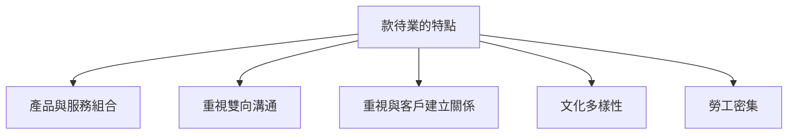
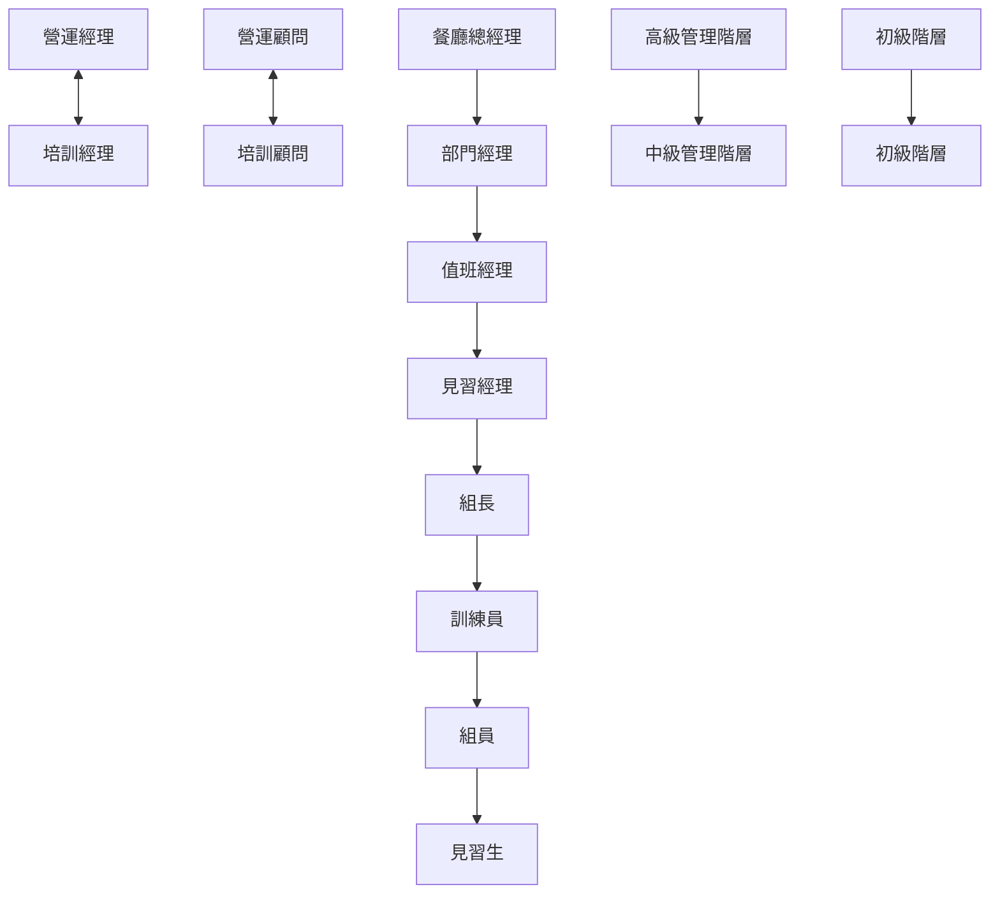

# 新里程

# 旅遊與款待

# 款待導論

# 2

text_image

作者 頼昊萱、翁毓梓 顧問 Ray Pine
閔博出版社

# 編輯要旨

natural_image

Illustration of global travel and tourism concepts including iconic landmarks like the Statue of Liberty, World Map, and airplane (no text or symbols)

《新里程旅遊與款待》一至四冊，是依照香港課程發展議會與香港考試及評核局於2007年聯合編訂，並於2015年更新的《旅遊與款待課程及評估指引（中四至中六）》的內容和精神編寫而成，適合香港中學四至六年級旅遊與款待科教學之用。

《新里程旅遊與款待》一至四冊課本共分四本，各分冊課題分配如下：

<table><tr><td>分冊</td><td>課題</td><td>單位</td></tr><tr><td>第一冊</td><td>課題(一)旅遊導論</td><td>1. 旅遊的概念與原理2. 本地旅遊業3. 會議、獎勵、商務、展覽是旅遊業中的一個界別</td></tr><tr><td>第二冊</td><td>課題(二)款待導論</td><td>1. 款待業2. 住宿業3. 餐飲業</td></tr><tr><td>第三冊</td><td>課題(三)地理名勝</td><td>1. 地理名勝</td></tr><tr><td rowspan="2">第四冊</td><td>課題(四)客務關係及服務</td><td>1. 顧客服務2. 客務關係3. 溝通技巧</td></tr><tr><td>課題(五)旅遊與款待業趨勢及議題</td><td>1. 旅遊與款待業的熱門議題2. 旅遊業的趨勢3. 款待業的趨勢</td></tr></table>

為配合探究式教學模式，本書有以下欄目及特色：

<table><tr><td>探究重點</td><td>點列每單元的學習重點,使學生容易掌握學習重心,提高研習旅遊與款待科的能力。</td></tr><tr><td>資料室</td><td>配合課文內容,補充相關的教學資料和旅遊與款待科新知識,幫助學生對課題有更深入、全面的認識。</td></tr><tr><td>例子庫</td><td>配合課文內容,提供大量旅遊與款待業最新例子,協助學生充分理解相關內容和概念。</td></tr><tr><td>提示箱</td><td>提示一些與課題相關的小知識,或不同課題之間的聯繫,提高學生的旅遊與款待科知識,以及加強了解各課題的關聯性。</td></tr><tr><td>思考點</td><td>針對課文內容及補充資料,提出一些具啟發性和思考性的問題,以刺激學生思考,培養他們理解、分析等能力。</td></tr><tr><td>活動站</td><td>針對課文內容,設計各式各樣的課堂活動,例如:行程設計、個案規劃、分組討論、個人分享、配對、計算等,活動設計輕巧實用,適切課堂教學需要,並能讓學生愉快學習。</td></tr><tr><td>練習場</td><td>根據各章的學習重點,適當地編制相關的選擇題練習,讓學生鞏固所學及進行自我評估。</td></tr><tr><td>網絡台</td><td>提供一些與課文相關的旅遊與款待科網站,方便學生作進一步探究。</td></tr><tr><td>基本法教育</td><td>說明與旅遊與款待科有關的《基本法》條文,幫助學生理解《基本法》與促進香港旅遊業發展的關係。</td></tr></table>

本書加插了大量相關圖片、示意圖和地圖，以配合教學，有助增加學生對旅遊與款待科的認識，以及提升學習本科的興趣。

本書末另附有「香港旅遊業大事年表」及「世界地圖」，供學生作為參考。

本書編輯時已力求完善，如有疏漏，敬祈指正。

本社網站內的學與教資源並未經教育局評審。

學生可掃瞄二維條碼，在本社網站「用戶登入」選擇「學生」，輸入用戶「Student」及密碼「TH」，使用學生資源。

# 目錄

# 課題二 款待導論

# 單元 1 款待業 2

1 款待業簡介....3

# 單元 2 住宿業 11

1 住宿業簡介....12  
2 酒店住宿產品 32  
3 酒店產權與管理模式 48  
4 酒店的組織架構....57  
5 顧客流程與酒店運作 …… 63  
6 酒店客務部簡介 - 前堂部 68  
7 酒店客務部簡介 - 管家部 86

# 單元 3 餐飲業 110

1 餐飲業簡介.... 111  
2 餐飲服務的分類與營運模式.... 128  
3 餐單的基本知識.... 149  
4 餐飲服務基本知識....172  
5 廚房運作的基本知識 188  
6 食物安全及個人衛生：食物污染的種類....206  
7 食物安全及個人衛生：食物安全要點與處理工序...225

# 附錄 257

# 香港旅遊業大事年表 258

# 世界地圖 263

# 課題二

# 款待導論

natural_image

Coastal resort area with pool, lounge chairs, and ocean backdrop under blue sky (no visible text or symbols)

# 單元 1

# 款待業

# 探究重點

- 了解款待業的特點。
- 認識款待業與旅遊業的關係。
- 探討款待業的就業前景。

# 1 款待業簡介

款待是指以殷勤的態度誠懇接待顧客。所有提供服務流程的行業都包含款待的元素，例如餐廳為顧客提供食物和飲品、酒店為顧客提供住宿、零售商為顧客提供貨品、旅行社為顧客提供旅遊產品、美容院為顧客提供美容服務等。

# 1.1 款待業的特點

款待業具有產品與服務組合、重視雙向溝通、重視與客戶建立關係、文化多樣性和勞工密集的特點。

款待業的五個特點  

flowchart

圖 2.1

natural_image

Illustration of a dining scene with four people, a grand piano, and wine glasses (no text or symbols)

▲ 圖 2.2 顧客在餐廳用餐時接受有形產品和無形服務

# 1 產品與服務組合

在款待業中，機構向顧客提供的不僅是消費產品，而是消費產品與服務的組合。例如顧客在酒店餐廳用餐時，購買的除了食物和飲品外，還包括侍應提供的上餐服務和結算服務等。帳單收費包含了有形的產品與無形的服務。

有形與無形特質（以酒店餐廳為例）

<table><tr><td>有形特質的例子</td><td>無形特質的例子</td></tr><tr><td>• 前菜、主菜、甜品和餐飲
• 穿著整潔服裝的員工
• 餐廳典雅的裝修</td><td>• 食物的香味
• 員工友善的態度
• 餐廳播放的柔和音樂</td></tr></table>

# 提示箱

有關客戶服務雙向溝通的內容，將在本書課題四單元二「客務關係」加以闡述。

從以上可見，在款待業機構為顧客提供服務的過程中，有形產品和無形服務組成完整的體驗。

企業推出的產品及其他有形特質，短時間內很容易被競爭對手模仿，較難維持產品的優勢。相反，高水平的服務質素則較難被模仿，且更直接影響顧客的整體滿意度，所以成功的款待業機構會致力提供高質素的服務，保持競爭力。

natural_image

Three people gathered around a table reviewing a printed document or map (no visible text or symbols)

▲ 圖 2.3 雙向溝通在員工之間與顧客及員工之間都極為重要

# 2 重視雙向溝通

雙向溝通是款待業在提供服務流程中的重要一環，當中需要服務員工與顧客雙方的投入和參與。服務員工透過與顧客的互動，了解顧客的需求和期望，繼而採取行動，向顧客提供稱心滿意的服務。

顧客使用住宿、餐飲等服務時，體驗又往往涉及機構內部的團隊合作和訊息互通，所以各部門或員工之間的雙向溝通同樣重要。

# 3 重視與客戶建立關係

款待業機構要持續經營，有必要與顧客建立關係。因為忠誠顧客會持續光顧，從而為機構帶來穩定的收入；這批忠誠顧客又會向親友和商業夥伴推介，不單為機構建立口碑，長遠還可增加機構的營業額。

目前，不少款待業機構採用會員計劃，通過分析顧客消費紀錄，提供優質服務，以建立客戶關係，提高顧客的忠誠度。不過，有機構高級管理層認為，讓前線的服務員工與顧客建立「友好關係」，更能贏得顧客的忠誠度。

natural_image

Illustration of travelers queuing inside a modern hotel lobby, with travelers wearing luggage and some in traditional attire (no text or symbols visible)

▲ 圖 2.4 款待業員工會接待不同背景、文化、宗教信仰的顧客。

# 4 文化多樣性

款待業與旅遊業關係密不可分，而旅客來自世界各地，款待業員工很多時會接觸到不同背景、文化、宗教信仰的顧客和同事。由於文化多樣性的存在，款待業員工需要具有國際視野，認識不同地方的文化，並以開放和包容的態度，為顧客提供符合他們文化的服務，以及與來自不同地方的同事和睦共處。

# 例子庫

- 有顧客基於自身信仰或生活習慣，不食肉類，餐廳侍應便應向他們建議和提供素食餐點，以滿足顧客的需要。
- 與信奉印度教的同事共事，應避免在他們面前進食牛肉，以及不要用左手取遞食物，以示尊重他們的宗教信仰。

# 5 勞工密集

款待業以提供服務為主導，需要投入大量勞工。尤其高級酒店或餐廳以提供優質服務為目標，會安排較多員工到前線提供服務，為顧客營造難忘的消費體驗。

▼ 圖 2.5 多名員工正在為晚宴準備  

natural_image

Large banquet hall filled with purple and white tables, featuring guests and staff (no visible text or signage)

今時今日，即使資訊科技和各項新機器已取代過往服務流程中的一些工序，但是對於那些重視人與人之間接觸、享受個人化貼心服務的顧客來說，機器始終無法取代人性化的服務。

因此，款待業機構還是會投放很多資源和時間招聘具潛質的員工，並為他們提供優質的培訓。

# 1.2 款待業與旅遊業的關係

# 1 款待業的範疇

款待業的範疇沒有明確的定義，除了住宿業和餐飲業兩大核心部分外，其他與旅遊相關的行業，如航空公司、郵輪公司、主題公園等，也應包括在內。實際上，大部分款待業機構的產品及服務不單提供予旅客，也提供予本地的顧客。因此，款待業在某程度上涵蓋了旅遊業，或與旅遊業部分重疊，有人便建議把款待業和旅遊業合併為旅遊與款待業。

不過，一些款待業機構提供的產品及服務，僅以本地顧客為服務對象，而非旅客。例如住宿方面的老人院舍、大學宿舍或大型機構的員工宿舍；餐飲方面的包銷餐飲公司、醫院及學校等機構內部的飯堂等。這些機構雖然屬於款待業的一部分，但是不在旅遊業的範圍內。

# 旅遊與款待業中

# 款待業與旅遊業的區別與重疊示意圖

# 提示箱

不是所有的款待業都屬於牟利性質，大學宿舍、慈善機構的寄宿中心等，提供的便是非牟利的住宿服務。

# 款待業

住宿：

老人院舍
大學宿舍
員工宿舍

餐飲：

機構膳食
醫院食堂
學校食堂

住宿：

如酒店、
賓館

# 旅遊業

交通運輸服務：

如航空公司、租車公司

其他旅遊服務：

餐廳膳食

# 2 款待業的住宿和餐飲行業

住宿業和餐飲業是款待業範疇的兩大核心部分。

住宿業：為各種原因而離家在外的人士提供住宿服務。

餐飲業：為本地顧客、機構員工、各類型旅客提供餐飲服務。

這兩大核心行業將分別在本課題單元 2 及單元 3 詳細介紹。款待業的管理人員應牢記以下三個目標：

- 使顧客感到賓至如歸；
- 讓顧客感到一切稱心如意；
- 確保所屬業務能為顧客繼續提供服務，並符合其預算。

# 3 優質住宿和餐飲服務對旅遊業的重要性

旅遊目的地要發展可持續的旅遊業，除了依靠景點吸引旅客，優質的住宿和餐飲服務亦可在當中發揮重要的角色。

吸引高消費力旅客：高消費力的旅客對服務質素的要求普遍較高，旅遊目的地如能提供優質的住宿和餐飲服務，便能增加當地對這批旅客的吸引力。

提升整體旅遊體驗：旅遊目的地為旅客提供的運輸、住宿、餐飲、景點、購物、娛樂等服務，構成旅客的旅遊體驗，優質的服務有助提升旅客整體的滿意度。

建立良好旅遊形象：旅客在旅遊目的地得到優質的旅遊服務體驗後，很多時候會向親友推介，甚至透過社交媒體對外分享。因此，提供優質的服務有助目的地建立良好的旅遊形象。

對經濟貢獻更大：優質的住宿和餐飲服務會讓旅客覺得物有所值，往往更樂於在目的地消費；機構要提供優質的服務，也需要在員工、培訓、設備等方面投入更多資源。這些都會對目的地產生更大的經濟貢獻。

旅客重遊的機會較大：優質的住宿和餐飲服務，不但能提高旅客的整體滿意度，而且會成為旅客珍貴的回憶，日後重遊當地的機會一般較大。

# 1.3 款待業的就業前景

款待業既是蓬勃發展的行業，也是充滿挑戰的行業，有興趣投身該行業的人士，應考慮個人性格和興趣是否適合。以下是一些有關款待業就業前景的正面觀點和負面觀點：

# 1 正面觀點

# A 就業選擇多

款待業是世界上其中一個僱用勞工人數最多的行業。隨着全球消費整體維持增長，款待業對勞工的需求持續。無論在本地或海外，均有大量各種款待業的前線或後勤職位，可供各級學歷人士選擇。

# B 重視經驗和工作表現

投身款待業的人士，職業生涯大多從初級階層的工作做起。不過，款待業的事業發展之路相當清晰，且普遍重視員工的經驗和表現。即使員工學歷較低、入職時職位不高，仍能憑豐富的經驗和優秀的表現而躋身管理層。部分人士更會憑經驗創業，成為東主。因此，款待業是充滿事業發展機會的行業。

某大型連鎖快餐店為員工提供的事業發展階梯  

flowchart

圖 2.7

# C 有機會接觸不同文化背景的人士

在款待業的日常營運中，前線員工有很多機會與來自不同背景和文化的顧客接觸及溝通。性格外向的年青人，可以在這個充滿互動和挑戰的行業中，找到工作上的樂趣與成就感。

natural_image

Person serving food from a glass display counter in a restaurant (no visible text or signage)

# D 可享員工附帶福利

相比其他行業和服務機構，款待業的員工在底薪、年終花紅以外，通常還享有一些特別的福利。例如酒店的員工在工作時可享用免費的員工膳食，以折扣價訂購酒店房間等。

◀圖 2.8 酒店員工正在拿取免費的員工膳食  

# 提示箱

連鎖酒店員工以折扣價訂購酒店房間的福利，往往適用於該品牌集團在全球各地的酒店。

# 2 負面觀點

# A 工時長且不規律

住宿和餐飲等款待業機構，很多時候需要員工輪班工作，部分職位甚至要求員工通宵工作。另外，由於週末、公眾假期是這個行業人手需求最緊張的日子，員工往往需要在這些日子及節日工作，更可能要加班工作。對於擔心工作影響個人健康或家庭生活的人士，便可能抗拒投身款待業。

# B 工作壓力不輕

在款待業的營運過程中，為了縮短顧客的等候時間，員工需要提供迅速且優質的服務。尤其在客戶高峰時段，前線員工一方面要與顧客緊密溝通，一方面要保持服務效率和水平，壓力可謂相當大。另外，員工有時需要處理麻煩的顧客，甚至可能面對顧客的投訴，承受的壓力更大。未能承受這些壓力的員工，最終會選擇離開這個行業。

# C 起薪點較低

雖然款待業提供了大量的就業職位，但很多職位是學歷或技能要求不高的工種。在行業裏，除了管理階層，或要求精通多國語言或特殊技能的職位，沒有工作經驗的新入職員工，起薪點一般不高。不同類型酒店或餐廳之間的員工薪酬，差距亦可能很大。有志投身款待業的人士，便需要考慮日後晉升的機會和薪金的增幅。

# D 存在職業地位低微觀念

由於款待業中，有不少職位對學歷或技能的要求不太高，所以社會上有部分人會認為，從事款待業的員工，職業地位較銀行、金融、貿易等行業的員工為低。受這些負面觀念影響，一些畢業生抗拒從事款待行業。

natural_image

Interior of a restaurant with three people dining at a table, one serving food to another (no visible text or signage)

▲ 圖 2.9 正在服務顧客的餐廳侍應

# 活動站

# 應否放棄款待業的實習機會？

試以三至四人為一組，討論以下的實習個案，分析作為個案人士的上司，可如何鼓勵個案人士完成實習工作。

# 個案：

彼得是一名正在修讀款待及旅遊管理學位的大學生，今年暑假，他獲分派到一家高級酒店實習，為期兩個月。他日後希望從事活動策劃的工作，因此期盼能進入酒店的營業及市場推廣部。可是，酒店安排他到宴會廳當實習侍應。實習開始不久，他便覺得在宴會廳負責的工作對他日後的事業發展沒有幫助，加上體力工作量大，而且工時長，薪金低，他想放棄這次實習機會。
