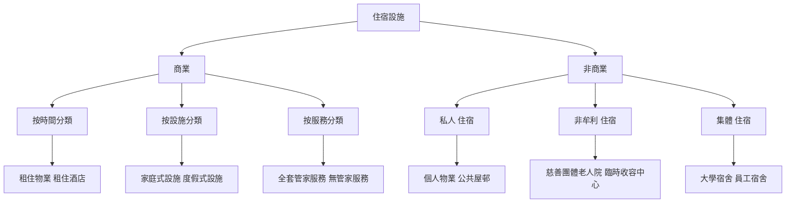
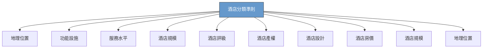
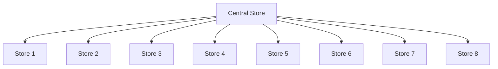
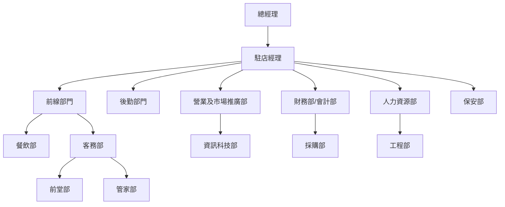

# 單元2

# 住宿業

# 探究重點

● 了解住宿的分類及各種酒店分類方法。

● 探討世界及本地酒店類型及特色。

● 分辨酒店內不同類型的房間。

● 認識酒店一般所提供的不同類型房價。

● 檢視酒店顧客的類別。

● 了解不同種類顧客的需求。

● 識別顧客流程的四個階段，以及每個階段所涉及的各項交易和服務。

● 分辨住宿業中各種商業產權類型及管理模式。

● 比較管理合約及特別經營兩者的好處及壞處。

● 認識酒店的主要部門及其職能，以及高級行政人員的職責。

● 識別客務部和前堂部的職能及組織架構。

● 了解前堂部主要崗位的職責。

● 探討前堂部與酒店其他部門的關係。

● 認識管家部的職能及組織架構。

● 了解管家部主要崗位的職責。

● 探討管家部與酒店其他部門的關係。

● 檢視清潔客房及公共地方的工作。

● 分辨客房的物料供應及客人用品。

● 分辨基本客房狀況的代碼。

● 認識處理客人財物、鑰匙、可疑人士及失物認領的基本保安程序。

# 1 住宿業簡介

住宿業中，有各類提供住宿服務的機構，為不同人士提供短期住宿的服務，在款待業和旅遊業中舉足輕重。

# 1.1住宿的分類

住宿業的範圍很廣，當中可分為商業和非商業兩大類。

# 商業住宿

商業住宿指持有可住宿地方的人或機構，向他人提供住宿設施和服務，而主要目的是為了賺取利潤。

# 非商業住宿

非商業住宿指持有可住宿地方的人或機構，向他人提供住宿設施和服務，目的不是要賺取利潤，所得收入主要用於補貼營運成本，或根本不收取任何費用。

住宿設施分類示意圖  

flowchart

圖 2.10

# 1.2 酒店及其分類方法

酒店是住宿業中最主要的商業住宿類型，為顧客提供住宿、餐飲等服務，而且在旅遊業中扮演重要的角色，因此有必要認識酒店的分類。

# 資料室

# 香港酒店的定義

香港法例第 158 章《酒店東主條例》對酒店的定義是：「酒店」（hotel）指任何場所，其東主顯示該場所是一處向到臨該場所的任何人提供住宿的地方，而該人看似是有能力並願意為所提供的服務及設施繳付合理款項，而且是在宜於予以接待的狀況的。

隨着酒店的多元化發展，今時今日有各種類型的酒店，而所提供的設施和服務亦各有不同。基本上，酒店可按以下準則劃分：

flowchart

圖 2.11

# 1.3 酒店的類型

酒店由古代的客棧發展而來，以前的客棧分布於交通道路沿線，為古代旅客提供基本的食宿服務。今時今日，酒店的設施及服務已多元化及專業化。部分地區亦稱酒店為賓館、旅館、旅店或飯店等。

按地理位置分類

<table><tr><td>類型</td><td>特點</td><td>香港或其他地區例子</td></tr><tr><td>市中心酒店</td><td>· 位於交通方便的市中心;· 數量多,規模和類型差別大,包括大型、中型、小型或高檔、中檔、低檔等;· 房價一般較市區以外的同級酒店為高。</td><td>· 半島酒店· 美麗華酒店· 旺角維景酒店· 灣仔88酒店</td></tr><tr><td>近郊酒店</td><td>· 位於近郊地區;· 通常建築密度較低,空間較大;· 一般提供全面的服務,以彌補交通不夠方便等問題。</td><td>· 沙田凱悦酒店· 沙田萬怡酒店· 屯門貝爾特酒店· 悦品天秀酒店· 元朗</td></tr><tr><td>機場酒店</td><td>· 位於機場附近,主要服務對象為航機乘客或商務乘客;· 高檔次,提供一系列優質的設施和服務;· 會為住客提供往返機場的接載服務。</td><td>· 富豪機場酒店· 天際萬豪酒店</td></tr><tr><td>公路/汽車酒店</td><td>· 位於市區以外的高速公路旁,主要服務對象為駕車方式旅行的旅客;· 規模較小,建築密度較低,提供基本設施,收費較低;· 客房與泊車處相近。</td><td>· 清邁高速公路酒店· 柏林鐵達尼公路酒店· 美國71公路假日酒店</td></tr></table>

# 按功能設施分類

<table><tr><td>類型</td><td>特點</td><td>香港或其他地區例子</td></tr><tr><td>會議酒店</td><td>· 規模大,擁有大量客房,餐飲、娛樂消閒等設施完備;· 主要服務對象為出席商務會議或展覽活動的旅客;· 設有多個會議廳和宴會廳,擁有大型的會議展覽場地和舉行活動的空間,可滿足舉行會議團體的需求;· 通常鄰近國際級的會議展覽中心;· 設有商務中心、機場穿梭接送服務等。</td><td>· 香港君悅酒店· 港島香格里拉大酒店· 如心海景酒店暨會議中心</td></tr><tr><td>商務酒店</td><td>· 大多位於市中心或商業區,主要服務對象為商務旅客;· 規模較會議酒店小,可供進行會議及活動的空間較小;· 設有商務中心,提供傳真、複印、視像會議等商務設施;· 客房設備便於旅客辦公;· 提供餐飲服務,以及泳池、健身中心等消閒設施。</td><td>· 香港四季酒店· 馬可孛羅香港酒店· 港島皇悅酒店· 香港珀麗酒店· 香港帝苑酒店</td></tr><tr><td>度假酒店</td><td>· 位於擁有優美自然環境的偏遠地點;· 住客需花較長時間、要長途跋涉才能到達,入住後停留時間通常較長;· 提供不同類型的休閒康樂設施,如游泳池、兒童樂園、桑拿設施等,以及多種餐飲服務;· 建築風格、裝潢設計和員工服飾等追求輕鬆、精緻品味。</td><td>· 香港黃金海岸酒店· 挪亞方舟度假酒店· 銀鑛灣渡假酒店</td></tr></table>

natural_image

Interior view of a stone well with water-filled basin and wooden slippers (no text or symbols visible)

▲ 圖2.12 温泉酒店房間內的露天温泉

natural_image

Exterior view of a grand white building with twin towers under a blue sky (no signage or text visible)

▲ 圖 2.13 澳門銀河酒店是一間賭場酒店

natural_image

Interior of a bathroom with marble flooring, a white bathtub, and decorative floral mural (no text or symbols visible)

▲ 圖 2.14 問月酒店的浴室具有獨特的風格

<table><tr><td>類型</td><td>特點</td><td>香港或其他地區例子</td></tr><tr><td>水療酒店</td><td>·位於度假類型的地點;·提供水療設施、按摩服務和療程,可幫助住客減壓、健身、纖體、復原、鬆弛等;·常駐按摩師、治療師、營養師、運動生理學家,甚至醫生。</td><td>·峇里島阿雅娜水療度假酒店·沖繩蒙特利水療度假酒店</td></tr><tr><td>温泉酒店</td><td>·位於温泉區;·規模大小不一,設施各異;·設有各類温泉泡池和温泉浴池。</td><td>·台北北投麗禧温泉酒店·海特麗晶箱根温泉度假村·廣州從化都喜泰麗温泉度假酒店</td></tr><tr><td>賭場酒店</td><td>·經營博彩業務,以此為主要收入來源;·設有多種豪華設施和酒店服務,包括表演場地提供即時娛樂、康體設施、各類型餐廳及購物商店等;·服務對象包括賭客、商務旅客及家庭度假旅客,以及舉辦會議展覽活動的團體。</td><td>·澳門新葡京飯店·澳門銀河酒店·拉斯維加斯美高梅大賭場酒店·拉斯維加斯金字塔賭場酒店</td></tr><tr><td>精品酒店</td><td>·酒店規模一般不太大,客房數量不多;·注重營造整體獨特風格,具有鮮明主題形象;·提供優質及個性化的服務;·主要對象為對生活品味有追求的高消費旅客;·房價差異大,需視乎酒店的環境而定。</td><td>·晉逸精品酒店·問月酒店·香港芬名酒店</td></tr></table>

# 按服務水平分類

# 思考點

哪一種服務類型的酒店較適合以下人士？為甚麼？

1. 到香港參加一星期交流團的大學生；
2. 到香港公幹兩個月的商務人士。

<table><tr><td>類型</td><td>特點</td><td>香港或其他地區例子</td></tr><tr><td>全套服務式酒店</td><td>·一般規模較大,提供全面而優質的住宿服務和酒店設施;·設有餐廳、酒吧等餐飲設施和服務;·設有宴會和會議場地或設施;·提供禮賓、洗衣等增值服務;·目標顧客是需要相關設施和服務的旅客。</td><td>上文所舉會議酒店、商務酒店、度假酒店皆屬此類</td></tr><tr><td>有限度服務式酒店</td><td>·一般規模較小,客房空間有限,設備較簡單,只有床鋪、浴室等基本設施;·提供的服務以清潔客房為主,缺少其他增值服務;·較少餐廳選項,甚至沒有餐廳,也沒有客房餐飲服務;·很少有宴會和會議場地或設施;·目標顧客是對服務設施要求不高,希望價錢經濟實惠的旅客。</td><td>·簡悅酒店·宜必思酒店·紅茶館酒店</td></tr><tr><td>長期住宅式酒店</td><td>·客房是住宅式設計,除了睡房外,還有起居間和廚房,提供齊全的家居設備;·提供管家服務,在客房清潔外,可替住客洗衣和熨衣等;·很少有餐廳選項,甚至沒有餐廳,也沒有客房餐飲服務;·一般沒有宴會和會議場地或設施;·目標顧客是停留時間較長的旅客,如在外地公幹一個月的商務旅客。</td><td>·海韻軒海景酒店·海灣軒海景酒店·香港馨樂庭尚圜服務公寓·香港奧華服務式住宅·逸東軒住寓</td></tr></table>

# 按酒店評級分類

一些官方、半官方或商業性的評級機構，會根據酒店的規模、設施、服務水平、地理位置等不同指標，對酒店進行評級分類。例如大家在旅遊網站會看到酒店標示為「五星級」、「四星級」等不同級別。有關酒店評級分類，下文（頁 26）「1.6酒店評級系統」會詳述。

text_image

HOTEL
★★★★★

圖 2.15 一間五星級酒店的評級標誌

# 5 按規模分類

客房數目往往反映一間酒店的規模，而酒店的規模又與其營運模式有緊密關係。因此，客房多寡也可以用作酒店的分類。般而言，擁有 500 間以上標準客房的屬大型酒店；擁有 300至500間客房是中型酒店；客房在300間以下可視為小型酒店。

# 6 按房價分類

房價也是酒店分類的其中一個標準。有些地方會把酒店劃分為豪華型和經濟型，也有些地方會劃分為高檔、中檔和低檔酒店。以香港為例，政府統計資料就按甲級高價酒店、乙級高價酒店和中價酒店為酒店分類。另外，還有更經濟實惠的賓館。

# 按產權分類

酒店亦可按產權和經營模式進行分類，如獨資酒店、連鎖酒店、特許經營酒店等。有關產權分類，下文（頁48）第三章「酒店產權與管理模式」會詳述。

# 1.4 其他住宿類型

<table><tr><td>類型</td><td>特點</td><td>香港例子</td></tr><tr><td>舊式建築改建酒店</td><td>一些具有歷史意義的建築物,會被改建為可供住宿的酒店;酒店會保留建築物的歷史特色,設計上會讓住客感受歷史氣氛;規模設施不一,視乎建築物條件及營運機構。</td><td>富衛1881公館(前身是香港水警總部)大澳文物酒店(前身是大澳警署)文化旅館翠雅山房(前身是荔枝角醫院)</td></tr><tr><td>賓館</td><td>多位於市區;規模較經濟型酒店小,級別可涵蓋廉價房間至豪華公寓不等;客房設備較簡單,提供基本空調設備、獨立沐浴及洗手間;缺少酒店的服務及設施。</td><td>明愛白英奇賓館亞洲旅遊賓館大華賓館銅鑼灣賓館</td></tr></table>

natural_image

Exterior view of a historic white building with arched balconies and palm trees, surrounded by modern skyscrapers (no signage visible)

▲ 圖 2.16 位於尖沙咀的富衞 1881 公館是一間古跡文物酒店，設有12間套房。

text_image

CHUNGKING MANSIONS
Travellers Hostel 周羅者飯店
Della HK Hotel
PARK INN
13
20
27
35
45
55
65
75
85
95
105
115
125
135
145
155
165
175
185
195
205
215
225
235
245
255
265
275
285
295
305
315
325
335
345
355
365
375
385
395
405
415
425
435
445
455
465
475
485
495
505
515
525
535
545
555
565
575
585
595
605
615
625
635
645
655
665
675
685
695
705
715
725
735
745
755
765
775
785
795
805
815
825
835
845
855
865
875
885
895
905
915
925
935
945
955
965
975
985
995
1005
1015
1025
1035
1045
1055
1065
1075
1085
1095
1105
1115
1125
1135
1145
1155
1165
1175
1185
1195
1205
1215
1225
1235
1245
1255
1265
1275
1285
1295
1305
1315
1325
1335
1345
1355
1365
1375
1385
1395
1405
1415
1425
1435
1445
1455
1465
1475
1485
1495
1505
1515
1525
1535
1545
1555
1565
1575
1585
1595
1605
1615
1625
1635
1645
1655
1665
1675
1685
1695
1705
1715
1725
1735
1745
1755
1765
1775
1785
1795
1805

■圖2.17 尖沙咀重慶大廈內有多間賓館經塋。

# 提示箱

青年旅舍有多人間及獨立間選擇。多人間分 4至12人間，以床位收費；獨立間供1至2人入住，以房間收費。青年旅舍注重公共交流活動空間，有利來自不同地區的旅客互相交流。

<table><tr><td>類型</td><td>特點</td><td>香港例子</td></tr><tr><td>旅舍</td><td>· 多位於郊區;· 主要對象為青年旅客;· 提供客房及類似宿舍床位的住宿服務;· 客房設備簡單,房價低廉;· 提供公眾浴室、洗手間及自助廚房煮食設施。</td><td>· 美荷樓青年旅舍· 賽馬會摩星嶺青年旅舍· YHA昂坪戴維斯青年旅舍</td></tr><tr><td>民宿旅館</td><td>· 多位於郊區或鄉村;· 由民居改建而成;· 業主或將房間出租給旅客,或將整座民居改建為旅館,並以賓館模式經營;· 規模小,客房數量不多,缺少酒店的專業服務和設施;· 會為住客提供基本住宿設備連早餐,因而被稱為「住宿連早餐旅館」(B&amp;B, Bed and Breakfast);· 業主會為旅客提供旅遊資料及當地生活資訊。</td><td>· 長洲B&amp;B度假旅館· 大嶼山度假屋· 南丫島度假屋</td></tr></table>

text_image

Blue triangular road sign with white tree and house icons, indicating a road ahead or next to a two-story building.

▲ 圖2.18 國際青年旅舍成員的標誌

text_image

B&B Bed & Breakfast
Rooms & Toursts Information Center

▲ 圖2.19 長洲一間B&B度假旅館

# 1.5 特色酒店

世界各地有不少特色酒店，如主題酒店、特別生活體驗酒店等，以各自的特色，吸引旅客入住，並為旅客創造獨特的旅遊體驗。

# 主題酒店

每間主題酒店都有一個特定而鮮明的主題，以酒店的建築風格、裝飾藝術、員工制服，以及個性化的服務等，營造專屬的文化氛圍，吸引目標顧客，並讓住客獲得歡樂。

<table><tr><td>類型</td><td>特點</td><td>香港或其他地區例子</td></tr><tr><td>童話酒店</td><td>·最常見是主題公園的配套酒店,以及用童話故事為主題的酒店;·設有不同類型的主題客房,務求讓旅客猶如置身童話世界,得到超現實的住宿體驗。</td><td>·香港迪士尼樂園酒店·杭州臨安湖畔童話酒店·吉林曹洛比童話酒店</td></tr><tr><td>文化主題酒店</td><td>·以文化為主題的酒店,會以人們熟悉的歷史時代、名人經歷、社會場景、體育文化等,作為酒店的主要特色;·可以是全新建造設計,也可以是由前人工作生活過的地方改造而來;·旅客一走進酒店,就能感受到文化主題的氛圍。</td><td>·魯迅文化主題酒店·都江堰熊貓驛站主題文化酒店</td></tr></table>

text_image

熊猫驿站
Coca Hotel

圖2.20都江堰熊猫驛站主題文化酒店

natural_image

Exterior view of a resort-style building with red and white roofs, surrounded by palm trees and rocky shore under a partly cloudy sky (no signage or text visible)

▲ 圖2.21 香港迪士尼樂園酒店

# 特別生活體驗酒店

<table><tr><td>類型</td><td>特點</td><td>其他地區例子</td></tr><tr><td>洞穴酒店</td><td>·由古時人們居住的洞穴改建而來;·酒店會盡量保留洞穴原有的地貌;·客房在洞穴內,但會增設齊全的客房設施,如浴室等。</td><td>·土耳其卡帕多奇亞洞穴酒店·美國大峽谷洞穴酒店·意大利馬泰拉洞穴酒店</td></tr><tr><td>冰酒店</td><td>·多位於嚴寒的北極圈地區,如芬蘭、瑞典、挪威、加拿大等國家的北部;·酒店由冰雪建造,不少是季節性建築;·住客會睡在鋪了動物皮毛等禦寒物料的冰床上;檯、椅等設施都是由冰雪製成。</td><td>·芬蘭冰屋酒店·瑞典冰屋酒店·挪威冰屋酒店·加拿大冰屋酒店</td></tr><tr><td>古堡酒店</td><td>·由古代的城堡改建而成;·酒店多會保留昔日帝王、貴族的奢華古典裝潢;·通常會提供管家服務和高級餐飲服務。</td><td>·德國古堡酒店·法國古堡酒店·英國古堡酒店</td></tr></table>

圖2.22 土耳其卡帕多奇亞洞穴酒店 ▲

natural_image

Ice sculpture depicting a figure in traditional attire with a glowing bed, set against a snow-covered wall and decorative heart-shaped elements (no text or symbols visible)

圖2.23加拿大冰屋酒店

natural_image

Aerial view of ancient earthen buildings in a desert landscape, featuring arched architecture and natural rock formations (no visible text or symbols)

natural_image

Exterior view of a historic red castle with a large tree and stone statues, no visible text or signage.

圖 2.24 英國古堡酒店 ▲

<table><tr><td>類型</td><td>特點</td><td>香港或其他地區例子</td></tr><tr><td>樹屋酒店</td><td>通常位於叢林中,建在大樹上;設計一般較簡約,建築方法與大樹融為一體,務求融入大自然環境;住客在客房就能觀賞叢林中的野生動植物,亦可在叢林漫步,感受大自然的氣息。</td><td>南非樹屋酒店泰國樹屋酒店挪威樹屋酒店哥斯達黎加樹屋酒店</td></tr><tr><td>飛機酒店</td><td>由退役飛機改造而來;酒店會保留飛機的原貌,讓旅客體驗在航機上住宿的感覺;客房由機艙改建而成,但會增設齊全的客房設施,如浴室等。</td><td>哥斯達黎加飛機酒店瑞典飛機酒店美國飛機酒店</td></tr></table>

natural_image

Wooden treehouse structure surrounded by dense forest, no visible text or symbols

▲ 圖2.25 挪威樹屋酒店

natural_image

Exterior view of a red and white airplane floating on a stone structure surrounded by lush greenery under a clear blue sky.

▲圖2.26  
哥斯達黎加飛機酒店

<table><tr><td>類型</td><td>特點</td><td>香港或其他地區例子</td></tr><tr><td>水底酒店</td><td>酒店建於海平面以下;客房會有大型玻璃窗,住客可近距離觀賞海洋生物,並與牠們共眠,如同置身海底世界。</td><td>馬爾代夫水底酒店坦桑尼亞水底酒店迪拜水底酒店</td></tr><tr><td>膠囊酒店</td><td>起源於日本,是一種密集型的住宿設施,規模較小;多位於市中心或鄰近交通樞紐,為旅客提供短時間住宿服務;客房空間窄小,每間只可容納一至兩人;客房提供空調系統和照明系統,甚至影視設施;旅客需要使用公共浴室和洗手間;收費遠較其他酒店便宜。</td><td>SNOOZE 膠囊酒店海之星宿睡眠倉酒店享睡—睡眠倉酒店</td></tr></table>

natural_image

Interior view of a hotel room with a large bed, large windows, and decorative wall panels (no visible text or symbols)

▲ 圖2.27 坦桑尼亞水底酒店

natural_image

Interior view of a futuristic spacecraft module with blue-lit panels and green shoes on the floor (no visible text or symbols)

▲ 圖2.28 膠囊酒店是一種高密度的酒店住宿設施

# 辨識酒店類型

根據以下資料，指出有關香港酒店的類型，把正確答案的英文字母圈起來。

<table><tr><td>酒店名稱</td><td>酒店資料</td><td>酒店類型</td></tr><tr><td>九龍海逸君綽酒店</td><td>位置:紅磡設施:專屬會議樓層(設有2350平方米的活動空間及12個多用途會議室)、餐廳、酒吧、健身中心、露天游泳池、美容及香薰按摩、貴賓休閒室、貴賓樓層、商務中心等。客房種類:城景客房、海景客房、城景套房、海景套房、優越城景套房、優越海景套房、服務式套房</td><td>A 會議酒店B 商務酒店C 度假酒店</td></tr><tr><td>石板街酒店</td><td>位置:中環設施:餐廳、酒吧等客房種類:高級客房、豪華客房、精緻客房、硃甸乍套房</td><td>A 商務酒店B 精品酒店C 會議酒店</td></tr><tr><td>恆豐酒店</td><td>位置:佐敦設施:餐廳、宴會廳、酒吧、健身中心、游泳池、商務中心(擁有會議室,提供會議設施及商務服務,每間會議室最多可容納12位賓客)等客房種類:高級房、豪華房、行政房、複式套房</td><td>A 會議酒店B 商務酒店C 度假酒店</td></tr><tr><td>香港愉景灣酒店</td><td>位置:大嶼山愉景灣設施:一個宴會廳及九個小型多功能廳、餐廳、水療中心、健身中心、兒童天地/活動中心、室外游泳池等客房種類:山景客房、海景客房、海景豪華客房、全海景豪華客房</td><td>A 精品酒店B 温泉酒店C 度假酒店</td></tr><tr><td>迪士尼探索家度假酒店</td><td>位置:大嶼山竹篙灣設施:餐廳、雨澄泳池、主題庭園、海底奇兵小天地等客房種類:標準客房</td><td>A 主題酒店B 精品酒店C 會議酒店</td></tr></table>

# 1.6 酒店評級系統

世界各地對酒店的評級沒有統一的標準。旅客較常接觸的是「星級」評級系統。酒店評級系統可分為由官方或半官方機構評定，以及由商業性機構評定兩類。在香港，香港旅遊發展局便自設了酒店評級系統。

# 香港旅遊發展局酒店評級系統

# A 四個級別

香港旅遊發展局的酒店評級系統，通過酒店設施、酒店地點、職員與客房數目比例、實際平均房租、商務組合這五個指標，計算整體評分，把本港酒店分為四個級別：

<table><tr><td>級別</td><td>綜合分數</td></tr><tr><td>甲級高價酒店</td><td>3.00至3.99</td></tr><tr><td>乙級高價酒店</td><td>2.00至2.99</td></tr><tr><td>中價酒店</td><td>1.00至1.99</td></tr><tr><td>旅客賓館</td><td>上述評分不適用</td></tr></table>

# B 五個指標

在香港旅遊發展局的酒店評級系統中，酒店設施、酒店地點、職員與客房數目比例、實際平均房租、商務組合這五個指標，所佔的比重並不相同。

<table><tr><td>指標</td><td>比重</td></tr><tr><td>酒店設施 (a)</td><td>0.25</td></tr><tr><td>酒店地點 (b)</td><td>0.20</td></tr><tr><td>職員與客房數目比例 (c)</td><td>0.20</td></tr><tr><td>實際平均房租 (d)</td><td>0.20</td></tr><tr><td>商務組合 (e)</td><td>0.15</td></tr><tr><td>合計比重</td><td>1</td></tr></table>

a 酒店設施 （所佔總比重25%）

<table><tr><td>設施分類</td><td>描述</td><td>分數</td><td>分數所佔比重</td></tr><tr><td>飲食設施</td><td>計算酒店內所提供的餐飲場地的數目。</td><td>0-8</td><td>0.09</td></tr><tr><td>電訊設施</td><td>計算酒店內所提供的電訊設施:可租借手提電腦、寬頻上網、無綫上網和室內資料輸入插口等。</td><td>0-4</td><td>0.05</td></tr><tr><td>商務設施</td><td>計算酒店內所提供的商務設施:商務中心、宴會設施、會議設施和行政樓層等。</td><td>0-4</td><td>0.06</td></tr><tr><td>康樂及其他設施</td><td>計算酒店內所提供的康樂及相關設施:健身室、游泳池、運動設施、按摩服務、桑拿室/水療設施和為殘疾旅客而設的房間等。</td><td>0-6</td><td>0.05</td></tr><tr><td colspan="3">總比重</td><td>0.25</td></tr></table>

natural_image

Exterior view of a modern residential pool with high-rise buildings and lounge chairs, no visible text or signage

▲ 圖 2.29 香港酒店是否設有游泳池，直接影響酒店康樂及其他設施的分數。

b 酒店地點（所佔總比重20%）

<table><tr><td>地區</td><td>分數</td></tr><tr><td>尖沙咀、中環、金鐘、銅鑼灣及國際主題公園。</td><td>5</td></tr><tr><td>佐敦、旺角、油麻地、灣仔及大樓設有或鄰近出入境管制站或國際會議及展覽場地。</td><td>4</td></tr><tr><td>北角、上環、西區、紅磡、沙田及荃灣。</td><td>3</td></tr><tr><td>其他九龍及香港地區。</td><td>2</td></tr><tr><td>其他新界地區及離島。</td><td>1</td></tr></table>

c 職員與客房數目比例（SRR, 所佔總比重20%）

<table><tr><td>職員與客房數目比例*(SRR)</td><td>分數</td></tr><tr><td>SRR &gt;= 0.60</td><td>3</td></tr><tr><td>0.60 &gt; SRR &gt;= 0.40</td><td>2</td></tr><tr><td>SRR &lt; 0.40</td><td>1</td></tr></table>

\* 2024年數字。數字會根據酒店問卷調查的結果作修訂。

d 實際平均房租（AARR, 所佔總比重20%）

<table><tr><td>實際平均房租*(ARR,港幣)</td><td>分數</td></tr><tr><td>實際房租 &gt;= $1 480</td><td>3</td></tr><tr><td>$1 480 &gt; 實際房租 &gt;= $900</td><td>2</td></tr><tr><td>實際房租 &lt; $900</td><td>1</td></tr></table>

\* 2024年數字。平均房租的分數會根據每月酒店入住率的調查結果計算；實際房租數字會根據酒店問卷調查的結果作出修訂。

e 商務組合（BM, 所佔總比重15%）

<table><tr><td>商務組合*(BM)</td><td>分數</td></tr><tr><td>商務旅客比率 &gt;= 16%</td><td>2</td></tr><tr><td>商務旅客比率 &lt; 16%</td><td>1</td></tr></table>

\* 2024年數字。數字會根據旅遊發展局離境旅客問卷調查的結果作出修訂。

natural_image

Two business professionals walking with luggage in a glass-lit indoor space (no visible text or symbols)

圖2.30 商務旅客的入住人數直接影響商務組合的比重

# C 分類計算方法

酒店的綜合分數，按以下公式計算可得出（即把酒店各項評分乘以該項比重，再把各項指標的得分相加）：

${ \frac { 6 0 5 } { 9 9 } } { \widehat { f } } { \widehat { y } } + { \widehat { x } } = ( { \mathsf { a } } ) \times 0 . 2 5 + ( { \mathsf { b } } ) \times 0 . 2 0 + ( { \mathsf { c } } ) \times 0 . 2 0 + ( { \mathsf { d } } ) \times 0 . 2 0 + ( { \mathsf { e } } ) \times 0 . 1 5$

# 活動站

# 計算酒店綜合分數及評級類別

試根據以下酒店的資料，按香港旅遊發展局的酒店評級系統，計算酒店的綜合分數和所屬評級類別。

# 灣仔XYZ酒店

鄰近香港灣仔港鐵站，於2002年開幕，樓高21層，共提供360間客房（300間舒適客房、25 間為殘疾旅客而設的客房、34 間豪華套房、1 間總統套房，每間客房均提供無線上網服務，以及設有寬頻上網設備和室內資料輸入插口）。

酒店設施包括：宴會廳、中菜餐廳、西式餐廳、酒廊、商務中心、行政樓層，小型會議室、健身中心、室外泳池。酒店其他地方均設有公共無線上網服務，另大堂提供 5 台電腦供顧客免費使用。

酒店員工有 200 名，主要來自香港。酒店平均房價每晚為 \$1 120 元，有四成是商務旅客，三成是觀光旅客，兩成是旅行團旅客，一成是本地旅客。

<table><tr><td colspan="2">評分指標</td><td>評分</td><td>分數所佔比重</td><td>指標分數</td></tr><tr><td rowspan="4">(a)酒店設施</td><td>飲食設施</td><td></td><td>×0.09</td><td></td></tr><tr><td>電訊設施</td><td></td><td>×0.05</td><td></td></tr><tr><td>商務設施</td><td></td><td>×0.06</td><td></td></tr><tr><td>康樂及其他設施</td><td></td><td>×0.05</td><td></td></tr><tr><td colspan="2">(b)酒店地點</td><td></td><td>×0.20</td><td></td></tr><tr><td colspan="2">(c)職員與客房數目比例</td><td></td><td>×0.20</td><td></td></tr><tr><td colspan="2">(d)實際平均房租</td><td></td><td>×0.20</td><td></td></tr><tr><td colspan="2">(e)商務組合</td><td></td><td>×0.15</td><td></td></tr><tr><td colspan="4">酒店所得綜合分數</td><td></td></tr></table>

酒店綜合分數：

酒店評級類別：

# 提示箱

各地之間的評級標準並不相同，一間中國四星級的酒店，其設施和服務與英國的四星級酒店有很大分別。

# 星級評級系統

世界各地會採用當地官方機構或商業性機構的酒店評級系統，對酒店進行評級。雖然評分的標準各有不同，但「星級酒店評級系統」較為全球多地廣泛使用。星級越高，酒店的級別越高。

  
例子庫

<table><tr><td>地區</td><td>標籤</td><td>最高等級</td><td>描述</td></tr><tr><td>中國內地</td><td>星級</td><td>五級</td><td>中國文化和旅遊部負責評級四、五星級酒店;一、二、三星級酒店由各省市旅遊部門負責評級。評級標準為酒店的建築裝潢、設施、設備、服務水平等。</td></tr><tr><td>美國</td><td>星級</td><td>五級</td><td>由美國《福布斯旅遊指南》派出調查員評級,會根據酒店規模、環境、設施、服務、職員與客房數目比例等,作出評級。</td></tr><tr><td>英國</td><td>星級</td><td>五級</td><td>由英國汽車協會評定。</td></tr><tr><td>澳洲</td><td>星級</td><td>九級</td><td>由全國酒店與旅遊者協會評定,分為五星、四星半、四星、三星半、三星、二星半、二星、一星半及一星。</td></tr></table>

綜合各地的「星級酒店評級系統」，評級標準大致如下：

<table><tr><td>星級酒店</td><td>描述</td></tr><tr><td>五星級酒店</td><td>設備相當齊全,裝潢豪華,有各種類型客房,多項大型康體娛樂設施,以及設有大型會議和社交場地,並提供專業優質的服務,住客更可在酒店內購物。</td></tr><tr><td>四星級酒店</td><td>設備多元化,有多種類型客房,提供餐飲、商務設施,以及游泳池、健身中心等較全面的康體娛樂設施。</td></tr><tr><td>三星級酒店</td><td>設備比較齊全,提供不同類型客房,有餐飲設施,也有簡單的綜合設施和商務設施,如健身房等。</td></tr><tr><td>二星級酒店</td><td>設備一般,提供有限的服務和設施,客房有電視機和電話。</td></tr><tr><td>一星級酒店</td><td>設備簡單,只提供一般住宿設施,滿足住客基本的需要。</td></tr></table>

# 選擇題

# 頁 3 至頁 30

單元一1款待業簡介

單元二1住宿業簡介

選取各題最恰當的答案，把英文字母代號填寫在方格內。

1. 以下哪兩個是款待業的特點？

（1） 重視單向溝通  
（2） 產品與服務組合  
（3） 文化單一化  
（4） 勞工密集

A 只有（1）和（2）  
B 只有（1）和（3）  
C 只有（2）和（4）  
D 只有（3）和（4）

2. 以下哪兩個行業是款待業範疇的核心部分？

（1） 住宿業  
（2） 餐飲業  
（3） 運輸業  
（4） 手信業

A 只有（1）和（2）  
B 只有（1）和（3）  
C 只有（2）和（4）  
D 只有（3）和（4）

5 香港有不同類型的酒店。以下哪項組合是正確的？

# 香港皇悅酒店

A 商務酒店  
B 商務酒店  
C 會議酒店  
D 度假酒店

# 香港問月酒店

度假酒店  
精品酒店  
膠囊酒店  
膠囊酒店

# 香港愉景灣酒店

精品酒店  
度假酒店  
度假酒店  
會議酒店

3. 根據香港旅遊發展局酒店分類制度，以下哪一個地方的酒店，在「地點」指標中的分數較高？

A 北角  
B 旺角  
C 荃灣  
D 長洲

名來自日本而預算有限的背包客，對客房設施要求不高，但希望有獨立洗手間，並住在香港市中心。以下哪一項住宿最適合他？

A 膠囊酒店  
B 民宿旅館  
C 旅舍  
D 賓館

# 2 酒店住宿產品

住宿是酒店提供的主要產品和服務，也是酒店其中一項最主要的收入來源。要完整地認識酒店，有必要了解住宿這項重要的產品。

# 2.1客房類型

酒店大多會設置不同類型的客房，讓旅客根據客房的等級或可住人數和組合等，選擇合適的房間。

# 按客房等級分類

客房的等級按景觀、設施和服務，一般分為標準級、特級、豪華級三類。有些酒店會額外提供更豪華的行政套房及總統套房。

<table><tr><td></td><td>景觀</td><td>設施</td><td>服務</td></tr><tr><td>標準級客房</td><td>景觀一般,大多是園景、停車場景或沒有窗等,樓層也較低</td><td>提供基本設施,如普通傢俱、即棄拖鞋等</td><td>基本的管家服務</td></tr><tr><td>特級客房</td><td>景觀較標準級客房為佳,多是城市景、山景等</td><td>設施會較標準級客房略好,如較高級的傢俱,更多裝飾、擺設等</td><td>基本的管家服務外,有免費報章等</td></tr><tr><td>豪華級客房</td><td>景觀比標準級和特級客房好,如位處高層,可享海景等</td><td>房間較大,會有更多傢俱和設施,裝飾、擺設更豪華等</td><td>歡迎飲品、免費使用更多酒店康樂設施等</td></tr><tr><td>行政套房</td><td>景觀更佳,多設於較高樓層</td><td>有睡房連客廳,配置更大型、高級和舒適的傢俱和設施,淋浴用品較名貴等</td><td>管家服務更周到,可享特快入住登記,以及可進入行政專用樓層並享用其服務</td></tr><tr><td>總統套房</td><td>景觀最佳,多設於頂層</td><td>空間最大,有睡房、客廳、飯廳、會議廳等,裝潢最為豪華,各項設施和用品均最上乘</td><td>有專屬管家,享有個人化的禮賓服務,出入保安嚴密</td></tr></table>

# 資料室

# 總統套房與行政套房

總統套房和行政套房類似於航空公司的頭等客艙和商務客艙，旅客可享有相對優質的設施和服務。現比較兩者如下：

<table><tr><td></td><td>總統套房</td><td>行政套房</td></tr><tr><td>收費</td><td>全酒店最昂貴</td><td>低於總統套房,但較其他類型客房為高</td></tr><tr><td>數量</td><td>通常一間酒店只有一間</td><td>數量不多(視乎各酒店而定)</td></tr><tr><td>目標客群</td><td>富豪、政要、名人</td><td>高級行政人員、商務旅客、公司戶口客人</td></tr><tr><td>位置</td><td>通常設於酒店最高樓層,享有最佳景觀</td><td>通常設於酒店較高樓層,享有較佳景觀,在專設的行政樓層</td></tr><tr><td>房間大小和間隔</td><td>面積最大,通常有一個或多個睡房,並有客廳、飯廳、會議廳、衣帽間、書房等</td><td>面積較總統套房小,但較其他類型客房寬敞,有睡房連客廳,以及辦公桌</td></tr><tr><td>設施</td><td>傢俱、擺設和各項用品,如梳化、布草、床褥、枕頭、毛巾等,均為全酒店最高級</td><td>配置大型、高級和舒適的傢俱,設施,淋浴用品也較其他類型客房名貴等</td></tr><tr><td rowspan="5">服務</td><td>優先辦理所有酒店服務</td><td>於酒店大堂行政樓層專用櫃台優先辦理入住及退房手續</td></tr><tr><td>有專屬的管家提供個人化的貼身服務</td><td>有行政樓層管家服務</td></tr><tr><td>全日免費水果、茶點、小食和飲品</td><td>可享行政樓樓層貴賓廊服務,如免費早餐、午後小食及雞尾酒等</td></tr><tr><td>通常設有專屬的電梯,並有保安人員保護</td><td>/</td></tr><tr><td colspan="2">·迎賓果籃、免費迷你酒吧、免費報章、免費上網
·酒店餐廳、收費康樂設施、美容按摩等,均享有折扣</td></tr></table>

# 按客房可住人數和組合分類

客房按可住人數和組合，可分為單人房、雙人房、荷里活式雙人房、三人房、家庭房、無障礙客房、套房等。

<table><tr><td>客房類型</td><td>描述</td></tr><tr><td>單人房</td><td>客房備有一張單人床,或雙人床、大床。只供一位客人住宿。</td></tr><tr><td>雙人房(兩張床)</td><td>客房備有兩張單人床。可供兩位客人住宿。</td></tr><tr><td>雙人房(一張床)</td><td>客房備有一張雙人床或大床。可供兩位客人住宿。</td></tr><tr><td>荷里活式雙人房</td><td>客房備有兩張以共同床頭板連接的單人床。可供夫婦或兩位客人住宿。</td></tr><tr><td>三人房</td><td>客房備有三張單人床,或一張雙人床加一張單人床。可供三位客人住宿。</td></tr><tr><td>家庭房</td><td>客房備有兩張雙人床,或一張雙人床及兩張單人床、兩張單人床及一張碌架床等。可供四至五人住宿。</td></tr><tr><td>套房</td><td>客房設有一個或多個臥室及起居室。臥室可以是單人房或雙人房,起居室設有梳化、餐桌等。</td></tr></table>

natural_image

Interior view of a modern hotel room with a large bed, desk, and window (no visible text or symbols)

▲ 圖2.31 荷里活式雙人房

natural_image

Interior view of a hotel room with two white beds, red cushions, and a decorative wall art (no visible text or symbols)

▲ 圖 2.32 三人房

natural_image

Interior view of a well-lit bedroom with two large blue bunk beds and a matching table, no visible text or symbols.

▲ 圖 2.33 家庭房

natural_image

Interior view of a modern hotel room with sofa, coffee table, and large windows (no visible text or symbols)

▲ 圖 2.34 套房

# 提示箱

根據香港法律規定，酒店需提供一定比例的無障礙客房，以便傷健人士入住。不過，並非所有國家或地區均實施類似法律規管。

<table><tr><td>無障礙客房</td><td>客房專為傷健人士、長者等有特殊需要的顧客而設。多位於較低樓層,並靠近升降機,以方便出入。入口較寬,浴室較大,並有安裝安全扶手、緊急按鈕等設備。</td></tr><tr><td>陽台客房</td><td>客房設有陽台。</td></tr><tr><td>長期住宅式客房</td><td>設有開放式廚房及提供基本烹飪工具。另有起居室、會議桌等,方便公幹或從事學術研究的住客。</td></tr><tr><td>別墅</td><td>獨立的房子,是一些度假酒店的特色住宿。除了臥室,還設有客廳、私人游泳池、按摩浴池及陽台等。可供情侶、家庭及群體入住。</td></tr></table>

text_image

一般客房
無障礙客房標誌

圖2.35酒店客房走廊

text_image

圖 2.36 陽台客房
陽台

獨  

text_image

立屋
人泳池
陽台

私人  
▲ 圖 2.37 別墅

按客房位置，客房又可分為相鄰房、相連房和相通房等。

<table><tr><td>客房類型</td><td>描述</td></tr><tr><td>相鄰房</td><td>客房與另一房間相鄰,隔着走廊而沒有相連。</td></tr><tr><td>相連房</td><td>客房相連,但沒有相通的房門。</td></tr><tr><td>相通房</td><td>客房由相連且有相通房門的兩個房間組成。</td></tr></table>

相鄰房：

816 與 817；

818 與 819

相連房：

816 與 818

相通房：

817 與 819

圖 2.38  

# 資料室

# 吸煙和不吸煙客房

現時，很多酒店會提供吸煙客房和不吸煙客房讓住客選擇。

部分酒店甚至會將吸煙客房設於特定的樓層，與不吸煙客房分隔開，以減低二手煙對不吸煙住客的影響。

text_image

Thank you for not smoking in the room
感谢贵宾客不于房内吸烟
empire hotels
皇快酒店集团

圖2.39 不吸煙客房內的告示 ▲

# 2.2睡床類型

酒店會根據客房類型和住客的數目及要求，為住客安排不同尺碼大小的睡床。

natural_image

Illustration of a person sleeping in bed at night with a lamp and bedside table (no text or symbols)

▲ 圖2.40 單人床

natural_image

Illustration of a couple sleeping in bed at night with lamps (no text or symbols)

▲ 圖2.41 雙人床

natural_image

Illustration of a person sleeping in bed with waves, surrounded by plants and books (no text or symbols)

▲ 圖 2.42 大床

<table><tr><td>睡床類型</td><td>標誌/代號</td><td>尺碼大小</td><td>說明</td></tr><tr><td>單人床</td><td>S</td><td>39”X75&quot;(99cm X 190cm)</td><td>僅供一人使用。</td></tr><tr><td>雙人床(兩張單人床)</td><td>T</td><td>39”X75&quot;(99cm X 190cm)</td><td>可供一人或二人使用;每張與單人床大小相同。</td></tr><tr><td>雙人床(一張床)</td><td>D</td><td>54”X75&quot;(137cm X 190cm)</td><td>可供一人或二人使用。</td></tr><tr><td>大床</td><td>Q</td><td>60”X80&quot;(152cm X 203cm)</td><td>可供一人或二人使用;比雙人床更長更寬更舒適。</td></tr><tr><td>特大床</td><td>K</td><td>78”X80&quot;(198cm X 203cm)</td><td>可供一人或二人使用;比大床更舒適。</td></tr><tr><td>荷里活式床</td><td>T</td><td>78”X75&quot;(198cm X 190cm)</td><td>兩張單人床並排,共用一塊床頭板;可供二人使用。</td></tr><tr><td>梳化床</td><td>H</td><td>48”X75&quot;(122cm X 190cm)</td><td>可按需要轉為梳化,滿足住客在客房舉行會議或活動的需要。</td></tr><tr><td>摺疊床</td><td>M</td><td>60”X80&quot;(152cm X 203cm)/78”X80&quot;(198cm X 203cm)</td><td>一般會在加床時使用,摺疊後可藏於牆壁或壁櫥,讓住客在客房有較多活動空間。</td></tr><tr><td>加床</td><td>/</td><td>30”X75&quot;(76cm X 190cm)34”X75&quot;(86cm X 190cm)</td><td>根據住客要求臨時加設,一般以摺疊床為主;需額外收費。</td></tr><tr><td>幼兒床</td><td>/</td><td>/</td><td>為帶同幼兒的住客而設,通常要住客在預訂房間時預先提出;無需額外收費。</td></tr></table>

# 2.3 房價

酒店提供不同種類的房價，而房價受到多種因素影響。作為酒店前堂部，尤其是訂房部的員工，必須熟知各項住宿產品和定價，以及酒店提供的設施、服務和優惠計劃等，才能清晰向住客說明，並為住客作適當的安排。

# 影響房價的因素

房價浮動是酒店常見的現象，影響房價的因素包括以下各項：

# A 旅遊季節及節慶活動

在暑假、復活節、聖誕節等旅遊旺季和重要節慶，以及遇到國際會議、大型展覽和體育盛事等活動，由於有大批旅客到訪，對酒店客房的需求量急增，酒店往往會調高房價。不過，在旅遊淡季，旅客人數大幅減少，酒店亦會相應調低房價，以吸引旅客入住。

# B 房間的級別

酒店客房的類型、景觀、設施等，也會影響房價。豪華級客房的房價，便會高於特級客房和標準級客房的房價；附設陽台、廚房等設施的客房，房價亦會高於沒有這些設施的客房。

natural_image

Interior view of a small hotel room with blue bedding, ocean view, and kitchen (no visible text or symbols)

▲ 圖2.43 擁有海景及附設廚房的客房，房價高於山景及沒有附設廚房的客房。

# C 包括在房價內的餐飲選擇

部分酒店在顧客訂購客房時，會一併提供餐飲選擇，這亦會影響房價。以下是四種常見的計算方法：

<table><tr><td>計算方法</td><td>房價包括項目</td></tr><tr><td>歐式計價 (EP)(European Plan)</td><td>只包括房間,不包含任何餐飲收費。</td></tr><tr><td>歐陸式計價 (CP)(Continental Plan)</td><td>包括房間及早餐。</td></tr><tr><td>修正美式計價 (MAP)(Modified American Plan)</td><td>包括房間及兩餐(通常為早餐和晚餐或早餐和午餐)。</td></tr><tr><td>美式計價 (AP)(American Plan)</td><td>包括房間及三餐(即早餐、午餐及晚餐);部分酒店的房價包括房間及四餐,即連下午茶。</td></tr></table>

# D 其他相關產品及服務

支付了房價的住客，除了可按房價計算方法入住客房和享用餐飲服務外，也可使用酒店其他相關產品及服務。這些產品及服務已包括在房價內，會因應酒店的規模、級別和類型而有所分別。以下是一些常見的例子：

<table><tr><td>免費(已包括在酒店房價內)</td><td>免費或收費(視乎酒店而定)</td></tr><tr><td>24小時前台服務來電喚醒服務行李運送服務客房保險箱清潔房間服務代客泊車服務開床服務房內免費小食和飲品</td><td>歡迎飲料互聯網及Wi-Fi網絡服務游泳池健身室每日報章行政樓層休息室穿梭巴士服務</td></tr></table>

text_image

GALAXY®
MACAU
澳门銀河
银河快线
GALAXY Express
KINGLONG

圖2.44 澳門銀河等酒店為旅客提供免費穿梭巴士服務

# 資料室

# 酒店常見的收費服務與設施

酒店房價一般不包括以下服務與設施，需要旅客額外付費：

• 房內迷你酒吧小食及飲品；  
• 房內自選收費電影；  
美容及保健護理水療設施（如面部護理、深層手足療程、按摩、水療）  
• 洗衣服務；  
• 改衣及縫補服務；  
• 擦鞋服務；  
• 客房餐飲服務；  
• 保姆服務；  
醫生服務等。

# 酒店小冊子及價目表

酒店會製作小冊子及價目表作為銷售及市場推廣工具，讓顧客了解房價（正價）和所提供服務與設施的資料。小冊子通常載有客房、餐廳，以及酒店其他設施的圖片。由於酒店各項服務與設施的價格每年或每季均可能出現變動，價目表因而會獨立印製成插頁，以便更換。

natural_image

Interior view of a massage room with two beds and curtains, no visible text or symbols

natural_image

Hotel staff serving a long table with teaware and drinks, no visible text or signage

▲圖2.45、圖2.46 按摩水療及客房餐飲服務都是酒店常見的收費服務

# E 租住時間長短

對於租住日期較長，如一個月或以上的住客，酒店很多時會提供月租計劃，給予住客較優惠的折扣。這有助酒店入住率維持在一定水平，以及為酒店帶來穩定收入。

# F 租住顧客類型

酒店會因應顧客的類型，向不同的客源提供不同的折扣優惠。例如旅行社的團體旅客與直接向酒店訂購客房的自由行旅客，房價便有所不同。

# 房價種類

酒店會因應不同類型的顧客及季節性因素，提供多種不同的房價，藉此吸引不同類型的顧客，提升酒店的入住率及整體收益。以下是各類客房價格的例子：

<table><tr><td>房價類別</td><td>特色</td></tr><tr><td>正價(Rack Rate)</td><td>酒店客房收取的標準價格,不包括任何折扣或優惠。在各類別房價中收費最高。通常向直接於酒店前台訂購客房的顧客收取此價錢。</td></tr><tr><td>團體價(Group Rate)</td><td>酒店向旅行代理商或專業機構等團體提供的房價優惠。由於訂購客房的數量多,酒店會給予較大的折扣。</td></tr><tr><td>商務價(Commercial Rate)</td><td>酒店向非頻密入住的企業行政人員提供的優惠房價。商務價會較團體價和公司價高,但酒店會提供更多增值服務和個人化服務,以迎合商務旅客的需要。</td></tr><tr><td>會展價(Convention Rate)</td><td>在大型會議或展覽舉行期間,酒店向參與者提供的優惠房價。</td></tr><tr><td>旅遊同業價(Travel Industry Rate)</td><td>酒店向旅遊從業員,如隨團導遊、司機、其他酒店員工或會議展覽策劃者等,提供的優惠房價。</td></tr><tr><td>航空公司價(Airline Rate)</td><td>酒店與航空公司之間協定的優惠房價。房價會根據酒店從航空公司獲得的業務量而釐定。</td></tr><tr><td>公司價(Corporate Rate)</td><td>酒店提供予屬於常客的行政人員或公司僱員的房價。這些公司與酒店之間訂有合約,而房價的折扣最終會視乎該公司給酒店帶來的實際營業額。</td></tr><tr><td>套票價(Package Rate)</td><td>酒店為吸引顧客,以套票形式推售的房價優惠,通常包括住宿連餐飲或個別服務。多於旅遊淡季推出,以提高入住率。</td></tr><tr><td>周末價(Weekend Rate)</td><td>一些商務旅客較多的酒店,會因應假日的入住率回落,推出周末價格,為希望於假日度假的顧客提供優惠,以提高整體入住率。</td></tr><tr><td>小童價(Children&#x27;s Rate)</td><td>酒店以象徵式價格向與父母同住的兒童收取的費用。酒店會對小童年齡設限,通常不會向三歲或以下的嬰孩收費。</td></tr><tr><td>免費房(Complimentary Rate)</td><td>酒店會將無需付款即可入住的免費房,提供給當地顯要、公司董事或酒店的海外高級行政人員等。</td></tr></table>

# 資料室

# 常客優惠計劃

酒店集團為了提升顧客的忠誠度，吸引他們再次到酒店集團旗下的酒店消費，推出常客優惠計劃。在常客優惠計劃下，酒店會按顧客的入住次數或餐飲次數計算積分，將顧客分為不同等級的會員。當會員的積分及等級越高，其享有的優惠就越多。常客優惠計劃常見的優惠及服務包括：

• 入住登記及退房優化服務  
• 客房升級  
• 延長退房時限服務  
• 客房入住保證  
• 客房預訂折扣

• 免費禮品換領  
• 免費酒店住宿  
• 免費早餐  
• 免費享用酒店康樂設施  
• 免費報章

natural_image

Person arranging a small block of chocolate cubes on a bed, with curtains and white pillows in the background (no text or symbols visible)

▲ 圖 2.47 酒店給予常客免費禮品

▲圖 2.48 酒店給予常客的會員金卡  

natural_image

Two hands exchanging a card labeled 'RED CARD' on a glass table, with abstract background lighting (no readable text or symbols)

# 2.4客房銷售收入和銷售指標

# 客房銷售收入

在世界各地的酒店中，客房銷售收入一般佔了酒店收入的大部分。不過，客房銷售所佔酒店收入比例，視乎酒店的類型而有所不同。例如會議酒店相比其他酒店，由於宴會和會議活動方面的收益較多，整體客房銷售所佔酒店收入的比例，便相應低於沒有餐廳或會議場地的小型酒店。

# 客房銷售指標

酒店業界通常會利用入住率、每日平均房價、每間可銷售房收入和每入住客房顧客人數，這四個可反映客房銷售情況的指標，來衡量一間酒店的營業狀況和盈利。

# A 入住率（OR, Occupancy Rate）

「入住率」是酒店最常用和最簡單的計算方法，藉此反映酒店當日的客房銷售情況。假如酒店當晚把所有客房租出，即入住率達到100%。

「入住率」的計算公式如下：

$$
\text{入住率} = \frac {\text {已售出房間數目}}{\text {酒店房間總數}} \times 100 \%
$$

圖 2.49 以前酒店存放前堂部的客房門匙架  

natural_image

Wooden shelf display with metal key holders and numbered labels (no readable text or symbols)

# B 每日平均房價（ADR, Average Daily Room Rate）

「每日平均房價」是酒店用來計算每間客房平均租出價格的方法。由於酒店客房的價格會因客房類型、銷售渠道、預訂日期等而有所不同，所以酒店會藉計算每日平均房價，更準確地顯示酒店的銷售收入。

「每日平均房價」的計算公式如下：

$$
\text {每日平均房價} = \frac {\text {客房總收入}}{\text {入住房數目}}
$$

當 ADR 數值越高，代表酒店有空間以更高的價錢租出客房。酒店業界主要用這個指標來比較同類酒店的銷售表現，以及評估酒店的競爭力。

# C 每間可銷售房收入

# （RevPAR, Revenue Per Available Room）

「每間可銷售房收入」指酒店銷售客房的總收入與客房總數的比例。這個計算方法近似「每日平均房價」，最大分別在於「每間可銷售房收入」除了計算實際銷售的客房外，還會計算待售客房、待維修客房及「酒店內部用途」等房間的數目。

「每日可銷售房收入」的計算公式如下：

$$
\text {每間可銷售房收入} = \frac {\text {客房總收入}}{\text {酒店客房總數}}
$$

RevPAR 數值能反映酒店管理層是否善用所有客房資源，為酒店賺取最大的利潤。當 RevPAR 數值越高，代表酒店在銷售客房方面的總收入越多，利潤也越多。酒店業界會用這個指標來比較同類酒店的銷售表現，以及評估酒店的盈利能力。

# D 每入住房顧客人數（Guests Per Occupied Room）

「每入住房顧客人數」是指酒店實際入住人數與入住客房的比例。這個計算方法，有助酒店更準確地估算整體入住人數對酒店物料的消耗量，從而計算所造成的開支。

「每入住房顧客人數」的計算公式如下：

$\frac { 1 } { 1 5 } \lambda \ln 1 \pm \frac { \sqrt { 3 } \sqrt { 3 } } { 1 2 } \lambda \ln 3 \lambda = \frac { \sqrt { 3 } \sqrt { 3 } \lambda \ln 3 \lambda \ln 3 \lambda } { \lambda \ln 1 \pm \sqrt { 3 } \frac { \cos 3 \lambda } { 2 } \lambda \ln 2 }$

# 活動站

# 計算客房銷售情況

# 資料一：

間位於香港尖沙咀的酒店，擁有 320 間客房。星期六晚共有 278 間客房租出，總入住人數為 467 人。根據酒店的統計，當晚客房總收入為\$273 830。

試根據資料一，計算該酒店的客房銷售情況。

圖 2.50 酒店客房的入住 ▲率直接影響酒店的整體收入  

natural_image

Long, empty hotel corridor with wooden doors and blue carpet (no visible text or signage)

<table><tr><td>入住率</td><td></td></tr><tr><td>每日平均房價</td><td></td></tr><tr><td>每間可銷售房收入</td><td></td></tr><tr><td>每入住房顧客人數</td><td></td></tr></table>

# 提示箱

酒店顧客可按以下準則分類：

行程目的：休閒或商務旅客  
• 人數：個人或團體旅客  
原居地：本地或海外旅客

# 2.5 酒店顧客類別

酒店的顧客來自不同地區，入住的目的各有不同，對住宿的需求和服務也各異。酒店會在顧客入住前，先了解顧客的基本資料、入住目的和特別要求等，以便為顧客安排合適的房間和提供適切的服務。

<table><tr><td>顧客類別</td><td>特徵</td><td>特別的服務要求</td></tr><tr><td>休閒旅客</td><td>按人數劃分,屬個人旅客;旅遊目的:參與觀光、休閒活動,或參加體育或文化活動,或探訪親友等。</td><td>可能要求編配較寧靜的客房,或非吸煙房,或與親友相連或相鄰的客房;可能需要客房加摺疊床或幼兒床,以及保姆服務;希望享用較多消閒康樂設施;希望取得較多旅遊資訊。</td></tr><tr><td>公司商務旅客</td><td>企業的行政人員;由公司安排訂房,對價格不太敏感,但較在意酒店的環境和提供的服務;旅遊目的:從事業務相關活動,出席商務會議,參與產品交易等。</td><td>需要高效率的服務,如特快入住和退房安排、往返機場或車站的交通安排、泊車服務、預訂餐廳用膳等;較需要洗衣燙衣、擦鞋等增值服務;較需要上網設施、會議設施,以及商務中心的支援服務。</td></tr><tr><td>團體旅客</td><td>以旅行團或團體組織方式入住的旅客;透過旅行代理商訂購和安排客房及膳食;在入住、退房和用膳等方面,均以集體方式進行;花費一般較少,以及會為消費支出制訂預算。</td><td>酒店需預留客房及預先準備入住登記,以減少團體旅客在大堂等候的時間,及避免對其他顧客造成不便;為方便旅行團或團體組織照顧團友,客房多編配至某樓層集中處理;酒店需預留餐廳用膳時間及座位。</td></tr></table>

<table><tr><td>顧客類別</td><td>特徵</td><td>特別的服務要求</td></tr><tr><td>散客</td><td>·已預先訂房的「自助遊旅客」或未有預訂而要求即時入住的個別旅客;
·對於未有預訂而要求即時入住的個別旅客,如遇上酒店客滿,酒店會婉拒客人的入住。</td><td>·希望盡快登記及編配客房。</td></tr><tr><td>參加會議人士</td><td>·大多由會議主辦單位安排訂房;
·旅遊目的:參加會議。</td><td>·酒店可能需要與主辦單位溝通,提供交通接送、隨行公關等服務安排;
·主辦單位可能要求酒店提供一些標準化服務以外的安排,如接待規格要達到主辦單位的要求、為賓客提供專車和司機等,以確保主辦單位的聲譽。</td></tr><tr><td>本地旅客</td><td>·因為特別事件和活動而入住的本地居民,如家居裝修、舉行婚禮、專心工作、準備應試等。</td><td>·酒店可能需要提供一些與日常起居有關的服務,或安排適合舉辦相關活動的客房。</td></tr><tr><td>重要人物(VIP)</td><td>·包括國家領袖、政要、社會名流、知名藝人、體育明星、入住昂貴客房的顧客,以及企業高級行政人員等。</td><td>·需加強保安工作,甚至可能要封鎖全層客房;
·部分住客會要求保密行蹤,以保障私隱;
·需要特別入住和退房安排;
·有需要可能會安排住客使用員工通道進出酒店。</td></tr><tr><td>匿名住客</td><td>·以隱藏身份入住酒店的顧客。</td><td>·住客會要求確保行蹤保密,酒店需配合以保障住客私隱;
·需要特別入住和退房安排;
·住客可利用員工通道進出酒店。</td></tr></table>

<table><tr><td>有特別需要的顧客要求</td><td>其他的顧客要求</td></tr><tr><td>無障礙客房;輪椅;傷殘人士設施。</td><td>禁煙客房;客房清潔服務;改衣及縫補服務;餐飲查詢,如用餐時間及地點。醫生服務;客房餐飲服務;維修及保養服務;</td></tr></table>

# 資料室

# 不受歡迎人士

對於曾在酒店內作出不文明行為，如損壞酒店財物、滋擾其他住客的人士，酒店會把他們列為不受歡迎人士，列入酒店的黑名單。酒店有權拒絕這類人士再次入住，以保障酒店和其他客人的利益與安全。

# 3

# 酒店產權與管理模式

酒店在款待業中扮演重要角色，以下會介紹酒店的產權和管理模式。

# 3.1酒店的產權和管理模式

產權簡單而言，即是酒店財產的擁有權。管理模式則指經營和管理酒店的方式。

# 酒店的產權

酒店的產權可分為私人、本地集團和國際集團三種。

<table><tr><td>產權</td><td>描述</td><td>香港酒店例子</td></tr><tr><td>私人酒店</td><td>·產權由私人業主、合伙人或私人有限公司擁有。·酒店數目為一間。</td><td>·香港百樂酒店·香港逸東酒店·恒豐酒店</td></tr><tr><td>本地集團酒店</td><td>·產權由一家本地企業或集團擁有。·酒店數目為兩間或以上。·集團經營的酒店大多在本地,並可能有多個品牌。</td><td>·海逸國際酒店集團·信和酒店集團·帝盛酒店集團·美麗華酒店企業</td></tr><tr><td>國際集團酒店</td><td>·產權由一家國際企業或集團擁有。·酒店數目為兩間或以上。·集團在世界各地均設有酒店,旗下擁有多個品牌。</td><td>·洲際酒店集團·凱悦酒店集團·萬豪酒店集團·香格里拉酒店集團</td></tr></table>

# 例子庫

# 本地集團酒店：

海逸國際酒店集團在本港的酒店有：港島海逸君綽酒店、九龍海逸君綽酒店、九龍酒店、歷山酒店、都會海逸酒店、8度海逸酒店、北角海逸酒店、華逸酒店和青逸酒店等。  
• 信和酒店集團在本港的酒店有：皇家太平洋酒店、香港遨凱酒店、香港黃金海岸酒店、中環石板街酒店等。  
帝盛酒店集團在本港的酒店有：香港灣仔帝盛酒店、香港旺角帝盛酒店、香港荃灣帝盛酒店、香港遠東絲麗酒店、香港海景絲麗酒店、香港荃灣絲麗酒店、香港麗悅酒店、蘭桂坊酒店 @ 九如坊等。

# 國際集團酒店：

洲際酒店集團在全球擁有的酒店品牌有：洲際酒店、六善酒店、麗晶酒店、金普頓酒店、華邑酒店、假日酒店、皇冠假日酒店、智選假日酒店、逸衡酒店、洲際度假村、六善度假村、麗晶度假村、皇冠假日度假村等。  
• 凱悅酒店集團在全球擁有的酒店品牌有：凱悅酒店、君悅酒店、柏悅酒店、安達仕酒店、凱悅度假村等。  
萬豪酒店集團在全球擁有的酒店品牌有：瑞吉酒店、JW 萬豪酒店、萬豪酒店、喜來登酒店、威斯汀酒店、萬怡酒店、麗思卡爾頓酒店等。

text_image

香港海得酒店集团有限公司
香港海得酒店集团有限公司（HONG KONG: 1113）的成都·珠海思特位于
香港的11家酒店分摊的春景 - 九龍紀界 - 20A500多层客房 - 茶悦宅服务
式套房。
SHANGHOU GRAND
SHANGHOU
PICKING
ShanghOU GRAND
SHANGHOU GRAND
SHANGHOU GRAND
SHANGHOU GRAND
SHANGHOU GRAND
SHANGHOU GRAND
SHANGHOU GRAND
SHANGHOU GRAND
SHANGHOU GRAND
SHANGHOU GRAND
SHANGHOU GRAND
SHANGHOU GRAND
SHANGHOU GRAND
SHANGHOU GRAND
SHANGHOU GRAND
SHANGHOU
SHANGHOU GRAND
SHANGHOU GRAND
SHANGHOU GRAND
SHANGHOU GRAND
SHANGHOU GRAND
SHANGHOU GRAND
SHANGHOU GRAND
SHANGHOU GRAND
SHANGHOU GRAND
SHANGHOU GRAND
SHANGHOU GRAND
SHANGHOU GRAND
SHANGHOU GRAND
SHANGHOU GRAND
Shanghau Gao'an Hotel
Shanghau Gao'an Hotel
Shanghau Gao'an Hotel
Shanghau Gao'an Hotel
Shanghau Gao'an Hotel
Shanghau Gao'an Hotel
Shanghau Gao'an Hotel
Shanghau Gao'an Hotel
Shanghau Gao'an Hotel
Shanghau Gao'an Hotel
Shanghau Gao'an Hotel
Shanghau Gao'an Hotel

▲圖2.51 海逸國際酒店集團網頁

text_image

關於我們
我愛了我們的
以驚人的速度擴展
香港及澳聯成立的2007年5月，香港東莞有限公司於香港中華股份有限公司發佈之光榮公司，作為台灣新興興興的總合機器之一。香港東莞集團就於香港、澳聯內新增光榮公司經營主要境內，除了使用企業管理工具產生計劃外，香港東莞有限公司將於香港光榮公司發佈之光榮公司，以香港光榮公司為單位提供計劃。香港東莞有限公司將於香港光榮公司發佈之光榮公司，以香港光榮公司為單位提供計劃。

▲圖2.52 帝盛酒店集團網頁

text_image

IHG
搜索目的地
HUAAN
热门新闻地
HUAAN@HUAAN China News & Technology, Beijing 2018-2020 Online Search Engine
搜索目的地
HUAAN
热门新闻地
HUAAN@HUAAN China News & Technology, Beijing 2018-2020 Online Search Engine

▲圖2.53 洲際酒店集團網頁

text_image

HYATT
歐旋花園鳳凰酒店集團

▲圖2.54 凱悅酒店集團網頁

# 酒店的管理模式

酒店的經營模式主要分為獨立擁有及經營、特許經營和管理合約三種。酒店產權擁有者會根據酒店的營運方式、管理經驗、酒店級別和目標顧客等不同的因素，來決定酒店的經營模式。

# A 獨立擁有及經營

獨立擁有及經營酒店指沒有聯營機構的酒店，酒店的擁有人擁有酒店的所有權，以及經營管理的決策權力。這類酒店的規模一般較小，並主要以家族形式經營酒店，例如香港逸東酒店、恆豐酒店等。

獨立擁有及經營酒店的利與弊

<table><tr><td>優點</td><td>缺點</td></tr><tr><td>可自由統籌及運用個人或企業資金。</td><td>擁有者未必具有現代酒店管理知識及經驗,投資風險較高。</td></tr><tr><td>酒店的收益全歸擁有者所有,無須和其他經營者分享。</td><td>欠缺酒店集團的品牌效應,面對的市場競爭壓力較大。</td></tr><tr><td>對營運人員的調派有自主權。</td><td>廣告宣傳的成本較特許經營為高。</td></tr><tr><td>因應市場變化而調整經營策略的彈性較大。</td><td>集資能力較低,既難以快速擴張酒店,也較難籌措資金應付難關。</td></tr></table>

# B 特許經營

特許經營指連鎖式經營的酒店集團，向有興趣的投資者出售特許經營權，讓其酒店成為集團旗下的加盟酒店；加盟酒店和擁有特許經營權的酒店集團須彼此合作，遵守一定的權利和義務。

<table><tr><td>特許經營權擁有者提供予加盟酒店:</td><td>加盟酒店給予特許經營權擁有者:</td></tr><tr><td>酒店品牌使用權</td><td>加盟費</td></tr><tr><td>營運標準系統及管理知識</td><td>持續經營費</td></tr><tr><td>銷售網絡</td><td>市場銷售費</td></tr><tr><td>採購網絡</td><td>某百分比的客房收入</td></tr></table>

特許經營模式下，加盟酒店雖然要向擁有特許經營權的連鎖式酒店集團支付「加盟費」，並要按酒店集團的營運模式和標準經營酒店，但加盟酒店的產權和管理權仍由投資者所持有。

特許經營模式下加盟酒店的利與弊

<table><tr><td>優點</td><td>缺點</td></tr><tr><td>具品牌效應:集團酒店的品牌具品牌效益,使用其品牌可減少市場推廣費用,並在短時間內提高酒店知名度。</td><td>削弱整體利潤:須支付加盟費及持續經營費,即使酒店虧損,仍要承受支付有關費用的壓力。收入更會被擁有特許經營權的酒店集團攤分,令整體利潤被削弱。</td></tr><tr><td>減省開業工作:可採用酒店集團的經營模式,毋須自行進行市場研究和開發等工作,縮短發掘和投入階段。</td><td>靈活度降低:營運標準和策略須按照酒店集團的要求,自主性和因應市場變化的靈活度均會降低。</td></tr><tr><td>減低經營風險:可採用已被證實為成功的模式來經營酒店,能減低經營風險。</td><td>難以創新獨立:須依照既定的營運模式,經營獨立性缺乏,且加盟期間不可自行創建新品牌。</td></tr><tr><td>入住率有保證:可分享酒店集團的市場資訊、訂房系統與廣告宣傳效益,有助維持酒店整體入住率。</td><td rowspan="3">經營權被動:特許經營權有可能被酒店集團收回,需面對被終止合約的風險,或因而招致損失。</td></tr><tr><td>得到強大支援:能得到集團的專業知識、諮詢服務,解決營運問題。</td></tr><tr><td>降低採購開支:可經酒店集團集體購貨,享有較一般獨立經營酒店較大的折扣優惠。</td></tr></table>

text_image

ShangHua hotel
SHANGHUA
MANILA

圖2.55 香格里拉酒店是全球知名的酒店品牌，具品牌效益。

特許經營模式下特許經營權擁有者的利與弊

<table><tr><td>優點</td><td>缺點</td></tr><tr><td>迅速擴張:可以較少的成本達到擴張集團的目的,在短時間內提高品牌在市場上的佔有率。</td><td>服務質素參差:由於加盟酒店會自行聘請大部分員工,所以酒店集團無法完全控制加盟酒店的服務質素,可能導致各酒店服務質素參差。</td></tr><tr><td>提高知名度:由於不用兼顧加盟酒店的日常事務,可集中推廣和業務擴張活動,進一步提高品牌知名度。</td><td>出現價格差異:酒店集團無法控制加盟酒店的客房定價,可能導致同一地區的同品牌酒店出現價格差異。</td></tr><tr><td>得到穩定收入:可獲得加盟費及加盟者的持續經營費,使集團有穩定的收入。</td><td>承擔形象受損風險:加盟酒店如不遵守營運標準;或因負債風險而被銀行等追討費用,甚至沒收時,均有可能導致酒店集團的品牌形象受損。</td></tr><tr><td>降低經營風險:無須負擔加盟酒店的經營開支,有助降低經營風險。</td><td></td></tr></table>

flowchart

加盟酒店

特許經營權擁有者

▲圖2.56 特許經營模式有助特許經營權擁有者迅速擴張業務

# C 管理合約

管理合約指酒店擁有人委託專業的管理公司，全權負責酒店的日常營運，以借助管理公司的品牌、專業管理水平，以及銷售能力，提升投資回報。

管理合約下，酒店擁有人會向管理公司提供酒店土地、建築、設施、營運資本等資產，且不介入酒店日常的營運。酒店的盈利或虧損，都由酒店擁有人承受。

管理公司則在收取管理費用作報酬後，負起營運及管理酒店的責任，包括運用專業知識協助營運、招聘和培訓員工、宣傳及推廣等，為酒店擁有人賺取最大的回報。部分管理公司更可從酒店利潤中得到花紅作為額外報酬。

管理合約模式下酒店擁有人的利與弊

<table><tr><td>優點</td><td>缺點</td></tr><tr><td>減低投資風險:由專業管理集團負責酒店管理,可降低因缺乏管理經驗而造成的投資風險。</td><td>利潤被分薄:需向管理公司支付大筆管理費用,甚至要提供花紅作額外報酬,使整體利潤被分薄。</td></tr><tr><td>提高酒店質素:得到專業人士參與營運和培訓員工,可提高酒店的管理及服務質素。</td><td>承擔經濟責任:擁有者可能面對資源濫用或帳目混亂的情況,甚至有機會要承擔由於管理不善而出現的虧損。</td></tr><tr><td>無須參與營運:只需投入資金,無須參與酒店日常營運,可減輕工作量。</td><td>產生依賴性:如過度依賴管理公司,一旦雙方合作終止,酒店擁有者可能會面對營運困難。</td></tr><tr><td>提升知名度:聘用具商譽的管理企業負責營運,能提升酒店的知名度。</td><td>欠缺自主權:酒店由管理公司全權負責營運,擁有者對人事任用等欠缺自主權。</td></tr></table>

管理合約模式下酒店管理公司的利與弊

<table><tr><td>優點</td><td>缺點</td></tr><tr><td>得到穩定收入:管理合約一般長約五至十年,在此期間,無論酒店業績是否理想,管理公司都可定期收取到管理費用。</td><td>管理費用固定:管理公司全權負責酒店營運,如合約訂明只收取固定的管理費用,當酒店業績理想而沒有額外分紅,士氣或會低落。</td></tr><tr><td>擴展業務:管理公司可透過參與營運不同地區的酒店,把業務擴展至世界各地。</td><td>無法左右產權:如酒店擁有人把酒店產權轉讓給其他人,出現對管理企業不利的情況,未持有酒店股權的管理公司也無法作出干預。</td></tr></table>

# 資料室

# 轉介

轉介是指多間不同名稱的酒店，以聯盟的形式結成策略合作夥伴，以加強顧客的信心。在轉介聯盟下，各間酒店仍以獨立酒店的方式經營，但會建立統一的標誌、形象或宣傳口號，以及使用共享的客戶資料庫，並利用中央訂房系統進行銷售工作。由於資訊科技快速發展，以及旅客消費模式改變，轉介聯盟對個別酒店的影響正日漸下降。

與特許經營不同的是，參與轉介聯盟的酒店，無須支付加盟費或只需支付較低的加盟費。宣傳推廣等其他費用，則按需要再行支付。另外，在經營和管理上，轉介酒店享有更大的彈性，包括可對酒店的設計、設施、宣傳策略、營運準則等，作出調整。

圖 2.57 轉介聯盟的酒店，可以使用共享的客戶資料庫，並利用中央訂房系統進行銷售工作。

natural_image

Overhead view of a man in a suit typing on a laptop at a desk with other electronic devices (no visible text or symbols)

# 資料室

轉介模式下酒店的利與弊

<table><tr><td>優點</td><td>缺點</td></tr><tr><td>共享系統:各酒店可以共同使用中央訂房系統,爭取更多顧客。</td><td rowspan="2">標準執行不一:雖然每家酒店都會進行定期評估及查核,但各間酒店不一定嚴格執行標準,萬一任何一間酒店出現問題,可能會影響聯盟聲譽,對酒店入住率產生負面影響。</td></tr><tr><td>更具彈性:各酒店在日常營運,如裝飾設施、招募培訓員工、宣傳推廣等方面,有較大的彈性。</td></tr><tr><td>提升知名度:各酒店加入聯盟,以連鎖品牌形式銷售,有助提升知名度。</td><td>發展潛力有限:參與的酒店主要是小型酒店,進一步擴展的潛力不及特許經營酒店。</td></tr></table>

# 分時度假

分時度假指酒店或度假村，將客房或度假別墅每年某個時段的使用權出售給會員顧客，而會員顧客則可享用該時段的度假資產。

分時度假對酒店或度假村經營者有不少好處：

• 可加快現金流，令經營者的投資回報期得以縮短；  
可減低酒店或度假村客房或別墅的空置率，為經營者提供穩定的收入；  
酒店或度假村的娛樂設施在淡季的使用率也可相應提高，令整體收益增加。

text_image

Hilton Grand Macauhois

▲ 圖2.58 希爾頓酒店是全球其中一間知名的分時度假酒店

# 練習場

# 選擇題

# 頁 32 至頁 55

2酒店住宿產品  
3酒店產權與管理模式

選取各題最恰當的答案，把英文字母代號填寫在方格內。

1. 以下哪一項是對「荷里活式雙人房」的正確描述？

A 房間有一張大床  
B 房間有兩張以共同床頭板連接的單人床  
C 房間有陽台  
D 房間有臥室和起居室

4. 一家有 250 間客房的酒店某一天錄得 70% 入住率（70 間客房空置和 5間客房須維修），客房總銷售收入是港幣 \$175 000 萬。每日平均房價（ADR）及每間可銷售房收入（Rev-PAR）為：

# ADR

A 港幣 \$1 000  
港幣 \$1 000  
港幣 \$1 250  
D 港幣 \$1 250

# RevPAR

港幣 \$714

港幣 \$700

港幣 \$714

港幣 \$700

2. 以下哪一項是對影響房價的「修正美式計價」的正確描述？

A 只包括房間，不包含任何餐飲收費  
B 包括房間及一份歐陸式簡單早餐  
C 包括房間及兩餐  
D 包括房間及三餐

3. 以下哪一項客房價格類別，屬於酒店給予旅行代理商所辦旅行團的房價優惠？

A 公司價  
B 商務價  
C 團體價  
D 旅遊同業價

5. 以下哪一項對獨立擁有及經營酒店的陳述是正確的？

A 營運自主性較特許經營為低  
B 投資風險較特許經營為低  
C 宣傳成本較特許經營為高  
D 集資能力較特許經營為高

6. 從酒店擁有人的角度，以管理合約方式經營酒店，有哪些好處？

（1）可迅速擴張  
（2）可與其他酒店共享訂房系統  
（3）可無須參與日常營運  
（4）可減低投資風險

A 只有（1）和（2）  
B 只有（1）和（3）  
C 只有（2）和（4）  
D 只有（3）和（4）

酒店的日常營運由不同的部門分工合作。這些部門可按功能劃分，無論大小規模的酒店，都有類似的組織和架構。不同的是，規模較大的酒店，各部門的分工會更加仔細。

# 4.1酒店的部門分類

酒店的部門可按兩種分類方法區分性質：

• 以財務分類：「收入中心」部門和「成本中心」部門  
• 以工作分類：「前線部門」和「後勤部門」

# 以財務分類

# A 「收入中心」部門

「收入中心」是指通過向顧客提供商品或服務，而為酒店創造直接收益的部門或單位，例子包括：款接部、餐飲部的餐廳、商務中心、水療服務和禮品店等。

# B 「成本中心」部門

「成本中心」部門指協助和支援「收入中心」部門運作，而不會為酒店創造直接收益的部門。這些部門包括人力資源部、財務部 ／會計部、工程部和保安部等。

# 提示箱

雖然酒店部門可按工作分為「前線」部門和「後勤」部門，但有些部門的工作具綜合性，橫跨「前線」與「後勤」。例如餐飲部的侍應屬「前線」，廚師則屬「後勤」。

# 以工作分類

# A 「前線」部門

「前線」部門或領域直接與顧客接觸和互動，為顧客提供服務，例子包括：前堂部、餐飲部的餐廳等。

# B 「後勤」部門

「後勤」部門或領域甚少或非直接與顧客接觸和互動，而為「前線」部門提供支援和協助，例子包括：餐飲部的廚房、管家部、營業及市場推廣部、財務部 ／會計部、人力資源部、工程部和採購部等。

# 4.2酒店部門的組織架構

酒店各部門分別負責特定的職能，並互相配合，在酒店營運上扮演重要的角色。以下是酒店部門的組織架構：

flowchart

圖 2.59

# 4.3 酒店主要行政人員及部門的職能

現時，酒店的管理已制度化和專業化。酒店主要行政人員和各部門的分工仔細，在酒店的營運中有各自的職能。

# 酒店主要行政人員的職能

# A 總經理

總經理是酒店集團內所有酒店的最高級管理人員，主要職能包括：

酒店的架構大同小異，但主要行政人員的職銜有不同的叫法。有些酒店的總經理會稱為董事總經理、行政總裁、首席執行官等。

• 負責酒店的一切事務，領導各部門達成酒店各項目標；  
• 參與制訂酒店的營運策略及發展方向；  
• 領導和監督酒店的管理團隊提升服務水平；  
• 協調所有部門的工作，處理重要人事變動；  
• 領導酒店員工履行財務及可持續發展的企業責任；  
• 對酒店的整體表現，承擔全部責任。

# B 駐店經理

駐店經理是酒店集團內各分店的最高負責人，主要職能包括：

• 領導管理團隊執行由擁有人、總經理所制訂的計劃；  
• 協助總經理制訂分店的營運程序、服務標準、管理制度等；  
• 主持工作例會，協調各部門處理日常營運中出現的問題；  
• 評核酒店的營運情況，並在必要時作出指示及提供協助；  
• 審核及完成統計報告，並向總經理匯報；  
• 履行酒店日常營運和管理的責任，向總經理負責。

# 提示箱

有關餐飲部的職能，會在本書單元3「餐飲業」頁 110 至 127 詳述。

natural_image

Interior view of a grand multi-level hotel lobby featuring a decorated Christmas tree and chandeliers (no visible text or signage)

▲ 圖 2.60 營業及市場推廣部需要在節日推廣酒店品牌

# 酒店主要前線部門的職能

# A 前堂部

前堂部隸屬客務部，職能包括：

• 接待住客；  
• 為住客辦理入住及退房手續；  
• 分配客房；  
• 處理住客帳單；  
• 回應住客查詢和投訴等。

# B 餐飲部

• 負責酒店餐廳、宴會廳、酒吧等的管理和營運；  
為酒店住客及訪客提供餐飲服務，包括客房餐飲；  
• 製作餐單；  
籌辦各種宴會和活動；  
• 為酒店員工餐廳提供膳食等。

# 酒店主要後勤部門的職能

# A 管家部

管家部隸屬客務部，職能包括：

清潔客房及酒店公眾空間；  
• 為住客提供專用物資、設施及服務；  
. 清洗衣物布草等。

# B 營業及市場推廣部

• 為酒店開發銷售市場，如會議、展覽會、晚宴等，提升營業額；  
• 向旅行代理機構、航空公司等促銷酒店產品和服務，增加客 源；  
• 進行市場調查，分析市場情況，確保酒店提供的產品和服務能滿足顧客需要；  
• 協調廣告及公關活動，向市場推廣酒店品牌和提升酒店形象；  
• 管理及優化酒店的常客優惠計劃，以提升顧客的忠誠度等。

# C 財務部/會計部

監管酒店一切財務活動；  
• 控制及管理酒店資產；  
• 處理應收帳款、應付帳款、員工發薪、銀行賬務等事宜；  
• 編制酒店預算、每月損益表，以及控制成本開支；  
• 定期盤點和紀錄酒店資產及物資、負債及財務交易記錄；  
協調採購部及資訊科技部；  
• 處理顧客的帳單查詢要求。

# D 人力資源部

• 負責各部門員工的招聘；  
• 為員工提供培訓，提升員工服務水平和提供職業安全資訊；  
• 規劃及完善酒店的人事制度；  
評核員工表現，處理薪酬福利；  
• 安排員工膳食、制服等事宜，組織團體活動；  
• 維繫勞資關係及處理僱員關係等。

natural_image

Interior scene with a man in business attire holding a clipboard and writing, another person in uniform standing near a bed with flowers (no visible text or symbols)

▲ 圖2.61 人力資源部負責員工培訓及評核等工作

# E 資訊科技部

• 維持酒店電腦系統正常運作；  
• 為其他部門提供資訊科技支援；  
• 引入適合酒店的新科技。

# F 工程部

• 維護酒店內水、電、煤氣系統，以及空調、升降機等機電類和電器設施的正常運作；  
• 保養及維修酒店內的各項設施，包括客房內的設施、大堂和

走廊的設施、餐廳和廚房的設施；

• 與承辦商協調，進行定期維修和保養工作；  
• 參與節日裝飾、大型宴會等項目的工作；  
• 參與酒店擴建與大型維修工程的工作等。

natural_image

Office kitchen scene with a man holding a white PVC pipe fitting, surrounded by tools and fixtures (no visible text or symbols)

圖2.62 工程部員工在維修酒店客房的設施

# G 保安部

• 巡查酒店公共空間，防範影響酒店運作的事故發生；  
• 保障酒店住客、訪客的人身及財物安全；  
• 執行內部保安工作，確認職員的身分和可進入的範圍；  
• 指揮酒店範圍的交通和負責停車場管理；  
• 維護酒店消防設施、滅火系統等的安全和使用；  
• 制定事故處理程序和執行有關措施等。

natural_image

Man in suit using smartphone to listen while watching multiple video surveillance screens on a desk (no visible text or symbols)

▲ 圖 2.63 保安部員工在監察閉路電視系統

# 提示箱

酒店部門的設立會因應業務情況而有所不同。擁有高爾夫球場的度假酒店，會設有高爾夫球部，專責球場的業務和管理；有些酒店設有紀念品售賣店，會由營業部或財務部負責管理。

# H 採購部

• 處理和審核酒店各部門的採購申請；  
• 向符合要求的供應商採購酒店各類所需物資和服務；  
• 驗收及分配供應商供應的物資；  
監察和評估物資的使用情況；  
• 完善物資採購程序，尋找更優質的貨源等。

先了解酒店的顧客流程，有助我們掌握酒店各部門的運作。

酒店的顧客流程，可分為「抵埗前」、「抵埗」、「入住和「離開」四個階段。顧客在每一個階段都有其需要的服務，酒店各部門則需要依照顧客的需要，提供適當的服務。

顧客流程的四個階段示意圖  

```mermaid
graph TD
    A["前堂部"] --> B["酒店相關部門"]
    C["管家部"] --> D["酒店相關部門"]
    E["前堂部"] --> F["酒店相關部門"]
    G["在家部"] --> H["酒店相關部門"]
    I["前堂部"] --> J["酒店相關部門"]
    K["在家部"] --> L["酒店相關部門"]
    M["前堂部"] --> N["酒店相關部門"]
    O["在家部"] --> P["酒店相關部門"]
    Q["前堂部"] --> R["酒店相關部門"]
    S["在家部"] --> T["酒店相關部門"]
    U["在家部"] --> V["酒店相關部門"]
    W["在家部"] --> X["酒店相關部門"]
    Y["在家部"] --> Z["酒店相關部門"]
    AA["在家部"] --> AB["酒店相關部門"]
    AC["在家部"] --> AD["酒店相關部門"]
    AE["在家部"] --> AF["酒店相關部門"]
    AG["在家部"] --> AH["酒店相關部門"]
    AI["在家部"] --> AJ["酒店相關部門"]
    AK["在家部"] --> AL["酒店相關部門"]
    AM["在家部"] --> AN["酒店相關部門"]
    AO["在家部"] --> AP["酒店相關部門"]
    AQ["在家部"] --> AR["酒店相關部門"]
    AS["在家部"] --> AT["酒店相關部門"]
    AU["在家部"] --> AV["酒店相關部門"]
    AW["在家部"] --> AX["酒店相關部門"]
    AY["前堂部"] --> AZ["酒店相關部門"]
    BA["在家部"] --> BB["酒店相關部門"]
    BC["在家部"] --> BD["酒店相關部門"]
    BE["在家部"] --> BF["酒店相關部門"]
    BG["在家部"] --> BH["酒店相關部門"]
    BI["在家部"] --> BJ["酒店相關部門"]
    BK["在家部"] --> BL["酒店相關部門"]
    BM["在家部"] --> BN["酒店相關部門"]
    BO["在家部"] --> BP["酒店相關部門"]
    BQ["前堂部"] --> BR["酒店相關部門"]
    BS["在家部"] --> BT["酒店相關部門"]
    BU["在家部"] --> BV["酒店相關部門"]
    BW["在家部"] --> BX["酒店相關部門"]
    BY["在家部"] --> BZ["酒店相關部門"]
    CA["在家部"] --> CB["酒店相關部門"]
    CC["在家部"] --> CD["酒店相關部門"]
    CE["在家部"] --> CF["酒店相關部門"]
    CG["在家部"] --> CH["酒店相關部門"]
    CI["在家部"] --> CJ["酒店相關部門"]
    CK["在家部"] --> CL["酒店相關部門"]
    CM["在家部"] --> CN["酒店相關部門"]
    CO["在家部"] --> CP["酒店相關部門"]
    CS["在家部"] --> CT["酒店相關部門"]
    CU["在家部"] --> CV["酒店相關部門"]
    CW["在家部"] --> CX["酒店相關部門"]
    CY["在家部"] --> CZ["酒店相關部門"]
    DA["在家部"] --> DB["酒店相關部門"]
    DC["在家部"] --> DD["酒店相關部門"]
    DJ["在家部"] --> DE["酒店相關部門"]
    DF["在家部"] --> DG["酒店相關部門"]
    DH["在家部"] --> DI["酒店相關部門"]
    DJA["在家部"] --> DJB["酒店相關部門"]
    DK["在家部"] --> DL["酒店相關部門"]
    DN["在家部"] --> DW["酒店相關部門"]
    DX["在家部"] --> DXB["酒店相關部門"]
    DXB --> DXC["酒店相關部門"]
```

flowchart

# 5.1 抵埗前

抵埗前是指顧客選擇和預訂客房的階段。在此階段，酒店的訂房部會處理和確認顧客的訂房。

# A 顧客方面

顧客在選擇酒店和客房類別前，一般會參考以下資料：

• 酒店的廣告和網站的介紹；  
• 其他住客或社交媒體對酒店的評分和評語；  
• 旅行代理商或親友的推介；  
• 過往的住宿體驗等。

酒店的網頁如能清晰展示客房價格、房間設施、配套設施和服務、酒店位置、交通、附近景點等，並配以清晰的圖像說明，有助吸引顧客作出訂購選擇。

酒店訂購系統簡單易操作，也能優化顧客預訂客房的體驗，令顧客對酒店留下良好的印象。

natural_image

Illustration of a family watching a travel screen in a living room (no text or symbols on the main subjects)

▲ 圖2.65 抵埗前：顧客在抵埗前選擇和預訂酒店。

# B 酒店方面

酒店在顧客抵埗前的工作包括：

• 酒店應提供電話熱線、電郵解答等渠道，方便回覆顧客查詢；  
• 酒店訂房部或預訂系統須確認顧客的預訂安排，並通知顧客；  
• 酒店訂房部須將顧客資料、入住和退房時間、客房類型、特別要求等資料，轉交款接部；  
• 款接部須根據訂房部轉交的資料，為顧客預留相關客房，以及安排相關服務等。

# 5.2 抵埗

抵埗是指顧客抵達酒店，登記入住的時刻。在此階段，酒店的前堂部會接待顧客，以及為顧客辦理入住手續。

# A 顧客方面

顧客抵達酒店後，需前往前堂部辦理入住登記手續，如出示個人證件、簽署所需文件等。完成手續後，顧客會取得所編配客房的門匙卡。

# B 酒店方面

酒店在顧客抵埗時的工作，主要由前堂部各部門的職員負責：

• 禮賓部須迎接顧客，並協助顧客運送行李；  
• 款接部須為顧客辦理入住登記手續，核對顧客資料及證件、讓顧客簽名確認等，並分發客房門匙卡；  
• 在此階段，前堂部各職員可向顧客介紹酒店的設施和服務，以及解答顧客的查詢等。

顧客抵達酒店至登記入住，是酒店員工與顧客接觸的關鍵時刻，也是酒店建立正面形象的最佳機會。前堂部職員以親切友善的態度，按程序提供快捷的服務，並清晰向顧客講解，讓顧客盡快取得門匙卡，前往客房入住休息，能提升顧客的整體滿意度，從而增加顧客再次入住的機會。

natural_image

Illustration of travelers at a service counter with luggage and a uniformed staff member (no text or symbols)

▲ 圖 2.66 抵埗：顧客抵埗期間，前堂部員工為他們辦理登記手續和運送行李。

# 5.3 入住

入住是指顧客在酒店入住、停留的時間。在此階段，顧客會體驗酒店各部門提供的服務。

# A 顧客方面

顧客入住、停留酒店期間，可能會以掛帳形式使用收費的設施和服務，例如餐廳、酒吧、水療按摩等。顧客需確認有關收費，在退房結帳時才支付。

# B 酒店方面

顧客入住期間，酒店各部門需應顧客的要求，為他們提供適當的服務，以增加顧客的滿意度。

前堂部：前堂部須因應顧客的特別要求，為他們安排適當的設施或服務。例如顧客希望入住靠近電梯的客房，以方便出入；預約適合殘障人士出行的車輛等。

另外，前堂部在顧客入住期間，很多時會接到顧客就酒店設施及服務，或當地旅遊資訊的查詢，前堂部需有禮貌地回應。前堂部如接到顧客的服務要求或投訴，便需轉交管家部、餐飲部、保安部等部門跟進。

natural_image

Illustration of a child and an adult in a bedroom, one reading a book while the other stays near a red suitcase (no text or symbols visible)

▲ 圖2.67 入住：顧客入住期間會體驗酒店各部門提供的服務。

管家部：管家部須每天清潔客房及補充客房物資。如顧客有衣物要清洗，有餐飲要送遞，管家部亦需要協助。同時，管家部須確保客房樓層和設施的整潔。

餐飲部：無論顧客光顧酒店餐廳，或需要客房餐飲服務，餐飲部都須為顧客提供用餐。

保安部：保安部須不時巡查酒店公共空間、消防通道及設施，確保顧客的人身和財物安全。保安部亦須留意可疑人物，避免顧客受到不必要的滋擾等。

# 5.4 離開

離開是指顧客結帳退房，離開酒店的時刻。

# A 顧客方面

顧客會收拾好行李，到款接部結帳，支付使用酒店額外設施和服務的費用，把門匙卡交還酒店，然後離開。

# B 酒店方面

酒店在此階段的工作包括：

• 款接部須為顧客辦理結帳及退房手續，同時通知管家部檢查客房的設施有否損毀或遺失，以及點算迷你酒吧各收費飲品和食物的使用情況；  
• 款接部須儲存顧客的入住及消費紀錄；  
• 管家部須清潔顧客退房後的客房等。

natural_image

Illustration of a hotel corridor scene with a uniformed staff member, two children, and luggage (no text or symbols)

▲ 圖2.68 離開：顧客結帳退房後，離開酒店。
