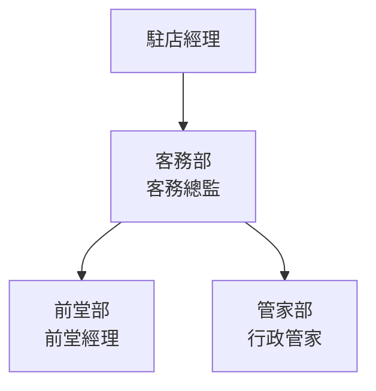
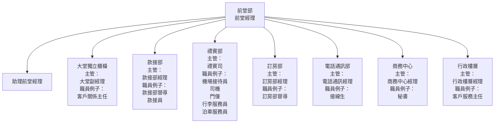
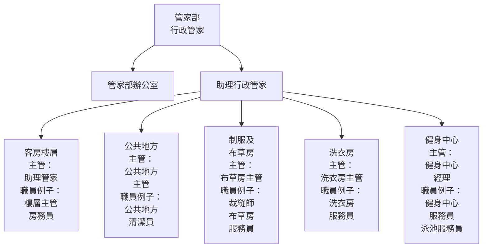

# 6

# 酒店客務部簡介-前堂

natural_image

Colorful stylized city skyline illustration featuring iconic landmarks including the Eiffel Tower, Big Ben, and World landmarks (no text or symbols)

客房銷售是酒店的核心業務，而客房這一重要產品由客務部負責管理。客務部同時管理酒店大堂及其他公眾地方，直接影響顧客對酒店服務水平的觀感，對維持酒店品牌形象至為重要。

# 思考點

酒店為何要將前堂部和管家部合併為客務部？

# 6.1客務部的組織架構

客務部是酒店最大的部門，主要由前堂部和管家部兩個部門組成。客務部的日常運作由客務總監領導，前堂部和管家部則分別由前堂經理和行政管家負責。

# 提示箱

由於前堂部和管家部有很多職能，並下設多個部門，所以也有酒店不會把它們合併為客務部，而是設立為獨立的部門，直接由駐店經理領導。

flowchart

圖 2.69

natural_image

Interior of a hotel lobby with travelers and luggage, no visible text or signage

# 6.2 前堂部的職能與組織架構

前堂部是酒店的樞紐，負責營銷、溝通和協調等角色，也是顧客最先及最後接觸的前線部門，在酒店營運中佔有舉足輕重的地位。

▲ 圖 2.70 前堂部

# 前堂部的職能

前堂部的主要職能包括：

‧ 銷售客房；  
‧ 接待顧客；  
‧ 分配客房；  
‧ 向顧客提供各項服務及資訊；  
‧ 處理顧客帳單；  
協調各部門的顧客服務；  
‧ 記錄及更新顧客帳戶資料等。

# 前堂部的組織架構

前堂部的工作範圍相當廣泛，為了有效進行分工，大型酒店一般會在前堂部之下設立多個部門，包括款接部、大堂獨立櫃檯、禮賓部、訂房部、電話通訊部、商務中心和行政樓層等。

大型酒店前堂部的組織架構圖  

flowchart

# 3 前堂部的員工職能

# A 前堂經理

前堂經理主管整個前堂部，是前堂部的最高級職員，其職責包括：

監控客房銷售及訂房情況；  
• 研究市場組合，向上級呈交客房入住率預測報告；  
• 確定房價架構，監督房價政策的實施；  
• 審核住客抵埗及離開情況；  
• 檢視每日客房銷售、平均房價、收入報表；  
• 根據前堂部運作情況，調配員工當值；  
• 接待重要人物，包括在重要人物入住前查察其客房；  
• 制定前堂部的服務政策及指引，並監督其實施情況；  
• 巡視前堂部各範圍，處理各項問題，並與其他部門溝通協調；  
• 維繫與重要客戶及機構的關係，為酒店爭取更多銷售服務的機會。

# B 助理前堂經理

助理前堂經理協助前堂經理管理前堂部，其職責包括：

• 協助前堂經理監控訂房情況；  
• 協助前堂經理製作報表等行政工作；  
監督前堂部員工的服務；  
評核前堂部員工的表現；  
• 培訓前堂部員工。

natural_image

Two business professionals in a meeting at a desk with a laptop and notepad (no visible text or symbols)

▲ 圖2.72 評核前堂部員工的表現是助理前堂經理其中一項工作

# C 大堂獨立櫃檯的工作與員工的職能

大堂獨立櫃檯負責酒店大堂範圍的客戶關係和秩序，協助前堂經理督導大堂員工提供符合水平的服務。大堂副經理是大堂獨立櫃檯的主管，其下有客戶關係主任，職責如下：

<table><tr><td>職位</td><td>職能</td></tr><tr><td>大堂副經理</td><td>·代表酒店管理層歡迎和接待重要客人;·發揮客戶服務關係的角色,與客人交流;·處理顧客的查詢、投訴,為顧客提供協助;·協助前堂經理留意大堂員工的工作表現;·統籌各部門的聯繫工作,確保所有部門運作暢順等。</td></tr><tr><td>客戶關係主任</td><td>·歡迎和接待所有抵埗的顧客,特別是商務客人;·為顧客提供當地資訊;·向顧客推廣酒店的設施、服務和活動;·在款接部繁忙時提供協助,如協助顧客結帳退房等。</td></tr></table>

# D 款接部的工作與員工的職能

款接部負責接待顧客，安排顧客入住和退房。款接部經理是該部門的主管，其下有款接部督導、款接員等，職責如下：

<table><tr><td>職位</td><td>職能</td></tr><tr><td>款接部經理</td><td>· 負責監督款接部的日常運作；
· 推動客房的銷售收入，確保客房入住率達到最高水平；
· 接待重要賓客；
· 培訓及考核款接部員工等。</td></tr><tr><td>款接部督導</td><td>· 協助款待部經理監督款待部的日常運作；
· 編製款待部值班表；
· 接待重要賓客，如重要人物；
· 為顧客編配客房；
· 接待抵埗的團體旅客；
· 處理顧客的查詢及投訴等。</td></tr><tr><td>款接員</td><td>· 接待抵埗的顧客；
· 為顧客辦理登記手續及編配客房；
· 向顧客提供酒店設施及服務資訊，並作推銷；
· 記錄及更新顧客帳戶資料；
· 為顧客辦理退房及結帳手續；
· 管理供顧客免費使用的款接部保險箱系統；
· 為顧客兌換外幣等。</td></tr></table>

natural_image

Interior view of a modern hotel lobby with reception desk, decorative wall panels, and red abstract sculpture (no visible text or signage)

▲ 圖 2.73 酒店款接部的款接員

# E 禮賓部的工作與員工的職能

禮賓部主要負責接待顧客，為酒店提供住房以外的支援服務，在高級酒店中扮演重要角色，務求令顧客有賓至如歸的感覺。禮賓司是該部門的主管，其下有機場接待員、司機、門僮、行李服務員、泊車服務員等，職責如下：

text_image

Concierge
礼宾部

▲ 圖 2.74 禮賓司

<table><tr><td>職位</td><td>職能</td></tr><tr><td>禮賓司</td><td>向顧客介紹酒店的設施、服務;向顧客提供當地景點、餐飲、娛樂等觀光旅遊資訊;代顧客預訂餐廳座位及各類門票;代顧客安排往返各地的交通服務,例如確認航班航程和訂購機票、安排酒店轎車等;調配禮賓部人手,以應對顧客的不同需要和查詢;培訓及監督禮賓部員工等。</td></tr><tr><td>機場接待員司機</td><td>到機場迎接顧客;為顧客提供行李、離境等協助,例如聯絡航空公司為顧客安排輪椅、處理遭航空公司遺失的顧客行李;安排顧客由機場前往酒店;接受酒店客房預訂等。接送顧客往返酒店;按要求擔任顧客的私人司機等。</td></tr><tr><td>門僮</td><td>迎接抵埗的顧客;為顧客開門;召喚行李服務員協助抵埗的顧客;為顧客召喚的士及代顧客提供酒店地址卡;為沒有當地貨幣的酒店顧客支付的士車資;指揮酒店出入口的交通及車輛停泊等。</td></tr><tr><td>行李服務員</td><td>替顧客運送行李;陪同顧客由款接部前往客房,並介紹客房設施;送遞報紙、郵件、訊息及包裹等至顧客房間;儲存顧客寄存的行李。</td></tr><tr><td>泊車服務員</td><td>為顧客停泊車輛;協助門僮疏導酒店車輛出入口的交通。</td></tr></table>

text_image

INTERCONTINENTAL.
BANGKOK
President Tower Arcade

圖2.75門僮

natural_image

Interior of a hotel lobby with a person pushing a horse pallet, surrounded by ornate furniture and potted plants (no visible text or signage)

▲圖2.76行李服務員

text_image

VALET
PARKING
STOP HERE

▲圖2.77泊車服務員

# F 訂房部的工作與員工的職能

訂房部主要負責客房銷售工作，並決定應否接受或停止超額預訂客房，並向款接部提供入住顧客的資料。訂房部經理是該部門的主管，其下有訂房部督導、訂房部文員等，職責如下：

<table><tr><td>職位</td><td>職能</td></tr><tr><td>訂房部經理</td><td>監督訂房部的日常運作;決定預訂客房的數目;監控客房預訂情況;向管理層匯報訂房情況;培訓及督導員工執行預訂客房服務等。</td></tr><tr><td>訂房部督導</td><td>協助訂房部經理監控客房預訂情況;監察及匯報異常的預訂及取消預訂情況;監督訂房部員工。</td></tr><tr><td>訂房部文員</td><td>處理顧客及旅行代理商等有關客房預訂的查詢;處理客房預訂要求及編製訂房確認單;記錄客房預訂要求的資料及每晚接受的訂房數目;編製客房預訂報表,並提供給前堂部;編製重要人物名單;更新顧客檔案的紀錄。</td></tr></table>

# 資料室

# 訂房部如何處理客房預訂

酒店訂房部會由不同渠道收到訂房指示，例如：

• 透過互聯網、電郵、電話、傳真、郵件而來的直接訂房；  
• 透過全球分銷系統（GDS）或酒店電腦訂房系統（CRS）；  
• 旅行代理商； • 旅行團經營商；  
• 會議籌辦人； • 自來客人

當訂房部接納訂房要求後，有關客房預訂的詳細資料，包括顧客姓名、住宿晚數、客房類型、客房價格、付款方式、顧客聯絡資料和特別要求等，會記錄在酒店的訂房表格及電腦系統中。

酒店了解到部分預訂了客房的顧客最終可能不會出現，因此在旺季時會接受超額預訂（即酒店接受的訂房數目，高於其可容納預訂數目的客房），以達到 100% 的入住率。訂房部文員很多時會在旺季要求顧客核實其預訂指示。

得到回覆確認的訂房指示，由於顧客已為客房預繳費用，即使顧客最後沒有出現，也不會獲得退款，而酒店會在確認期限內為顧客保留客房。不過，對於收不到顧客核實的訂房指示，酒店將保留客房到既定的取消時間（通常是抵埗日期的下午 6 時）。假如顧客沒有如期出現，酒店將會重新銷售該客房。

# G 電話通訊部的工作與員工的職能

電話通訊部是酒店的通訊中心，負責酒店對內及對外的電話通訊和網絡服務等。電話通訊服務經理是該部的主管，其下有接線生等，職責如下：

<table><tr><td>職位</td><td>職能</td></tr><tr><td>電話通訊服務經理</td><td>監督電話通訊部的日常運作;處理特別的電話查詢及投訴;培訓及督導接線生的溝通技巧等。</td></tr><tr><td>電話接線生</td><td>利用電話回應顧客的查詢、服務要求和投訴;接駁外來電話及收發電話傳真、電傳視訊等;為顧客記錄電話留言;為顧客提供電話喚醒服務;替顧客預訂酒店各項服務;管理客房收費電視系統和長途電話收費;當緊急事故、天氣突變情況發生時,擔當通訊中心的角色,通知管理層、各酒店部門和顧客等。</td></tr></table>

# H 商務中心的工作與員工的職能

商務中心負責為需要商務服務的顧客提供支援服務，為顧客提供商務活動設備和協助舉辦商務活動等。商務中心經理是該部門的主管，其下有秘書等，職責如下：

<table><tr><td>職位</td><td>職能</td></tr><tr><td>商務主管</td><td>監督商務中心的日常運作;為顧客安排秘書及翻譯服務,以及各類辦公室設施;為顧客安排會議及活動場地;培訓及督導秘書等。</td></tr><tr><td>商務中心秘書</td><td>管理商務中心內的設施;協助顧客使用各類辦公室設施;協助顧客使用會議及活動場地;記錄顧客使用設施及場地的費用等。</td></tr></table>

# I 行政樓層的工作與員工的職能

行政樓層通常設於酒店的頂層，為願意支付額外費用的顧客提供更優質的服務。行政樓層亦會為顧客提供多種免費的專屬優惠等。行政樓層經理負責該部門的運作，其下有客戶服務主任等，職責如下：

<table><tr><td>職位</td><td>職能</td></tr><tr><td>行政樓層經理</td><td>監督行政樓層的日常運作;接待使用行政樓層的顧客;培訓及督導客戶服務主任等。</td></tr><tr><td>客戶服務主任</td><td>接待使用行政樓層的顧客;為使用樓層的顧客提供特快入住登記和結帳退房服務;為使用樓層的顧客提供免費餐飲服務;為使用樓層的顧客安排個人化的商務及禮賓服務,例如燙衣服務、擦鞋服務、確認航班和酒店轎車安排等。</td></tr></table>

natural_image

Modern living room interior with blue sofas, chandelier, and large windows (no visible text or symbols)

▲ 圖2.78 行政樓層

# 6.3前堂部與其他部門的關係

前堂部是酒店中接觸顧客最多的部門，也是處理顧客交易、收集及分發顧客資料的中心。因此，前堂部扮演了顧客及其他部門的溝通橋樑，其運作效率同時影響着酒店其他部門為顧客提供服務的質素。

前堂部與酒店其他部門的關係大致如下：

<table><tr><td>部門關係</td><td>概述</td></tr><tr><td>前堂部與管家部</td><td>· 管家部清潔完客房後,需即時更新客房狀況,以便前堂部準確掌握客房的狀況,編配客房。
· 當管家部發現客房或樓層出現異常情況時,需立即聯絡前堂部,以便前堂部通知其他部門作出跟進。
· 前堂部需向管家部提供顧客入住及退房的時間,以便管家部編排清潔客房的優先次序。
· 當顧客提出要求時,如索取紙巾、毛巾、酒杯等,管家部需支援前堂部,盡快為顧客提供所需設施及服務。
· 當前堂部為顧客辦理退房手續時,需通知管家部檢查客房情況;管家部在檢查後,需馬上向前堂部匯報。</td></tr><tr><td>前堂部與餐飲部</td><td>· 前堂部會向餐飲部提供客房訂餐的要求,以便餐飲部製作相應的餐點。
· 前堂部需向餐飲部提供有關顧客用膳安排的資料,如當日享用早餐的人數,以便餐飲部準備食材、預留餐廳座位及安排人手,供顧客用膳。
· 個別酒店會為顧客提供歡迎果籃、飲品等,前堂部需在顧客抵埗前通知餐飲部預備。
· 餐飲部需將顧客在餐廳的消費帳項通知前堂部,以便前堂部計算顧客在酒店的總消費及便利結帳退房手續。</td></tr><tr><td>前堂部與營業及市場推廣部</td><td>·前堂部需向營業及市場推廣部提供顧客的入住資料,以便營業及市場推廣部進行分析研究,從而計劃銷售策略,並向顧客進行促銷宣傳。·營業及市場推廣部制定推廣計劃後,需向前堂部員工作介紹,以便前堂部員工掌握詳細情況,並向顧客作推介。·營業及市場推廣部在處理旅行團和團體機構的訂房時,需與前堂部的款接部和訂房部緊密合作,以便盡早安排客房分配名單,使旅行團或團體顧客抵埗時,提高入住效率。</td></tr><tr><td>前堂部與人力資源部</td><td>·人力資源部會協助招聘前堂部員工,並安排培訓,如為員工講解工作守則、如何使用酒店資產管理系統等。·前堂部員工的工作表現評核等,需人力資源部配合完成。</td></tr><tr><td>前堂部與工程部</td><td>·當顧客對客房或其他設施故障作出投訴時,前堂部需即時通知工程部,以便工程部盡快安排人員進行維修。·當工程部在對酒店客房、公共設施進行維修或保養工程時,需通知前堂部,以便封鎖有關客房和公共設施,以及調整客房分配。</td></tr></table>

natural_image

Close-up of hands installing a circular component with a screwdriver, no visible text or symbols

▲ 圖2.79 工程部接到前堂部的通知後，會安排人員維修設施。

<table><tr><td>前堂部與保安部</td><td>· 前堂部在重要賓客抵埗前,需盡早與保安部商討及制訂妥當的保安計劃。· 前堂部如發現有可疑人士或黑名單人士進入酒店範圍,需通知保安部,以便監察及截查有關人士,防止影響酒店秩序的事情發生。· 前堂部在火警、電源故障等緊急狀況下,需提供顧客資料給保安部,以便保安部作出跟進。· 保安部在接到前堂部有關保安事故的通告後,如失竊、意外事故等,需立即前往處理。</td></tr><tr><td>前堂部與財務部/會計部</td><td>· 前堂部每天收取的款項,需連同紀錄,即日轉交會計部;會計部則會核對有關款項及紀錄資料。· 會計部會編製核准賒帳公司的名單和最高金額等,供前堂部參考。</td></tr><tr><td>前堂部與資訊科技部</td><td>· 資訊科技部會為前堂部員工提供使用酒店電腦系統的培訓。· 前堂部如遇上電腦系統、通訊系統故障等,需要資訊科技部提供技術支援。· 顧客如在酒店客房及公共空間遇到網絡故障問題,前堂部會通知資訊科技部作出跟進。</td></tr></table>

text_image

SYSTEMFAILURE

▲ 圖2.80 資訊科技部會為前堂部解決電腦系統故障等問題

# 6.4款接部職能

為顧客辦理入住登記、處理結帳退房和客房超額預訂，是款接部最主要的職能。

# 1 入住登記

款接部職員為顧客辦理入住登記，是顧客接觸酒店的關鍵時刻，並往往成為酒店建立正面形象的重要時機。因此，款接部職員應遵照標準的入住登記處理程序，快捷、準確地完成入住登記，務求令顧客對酒店留下良好的印象。

圖 2.81 正在為顧客辦理入住登記的款接部職員  

text_image

Interior photo of a modern hotel lobby with visible counter signs and staff assisting visitors

# 提示箱

酒 店 資 產 管 理 系 統（Property Manage-ment System, PMS） 是套專門用於酒店資產和設備管理的資訊科技系統，在第四冊課題五「旅遊與款待業趨勢及議題」將會詳細介紹。

# A 已訂房顧客

已訂房顧客即抵達酒店時，已經網上系統、旅行代理商或其他渠道，預訂了客房及提供了資料的顧客。這些顧客來到款待部時，職員只需核實資料，便可安排顧客入住。

已訂房顧客的標準入住登記處理程序

<table><tr><td colspan="2">程序</td><td>描述</td></tr><tr><td>1.迎接顧客</td><td></td><td>當行李服務員等引領顧客來到櫃檯前,款接部職員應有禮貌地問候顧客。</td></tr><tr><td>2.核實顧客身分</td><td></td><td>職員應詢問顧客是否要登記入住,然後核實顧客的護照或身份證,以及訂房憑證、確認編號與預訂紀錄是否相符。</td></tr><tr><td>3.提供入住登記表格</td><td></td><td>職員應把已輸入顧客個人資料和入住資料的表格列印出來,然後交予顧客簽名確認。</td></tr><tr><td>4.確認顧客的付款方式</td><td></td><td>基於酒店預先付費政策,職員應先利用酒店資產管理系統(PMS),確認顧客是否已經網上支付系統付款。如顧客未付款,可詢問顧客會選擇以信用卡還是以現金支付。另外,酒店一般需要顧客交付按金,職員應再次徵詢顧客支付方式。如顧客選用信用卡,職員應留意信用卡的有效日期,以及核對顧客的簽名。</td></tr><tr><td>5.在酒店資產管理系統中核對並更新顧客帳戶資料</td><td></td><td>職員應在酒店資產管理系統(PMS)中核對並更新顧客的資料,再根據顧客的訂房資料,選擇並分配適當的客房。</td></tr><tr><td>6.分發客房門匙卡並提供進一步資訊</td><td></td><td>職員應先交還顧客的護照或身份證等個人證件、信用卡等,再向顧客分發客房門匙卡,同時告訴顧客房間樓層和號碼,以及指示客房的方向。職員應按顧客的入住情況,向顧客簡介酒店的設施、服務等,如啟動升降機的方法、早餐用餐的位置、穿梭巴士的時間等。</td></tr><tr><td>7.陪同顧客前往客房</td><td></td><td>職員應詢問顧客是否需要行李服務員的協助,如有需要,便請行李服務員帶同顧客的行李,陪同顧客前往客房。</td></tr></table>

# B 團體顧客

團體顧客由領隊或導遊帶領到達酒店，也是已訂房的顧客。不過，由於團體顧客人數較多，為免影響其他客人入住登記，大部分酒店設有團體入住登記櫃檯，專門處理團體顧客的入住登記。款接部職員只需向領隊或導遊一次性索取顧客個人資料，然後核實資料，便可安排團體顧客入住。

團體顧客的標準入住登記處理程序

<table><tr><td>程序</td><td>描述</td></tr><tr><td>1.事前準備</td><td>當團體顧客到達酒店前,款接部職員便應按人數,預先分配所需客房,如雙人房的數目。職員也應準備好有關表格、客房門匙卡、早餐券等。</td></tr><tr><td>2.抵達後安排</td><td>職員應知會領隊或導遊,安排團體顧客集中等候的區域,以免影響大堂秩序,或對其他顧客造成不便。</td></tr><tr><td>3.核實顧客身分及訂房資料</td><td>領隊或導遊會向職員提供全部團體顧客的護照或身份證等個人資料,職員應核實個人資料與預訂紀錄是否相符。</td></tr><tr><td>4.交還證件及分發客房門匙卡</td><td>職員應先向領隊或導遊交還團體顧客的護照或身份證等個人資料,再向領隊或導遊分發客房門匙卡,讓他們在大堂分配客房給顧客。</td></tr><tr><td>5.確認安排</td><td>職員應向領隊或導遊說明酒店的設施、服務,以及服務安排等,如早餐用餐的位置、行李運送安排等,再由領隊或導遊向團體顧客交代。</td></tr><tr><td>6.更新記錄</td><td>職員應在領隊或導遊分配客房給顧客後,按分配情況更新各客房入住顧客的資料記錄。</td></tr><tr><td>7.安排運送行李到客房</td><td>職員應請行李服務員把團體顧客的行李運送到所屬樓層,讓顧客認領後送入客房。</td></tr></table>

# C 散客

散客是到達酒店時，未有預訂客房而要求即時入住的顧客。款接部職員同樣需要採取標準的入住登記程序。

散客的標準入住登記處理程序

<table><tr><td>程序</td><td>描述</td></tr><tr><td>1.迎接顧客</td><td>當顧客來到櫃檯前,款接部職員應有禮貌地問候顧客,並詢問顧客是否已訂房。</td></tr><tr><td>2.了解顧客需求</td><td>職員應先了解顧客的住房需求,例如入住人數、逗留時間等。</td></tr><tr><td>3.推銷客房</td><td>職員應先確認可銷售客房的情況,然後向顧客推介可供入住的客房類型,以及介紹客房的設備、收費、付款方法等。</td></tr><tr><td>4.提供入住登記表格</td><td>職員在確定顧客訂房後,應向顧客索取護照或身份證等個人證件,接着在入住登記表格輸入顧客個人資料和入住資料,然後把表格列印出來,交予顧客簽名確認。</td></tr><tr><td>5.請顧客付款</td><td>基於酒店預先付費政策,職員應請顧客以信用卡或現金方式支付客房費用和按金。如顧客選用信用卡,職員應留意信用卡的有效日期,以及核對顧客的簽名。</td></tr><tr><td>6.交還證件及分發客房門匙卡</td><td>職員應先交還顧客的護照或身份證等個人證件、信用卡等,再向顧客分發客房門匙卡,同時告訴顧客房間樓層和號碼。</td></tr><tr><td>7.安排運送行李到客房</td><td>職員應請行李服務員帶同顧客的行李,陪同顧客前往客房。</td></tr><tr><td>8.更新記錄</td><td>職員應在酒店資產管理系統(PMS)中更新客房入住情況及顧客的資料。</td></tr></table>

# 結帳退房

款接部職員快捷、準確地為顧客處理結帳退房，可以讓顧客在離開酒店前，對酒店留下良好印象，這也是酒店與顧客之間的關鍵時刻。

標準的結帳退房處理程序

<table><tr><td>程序</td><td>描述</td></tr><tr><td>1.問候顧客</td><td>當顧客來到櫃檯辦理退房手續時,款接部職員應有禮貌地問候顧客,並可藉此詢問顧客對入住酒店的評價。</td></tr><tr><td>2.核對顧客資料</td><td>職員在接過門匙卡後,應在酒店資產管理系統中核對顧客的客房號碼、姓名等。職員亦應詢問顧客有沒有使用客房內的迷你酒吧和其他收費服務,以及提醒顧客有否遺留任何物品於客房。</td></tr><tr><td>3.核對顧客延遲結帳退房費用</td><td>酒店標準的結帳退房時間通常定在中午12時或之前,職員應在酒店資產管理系統中查看顧客是否要支付延遲結帳退房的費用。</td></tr><tr><td>4.核對漏帳</td><td>職員應詢問顧客有沒有使用客房內迷你酒吧和其他收費服務,例如顧客可能在餐廳享用早餐而未入帳。迷你酒吧的狀況需要房務員於顧客結帳退房時協助檢查核實。</td></tr><tr><td>5.請顧客再次核對酒店費用</td><td>職員應列印所有款項的單據,請顧客再次核對在酒店的全部開支,或出示總帳戶供旅行團領隊查閱。如有問題,職員應核證和解釋,然後重新列印單據,讓顧客核對。</td></tr><tr><td>6.結清顧客帳戶</td><td>職員應請顧客在單據上簽名確認,再處理結帳。在扣除顧客的按金後,可能需收取現金或信用卡結帳。其後,職員應把賬單放進信封,交給顧客。</td></tr><tr><td>7.為顧客提供協助</td><td>職員應感謝顧客入住酒店,並詢問顧客是否需要保管行李、召喚的士等服務。</td></tr><tr><td>8.更新客房狀況和顧客入住記錄</td><td>職員應在酒店資產管理系統(PMS)中更新客房狀況及顧客的入住記錄,以便酒店在顧客再次入住時,能因應顧客的特徵,提供更貼心的服務。</td></tr></table>

# 資料室

# 總帳單和雜項費用帳單

針對不同的顧客，如商務旅客和旅行團旅客，酒店往往會將消費項目拆分到兩張帳單：總帳單和雜項費用帳單。

總帳單：通常涵蓋客房住宿和早餐費用，此類費用多由企業為赴外公幹員工承擔的必要公務費用，或屬旅行代理商已預先向旅客收取的團體旅遊基本費用範圍。

雜項費用帳單：屬於顧客自行負責的額外服務支出，常見的有國際通訊費用、水療服務費用和客房自選電影收費等。

# 處理客房超額預訂

酒店為了爭取高入住率和提高收益，在銷售客房時，會容許超額預訂（Overbooking），即酒店預訂的客房數目會多於酒店實際可供應的客房數目。酒店會根據過往的經驗，以及分店數量的多寡，一般容許超額預訂5%至10%的客房。

當超額預訂出現，酒店必須妥善處理，否則會對顧客造成不便，以及令顧客對品牌產生負面印象。在顧客抵達酒店前，酒店已需要開展處理客房超額預訂的程序。

標準的處理客房超額預訂程序

<table><tr><td>程序</td><td>描述</td></tr><tr><td>1.查證預訂及客房情況</td><td>職員應重新確認預訂資料,了解有沒有重複預訂或已取消預訂的情況;同時查核酒店全部客房的狀況,查找還有沒有可供銷售的客房,包括嘗試加快完成維修的客房。</td></tr><tr><td>2.排列處理先後</td><td>職員應優先編配行政樓層及保證預訂,再處理團體顧客和常客的預訂,然後安排其他預訂。</td></tr><tr><td>3.擬定臨時措施</td><td>如酒店沒有任何客房可供顧客入住,酒店應擬定臨時措施處理,包括向集團同系酒店或鄰近的酒店預訂客房,以安排顧客轉往入住。</td></tr><tr><td>4.向顧客致歉</td><td>顧客抵達酒店後,大堂副經理或款接部經理等高級職員,應即時代表酒店向顧客致歉。</td></tr><tr><td>5.提供其他選擇</td><td>職員代表酒店向顧客提供賠償及作出安撫,常見的賠償包括:·入住替代酒店所需的首晚客房費用;·安排免費交通服務前往替代酒店;·再次入住將可享有免費客房升級;·餐飲消費折扣券、果盤等。若顧客訂房超過一晚,而餘下日子有客房可供應,可主動邀請顧客回來入住。</td></tr><tr><td>6.提供行李服務和交通</td><td>如顧客接受替代酒店,職員應安排專車及專人接送客人前往,並由行李服務員運送顧客的行李。</td></tr><tr><td>7.跟進服務</td><td>酒店方面應致電替代酒店,請對方職員特別照顧不滿的顧客。如有需要,大堂副經理或款接部經理應親自致電顧客,再次向對方致歉,以緩解其不滿。</td></tr></table>

前堂部和管家部是客務部的兩大部門。上一章已介紹了前線部門前堂部，這一章會介紹後勤部門管家部。

# 7.1管家部的職能與組織架構

管家部負責酒店全部客房及公共區域的清潔工作，對酒店的順利運作甚為關鍵。酒店客房及公共區域的清潔程度，更直接影響顧客對酒店的觀感和印象。因此，很多酒店都重視管家部的工作，並採取嚴格的標準。

natural_image

Hotel corridor scene with a woman in uniform standing beside a main crane, no visible text or symbols

▲ 圖2.82 在樓層走廊房務車前的房務員

# 管家部的職能

管家部的主要職能包括：

# A 清潔和保養酒店客房樓層

為酒店客房、樓層走廊、升降機提供清潔和保養工作；  
• 每天為客房提供檢查、清潔和整理工作，為顧客營造舒適的住宿環境；  
• 在顧客退房後，檢查和再清潔客房等。

# B 供給和配置客房用品及設備

• 每日為酒店客房供給和配置衞生紙、沐浴露等用品，以方便顧客使用；  
• 應顧客需求，提供額外的用品，如插頭轉換器、酒杯、刀叉等，以滿足顧客的需要；  
• 為有需要的顧客提供開床服務等。

# C 提供顧客服務

• 接聽顧客的查詢來電，處理顧客對客房用品的要求；  
• 為顧客提供個性化的服務，如客房送餐服務、洗衣服務、擦鞋服務、托嬰服務等。

# D 清潔和保養酒店公共地方

• 為酒店各公共地方，如大堂、餐廳、商務中心、會議室、游泳池、健身室、公共洗手間等，提供清潔和保養工作，為顧客營造良好的生活環境；  
• 為酒店員工的辦公地方，如各部門的辦公室、員工餐廳、更衣室、儲物室等，提供清潔和保養工作，為員工營造良好的工作環境；  
• 護養酒店內的植物，打理花園和防蟲等。

# E 收發和洗燙布草、制服等用品

• 為住客提供洗衣、乾衣和熨衣服務；  
• 清潔員工制服、客房及餐廳的布草；  
• 收發、點算、修補及保管員工制服、客房及餐廳的布草等。

# 資料室

# 布草

布草是酒店的行業用語，泛指管家部負責，與「布」有關的酒店用品，包括客房內的面巾、毛巾、浴巾、浴袍、地巾、床單、被套、枕頭套等；餐廳內布餐巾、檯布等。

由於酒店布草每天消耗量大，而且布草的清潔程度會直接影響顧客對酒店的印象，所以酒店會安排專門的制服及布草房部門負責布草的工作。

natural_image

Warehouse shelving with stacked white sheets and hanging clothes, no visible text or labels

▲ 圖2.83  制服及布草房的布草

# 管家部的組織架構

管家部的架構包括：客房樓層、公共地方、布草房、洗衣房等部門。

大型酒店管家部的組織架構圖  

flowchart

圖 2.84

# 3 管家部的員工職能

# A 行政管家

行政管家主管整個管家部，是管家部的最高級職員，其職責包括：

• 監督管家部的工作質素，督促員工落實酒店的方針和政策；  
• 制定管家部各部門的工作安排；  
• 制定管家部的工作程序及守則；  
面試及聘請管家部員工；  
• 培訓管家部員工；  
• 人事紀錄管理；  
• 調配管家部人手，編製輪值表、休假表等；  
• 安排監督工作和員工福利；  
• 訂購和管理管家部的設備、材料及布草；  
• 管理鎖匙；  
• 處理住客投訴和突發事故；  
• 與各部門及其他相關部門溝通、協調等。

# B 助理行政管家

• 協助行政管家監督管家部的日常運作，在行政管家缺勤時承擔其職責；  
• 根據入住情況修訂管家部日常的工作安排；  
• 與前堂部保持聯繫，以便調配人手協助；  
• 編制用於清潔地氈、窗簾等的總清單；  
• 檢查客房及公共地方的衞生情況，確保符合酒店標準；  
• 檢查和決定是否需要翻新客房、大堂，以及提供建議；  
• 遴選管家部求職者、協助培訓員工；  
• 評核管家部員工的工作表現，建議作出紀律行動或解僱。

# C 客房樓層的工作與員工的職能

客房樓層主要負責清潔和整理客房，報告客房及樓層異常事故等。助理管家是該部門的主管，其下有樓層主管、房務員等，職責如下：

<table><tr><td>職位</td><td>職能</td></tr><tr><td>助理管家</td><td>協助行政管家的日常工作;调配樓層主管、房務員到指定樓層;編制樓層員工的工作時間表、考勤記錄;監督樓層員工的工作,記錄管家部執行的額外工作;巡視及檢查樓層客房、大堂及後樓梯,並填寫檢查報告;檢查客房樓層的設備,以及建議購買新設備;盤點清潔用品和布草等;與其他部門協調和溝通等。</td></tr><tr><td>樓層主管</td><td>協助助理管家監督樓層的日常運作;重新分配樓層人手,編排當天工作;檢查管轄範圍的客房,並填寫客房檢查清單;督導及檢查員工的工作情況,以及樓層的衛生情況;培訓房務員;監察清潔用品的存量,訂購及分發清潔用品;進行布草檢查和其他保養檢查;就顧客的抵埗及離開與款接部保持聯絡。</td></tr><tr><td>房務員</td><td>清潔及收拾客房、浴室和套房;補充客房所需的日用品;整理未清潔和已清潔的布草;為顧客提供開床服務;把顧客需要洗熨的衣物交給洗衣房處理;供給住客額外要求的客房用品或設備;在顧客退房時檢查客房物品和設施;報告故障及不尋常的情況。</td></tr></table>

# D 公共地方的工作與員工的職能

公共地方主要負責清潔酒店大堂、餐廳、升降機、洗手間、健身室等公共區域，以及清潔酒店各部門的辦公室等。公共地方主管是該部門的主管，其下有公共地方清潔員等，職責如下：

text_image

CAUTION
WET FLOOR

圖 2.85 公共地方清潔員在清潔公共地方時，應豎立警告牌，提醒顧客注意地滑。

<table><tr><td>職位</td><td>職能</td></tr><tr><td>公共地方主管</td><td>監督公共地區員工的日常工作;巡視及檢查公共地方、走廊及辦公室的清潔情況,確保符合標準;制定清潔標準和實施清潔計劃;查看需要即時維修的地方是否經已報告;就餐廳或需要維修的項目作出保養報告,並跟進維修工作妥善完成;培訓清潔員;評核清潔員的工作表現,如表現未如理想需通知行政管家;就清潔安排與其他部門協調和溝通等。</td></tr><tr><td>公共地方清潔員</td><td>保持公共地方的清潔;清潔酒店裝飾品、地氈和其他用品;保持走廊潔淨;移動及整理傢俱;執行上司分派的清潔及整理工作;報告故障及不尋常的情況。</td></tr></table>

# E 制服及布草房的工作與員工的職能

制服及布草房主要負責收發、點算、修補和保管員工制服，以及客房及餐廳的布草等。制服及布草房主管是該部門的主管，其下有布草房服務員等，職責如下：

<table><tr><td>職位</td><td>職能</td></tr><tr><td>制服及布草房主管</td><td>統籌布草房的工作安排;監督布草房員工的工作;監控員工制服和布草的收發、清潔情況;編制員工制服和布草的存貨清單。</td></tr><tr><td>裁縫師</td><td>修改及修補員工制服、布草、窗簾和掛幔等;修補顧客的衣物;為新員工量度尺寸、分發制服,並保存記錄;棄置員工制服,以及客房和餐廳的布草,並紀錄棄置品;編制存貨清單。</td></tr><tr><td>制服及布草房服務員</td><td>收集、分類未清潔的員工制服和布草;安排員工制服和布草到洗衣房進行清潔;檢查、點算已清潔的制服和布草;分發員工制服和布草到各個部門。</td></tr></table>

# F 洗衣房的工作與員工的職能

洗衣房主要負責為住客提供洗衣、乾衣和熨衣服務，以及清潔員工制服、客房及餐廳的布草等。洗衣房主管是該部門的主管，其下有洗衣房服務員等，職責如下：

<table><tr><td>職位</td><td>職能</td></tr><tr><td>洗衣房主管</td><td>統籌洗衣房的工作安排;與布草房協調收集、清潔員工制服和布草的工作;監督洗衣房員工的工作;監控員工制服和布草的清潔質素。</td></tr><tr><td>洗衣房服務員</td><td>為住客洗衣、乾衣和熨衣;為住客傳送需洗滌及已洗滌的衣物;洗滌員工制服和布草;傳送需洗滌及已洗滌的員工制服和布草。</td></tr></table>

# G 健身中心的工作與員工的職能

健身中心主要負責健身室、游泳池等地方的日常營運。健身中心經理是該部門的主管，其下有健身中心服務員、游泳池服務員等，職責如下：

natural_image

Person cleaning a poolside with a blue mop and water, near lounge chairs and ocean (no text or symbols visible)

▲ 圖2.86 正在清理游泳池雜物的服務員

<table><tr><td></td></tr></table>

# 7.2管家部與其他部門的關係

管家部對酒店客房的管理，直接影響客房的銷售；對酒店公共地方的管理，則直接影響顧客對酒店的印象。因此，管家部需時刻與酒店其他部門緊密協調及合作，對酒店的營運甚為重要。

管家部與酒店其他部門的關係大致如下：

<table><tr><td>部門關係</td><td>概述</td></tr><tr><td>管家部與前堂部</td><td>· 前堂部收到顧客的入住資料後,需提交予管家部,以便管家部為顧客提供額外的開床服務。· 顧客入住期間,前堂部接到顧客提出額外要求,如索取紙巾、毛巾、酒杯等,會通知管家部處理;管家部有時會收到顧客的特別要求,如提供觀光旅遊資訊、安排交通服務等,需通知前堂部跟進。· 管家部發現客房設施受損,影響顧客入住,需通知前堂部停止使用該客房。· 管家部收到前堂部有關顧客退房的指示後,需馬上檢查客房情況,然後盡快向前堂部匯報。· 管家部清潔完客房後,需即時更新客房狀況,以便前堂部準確掌握客房的狀況,編配客房。</td></tr><tr><td>管家部與餐飲部</td><td>· 餐飲部每日使用大量布草,需與管家部保持良好關係,以便管家部處理餐廳污損的布草和提供潔淨的布草。· 餐飲部承辦的大型宴會,更需管家部提供足夠的布草應付。· 管家部需時刻與餐飲部保持聯繫,並提供及時的管家服務,以確保住客的客房餐飲,可安全、快速地運送到客房,供住客用膳。· 顧客在客房享用完餐飲後,需管家部把餐具送返餐廳。</td></tr></table>

natural_image

A banquet table with multiple glasses and pink napkins arranged in rows, no visible text or symbols.

▲ 圖 2.87 餐飲部餐廳的布草由管家部供應

<table><tr><td>管家部與營業及市場推廣部</td><td>營業及市場推廣部爭取到旅行團或團體機構的訂房後,需及早與管家部溝通,以便確保顧客抵埗前,準備好所需客房。營業及市場推廣部爭取到顧客在酒店舉行大型活動後,需及早與管家部溝通,以便管家部屆時安排足夠人力及物力應付。管家部需配合營業及市場推廣部的推廣活動,在客房擺放活動宣傳品,讓顧客知悉酒店的優惠計劃。管家部需向營業及市場推廣部提供日常工作報告、顧客意見表等統計資料,以便營業及市場推廣部分析顧客的活動及消費行為,從而計劃銷售策略及向顧客進行促銷宣傳。</td></tr><tr><td>管家部與人力資源部</td><td>人力資源部會協助招聘管家部員工,並安排培訓,如為員工講解工作守則、掌握酒店的服務質素要求等。管家部員工的工作表現評核等,需人力資源部配合完成。</td></tr><tr><td>管家部與工程部</td><td>管家部如發現酒店客房、公共地方的任何設施有損壞,需通知工程部進行維修。管家部需與工程部緊密合作,協調客房及公共區域的維修及翻新工程,將對顧客的干擾減至最低。</td></tr></table>

natural_image

Four business professionals in a hotel room, one man pushing a towel while others hold blue equipment (no visible text or symbols)

▲ 圖2.88 人力資源部正協助管家部房務員掌握酒店的服務質素要求

<table><tr><td>管家部與保安部</td><td>· 保安部負責整間酒店的保安工作,而管家部員工的工作範圍也遍布酒店每一個角落,因此管家部員工可向保安部提供重要的保安訊息,例如發現可疑人物。· 房務員在清潔客房時,會鎖上客房的戶外趟門及窗戶,亦對酒店的保安工作作出貢獻。· 保安部要協助管家部展開安全教育、培訓及演練,尤其是強化管家部員工的安全防範意識,包括防盜防火等。</td></tr><tr><td>管家部與財務部/會計部</td><td>· 管家部保存酒店的布草、制服、清潔用品及其他設備,必須定期將有關損益紀錄轉交財務部。· 財務部會核對有關紀錄,以便進行監察及盤點。</td></tr><tr><td>管家部與採購部</td><td>· 管家部需向採購部申請訂購酒店布草、制服、清潔用品及其他設備,並反映有關用品的質素。· 採購部會根據申請訂購的數量、質素要求等,與管家部商討和確認,然後為管家部訂購所需物資。</td></tr></table>

text_image

圖 2.89 保安部需教導管 ▶
家部員工使用滅火器等設施

natural_image

Interior scene of a bathroom with folded towels, water bottles, and small boxes on a wooden shelf (no text or symbols visible)

▲ 圖 2.90 採購部會為管家部訂購客房所需的布草、樽裝水等物資

# 7.3管家部的客房樓層工作

客房樓層是管家部重要的工作範圍。管家部需清潔客房，為客房提供物資，並按顧客要求提供用品和服務。為了方便各部門知悉酒店客房的狀況，管家部和其他部門習慣使用客房狀況代碼。

# 客房清潔工作

# A 客房清潔前的準備工作

樓層主管每天早上會到管家部辦公室領取客房門匙卡，以及當天的工作單，了解當天客房的狀況和需要清潔客房的數目。要清潔的客房主要分為「已退房客房」和「續住退房」，前者的清潔時間較長，後者的清潔時間較短。

在正式工作開始前，樓層主管會與當值的房務員開早會，接着分配客房，然後房務員會準備所需物資。

<table><tr><td>準備工作</td><td>描述</td></tr><tr><td>1.開早會</td><td>樓層主管會按當值名單點名,並檢查所有房務員的制服和儀容。樓層主管會為房務員提供以下重要資訊:- 當天需要清潔客房數目;- 有否旅行團或團體組織即將入住,或提前到達入住;- 顧客特別清潔要求,如顧客到達前要加床等。房務員需記錄特別注意事項。樓層主管亦會就顧客的投訴、工作操守或程序等問題,提出注意事項和作出檢討。</td></tr><tr><td>2.分配客房</td><td>樓層主管在完成早會後,會向房務員分配客房,派發門匙卡,並讓房務員在報表上簽名。房務員每天需要清潔的客房數目,在10至15間不等(視乎客房的面積、等級、設備和酒店級別、清潔標準等)。一間已退房客房的標準清潔時間約為30分鐘。一間有客人入住的客房,所需的清潔時間較已退房客房為短。</td></tr></table>

natural_image

Hotel corridor scene with a staff member pushing a decorated cart filled with laundry (no visible text or symbols)

# 3. 準備所需物資

房務員需前往樓層的儲物室，為房務車補充足夠的布草、牙刷等客房所需的物資和清潔用品。  
• 房務員通常按以下次序清潔客房：

1 顧客要求「優先服務」的客房  
2 已結帳退房，並已預留給即將入住顧客的客房  
3 其他已結帳退房的客房  
4 有顧客入住的客房

▲ 圖2.91 推着房務車前往

清潔客房的房務員

# B 客房清潔的程序

房務員在清潔客房中採取的程序大致如下：

<table><tr><td>清潔程序</td><td>描述</td></tr><tr><td>1.進入客房</td><td>· 房務員在進入客房清潔前,需核對客戶狀況與派發的清潔客房表是否一致。· 在核對後,房務員應先敲房門三下,並表示要入內清潔。在確定客房沒有客人,才使用門匙卡入內清潔。· 把房務車停放在客房門前,以防止有外人進入房間。· 如客房門掛有「請勿打擾」的指示牌,便不應敲門打擾客人,並要透過酒店資產管理系統,更新客房狀況。</td></tr></table>

natural_image

Woman in uniform pointing at a whiteboard in a hospital corridor (no visible text or symbols)

▲ 圖 2.92 房務員入內清潔前敲房門

<table><tr><td>2.開啟電源及進行初次檢查</td><td>·進入客房後,開啟所有燈、電視、空調、雪櫃等,以確保電器運作正常。
·檢查雪櫃及迷你酒吧的付費物品數量。
·檢查已結帳退房的客房沒有物品遺失,或遺留顧客的個人物品。</td></tr><tr><td>3.整理床鋪</td><td>·用新的布草替換床上已用過的布草。
·如發現布草有大範圍的污漬或破損,應立即通知樓層主管。</td></tr><tr><td>4.打掃客房</td><td>·清理客房內的垃圾。
·打掃客房,抹去不乾淨的地方。</td></tr><tr><td>5.清潔浴室</td><td>·清理浴室內的垃圾和已用過的毛巾。
·清潔浴室並進行消毒。
·為浴室補充乾淨的毛巾,以及廁紙、牙刷、沐浴露等用品。</td></tr><tr><td>6.吸塵</td><td>·使用吸塵機,從客房內側向外側吸塵。</td></tr><tr><td>7.再次檢查</td><td>·離開客房前,再次檢查所用垃圾、需替換物品及清潔用品是否已移離。
·再次確定所有用品和陳設是否已放置妥當。
·通知樓層主管檢查客房。</td></tr><tr><td>8.更新客房狀況</td><td>·樓層主管檢查及確認沒有問題,可使用酒店資產管理系統,更新客房狀況,以便前堂部重新分配客房。</td></tr></table>

natural_image

Hotel room scene with a woman in uniform holding a bed of white pillows, next to a stack of folded towels and a pink flower (no text or symbols visible)

▲ 圖2.93 正在整理床鋪的房務員

# 提示箱

不同地區的酒店所提供的消耗物料會有所差異。以亞洲地區為例，南韓、馬來西亞等國家的酒店通常不會提供牙刷、牙膏等一次性消耗物料；而日本、中國的酒店則大多會提供牙刷和牙膏。

# 客房物料供應及客人用品

# A 固定物品和消耗物品

管家部負責客房物料及客人用品的供應、存置。但每間酒店所提供的物品均有所分別，以下就是一間標準酒店客房會提供的固定物品和消耗物品：

<table><tr><td>種類</td><td>位置</td><td>物品</td></tr><tr><td rowspan="3">固定物品</td><td>客房</td><td>睡床、被子、枕頭、書桌、椅子、電視機、電話、鬧鐘、衣架、保險箱、服務指南、住宿須知、送餐菜單等。</td></tr><tr><td>浴室</td><td>鏡子、漱口杯、垃圾桶、防滑墊、風筒、洗衣袋等。</td></tr><tr><td>迷你酒吧</td><td>沸水壺、茶杯等。</td></tr><tr><td rowspan="3">消耗物品</td><td>客房</td><td>拖鞋、筆、信紙、信封等。</td></tr><tr><td>浴室</td><td>浴巾、面巾、抹手巾、地巾、牙刷、牙膏、沐浴液、洗髮液、浴帽、香皂、剃刀、梳子等。</td></tr><tr><td>迷你酒吧</td><td>茶包、咖啡包、飲品、零食等。</td></tr></table>

natural_image

Three stacked boxes containing various items including masks, toothpaste, and dental tools (no visible text or labels)

圖 2.94 一次性的牙刷、牙膏、浴帽、香皂、剃刀、梳子等屬於消耗物品

natural_image

Interior view of a modern refrigerator with multiple beverage cans and refrigerators (no visible text or labels)

▲ 圖2.95 迷你酒吧的飲品屬於消耗物品

natural_image

Modern iron iron on a bed, no visible text or symbols

▲ 圖 2.96 現時熨斗、熨衫板會是一些酒店客房的固定物品

# 思考點

除了課本提及的物品外，顧客還可能會要求管家部員工提供哪些物品？

natural_image

A metal folding chair with blue floral bedding and wooden wheels, placed on a wooden floor against a plain wall (no text or symbols visible).

# B 顧客特別要求的物品

酒店不同住客對住房的需求有所不同，他們可能會要求管家部員工提供特別的物品。以下列舉了一些常見的例子：

借用物品及設備：住客可能需要借用未有配置在客房的物品，如插頭轉換器、變壓器、拖板、熨斗、熨衫板、花瓶等。管家部在免費借出以上物品後，亦須負責收回相關物品。

# 資料室

# 世界各地主要的插頭類型

世界各地使用的插頭不一，所以插頭轉換器會是酒店其中項常備的借用物品。以下是主要的插頭和使用地區資料：

# 兩腳扁型

使用地區：內台灣地區、日泰 國、 越 南、律 賓、 美 國、拿 大、 墨 西 哥地 地、本、 菲 加等

# 兩腳圓型

使用地區：南韓、印尼、歐洲（英國、愛爾蘭、塞浦路斯、馬爾他除外）等地

# 三腳扁型

使用地區：香港、澳門、英國、愛爾蘭、塞浦路斯、馬爾他、馬來西亞、新加坡、馬爾代夫等地

# 三腳圓型

使用地區：印度、尼泊爾、斯里蘭卡、南非等地

# 以色列插頭

使用地區：以色列

# 澳洲插頭

使用地區：澳洲、新西蘭、巴布亞新幾內亞、斐濟、阿根廷等地

# 丹麥插頭

使用地區：丹麥、格陵蘭等地

# 瑞士插頭

使用地區：瑞士、列支敦士登等地

加床：帶同嬰兒入住的住客，或會要求管家部在客房內加設一張嬰兒床。另外，住客預訂客房後，在入住時人數卻臨時增加一位，會要求管家部加設一張摺疊床。不過，某些酒店或會向住客收取附加費用。

▲ 圖2.97 在客房內未打開的摺疊床

# 提示箱

酒店每一間客房在房務員清潔完畢後，必須經樓層檢查員檢定清潔及物品配置情況。在確定客房達到標準後，管家部方可通知前堂部編配給住客入住。

# 客房狀況代碼

管家部負責管理客房，需將最新的客房情況通知前堂部及其他部門。為了方便溝通，酒店各部門會使用特別的代碼。管家部及其他部門的員工通過電腦系統，就可得知客房的情況，並作出相應調配。

常見的客房狀況代碼例子：

<table><tr><td>客房狀況代碼</td><td>中文狀況用語</td><td>說明</td></tr><tr><td>OC(Occupied Clean)</td><td>已清潔的入住房</td><td>客房有住客正在入住,服務員已清潔。</td></tr><tr><td>OD(Occupied Dirty)</td><td>未清潔的入住房</td><td>客房有住客正在入住,服務員未清潔。</td></tr><tr><td>VC / VR(Vacant Clean / Vacant Ready)</td><td>已清潔待售房間</td><td>客房空置,並已清潔,可銷售。</td></tr><tr><td>VD(Vacant Dirty)</td><td>未清潔待售房間</td><td>客房空置,但未清潔,待清潔後方可銷售。</td></tr><tr><td>OOO(Out-Of-Order)</td><td>待修房</td><td>客房正在待修中,不可銷售或編配給住客。</td></tr><tr><td>DND(Do Not Disturb)</td><td>請勿打擾</td><td>住客正在客房入住,並要求不受打擾,包括清潔客房。</td></tr><tr><td>NNS(No Need Service)</td><td>不需服務</td><td>住客正在客房入住,並拒絕任何客房服務。</td></tr></table>

# 資料室

# 其他客房狀況代碼

酒店業還會使用其他客房狀況代碼，而不同的連鎖酒店集團所使用的客房狀況代碼可能略有不同，以下僅作參考。

<table><tr><td>客房狀況代碼</td><td>中文狀況用語</td><td>說明</td></tr><tr><td>LB (Light Baggage)</td><td>輕便行李</td><td>正在客房入住的住客只有輕便行李,一般無須行李服務員協助。</td></tr><tr><td>NB (No Baggage)</td><td>沒有行李</td><td>正在客房入住的住客沒有行李,無須行李服務員協助。</td></tr><tr><td>XB (Extra Bed)</td><td>加床</td><td>客房已有住客入住,並額外加設了一張摺疊床。</td></tr><tr><td>SO (Sleep-Out)</td><td>外宿客房</td><td>已編配給住客,但床上並沒有使用痕跡,住客在外留宿,不回客房睡覺。</td></tr><tr><td>CO (Check Out)</td><td>結帳退房</td><td>住客已結帳及退房離開,但客房未完成清潔。</td></tr><tr><td>ED (Expected departure)</td><td>預定離開/ 即將退房</td><td>住客將於次日結帳退房時間之前離開。</td></tr><tr><td>I (Inspected)</td><td>已檢查房</td><td>在房務員清潔後,樓層主管已檢查的客房。</td></tr><tr><td>DNCO (Do Not Check Out)</td><td>未退房</td><td>住客已結帳,但未完成退房手續,例如離開時沒有通知款接部及取回按金、遺留物品在客房。</td></tr><tr><td>LCO (Late Check Out)</td><td>延遲退房</td><td>住客會在指定時間後才退房離開。</td></tr><tr><td>Stay-On</td><td>續住房</td><td>住客今天不會離開,並會在此客房最少入住多一晚。</td></tr><tr><td>/</td><td>反鎖房</td><td>有住客正在入住的客房已反鎖,除非住客聯繫酒店員工說明情況,否則員工無法再次進入。</td></tr><tr><td>/</td><td>逃帳住客</td><td>住客未有結帳付款,且在未有通知款接部的情況下離開。</td></tr><tr><td>/</td><td>免費</td><td>客房免費入住。</td></tr></table>

酒店員工遇見某些特殊客房狀況，應多加留意，如代碼為 DND、LB / NB、SO，以及可能變為「逃帳住客」的「反鎖房」。這些情況都可能對酒店的收入和聲譽造成損害。

# 活動站

# 客房狀況代碼

為以下的個案，填寫正確的客房狀況代碼。

<table><tr><td>個案</td><td>客房狀況代碼</td></tr><tr><td>一名房務員打算清潔客房,發現客房門掛有「不需服務」的牌。</td><td></td></tr><tr><td>一名房務員表示需要協助另一間客房的顧客補充物料,未能按時清潔這間已退房的客房。</td><td></td></tr><tr><td>工程部人員檢查客房後,發現水管出現嚴重漏水,需要封閉客房兩天,以作更換。</td><td></td></tr><tr><td>一名住客表示稍後會外出,要求房務員下午才清潔客房。</td><td></td></tr><tr><td>一名房務員在住客結帳退房後,清潔了客房,而主管亦完成檢查。</td><td></td></tr><tr><td>一名住客將要在客房進行視像會議,在客房門掛上「請勿打擾」的牌。</td><td></td></tr><tr><td>一名房務員在住客外出期間,完成了客房清潔。</td><td></td></tr></table>

# 7.4管家部的公共地方工作

酒店的公共地方範圍廣泛，可分為前台區域和後台區域，由管家部清潔員負責清潔工作。

公共地方清潔員日常需負責清潔的酒店區域

<table><tr><td>由公共清潔員清潔的「前台」區</td><td>由公共清潔員清潔的「後台」區</td></tr><tr><td>·大堂·升降機和扶手電梯·公共地方洗手間·餐廳和酒吧·宴會廳和會議室·健身室和游泳池·商務中心·泊車處</td><td>·員工更衣室·送貨升降機·員工餐廳·廚房·各部門辦公室·樓梯·儲物間·洗衣房及布草房</td></tr></table>

管家部在進行公共地方的清潔工作時，一般有以下安排：

分工：管家部往往會把各區域再劃分為小區域，安排清潔員專責處理。部分地方，如餐廳、酒吧、宴會廳等，會由所屬地方的侍應、廚師、宴會服務員等，分擔清潔的工作。

時間：清潔的時間，主要視乎各區域的人流量，以及考慮顧客、員工的便利和安全。清潔工作盡量以不影響顧客及酒店營運為前提，例如酒店大堂在繁忙時間只作簡單的清潔，深度或例行大規模的清潔大多在深夜進行。

natural_image

Person cleaning a well-lit hallway with mops and potted plants (no visible text or symbols)

圖2.98清潔員正在用拖把清潔酒店地板

頻率：清潔的頻率視乎實際營運而定，以確保酒店環境和對顧客的形象。例如，公共地方的洗手間和電梯等，每天清潔的次數會相當頻密；公司後勤部門辦公室每天可能只清潔一次。

管理：管家部需制定工作指引和清潔標準，讓清潔員跟從，並安排管理人員監察和評核。當有突發衞生事件時，需安排人手優先處理，以免影響酒店正常營運。

# 7.5與管家部相關的保安程序

為確保顧客的人身及其財物的安全、酒店的資產安全，以及員工的人身安全，每一間酒店都應制定妥善的保安程序，並培訓員工嚴格執行有關指引。

# 資料室

# 顧客個人資料的安全控制及管理

酒店員工在未經授權的情況下，不得向任何人泄露住客的任何資料。如有外訪人士或來電要求聯絡住客，前堂部員工必須要求對方準確說出住客姓名及客房號碼後，方可替其聯絡有關住客，或轉駁電話至客房。

酒店方面亦須妥當保管顧客的個人資料，確保資料只有授權員工才可存取。至於員工，也須先經過培訓，再按照既定程序，正確使用顧客的個人資料，並防止資料外泄。

酒店的安全管理不能單單依靠保安部，同時需要其他部門員工，尤其是管理所有客房的管家部的配合，並主要在以下四方面體現：

# 客房門匙管理

管家部員工每天都會使用客房鎖匙或電子門匙卡，進入客房履行其職責，所以管家部必須妥善保管及適當分發客房鎖匙或電子門匙卡。

所有客房鎖匙或電子門匙卡，均會放置在管家部辦公室的鎖匙櫃內，由管家部文員負責簽發及管理。當房務員領取時，必須在「簽入及簽走（The sign in andout）」記錄簿上，詳細登記領用人、發放人、發放數量、發放和歸還的時間等資料，並要簽名作實。

text_image

Person reviewing documents with visible text and QR code on clipboard, likely in a formal setting

圖2.99　管家部正在簽發門匙卡

# 提示箱

酒店採用的電子門匙卡，一般不會在卡身標示客房的號碼，這樣可防止客人的門匙卡丟失後，被不法分子利用。

房務員在管有客房鎖匙或電子門匙卡期間，要小心保管，不可將其懸掛在手推車或門鎖上，更不可把鎖匙帶離酒店範圍。如不幸遺失鎖匙或電子門匙卡，房務員必須馬上向管家部及保安部報告，而有關人士亦須馬上展開搜索，直到尋獲為止。若遺失的是電子門匙卡，可聯絡主管註銷房卡，以免被盜用。

# 資料室

# 客用電梯感應系統和顧客丟失門匙卡處理

現時部分酒店為了提升酒店的保安，顧客在乘搭電梯前往

樓層時，須先利用電子門匙卡去感應電梯系統。在確認顧客的身分後，才可選擇前往的樓層。

顧客如不慎丟失了電子門匙卡，須到前堂部補領。在核實顧客的身分後，前堂部員工會為顧客發放一張重新編碼的門匙卡。房務部員工如遇顧客因遺漏門匙卡而要求代為開啟房門，一般不會受理，而會轉介顧客到前堂部。

text_image

Photo of a hand inserting a card into a door panel with visible control buttons and numbers

圖 2.100 需電子門匙卡感應的電梯系統

# 處理顧客的貴重財物

顧客如有貴重財物，可存放於酒店的保險箱。酒店一般會在款接部設有中央保險箱，又或在客房設有小型保險箱。如使用前者，顧客可將有關財物交給款接部員工，由酒店方面代為保管，顧客需要簽名確認；如使用後者，顧客可自設密碼，並將有關財物存入。

房務員如在清潔時，發現客房內有貴重物品隨處擺放，必須向管家部辦公室報告，並在現場等候樓層主管、大堂副經理、保安主任等到達。酒店方面隨後必須把客房雙重鎖上，直到顧客返回。房務員也需在工作日誌清楚記錄事件，以便日後參考。

顧客萬一不幸發生財物失竊，管家部員工應立即通知保安部前來協助處理。如保安部未能處理，在匯報總經理後，須向警方報案及協助警方調查，事後亦須詳細記錄和存檔。

# 失物認領

顧客在退房後遺留物件的事情時有發生。款接部指示房務員檢查退房時，房務員如發現顧客遺留任何物品在客房，應第一時間通知款接部，以便顧客在離開酒店前取回。

如房務員在顧客離開酒店後，對客房進行仔細清潔程序時，才發現顧客在客房遺留任何物品，須馬上向部門主管報告，並在工作日誌詳細記錄事件，包括發現物品的類別、客房號碼、發現時間和位置等，以便日後跟進。

管家部或保安部須把物品帶返「失物認領處」，並把有關物品的資料詳細記錄在「失物認領記錄簿」內，以方便失主查詢時可即時查閱。有關失物應儲存在空氣流通的房間內，妥善保管三個月。若逾期沒有顧客認領，會按酒店的政策處理。

# 可疑人士

管家部員工如遇見可疑人士在樓層或公共區域遊蕩，必須向保安部或管家部辦公室報告，以便保安部透過監控電視監察，或派出員工前往監視及跟進。管家部員工亦要留意客房的房門是否關上，如發現異常情況，須召喚保安員前來協助，並進入客房了解。 。

房務員在清潔客房時，按指引需打開房門，並把房務車停放在客房門前，以防止外人進入客房。如有自稱住客人士要求進入客房，房務員應有禮貌地向對方說明，基於保安程序，住客必須出示門匙卡，以及自行開啟大門，方可入內。

natural_image

Interior hallway with a long wooden cart carrying medical supplies, surrounded by carpeted flooring and ceiling lights (no visible text or symbols)

圖2.101 房務車停在客房門 ▲前，防止外人進入客房。

# 練習場

# 選擇題

# 頁 57 至頁 106

4酒店的組織架構  
5顧客流程與酒店運作  
6酒店客務部簡介—前堂部  
7酒店客務部簡介—管家部

選取各題最恰當的答案，把英文字母代號填寫在方格內。

1 以下哪些是酒店總經理的工作？

（1） 決定酒店資金投放  
（2） 監控客房銷售及訂房情況  
（3） 參與制定酒店營運策略  
（4） 處理酒店重要人事變動

A 只有（1）和（2）  
B 只有（1）和（3）  
C 只有（2）和（4）  
D 只有（3）和（4）

2. 以下哪些是顧客抵埗前，酒店訂房部的工作？

（1） 回覆顧客對酒店設施的查詢  
（2） 把顧客資料轉交款接部  
（3） 點算客房迷你酒吧的使用情況  
（4） 儲存顧客的入住及消費紀錄

A 只有（1）和（2）  
B 只有（1）和（3）  
C 只有（2）和（4）  
D 只有（3）和（4）

3. 以下哪些是酒店禮賓部的員工？

（1） 門僮  
（2） 款接員  
（3） 行李服務員  
（4） 客戶關係主任

A 只有（1）和（2）  
B 只有（1）和（3）  
C 只有（2）和（4）  
D 只有（3）和（4）

4. 以下哪一項是已訂房顧客的標準入住登記處理程序？

（1） 在酒店系統中核對並更新顧客資料  
（2） 核實顧客身分  
（3） 提供入住登記表格  
（4） 確認顧客付款方式

A （1）>（4）>（2）>（3）  
B （2）>（3）>（4）>（1）  
C （3）>（4）>（2）>（1）  
D （4）>（3）>（2）>（1）

5 . 以下哪一項是管家部房務員清潔客房的標準程序？

（1）吸塵 （2）打掃客房  
（3）整理床鋪 （4）清潔浴室

A （1）>（4）>（2）>（3）  
B （2）>（1）>（3）>（4）  
C （3）>（4）>（2）>（1）  
D （4）>（3）>（2）>（1）

6. 以下哪些是酒店樓層清潔員日常須負責清潔的區域？

（1） 客房  
（2） 升降機  
（3） 酒店大門  
（4） 員工休息室

A 只有（1）和（2）  
B 只有（1）和（3）  
C 只有（2）和（4）  
D 只有（3）和（4）

# 資料回應題

細閱以下資料，然後回答問題。

易先生的家族在香港尖沙咀經營一間名為「HK Hotel」的酒店，以下是該酒店的一些資料：

<table><tr><td rowspan="4">設施</td><td>飲食設施</td><td>西餐廳一間</td></tr><tr><td>電訊設施</td><td>免費寬頻上網和無線上網</td></tr><tr><td>商務設施</td><td>商務中心及兩間會議室</td></tr><tr><td>康樂及其他設施</td><td>健身室、游泳池</td></tr><tr><td colspan="2">職員與客房數目比例</td><td>35:100</td></tr><tr><td colspan="2">實際平均房租(港元)</td><td>$650</td></tr></table>

受2019冠狀病毒病的疫情影響，旅客數目大減，酒店生意大受打擊，易先生正考慮透過管理合約，安排專門管理酒店的企業營運他的酒店。不少員工均對此表示憂慮，不希望由外人來管理酒店。以下是部分酒店員工向易先生提出的一些建議。

員工 A：以往我們主要服務商務旅客，現在我們應該轉型，例如服務因裝修家居而要租住酒店的客人、希望有獨立工作和居住環境的年輕人，以確保客源。

員工 B：要招待以上客人，我們可增加供一家大小居住的客房，並提供一些服務優惠，以吸引他們入住。

(a) 根據香港旅遊發展局的評級系統，

(i) 「HK Hotel」在地點上會獲評多少分？（1分）

(ii) 「職員與客房數目比例」這指標的比重是多少？（1分）

(b) 根據資料，指出「HK Hotel」的酒店類型，並以例證說明。（1分）

(c) 因應酒店員工的建議，

(i) 指出酒店在疫情下，可集中吸引的顧客類型，並以例證說明。（1 分）  
(ii) 建議酒店可提供的兩種服務優惠，以吸引這些客人入住，並以例證說明。（2 分）

(d) 從酒店擁有人的角度出發，指出管理合約的兩項好處和兩項壞處。（4分）

# 論述題

某家企業旗下的子公司申請參與「活化歷史建築伙伴計劃」，計劃將一間位於離島的舊警署活化為一間精品酒店，以海外及本地高消費旅客為主要服務對象。此外，由於客房數量不多，酒店只會接受顧客透過官方網頁訂購客房。

(a) 根據 2010 年香港旅遊發展局 (HKTB) 酒店分類制度的指標和目標市場的需要，該公司希望舊警署活化後可以成為一間乙級高價酒店。指出每項指標是什麼，並通過對酒店和目標市場兩者特徵的描述，解釋為什麼評級是合宜的。（10 分）

(b) 指出影響酒店房價的任何四個因素，並各自以一個例子加以說明。（8 分）
