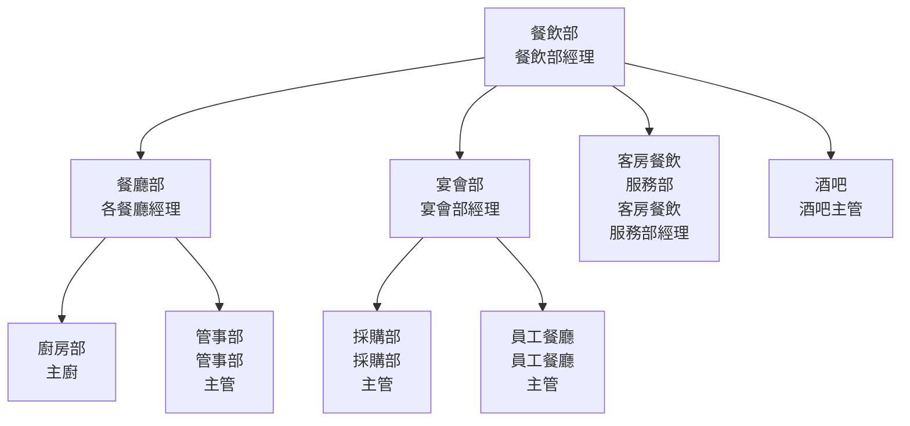
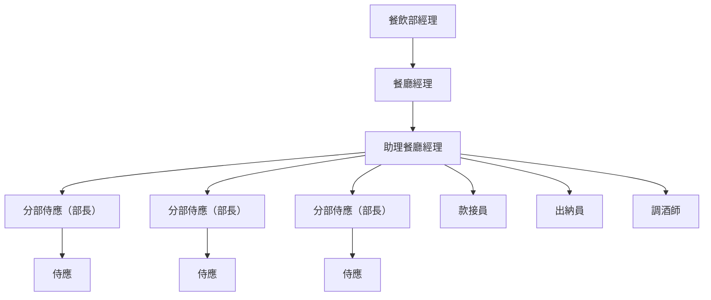
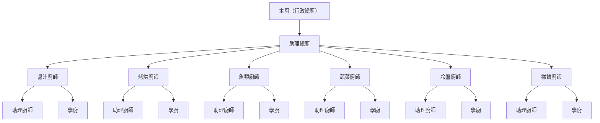
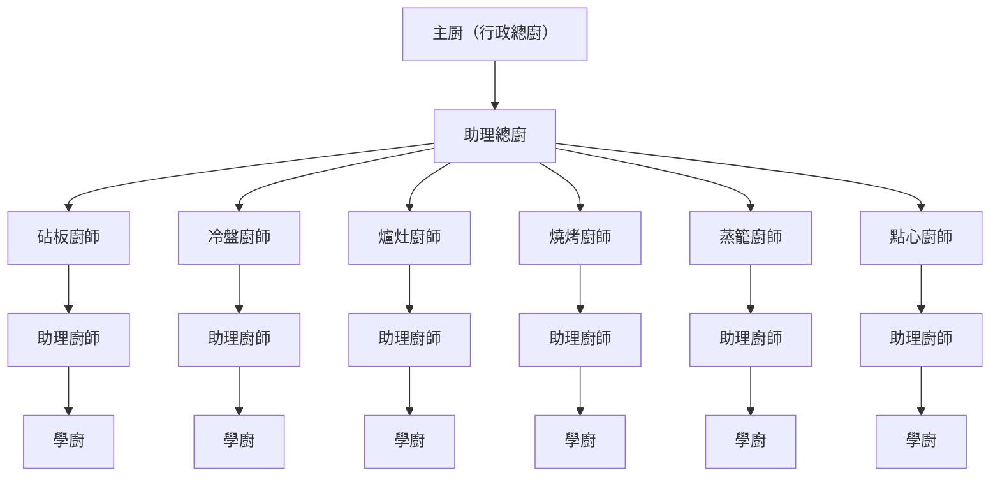
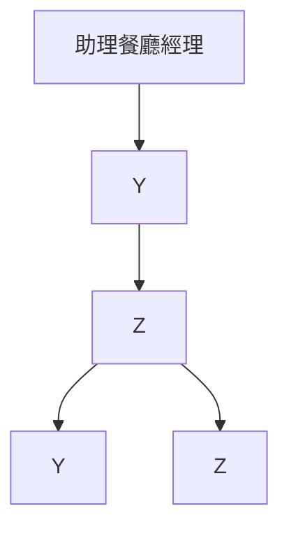

# 單元3

# 餐飲業

# 探究重點

認識餐飲部的職能及組織架構。

• 了解餐飲部主要崗位的職責。

• 探討餐飲部與酒店其他部門的關係。

• 分辨根據市場劃分（顧客類別）描述餐飲服務的分類。

• 比較不同的營運模式。

• 認識常見的餐飲服務例子及其特性。

• 分辨不同類型的餐單。

• 檢視餐單目標與盈利、形象及市場策略的關係。

• 探討擬定餐單時需要考慮的因素。

• 了解釐定餐單價格的基本方法。

• 分析餐牌設計的基本因素。

• 探討餐廳在設計及佈局上與營運的關係。

• 認識餐廳的環境氣氛，以及營造合適氣氛的要素。

• 了解餐桌擺設程序。

• 分析影響廚房設計的因素。

• 檢視不同類型的食物污染、引致食物中毒的常見原因及其預防方法。

• 了解餐廳內食物安全的重要性。

• 探討「食物安全五要點」應用在每個食物處理步驟當中的要點。

• 認識良好的食品處理及儲存程序，以及食物受到交叉感染的原因。

• 檢視一般飲食業員工的個人衞生標準及安全操作程式。

# 1 餐飲業簡介

# 1.1餐飲業概論

餐飲業是非常民生化的款待業，也是旅遊業的重要組成部分。它有固定的場所，為本地居民和旅客提供膳食或飲料，可滿足顧客不同的需求與期望，並讓他們恢復精神與氣力。

餐飲業若依顧客類別來區分，大致可分為酒店市場、閒暇市場、商業及工業市場、學生市場、零售市場、交通市場、醫護市場和其他公營部門市場等；若依營運規模，可分為獨資經營、連鎖經營等；又可分為「以盈利為宗旨」與「以非盈利為宗旨」等；若依服務特性來區分，則有高級餐廳、休閒餐廳、快餐店、自助餐廳、酒吧等。

natural_image

Two sets of Chinese dishes: top shows bamboo steamed buns and dumplings, bottom shows a glass of milk and baked goods on a table (no visible text or symbols)

国2.102、圖2103港式點心丶菠油丶西多士‘丝灌奶茶等，具香港本地特色，成為不少訪港旅客必嶒的食物。

餐飲業的發展與民族和地區文化息息相關，因此不同地區會出現不同的飲食文化，甚至可以發展成具地區特色的旅遊景點。在香港，具本地特色的食肆有茶餐廳、茶樓、大排檔、甜品店等；具本地特色的食物有港式點心、雞蛋仔、菠蘿油、西多士、絲襪奶茶等。

?橙更叨4大排檔是具香港特色的食肆，窗作檔更吸引大量旅客光顾  

text_image

潮団探星
Tangke Food Expo

# 1.2酒店餐飲部的組織架構與職能

餐飲部是酒店的其中一個重要部門，為酒店顧客提供膳食、飲料及其他相關服務。具規模的酒店，一般設有餐廳、宴會廳、咖啡廳、酒吧和客房餐飲服務。

酒店餐飲部亦會根據顧客的要求，舉辦各種類型的宴會、酒會、商務會議和公關活動等，提供各種不同風味的食物及餐飲服務。另外，酒店餐飲部會舉辦各種特色餐飲活動，如海鮮美食節、時令大閘蟹宴、聖誕自助餐等，以吸引更多的顧客。這既可推廣酒店，也可提升酒店的整體利潤。

對不少酒店而言，提供餐飲服務的收入，是客房銷售收入以外，另一項主要收入來源。

# 酒店餐飲部的組織架構

大型酒店餐飲部的組織架構包括了：餐廳部、宴會部、客房餐飲服務部、酒吧、廚房部、採購部、管事部和員工餐廳等。各部門的負責人分別向餐飲部經理負責，餐飲部經理又需向駐店經理負責。

flowchart

圖 2.105

# 酒店餐飲部的部門與職能

# 提示箱

酒店內的餐廳不一定由酒店擁有及管理。部分酒店會租出地方讓其他餐廳進駐。這一方面可為酒店帶來穩定的租金收入，一方面可減輕管理工作和減低餐飲成本。

# A 餐廳部

餐廳部為酒店顧客和公眾提供用膳場地及餐飲服務。每間酒店的餐廳數目、定位各有不同，視乎酒店的規模和級別等而定。至於酒店內的各間餐廳，分別由各餐廳經理負責管理。

大型的高級酒店，會設有自助餐廳、西餐廳、中餐廳、日式料理餐廳、咖啡廳等多間不同類型及風格的餐廳，為顧客提供不同口味和特色的餐飲選擇。

一般酒店通常設有一間特色或高級餐廳，以及一間普通咖啡店式餐廳。特色或高級餐廳有特定的主題或類型，如法國餐廳、扒房餐廳、海鮮餐廳、高級粵菜餐廳等，並提供即時烹調的餐飲。酒店顧客的早餐服務，則主要由普通咖啡店式餐廳提供；不少酒店更會善用此餐廳，為酒店顧客和公眾提供中午及晚上時段的自助餐服務。

■圖2106酒店自助餐廳  

natural_image

Interior view of a restaurant with multiple plated dishes and glass tableware (no visible text or signage)

■圖2.107酒店西餐廳  

natural_image

Interior view of a grand banquet hall with red chairs, patterned carpet, and large windows (no visible text or signage)

natural_image

Interior view of a modern banquet hall with round tables, teacups, and patterned carpet (no visible text or signage)

圖2.108酒店中餐廳

natural_image

Interior view of a modern lounge or hotel lobby with beige and red seating areas, large windows, and ceiling lighting (no visible text or signage)

▲圖2.109酒店咖啡廳

# B 宴會部

宴會部會為酒店顧客在特定的時間和地點，舉行各式宴會、慶典及活動，並提供特定的食物和飲品服務。

natural_image

Interior view of a large conference hall with green carpet, white floral arrangements, and tables (no visible text or signage)

▲ 圖 2.110 婚宴是酒店宴會部時常舉辦的宴會

# 例子庫

酒店宴會部舉辦的宴會、慶典及活動，包括婚宴、壽宴、百日宴、謝師宴、企業周年晚宴、公司社團聚餐晚會、慈善舞會、大型會議、產品發布會等。

大部分的酒店都設有宴會、活動場地，如宴會廳、會議室、活動室等，並可提供影音設備、會場佈置、雞尾酒會等設施和服務，方便顧客舉辦不同類型的餐飲活動。

natural_image

Large banquet hall with attendees seated at tables, decorated with spotlights and a geometric backdrop (no visible text or signage)

▲ 圖 2.111 酒店宴會部舉辦的晚宴，提供了會場佈置、影音設備等。

在香港酒店舉辦的餐飲活動，大部分主辦單位偏向選擇套餐餐單，有些主辦單位會選擇自助餐形式，以便供應食物。

# 資料室

# 自助餐

自助餐是一種顧客在用餐時，可於供應區內根據所提供的食物和個人喜好，自行任意挑選食物的服務形式。自助餐的特點是菜餚種類多樣，顧客選擇性大，服務人員雖然較少，但已可服務大量客人。

自助餐有多種形式，以下是一些例子：

「任食」（all-you-can-eat）自助餐：在香港較為大家熟知的自助餐形式。顧客支付一個固定的費用，便可在用餐時段任意享用各種食物。這種形式的自助餐可以是早餐、午餐或晚餐，常見於酒店內的餐廳或任食放題餐廳。  
傳統的瑞典自助餐（smorgasbord）：意思是擺滿三文治的桌子。餐廳會在一張自助式的桌子上，供應各種菜式，但主要是冷菜。  
餐櫃、自助食堂或自助服務：多見於學校和企業的自助食堂。顧客從服務櫃檯開始，拿取托盤或餐碟，排隊沿著餐櫃挑選所需食物，然後付款並選取適當的餐具。顧客可選擇坐下或站立用餐，也可將食物打包帶走。

宴會部所提供的餐飲服務需要提前預訂，由酒店的營業及市場推廣部與宴會主辦單位議定費用和細節。宴會確定後，宴會部需要安排人手應付，在活動旺季更需要聘請一批臨時員工協助。

除了在酒店內的宴會活動外，部分酒店會提供到私人地方舉行的宴會，稱為「到會服務」。這些服務同樣需要提前預訂，宴會部會在宴會舉行當日，在酒店廚房預先製作食物和餐具，再由專車運送到指定場地，並安排餐飲部服務員到場提供款待服務。

# C 客房餐飲服務部

客房餐飲服務是不少酒店會為住客提供的服務，餐飲選擇列於客房的餐單，包括早、午、晚餐和宵夜，供希望享受高度私隱和個人化服務的住客隨時訂餐。

natural_image

Breakfast table setup with cloche, teacup, coffee, and fruit (no visible text or symbols)

▲ 圖 2.112 客房餐飲服務讓住客可隨時在房內進食

當客房餐飲服務部收到住客的餐飲要求後，會將相關要求轉交廚房；廚房烹調好食物，會由客房服務員運送至客房，讓顧客可以在房間內享用。

由於客房餐飲服務的營運成本較高，餐飲的價錢會較在酒店餐廳享用高昂。部分酒店為了降低營運成本，只提供有限度的服務，甚至取消有關服務。

# 資料室

# 客房餐飲服務的挑戰

客房餐飲服務需要 24 小時運作，亦涉及運送問題，而且要與管家部配合，所以對酒店而言，面對不少挑戰：

• 為了隨時為顧客提供服務，客房餐飲服務部和廚房部均需要安排員工 24 小時輪班工作，但有關服務需求有限，以致成本高而效益低；  
由於廚房部與客房距離較遠，烹煮的熱食送到客房時，可能會變冷，又或因為送餐不準時，容易招致顧客投訴；  
客房餐飲服務在運作上，需要與管家部保持緊密溝通，以確保適時收回碗碟器皿，避免顧客用餐後把碗碟器皿放置到客房外，影響衞生或其他顧客。

# D 酒吧

酒吧屬娛樂休閒類餐飲場所，讓顧客可選擇各式飲料和酒精飲品，以及佐酒小食，開放時間一般由下午至凌晨。

酒店的酒吧大致上可分為休閒型或娛樂型。休閒型酒吧主要提供一個輕鬆的環境，讓顧客可以聯誼、談心。娛樂型酒吧設有娛樂設施，如電子飛鏢機、大電視、卡拉 OK，一些更有樂師、歌手、舞蹈員現場表演等。

natural_image

Interior view of a modern lounge or café with blue and purple seating, ambient lighting, and hanging pendant lights (no visible text or signage)

酒吧經理和調酒師需要對啤酒、紅酒、白酒、烈酒等各類酒精飲品的釀製過程有充份的認識，以及懂得調製含酒精或不含酒精的雞尾酒，才能為顧客建議和調製適合他們的飲品。酒吧經理的工作還包括：監督各類酒的訂購與儲存、編制每週的餐酒清單、制定員工值勤安排和培訓，以及控制成本等。

▲ 圖 2.113 休閒型酒店酒吧  

# 思考點

酒店廚房部為何要劃分為多個區域，而不整合為一個大廚房？

# E 廚房部

廚房部負責整間酒店的餐飲供應，包括準備及烹調食材，為早餐、午餐、晚餐和其他餐飲活動提供各式食物，以及定期推出新菜式和控制餐飲成本等。

酒店廚房又劃分為以下區域：

<table><tr><td>區域</td><td>描述</td></tr><tr><td>製作廚房</td><td>酒店的核心廚房,為酒店各項餐飲活動製作食物、飲料。</td></tr><tr><td>宴會廚房</td><td>為大型宴會製作食物和飲料,並與製作廚房配合。</td></tr><tr><td>自助餐廚房</td><td>為自助餐製作食物和飲料,並與製作廚房配合。</td></tr><tr><td>扒房廚房</td><td>為西餐廳製作食物和飲料,並與製作廚房配合。</td></tr><tr><td>糕餅廚房</td><td>為酒店各餐廳、宴會廳製作糕點和甜品。</td></tr><tr><td>備餐區</td><td>設於接近款客區的位置,有一張可供擺放多個碗碟器皿的長檯,廚師會將烹調好的食物放置在長檯,再由服務生送到顧客的餐桌上。</td></tr></table>

# F 採購部

酒店的餐飲部每日消耗大量食材，因此部分酒店會設立採購部，專門負責根據各餐廳的營業情況，並與餐廳部、宴會部、酒吧、廚房等部門保持緊密溝通，及時為各部門採購所需要的食材和用具，同時為酒店控制成本和食材質素。

# G 管事部

管事部負責清潔餐廳廚房、所有廚房設施和廚具，以及餐廳餐具、器皿，是整個餐飲部的支援部門。管事部由總管事領導，其責任如下：

• 保持食物準備區的清潔；  
• 確保廚房各項烹飪用具、 設備和餐具的清潔；  
• 管理化學物品的使用，包括清潔用品和滅蟲劑的存放及記錄；  
• 必要時開展滅蟲工作；  
• 保養洗碗機。

natural_image

Interior view of a stainless steel kitchen with white plates and matching teacups on metal racks (no visible text or symbols)

▲ 圖2.114 管事部負責清潔所有餐廳餐具。

# H 員工餐廳

大多數酒店會內設員工餐廳，為當值的員工提供膳食。員工餐廳一般全日 24 小時運作，多由餐飲部負責管理，也有酒店會外判給合約承辦商營運。

員工餐廳的成本不會列作餐飲部的開支，而是計算入人力資源部的成本。由於員工餐廳的營運目的是作為員工福利，不是要賺取利潤，所以餐廳的環境和服務會較為簡單，膳食以套餐或自助餐形式為主。

# 1.3酒店餐飲部主要崗位的職能

酒店整個餐飲部平日由餐飲部經理全權負責。各餐廳、廚房的職員則分工合作。

# 餐飲部經理及其職能

餐飲部經理主管整個餐飲部，是餐飲部的最高級職員，其職責包括：

<table><tr><td>範疇</td><td>主要職責</td></tr><tr><td>領導組織</td><td>·直接向駐店經理,甚至總經理負責。·執行公司管理層制定的政策和指令。·領導餐飲部各部門貫徹執行酒店的政策和指令。·統籌餐飲部的日常運作。·定期與各餐廳和廚房的主管舉行會議,確保運作順暢。</td></tr><tr><td>監管控制</td><td>·控制餐飲部的開支預算、監督採購環節。·處理烈酒、葡萄酒和啤酒的事宜,包括採購、接收、儲存及分發。·確保餐飲部達到營業額和盈利目標。·制定評核標準,定期評估廚房及各餐廳的服務表現。·監控餐廳服務質素和廚房食物水準。·巡視餐飲部各部門,監督員工遵守健康及安全條例。</td></tr><tr><td>人事安排</td><td>·安排餐飲部的人力資源分配。·面試及挑選餐飲部員工。·培訓餐飲部主要管理人員。·執行餐飲部的在職培訓計劃。·處理員工升遷、任免、獎罰等事宜。</td></tr><tr><td>溝通維繫</td><td>·協調餐飲部與酒店其他部門的關係和要求。·掌握餐飲狀況及顧客意見,向廚房部反映。·負責緊急和突發事故的應變工作,處理顧客投訴。·維繫與重要客戶的關係,爭取更多餐飲服務的機會。</td></tr><tr><td>計劃開發</td><td>·策劃餐飲部在不同季節的餐飲推廣活動。·參與研發新菜式,在菜單中增加新菜式。·與營業及市場推廣部商討制定餐飲部的市場推廣。</td></tr></table>

# 餐廳主要工作人員及其職能

酒店餐廳由餐廳經理負責日常營運。餐廳經理之下，又會有助理餐廳經理協助，以及由分部侍應、侍應、款接員、出納員和調酒師等，為顧客提供餐飲服務。

flowchart

<table><tr><td>職位</td><td>職責</td></tr><tr><td>餐廳經理</td><td>統籌餐廳的日常工作;向餐飲部經理負責;協助餐飲部經理控制餐廳的開支成本;跟進訂席和訂餐事宜,與主廚緊密合作;調配餐廳員工及人力資源,編定「工作值班表」等;監督餐廳員工的服務、儀容;面試及挑選餐廳員工;培訓及評核餐廳員工;確保餐廳員工遵守各項工作健康及安全法例;協調與其他部門的關係,領導餐廳配合其他部門的工作;處理與餐廳相關的法律事宜、會計及財務安排,以及市場推廣、廣告和公關工作;處理顧客的投訴及餐廳的突發事件;審核餐廳的營業收入,監控結賬工作。</td></tr><tr><td>助理餐廳經理</td><td>·協助餐廳經理管理餐廳,確保餐廳日常運作正常;·在餐廳經理繁忙或休假時,代理其職務;·協助餐廳經理安排員工的工作,並建立良好溝通渠道;·協助餐廳經理面試、挑選及培訓員工;·確保餐廳員工遵守各項工作健康及安全法例;·協助餐廳經理跟進訂席和訂餐事宜等。</td></tr><tr><td>分部侍應(部長)</td><td>·分部侍應在餐廳或活動中,負責特定數目的餐桌,並管理該分部所分配的侍應,為餐桌提供服務,在中餐廳又稱為「部長」;·管理所屬分部的侍應,安排侍應的工作崗位;·留意餐廳營運情況,協助侍應提供餐飲服務;·接待顧客,為顧客訂菜及推銷菜式;·與廚房保持聯絡,跟進上菜進度和食物水準等;·徵詢顧客意見及建議,向餐廳經理反映;·處理顧客投訴等。</td></tr><tr><td>侍應</td><td>·更換餐桌的布草及各類餐具;·為顧客提供點菜、上菜、酒水及結帳等服務;·把顧客點菜資料傳送到廚房,跟進上菜進度;·收拾餐具、布草,清理餐桌等。</td></tr><tr><td>款接員</td><td>·接聽顧客訂座電話,或處理網上訂座資料;·整理訂座顧客資料,事前準備合適的座位;·接待顧客,安排及引領顧客入座等。</td></tr><tr><td>出納員</td><td>·管理帳單的錢財收支;·統計餐廳的營業收入。</td></tr><tr><td>調酒師</td><td>·調配各式酒水;·管理與儲存酒品及各種器具;·招呼顧客。</td></tr></table>

natural_image

Person pouring liquid into a martini glass with a straw, no visible text or symbols

▲ 圖2.116 有志投身調酒師行業的人士，可修讀國際認可的專業調酒師課程。

# 餐廳廚房主要工作人員及其職能

酒店廚房的組織架構因應餐飲部的規模、菜式的選項等而有所分別。一般而言，每間酒店的餐飲部由主廚（或稱行政總廚）負責管理。主廚下又會有負責各類食物的廚師，以及助理廚師和學廚等，合作完成菜餚。

以下是酒店西餐廚房的組織架構：

flowchart

圖 2.117

<table><tr><td>職位</td><td>職責</td></tr><tr><td>主廚(行政總廚)</td><td>· 負責安排及管理各廚房的日常工作；
· 監督廚房各級廚師和員工的工作；
· 監控廚房食品的質素和烹調水準；
· 編寫菜單、創作新餐單；
· 制訂利潤目標；
· 協助餐飲部經理策劃餐飲活動；
· 採購和監管食物材料及廚房設備；
· 就購置廚房設備，提出建議；
· 培訓及評核各級廚師；
· 鼓勵廚房員工積極投入工作；
· 協調與其他部門的關係，領導廚房配合其他部門的工作；
· 全權或部分負責貨倉、儲藏室，以及銀器和陶器的清洗工作；
· 確保顧客滿意食品的質素、處理顧客投訴等。</td></tr><tr><td>助理總廚</td><td>協助主廚確保各廚房日常工作順暢;在主廚不在時,代理其職務;協助主廚監督廚房各級廚師和員工的工作;協助主廚監控廚房食品的質素和烹調水準;協助主廚申請購買和驗收廚房所需的材料等;協助主廚培訓及評核下屬;協助主廚編寫菜單、創作新餐單及研發新菜式等。</td></tr></table>

natural_image

Group of chefs in white uniforms and tall hats preparing food in a modern kitchen (no visible text or symbols)

▲ 圖2.118 監控廚房食品質素和烹調水準是助理總廚其中一項工作。

<table><tr><td>部門廚師</td><td>管理所屬廚房部門的工作;调配所屬廚房的人手;烹調食物;驗收所屬廚房需要的材料;清點廚房材料及用品,申請購買;參與研發新菜式;為所屬廚房員工提供培訓;督導廚房員工做好衛生及安全生產工作等。各部門廚師的工作性質分為:■醬汁廚師:負責煎炒食物及製作不同醬汁。■烤烘廚師:負責烹調所有燒烤或烤烘食物。■魚類廚師:負責烹調所有魚類及貝殼類海產。■蔬菜廚師:負責烹調所有熱食頭盤、餐湯、蔬菜,以及粉麵等澱粉質食物。■冷盤廚師:負責烹製所有冷食,如冷食頭盤小點、沙律、魚生,以及火腿、煙肉等冷食肉製品等。■糕餅廚師:負責烘製各式蛋糕、麵包和甜品。■換班廚師:即「替班」廚師,在個別廚房出缺時填補廚師的崗位。</td></tr></table>

natural_image

Person in white chef uniform pouring liquid into a metal bowl (no text or symbols visible)

▲ 圖 2.119 醬汁廚師

natural_image

Steamed pork belly on a red cutting board with gloved hands, no visible text or symbols

▲ 圖 2.120 烤烘廚師

natural_image

Person preparing a plated dish with skewers and garnishes (no visible text or symbols)

▲ 圖 2.121 魚類廚師

natural_image

Person stir-frying vegetables in a black frying pan on a stovetop (no text or symbols visible)

▲ 圖 2.122 蔬菜廚師

natural_image

Chef in white uniform slicing raw salmon on a cutting board with garnish (no text or symbols visible)

▲ 圖 2.123 冷盤廚師

natural_image

Chef in white uniform preparing layered pastries with red berries on a cutting board (no text or symbols visible)

▲ 圖 2.124 糕餅廚師

<table><tr><td>助理廚師</td><td>為廚師處理各種食物材料;協助廚師烹制食物;檢查和保養廚房設施及用具;協助廚師清點所屬廚房的材料及用品等。</td></tr><tr><td>學廚</td><td>搬運和傳遞材料及用具;處理各種食物材料;清洗廚房設施及用具等。</td></tr></table>

# 資料室

# 酒店中餐廚房的組織架構

酒店中餐廚房與西餐廚房一樣，由主廚或行政總廚負責管理。但中餐廚房的部門分類不同西餐廚房，按烹調方法可劃分為砧板、冷盤、爐灶、燒烤、蒸籠、點心等部門。由部門廚師管理所屬廚房，帶領助理廚房和學廚。

flowchart

圖 2.125

各部門廚師的工作性質分為：

￭ 砧板廚師：負責切削各種食品，包括禽肉、海鮮，以及管理和驗收食材。  
￭ 冷盤廚師：負責所有冷盤、滷味食物和果雕、冰雕等。  
￭ 爐灶廚師：負責掌灶，烹煮各式菜餚，是中餐的靈魂人物。  
￭ 燒烤廚師：負責烹調所有燒烤食物，如乳豬、燒味等。  
￭ 蒸籠廚師：負責燉蒸湯水、菜餚等。  
點心廚師：負責製作各式點心、糕餅等。

natural_image

Two chefs in a commercial kitchen preparing food, one stirring a wok with steam and the other observing (no visible text or symbols)

natural_image

Person preparing bamboo steamed buns with chopsticks, accompanied by dumplings and a small bowl (no visible text or symbols)

■圖2.127點心廚師除了製作點心、糕餅，谔要負責糖水供應。  
圖2.126爐灶廚師是中餐的靈魂人物

# 1.4 酒店餐飲部與其他部門的關係

餐飲部對酒店的整體營業額貢獻不少，是酒店營運過程中不可或缺的一部分。餐飲部必須與酒店其他部門緊密聯繫及合作，才能為顧客提供優質的服務，以及提升酒店的整體收入。

餐飲部與酒店其他部門的關係大致如下：

<table><tr><td>部門關係</td><td>概述</td></tr><tr><td>餐飲部與前堂部</td><td>· 當前堂部收到有旅行團或團體組織的顧客需要在酒店餐廳用膳的安排後,需提早通知餐飲部,提交人數、時間、餐單等資料,以便餐飲部預留座位、準備食材和準時供應。</td></tr><tr><td>餐飲部與管家部</td><td>· 管家部負責處理餐飲部的制服和布草,包括收發制服和布草。· 餐飲部如承辦大型宴會,需提早通知管家部供應足夠的布草應付。· 管家部收到顧客的客房餐飲服務要求後,需通知餐飲部烹調食物;餐飲部烹煮好後,會通知管家部員工送到客房供顧客享用;之後,管家部需把餐具送返餐飲部,以便清洗。· 管家部負責補充客房迷你酒吧的飲品和小吃,如有需要,會通知餐飲部供應所需的物品,以便房務員補充。</td></tr></table>

▲ 圖2.128 餐飲部需要管家部供應桌布、餐巾等布草。

natural_image

Long banquet table with red and gold decorations, set in a formal dining room with wooden chairs (no visible text or symbols)

<table><tr><td>部門關係</td><td>概述</td></tr><tr><td>餐飲部與營業及市場推廣部</td><td>· 餐飲部需與營業及市場推廣部聯絡,共同策劃及推廣各餐廳的餐飲活動,如制訂餐飲活動的主題及優惠,並透過報章、雜誌、網頁、電郵等媒介,向顧客傳遞有關訊息等。· 餐飲部研發出新菜式,需要營業及市場推廣部協助推廣。· 營業及市場推廣部如舉辦大型宴會或活動,需要餐飲部提供餐飲服務。</td></tr><tr><td>餐飲部與人力資源部</td><td>· 人力資源部會協助餐飲部招聘員工,提供員工入職培訓,以及處理員工的薪酬福利事宜。· 餐飲部需與人力資源部合作,制訂員工的工作指引,並執行餐飲部的員工培訓計劃。· 餐飲部舉行大型宴會與活動時,可能需要額外人手應付,便要通知人力資源部增聘臨時員工。</td></tr><tr><td>餐飲部與工程部</td><td>· 工程部需負責各餐廳及廚房日常的維修和保養工作,包括水電煤設備、大型廚具等。· 餐飲部在籌辦宴會與活動時,需要工程部的支援,以確保舞台、燈光、音響及影視等設施的正常運作。</td></tr></table>

natural_image

Exterior view of a large banquet hall filled with guests seated at tables, featuring a metal grater containing a food item (no visible text or signage)

▲ 圖 2.129 餐飲部會向舉辦大型宴會的營業及市場推廣部提供餐飲服務。

圖2.130 人力資源部會協助餐飲部提供員工入職培訓。  

natural_image

Three business professionals in formal attire gathered around a dining table, one pointing at a wine bottle (no visible text or symbols)

<table><tr><td>部門關係</td><td>概述</td></tr><tr><td>餐飲部與保安部</td><td>· 保安部要協助餐飲部展開安全教育及培訓,尤其是強化廚房員工的防火意識及提升滅火的技能。
· 餐飲部需與保安部加強溝通,以維持餐廳的治安,確保顧客的人身和財物安全。
· 當餐飲部舉行大型宴會與活動時,保安部要參與控制人流,以及確保宴會與活動順利進行。</td></tr><tr><td>餐飲部與財務部/會計部</td><td>· 餐飲部每天收取的款項,需連同紀錄,即日轉交財務部;財務部則會核對有關款項及紀錄資料。
· 餐飲部需定期盤點廚房設施和餐具等的損益情況,並將有關紀錄轉交財務部,以便向財務部申請購買所需的物資。
· 財務部需核對有關紀錄,以便監察和撥發所需資金。</td></tr><tr><td>餐飲部與採購部</td><td>· 餐飲部需向採購部申請訂購所需的食材、廚具及其他設備,並反映有關用品的質素。
· 採購部會根據申請訂購的數量、質素要求等,與餐飲部商討和確認,然後為餐飲部訂購所需物資。</td></tr></table>

圖 2.131 財務部 ▲會核對餐飲部每天收取的款項。  

natural_image

Close-up of pens and pencils in a white plastic container (no visible text or symbols)

natural_image

Interior of a modern kitchen with fresh vegetables and plastic crates (no visible text or labels)

▲ 圖 2.132 採購部會為餐飲部訂購所需物資。

# 2 餐飲服務的分類與營運模式

餐飲服務是指餐廳為顧客提供的一系列有關餐飲服務的設施、餐具、菜餚、酒水，以及協助顧客用膳的一系列活動。

在餐飲業的市場上，有不同服務類別、不同食物種類、不同裝修環境的餐廳，供顧客各取所需。

# 2.1按餐飲服務市場和顧客類別分類

如按顧客類別劃分，餐飲服務市場可分為：酒店市場、閒暇市場、商業及工業市場、學生市場、零售市場、交通市場、醫護市場、其他公營部門市場等。

# 酒店市場

• 為這類市場提供餐飲服務的餐廳，開設在酒店內，包括西式餐廳、宴會廳、咖啡廳和酒吧。  
• 這類餐廳大多數由酒店擁有，並由酒店餐飲部營運，部分由獨立經營者營運。  
主要為酒店住客及外來客人提供不同風味和高消費水平的餐飲服務。  
• 顧客可享用餐桌服務，全程由侍應生招待，而顧客逗留的時間一般較長。  
• 不少酒店會透過提供宴會服務，以增加餐飲營業收入。

▲ 圖 2.133 宴會服務是酒店餐廳其中一項重要收入來源  

natural_image

Interior of a large banquet hall with multiple tables, chairs, and floral arrangements (no visible text or signage)

natural_image

Outdoor café scene with patrons seated at tables, a woman standing and holding a phone, and a Ferris wheel in the background (no visible text or signage)

圖2134，設在海灘旅遊區的餐廳，有侍應生招待。

# 閒暇市場

泛指在旅遊景點或休閒場所提供餐飲服務的餐廳，服務的對象廣泛，包括旅客，以及餐廳附近居民和其他流動人口。  
• 這類餐廳開設在不同地區，分佈範圍很廣。  
餐廳的面積較大，可容納的顧客人數較多。  
顧客可享用餐桌服務，全程由侍應生招待，而顧客逗留的時間較長。

# 例子庫

屬於閒暇市場的餐廳眾多，包括旅遊景點和主題公園內的餐廳、各類私人會所內的餐廳，以至海灘的小食店等。

# 3 商業及工業市場

為這類市場提供餐飲服務的餐廳，開設在商業區或工業區。  
• 主要為附近的上班一族提供早餐、午餐、下午茶，不少餐廳晚上停止營業。  
• 這類餐廳或提供餐桌服務，或提供櫃台式服務，或提供外賣服務，顧客逗留的時間不長。

natural_image

Interior view of a busy multi-level public space with many people dining at tables and chairs, no visible text or signage.

■圖2.135設在商業區商場的美食廣場，只提供櫃台式服務。

■圖2.136設在大學的學生食堂，提供簡單的櫃台式服務。  

natural_image

Interior of a modern restaurant with green dining chairs and a cooking counter (no visible text or signage)

# 學生市場

• 開設在大專院校及中學的食堂或餐廳，餐飲服務的對象是學生、教職員和相關員工。  
• 這類餐廳主要提供簡單的櫃台式服務。  
• 這類餐廳由於享有租金優惠，餐飲價格會較為相宜。

natural_image

Interior of a modern supermarket with customers at a counter and visible menu products (no readable text or symbols)

▲ 圖 2.137 設在商場美食廣場內的餐廳，顧客逗留時間較短。

# 5 零售市場

• 在商場的美食廣場、便利店等地，出售供場內用餐或外賣餐飲的餐飲服務供應商。  
• 這類餐廳多以自助方式經營，部分甚至需要顧客自行加熱食物，顧客逗留的時間較短。  
• 這類餐廳主要開設在人流較多的商場內或街道旁。

# 6 交通市場

. 指向在飛機、火車、郵輪等交通工具上的乘客，或機場、火車站、郵輪碼頭等交通樞紐的顧客， ，提供餐飲服務。 。  
. 這類餐飲服務的對象流動性極大，每天服務不同的顧客。  
提供的大多是已包裝妥當的預製食物。

natural_image

Interior of a modern transportation hub with travelers queuing at service counters (no visible text or signage)

▲ 圖2.138 設在機場的餐廳，顧客流動性極大。

# 醫護市場

• 這類市場的餐廳主要開設在醫院、療養院內，主要服務對象是醫護人員和病人等。  
• 這類市場提供的餐飲著重食品控制，食材和烹調方式以健康、清淡為主。

# 其他公營部門市場

• 這類市場的餐飲服務供應商，由政府批出合約承辦，為政府轄下的公營部門，如監獄、警察局、軍隊等，提供餐飲服務。  
• 這類餐飲服務獲政府撥款，需控制成本，將餐飲售價盡可能降至最低。

# 2.2餐飲服務的營運模式

按照餐飲服務的營運模式分類，餐飲業市場上有「獨立經營」和「連鎖經營」兩種。如按運作定位劃分，大部分「以盈利為宗旨」，其餘為「以非盈利為宗旨」。 。

# 以營運方式劃分

# A 獨立經營

獨立經營餐廳有以下特色：

<table><tr><td></td><td>特色</td></tr><tr><td>擁有權</td><td>· 由個人、家族獨資,或多人集資合夥擁有。</td></tr><tr><td>規模和數目</td><td>· 一般規模較小。· 餐廳數目大多只有一間,部分有兩至三間分店。</td></tr><tr><td>經營權和方式</td><td>· 東主擁有獨立管理權,大多由家庭式經營及管理。· 餐廳風格、管理方式、服務標準視乎東主的喜好。</td></tr><tr><td>市場細分</td><td>· 餐廳類型廣泛,顧客類型因應其位置而有所分別。生意大多依靠當地或其附近地區的顧客。</td></tr></table>

獨立經營餐廳有以下優點和缺點：

text_image

司公奶牛洲澳
AUSTRALIA DAIRY CO.

▲ 圖 2.139 澳洲牛奶公司是香港一間獨立經營餐廳

<table><tr><td>優點</td><td>缺點</td></tr><tr><td>擁有獨立管理權,較自主及富彈性。</td><td>創業階段需時建立口碑,營運過程比較艱辛。</td></tr><tr><td>餐廳風格、氣氛較易根據經營者的意願來建立。</td><td>缺乏系統化的制度及服務標準。</td></tr><tr><td>餐單內容可隨時作出改變,較快迎合顧客飲食習慣的轉變。</td><td>資產規模大多不高,店舖數目的增長較慢。</td></tr><tr><td>可靈活進行促銷及宣傳。</td><td>籌措資金的能力有限,結業率較高。</td></tr><tr><td>經營者可享有餐廳的全部利潤。</td><td>租金議價能力較低。</td></tr></table>

# B 連鎖經營

連鎖經營餐廳有以下特色：

<table><tr><td></td><td>特色</td></tr><tr><td>擁有權</td><td>·主要以股份制形式持有,部分更由上市公司擁有。·有些連鎖集團會以出售特許經營權方式,讓第三方透過合約授權形式經營。</td></tr><tr><td>規模和數目</td><td>·一般規模較大,部分更是跨國飲食集團。·餐廳數目較多,部分更在不同國家或地區開設分店。</td></tr><tr><td>經營權和方式</td><td>·由總公司的專業團隊管理各分店。·著重品牌管理和擴展,餐廳風格、服務標準以標準化營運。</td></tr><tr><td>市場細分</td><td>·餐廳類型多樣,顧客類型因應其定位而有所分別。·生意以照顧大眾化市場為主。</td></tr></table>

連鎖經營餐廳又可細分為單一概念連鎖、多元概念連鎖、跨國餐飲服務連鎖和本地餐飲服務連鎖。

# a 單一概念連鎖

餐飲企業只經營單一品牌的連鎖餐廳。

# 例子庫

• 麥當勞、肯德基、Subway、Burger King 等。

text_image

McDonald's

圖 2.140

natural_image

KFC logo featuring a bearded man in a red vest with the word 'KFC' inside, enclosed in a circular frame (no additional text or symbols)

圖 2.141

text_image

BURGER
KING®

圖 2.142

text_image

SUBWAY
SUBWAY

圖 2.143

# b 多元概念連鎖

餐飲企業同時經營超過一個品牌的連鎖餐廳。為了達致最大的經濟效益，企業會對旗下各個品牌的連鎖餐廳，在營運、資金調配、食材等方面，採取集團式運作。不過，旗下不同品牌的連鎖餐廳，定位各有不同，並針對特定的目標客群，採取各自的宣傳推廣計劃。

# 例子庫

香港美心集團除了經營快餐店外，還經營粵菜、潮州菜、外省菜、西餐、日本菜、泰越菜、麵包西餅、咖啡店、酒吧等。  
• 香港大家樂集團除了經營快餐店外，還經營中菜、西餐、日本菜、韓國菜等。

text_image

美心集团
首页
搜索
搜索内容
搜索结果
搜索评论
搜索关键词
搜索工具
搜索图片
搜索内容
搜索关键词
搜索工具
搜索图片
搜索关键词
搜索工具
搜索图片
搜索关键词
搜索工具
搜索图片
搜索关键词
搜索工具
搜索图片
搜索关键词
搜索工具
搜索图片
搜索关键词
搜索工具
搜索图片
搜索关键词
搜索工具
搜索图片
搜索关键词
搜索工具
搜索图片
搜索关键词
搜索工具
搜索图片
搜索关键词
搜索工具
搜索图片
搜索关键词
搜索工具
搜索图片
搜索关键词
搜索工具
搜索图片

▲ 圖2.144 香港美心集團網頁

text_image

大菜店
策略性餐厅
首页
大菜店（香港）
www.cafheadc.com
大菜店（香港）
大菜店（香港）
大菜店（香港）
大菜店（香港）
大菜店（香港）
大菜店（香港）
大菜店（香港）
大菜店（香港）
大菜店（香港）
大菜店（香港）
大菜店（香港）
大菜店（香港）
大菜店（香港）
大菜店（香港）
大菜店（香港）
大菜店（香港）
大菜店（香港）
大菜店(香港)
大菜店(香港)
大菜店(香港)
大菜店(香港)
大菜店(香港)
大菜店(香港)
大菜店(香港)
大菜店(香港)
大菜店(香港)
大菜店(香港)
大菜店(香港)
大菜店(香港)
大菜店(香港)
大菜店(香港)
大菜店(香港)
大菜店(香港)
大菜店(香港)
大菜店（香港）
大菜店（香港）
大菜店（香港）
大菜店（香港）
大菜店（香港）
大菜店（香港）
大菜店（香港）
大菜店（香港）
大菜店（香港）
大菜店（香港）
大菜店（香港）
大菜店（香港）
大菜店（香港）
大菜店（香港）
大菜店（香港）
大菜店（香港）
大菜店
大菜店
大菜店
大菜店
大菜店
大菜店
大菜店
大菜店
大菜店
大菜店
大菜店
大菜店
大菜店
大菜店
大菜店
大菜店
大菜店
大菜店
大菜店
大菜店
大菜店
大菜店
大菜店
大菜店
大菜店
大菜店

▲ 圖2.145 香港大家樂集團網頁

# 國際餐飲服務連鎖

在世界不同國家或地區均開設有連鎖式餐廳。國際餐飲集團除了自資開設分店外，也會出售特許經營權，與當地的飲食集團或獨立人士合作開設分店。

# 例子庫

百勝餐飲集團旗下擁有肯德基、必勝客、塔可鐘、艾德熊及 LongJohn Silver's 等國際餐飲品牌，在全球 100 多個國家及地區開設了超過3萬2千家連鎖餐廳。  
• 星巴克是全球最大的連鎖咖啡店，在全球 70 多個國家及地區開設了分店，企業直接營運的分店和特許經營的分店各佔五成左右。

text_image

大快舌
Fairwood

▲ 圖2.146 大快活是本港其中一家知名餐飲連鎖集團

# d 本地餐飲服務連鎖

在本地開設的連鎖式餐廳，業務只限於較少數的城市和地區，經營規模會較國際餐飲集團小。經營模式與國際餐飲集團相似。

# 例子庫

• 本地餐飲連鎖集團有美心、大家樂、大快活、稻香、富臨、太興、翠華等。

e 連鎖式經營餐飲的優點和缺點

<table><tr><td>優點</td><td>缺點</td></tr><tr><td>擁有標準管理系統及作業流程,能確保餐飲和服務水平,維持顧客信心。</td><td>分店數目眾多,管理不易,而且一間分店出現問題,可能會對集團或其他分店造成負面影響。</td></tr><tr><td>營運資金較充裕,融資較容易,亦可透過特許經營等方式開設分店,有助拓展市場,增加市場佔有率。</td><td>各分店需採取標準管理系統及作業流程,會令分店缺乏獨有特色,甚至沒有地域性風格。</td></tr><tr><td>可通過中央統一採購材料、研發新菜式、宣傳推廣、訓練員工等,降低成本。</td><td>由於集團規模較大,規章制度會較繁雜,靈活性較低,應對市場轉變的速度未必及獨立經營餐廳。</td></tr><tr><td>管理層可從各分店取得準確的市場資訊,從而制定策略回應市場的轉變,改善營運收益。</td><td>連鎖式經營需要聘請專業的管理團隊,集團行政組織架構一般較龐大,所需的行政成本也較高。</td></tr><tr><td>集團業務廣泛,較容易吸引專業人士、優秀廚師等加入,有利集團進一步發展。</td><td>連鎖式經營主要針對大眾餐飲市場,競爭激烈,依靠薄利多銷,利潤率一般較低。</td></tr><tr><td>具有較高知名度,有利爭取醫院、學校等大型機構的餐飲合約,增加盈利。</td><td>/</td></tr></table>

# 以盈利方式劃分

餐廳亦可按「以盈利為宗旨」及「以非盈利為宗旨」劃分營運模式。

# A 盈利為主經營

餐飲市場的所有跨國餐飲服務連鎖、本地餐飲服務連鎖，以及大部分的獨立經營餐廳，都以賺取盈利為經營的最主要目標。它們會先確定目標盈利，然後成為管理導向，並在營運中努力實現。

# B 非盈利為主經營

餐飲市場的小部分餐廳，如社會企業開設的餐廳、大型企業或政府機構的員工餐廳，以及學院、職業訓練局開辦的餐廳，並非以賺取盈利為經營的最主要目標。

• 社會福利機構開設的餐廳，經營的最主要目標，或為社會需要的人士提供餐飲，或為弱勢社群提供就業和培訓機會。即使經營能賺取到盈利，亦會再投資到餐廳本身，或用作資助其他社會服務等。  
企業或政府機構的員工餐廳，經營的最主要目標是專為職員提供餐飲服務，而且由企業或政府機構補貼，所以餐飲費用會低於一般市場水平。  
• 大專學院及職業訓練局也會開辦餐廳，作為學生實習的場地，收入可能僅足夠支持日常營運。

natural_image

Two chefs in white uniforms and gloves preparing food on an induction cooktop with a pot on the stove (no visible text or symbols)

▲ 圖2.147 學院開設的餐廳，為學生實習提供了場地。

# 2.3常見的餐飲服務模式

餐廳會根據其經營方式、營運規模、顧客類型等因素，提供針對性的餐飲服務模式，以滿足顧客的需求。常見的餐飲服務模式，大致可分為四大類：高級餐廳、休閒餐廳、快餐店和酒吧。

# 高級餐廳

高級餐廳以「高消費、高品質服務」為經營原則，環境通常相當舒適，顧客一進入餐廳，就會得到具專業水平的侍應生提供優質的招待服務，包括安排入座、擺設餐具、協助點菜、傳送餐飲和結帳等。

侍應生將顧客的點菜單傳到廚房後，廚師會根據顧客要求，烹調出各種精緻的食物，再由侍應生傳送到進餐區，供顧客享用。

natural_image

Interior of a grand restaurant with ornate white furniture and chandeliers, no visible text or signage

圖2.148装修華麗的高級西餐廳

natural_image

Interior view of a modern dining room with a large oval table, purple chairs, and city skyline view (no visible text or symbols)

擁有海景的高級中餐廳

高級餐廳餐飲服務的特點包括：

<table><tr><td>主題</td><td>環境氣氛華麗,裝潢較典雅,擺設較講究;用餐空間較寬敞、安靜和舒適。</td></tr><tr><td>餐單</td><td>以「自選餐餐單」為主;食材較優質、新鮮;以「即點即煮」及較繁複的程序烹調菜餚;可根據顧客的喜好烹調食物;顧客等候食物的時間較長;餐牌提供的食物定價高;可供選擇的餐飲種類較多;飲品餐單與主餐單分開,當中包括多種餐酒和酒精飲料。</td></tr><tr><td>服務</td><td>提供完整的餐桌服務,並有正式的餐桌擺設;服務較精細,員工與顧客的比例較高;顧客用餐時間較長,餐桌翻檯率較低;部分餐廳對顧客有衣著要求,需遵守餐桌禮儀;大部分員工為全職及技術性員工,訓練有素;員工打扮得體,服務殷勤;會收取服務費;可能需要顧客提前預訂座位。</td></tr></table>

# 提示箱

餐桌翻檯率或稱回轉率，指餐桌重複使用率。間有 10 張餐檯的餐廳，晚市接待了 20 桌顧客，餐桌翻檯率就是100%；假如晚市接待的顧客只有 10 桌或不足 10 桌，餐桌翻檯率便是0%。

高級餐廳的顧客主要是高消費的本地顧客和遊客，大多開設在酒店、商業區及遊客區等。

natural_image

Formal dining setting with a staff member in black vest and gloves, set with candles and fruit (no visible text or symbols)

▲ 圖2.150 高級餐廳的員工均穿著整齊制服，打扮得體，服務精細。

# 休閒餐廳

休閒餐廳是指為顧客提供輕鬆環境氣氛的餐廳。這類餐廳提供的餐桌服務、食物價格，介乎高級餐廳和快餐店之間。顧客在就餐區會得到侍應生提供的招待服務，但餐桌擺設、餐飲服務等，均不及高級餐廳精細。

休閒餐廳餐飲服務的特點包括：

<table><tr><td>主題</td><td>環境氣氛輕鬆休閒,裝潢及擺設視乎餐廳定位;用餐空間較舒適。</td></tr><tr><td>餐單</td><td>提供自選餐餐單、套餐餐單,或自助餐及健康食品等;提供的食物價格較中等;食材質素和新鮮程度,視乎個別餐廳而定;可供選擇的菜式一般較高級餐廳多,以迎合不同人士的需要;食物或即點即煮,或預先烹調好;飲品餐單與主餐單合併或分開,相對高級餐廳,其啤酒選擇多於葡萄酒;</td></tr><tr><td>服務</td><td>餐桌服務及餐桌擺設較高級餐廳簡單,部分需顧客到櫃檯點餐、取餐和結帳;服務不及高級餐廳精細,員工與顧客的比例較低;對顧客衣著和餐桌禮儀沒有嚴謹要求;員工包括全職或兼職,以非技術性員工為主;員工打扮得體,服務良好;大多會收取服務費。</td></tr></table>

休閒餐廳的種類較多元化，在香港，特色餐廳、咖啡室、自助食堂都可歸類為休閒餐廳。不過，這些餐廳與傳統的休閒餐廳在特性上有所不同。

natural_image

Interior of a modern café with wooden chairs, blue cushions, and hanging pendant lights (no visible text or signage)

▲ 圖 2.151 一間裝修雅致的咖啡室

# A 特色餐廳

特色餐廳指具有鮮明主題，或以某一個地方菜式、某一類烹調方式或食品，或以特定的用餐環境、獨特的主題文化，以招徠顧客的餐廳。這類餐廳的價格和服務水平各異，視乎經營者的業務定位而定。一些特色餐廳的餐飲、服務質素，甚至可媲美高級餐廳。

常見的特色餐廳有以下幾類：

# a 突出餐飲文化

不少特色餐廳以標榜某國家、地方、民族色彩作為餐飲賣點。

# 例子庫

• 標榜粵菜、京菜、川菜、湘菜、滬菜、新疆菜、東北菜等的中式餐廳。  
• 標榜日本菜、韓國菜、泰國菜、越南菜、新加坡菜、土耳其菜、意大利菜、墨西哥菜等的餐廳。

natural_image

Chef in white uniform preparing food at a restaurant counter, with wooden ceiling and dining area visible (no signage or text)

▲ 圖2.152 以北京填鴨為招牌菜的京菜中餐廳

natural_image

Interior of a decorated restaurant with a golden ornamental kiosk labeled 'Kahlell's Golden' and 'Turk', surrounded by seating areas (no readable text beyond signage)

▲ 圖2.153 具土耳其特色的土耳其菜餐廳

# b 突出烹調方式或食材

部分特色餐廳以標榜某種烹調方式或食材作為餐飲賣點。

# 例子庫

• 以火鍋為主打的餐廳、以燉湯為主打的餐廳、以傳統烹調方式為主打的餐廳等。  
• 標榜健康素食的餐廳、標榜本地食材的餐廳、標榜烏冬或牛肉食材的餐廳等。

natural_image

Nighttime cityscape with two wine glasses and a table of dining table, illuminated by city lights (no visible text or symbols)

▲ 圖 2.154 可飽覽維多利亞港景色的餐廳

# c 突出用餐環境

部分特色餐廳以標榜餐廳特有的地理位置或風景為賣點。

# 例子庫

• 標榜可以飽覽維多利亞港景色的山頂餐廳、標榜可以欣賞海景的沙灘區餐廳等。  
位於海洋公園水族館內，在用餐時可觀賞魚類的餐廳；位於灣仔原址為和昌大押的歷史建築、中環大館的餐廳等。

# d 突出主題文化

部分特色餐廳設有獨特的主題文化，並透過餐廳的整體設計、食物種類、餐具設施、員工制服、背景音樂等，為顧客帶來難忘的體驗， ，從而吸引指定的顧客群

圖2.155 以卡通人物為主題的餐廳  

natural_image

Three-tiered dessert display with Hello Kitty character and 'HELLO KIT' slogan in background (no readable text on main subject)

# 例子庫

以電影或電視為主題的餐廳、以歷史場景為主題的餐廳、以卡通人物為主題的餐廳、以名人紅星為主題的餐廳、以體育運動或體育賽事為主題的餐廳等。

特色餐廳的餐飲服務，除了兼具休閒餐廳的餐飲服務外，還具有以下特點：

<table><tr><td>主題</td><td>• 裝潢及擺設充分配合餐廳的主題概念；
• 營造獨特、舒適的環境。</td></tr><tr><td>餐單</td><td>• 餐飲選擇圍繞餐廳主題，強調特色菜式；
• 餐單配合餐廳主題，針對目標顧客；
• 或採用書本摺疊式餐牌，或展示於點餐位置。</td></tr><tr><td>服務</td><td>• 服務視乎餐廳定位，由員工與顧客比例低到提供完整的餐桌服務皆有；
• 員工制服及打扮配合餐廳主題；
• 員工服務著重讓顧客可享受輕鬆悠閒的感覺。</td></tr></table>

natural_image

Interior of a modern restaurant with red lanterns, seating areas, and menu board (no visible text or signage)

▲ 圖 2.156 提供半自助式服務的太平洋咖啡室

# B 咖啡室

咖啡室是指以售賣簡單食物和非酒精飲品為主的餐飲場所。這類餐廳大多開設在酒店、大型購物商場、商業區等，規模一般不大，供顧客社交聚會、商業會面等。

一些咖啡室會為顧客提供餐桌服務，但部分會採用半自助式服務，需要顧客到櫃檯點餐、取餐和結帳。至於各咖啡室的價格和服務水平，存在很大差異，需視乎其檔次而定。

# 例子庫

• 位於五星級酒店的咖啡室，裝潢格調較高雅，餐桌服務精細，糕點、小食、飲品的價格較高。  
位於大型購物商場、商業區的咖啡室，如星巴克咖啡、太平洋咖啡、Delifrance 等，設計配合連鎖風格，並為顧客提供半自助式服務，糕點、小食、飲品的價格較五星級酒店的咖啡室低。

咖啡室的餐飲服務，除了兼具休閒餐廳的餐飲服務外，還具有以下特點：

<table><tr><td>主題</td><td>• 裝潢、燈光等以暖色系為主,營造輕鬆悠閒的氣氛;• 座位較寬敞、舒適,讓顧客可進行朋友聚會、商務洽談等社交活動;• 多設開放式廚房,以營造隨和的環境,並提高食物製作的透明度。</td></tr><tr><td>餐單</td><td>• 餐單設計簡單,或採用書本摺疊式餐牌,或展示於點餐位置;• 可供顧客選擇的食物種類有限,飲品選項一般相對較多;• 食物以糕點、小食或易於烹製的餐點為主;• 顧客可在店內進食,也可外賣帶走餐點。</td></tr><tr><td>服務</td><td>• 職員和顧客的比例較低;• 提供半自助式服務的咖啡室不需服務費,提供餐桌服務的咖啡室則需收取服務費;• 餐桌沒有擺設;• 顧客可自由入座,無需預訂座位;• 職員對咖啡有一定認識,必要時會為顧客提供建議。</td></tr></table>

# C 自助食堂

自助食堂一般分為取餐區及進餐區。在取餐區，顧客可在櫃檯選取廚師已準備好的食物，又或等候廚師即場烹調的食物，然後自行帶到進餐區享用。在進餐區，服務員會負責收拾餐具及清潔餐桌，但不會提供點菜和傳菜服務。

自助食堂的收費方式：

<table><tr><td>收費方式</td><td>特色</td><td>例子</td></tr><tr><td>櫃檯式:顧客在服務櫃檯排隊,選取所需的食物,放在托盤上,然後前往收銀處付款;自由流動式:顧客可自由到不同的櫃檯選取食物,然後前往收銀處付款;超級市場式:顧客可任意前往不同的島嶼式服務點,選取食物並付款。</td><td>收費較低;只限所設機構員工或學校師生光顧;大多供應與快餐店相近的食物。</td><td>醫院食堂企業食堂大學飯堂</td></tr></table>

natural_image

Interior of a restaurant with patrons dining on trays, including fried egg, rice, and red liquid (no visible text or signage)

▲ 圖2.157 按量收費的自助食堂

自助食堂的餐飲服務，除了兼具休閒餐廳的餐飲服務外，還具有以下特點：

<table><tr><td>主題</td><td>• 裝潢較為簡單,燈光較為明亮;• 座位較多,座位間隔較特色餐廳、咖啡室狹窄。</td></tr><tr><td>餐單</td><td>• 菜式選擇多,包括多種肉類、魚類、蔬菜、飯或麵,還有湯、甜品和飲品;• 按量收費的自助食堂,顧客可看着點餐區的餐牌或食物圖片來點選食物;• 顧客可在店內進食,也可外賣帶走餐點。</td></tr><tr><td>服務</td><td>• 職員和顧客的比例極低;• 餐桌翻檯率高;• 餐桌沒有擺設;• 按量收費的自助食堂,顧客可自由入座,無需預訂座位;• 顧客與職員的互動較少;• 不會收取服務費。</td></tr></table>

natural_image

Two people serving food items on a tray with pastries and baked goods (no visible text or symbols)

▲ 圖 2.158 顧客在按量收費的自助食堂，於取餐區點選食物後，完成付款才會到用餐區享用食物。

# 3 快餐店

快餐店又稱速食餐飲餐廳，是都市人熟悉的餐廳模式。快餐店以「低消費、高銷量」為經營原則，提供注重速度和效率的餐飲服務，所以食物多是簡單或預製的食物，並以簡易的程序烹調。

大部分快餐店須顧客先付款，再自助提取食物；部分會讓顧客先選取食物，再付款。快餐店提供的餐飲服務，主要在點餐和餐後清潔桌面。在大部分快餐店，顧客既可在餐廳內食用，亦可外帶食用。小部分快餐店，則僅提供外帶或送遞服務。

快餐店餐飲服務的特點包括：

<table><tr><td>主題</td><td>·裝修簡約而鮮明,多採取現代風格;·大多使用明亮的顏色和標誌,營造獨特的品牌形象;·桌椅易於清潔,座位較為狹窄。</td></tr><tr><td>餐單</td><td>·提供自選餐單及套餐等;·餐飲選項較高級餐廳、休閒餐廳為少;·通常提供易於烹製、方便攜帶的「快餐」,如漢堡包、熱狗、炸雞、薄餅、三文治和飯盒等;·不提供書本摺疊式餐牌,餐牌大多在點餐區以圖片展示;·提供的食物價格較便宜;·顧客等候食物的時間短;·食材大部分在中央廚房預製,再在各分店加熱或加工;·食材成本和食物營養價值相對高級餐廳、休閒餐廳為低;·顧客可在店內進食,也可外賣帶走餐點。</td></tr><tr><td>服務</td><td>·餐桌翻檯率極高;·大部分員工為兼職及非技術性員工;·員工穿著醒目的制服;·員工與顧客比例極低,只需為數不多的員工就能運作;·員工與顧客的互動較少;·顧客需自行點餐、取餐;·餐桌沒有擺設;·顧客可自由選擇座位,無需預訂座位;·營業時間較長,部分更24小時營業;·不會收取服務費。</td></tr></table>

快餐店既有國際性及本地性連鎖經營，也有獨立經營。它們提供的食物種類，由有限至多元化，視乎其類型及地理位置。快餐店大多開設在人流量集中的地點，例如商業區、工業區、大型商場、大型屋苑，以及車站和碼頭附近等。

# 資料室

# 快餐店的轉變

過去，無論美式快餐店還是港式快餐店，為了配合城市人的生活節奏，都較著重快捷的服務，所以食物大多已預先烹調，再加熱保温等待顧客領取，而且食物多油炸及多肉少菜。不過，隨着健康飲食潮流的出現，快餐店現時更注重食物的質素及營養，食物很多時都在顧客付款後才烹調。近年快餐店亦推出了不少沙律、素式菜餚供顧客選購。

另一方面，隨着市場競爭加劇，近年快餐店不斷擴大餐飲的選擇。例如不少本地快餐連鎖店近年將過往在中式食肆提供的食品引進餐單，包括在冬天推出火鍋、在節慶推出盆菜等。國際連鎖快餐店則會增加本地化的食品，如中式的飯餐等。

此外，現時有一些連鎖快餐店為了提升服務質素，會向堂食顧客提供送餐服務，令餐飲服務的分類出現模糊化的現象。

natural_image

Three popular hamburger buns in full view, one with sesame seeds and lettuce, the other with cheese and vegetables (no text or symbols visible)

▲ 圖 2.159 快餐店推出的素食漢堡包

natural_image

Top-down view of a black ceramic pot containing various braised meatballs and broccoli, with no visible text or symbols.

▲ 圖 2.160 快餐店在節慶推出的盆菜

text_image

Let's try
our crispy
Onion
RING
▲ 圖 2.161 快餐店是下为学生和家长

■圖2.161快餐店員工為堂食顧客提供送餐服務

# 4 酒吧

酒吧主要銷售酒精飲品，也供應簡單餐點及小食，讓顧客消遣娛樂。相比其他類型的餐廳，酒吧銷售飲品的盈利一般高於餐食。由於酒吧通常是供人們下班或晚飯後消遣的場所，所以營業時間大多在黃昏至深夜。

為了招徠目標顧客群，酒吧均注重主題設計及室內裝潢，營造獨特氣氛。不少酒吧設有大電視，供顧客觀賞足球等體育賽事。部分酒吧更會有樂隊、歌手、舞蹈員表演。

# 提示箱

雖然酒吧銷售飲品的利潤較食物為高，但近年不少酒吧為了增加營業額，亦提供主流西餐廳的餐點。

顧客在座位上向酒吧侍應點餐後，侍應會向顧客提供所需餐飲，並收取有關費用。

酒吧大多設在人流密集而高消費的地區，如商業區、旅遊區等，亦會設於酒店、大型餐廳內。

# 例子庫

酒吧遍布香港各區，其中較集中和受旅客歡迎的，有中環蘭桂坊及 SoHo 區；灣仔駱克道、盧押道和謝斐道一帶的酒吧區；尖沙咀諾士佛臺；旺角通菜街等。

text_image

Challeng
Lan Kwai Fong
蘭桂坊

圖2.162　中環蘭桂坊是香港著名的酒吧區

natural_image

Night street scene with illuminated storefronts and people queuing outside (no visible text or signage)

圖 2.163位於中上環的 SoHo 區，又稱蘇豪區域荷南美食區，有多間酒吧。

酒吧餐飲服務的特點包括：

<table><tr><td>主題</td><td>·各有不同的主題風格；
·設有吧檯，通常位於中央，方便顧客觀看調酒師調製酒精飲品和非酒精飲品；
·燈光比較昏暗；
·座位較少，但空間較寬敞。</td></tr><tr><td>餐單</td><td>·提供自選餐餐單；
·餐飲選項以飲品，特別是酒精飲品為主，如啤酒、雞尾酒及葡萄酒等酒類飲品的選擇較其他類型的餐廳為多；
·提供的食物主要是易於製作的小食及簡單菜式；
·部分酒吧會在下午時段，提供歡樂時光折扣優惠，以提高營業額。</td></tr><tr><td>服務</td><td>·營業時間大多在下午至深夜；
·只招待18歲或以上的人士，有些酒吧更只招待會員；
·侍應與顧客比例較低，但著重侍應在銷售飲品方面的服務技巧；
·調酒師及侍應對酒吧提供的酒精飲品有良好的認識；
·調酒師與侍應會主動和顧客交談、互動；
·餐桌沒有擺設；
·顧客大多可自由選擇座位，無需預訂座位；
·會收取服務費。</td></tr></table>

Buy One Get One For FREE!!!

圖2164，歡樂時光時段，不少酒吧會提供飲品買一送一優惠。

natural_image

Two glasses of brewed beverage on a wooden table with scattered snacks and a blurred background (no text or symbols visible)

圖 2.165　酒吧一般會向顧客提供果仁、薯條等小盒。

# 練習場

# 選擇題

# 頁 109 至頁 147

1餐飲業簡介  
2餐飲服務的分類與營運模式

選取各題最恰當的答案，把英文字母代號填寫在方格內。

1. 有些酒店會提供「到會服務」。該服務由餐飲部轄下哪一個部門負責？

A 管事部  
B 廚房部  
C 餐廳部  
D 宴會部

2. 在一家大型酒店的餐廳組織架構中，以下哪些職位組合是正確的？

flowchart

A 分部侍應  
B 分部侍應  
C 款接員  
D 出納員

侍應

款接員

侍應

款接員

3. 以下哪些屬於大型酒店西餐廚房的廚師職位？

（1） 醬汁廚師  
（2） 冷盤廚師  
（3） 砧板廚師  
（4） 點心廚師

A 只有（1）和（2）  
B 只有（1）和（3）  
C 只有（2）和（4）  
D 只有（3）和（4）

4. 某知名的飲食集團於香港、菲律賓、馬來西亞、新加坡經營多間餐廳，同時與當地的飲食集團合作開設多間分店。以下哪項是對該集團最恰當的描述？

A 多元概念連鎖  
B 本地餐飲服務連鎖  
C 國際餐飲服務連鎖  
D 特許經營的連鎖餐廳

5. 以下哪些組合對兩種餐飲服務市場的描述大致恰當？

# 閒暇市場

# 學生市場

（1） 提供餐桌服務

提供櫃台式服務

（2） 只提供套餐餐牌

只提供自選餐餐牌

（3） 顧客逗留時間較長

顧客逗留時間較短

（4） 食物以預製為主

顧客可自行加熱食物

A 只有（1）和（2）  
B 只有（1）和（3）  
C 只有（2）和（4）  
D 只有（3）和（4）

6. 以下哪些屬於快餐店餐飲服務的特點？

（1） 員工與顧客互動較高級餐廳多  
（2） 餐飲選項較高級餐廳多  
（3） 食材成本較休閒餐廳低  
（4） 餐桌翻檯率較休閒餐廳高

A 只有（1）和（2）  
B 只有（1）和（3）  
C 只有（2）和（4）  
D 只有（3）和（4）

