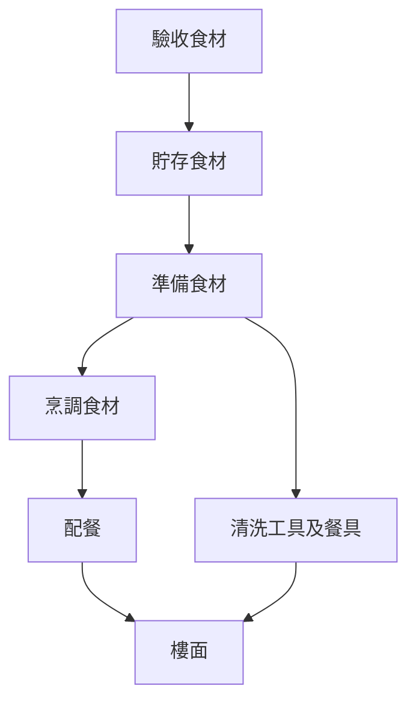
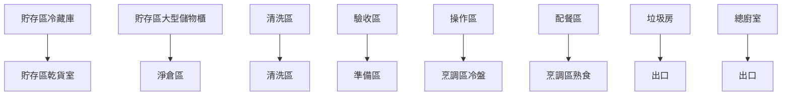
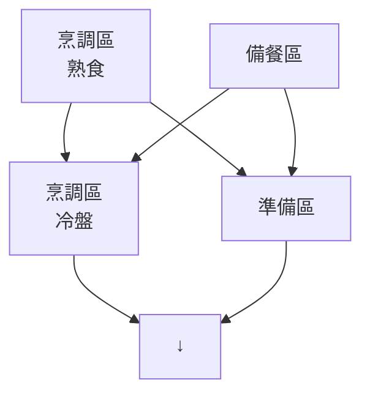
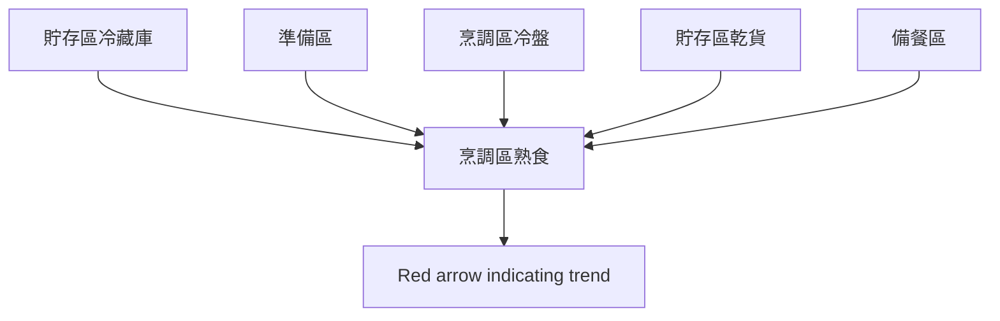
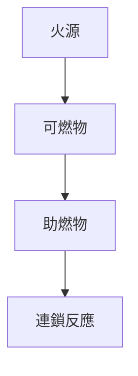

# 餐單的基本知識

餐單是一間餐廳十分重要的款待工具，通常以書面形式呈現，供顧客選擇餐飲之用。每一間餐廳都會因應自身的服務風格、食物特色，以及時節等因素，制訂不同類型的餐單。

# 3.1餐單的種類

餐飲業常見的餐單有自選餐餐單、套餐餐單、是日精選餐單、周期餐單、兒童餐單和宴會餐單。

# 自選餐餐單

自選餐餐單會列出餐廳提供的所有餐點，各餐點均有獨立的價格。顧客可根據個人喜好，任意選擇和配搭。西式餐廳的自選餐餐單，主要依上菜次序排列，最先是前菜，其次是餐湯，然後是主菜，之後是甜品等。中式餐廳的自選餐餐單，大多按食物分類，如肉類、海鮮類、蔬菜類、湯類、飯麵類、甜品類等。

自選餐餐單具有以下特色：

text_image

New Life
SALAD
MONDAY
SALAD
MONDAY
SALAD
MONDAY
SALAD
MONDAY
SALAD
MONDAY
SALAD
MONDAY
SALAD
MONDAY
SALAD
MONDAY
SALAD
MONDAY
SALAD
MONDAY
SALAD
MONDAY
SALAD
MONDAY
SALAD
MONDAY
SALAD
MONDAY
SALAD
MONDAY
MONDAY
SALAD
MONDAY
SALAD
MONDAY
SALAD
MONDAY
SALAD
MONDAY
SALAD
MONDAY
SALAD
MONDAY
SALAD
MONDAY
SALAD
MONDAY
SALAD
MONDAY
SALAD
MONDAY
SALAD
MONDAY
SALAD
MONDAY
SALAD
MONDAY
SALAD
SALAD
MONDAY
SALAD
SALAD
MONDAY
SALAD
SALAD
MONDAY
SALAD
SALAD
MONDAY
SALAD
SALAD
MONDAY
SALAD
SALAD
MONDAY
SALAD
SALAD
MONDAY
SALAD
SALAD
MONDAY
SALAD
SALAD
MONDAY
SALAD

圖2.166  
西式餐廳的自選餐單

顧客選擇具自主性：顧客可根據個人的喜好和口味，自主選擇餐單上的餐點，因此他們對餐點的接受程度亦較高。  
• 餐點逐項收費：顧客選取的餐點，全部以獨立的價格逐項收費，如以同樣的餐點計算，自選餐餐單的價格會較套餐餐單的價格為高。  
• 製作時間較長：由於顧客有不同的選項，廚師難以集中處理，大多以即點即煮的方式逐項烹調，整體製作的時間較長，顧客等候餐點的時間也相對套餐為長。  
食材採購繁多：餐廳需要準備餐單上所有餐點的食材，食材種類會遠較套餐餐單為多，在預算採購量方面會較花時間，加上各項食材的份量較少，所以食材的成本亦會較高。  
• 整體成本較高：除了食材成本較高外，餐廳還需要聘請較多人手處理食材，自選餐餐單的整體成本因而較套餐餐單為高。

# 套餐餐單

套餐餐單以固定的價格，向顧客提供一組特定選項的菜餚，讓顧客選擇。不同的餐廳會有不同類型的套餐組合，大部分的西式套餐餐單，通常會有前菜、餐湯、主菜、甜品及飲品；中式套餐往往會按人數設定，如二人套餐、六人套餐、十二人套餐等。

套餐餐單具有以下特色：

• 組合全包式收費：這類餐單對整個套餐進行「全包式」收費。顧客點選後，不論有沒有享用全部菜式，都需要支付整個套餐組合的費用。  
• 顧客選擇有限：顧客只能從特定的組合作有限度的選擇，整體選擇較自選餐餐單少。例如西式套餐，顧客大多只可由兩款前菜、餐湯、主菜、甜品中選擇其中的一款。六人中式套餐，顧客可能要從十款菜式中選六款等。  
方便採購食材：套餐餐單所需的食材種類較少，而餐廳的採購數量相對較多，既方便餐廳採購，亦有助降低採購成本。  
• 整體成本較低：套餐餐單的製作工序重複性高，適合餐廳大量烹調，從而節省製作時間和人手，加上食材採購成本較低，能降低整體成本。因此不少餐廳在聖誕節、春節等餐飲旺季，只會向顧客提供套餐。

提高顧客消費意欲：以同樣的餐飲計算，套餐餐單的價格會較自選餐餐單的餐點價格為低，所以不少顧客基於整體較優惠而點選套餐。

text_image

Special
MENU
TABLE FOR TWO
晚市特色2人套餐
自選STARTERS 頭盤
泰式燒菠蘿沙律（素食之選）
黑白芝麻鯖絲沙律（生酮之選）
/+$28.-轉配蜜桃蟹肉他他
SOUP 餐湯
是日素湯
/+$28.-轉配蟹肉龍蝦湯
奉送DRINKS 餐飲&
DESSERT 甜品
$298.-
PASTA/RISOTTO
泰味意大利粉/意大利飯
椰汁雜菜意大利燉飯
（素食之選）
或
拋打豬肉/新豬肉意粉
（辣/微辣/走辣）
MAIN 主菜
秘製酸子汁燒鱸魚配意大利黃瓜
（低碳之選）
或
澳洲殼飼肉眼牛伴紅咖喱焗薯蓉
@blossomy that
加一座桂青 KTI Service Charge

圖2.167 泰式西餐廳的套餐餐單 ▲

text_image

Daily Special
• Pan-fried Cauliflower Padies Grape
Cauliflower, Mint Oil $88.
• Ficedle Glaciale Salad $98.
• Clam or Letts Red Chilli
Gaulic $128.
• Chicken Conomo, Popcornous
Mixed Vegetable Balls $98
• Beef Campaccio
or Egg Yolks Puote, Crouton $268.
• Grilled Pork Loin.
Roasted Jamusilen Artichade
Apple Puote $258.
• Sous vide Pork Belly
or Baby Carrot, Pearl Onion.
Carrot & Orange Puote $238.

圖2168餐廳的是日精選餐單

# 3 是日精選餐單

是日精選餐單指餐廳當日向顧客推介的菜餚，通常會寫於餐牌、黑板展示，或由侍應以口述的方式推介。這類餐單近似套餐餐單，以固定的價格，供應一組特定的菜式。不同的是，這類餐單會每日作出更新。

是日精選餐單具有以下特色：

• 有助推廣：餐廳可利用是日精選餐單，向顧客推廣時令食材或新菜式。  
促銷食材：餐廳可利用是日精選餐單，組合一些囤積過多的食材，加快促銷。 c

# 4 周期餐單

周期餐單指在一定時間內，輪流循環使用的餐單，常見於大型企業、工廠、醫院、大學的自助食堂。這類餐單的循環使用期一般由一周至三個月不等，而使用期的長短主要取決於季節可用的食物、餐廳的政策等。

周期餐單具有以下特色：

• 節省餐單規劃時間：餐廳可減少制訂餐單及準備餐點的時間；  
簡化採購程序及降低採購成本：餐廳可定期大量採購食材，既能簡化採購程序，亦有助降低成本；  
• 提升營運效率：餐廳所需的食材較為固定，可易於控制食材存貨，提升營運效率；  
有利生產系統化：餐廳可透過系統化處理食材、重複烹調相同的餐點，提升烹調效率和餐點水準；  
選擇性及重複感適中：顧客每隔一段時間才會再遇相同的餐單，整體選擇較套餐餐單為高，重複感亦較套餐餐單為低。

text_image

CATERING MAN
SET LUNCH - 走好午餐
星期一
星期二
星期三
星期四
星期五
星期六
每日开盘价最高1元/克，最低1元/克。
每日开盘价最低1元/克，最高1元/克。
每日最高价最高1元/克，最低1元/克。
每日最低价最低1元/克，最高1元/克。
每日开盘价最高1元/克，最低1元/克。
每日开盘价最低1元/克，最高1元/克。
每日最高价最高1元/克，最低1元/克。
每日最低价最低1元/克，最高1元/克。
每日开盘价最高1元/克，最低1元/克。
每日开盘价最低1元/克，最高1元/克。
每日最高价最高1元/克，最小1元/克。
每日最低价最低1元/克，最高1元/克。
每日开盘价最高1元/克，最低1元/克。
每日开盘价最低1元/克，最高1元/克。
每日最高价最高1元/克，最小1元/克。
每日最低价最低1元/克，最高1元/克。
每日开盘价最高1元/克，最低1元/克。
每日开盘价最低2元/克，最高1元/克。
每日最高价最高2元/克，最小2元/克。
每日最低价最低2元/克，最高2元/克。
每日开盘价最高2元/克，最低2元/克。
每日开盘价最低2元/克，最高2元/克。
每日最高价最高2元/克，最小3元/克。
每日最低价最低2元/克，最高3元/克。
每日开盘价最高2元/克，最低3元/克。
每日开盘价最低2元/克，最高3元/克。
每日最高价最高2元/克，最小4元/克。
每日最低价最低2元/克，最高4元/克。
每日开盘价最高2元/克，最低4元/克。
每日开盘价最低2元/克，最高4元/克。
每日最高价最高2元/克，最小5元/克。
每日最低价最低2元/克，最高5元/克。
每日开盘价最高2元/克，最低5元/克。
每日开盘价最低2元/克，最高5元/克。
每日最高价最高2元/克，最小6元/克。
每日最低价最低2元/克，最高6元/克。
每日开盘价最高2元/克，最低6元/克。
每日开盘价最低2元/克，最高6元/克。
每日最高价最高2元/克，最小7元/克。
每日最低价最低2元/克，最高7元/克。
每日开盘价最高2元/克，最低7元/克。
每日开盘价最低2元/克，最高7元/克。
每日最高价最高2元/克，最小8元/克。
每日最低价最低2元/克，最高8元/克。
每日开盘价最高2元/克，最低8元/克。
每日开盘价最低2元/克，最高8元/克。
每日最高价最高2元/克，最小9元/克。
每日最低价最低2元/克，最高9元/克。
每日开盘价最高2元/克，最低9元/克。
每日开盘价最低2元/克，最高9元/克。
每日最高价最高2元/克，最小10元/克。
每日最低价最低2元/克，最高10元/克。
每日开盘价最高2元/克，最低10元/克。
每日开盘价最低2元/克，最高10元/克。
每日最高价最高2元/克，最小11元/克。
每日最低价最低2元/克，最高11元/克。
每日开盘价最高2元/克，最低11元/克。
每日开盘价最低2元/克，最高11元/克。
每日最高价最高2元/克，最小12元/克。
每日最低价最低2元/克，最高12元/克。
每日开盘价最高2元/克，最低12元/克。
每日开盘价最低2元/克，最高12元/克。
每日最高价最高2元/克，最小13元/克。
每日最低价最低2元/克，最高13元/克。
每日开盘价最高2元/克，最低13元/克。
每日开盘价最低2元/克，最高13元/克。
每日最高价最高2元/克，最小14元/克。
每日最低价最低2元/克，最高14元/克。
每日开盘价最高2元/克，最低14元/克。
每日开盘价最低2元/克，最高14元/克。
每日最高价最高2元/克，最小15元/克。
每日最低价最低2元/克，最高15元/克。
每日开盘价最高2元/克，最低15元/克。
每日开盘价最低2元/克，最高15元/克。
每日最高价最高2元/克，最小16元/克。
每日最低价最低2元/克，最高16元/克。
每日开盘价最高2元/克，最低16元/克。
每日开盘价最低2元/克，最高16元/克。
每日最高价最高2元/克，最小17元/克。
每日最低价最低2元/克，最高17元/克。
每日开盘价最高2元/克，最低17元/克。
每日开盘价最低2元/克，最高17元/克。
每日最高价最高2元/克，最小18元/克。
每日最低价最低2元/克，最高18元/克。
每日开盘价最高2元/克，最低18元/克。
每日开盘价最低2元/克，最高18元/克。
每日最高价最高2元/克，最小19元/克。
每日最低价最低2元/克，高19.5 元/
每日开盘价最高2 元（含税）

▲圖2.169  
西式餐廳的周期餐單

# 5 兒童餐單

兒童餐單即專為兒童設計的餐單，可以是套餐或自選餐餐單。

兒童餐單具有以下特色：

• 餐單設計吸引，印有大量圖畫；  
• 食物普遍較容易進食；  
• 餐單通常由營養均衡的食物組成；  
• 食物份量較成人餐單為少，價格亦相對較便宜；  
• 食物造型和包裝較有趣味。

text_image

Kids' Meals
魚絲餅湯肉餅餅餅汁，Tomato Sauce Rice Omelet
$115
鶏三丈魚餅餅餅白飯，時令水果
鶏餅冬瓜，蒸餌中磚餅餅水成果汁
Baked Salmon with Steamed Rice
seasonal fruits
your choice of 900L, Borequark Mineralized Water or Fruit Juice
魚蹄魚蛋餅餅餅餅漿汁，時令水果
鶏餅冬瓜，蒸餌中磚餅餅水成果汁
Tomato Sauce Rice Omelet
seasonal fruits
your choice of 900L, Borequark Mineralized Water or Fruit Juice
$115
日式鶏餅餅餅餅餅白飯，日式鶏餅餅汁，時令水果
鶏餅冬瓜，蒸餌中磚餅餅水成果汁
Tatyuki Chicken Brunnetick in Japanese Sweet Curry with Steamed Rice
seasonal fruits
your choice of 900L, Borequark Mineralized Water or Fruit Juice
$115
▲圖2.170 儿童餐器

兒童餐單

# 6 宴會餐單

宴會餐單是專為婚宴、壽宴、公司宴會、畢業禮等特定的大型活動而提供的餐單，屬套餐餐單的一種。餐廳方面會與顧客在活動舉行前，先共同擬定固定的菜式及價格，然後在活動舉行當日，將菜餚逐一製作，並呈上供賓客享用。

餐廳在設計宴會餐單時，應注意以下要素：

• 在顧客的費用預算下，盡量滿足顧客的要求；  
• 根據宴會的主題，設計圍繞主題的菜餚；  
• 留意賓客的年齡、地位、背景、宗教信仰等情況；  
• 採用合時的食材，並兼顧不同賓客的口味。

text_image

Wedding Lunch Menu
Appetiser 前菜
Pan-seared scallop on fire gras mousse with smoked salmon
姬三文鱼脊筋带子配醋肝酱
Soup 固
Caviar seafood chowder
黑鱼子海鲜炖打菌
Main Course 主菜
Australia beef fillet with rosemary red wine sauce and butter shrimp
澳洲牛柳伸展酱粗配速送香红酒汁
or 或
Baked sole fillet with Tai O salted eggyolk
大澳鲥蛋黄焖圈鱼榨
Dessert 谩蒜
Tai O mountain begenta pannu cotta
大澳紫貝天菊息式奶酪
Coffee or tea
with macarons and cookies
咖啡或茶配玛卡蔬及曲奇饼

■圖 2.171酒店西式婚禮午宴餐服

# 例子庫

• 中式及西式宴會餐單的內容有很大分別，以下是常見的例子：

<table><tr><td>中式宴會餐單內容</td><td>西式宴會餐單內容</td></tr><tr><td>1. 餐前小食2. 拼盤3. 湯羹4. 海鮮5. 主菜(畜禽肉)6. 時蔬7. 主食(麵飯等)8. 甜品9. 水果拼盤</td><td>1. 前菜2. 湯3. 主菜(一般兩道)4. 甜品5. 咖啡或茶</td></tr></table>

# 雞尾酒會餐單

雞尾酒會餐單是專為雞尾酒會而設的餐單，為賓客提供袖珍的食物。賓客可隨便享用擺放在服務櫃台上的飲品和小食。由於酒會不設固定座位，賓客可在會場自由走動，與其他賓客輕鬆站立交談。侍應會用托盤盛載飲品和小食，在會場各處穿梭，方便賓客取用。

雞尾酒會餐單具有以下特色：

餐單由主辦單位與餐廳或到會餐飲公司方面共同擬定；  
• 酒會提供多款飲品和簡單小食，供賓客享用。當中的飲品，不少是以各種酒類配合果汁等調配的雞尾酒（Cocktail）；

• 小食一般較精巧，包括西式點心、開胃小食等；

• 提供的食物可以是冷盤或熱盤；

• 現場不會向賓客提供餐單。

natural_image

Interior view of a grand banquet hall with ornate red carpet and multiple tables featuring ceremonial items (no visible text or signage)

▲ 圖 2.172 在雞尾酒會舉辦前，已由主辦單位與餐廳或到會餐飲公司擬定餐單。

# 活動站

# 分辨餐單

細閱以下餐單，分辨各餐單的類型，把答案配對到適當的括號內。

# 自選餐單

# 套餐餐單

# 宴會餐單

# 是日精選餐單

# 晚宴

帕爾馬火腿伴蜜瓜

傳統意式雜菜湯

意粉伴香煎帶子

澳洲牛扒伴時令雜菜

拿破崙蛋糕

咖啡或茶

# 肉類

阿根廷西冷牛扒

新西蘭羊扒

西班牙豬扒

泰國烤魚

法國鴨胸肉

波士頓龍蝦

# 晚餐

大蝦沙律

或 牛油果沙律

羅宋湯 或 忌廉湯

香煎鱸魚柳

或 香煎三文魚扒

芝士餅

或 蘋果批

咖啡或茶

# 資料室

# 宗教餐單

除了自選餐餐單、套餐餐單、是日精選餐單、周期餐單、兒童餐單、宴會餐單和雞尾酒會餐單外，還有宗教餐單。以下是這類餐單的特色和服務方式：

<table><tr><td>餐單</td><td>特色</td><td>服務方式</td></tr><tr><td>宗教餐單</td><td>• 為有宗教信仰人士,根據其飲食禁忌而設計的餐單,例如:伊斯蘭教餐、印度教餐、猶太教餐。</td><td>• 適宜配合餐桌服務的運作方式。</td></tr></table>

natural_image

People enjoying a meal together at a decorated table with plates and food (no visible text or symbols)

圖 2.173 伊斯蘭教餐不會有豬肉，肉食以羊、雞、牛及有鱗的魚、蝦為主。

natural_image

Plated dish of various food items including rice, vegetables, and fish (no visible text or labels)

圖 2.174 印度教餐不會有牛肉、豬肉，肉食以雞、羊及魚類為主。

natural_image

Top-down view of a meal tray with chicken, bread, and side dishes (no visible text or symbols)

圖 2.175 猶太教餐不會有豬肉、無鱗的海產，肉食以雞、羊、牛及有鱗的魚為主。

# 3.2 不同餐單種類的比較

各類型的餐單受不同因素影響，有「選擇性」與「非選擇性」的分別。

• 選擇性餐單：每項食物類別都有多種選擇，與非選擇性餐單相比，顧客擁有較大的選擇自由度。

• 非選擇性餐單：每項食物類別僅提供單一選擇，顧客的選擇自由度低。

「選擇性」與「非選擇性」餐單對餐廳的營運各有好處：

<table><tr><td>「選擇性」餐單</td><td>「非選擇性」餐單</td></tr><tr><td>因為餐單的選項較多,餐廳可採用較廉價的食材,平衡較昂貴的食材,節省成本;由於餐單可供選擇的餐點較豐富,顧客會點選的菜式一般較多,餐廳每款餐點的份量不需要太大;餐廳可依照飲食潮流或季節食材,改變餐單,推出新款菜式,以增加顧客的新鮮感,從而刺激消費。</td><td>餐單上的餐點種類單一,製作工序重複性高,無須額外增聘經驗較豐富的員工;食材的採購種類較少,採購較簡單和較易於監控,採購成本也較低;由於可選擇性低,所預備的食材種類有限,既可較易控制食物份量,亦可降低開支。</td></tr></table>

<table><tr><td>餐單</td><td>選擇性</td><td>描述</td></tr><tr><td>自選餐餐單</td><td>高</td><td>· 餐單上的各項餐單都依獨立價格收費,款式較多,顧客根據個人喜好,任意選擇和配搭。</td></tr><tr><td>套餐餐單</td><td>低</td><td>· 餐單的配搭和份量已預先編定,顧客只能依據餐廳提供的套餐選項作出選擇。</td></tr><tr><td>是日精選餐單</td><td>低</td><td>· 餐單的選項主要是時令食材或餐廳囤積過多的食材,可供顧客選擇的選項不多。</td></tr><tr><td>周期餐單</td><td>低至中</td><td>· 視乎餐廳對周期餐單的依賴程度。若餐廳依賴程度高,餐單會有較多選項;若餐廳將周期餐單作輔助之用,則選項會較少。</td></tr><tr><td>兒童餐單</td><td>低</td><td>· 一般餐廳的兒童餐單由於需求量有限,可供兒童選擇的餐點較少,往往只有兩款左右。</td></tr><tr><td>宴會餐單</td><td>低</td><td>· 宴會餐單主要由宴會場地先行編制數款,再供客人選擇。雖然客人可根據個人喜好,轉換個別選項,但基於成本等因素,實際選擇性有限。</td></tr><tr><td>雞尾酒會餐單</td><td>低</td><td>· 餐單已預先擬定,而服務過程中亦不會向賓客提供餐單,賓客沒有其他選擇。</td></tr></table>

natural_image

Circular arrangement of food items including vegetables, bread, and snacks (no text or labels)

▲ 圖2.176 五大食物種類

# 3.3五大食物種類

一份完整的餐單，應包含以下五大食物種類中最少一種食物，以確保營養均衡。

• 澱粉質食物：包括米飯、麵食、馬鈴薯、粟米片等。這類食物能為身體提供能量。  
• 水果和蔬菜類：水果包括蘋果、芒果、西瓜等；蔬菜包括西蘭花、番茄、蘿蔔等。這類食物能為身體提供各種維他命，維持身體健康。  
肉類、魚類及其他非乳類蛋白質食物：肉類包括豬肉、雞肉、牛肉和羊肉等；魚類包括石斑、鯛魚、鱔等；非乳類蛋白質食物包括豆腐、紅豆或大豆類製品等。這類食物為人體提供蛋白質，有助強健體魄。  
牛奶、雞蛋和乳製食物：乳製食物包括乳酪、芝士、奶油和忌廉等。這類食物為人體提供鈣，維持骨骼和牙齒健康。  
含脂肪及含糖份的食物：包括芝士、煙肉、雞蛋和脂肪比例較高的肉類，以及乾果、罐頭水果、醬汁和湯、含糖份的雪糕等。如進食適當份量，能維持飲食均衡。

# 3.4餐單的目標和功能

# 餐單的目標

餐單是餐廳向顧客提供餐飲資訊的重要渠道，與餐廳能否達到盈利目標直接相關。與此同時，餐單對餐廳的形象構成很大影響，並關係到餐廳的市場策劃，以及廚房和採購工作。

# A 餐單與盈利

協助餐廳賺取盈利是餐單的首要目標。因為顧客主要根據餐單提供的資訊，了解餐廳的菜式，進而作出選擇。假如餐單的選項能夠滿足顧客的需求，而顧客在享用餐點後，認為菜式的質素與其對餐單的認知相符合，日後再次光顧的機會率相當高。

餐單同時確定了餐廳提供的食物及飲品種類，以便餐廳計算成本。因此，餐單與餐廳的營業額、成本關係密切，會直接影響到餐廳的盈利。

text_image

Mr. Moscow Communist Party
Mongolia Republic
Auction, 2015 March 2015

公司成立
Organizational of the Moscow Communist Party of China
中国共产党
National Party of China
国家统计局
Chinese People's Political Consultative Conference
Corporation for the Chinese People's Political Consultative Conference
中国建设银行股份有限公司
Corporation for the Chinese People's Political Consultative Conference
中国建设银行股份有限公司
Corporation for the Chinese People's Political Consultative Conference
中国建设银行股份有限公司
Corporation for the Chinese People's Political Consultative Conference
中国建设银行股份有限公司
Corporation for the Chinese People's Political Consultative Conference
中国建设银行股份有限公司
Corporation for the Chinese People's Political Consultative Conference
中国建设银行股份有限公司
Corporation FOR THE CHINA POWER OF CHINA
中国建设银行股份有限公司
Corporation FOR THE CHINA POWER OF CHINA
中国建设银行股份有限公司
Corporation FOR THE CHINA POWER OF CHINA
中国建设银行股份有限公司
Corporation FOR THE CHINA POWER OF CHINA
中国建设银行股份有限公司
Corporation FOR THE CHINA POWER OF CHINA
中国建设银行股份有限公司
Corporation FOR THE CHINA POWER OF CHINA
中国建设银行股份有限公司
CorporATION FOR THE CHINA POWER OF CHINA
中国建设银行股份有限公司
Corporation FOR THE CHINA POWER OF CHINA
中国建设银行股份有限公司
Corporation FOR THE CHINA POWER OF CHINA
中国建设银行股份有限公司
Corporation FOR THE CHINA POWER OF CHINA
中国建设银行股份有限公司
Corporation FOR THE CHINA POWER OF CHINA
中国建设银行股份有限公司
Corporation FOR THE CHINA POWER OF CHINA
China Construction Bank Corporation Limited
中国建设银行股份有限公司
Corporation FOR THE CHINA POWER OF CHINA
中国建设银行股份有限公司
Corporation FOR THE CHINA POWER OF CHINA
中国建设银行股份有限公司
Corporation FOR THE CHINA POWER OF CHINA
中国建设银行股份有限公司
Corporation FOR THE CHINA POWER OF CHINA
中国建设银行股份有限公司
Corporation FOR THE CHINA POWER OF CHINA
中国建设银行股份有限公司
Corporration FOR THE CHINA POWER OF CHINA
中国建设银行股份有限公司
Corporation FOR THE CHINA POWER OF CHINA
中国建设银行股份有限公司
Corporation FOR THE CHINA POWER OF CHINA
中国建设银行股份有限公司
Corporation FOR THE CHINA POWER OF CHINA
中国建设银行股份有限公司
Corporation FOR THE CHINA POWER OF CHINA
中国建设银行股份有限公司
Corporation FOR THE CHINA POWER OF CHINA
中建银行股份有限公司
Corporation FOR THE CHINA POWER OF CHINA
中国建设银行股份有限公司
Corporation FOR THE CHINA POWER OF CHINA
中国建设银行股份有限公司
Corporation FOR THE CHINA POWER OF CHINA
中国建设银行股份有限公司
Corporation FOR THE CHINA POWER OF CHINA
中国建设银行股份有限公司
Corporation FOR THE CHINA POWER OF CHINA

▲ 圖2.177 高級餐廳的餐單

# B 餐單與形象

餐單是顧客首先接觸到菜式、了解餐廳的重要媒介，除了向顧客解說菜式和協助顧客點餐外，還代表了餐廳想給顧客留下的印象。因此，能夠配合餐廳形象和服務風格的餐單，可以加深顧客對餐廳的印象。

text_image

Street photo of a McDonald's restaurant with multiple food displays and visible menu signs in Chinese

▲ 圖2.178 快餐店的餐單

# 例子庫

高級餐廳的餐單不但設計精美，而且大多會在餐牌上印上餐廳的標誌，以提高顧客對餐廳格調的認知和定位。  
快餐店由於競爭激烈，加上顧客對價錢的敏感度往往較高，因此餐單會注重標榜餐飲價格相宜，甚至會放大某些特惠的項目，讓顧客認為餐廳的餐飲是物有所值，從而建立經濟實惠的大眾化形象。

# C 餐單與市場策劃

餐單在提供餐飲資訊予顧客的同時，可發揮市場推廣的作用。當餐廳制定了市場策劃與銷售目標後，會通過製作新餐單，向目標顧客推廣餐廳的新菜式或新優惠，使餐單成為市場策劃推廣的其中一項有效工具。

text_image

TODAY
SPICE
SPOCK
SPOCK

▲ 圖 2.179 餐廳員工正在描述是日精選餐單

# 例子庫

餐廳如希望在聖誕節吸引家庭顧客，會在餐單上作出調整，包括展示適合一家大小的菜式和份量，以吸引更多的家庭顧客；如希望在情人節吸引情侶顧客，會推出專為情人節而設的情侶套餐。  
餐廳如為了推廣某數款新菜式，會把新菜式置於餐單的首頁，或在餐單上以較大的圖片及較詳細的文字描述，以吸引更多顧客點選；如為了提高營業額，搶佔市場份額，餐廳便要推出震撼價格的優惠套餐，透過餐單向顧客展示，吸引顧客的眼球。

# D 餐單與廚房和採購工作

餐單上列出的餐點，決定了廚房需要準備的食物材料、數量和品質，以及烹調所需的工具、設備和方法，餐廳在採購有關食材、工具及設備時，便要加以配合。

# 餐單的功能

餐單是餐廳運作中不可或缺的設施，發揮了提供餐飲資訊、幫助推廣銷售、增強顧客信心、營造餐廳氣氛和主題，以及計算食材用量和成本的功能。

# A 提供餐飲資訊

為顧客提供餐飲資訊是餐單的重要功能。因為顧客會先根據餐單了解餐廳所供應的菜式和價錢，再進行點選。

# B 幫助推廣銷售

餐單在相當程度上發揮幫助餐廳推廣銷售的功能。餐廳可以把一些盈利高和受歡迎的菜式，列於餐單的當眼位置，並運用菜式圖片或推薦字眼等，增加顧客點選的意欲，從而提高餐廳利潤。

在一些節慶或市場推廣活動中，餐廳也可利用餐單附加宣傳單張，推廣節慶餐飲或新款菜式等。

▲ 圖2.180 為情人節而設的餐單

# C 增強顧客信心

餐單代表了餐廳，一份版面設計精美、光潔乾淨、資訊完備、字體適宜的餐單，能提高餐廳的有形服務，增強顧客對餐廳的信心。

# D 營造餐廳氣氛和主題

餐單在相當程度會影響餐廳的氣氛和主題，設計如能配合餐廳的建築和佈局等元素，有助貫穿各個元素，進一步營造氣氛和主題。

# E 計算食材用量和成本

根據統計餐單各餐點的銷售情況，餐廳方面可以監察及預計各項食材的用量和成本，方便向供應商採購食材。

text_image

Special
Valentine's
Day
Menu

# 3.5餐單規劃的考慮因素

規劃餐單時，餐廳管理層和主廚會綜合考慮與顧客、食物、營運和市場的關係，然後才決定餐單上的餐飲項目、定價，以及展示的方式等。

# 與顧客有關的考慮因素

# A 所吸引的顧客類型

餐單應針對餐廳的目標顧客群，提供能迎合他們的餐飲種類。目標顧客群可按年齡、性別、職業、地區等來劃分。

# 例子庫

• 餐廳的目標顧客群若是年輕人，餐單可以推出較多高熱量、以煎炸方式烹調的菜式。  
• 餐廳的目標顧客群若是長者，餐單應較注重健康，菜式也宜以少油、少鹽、少糖的方式製作。

# B 消費能力

餐單應按照餐廳目標顧客群的消費能力，以及餐廳的市場定位，合理制定餐飲項目的價格。假如定價高於目標顧客群的消費能力、偏離市場定位，餐單便無法有效吸引顧客消費。

# 例子庫

開設在高級商業區或旅遊區、以收入較高的上班一族或旅客為目標顧客群的餐廳，顧客的消費能力較高，也較願意支付較高的餐飲費用，餐單的定價可較高。  
開設在民生社區、以附近街坊為目標顧客群的普通餐廳，顧客大多只願意支付較低的餐飲費用，餐單的價格便不宜訂得太高。

圖 2.181、圖 2.182 中環商業區餐單的餐飲價格，會高於深水埗等民生社區。

natural_image

Split image showing a modern city skyline with skyscrapers and a busy street market with vendors and shoppers (no visible text or signage)

# C 用餐次序

為迎合顧客的用餐次序與習慣，以及方便顧客點餐，餐廳在編排餐單時，一般會把前菜放置在最前，再按海鮮、肉類、蔬菜等類別排列主菜，然後是麵食、飯類，甜品和飲品則置於最後。

# D 特別要求

餐廳在設計餐單時，除了考慮目標顧客群的餐飲需求外，也要考慮其他類型顧客的需要，以便在營運過程中作出調整，才能擴寬顧客群，增加營業額。

# 例子庫

• 在香港以辛辣菜式為主的餐廳，除了滿足愛好吃辣人士的需求外，亦會因應部分港人的口味，提供小辣、微辣的選擇。  
• 餐廳可能會有一些猶太教徒顧客或素食顧客光顧，在設計餐單時，應考慮供應沒有豬肉或純素食的菜式。

# 與食物有關的考慮因素

# A 食材成本及價格

規劃餐單時，餐廳除考慮目標顧客群的消費能力外，還應考慮食材成本，以及食材成本佔整體成本的比例。這可以確保食材成本在可控水平，避免餐飲價格因食材成本上升而要上調，並使餐廳能獲得一定比例的利潤。

# B 食材供應

餐廳在擬定餐單時，要確保所需的各類食材能充足供應，盡量選取供應穩定的食材，避免因個別食材短缺而出現停止銷售菜式的情況。需要用季節性食材烹調的菜式，餐廳可考慮另設獨立餐單。

text_image

日生 番
STARRY TOMATO
味覺饗宴·盛大回歸
——大開蟹主題宴——
全日8折優惠
×3
超值大開蟹宴
每位定價$548 8折優惠 $438 (2位起)
陳年 剛皇 機樂汁
精 美
家
燈
溫
燒
燒
×○ 圓爆小象鮮
蘇翠 小蝦藥
精選大開蟹
(二個位三萬) 麻(三一)大隻
(二個位三萬) 麻(三一)大隻

▲ 圖 2.183 餐廳為時令食材大閘蟹而設的獨立餐單

# C 食物營養價值

餐廳提供的餐飲為顧客供應了所需的營養和能量，因此餐廳在制定餐單時，應注意菜式要符合均衡營養的要求。隨着現時人們日益注重飲食健康，不少餐廳已在餐單增加低脂、高纖、少防腐劑的菜式。一些餐廳更會在餐單列出食物的成份或健康價值，以供顧客參考。

text_image

403
$88
紫薯窩夫配焦糖海鹽和雪糕
Purple Potato Waffle with Ice Cream
Sea Salt & Caramel Syrup
總卡路里Total Calories: 528 Kcal
蛋白質 Protein :4g 焦水化合物 Carbohydrates : 10g 總脂粉 Total Fat : 18g

▲ 圖 2.184 列出食物總卡路里、蛋白質、碳水化合物、總脂肪數量的餐單。

總卡路里 Total Calories: 528 Kcal蛋白質 Protein：4g碳水化合物 Carbohydrates：10g總脂肪 Total Fat：18g

# D 選擇種類和數目

餐廳在規劃餐單時，一方面要從目標顧客群的角度，檢視菜式種類的選擇是否足夠；一方面要從餐廳營運的角度出發，考慮菜式所需的食材種類與數量會否過多，導致廚房處理需時，或未能有效供應。因此，餐單要兼顧目標顧客群的選擇性和餐廳營運的操作性，在兩者之間取得平衡。

# 例子庫

光顧快餐店的顧客，較重視餐廳食物供應的效率，希望能用較短時間點選菜式及獲得食品，所以快餐店的餐單選擇有限，所需人手較少，製作時間也較短。

# E 食物衞生及安全

食物衞生及安全是餐廳必須注重的事項。餐廳在擬定餐單時，應考慮食材的衞生程度和安全性，尤其是選取生蠔、魚生等高風險食材時，需特別留意。為防止發生食物中毒事故，危害顧客健康和影響餐廳商譽，餐廳應確保食材的供應和處理符合安全水平。

# 與營運有關的考慮因素

# A 餐廳位置

餐廳的位置與目標顧客群及其餐飲需求有密切關係，直接影響到餐單的設定。餐廳應根據營業的地點，推出迎合該地區人士和目標顧客群所需的餐飲。

# 例子庫

開設在交通樞紐的餐廳，目標顧客群是流量極高的交通工具乘客，為應付急速轉換的顧客群，餐單菜式往往製作簡便，而且適合外賣。  
開設在商業區的高級餐廳，目標顧客群是消費能力和對餐飲要求較高的人士，餐單供應的菜式便需要較精緻，製作時間也會較長。

text_image

壹号精算套餐(11:00 - 4:00)
星期一

1. 除三文包箱套管等规格面 $76
2. 箱子牙刷 $76
3. 皮带套装 $76
4. 胶套套装 $76

星期二

1. 箱子包件套管外径面 $76
2. 胶套套装外径面 $76
3. 皮带套装外径面 $76
4. 胶套套装外径面 $76

星期三

1. 箱子包件套管内径面 $76
2. 胶套套装内径面 $76
3. 胶套套装内径面 $76
4. 胶套套装内径面 $76

星期四

1. 三文包\*内套套装 $76
2. 胶套套装 $76
3. 精定套装\*内套套装 $76
4. 精定套装外套套装 $76

星期五

1. 三文包\*内套套装 $76
2. 胶套套装 $76
3. 精定套装外套套装 $76
4. 胶套套装外套套装 $76

以上固定版 / 精定/磁盘片 / 长床片 / 检查

精算规格下年法 (2:30 - 6:45) $34#

1. 箱式整箱内衬漆 $76
2. 箱式整箱内衬漆 $76
3. 脊厚壁板\*内套内衬漆 $76
4. 气泡内嵌套\*内套内衬漆 $76
5. O型胶膜\*内套内衬漆 $76

6. O型薄士卷\*内套内衬漆 $76
7. 箱式整箱内衬漆 $76
8. 箱式整箱内衬漆 $76
9. 分型薄壁板\*内套内衬漆 $76
10. 箱式整箱内衬漆 $76

11. O型薄士卷\*内套内衬漆 $76
12. 箱式整箱内衬漆 $76
13. 箱式整箱内衬漆 $76
14. 分型薄壁板\*内套内衬漆 $76
15. 箱式整箱内衬漆 $76

普通小窗 (11:00 - 6:45)
O型全窗包*内套$76
中窗多层包*内套$76
低层薄软贴 $76
中窗双色包$76

暗式整箱内衬漆 $76
暗式整箱内衬漆 $76
暗式整箱内衬漆 $76

暗式整箱内衬漆 $76
暗式整箱内衬漆 $76

暗式整箱内衬漆 $76

暗式整箱内衬漆 $76

暗式整箱内衬漆 $76

暗式整箱内衬漆 $76

暗式整箱内衬漆 $76

暗式整箱内衬漆 $76

暗式整箱内衬漆 $76

暗式整箱内衬漆 $76

暗式整箱内衬漆 $76

明式整箱内衬漆 $76
暗式整箱内衬漆 $76
暗式整箱内衬漆 $76
暗式整箱内衬漆 $76

暗式整箱内衬漆 $76
暗式整箱内衬漆 $76
暗式整箱内衬漆 $76
暗式整箱内衬漆 $76

暗式整箱内衬漆 $76
暗式整箱内衬漆 $76
暗式整箱内衬漆 $76
暗式整箱内衬漆 $76

暗式整箱内衬漆 $76
暗式的整箱内衬漆 $76
暗式的整箱内衬漆 $76
暗式的整箱内衬漆 $76

暗式整箱内衬漆 $76
暗式的整箱内衬漆 $76
暗式的整箱内衬漆 $76
暗式的整箱内衬漆 $76

暗式整箱内衬漆 $76
暗式的整箱内衬漆 $76
暗式的整箱内衬漆 $76
暗式的整箱内衬漆 $76

暗式大窗包*内套$76
暗式大窗包*内套$76
暗式大窗包*内套$76
暗式大窗包*内套$76

暗式大窗包*内套$76
暗式大窗包*内套$76
暗式大窗包\*内套$76

暗式大窗包*内套$76
暗式大窗包*内套$76
暗式大窗包\*内套$76

暗式大窗包*内套$76
暗式大窗包*内套$76
暗式大 Window包*内套$76
暗式大 Window包*内套$76
暗式大 Window包\*内套$76

暗式大窗包*内套$76
暗式大窗包*内套$76
暗式大窗包*内套$76
暗式大 Window包*内套$76
暗式大 Window包\*内套$76

# B 營業時間

餐廳在規劃餐單時，會考慮營業的時間，在不同時段供應不同的餐單。一般餐廳會提供早餐、午餐、下午茶和晚餐餐單，而不同時段的餐單選項和價格均有所不同。

▲ 圖2.185 午餐及下午茶等不同時段的餐單選項和價格有所不同

# 廚房大小及設施

餐單的規劃涉及到食材的儲存，以及廚房烹調設施能否配合。因此，餐廳在設定餐單時，要考慮所需食材是否有足夠的地方和設備妥善存放，以確保能為廚房提供足夠食材；餐單上的所有菜式是否有相應的烹調工具，才能避免出現不協調或無法製作菜式的情況。

# 例子庫

• 部分冷藏肉類需要大型冰箱儲存，一些乾貨海味需要存放在密實盒內或陰涼乾爽的地方，餐廳要有特定的設備和空間。  
餐廳的餐單如有較多的蒸煮菜式，廚房便需要擁有蒸櫃、蒸籠等廚具配合；如有較多烤炸的菜式，廚房就應有烤爐、炸爐等廚具配合。

text_image

MENU

▲ 圖 2.186 餐單需要考慮廚房員工的技能，與廚師一同擬定較為可行。

# D 廚房員工的技能

餐單上的菜式需要廚房員工製作，水準也需要員工維持。因此餐廳在擬定餐單時，需要與廚房員工交流意見，確保餐單上的菜式是否可行，例如廚師是否有足夠的技能烹調，其他員工是否足以協助應付等。

# E 製作時間

餐單的規劃需要同時考慮菜式的製作時間，因為顧客點選菜式後，大多不希望需要花長時間等候。另外，菜式如要花太多工序和時間製作，也會降低餐桌的翻檯率，影響餐廳的整體收入和利潤。

# 與市場有關的考慮因素

# A 同行的做法

餐飲業競爭激烈，為提高市場競爭力，餐廳在規劃餐單時，可先了解競爭對手的餐單選項，然後參考對手的菜式和價格，作出調整。餐單應具有餐廳的特色，以提高餐廳的吸引力；菜式價錢亦不能與同行相距太多，以免與市場脫節。

# B 餐廳裝潢

餐單的選項如能配合餐廳的裝潢和主題，能提升顧客的印象及體驗。

# 例子庫

• 快餐店的餐飲特色是提供方便快捷的食物，所以餐單和餐廳裝潢都統一以簡潔明快為主。  
高級餐廳的餐飲特色是提供高雅舒適的環境和優質的食材，所以餐單設計會配合餐廳的環境和主題，菜式名稱也會相當講究，以突出食材的質素。

# C 配合市場推廣

餐單兼具向顧客推廣餐廳菜式的功能，是餐廳其中一項重要的銷售工具。餐廳制定的餐單，除了外觀要具吸引力，也要方便顧客閱覽，讓顧客了解餐飲的特色，從而達到銷售餐飲的目的。

餐廳亦可設計不同的菜式組合，為顧客提供價格優惠；又或在節慶日子推出應節餐單，以便向顧客進行市場推廣，進而提升整體營業額。

# D 迎合飲食潮流

餐廳需要留意飲食潮流的轉變，適時調整餐單，增加或減少某類食材，或以時興的烹調方式製作菜式等，以迎合顧客和市場的需要。

# 例子庫

近年市民大眾越來越注重飲食健康，很多餐廳在餐單加入了純蔬菜的素食菜式，或在菜式中加入一些有機食材、養生食材等，以及刪去部分被視為不健康的肥膩菜式。  
部分餐廳為了迎合近年講求健康的飲食潮流，把部分菜式改以蒸煮、蒸燉的方式製作，如推出蒸氣海鮮鍋、蒸燉老火湯等。

text_image

海鲜近江町丼
2,800円
2,500円
海鮮近江町丼
2,800円
PREDICTLY FISH (HONG KONG) 1,800円
EXCHANGE PISH (HONG KONG) 1,800円
海鮮近江町丼
2,800円
PREDICTLY FISH (HONG KONG) 1,800円
東行 海鮮近江町丼
1,500円
HAWA CHUAI YIKUAN

# E 使用語言

餐廳在設計餐單時，使用的語言文字要顧及目標顧客群的需要，以方便顧客閱覽和了解菜式。

▲ 圖 2.187 為方便旅客，附有英文的日本餐廳餐單。

# 例子庫

以外地旅客為主的餐廳，會在餐單上設有英文及其他慣常光顧旅客的語言，如西班牙文、日文等，並會附設圖片，輔助說明。  
部分具外國特色的餐廳或高級西餐廳，會在餐單上一併提供相關國家的語言文字，以增加餐單的特色和顧客的印象。

# 活動站

# 餐單設計

試替一間位於尖沙咀、以地中海為主題的意大利餐廳，設計一份「母親節」餐單。餐單需配合主題，在提供餐飲資訊以外，亦要突出推廣效果，並為餐廳營造氣氛和主題。

# 3.6釐定餐單價格的方法

餐廳的收入依靠銷售餐飲，因此餐單的價格會直接影響餐廳的盈利。餐廳在釐定餐單價格時，主要依從成本法及主觀法兩種。

natural_image

Person using a laptop with a shopping cart in the background (no text or symbols visible)

▲ 圖 2.188 根據成本法，餐廳在釐定餐單價格時，主要考慮營運成本及目標收益等因素。

# 1 成本法

「成本法」是餐廳最常用的餐飲定價方法。餐廳主要根據營運成本及目標收益來制定餐飲的價格。

餐廳的營運成本包括食材開支、燃料開支、租金、員工薪金、強積金、勞工保險、宣傳費用等。目標收益指餐廳預計的餐飲銷售額。

餐廳可計算食材成本與售價的百分比，並以此為制定餐飲售價的標準。其公式如下：

$$
\text{食材成本百分比} = \frac {\text {食材成本}}{\text {售價}} \times 100
$$

因此

$$
\mathrm{售價} = \frac {\mathrm{食材成本}}{\mathrm{食材成本百分比}}
$$

# 思考點

假設餐廳某菜式的食材成本是 \$36，食材成本百分比設定在 30%，按成本法計算，該菜式的售價應是多少？

# 例子庫

• 假設餐廳某菜式的食材成本是 \$20，食材成本百分比設定在25%，按成本法計算，該菜式的售價為\$80。

一般餐廳的食材成本百分比，介乎20%至30%。採用昂貴、新鮮食材的高級食肆，食材成本百分比則會高於上述範圍。

不過在實際營運中，除了食材成本外，餐廳還需要把燃料開支、租金、員工薪金、強積金、勞工保險、宣傳費用等成本計算在內，才能得出餐廳的確切利潤。如餐飲定價過低，未能達到目標收益，餐廳就會出現虧損。

總括而言，使用成本法來制定餐飲售價，有以下優缺點：

<table><tr><td>優點</td><td>缺點</td></tr><tr><td>計算方法簡單,易於操作;較為客觀,不受市場定位、競爭情況等因素影響;可作為其他釐定餐單價格方法的參考。</td><td>只考慮成本方面的因素,容易忽略顧客對價格的接受程度,一旦價格超出顧客的可接受程度,目標收益將難以達到;容易忽略市場定位、競爭情況等因素,未能全面反映餐廳的經營效果。</td></tr></table>

# 主觀法

主觀法指定價主要考慮各項市場因素或餐廳目標而作出，並非以食材成本為基礎。以下是主觀法常見的考慮因素：

<table><tr><td>考慮因素</td><td>描述</td></tr><tr><td>餐廳類型和形象</td><td>餐廳的類型和形象會影響餐單的定價。高級食肆標榜優質食材及服務質素,會傾向調高各項餐飲的價錢,以營造餐廳奢華的形象,吸引高消費的顧客。至於大眾化的餐廳,餐單的定價會貼近普羅大眾的消費水平,以免影響餐廳在消費者心目中的大眾化形象。</td></tr><tr><td>餐廳地點和環境</td><td>餐廳的地點和環境對餐單的定價也有影響。餐廳位處獨特的地點,如主題公園、海灘風景區內,或租金昂貴的商業區地段等,餐單的定價會較其他地區為高。</td></tr><tr><td>目標顧客群</td><td>餐廳會根據主要顧客群對餐飲的需求和價格的承受程度,制定符合顧客消費能力的價格。例如在商業區和旅遊區,針對消費力較高的商務人士和旅客而開設的餐廳,定價會相對較高。</td></tr><tr><td>市場競爭者的定價</td><td>餐廳會以市場競爭者的價錢為定價的依據,定價會略高或略低於競爭對手,但不會與競爭對手的價格出現太大差距。</td></tr><tr><td>宣傳推廣效果</td><td>餐廳有時為了達到宣傳推廣效果,會把部分餐單項目的定價大幅調低於市場價格,以吸引顧客。前來光顧的食客,很多時會一併點選其他餐飲項目,提高整體營業額。</td></tr></table>

採用主觀法可為餐廳設定合理的目標盈利，不過在定價時必須深入研究市場，充分了解自身的競爭優勢，以及顧客和競爭對手的情況，才能制定出符合市場需求的餐飲價格。

# 3.7 餐牌設計的因素

餐牌上載有餐廳提供的餐飲選項，既是餐廳與顧客溝通的工具，也是餐廳向顧客推廣餐飲產品的重要渠道。由於餐牌在餐廳銷售中擔當了重要的角色，不少餐廳為了增加餐牌的吸引力，會聘請專業人士協助製作。

# 餐牌設計與餐廳形象

餐牌的設計與餐廳的形象息息相關。當顧客坐下接觸到餐牌，便會由餐牌得出對餐廳的第一印象。因此，一份設計精美而潔淨的餐牌，能立即提高顧客對餐廳的期望；設計醜陋而骯髒的餐牌，則會大大降低顧客的期望 C

由於顧客的第一印象相當重要，所以餐牌的設計應與餐廳的主題、裝潢、食物的種類，以至侍應的制服等元素相配合，使餐牌能切合餐廳的整體氛圍，從而加深顧客對餐廳的印象。

# 餐牌的基本資料

一份餐牌基本上包含了菜名、價錢和菜式描述三項資料。

# A 菜名

餐牌上的菜名應使用簡潔如實的文字，使顧客容易明白菜式的內容。餐牌通常會按前菜、湯、主菜、麵飯、甜品等分類，主菜又會依肉類、海鮮等再作細分。

text_image

菜名前有號碼
方便下單
按湯羹類、飯麵
類等分類
價錢在菜名後標示
標示加一服務費

# B 價錢

菜名後或旁，清楚標示餐飲項目的價錢，以便顧客評估消費總額。假如餐廳需要收取加一服務費或設有最低消費額，亦會在餐牌上展示。

▲ 圖2.189 按類別分類的中式餐牌

# C 菜式描述

部份餐牌附有文字簡單描述各款菜式，協助顧客進一步了解菜式的用料、烹調方式等資料。

# 餐牌的設計元素

餐牌的最主要功能是吸引顧客，使顧客可根據菜式作出點選的決定。為了達到此目標，餐牌會在設計上運用多項元素。

# A 顏色

色彩能夠對人的心理產生不同的反應，是餐廳設計的其中一項重要元素。餐牌所選用的顏色，需要配合餐廳的風格。

暖色系的紅、橙、黃等，會令人產生温暖柔和的感覺，是不少快餐店餐牌選用的顏色。冷色系的藍、紫、綠等，會令人產生高雅時尚的感覺，高級餐廳會較傾向選用。

# B 封面與封底

餐牌的封面代表着餐廳的形象，顏色應與餐廳整體環境的顏色相協調，並反映出餐廳的經營特色及風格。封面亦應印上餐廳的名稱、標誌，這既可增加餐廳的知名度，又可建立餐廳的形象。

餐牌的封底則應印有餐廳地址、電話號碼、營業時間及其他營業資訊，以加強推廣效果。

natural_image

Five colorful rectangular certificates placed on a wooden table, featuring green, blue, red, orange, and patterned designs (no visible text or symbols)

▲ 圖2.190 餐牌封面設計例子

# 提示箱

餐牌的設計需要留意餐廳的燈光環境等，以確保顏色能方便顧客看清楚餐牌上的文字。

# C 印刷用料

長期重複使用的餐牌，需要選擇高品質、耐用、防污及防油的紙張或卡紙製作。一次性使用的餐牌，如外賣餐牌，一般不用考慮其耐用性及防污、防油的功能，紙質可稍遜。

部分高級餐廳及酒店宴會廳，會採用皮革、布帛等物料裝配餐牌，以突顯餐廳的服務規格及檔次，營造華麗的形象。

# D 字體及字款

餐牌應選用大小適中的字體，齊整排列菜名、價錢及菜式描述，各項目之間有足夠的行距。至於菜名和菜式描述應採用不同款式及型號的字體，以示區別。這樣既讓顧客易於閱讀，也不會產生混淆。

一般餐廳的餐牌會用傳統正規的字體，部分特色和高級餐廳為了突出其風格，會選用比較特別、優雅的字體。

# E 對食物的描述

餐牌有關菜式的描述，可產生宣傳作用，吸引顧客點選。一般而言，餐廳會根據食材的來源地、烹調方法、調味料等，描述食物。

另外，餐廳有時會為菜式選用一些特別的菜名，以提高顧客的興趣。部分特色菜式或推介菜式旁，更會加插圖片，以及「廚師推介」、「秘製」等字眼，或加上大拇指、廚師帽等小圖案，誘使顧客點選。

text_image

厨师推介
Chef's Special
火山排骨
Laeng Saeb
Mountain of R&B Beans
小熊鱼 118
大 Large 188
62
Chicken Soup
厨师推介
Chef's Special
泰式蛋咖喱炒原斐冉蟹
Wet Fried Almond Crab in the Eye Cream/Carry

圖2.191 「廚師推介」及加插圖片的餐牌 ▲

text_image

월남선생과
태국이 만났다
Pha
상국수
스래설 Special
상국수
스래설 Special
상국수
스래설 Special
상국수
스래설 Special
상국수
스래설 Special
상국수
스래설 Special
상국수
스래설 Special
상국수
스래설 Special
상국수
스래설 Special
상국수
스래설 Special
상국수
스래설 Special
상국수
스래설 Special

▲ 圖 2.192 加入韓文的韓國餐廳餐牌

# 提示箱

A5：14.8cm × 21.0cm

A4：21.0cm × 29.7cm

A3：29.7cm × 42.0cm

# F 採用的語言

餐牌採用的語言，要考慮目標顧客群的需要。以香港為例，由於是國際旅遊城市，為方便旅客，很多餐廳都在餐牌上設有中文和英文。至於部分特色餐廳，為了增加餐廳的地方特色，會在餐牌上加入地方語言，如一些日本、韓國、泰國餐廳會分別在餐牌加入日文、韓文、泰文，以增加顧客的投入感。

# G 大小及形狀

餐牌的大小主要根據餐廳的經營特色而定，沒有標準，尺寸由A5至A3不等。

餐牌的形狀也沒有固定，視乎餐廳的需要。選項較少或獨立宣傳的餐牌，會以單頁式印製。選項較豐富的餐牌，會以摺疊式或書本式呈現。 些經常更換餐單的餐廳，餐牌的內頁會使用易於更換的釘裝方式。

# H 閱讀習慣

顧客閱讀單頁式餐牌，首先注意的會是最上方的菜式；閱讀窗口摺疊式餐牌時，最先留意的會是餐牌的中間內頁；閱讀書本摺疊式餐牌時，首先看到的往往是右上方的版面，然後才順序瀏覽至左上方的版面。餐廳在設計餐牌時，應依照顧客的閱讀習慣，把最想顧客點選的菜式，放在最適當的位置。

# I 美術元素

除了增加美術設計元素外，加入插圖也可豐富餐牌的吸引力和藝術性，同時方便顧客理解菜式及點餐。不過，使用插圖時，一定要注意圖片色彩與餐廳整體環境的協調性。

text_image

MENU
Ottakerfont

圖2.193 配合酒吧風格的餐牌 ▲

# 餐飲服務基本知識

natural_image

Colorful stylized city skyline illustration featuring iconic landmarks including the Eiffel Tower, Big Ben, and World landmarks (no text or symbols)

要認識餐廳提供的餐飲服務，需要從餐廳樓面設計及佈局、餐廳的環境氣氛和餐桌擺設及用具這三方面進行探討。

# 4.1餐廳設計及佈局

餐廳的設計及佈局，與餐廳的服務方式，以及經營者希望營造的氣氛與經營方針有密切關係。

# 餐廳設計需要考慮的因素

餐廳樓面的設計，需要考慮以下因素：

• 餐廳主題：需根據餐廳經營的主題，作出合適的設計；  
• 服務方式：即會採用何種服務類型，完整餐桌服務還是半自助式或全自助式服務；  
• 菜式風格：即提供中式、西式，還是其他地區的菜式；  
• 員工與顧客比例：如一名侍應會服務多少桌的顧客等；  
餐廳面積與間隔：即餐廳樓面與廚房的比例（受法例規管），以及設計會受間隔影響。

natural_image

Row of white banquet tables with red flowers and glassware, no visible text or symbols

# 餐廳佈局於功能上的考慮

餐廳樓面一般分為三大區域：用餐區、水吧和其他附屬區域及設施。為了善用空間，以提升經營效率和業務利潤，餐廳在規劃階段，會按其實際需要，決定各區域的大小和不同設施的擺放位置。

▲ 圖2.194 浪漫主題的餐廳，會傾向選用完整餐桌服務。

下圖是一間中型餐廳的樓層平面圖，當中用餐區所佔的面積最大。至於廚房部分，會在稍後的章節再作講解。

text_image

正門
大堂
正門
用餐區
A
用餐區
B
用餐區
D
後門
水吧
用餐區
C

圖 2.195

# A 用餐區

中型或大型餐廳通常會把用餐區劃分為多個小區域。每一個區域由餐廳經理和部長決定員工與顧客的比例，一般由一至數名侍應負責。

用餐區劃分區域，對餐廳有以下好處：

a 方便服務管理：把顧客分配到不同區域，由負責該區域的侍應服務，一方面可令侍應的工作量更平均，一方面可讓侍應的權責更分明，使管理層較易管理和監察員工的工作及服務質素。

b 便於彈性佈局：各小區域的佈局保留彈性，有利隨時作出調動，分拆或合併餐桌，以滿足不同類型顧客的餐飲服務需要。例如四人一組的餐桌，可分拆為供兩人使用；兩人一組的餐桌，可合併為供四人、六人、八人使用等。部分餐廳更會置有一些大圓檯面，在有需要時放到四人餐桌上，使其成為供八人至十二人使用的大餐桌。

c 增加服務級別：部分顧客希望用餐時能享有較高私隱度和較舒適的空間，餐廳方面可把個別區域用隔板分隔開，成為獨立的的活動空間或貴賓房，並安排專責的侍應服務。餐廳對這種餐桌服務一般有最低消費要求，並需要顧客提早預訂，而這類顧客往往會願意花費較多，使餐廳的整體收入得到提高。

d 有利日常營運：劃分不同的小區域，也有利餐廳在清閒的時段，如下午或臨近打烊前，停用部分區域。這既可減少侍應數目、燈光用電等，亦能方便餐廳進行清潔、預備工作等。

# B 水吧區

餐廳大多設有水吧區，負責為餐廳提供各類飲料。大部分餐廳會把水吧設於接近用餐區，並以開放式設計，一方面方便顧客了解飲品調製過程，另一方面可增加餐廳的格調和氣氛。

酒吧的水吧區往往位於用餐區的中央，當顧客進入時，便能看到吧檯的位置。吧檯前更有單人座位，讓顧客與調酒師有更多接觸。調酒師身後會放置酒櫃、陳列櫃和冷藏櫃等，方便調酒師取用各式各樣的酒精和非酒精飲品。

text_image

酒櫃、陳列櫃
吧檯
單人座位

▲ 圖2.196 酒吧水吧區的吧檯

# C 其他附屬區域及設施

一般餐廳擁有其他附屬區域及設施，支援餐廳的日常營運。

natural_image

Interior view of a modern restaurant with rows of tables, chairs, and a podium (no visible text or signage)

a 款接部：設於餐廳入口，由款接員負責分配顧客到各區域入座，以及接受訂座等。款接員會根據顧客流量，合理配對餐桌，對提高餐廳的餐桌翻檯率和整體營業額，有重大責任。

▲ 圖2.197 站在餐廳入口的款接部員工

b 收銀部：一般設於接近餐廳入口的位置，由收銀員處理顧客的結帳。

圖2.198 負責結帳的收銀員 ▲  

natural_image

Interior of a modern café with a customer at the counter, shelves, and decorative items (no visible text or signage)

# 提示箱

電子銷售終端機將於第四冊單元五「旅遊與款待業趨勢及議題」有詳細敍述。

c 電子銷售終端機（POS 系統）：是常見於餐廳的設施，可用於協助侍應輸入顧客的菜式和飲料訂單。乾淨的餐具、餐巾等用品，也多會存放在電子銷售終端機附近。餐廳在考慮其佈局時，需要顧及侍應方便和有效率地使用。  
d 經理室：通常設於用餐區和廚房之間，以方便經理與顧客、餐廳前線和後勤員工溝通。經理室讓經理處理行政工作，並有電腦系統、保險箱、閉路電視等設施。  
e 員工更衣室及儲物室：供餐廳員工更換制服，以及存放個人物品。

# 4.2餐廳的環境氣氛

餐廳的環境氣氛指給顧客在光顧過程中的整體感覺。餐廳應根據其服務風格及特色，創造獨特的情調和環境。

營造餐廳氣氛的要素包括：裝修風格、員工制服、餐廳主題、餐桌擺設。

# 1 裝修風格

裝修風格對營造餐廳的氣氛有重要影響。餐廳可根據提供的餐飲類別，把餐廳裝修成古典優雅式、傳統隆重式、現代簡約式、浪漫式、卡通式等。

另外，裝修時運用特殊的材料、擺設，結合色調、燈光等，亦能進一步突出餐廳的獨特氣氛和情調。

# 例子庫

高級餐廳通常會利用華麗的牆紙、高雅的燈飾、高貴的餐桌和餐椅，配合統一的優雅陳設，打造高檔次的氣氛和情調。  
日系咖啡店很多時候會用木製的傢俱，白色的牆身，以及簡單的植物擺設，營造舒服悠閒的清新氣氛和情調。

natural_image

Interior view of a grand, ornate restaurant with yellow walls, chandeliers, and patterned flooring (no visible text or signage)

▲ 圖2.199 裝修豪華的高級餐廳

▲ 圖2.200 裝修簡約的日系咖啡店  

natural_image

Modern dining table with wooden chairs and a potted green plant, no visible text or symbols

# 2 員工制服

制服是餐廳員工在工作時穿著的標準衣服，可反映員工的身分及職級。餐廳員工穿著制服，不但能夠讓顧客輕易辨別服務人員，而且可以為餐廳在顧客心目中建立特定的品牌形象，因此員工制服應能配合和反映餐廳的服務風格。

為了有助餐廳在顧客心目中建立良好的形象，員工制服亦需在顏色及款式上統一，而且要保持潔淨和簇新。

圖 2.201 高級餐廳穿着整齊黑色禮服的員工  

natural_image

Two uniformed staff members in a restaurant setting, one holding a wine bottle and the other holding a plate of food (no visible text or symbols)

# 例子庫

• 部分高級餐廳為了標榜其高貴形象，員工需要穿上整齊的黑色禮服。  
海濱餐廳為了營造輕鬆愉快的氣氛，員工往往會穿上色彩繽紛的便服。

# 3 感官

餐廳會利用視覺、聽覺、觸覺、嗅覺、温度等各種感官，去增加整體氣氛。

a 視覺：指顧客對餐廳所見空間的觀感，這有賴擺設、裝飾、色彩及燈光等方面的配合。餐廳在視覺上應營造令顧客輕鬆自在的感覺。

# 例子庫

• 部分餐廳用紅色為主色，並配以紅、橙、黃等暖色系的燈光和擺設，意在營造熱鬧、温暖的氣氛。  
• 部分餐廳會引用較多的天然光線，並擺放多款綠色植物，著力營造大自然的感覺。

b 聽覺：指顧客對餐廳整體聲浪的感覺，包括顧客的對話、侍應生的對話、室內音樂、廚房聲響、機器和設備的聲響，以及餐廳以外的聲浪。

顧客對於熱鬧氣氛的餐廳，聲浪的接受程度較高；對於寧靜氣氛的餐廳，聲浪的接受程度則較低。餐廳方面應考慮顧客的可接受程度，作出適當的調整。

c 觸覺：指顧客置身餐廳，通過接觸所獲得的整體感覺，這包括與餐檯、餐椅、餐具及地面等的接觸。

# 例子庫

顧客腳踏餐廳地面的磁磚、地板、地氈，手接觸到由陶瓷、玻璃、木材等製造的餐具，坐在用木、藤、塑料製作的餐椅等，均有不同的感覺。

d 嗅覺：指顧客對餐廳氣味的感覺，包括烹煮過程所產生的香味、廚房通風系統的效能等。

# 例子庫

• 有些餐廳在設計時，會刻意讓烘焙麵包或咖啡的香味傳到用餐區，甚至餐廳外的街道，以吸引途人光顧。

e 温度：指顧客在餐廳用餐時，對所處環境熱力和濕度的感覺。

圖 2.202設有室外用餐區的餐廳  

text_image

圖 2.202 故有望月寫云
EYXAPIZ
EYXAPIZ

# 例子庫

有些餐廳設有室外用餐區，顧客可能要在陽光下用餐，或面對室外風力、雨水等自然變化影響的温度等。  
部分靠近廚房的用餐區，顧客可能容易受到烹調所產生熱力的影響，餐廳方面便需要調節該區域的温度，避免讓顧客感到炎熱難耐，甚至對餐廳留下壞印象。

# 餐廳主題

餐廳主題能營造餐廳氣氛，影響餐廳的整體設計、食物種類、餐具設施、員工制服、背景音樂等範疇，為顧客帶來難忘的觀感，從而吸引目標顧客群。

餐廳在設計主題時須考慮以下因素：餐廳的位置（如著名風景區、歷史建築），餐廳的食物類型（如日式、泰式、中式），餐廳的目標顧客群（如女性、學生、旅客）。

以下是常見的餐廳主題：

‧ 以電影或電視劇為主題； ‧ 以特色設計為主題；  
‧ 以歷史懷舊為主題； 以名人紅星或卡通人物為主題；  
‧ 以自然景觀為主題； ‧ 以體育運動或體育賽事為主題。

# 資料室

# 推廣活動主題

部分餐廳為了宣傳推廣，會定期舉辦特別活動主題，如推出聖誕節大餐、情人節套餐等，又或推廣海鮮盛宴、環球美食節等，並進行主題裝飾佈置，以營造氣氛。

# 提示箱

中心裝飾品不應過大，以避免餐桌不夠空間上菜。

# 5 餐桌擺設

餐桌擺設包括餐具、餐巾、中心裝飾品，也可協助營造餐廳的整體氣氛。越高級的餐廳，對餐桌擺設的要求越講究。

餐具如造型特別及整潔，既可發揮裝飾的功能，又可令顧客心情愉快地進食。餐巾如顏色多變或印有不同的圖案及形狀，亦可為餐廳增添氣氛。中心裝飾品例如鮮花、燭台等，則可發揮裝飾的功能，增添餐廳的情調及氣氛。

natural_image

Interior view of a restaurant with round tables, checkered tablecloths, and decorative lighting (no visible text or signage)

▲ 圖2.203 有鮮花、燭台作裝飾品的餐廳餐桌

# 4.3餐桌擺設及用具

餐桌擺設及用具種類繁多，包括各式餐具，如餐刀、餐叉、餐匙、餐碟、餐杯等，以及其他餐桌用具，如餐巾、桌巾、燭台和花瓶等裝飾品。

# 西餐餐桌的擺設程序

以下是西餐餐桌的擺設程序：

1. 鋪設桌布或用桌墊代替桌布；
2. 擺放旁碟或麵包牛油碟於桌墊左方，牛油刀放在牛油碟右方，刀鋒向左；
3. 擺放托碟在桌墊的中間位置，作為整套餐具的定位；
4. 把主菜刀和主菜叉分別擺放到托碟右側和左側，主菜刀的刀鋒向左；
5. 擺放湯匙到主菜刀右側；
6. 擺放副刀（魚刀）或沙律刀到湯匙右側，刀鋒向左；
7. 擺放副叉（魚叉）或沙律叉到主菜叉左側；
8. 擺放甜品匙到托碟上方，匙口向左，擺放甜品叉到甜品匙和 旁碟之間，叉頭向右。
9. 擺放水杯、紅酒杯、白酒杯、香檳杯等在桌墊右上角；
10. 擺放餐巾於托碟中央。

text_image

水杯
紅酒杯
Place card: Never switch
or change seating
arrangements already
planned by host.
甜品匙
甜品叉
麵包碟
白酒杯
香檳杯
餐巾
湯匙
沙律叉
魚叉
主菜叉
主菜刀
魚刀
沙律刀

圖 2.204

# 基本西餐餐具擺設

西餐餐具的擺設有一定講究。高級酒店和餐廳通常擺放白色亞麻桌布和餐巾，並會根據其形象及風格，把餐巾折疊成不同的圖案和形狀，為裝飾增添氣氛。

按照餐桌的大小，餐具會擺放在距離餐桌邊緣約一英吋（2.54 厘米）的位置。各玻璃杯會擺放在距離餐刀正上方約一英吋的位置。

侍應會根據顧客點選的菜式，放置相應需要使用的餐具。餐桌上的餐具，是以第一道菜式配合最外側的餐具來使用為原則。剩下的餐具使用次序亦然，由外側使用至內側。

# 資料室

# 西餐的各式餐具

西餐餐廳會提供不同類型的餐具，以方便顧客享用不同種類的食物。 C

natural_image

Breakfast table setup with plates, cutlery, and glasses (no visible text or symbols)

▲ 圖 2.205 配備了餐巾，以及各式刀、叉、杯等餐具的西式餐桌。

<table><tr><td>餐刀</td><td>魚刀</td><td>牛排刀</td></tr><tr><td>沙律刀</td><td>牛油刀</td><td>餐叉</td></tr><tr><td>沙律叉</td><td>魚叉</td><td>甜品叉</td></tr><tr><td>點心叉</td><td>生蠔叉</td><td>田螺叉</td></tr><tr><td>圓湯匙</td><td>橢圓湯匙</td><td>點心匙</td></tr><tr><td>茶/咖啡匙</td><td>冰茶匙</td><td>雪糕匙</td></tr><tr><td>主菜碟</td><td>湯碟</td><td>沙律碟</td></tr><tr><td>麵包碟</td><td>點心碟</td><td>沙律碗</td></tr><tr><td>湯碗</td><td>焗烤杯</td><td>奶壺</td></tr><tr><td>湯杯</td><td>水杯</td><td>咖啡杯</td></tr><tr><td>果汁杯</td><td>紅酒杯</td><td>白酒杯</td></tr><tr><td>香檳杯</td><td>啤酒杯</td><td>雞尾酒杯</td></tr><tr><td>白蘭地杯</td><td>威士忌杯</td><td>烈酒杯</td></tr><tr><td>鹽和胡椒罐</td><td>糖罐</td><td>餐巾環</td></tr></table>

# 3 不同形式的餐桌擺設

每一間餐廳所使用的餐具，以及其款式和質料各有不同，但是餐桌擺設的方式大致是相同的。以下就西式自選餐餐具及套餐餐具擺設加以說明。

# A 自選餐餐具擺設

自選餐即餐牌菜式獨立定價，廚房根據顧客點選逐項烹調。顧客入坐前，侍應會先按自選餐餐具擺設，待顧客點選菜式後，再替顧客更換所需的餐具。

自選餐餐具的基本擺設有主菜刀、主菜叉、餐巾、麵包碟、牛油刀和水杯。

text_image

水杯
主菜叉
麵包碟
牛油刀
餐巾
主菜刀

圖 2.206

# B 套餐餐具擺設

套餐即餐牌設有固定價格，通常包括兩道或三道菜式。每一道菜式都會有一套餐具擺設，侍應會根據不同種類的食物，安排所屬的餐具。

以下是三款套餐的餐具擺設示例：

•兩道菜式（湯 + 主菜）、沒有甜品的餐具擺設

natural_image

Illustration of a dining table with plates, fork, knife, cheese, spoon, and wine glass (no text or symbols)

圖 2.207

•三道菜式（湯 + 主菜「肉」 + 甜品）的餐具擺設

natural_image

Illustration of a dining table with plates, fork, spoon, fork, and wine glass (no text or symbols)

圖 2.208

•三道菜式 （湯 + 主菜「魚及飯」 + 甜品）的餐具擺設

natural_image

Illustration of a set dining table with plates, fork, spoon, plate, fork, cheese, spoon, and wine glass (no text or symbols)

圖 2.209

# 資料室

# 中餐餐桌的擺設方式

# 基本中餐餐桌的擺設

由於中餐的菜式會全部上桌，所以餐桌較少擺放餐具以外的擺設，以方便上菜。另外，中餐的飲品以茶、水、果汁、汽水等飲料為主，因此一般不會預先放置酒杯。

以下是兩款基本的中餐餐桌的擺設程序：

<table><tr><td>基本擺設程序 A</td><td>基本擺設程序 B</td></tr><tr><td>1. 擺放骨盤、口湯碗</td><td>1. 擺放襯盤、骨盤</td></tr><tr><td>2. 擺放味碟</td><td>2. 擺放味碟</td></tr><tr><td>3. 擺放筷子</td><td>3. 擺放匙筷架</td></tr><tr><td>4. 擺放茶杯</td><td>4. 擺放茶杯</td></tr><tr><td>5. 擺放筷子在筷子架、瓷湯匙於口湯碗(匙柄朝左)</td><td>5. 擺放筷子及湯匙在匙筷架(湯匙朝上)</td></tr><tr><td>6. 擺放餐巾在骨盤上</td><td>6. 擺放餐巾在襯盤上</td></tr></table>

# 中餐晚宴的擺設

中餐晚宴會依照場地配置，先架設大圓桌，再配置餐椅， 然後就為餐桌擺設餐具。

以下是中餐晚宴餐桌的擺設程序：

1. 擺放骨盤、襯盤；
2. 擺放味碟、口湯碗（味碟在右、口湯碗在左）；有侍應服侍湯品的晚宴，不會事先擺放口湯碗在桌面；
3. 擺放匙筷架、筷子、湯匙；有些餐廳只用筷架，湯匙會放在湯碗或骨盤上；也有餐廳連筷架亦省去，把筷子放於筷子套中；

natural_image

Breakfast table setup with sauté, plate of bread, chopsticks, and small glass (no visible text or symbols)

4. 擺放水杯，用來裝盛果汁、汽水、啤酒、礦泉水等飲料；
5. 擺放餐巾在骨盤上；
6. 視乎顧客需要而擺放紅酒杯、啤酒杯或烈酒杯。

圖 2.210 配備了餐巾，以及筷子、碟、碗、杯等餐具的中式餐桌。

# 選擇題

# 頁 147 至頁 184

3餐單的基本知識  
4餐飲服務基本知識

選取各題最恰當的答案，把英文字母代號填寫在方格內。

1 以下哪些是餐廳在營運上採用周期餐單的好處？

（1）顧客選擇餐飲的自由度高  
（2）菜式份量大，顧客消費意欲增  
（3）可大量採購食材，採購成本較低  
（4）易於控制食材存貨，營運效率較高

A 只有（1）和（2）  
B 只有（1）和（3）  
C 只有（2）和（4）  
D 只有（3）和（4）

4. 以下哪些地方屬於餐廳的「其他附屬區域及設施」？

（1） 經理室  
（2） 收銀部  
（3） 用餐區  
（4） 水吧區

A 只有（1）和（2）  
B 只有（1）和（3）  
C 只有（2）和（4）  
D 只有（3）和（4）

2. 某西式宴會餐牌中有下列五道菜式：周打蜆湯、香芒莎莎帶子、法式焦糖燉蛋、香草煎羊架、咖啡。哪一項是第四道菜？

A 周打蜆湯  
B 香芒莎莎帶子  
C 法式焦糖燉蛋  
D 香草煎羊架

3. 有餐廳以「成本法」而不是「主觀法」釐定餐單價格，以下哪些會是主要原因？

（1） 計算方法較為簡單  
（2） 計算方法較為客觀  
（3） 定價較易達到目標盈利  
（4） 定價較能反映經營效果

A 只有（1）和（2）  
B 只有（1）和（3）  
C 只有（2）和（4）  
D 只有（3）和（4）

5. 一間餐廳在地面鋪設了短毛地氈，主要是希望透過哪一方面的感官，去增加顧客的整體氣氛？

A 聽覺  
B 觸覺  
C 嗅覺  
D 温度

6. 西餐自選餐餐具擺設除了主菜刀、主菜叉、餐巾和水杯外，還包括以下哪兩項？

（1） 沙律刀  
（2） 甜品叉  
（3） 麵包碟  
（4） 牛油刀

A 只有（1）和（2）  
B 只有（1）和（3）  
C 只有（2）和（4）  
D 只有（3）和（4）

# 資料回應題

細閱以下資料，然後回答問題。

李先生打算在某工業區開設一間餐廳。為此，李先生特意詢問了附近人士對餐廳餐單的看法。

歐陽先生：我每天都在附近的工地上班，午餐最重要是份量足，吃飽了工作就有力氣。我也會經常和同事吃下午茶，補充體力。

李先生：這個當然，在成本許可的前提下，一定讓大家吃個夠！

孫小姐：我是附近企業的員工，吃進肚的食物最重要健康，我每天早上都會買早餐回公司吃，中午則有一小時到餐廳享用午餐。

李先生：明白！

岑先生：我是泰國華僑，只會說中文，但不會看中文，希望將來的餐單可以照顧我的需要。

李先生：好的，謝謝你的意見。

連鎖式集團「人人美食」遊說李先生加盟，以特許經營權的模式營運餐廳。以下是連鎖式集團「人人美食」向李先生提供的方案要點。

加入「人人美食」，餐廳可享有集團各種專業服務如：市場營銷、人事管理、知名藝人代言宣傳等。  
• 加入「人人美食」，餐廳各項重大決定須先得到集團同意才可實施。  
• 成員餐廳需分攤集團的行政開支。

(a) 按餐飲服務市場分類，李先生的餐廳屬於哪一個市場分類？（1分）  
(b) 承上題，試指出以上市場餐廳的兩個服務特色。（2 分）  
(c) 根據李先生與受訪者的對話，指出餐單規劃時的三項考慮因素，並舉例子加以說明。（3分）

(d) 根據資料，連鎖式經營餐飲分別有甚麼優點及缺點？試各舉兩項，並加以解 釋。（4分）

# 論述題

每年都有不少經營者加入餐飲市場，部分選擇以快餐店形式經營，部分選擇以休閒餐廳形式經營。

(a) 從經營者的角度，指出快餐店在營運上的四個優勝之處，以及休閒餐廳在服務方面的四個優勝之處。（8分）  
(b) 描述影響餐飲場所環境氣氛的五個感官因素。利用這五個感官因素，解釋為什麼有些顧客認為休閒餐廳的環境氣氛較快餐店更具吸引力。（10 分）

# 5

# 廚房運作的基本知識

廚房是餐廳的核心部門，它所出品的餐飲質素，直接影響餐廳的收入和顧客對餐廳的評價。在進行廚房設計時，需要根據廚房的日常運作，安排合理的佈局。

# 5.1基本廚房的設計及佈局

餐廳廚房的面積雖然較樓面小，但是放置了多款廚房設備和用具，並需要處理驗收、貯存、準備、烹調食材，以及清洗工具和餐具等工作。因此，廚房的設計及佈局必須考量周全。在此之前，我們有必要先了解廚房的工作流程和工作區。

# 廚房的工作流程

餐廳廚房的基本工作流程如下：

flowchart

圖 2.211

驗收：檢查點收供應商送抵的食材，確定品質無虞。

貯存：把食材按乾貨、冷藏食物、肉類、蔬果類等分類存放妥當。

準備：烹調前的處理工序，包括解凍、清潔、切割、醃製等。

烹調：製作菜式，包括冷盤的調製、熱食的烹煮等。

配餐： 把烹調好的菜式上碟，再由傳菜員放到樓面供顧客享用。

清潔： 把從樓面收回的餐具和廚房使用後的工具清洗乾淨。

# 廚房的工作區

餐廳廚房按工作流程，通常可劃分為六大工作區域：驗收區、貯存區、準備區、烹調區、配餐區及清洗區。

餐廳廚房工作區示意圖  

flowchart

樓面  
圖 2.212

# A 驗收區

一般設於廚房的後門出口，不靠近餐廳樓面。餐廳員工會在此驗收供應商送抵的食材，而廚房員工上班下班亦主要經此區域。

# B 貯存區

用來儲藏乾貨、冷藏食物、廚房器皿及餐具的區域，設有大型儲物櫃、冷藏庫等，並會作分類存放。貯存區通常設於靠近驗收區及準備區的位置，方便運送及準備工作。

# C 準備區

廚房員工會在準備區處理需要烹調的食材，包括解凍冷藏食物、清洗及切割各種肉類和蔬果，所以準備區會設有水喉、清洗盤、工作檯、砧板、攪拌機等設備。準備區設於接近貯存區和烹調區的位置，方便拿取食材。

# D 烹調區

廚師烹調各款菜式的區域，又分為冷盤區和熱食區。烹調區設有大量爐具、焗爐、烤箱等煮食器具，以及抽油煙機、排氣系統等設備。此區域會設於接近水槽及準備區的位置，方便排水和拿取準備好的食物材料。

# E 配餐區

配餐區設於烹調區和餐廳樓面之間。廚師在烹調區烹煮好的菜式，會在配餐區作最後的裝飾、整理，如抹淨碟邊。再由傳菜員把擺好碟的菜式，送到樓面供顧客享用。

text_image

烹調區
準備區
配餐區

▲ 圖 2.213 廚房的工作區

# F 清洗區

清洗區是廚房員工清洗食材、廚房器皿及餐具的區域，設有深盆底的洗滌槽，洗碗碟機、垃圾桶等。洗滌區會設於接近貯存區及準備區的位置，方便員工拿取及清洗材料和器具。

natural_image

Woman cleaning a stainless steel kitchen sink with buckets and gloves (no visible text or symbols)

圖 2.214 清洗區 ▲

# 3 廚房的佈局和設計

餐廳廚房的佈局和設計沒有固定標準，餐廳在規劃廚房佈局和設計時，必須兼顧廚房的安全性和員工的工作效率。

良好的廚房佈局和設計應具備以下條件：廚房運作流程暢順、保持清潔及衞生、區域間隔分明、器具齊全且分類。

# A 廚房運作流程暢順

廚房佈局和設計應確保各工作區域能依循菜式製作及員工工作流程，避免出現交錯路線或逆向路線。

交錯路線示意圖  

flowchart

# 樓面

圖中所見，烹調區熟食烹調好後送往備餐區的路線，與烹調區冷盤到準備區拿取食材的路線交錯，員工之間容易發生碰撞。

逆向路線示意圖  

flowchart

圖中所見，貯存區的冷藏庫和貯存區的乾貨儲存分別置於準備區和烹調區的兩邊，工作次序逆向而行，並不順暢。

圖 2.215

圖 2.216

佈局和設計令廚房運作流程暢順，會有以下好處：

• 減低員工碰撞而發生意外的機會；  
• 員工省時省力，減低工作疲勞；  
• 避免重複工作步驟，並降低食物交叉污染的機會；  
• 有效管理時間，加快上菜速度，維持菜式質素；  
• 減省顧客等候菜式時間，增加餐桌翻檯率，以提高營業額。

# B 保持清潔及衞生

廚房高温、多油煙，且潮濕，餐廳必須保持廚房工作環境清潔及衞生，才能提升整體工作效率，以及保障員工安全。

# 例子庫

• 廚房要安裝妥善的排煙及通風系統，如抽油煙機、抽氣扇、送風機、排煙管道等，以排走烹調產生的油煙、水蒸氣、各種異味等。  
• 廚房地面應用防油、防滑和防水的物料鋪設，如凹凸磁磚、坑紋地磚，或鋪設防滑地墊、防滑塗膜等，以減低員工滑倒的風險。  
• 廚房要有足夠的冷、熱水設施，如水喉、洗滌盆、熱水機等，以方便進行清潔和消毒。  
• 廚房要安裝完善的排水系統，各排水口應設隔渣網，避免管道淤塞，亦便於清理垃圾和堵塞物。  
• 廚房地面應設有排水口，以防止污水積聚，導致員工滑倒。  
• 廚房牆壁應採用不透水和易潔的物料，方便清潔。  
• 廚房天花板應為無縫的構造，避免讓蟲鼠匿藏。  
• 廚房要有充足的照明，確保食物安全製造，減少工傷意外，並方便保持廚房清潔。

圖 2.217 廚房環境 ▲

容易清洗的不鏽鋼 廚具、瓷磚

text_image

天花無縫構造、
照明系統
防油、防滑和防水
地磚、排水口

natural_image

Two workers in protective suits cleaning a food processing facility with stainless steel machinery and blue hoses (no visible text or symbols)

▲ 圖2.218 進行廚房清潔的員工

# C 區域間隔分明

廚房要處理未清洗、已清洗及生熟食物，在佈局和設計上要確保各區域間隔分明，使各種食物能分開處理，減低食物交叉污染的機會。

圖2.219 廚房的冷凍櫃及保温櫃有温度顯示 ▲  

natural_image

Interior view of a commercial kitchen with stainless steel incubators and large refrigerators (no visible text or labels)

# 例子庫

• 廚房的清洗區收集所有已用的餐具、廚具，要處理大量廚餘與垃圾，應與烹調區、備餐區分開，以避免交叉污染。  
• 廚房要確保有足夠的空間儲藏冷凍食物。貯存區的冷藏庫、乾貨室等，更應注意濕度與温度的調控。

# D 器具齊全且分類

良好的廚房佈局和設計，應在每個工作區域配備該區所需使用的各種器具，並分類妥善擺放。這不但可以方便各區域員工工作，提升廚房運作效率，而且能夠確保器具只在該區使用，減低食物受污染的情況出現。

# 例子庫

廚房應設置合適的砧板及堅固的工作檯，甚至配備防切割手套，避免員工被刀具所傷。  
• 廚房準備區內處理生肉的砧板、刀和盛器，與處理熟肉的砧板、刀和盛器要分開，避免食物交叉污染。

natural_image

Interior view of a stainless steel restaurant with multiple kitchen utensils and large gas stove (no visible text or symbols)

圖2.220  
烹調區的器具分類妥善擺放

natural_image

Interior view of a modern restaurant with stainless steel kitchen uniforms and stacked dishes (no visible text or signage)

▲圖2.221 盛器放置在準備區擡下，可避免食物交叉污染。

# 影響廚房設計的因素

廚房的設計除了要顧及廚房的安全性和員工的工作效率外，還受到餐廳類型、餐單菜式種類、餐點製作流程、廚房面積、能源供應、廚房員工人數、投資預算和法例要求等因素影響。

# A 餐廳類型

不同類型的餐廳，如高級餐廳、休閒餐廳、咖啡店、快餐店、酒吧等，由於餐廳定位、營運時間、目標顧客人數、所提供餐飲等各有不同，廚房的設計便有很大的分別。

# 例子庫

大部分酒吧由於只會製作或翻熱小食，所以廚房的面積會較一般餐廳的廚房小，烹調設備不如一般餐廳的廚房齊備，通氣設備及污水處理系統亦相對簡單。

▲ 圖 2.222 酒吧主要的烹調方式是油炸  

natural_image

Metal shopping basket filled with fried chicken pieces and green onions (no text or symbols visible)

# B 餐單菜式種類

餐廳餐單供應的菜式種類越多，製作的工序越繁複，需要的烹調工具和設備也會較多。另外，一些餐廳的廚房需要大型煎炸器具或大型蒸煮用具。餐廳在設計廚房時，便要在工具和設備的擺放上多作考慮。

# C 餐點製作流程

餐廳提供的餐飲如各個流程均在廚房製作，準備區、烹調區所需的空間會較大。有些連鎖餐廳設有中央工場，會先預製大部分食材，再送到各分店，在分店廚房烹調，所以各分店廚房烹調區的空間相對較小，貯存空間則較大。因此，餐廳在設計時要配合餐點製作流程。

# D 廚房面積

廚房面積對廚房設計有很大影響。有些餐廳由於廚房面積較大，可選用較大型的設備。至於一些廚房面積有限的餐廳，則需要選用一些輕巧及多功能的設備，以節省空間。

# E 能源供應

廚房的運作離不開水、電、煤等能源的供應，餐廳在設計時，便要檢視各種喉管的分布，能否配合各項設備的擺放位置。

natural_image

Close-up of a coiled metal pipe fitting with a valve, mounted on a white piping system (no text or symbols visible)

圖2.223廚房設計要考慮水、電、煤等能源的供雁。

# F 廚房員工人數

餐廳在設計廚房時，要審視廚房員工的人數，以及員工負責的工序，才能設計出方便員工行動，以及合乎安全比例的工作空間。

# G 投資預算

餐廳對廚房投資的預算，直接影響廚房裝修所選用的材料及器具設備。投資預算較多的廚房，設計和設備的選擇較多；投資預算較少的廚房，各項選擇則相對較少。

# H 法例要求

餐廳廚房的設計須符合政府相關建築物、消防、衞生、環保等條例的要求，否則有關監管部門不會發出准許經營的牌照。

# 例子庫

建築物方面，本港餐廳廚房的設計和改動要符合《建築物條例》及《食物業規例》，如不應使用設有沙井或糞管、污水管及雨水管的地方作為廚房。  
• 本港廚房的間隔、通風系統、氣體安全、逃生途徑等，要符合《消防條例》  
• 衞生、環保方面，本港餐廳需申請由環保署發出的《水污染管制條例》牌照，並要根據《空氣污染管制條例》規例內的規定，向環保署遞交申請安裝或更改火爐、煙囪的申請表。

# 5.2廚房用具

餐廳廚房會使用各種不同類別的器具和設備，表列如下：

<table><tr><td>類別</td><td>用具</td></tr><tr><td>大型器具</td><td>抽油煙機或油煙過濾裝置、通風系統、爐頭、煮食爐、烤爐、炸爐、鐵板爐、蒸爐、湯爐、煮湯面機、保溫櫃、熱水機、製冰機、冰箱、冷藏庫、凍櫃、洗菜池、洗碗池、洗碗機</td></tr></table>

natural_image

Interior view of a stainless steel kitchen with ventilation ducts and lighting fixtures (no visible text or symbols)

圖2.224抽油煙機

natural_image

Row of black woks with wooden utensils on a stove, no visible text or symbols

圖2.225爐頭

natural_image

Workers in protective gloves handling dried fish on a metal grater (no visible text or symbols)

圖2.226鐵板爐

natural_image

Industrial oven with large metal incubator and black ductwork, placed on a brick wall (no visible text or symbols)

圖2.227烤爐

natural_image

Interior view of a stainless steel kitchen with a metal grater and conveyor system (no visible text or symbols)

圖2.228炸爐

natural_image

Kitchen stainless steel tray with various food compartments including pasta, cheese, and eggs (no visible text or labels)

▲圖2.229煮湯面機

natural_image

Exterior view of a modern stainless steel kitchen appliance with open shelves and control knobs (no visible text or symbols)

▲ 圖 2.230 保温櫃

natural_image

Interior view of a stainless steel industrial facility with air ducts, control panel, and digital display (no visible text or symbols)

▲ 圖 2.231 冷藏庫

<table><tr><td>類別</td><td>用具</td></tr><tr><td>煮食用具</td><td>平底鑊、平底鑊鏟、中式鑊、中式鑊鏟、炸鍋、湯煲、燉煮鍋、水煲、烤盤、烤模、蒸籠、蒸架、長筷子、炸杓/漏杓、湯杓、飯杓、微波爐</td></tr><tr><td>切割用具</td><td>膠砧板、木砧板、主廚刀、切肉刀、蔬菜刀、菜刨/削皮刀、切片刀、切片機、剪刀、麵包刀、磨刀器、刀架</td></tr><tr><td>攪拌及盛載用具</td><td>粉盆、木匙、筷子、大碟、湯碗、叉、茶匙、湯匙、飯碗、小碟、攪拌機、打蛋器</td></tr><tr><td>量度用具</td><td>磅、量杯、量匙、茶匙、湯匙</td></tr><tr><td>清潔用具</td><td>抹碗布、洗碗布、廚具架、碗碟瀝乾架、洗滌刷、餐巾紙架</td></tr><tr><td>其他用具</td><td>隔熱手套、隔熱墊、調味架、食物罩、筲箕、篩、罐頭刀、搾汁機、保鮮盒、捍麵棍、計時器、POS訂單列印機</td></tr></table>

natural_image

Industrial cutting machine with metal components and a mounted tool (no visible text or symbols)

▲ 圖 2.232 切片機

natural_image

Industrial mixing machines in a kitchen setting, no visible text or labels

▲ 圖 2.233 攪拌機

natural_image

Assorted stainless steel cookware pots including a lid, pan, and cooking pot (no text or labels visible)

▲ 圖 2.234 各式鍋

natural_image

Black frying pan with handle, isolated on white background (no text or symbols)

▲ 圖 2.235 平底鑊

natural_image

3D wireframe diagram of a folded paper or sheet structure with no visible text or symbols

▲ 圖2.236 碗碟瀝乾架

natural_image

Collection of kitchen utensils including a ladle, roller, fork, whisk, and spoon (no text or labels visible)

▲ 圖2.237 各式鑊鏟和切割、攪拌工具

natural_image

Wooden knife set with black-handled kitchen utensils and scissors, no visible text or symbols

▲ 圖 2.238 刀架

natural_image

Top-down view of a wooden plate on a red and white checkered napkin (no text or symbols visible)

▲ 圖 2.239 木砧板

natural_image

Black rectangular electronic payment machine with paper being inserted (no visible text or symbols)

▲ 圖 2.240 POS 訂單列印機

# 5.3 消防安全

餐廳每日有很多顧客，消防安全值得關注。由於餐廳廚房使用大量煤氣、電力等燃料烹煮，如處理不當或設備缺乏妥善保養，會增加火警的風險，所以廚房員工需要了解及執行相關的消防安全守則。

# 燃燒要素與滅火原理

# A 燃燒要素

燃燒的產生，必須要有可燃物、氧氣、熱能這三個「燃燒三角」同時存在，再加上三者相互影響而產生的化學連鎖反應，才能形成。

# 資料室

# 「燃燒三角」與連鎖反應

可燃物：即燃料及可以燃燒的物料（如木材、紙張、布料等）燃料可再分為固體（如木、煤等）、液體（如汽油、火水等）、氣體（如煤氣、氫氣等）。

氧氣：燃燒需要充足的氧氣，而空氣為主要的供氧源。氧氣本身並不可以燃燒，但在足夠的熱能下，可與可燃物產生化學作用，便會造成燃燒。

熱能：能量的一種。足夠的熱能可啟動可燃物與氧氣的化學作用，出現燃燒。

連鎖反應：可燃物受熱會產生一種生成物，與氧氣產生化學作用，燃燒時所產生的熱能，又會使可燃物持續分解出生成物，令可燃物一直燃燒下去，直至可燃物燒盡。

flowchart

燃燒四要素示意圖  
圖 2.241

# B 滅火原理

只要把可燃物、助燃物、熱能任何一種元素移除，就能撲滅火種。

# C 火災的分類

火災依可燃物分為六類，滅火方法各有不同。

<table><tr><td>類別</td><td>說明</td></tr><tr><td>A 類火災</td><td>與含有機物質的固體材料有關的火災,如木材、棉、毛、麻、紙張等,在燃燒時會產生灼熱的餘燼。</td></tr><tr><td>B 類火災</td><td>與液體或可熔化固體物質有關的火災,如汽油、煤油、甲醇、乙醇、瀝青、石蠟、可燃性油脂等。</td></tr><tr><td>C 類火災</td><td>與氣體有關的火災,如煤氣、天然氣、甲烷、乙烷、丙烷、氫氣等。</td></tr><tr><td>D 類火災</td><td>與金屬有關的火災,如鉀、鈉、鎂、鈦、鋰、鋁鎂合金等。</td></tr><tr><td>E 類火災</td><td>通電物體引發的火災,如變壓器、電拖板、精密儀器等。</td></tr><tr><td>F 類火災</td><td>煮食器具內的烹調物質引發的火災,如植物油、動物油或脂肪等。</td></tr></table>

natural_image

Close-up of a glowing flame inside a heated stove burner, with no visible text or symbols.

圖2.242本港不少餐廳廚房使用煤氣作为燃料，有關安装需要符合機電工程處的標準。

natural_image

Person cooking in a kitchen with a large flame rising from a pan (no visible text or symbols)

■圖 2.243　餐廳廚房在煎炸食物，或加入洒精作高調時。爐頭容易出現「搶火」現象。

# 網絡台

《最低限度之消防裝置及設備守則》

# 餐廳常用的消防設施與用具

根據本港法例，餐廳經營者必須遵從建築物、消防等條例的規定，在餐廳安裝符合標準的消防設施。餐廳需要安裝的消防設施主要有：

• 滅火劑自動固定裝置（如滅火筒）  
• 自動噴灑系統  
• 消防栓及喉轆系統  
• 手控火警警報系統  
• 緊急照明系統  
機械通風系統的自動中斷操作裝置

text_image

FIRE ALARM
BREAK GLASS
PUSH BUTTON

▲ 圖2.244 手控火警警報系統

自動噴灑系統安裝於餐廳及廚房的天花，花灑之間的距離不得少於 2 米，花灑四周空間不得少於 50 厘米，以防止被貨物遮擋，無法在火災發生時發揮最大效用。

緊急照明系統一般安裝於樓宇的公眾地方，如樓梯、通道等。系統要確保有後備電源，當電力供應中斷，系統亦可立即啟動照明。

natural_image

Close-up of a circular mechanical component submerged in water, creating ripples (no text or symbols visible)

圖2.245自動噴灑系統

natural_image

Exterior view of a white electrical enclosure with three recessed light bulbs and a control panel (no visible text or symbols)

圖2.246緊急照明系統

以下是餐廳發生火災時，員工常用的消防設施及用具：

# A 滅火筒

滅火筒是很多餐廳會配備的消防用具。當火災發生之初，員工如能迅速使用適當的滅火筒，可撲滅火苗，防止火勢蔓延。

不過，如員工使用不適當的滅火筒，反而會導致火勢加劇，甚至對自身造成傷害。因此，餐廳員工要了解滅火筒的類型，按火災的類別，使用適當的滅火筒。

<table><tr><td rowspan="2">類別</td><td colspan="5">滅火筒類型(√適用;×不適用)</td></tr><tr><td>水式滅火筒</td><td>泡沫滅火筒</td><td>二氧化碳氣體式滅火筒</td><td>乾粉式滅火筒</td><td>淨劑滅火筒</td></tr><tr><td>A類火災(含有機物質的固體材料)</td><td>√</td><td>√</td><td>×</td><td>√</td><td>×</td></tr><tr><td>B類火災(液體或可熔化固體物質)</td><td>×</td><td>√</td><td>√</td><td>√</td><td>√</td></tr><tr><td>C類火災(氣體)</td><td>×</td><td>√</td><td>√</td><td>√</td><td>√</td></tr><tr><td>D類火災(金屬)</td><td>×</td><td>×</td><td>√</td><td>√</td><td>√</td></tr><tr><td>E類火災(通電物體)</td><td>×</td><td>×</td><td>√</td><td>√</td><td>√</td></tr><tr><td>F類火災(煮食器具內的烹調物質)</td><td>×</td><td>√</td><td>√</td><td>√</td><td>√</td></tr></table>

natural_image

Red fire extinguisher with hose and hose assembly (no visible text or symbols)

▲ 圖2.247 水式滅火筒

natural_image

Red fire extinguisher with attached hose and valve (no visible text or symbols)

▲ 圖2.248 泡沫滅火筒

natural_image

Red fire extinguisher with attached nozzle and safety labels (no readable text on body)

▲ 圖 2.249 二氧化碳氣體式滅火筒

# 提示箱

水式滅火筒切勿用來灌救電火、燃燒中的易燃液體或金屬品；  
使用二氧化碳氣體式滅火筒或淨劑滅火筒後，應走到空曠地方；  
泡沫式滅火筒切勿用來撲滅電火；  
乾粉式滅火筒使用時，噴出的乾粉會降低能見度，使人難以辨別方向。

natural_image

Red fire extinguisher with hose and warning labels (no readable text on body)

▲ 圖 2.250 乾粉式滅火筒

natural_image

Red fire extinguisher with attached hose and safety belt (no visible text or symbols)

▲ 圖2.251 淨劑滅火筒

# B 滅火氈

滅火氈適用於燃燒中的易燃液體，尤其是在廚房發生的小火災。使用者需要將滅火氈從套中取出及張開，然後覆蓋在火焰上，以隔絕氧氣，並切斷煤氣等熱源，直到火焰熄滅及燃燒物冷卻後，方可移走滅火氈。

text_image

Fire Blanket
FOR THE END OF CHAMPIONS
CONTENTS TO
FOR THE END OF CHAMPIONS
CONTENTS TO
FOR THE END OF CHAMPIONS
CONTENTS TO
FOR THE END OF CHAMPIONS
CONTENTS TO
FIRE BLANKET
30° + 30°
1m + 1m
CONTENTS
FOR THE END OF CHAMPIONS
CONTENTS TO
FOR THE END OF CHAMPIONS
CONTENTS TO
FOR THE END OF CHAMPIONS
CONTENTS TO
FOR THE END OF CHAMPIONS
CONTENTS TO
FOR THE END OF CHAMPIONS
CONTENTS TO
FOR THE END OF CHAMPIONS
CONTENTS TO
FOR THE END OF CHAMPIONS
CONTENTS TO
FOR THE END OF CHAMPIONS
CONTENTS TO
FOR THE END OF CHAMPIONS
CONTENTS TO
FOR THE NEW CHAMPIONS
CONTENTS TO
FOR THE NEW CHAMPIONS
CONTENTS TO
FOR THE NEW CHAMPIONS
CONTENTS TO
FOR THE NEW CHAMPIONS
CONTENTS TO
FOR THE NEW CHAMPIONS
CONTENTS TO
FOR THE NEW CHAMPIONS
CONTENTS TO
FOR THE NEW CHAMPIONS
CONTENTS TO
FOR THE NEW CHAMPIONS
CONTENTS TO
FOR THE NEW CHAMPIONS
CONTENTS TO
FOR THE NEW CABBAGE
CONTENTS TO
FOR THE NEW CABBAGE
CONTENTS TO
FOR THE NEW CABBAGE
CONTENTS TO
FOR THE NEW CABBAGE
CONTENTS TO
FOR THE NEW CABBAGE
CONTENTS TO
FOR THE NEW CABBAGE
CONTENTS TO
FOR THE NEW CABBAGE
CONTENTS TO
FOR THE NEW CABBAGE
CONTENTS TO
FOR THE NEW CABBAGE
CONTENTS TO
FOR THE NEW CABBAGE

▲ 圖 2.252 滅火氈

# 資料室

# 滅火氈可否重複使用？

目前市面上的滅火氈分為「重型」和「輕型」兩類。一般而言，只有「重型」及沒有破損的滅火氈可供重複使用；「輕型滅火氈應於使用後即棄，不宜重複使用。

# C 沙桶

沙桶適用於小火災或燃燒中的金屬，以及用於清理地面上的易燃液體。使用者應站在火源的上風位置，將沙桶內的消防沙傾倒落到火上，以隔絕氧氣，直到火焰熄滅和沒有冒煙為止，才打掃乾淨現場。

沙桶內的消防沙必須保持乾燥。假如沙粒中有水分，用於 D 類由易燃金屬引起的火災時，反而會令火勢加劇。

text_image

FIRE

▲ 圖 2.253 沙桶

# D 消防栓及喉轆系統

消防栓及喉轆系統安裝在樓宇內，方便樓宇內人士取用。平時，消防喉轆外面應緊貼牆壁；當火災發生需要使用時，喉轆可暢順地拉出使用

根據本港消防條例，消防栓及喉轆系統不可被雜物阻塞，樓宇亦要聘請註冊認可的消防工程承辦商，對系統作定期維修保養。

natural_image

Exterior view of a red fire extinguisher cabinet with visible internal components and two safety switches on the wall (no text or symbols)

▲ 圖2.254 消防栓及喉轆系統

# 3 餐廳員工的消防安全意識

餐廳負責人及員工的消防安全意識充足，有助減低餐廳發生火警的機會，保障餐廳財產及顧客和員工人身安全。

# A 電器使用安全

• 正確使用電器裝置，安排專業註冊人士定期檢查電器；  
• 避免過多電器使用同一個插座，以免負電過量而觸發火災；

natural_image

Flaming hot pot on a stovetop with visible flames and smoke (no text or symbols)

▲ 圖 2.255 不正確油炸食物，容易釀成大火。

# B 爐具使用安全

不要放置任何易燃物品於爐具四周；  
定期清理爐具，避免爐具四周積聚油脂。

# C 烹煮操作安全

• 在指定的廚房內生火烹煮；  
• 烹煮食物時要看好爐火；  
• 油炸或烘烤食物時要注意正確烹製程序。

# D 物料放置安全

• 不要將汽油、煤油、可燃性油脂等易燃物品放置在爐火或任何熱源附近；  
• 離開餐廳及廚房前，要檢查所有電源、火源或燃料供應掣是否已關閉；  
• 學習正確處理火種及易燃物品的方法。

# E 通道設施安全

• 保持走火通道暢通無阻；  
• 確保防煙門緊掩而不鎖上；  
• 不妨礙消防設備及裝置的正常運作。
