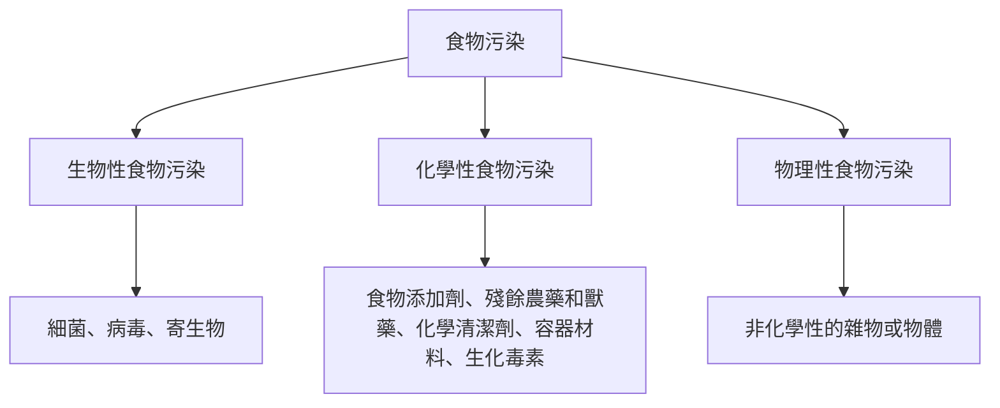
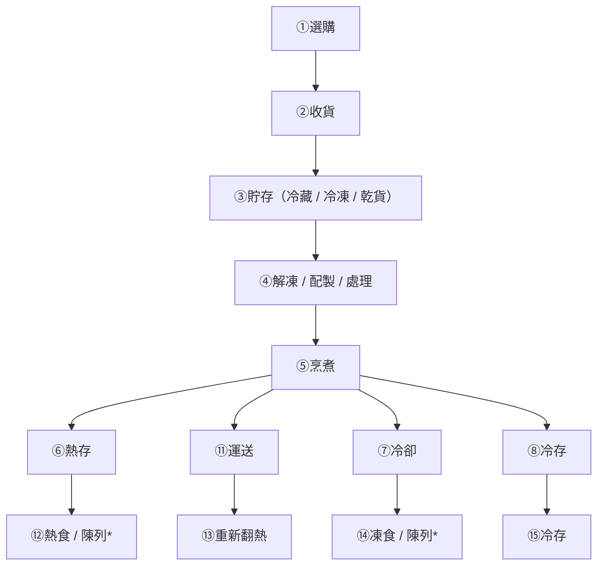
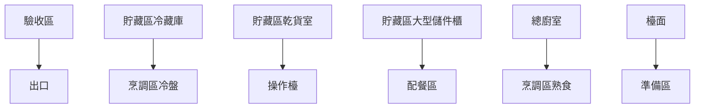

食物安全是指食物中沒有任何造成人體危害的物質。讓顧客安心享用安全可靠的食物，以及營造良好的衞生環境，不但關係到顧客的健康，也對餐飲業有好處。

食物安全衞生良好的好處與食物安全衞生惡劣的壞處

<table><tr><td></td><td>食物安全衛生良好的好處</td><td>食物安全衛生惡劣的壞處</td></tr><tr><td>法規及風險</td><td>·符合食物安全及環境衛生的發牌和持牌要求;·減低餐廳發生食物中毒事故的機會。</td><td>·違反發牌和持牌要求;·增加餐廳發生食物中毒事故的風險;·可能面對罰款或檢控,甚至顧客追討賠償。</td></tr><tr><td>商譽及業務</td><td>·能增加顧客對餐廳食物安全的信心,以及再次光顧的機會。·可提升餐廳的形象和聲譽,吸引更多顧客光顧,令營業額提高。</td><td>·可能受到顧客惡評,打擊餐廳的聲譽,導致生意下滑而虧損;·餐廳如出現食物中毒,會被當局要求停業清潔,損失可營業的日子。</td></tr><tr><td>員工及生產力</td><td>·提高員工士氣,降低流失率,以及減少員工因病請假,從而提升生產力。</td><td>·降低員工士氣,增加流失率,並導致餐廳人手不足,生產力下降。</td></tr><tr><td>食物及成本</td><td>·可保障食物的質素,延長食物的貯存期,減少食物浪費。</td><td>·食物受到污染而需要棄置,造成食物浪費,增加成本。</td></tr></table>

# 思考點

提高食物安全對本港的旅遊業有何正面影響？

# 6.1 食物中毒與食物污染

食物中毒通常由進食受污染食物所引致。餐廳由選購、貯存、準備、烹煮、備餐至上菜等各個食物製作流程，都有機會令食物受到污染。

顧客如進食了受污染的食物，便會出現食物中毒的情況。輕微者可能只會腸胃不適，嚴重者有機會喪命。

常見的食物污染可分為三大類：生物性食物污染、化學性食物污染和物理性食物污染。

flowchart

圖2.256

# 網絡台

食物安全中心「須呈報的傳染病

text_image

中航国际船舶重工
China Air Safety Building
中航安全中心
China Air Safety Building

▲ 圖2.257 食物安全中心

# 活動站

# 香港食物中毒

細閱以下資料，然後回答問題。

2016至2023年香港食物中毒病原體統計數字

<table><tr><td>年份\病原體</td><td>細菌</td><td>化學物質</td><td>生物毒素</td><td>病毒</td><td>其他*</td><td>總計</td></tr><tr><td>2016年宗數</td><td>137</td><td>6</td><td>24</td><td>45</td><td>1</td><td>213</td></tr><tr><td>2017年宗數</td><td>130</td><td>5</td><td>30</td><td>46</td><td>3</td><td>214</td></tr><tr><td>2018年宗數</td><td>123</td><td>6</td><td>16</td><td>24</td><td>4</td><td>173</td></tr><tr><td>2019年宗數</td><td>161</td><td>0</td><td>27</td><td>11</td><td>13</td><td>212</td></tr><tr><td>2020年宗數</td><td>199</td><td>1</td><td>18</td><td>3</td><td>21</td><td>242</td></tr><tr><td>2021年宗數</td><td>124</td><td>0</td><td>18</td><td>42</td><td>21</td><td>205</td></tr><tr><td>2022年宗數</td><td>83</td><td>0</td><td>20</td><td>21</td><td>9</td><td>133</td></tr><tr><td>2023年宗數</td><td>135</td><td>2</td><td>18</td><td>69</td><td>11</td><td>235</td></tr></table>

\* 其他病原體包括細菌、化學物質、生物毒素、病毒以外的病原體、混合病原體、未明病原體及有待分類個案。

香港衞生署

1. 根據本港衞生署的數字，在2016年至2023年，哪一種病原體的中毒個案最多？

2. 承上題，它屬於哪一類食物污染？

# 6.2生物性食物污染

生物性食物污染主要由有害細菌、病毒和寄生物造成。

# 1 細菌

大部分的細菌對人體無害，只有少於 1% 的細菌對人體有害。這些有害的細菌是導致食物中毒最常見的原因。最普遍的情況是，食物沒有妥善蓋好而沾上細菌，並處於「危險温度範圍」，令細菌快速繁殖，並產生毒素，使進食者中毒。

# A 常見導致食物中毒的細菌

副溶血性弧菌、沙門氏菌、金黃葡萄球菌、蠟樣芽孢桿菌、肉毒梭狀芽孢桿菌和李斯特菌是常見導致食物中毒的細菌。

<table><tr><td>細菌</td><td>特徵</td><td>通常受污染食物</td><td>潛伏期及中毒病徵</td><td>預防方法</td></tr><tr><td>副溶血性弧菌圖2.258</td><td>天然存在於海水中;不能產生孢子;高温煮10分鐘會死亡。</td><td>進食生的或未煮熟的海產、介貝類水產動物、海產製品(如蝦、蟹、蠔、螺、墨魚、海蜇等);進食生的或未煮熟的醃製食物(如鹹菜、燻蹄等)。</td><td>潛伏期:4至30小時不等,通常是12至24小時。中毒病徵:腹瀉、腹痛、噁心、嘔吐、發燒。</td><td>避免食用未經烹煮的海產;徹底煮熟海產;製作好的食物要在適當的溫度保存。</td></tr><tr><td>沙門氏菌圖2.259</td><td>廣泛分布於家養和野生動物中;不能產生孢子;攝氏70度以上細菌會死亡。</td><td>未經煮熟的食用動物(如雞、鴨、鵝、豬、牛)、動物內臟及其製品(如燒味、臘肉、鵝腸等);進食生的或未煮熟的蛋和蛋類製品、牛奶和奶類製品(如芝士蛋糕)。</td><td>潛伏期:6至72小時不等,通常是12至36小時。中毒病徵:發燒、頭痛、腹痛、腹瀉、噁心,有時嘔吐。可能引起嚴重的脱水,並威脅生命。</td><td>徹底清洗及煮熟食物;製作糕點和甜品時,避免使用未經巴士德消毒法消毒的蛋。</td></tr></table>

# 資料室

# 巴士德消毒法

一種以發明者路易巴士德的名字命名的食物處理方法。巴士德消毒法透過把食物加熱至某個温度（通常在攝氏 100 度以下），將引致食物腐壞的微生物數量減少，並保持一段時間以消滅有害微生物，從而延長食物的保質期，而食物的營養價值和味道不會受到顯著的影響。巴士德消毒可用於處理不同的食物，包括奶類、蛋類、蔬果汁和蜜糖等。

<table><tr><td>細菌</td><td>特徵</td><td>通常受污染食物</td><td>潛伏期及中毒病徵</td><td>預防方法</td></tr><tr><td>金黃葡萄球菌圖 2.260</td><td>· 普遍存在於人體的鼻腔、咽喉、頭髮和皮膚;· 不能產生孢子;· 細菌可抵抗高温,但一般烹煮過程可將細菌消滅。</td><td>· 需要多個程序和較長時間處理的食物;而食物處理好後,不需再加熱或翻熱的食物(如沙律、三文治、糕點、飯盒等)。</td><td>潛伏期:· 30分鐘至8小時不等,通常是2至4小時。中毒病徵:· 噁心、噁吐、腹痛和腹瀉。</td><td>· 嚴格遵守食物、個人、環境衛生的規定(如皮膚或手部有傷口,應包紮好,避免傷口接觸食物);· 妥善處理、貯存及徹底煮熟食物。</td></tr><tr><td>蠟樣芽孢桿菌圖 2.261</td><td>· 廣泛存在於自然環境中,包括泥土、灰塵、空氣、污水等;· 可產生孢子;· 細菌可抵抗高温。</td><td>· 剩餘的米飯、炒飯、調味汁、肉類製品及蔬菜(如馬鈴薯等高澱粉類食品)。</td><td>潛伏期:· 嘔吐型食物中毒約半小時至6小時;· 腹瀉型食物中毒約6至15小時;中毒病徵:· 嘔吐型食物中毒會噁心、嘔吐等;· 腹瀉型食物中毒會腹瀉、腹痛等,並可能會噁心。</td><td>· 食品須徹底煮熟或翻熱至中心溫度達75°C或以上;· 煮熟後的食品如非即時食用,應盡快冷卻放入雪櫃保存。</td></tr><tr><td>肉毒梭狀芽孢桿菌圖2.262</td><td>·廣泛存在於土壤、動物的胃腸道等;·可產生孢子;·高温煮10分鐘會死亡。</td><td>·罐裝食品及肉類製品。</td><td>潛伏期:·通常是12至36小時不等;中毒病徵:·嘔吐、便秘、腹瀉,視線不清、言語困難、口乾、麻痺。</td><td>·妥當處理及配製罐裝食品和醃製食品;·避免以非專業方法製造罐裝食品和醃製食品。</td></tr><tr><td>李斯特菌圖2.263</td><td>·在環境中幾乎無處不在;·不能產生孢子;·可在低温攝氏0度生長;·攝氏70度以上細菌會死亡。</td><td>·軟芝士、冷凍即食熟雞、凍食肉類、肉醬、預製及貯存的沙律、生吃的海產(如刺身及生蠔)、煙燻海產(如煙三文魚)、未經殺菌處理的牛奶和牛奶製品。</td><td>潛伏期:·3至70天不等,中位數是3個星期;中毒病徵:·會出現敗血病、腦膜炎及腦災,嚴重危害孕婦、初生嬰兒、老年人和低免疫力人士的健康;·孕婦若受感染,可導致流產、胎兒夭折。</td><td>·孕婦、老年人及低免疫力人士應避免進食高風險的食物;·只選用徹底烹熟的肉類及經巴士德消毒法消毒的乳類製品;·徹底洗淨蔬果才進食;·徹底煮熟生的食物;·食物要妥善貯存在雪櫃內。</td></tr></table>

# 資料室

# 細菌孢子

細菌孢子是由個別細菌自行生成，一種孢子保護結構。在孢子保護下，部分細菌在高温、乾燥等不適宜生長的環境下，會進入休眠期而不會被消滅。當有適當的温度、濕度，細菌可離開孢子，快速生長繁殖。

雖然一般的加熱方法不能把孢子殺死，但高温滅菌等方法仍能有效殺滅有孢子保護的細菌。

# B 經細菌傳播的傳染病

進食受細菌感染的食物，可能會染上傳染病，並引發嚴重疾病。

<table><tr><td>疾病例子</td><td>病原體</td><td>傳播途徑</td><td>中毒病徵</td></tr><tr><td>霍亂圖2.264</td><td>·由霍亂弧菌所引起的急性腸道傳染病。</td><td>·進食受污染的食物或食水。·人與人之間的傳播並不常見。</td><td>潛伏期:·由數小時至5天不等,一般是2至3天。中毒病徵:·腹瀉、嘔吐。·嚴重者有可能因嚴重脫水而死亡。</td></tr><tr><td>桿菌性痢疾志賀氏桿菌圖2.265</td><td>·由人體腸道內的志賀氏桿菌所引起的腸道感染。</td><td>·直接經患者或帶菌者的糞便傳播。·或間接經受污染的食物和食水傳播。</td><td>潛伏期:·1至3天,但可長至7天。中毒病徵:·發燒、腹瀉、腹部絞痛、噁心或嘔吐,糞便或會帶血及黏液。·嚴重者會出現大腸擴張、急性腎病等併發症。</td></tr><tr><td>傷寒與副傷寒傷寒沙門氏菌圖2.266</td><td rowspan="2">·分別由傷寒沙門氏菌及副傷寒沙門氏菌所引起。</td><td rowspan="2">·進食受糞便污染的食物、飲品和介貝類海產(尤其是蠔)。</td><td rowspan="2">潛伏期:·傷寒:3天至60天不等,通常為7至14天;·副傷寒:1至10天。中毒病徵:·發燒、頭痛、疲倦、噁心、肚痛、食慾不振及腹瀉。·嚴重者會出現可致命的腸臟出血及穿破的併發症。</td></tr><tr><td>副傷寒沙門氏菌圖2.267</td></tr></table>

# C 引致細菌性食物中毒或傳染病的常見原因

餐廳配製、貯存食物的過程，以及從業員的不良習慣，是引致餐廳出現細菌性食物中毒或傳染病的常見原因。

# a配製食物過程

. 使用來源不安全的食物材料：向未有合格證明的供應商採購了來歷不明的受污染食材，或在供應商運輸過程中，食材受到污染；  
. 食物未有徹底煮熟：由於未有徹底煮熟食物，未能消滅食物中的致病細菌；  
. 冷藏食物於烹煮前未徹底解凍：冷藏技術能抑制細菌生長，但解凍過程細菌會再次活躍起來，如未有徹底解凍食物便烹煮，食物中心或未能煮熟，以致病原體殘留；  
過早配製食物：過早配製食物而沒有把食物存放妥當，會令食物滋生細菌；  
： 熟食翻熱不足：熟食翻熱不足將不能有效殺死食物中的細菌。

# b 貯存食物過程

熟食遭到污染：由於貯存不當，熟食有機會與生食交叉感染；或食物沒有蓋好，被蒼蠅、蟑螂等昆蟲和老鼠等污染；  
貯存温度不當：生食或熟食貯存不適當，如熟食被長時間存放在攝氏4度至60度之間，導致細菌滋生、食物變壞。

# c從業員不良習慣

? 從業員不注重個人衞生：從業員沒有潔淨雙手，或未有包紮好傷口就接觸食物，便可能把細菌傳到食物上；

▲ 圖 2.268 生的食物細菌或病原體量較多，宜避免進食。  

natural_image

Assorted sashimi arranged on ice cubes, including salmon and ginkgoes (no text or symbols visible)

. 從業員感染腸道傳染病：患有腸道傳染病的從業員將病毒經未清潔的手或飛沫等，傳播到食物中；  
. 進食生的食物：生的食物通常含有較多細菌或病原體；  
? 使用剩餘食物：剩餘食物經長時間存放，食物可能已變壞，再次使用增加食物中毒的風險。

# 提示箱

在一些食物中毒的案例裏，有時很難判斷疾病的來源，可能由細菌引起，也可能由病毒引起。用藥方面，抗生素可殺滅細菌，但對病毒則無效。

# 病毒

# A 病毒的簡介

病毒是十分細小的微生物，較細菌還要小 10 至 100 倍。病毒不能自行繁殖和進行新陳代謝，必須依附在細胞上才能繁殖。由於病毒不能在受污染的食物中繁殖，所以不會令食物腐壞。

不過，很少數量的病毒已能傳播疾病，更會針對某些細胞進行攻擊。流行性感冒、禽流感、豬流感、手足口病、愛滋病等，都是由病毒傳播而引起的疾病。

# B 常見導致食物中毒的病毒

諾如病毒和甲型肝炎病毒是餐廳最常見的病毒。

<table><tr><td>病毒</td><td>特徵</td><td>傳播途徑</td><td>潛伏期及中毒病徵</td></tr><tr><td>諾如病毒圖2.269</td><td>·以往被稱為「諾沃克病毒」,常引致急性腸胃炎;·所有年齡組別人士都有機會受感染,在冬天較為常見。</td><td>·進食未徹底煮熟的貝殼類水產(尤其是蠔和蜆);·食用受污染的食物或食水:·接觸被感染人士的嘔吐物、糞便或嘔吐時的帶病毒噴沫;·接觸受污染的物件表面。</td><td>潛伏期:·12至48小時。中毒病徵·噁心、嘔吐、腹瀉、腹痛、輕微發燒及不適。</td></tr><tr><td>甲型肝炎病毒圖2.270</td><td>·由甲型肝炎病毒引起的肝臟疾病。</td><td>·進食受感染者糞便污染的食物、飲品及介貝類海產。·與感染者有緊密接觸。</td><td>潛伏期:·14至28天,最長可達50天。中毒病徵·發燒、疲倦、食慾不振、腹瀉、噁心、腹痛等。·嚴重者有機會出現急性肝衰竭等症狀。</td></tr></table>

# C 預防病毒導致食物中毒的方法

• 向信譽良好及持牌的供應商購買食材；  
• 處理食物前應以梘液和清水清潔雙手；  
• 以高温徹底烹煮食材；  
• 有發燒、嘔吐或腹瀉等腸胃病徵，不應上班及應向醫生求診；  
• 清理或處理嘔吐物及糞便時，必須戴上手套，事後一定要徹底洗手。

# 3 寄生蟲

# A 寄生蟲的簡介

寄生蟲是寄居於宿主（即另一種生物）身上或體內，以求自身得益或損害宿主利益的生物。

肉類、海產及農作物，都可找到寄生蟲。進食含有寄生蟲的食物後，有機會引致食物中毒。

# B 常見導致食物中毒的寄生蟲

常見寄居於人體的寄生蟲主要分為原蟲、蠕蟲兩大類。

<table><tr><td>寄生蟲</td><td>特徵</td><td>例子</td><td>寄存食物例子</td><td>潛伏期及中毒病徵</td></tr><tr><td rowspan="2">原蟲</td><td rowspan="2">與細菌相似,是單細胞生物;不能在食物中生長,但能夠在人體內繁殖;會在食物或環境中傳播。</td><td>弓形蟲圖2.271</td><td>生的或未徹底煮熟的肉類</td><td rowspan="2">潛伏期:長短視乎所感染的寄生蟲種類而定。中毒病徵:噁心、嘔吐和腹瀉;食慾不振、體重下降;嚴重者肺、肝等器官受損。</td></tr><tr><td>藍氏賈第鞭毛蟲圖2.272</td><td>受污染的水。</td></tr><tr><td rowspan="3">蠕蟲</td><td rowspan="3">較大的多細胞生物,體型因種類不同而分別很大,部分長逾六米;成蟲不會在人體內繁殖。</td><td>吸蟲圖 2.273</td><td>生鯨魚片、西洋菜、醉蟹。</td><td rowspan="3">潛伏期: 長短視乎所感染的寄生蟲種類而定。中毒病徵: 噻心、嘔吐和腹瀉;食慾不振、體重下降;嚴重者肺、肝等器官受損。</td></tr><tr><td>綠蟲圖 2.274</td><td>豬肉。</td></tr><tr><td>蛔蟲圖 2.275</td><td>福壽螺、豬肉。</td></tr></table>

# C 預防寄生蟲導致食物中毒的方法

• 選購安全食材：向衞生和可靠的供應商購買食物，不要光顧無牌供應商；  
• 徹底清洗蔬果：有些蔬果可能用了受糞便污染的水灌溉，使寄生蟲經糞便傳播到蔬果，因此蔬果應徹底清洗；  
• 徹底煮熟食物：把食物徹底煮熟，可殺死寄生蟲；如以燒烤或火鍋方式烹煮食物，更要確保食物完全熟透；  
• 避免進食高危食物：生的或未經煮熟的肉類，特別是牛肉、豬肉及魚肉，容易附有寄生蟲，應避免進食；  
從業員注意個人衞生：食物處理人員注意個人衞生，可防止寄生蟲在製作過程中進入食物。

# 6.3化學性食物污染

化學物質包括食物添加劑、殘餘農藥和獸藥、化學清潔劑、容器材料、生化毒素等。化學性食物污染指食物在生長環境，或製造、加工過程中，受到化學物質的污染。

化學性食物污染有別於細菌性食物污染，食物中的化學污染物即使經過高温烹煮，也不會被除去。

化學性食物污染的潛伏期相對較短，大部分人在進食後約數分鐘至一小時內就會出現中毒症狀。病徵因應不同類型的化學物質而有所不同，中毒者一般會有噁心、嘔吐、腹瀉、腹痛、流口水、麻痺等反應。嚴重者更會呼吸困難、器官衰竭，甚至死亡。

# 食物添加劑

食物添加劑是指在食物加工處理、包裝、運輸、貯存過程中，為了食物防腐、增加味道或顏色、改善食物質地和稠度等目的，刻意加入食物內的天然或化學物質。

適量的食物添加劑，不會對人體的健康構成危害。可是，有些不法商人為了降低成本，會採用過量添加劑，甚至使用不能食用的工業用化工物料作為添加劑。人們進食後，便會對身體造成危害。

natural_image

Shelves stocked with various canned food products (cans, beans, tomatoes) in a supermarket, no visible text or labels on the products themselves.

▲ 圖2.276 不少罐頭食品為了延長保存期限，會加入食物添加劑。

以下是一些常見的違規添加劑例子：

<table><tr><td>添加劑</td><td>特徵</td><td>常見食物</td></tr><tr><td>二氧化硫</td><td>· 是一種廣泛使用的食物添加劑;· 對二氧化硫敏感的人士進食後,會有支氣管收縮及哮喘反應。</td><td>· 涼果、果汁等;· 新鮮和冷藏肉類,以保持肉類的顏色,其中鮮紅色的肉類較高風險。▲圖2.277 涼果可能會被違規使用二氧化硫作為添加劑</td></tr><tr><td>紅2G</td><td>· 是一種合成染色料,會令食物添上不同深淺的紅色;· 已被香港、內地、歐美多國禁止用作食物染色料。</td><td>· 瓜子、臘腸、香腸、漢堡肉扒等。▲圖2.278 瓜子可能會被違規使用紅2G作為食物添加劑</td></tr><tr><td>蘇丹紅</td><td>· 是一種工業染色料,可增加和保持食物的顏色;· 已被香港、內地、歐美多國禁止用作食物染色料。</td><td>· 混合調味料、辣椒製品;· 蛋類及蛋類製品等。▲圖2.279 蘇丹紅</td></tr></table>

# 殘餘農藥和獸藥

很多農民會使用各類農藥，防治蟲害，或提高農產量和品質。家禽業、畜牧業在養殖家禽、家畜時，亦會使用各種獸藥，以抑制禽畜體外的寄生蟲，或促進禽畜成長。

不按法例和建議規定使用農藥和獸藥，包括使用過量、在銷售前沒有按法例停用、使用工業用化學物等，均有可能令農藥和獸藥殘留，造成化學性食物中毒。

# A 殘餘農藥

農民使用過量農藥，或在銷售蔬果前仍施加農藥，如甲胺磷、滴滴涕等，容易令蔬果殘留農藥。如餐廳採購這些蔬果，在烹煮前沒有用清水浸泡和徹底洗淨，可能無法去除殘餘農藥。

# B 殘餘獸藥

家禽業、畜牧業使用工業用化學物，或已被禁用的化學物，容易令禽畜體內積聚對人體有害的化學物質。以下是一些常見於禽畜業的抗生素與人造激素。

<table><tr><td></td><td>例子</td><td>用途/特徵</td></tr><tr><td rowspan="2">抗生素</td><td>孔雀石綠圖 2.280</td><td>· 原是一種工業染料,但被水產養殖業長期用作抗真菌劑和抗原蟲劑;· 孔雀石綠會被魚體吸收,長時間留在魚體內,食用有致癌風險,已被禁止使用。但一些不法商人為了降低成本,仍會違法使用。</td></tr><tr><td>硝基呋喃圖 2.281</td><td>· 是一種抗菌劑,可殺滅真菌、原蟲等病原體,曾廣泛應用於禽畜或水產養殖業,由於有致癌風險,現已被禁止使用;· 近年曾於豬肉罐頭製品、內臟,以及魚類中檢出含有硝基呋喃。</td></tr><tr><td rowspan="2">人造激素</td><td>鹽酸克崙特羅圖 2.282</td><td>· 又稱「瘦肉精」,可加速豬隻生長,增加瘦肉。· 瘦肉精不能通過沖洗或烹煮消滅,人們進食含過量瘦肉精的肉類,會出現心跳加劇、手震等症狀,嚴重者會暈眩及心臟衰竭。· 已被多國禁止使用,近年較為少見。</td></tr><tr><td>雌激素圖 2.283</td><td>· 能令家禽的身體,特別是胸部和腿部的脂肪增加,令肉質更為嫩滑。· 進食過多含雌激素的家禽,會導致孩童早熟,出現胸部發育的症狀。</td></tr></table>

# 化學清潔劑

餐廳每天使用大量清潔劑清潔樓面及廚房。如果使用濃度不當的清潔劑，或清潔、消毒後，未有清洗乾淨各類食具、烹調工具，都會令器具殘留化學清潔劑，進而引致化學性食物中毒。

# 容器材料

餐廳使用的容器，如使用不當，或材料出現問題，均會污染食物，導致食物中毒。常見的容器包括塑膠容器、金屬容器及即棄餐盤墊紙。

natural_image

Two black rectangular dishes containing braised meat and chicken pieces, garnished with green onions (no text or symbols visible)

# A 塑膠容器

很多餐廳在處理外賣時，會使用大量即棄塑膠容器，如發泡膠、塑膠飯盒等。這些即棄塑膠容器遇上高温或酸性食物，可能會釋出有害的化學物質，如甲醛和雙酚A等，影響進食者的健康。

▲ 圖2.284 即棄塑膠容器如使用不當，有可能釋出有害物質。

# B 金屬容器

不當使用金屬烹煮器具，亦可能釋出重金屬，導致食物中毒。例如一些易潔鍋不宜高温煎炸，因為會令其薄膜受破壞，釋出對人體有害的金屬成分。不鏽鋼鍋長期接觸酸性、鹼性食材，會出現化學反應，釋出可致癌金屬物。

# C 即棄餐盤墊紙

不少餐廳會使用即棄餐盤墊紙。當這些餐盤墊紙與食物接觸，墊紙上的印墨有機會釋出有害的化學物質，令食物受到污染，並對健康造成危害。

# 5 生化毒素

生化毒素是指由各種動物、植物產生的有毒物質，如動物進食含有毒素的物質、動物天然含有毒素、植物天然含有毒素等。人們進食這些含有毒素的動物、植物，便會出現食物中毒的症狀。

A 動物進食含有毒素物質

<table><tr><td>描述</td><td>例子</td><td>潛伏期及中毒病徵</td><td>預防方法</td></tr><tr><td rowspan="2">毒素由海洋浮游生物或微藻類產生;經食物鏈由部分珊瑚魚及貝類等海洋生物進食,然後積聚在其體內;當人們進食了這些含有毒素的珊瑚魚及貝類,便會出現化學性食物中毒。</td><td>雪卡毒素:常見於東星斑、老虎斑、蘇眉等珊瑚魚;毒素非常耐熱,不能透過烹煮及加工過程消除。▲圖2.285、圖2.286 東星斑和蘇眉屬珊瑚魚,常存有雪卡毒素。</td><td>潛伏期:通常在進食後24至48小時出現。中毒病徵:嘔吐、腹瀉、腹痛及噁心,皮膚發癢、疲倦、肌肉及關節疼痛,神經系統不適。嚴重者可能出現低血壓、心搏過緩、呼吸困難。</td><td rowspan="2">向信譽良好及持牌的供應商購買海產;減少進食大型珊瑚魚,避免進食珊瑚魚的卵、肝臟、腸臟、魚頭或魚皮;介貝類水產在烹煮前應除去內臟,並避免食用烹調的汁液。</td></tr><tr><td>貝類毒素:常見於蠔、蜆、扇貝、青口、蛤(蛳蚶)等貝類;毒素尤其積聚在貝類海產的內臟。▲圖2.287 貝類海產易積聚貝類毒素</td><td>潛伏期:通常在進食後數分鐘至數小時內出現。中毒病徵:刺痛、麻痺、口腔燙熱、腹瀉、肚痛、噁心及嘔吐;嚴重者可能出現說話或呼吸困難。</td></tr></table>

B 動物天然含有毒素

<table><tr><td>描述</td><td>例子</td><td>潛伏期及中毒病徵</td><td>預防方法</td></tr><tr><td>有些動物的器官或身體含有天然毒素,人們進食了這些含有毒素的動物,便會食物中毒。</td><td>河豚毒素:· 是一種毒性強烈的海洋生物毒素,相當耐熱;· 因事故常與河豚有關而得名,毒素集中在河豚的肝臟;· 河豚毒素亦會存在於藍紋章魚、鸚哥魚、神仙魚等動物品種。</td><td>潛伏期:· 通常10至45分鐘出現,亦會延至三小時或以上出現。中毒病徵:· 面部和四肢麻痹、眩暈、頭痛、嘔吐、腹瀉、腹痛、呼吸困難及心律紊亂;· 嚴重者可能呼吸衰竭和血液循環系統衰竭,並導致死亡。</td><td>· 避免購買、自行剷洗河豚,以及進食藍紋章魚等含有河豚毒素的動物。</td></tr></table>

natural_image

Close-up photo of a pufferfish with spiky tentacles against a teal background (no text or symbols visible)

圖2.288　進食河豚中毒的個案在本港時有發生

natural_image

Close-up of two red-tinted mushrooms growing on a forest floor with green foliage (no text or symbols visible)

1圖 2.289 顏色鮮艷的野生姑類大多有壺

C 植物天然含有毒素

<table><tr><td>描述</td><td>例子</td><td>潛伏期及中毒病徵</td><td>預防方法</td></tr><tr><td>有些植物含有天然毒素,或部分組織含有毒素,人們進食了這些植物,便會食物中毒。</td><td>野生菇類:本港絕大部分野菇有毒及不可食用;大部分菇類毒素不能以烹煮方法除去。發芽馬鈴薯:嫩芽含有毒的「茄鹼」,具耐熱特性,即使去除及加熱,毒素仍可能存在。</td><td>潛伏期:數分鐘至數小時不等。中毒病徵:腹痛、嘔吐、肚瀉、暈眩和心悸;嚴重者可能導致肝衰竭,甚至死亡。中毒病徵:噁心、腹瀉、腸胃不適、神經失調、出現幻覺等。嚴重者可以中毒死亡。</td><td>切勿採摘野生菇類進食;向持牌及信譽良好的供應商購買菇類。不要食用已發芽的馬鈴薯。</td></tr><tr><td></td><td>北杏及竹筍:未經烹煮前含有名為氰化物的毒素。</td><td>潛伏期:數分鐘內出現。中毒病徵:喉道收窄、噁心、嘔吐、頭痛;嚴重者可以中毒死亡。</td><td>先用清水浸泡,再用沸水徹底煮熟,可消除毒素。</td></tr></table>

natural_image

Close-up of a brown potato with green leafy vegetable garnish (no text or symbols visible)

▲ 圖2.290 發芽的馬鈴薯含有毒素

natural_image

Bamboo stalk with a sliced root and a bowl of sliced white root pieces, alongside a pile of dried white root slices (no text or symbols visible)

▲ 圖2.291、圖2.292 竹筍及北杏都要先用清水浸泡，再用沸水徹底煮熟，消除毒素，才可食用。

# 6.4物理性食物污染

物理性食物污染指食物受到物理性的外來破壞或污染，包括有雜物進入食物、食物盛載器皿受損而導致食物污染等，人們進食後出現中毒的情況。

<table><tr><td>描述</td><td>例子</td><td>病徵</td><td>預防方法</td></tr><tr><td>食物在生產、運輸、貯存、製作、陳列過程中,均有可能受到外來雜物的污染。雖然部分物理性食物污染未必會對顧客健康構成嚴重危害,但會影響食物的外觀和顧客對餐廳的印象。</td><td>運送食物的過程,食物盛載器皿受擠壓而遭到破壞,令包裝物料、碎片、微細金屬、玻璃等混入食物中;製造食物的過程,員工不小心把頭髮、飾物、膠布等雜物跌入食物內;盛載食物的器皿未蓋好或有裂縫,使天花板碎片、蒼蠅和蟑螂等昆蟲掉進食物中。</td><td>不同類型的物理性食物污染會產生不同的中毒反應,一般包括:急性腸道傳染病、被雜物割傷等。</td><td>向持牌及信譽良好的供應商購買食物;運送食物的過程中避免食物或其盛載器皿受到破壞;處理食物時避免雜物進入食物中;貯存食物和陳列食物時要防止雜物掉進食物中。</td></tr></table>

natural_image

Metallic cylindrical container with a broken lid, placed on a wooden surface with blurred metallic bars in the background (no text or symbols visible)

图2.293，破損罐頭容易受到外來雜物污染

natural_image

Close-up of fresh tomatoes and a cracker on a stone surface, with lettuce in the background (no text or symbols visible)

蟑螂屍體掉進沒有蓋好的食物中

# 食物安全及個人衞生：食物安全要點與處理工序

natural_image

Colorful stylized illustration of global landmarks including the Eiffel Tower, Statue of Liberty, and others (no text or symbols)

餐廳出現由食物傳播的疾病，很多時候由於餐飲業機構與從業員忽略了食物安全要點，以及在食物處理工序上發生問題所致。因此，有需要介紹食物安全要點與處理食物的正確工序。

# 7.1何謂食物安全五要點？

為了預防食物傳播的疾病，加強餐飲業機構與從業員的食物安全意識，世界衞生組織和本港衞生部門一直致力推廣「食物安全五要點」，供餐飲業界參考和應用。

# 「食物安全五要點」

1 精明選擇（選用安全的原材料）

natural_image

Illustration of a wicker basket filled with assorted fruits and vegetables, with a magnifying glass inspecting the food (no text or symbols)

2 保持清潔（保持雙手和用具清潔）

natural_image

Illustration of hands washing a basin with water splashing from a faucet (no text or symbols)

3 生熟分開（生熟食物分開處理）

natural_image

Illustration of two meat products: one cut open showing red meat slices, the other flat with a brown textured surface (no text or symbols)

4 煮熟食物（食物要徹底煮熟）

natural_image

Illustration of a cooking pot with steam rising from its side, showing a pan containing meat and flames (no text or symbols)

5 安全温度（把食物存放在安全的温度）

# 提示箱

食物安全中心專責調查及監控香港有關餐飲業的食物中毒個案。

# 7.2 食物處理工序流程與食物安全五要點

# 食物處理工序流程

香港食物環境衞生署轄下的食物安全中心，製作了「食物處理工序流程圖」，協助餐飲業界把「食物安全五要點」應用到各個日常食物處理步驟，預防食物出現問題，確保食物安全。

flowchart

\*註：陳列步驟適用於經營自助餐形式的餐飲業。

# 將食物安全五要點應用到處理工序流程

餐飲業可以根據下表，把「食物安全五要點」應用到各個食物處理工序流程中。

<table><tr><td rowspan="2">食物處理工序</td><td colspan="5">食物安全五要點</td></tr><tr><td>精明選擇</td><td>保持清潔</td><td>生熟分開</td><td>煮熟食物</td><td>安全溫度</td></tr><tr><td>1. 選購</td><td>✓</td><td></td><td></td><td></td><td></td></tr><tr><td>2. 收貨</td><td>✓</td><td>✓</td><td></td><td></td><td></td></tr><tr><td>3. 貯存(冷藏/冷凍/乾貨)</td><td></td><td>✓</td><td>✓</td><td></td><td>✓</td></tr><tr><td>4. 解凍/配製/處理</td><td></td><td>✓</td><td>✓</td><td></td><td>✓</td></tr><tr><td>5. 烹煮</td><td></td><td></td><td></td><td>✓</td><td>✓</td></tr><tr><td>6. 熟存</td><td></td><td>✓</td><td></td><td></td><td>✓</td></tr><tr><td>7. 冷卻</td><td></td><td>✓</td><td>✓</td><td>✓</td><td>✓</td></tr><tr><td>8. 冷存</td><td></td><td>✓</td><td>✓</td><td></td><td>✓</td></tr><tr><td>9. 烹煮後冷存</td><td></td><td>✓</td><td>✓</td><td>✓</td><td>✓</td></tr><tr><td>10. 翻熱</td><td></td><td>✓</td><td></td><td>✓</td><td>✓</td></tr><tr><td>11. 端送/運送</td><td></td><td>✓</td><td>✓</td><td></td><td>✓</td></tr><tr><td>12. 陳列(熱食/凍食)</td><td></td><td>✓</td><td>✓</td><td></td><td>✓</td></tr></table>

# 提示箱

有關各個食物處理工序的安全要點，將在本章 7.4「安全的食物處理工序」（頁233至246）加以闡述。

# 提示箱

「食物安全五要點」中的「保持清潔」和「生熟分開」，與預防交叉感染直接相關。

# 3 食物交叉感染

不少由食物引致的疾病個案，都是由交叉感染造成的。交叉感染是指細菌由一種食物傳到另一種食物，過程中細菌可以透過直接傳播或間接傳播，令食物受到污染。

# 例子庫

直接傳播：指細菌經食物與食物接觸，或有汁液滴下至另一種食物上，直接傳播開去。

生的食物和熟的食物擺放在一起，互相接觸，生的食物把細菌傳到熟的食物上；  
生的食物放在熟的食物上層，生食的血水或汁液滴落到下層的熟食中，將細菌傳到熟食；  
已變壞的食物與正常的食物混合擺放，已變壞食物的細菌便傳播給正常的食物；

未清洗的蔬果與已清洗的蔬果同擺放，未清洗蔬果上的殘餘農藥或受污染的泥土，會沾染已清洗的蔬果，導致交叉感染；

從業員手部有傷口而未有包紮好，令傷口的細菌直接污染食物；

從業員身體不適，向食物打噴嚏、咳嗽，飛沫將細菌傳到食物上。

natural_image

Two citrus fruits on a white background: one with yellowish speckled skin and one with yellowish, resembling a lemon (no text or symbols)

圖 2.297 已變壞的檸檬與正常的檸檬

間接傳播：指細菌經由受污染的手、設備、廚具、工作面，或者水花，間接傳播到食物。

從業員在處理食物前，未有徹底清潔雙手，讓雙手的細菌傳播到食物上；  
從業員使用同一塊砧板或同一套刀具處理生和熟的食物，把生食的細菌傳播給熱食；  
從業員用未洗乾淨或盛載過其他食物的器皿盛載食物，令食物沾染器皿留下的細菌而受到污染；

從業員使用同一塊抹布來洗擦乾淨的碗碟及不潔的碗碟，使細菌在碗碟間傳播；

從業員或顧客使用同一套餐具處理生的食物和熟的食物，導致交叉感染。

natural_image

Close-up of hands cleaning a white ceramic bowl with a brown cloth, next to a white cup on a wooden table (no text or symbols visible)

圖 2.298 應用乾淨的抹布抹清洗乾淨的碗碟

# 7.3 温度控制

本港近八成的食物中毒個案，由細菌引致。其中食物處理工序的温度控制不當，是造成細菌性食物中毒的常見原因。在認識食物温度控制前，有必要先了解細菌的生長條件。

# 細菌的生長條件

細菌生長的四大條件有：食物、水、適合的温度和時間。

# A 食物

人的食物同樣是細菌的食物。有豐富水份和蛋白質的食物，十分適合細菌生長，如奶類、肉類、海產等屬於「高風險食物」。

# B 水

細菌需要水份滋長，如無法獲得水份，細菌就不能繁殖。在缺水的狀態，細菌更會處於休眠或死亡。因此，烘乾、醃製食物能減少食物中的水份，延長食物的保質期。

text_image

100°C
60°C
4°C
0°C
高温
(不適宜病菌生存)
危險溫度範圍
(病菌繁殖)
低温
(病菌「冬眠」)
圖 2.299

# C 適合的温度

細菌在適合的温度下，可以迅速繁殖，以幾何級數劇增，導致食物中毒的風險急升。攝氏 4 度至 60 度屬於危險温度範圍。

# D 時間

在具備適當條件下，細菌會迅速繁殖。由於一般細菌通常可以在 10 至 20分鐘增加一倍，當時間越長，細菌倍增的數目會越驚人。例如食物一開始就含有1 000個細菌，在1小時40分鐘內，該食物的細菌便會達到 1 000 000 個細菌份量。

# 食物温度指標

食物温度控制得當，才能確保食物安全。不過，要注意不同種類的食物有不同的温度指標。

# 徹底煮熟食物

• 以適當的高温和足夠時間徹底烹煮和翻熱食物，能有效殺死致病細菌；  
• 在攝氏75度烹煮食物的中心或最厚部分，至少15秒，便能消滅致病細菌。

# 3 存放冷吃食物

• 攝氏4度或以下，病菌的生長速度會減慢，甚至停止，冷吃食物應存放在此温度或以下。

# 5 冷藏食物

• 攝氏零下18度或以下，適合貯存急凍及冷藏食物，可保持食物品質不變；  
• 在這個範圍，食物所含的水份亦會凝結成冰，雖然細菌仍不會死亡，但會進入休眠，停止繁殖；  
• 攝氏零下23度或以下，適合貯存雪糕。

text_image

Vertical column of red and blue text with horizontal lines, likely representing a list or section header.

# 2 存放熱吃食物

攝氏60度以上的高温，不適宜病菌繁殖，熱吃食物應存放在此温度或以上。

# 4 冷凍食物

• 細菌不會死亡，但繁殖速度會減緩；  
• 攝氏10度或以下，適宜存放奶類及奶類飲品；  
• 攝氏4度或以下，適宜貯存冰鮮、冷凍食物；  
• 攝氏零下2度或以下，適合貯存冰凍甜品（不包括軟雪糕）。

圖 2.300

# 提示箱

玻璃温度計不宜用作量度食物温度，因為温度計的玻璃，以及裏面的水銀或酒精，會為人體帶來危害。

# 檢查食物的温度

為了確保食物安全，檢查食物的温度是餐飲業常見的行為。

# A 餐飲業常用的温度計

餐飲業常用的温度計主要有：雙金屬棒狀温度計、熱電偶温度計和熱敏電阻温度計、紅外線温度計。

<table><tr><td>溫度計類型</td><td>特徵及使用</td></tr><tr><td>雙金屬棒狀溫度計圖2.301</td><td>·最常見的食物溫度計；
·由棒尖至沿棒而上的金屬範圍均可探測溫度；
·適合量度厚身食物的中心溫度；
·把溫度計插入食物，在20秒至2分鐘之內會顯示讀數。</td></tr><tr><td>熱電偶溫度計和熱敏電阻溫度計圖2.302</td><td>·透過棒尖的感應器量度温度；
·適合量度薄身或厚身食物的溫度；
·10秒之內可顯示讀數；
·用數字顯示溫度，又稱為「數字食物溫度計」。</td></tr><tr><td>紅外線溫度計圖2.303</td><td>·透過輻射能來量度溫度，無須接觸食物或食物包裝；
·可於1秒內量度食物或食物包裝的表面溫度；
·常用於接收食物時，以及檢查冷藏櫃、雪櫃、熱存設備內的食物溫度；
·不能準確量度金屬表面和反射箔紙的溫度。</td></tr></table>

natural_image

Close-up of a glass bottle with a glass of clear liquid and white cotton on a blue background (no text or symbols visible)

▲ 圖 2.304 温度計可用酒精或消毒劑消毒

# B 量度和記錄温度的注意事項

# 温度計使用前

• 已清潔、消毒的温度計應存放在乾淨、衞生的環境；  
• 檢查温度計，如有電池顯示燈，要檢查電量是否足夠，不足夠則要更換電池；  
• 先閱讀生產說明書，掌握温度計的正確使用方法，如了解需要插進食物的長度，以便獲取準確的讀數；  
• 使用温度計前，用暖水和清潔劑清洗，再消毒和風乾；  
• 如要消毒温度計，可把探頭放入攝氏 77 度或以上的熱水 6秒，或用沾了酒精的棉花抹乾淨，或使用生產商建議的消毒劑；  
. 檢查和調校温度計到妥當的量度食物温度。

# 資料室

# 檢查温度計的準確度

確保食物安全是至關重要的，因此餐飲業應每年至少一次安排温度計製造商或分銷商校準食物温度計，以及至少每三個月一次自行檢查食物温度計的準確度。以下是檢查食物温度計準確度的方法：

<table><tr><td>冰點方法</td><td>沸點方法</td></tr><tr><td>將幼細碎冰與清潔自來水混合,然後在容器中攪拌均匀;5分鐘後,將食物溫度計的尖端(至少50毫米)浸入冰水中,但不可接觸到容器內壁或底部;約2分鐘後,記錄溫度計的溫度;溫度計的讀數應顯示為攝氏0度。如讀數的誤差值超過1度,就需要調校溫度計。</td><td>將清潔自來水煮沸後,把食物溫度計的尖端(至少50毫米)浸入沸水中;等待數分鐘,讓溫度穩定下來;記錄溫度計的溫度;如處所位於水平線,溫度應為攝氏100度(若在地勢較高的地方,則需相應調低沸點)。如溫度計的讀數誤差超過1度(即讀數為攝氏101度以上或99度以下),就需要調校,或視乎情況維修、更換。</td></tr></table>

# 温度計使用時

• 量度肉類時，要把温度計插入食物最厚部分的中心，以得出準確的讀數：  
• 量度湯及醬汁時，應先把湯及醬汁攪拌均勻；  
• 量度時不應讓温度計的尖端接觸到食物容器，以免影響讀數；

• 量度預先包裝或冷藏食物的表面温度時，應把温度計的探頭放置在兩個包裝之間，避免弄損食物的包裝；  
• 量度時要等候10秒，或依生產商建議的時間，才讀取温度；  
• 各量度數據應填寫在温度紀錄表，並保存妥當；  
• 每次使用温度計量度後，要待讀數回復室温，才再次使用。

# 温度計使用後

• 每次用完食物温度計，都應妥善清潔。

# 7.4安全的食物處理工序

餐飲業在處理食物時，要經過多個工序。在各個工序中應用「食物安全五要點」，可大大減低食物污染的風險，保障顧客的健康。

選購  

natural_image

Rows of raw pork cuts in a processing facility, no visible text or labels

▲ 圖 2.305 在政府屠房屠宰的鮮肉

<table><tr><td>食物安全要點</td><td>處理要點</td><td>監控標準</td></tr><tr><td rowspan="5">精明選擇</td><td>謹慎選擇供應商</td><td>·向領有食物環境衛生署牌照及信譽良好的供應商,選購食物材料;·選購由持牌食品店所製造的本地食物或准許在香港出售的進口食品。</td></tr><tr><td>適量採購食材</td><td>·每次採購適量食材,減少貯藏大量存貨。</td></tr><tr><td>切勿選購違禁食材</td><td>·不能選購當局禁售的淡水魚魚生;·不能選購並非在政府屠房或食物環境衛生署批准的屠房屠宰的鮮肉或冷肉,或經非法途徑輸入本港的肉類;·不能選購從海港或香港仔海港採集的介貝類水產動物,當局已禁售。</td></tr><tr><td>選購安全的食材</td><td>·向供應商、進口商、持牌食品及街市攤檔選購肉類時,可要求對方出示有效的衛生證明書或單據;·選購活魚及介貝類海產時,要留意盛載食材的容器及養水是否清潔衛生,並確保海產新鮮和沒有異味。</td></tr><tr><td>制定安全規格</td><td>·與供應商訂立食物材料品質及安全規格(包括運送食物材料時的溫度)。</td></tr></table>

# 2 收貨

<table><tr><td>食物安全要點</td><td>處理要點</td><td>監控標準</td></tr><tr><td>精明選擇</td><td>驗收食物材料品質及安全</td><td>·檢查清楚食物材料的包裝是否完好(如罐頭沒有凹陷或生銹),以及沒有可見的異物;·檢查食物材料有沒有腐壞的跡象(如氣味、色澤正常等);·檢查食物材料有沒有超過食用保質期,如「此日期或之前食用」、「此日期前最佳」等;·食物材料運抵時的溫度:熱吃食物須保持在攝氏60度或以上;冷凍食物在攝氏4度或以下,冷藏食物在攝氏零下18度或以下。</td></tr><tr><td>保持清潔</td><td>妥善處理,避免交叉感染</td><td>·把不合格的來貨與其他食物分隔,避免交叉感染;·小心開啟食物包裝,避免包裝物料掉入食物,或殘留在食物上;·檢查完畢後,盡快把食物貯存在合乎溫度標準的環境。</td></tr></table>

除了驗收食材、妥善貯存外，餐飲業在收貨時還要處理好文件紀錄：

• 保留所有供應商的名稱、地址等資料，以便當局巡查檢閱；

natural_image

Coca-Cola beverage dispenser with multiple side stations and a Coca-Cola logo on the wall (no readable text or symbols)

• 保留全部進貨單據至少 60天，包括載有購入食物日期、種類、數量、供應來源或最終目的地等資料，以便當局查核及追蹤。假如食材用於供調配分售機作配製冰凍甜點，作為直接零售，進貨記錄更須至少保留90天。

▲ 圖2.306 提供飲品的調配分售機

text_image

MFG:040914
EXP:040917

▲ 圖 2.307 此日期或之前食用

BEST BY AUG 10 2019 8222 00:43

▲ 圖2.308 此日期前最佳  

# 資料室

「此日期或之前食用」與「此日期前最佳」

<table><tr><td>「此日期或之前食用」</td><td>「此日期前最佳」</td></tr><tr><td>屬食物安全標記,適用於極容易腐壞、在放置一段短時間後,可能對人類健康構成即時危險的食物,如容易變壞的牛奶、方包等。</td><td>屬食物質素的標記,例如味道、質感、香味等。該日期表示食物若適當貯存,可合理地預期在該日及該日之前,食物能保存其特質,適用於保存期較長的罐頭食物、冷藏食物等。</td></tr></table>

根據食物安全中心的建議，餐飲業切勿出售已過「此日期或之前食用」日期的食物；如出售已過「此日期前最佳」日期的食物，則應確保食物仍然適宜供人食用。

# 3 貯存

<table><tr><td>食物安全要點</td><td>處理要點</td><td>監控標準</td></tr><tr><td>保持清潔</td><td>貯存地點及方法要清潔衛生</td><td>·食物須貯存在清潔衛生的地點,並要保持空氣流通;·食物應擺放在距離地面30厘米或以上的食物架上,不應擺放在地面;·食物必須蓋好;·不應用不乾淨的紙張或有顏色的膠袋包裹食物。</td></tr><tr><td>生熟分開</td><td>生食及熟食分開存放</td><td>·生的食物和熟的食物不應放在一起,最好分開存放;·生的食物和熟的食物如要存放在同一雪櫃,食物必須使用獨立的盛器,避免交叉感染;熟的食物宜放在上層,生的食物宜放在下層,以免汁液流到熟的食物上;·貯藏魚生的冷藏櫃不應存放其他食物。</td></tr><tr><td>安全溫度</td><td>以適當的温度和濕度儲存食物</td><td>·乾貨食物須儲存在乾爽通風的地方,冷凍食物須儲存在攝氏4度或以下,冷藏食物須儲存在攝氏零下18度或以下;·非即時食用的熟食,須存放在攝氏4度或以下,或60度或以上。</td></tr></table>

natural_image

Close-up of a hand placing a raw chicken into a refrigerator with open storage compartments filled with vegetables (no text or symbols visible)

▲ 圖2.309 檢查冷藏櫃中食用期較短的食物

餐飲業貯存食物，還要注意存貨流轉：

• 採用「先入先出」的存貨原則存取食物，以防止食物存放時間過長，造成食物腐壞；  
• 貯存食物時，可標籤各種食物，如加上收貨日期、食用期限，或用編號來標示食物儲存的先後次序，方便實行「先入先出」的存貨原則；  
檢查食物包裝上的食用期限，並每日檢查冷藏櫃中食用期較短的食物，確保在食用期限前使用食物；  
• 切勿存放過多食物。

# 解凍/配製/處理

A 解凍

<table><tr><td>食物安全要點</td><td>處理要點</td><td>監控標準</td></tr><tr><td rowspan="2">保持清潔</td><td>解凍注意要點和方法</td><td>要以最短的時間解凍,避免冷藏食物在解凍過程中,細菌迅速大量繁殖到危險水平;切勿把食物放在室温解凍,否則細菌會大量繁殖;要確保冷凍及冷藏食物在烹調前,已徹底解凍;把食物放在攝氏8度或以下的雪櫃或解凍櫃解凍;魚生要放在攝氏4度或以下的冷藏櫃解凍;把食物放在流動的凍自來水中;使用微波爐解凍食物,但食物在解凍後必須馬上烹調;解凍時要避免有水滴下,污染其他食物。</td></tr><tr><td>解凍後處理要點</td><td>已解凍的食物,要存放在攝氏8度或以下的地方(攝氏4度或以下最佳),直至取用;解凍後切勿重複解凍及冷藏程序。</td></tr></table>

# B 配製

配製包括了清洗、切碎、醃製等預備工作，而人手、設備及用具方面都要處理恰當。

<table><tr><td>食物安全要點</td><td>處理要點</td><td>監控標準</td></tr><tr><td rowspan="3">保持清潔</td><td>區域進出管理</td><td>·食物配製區只容許食物處理人員進入。如管理及維修人員需進內,處所應採取措施,避免食物受到污染。</td></tr><tr><td>員工保持清潔</td><td>·雙手要經常保持清潔;·勤剪指甲,保持指甲衛生,不應塗指甲油;·避免直接用手接觸即食的食物,處理時應使用清潔和已消毒的鉗子、鏟等用具或食物調配器具;·處理食物時,配戴用後即棄的手套和口罩;·手部如有傷口,要貼好防水膠布或配戴手套,防止傷口接觸到食物。</td></tr><tr><td>設備及用具保持清潔</td><td>·配製時使用的設備及用具,要經過清潔和消毒;·試味時使用的用具,要經過清潔和消毒;試味後,用具要立即清潔和消毒;·再試味或為另一種食物試味,用具也要再清潔和消毒。</td></tr><tr><td>生熟分開</td><td>區分生熟食物設備及用具</td><td>·用不同顏色區分處理生食和熟食的設備或用具;·適當註明用具的用途,以免混淆。</td></tr></table>

圖 2.310 試味的湯匙不應未經 ▲  
清潔和消毒就重複使用  

natural_image

Portrait of a chef in white uniform and hat, holding a spoon (no text or symbols visible)

C 處理

<table><tr><td>食物安全要點</td><td>處理要點</td><td>監控標準</td></tr><tr><td rowspan="3">保持清潔</td><td>區域物品管理</td><td>存放化學品的地方,必須與食物處理區分隔開;</td></tr><tr><td>設備及用具保持清潔</td><td>處理時使用的設備及用具,要經過清潔和消毒;使用不同的用具試味和攪拌、混合食物,用具使用後要清潔和消毒。</td></tr><tr><td>食物保持清潔</td><td>摘除介貝類水產的內臟,以減低生物性污染;徹底浸泡、清洗蔬果,以清除泥塵、殘餘農藥和其他污染物。</td></tr><tr><td rowspan="2">生熟分開</td><td>在專門區域處理食物</td><td>專供處理燒味和鹵味等熟食的區域,應遠離魚缸及剷洗海鮮或家禽的區域;應在廚房的指定獨立區域處理魚生等生吃食物,並使用專用的砧板和刀配製生吃食物。</td></tr><tr><td>生熟食物設備及用具分開使用</td><td>處理生吃食物和熟吃食物,要使用不同的設備及用具,避免交叉感染。</td></tr><tr><td>安全溫度</td><td>留意製作時間及程序</td><td>避免過早處理食物,以免給予細菌大量繁殖的時間;準備沙律或涼拌菜等混合食物時,要等到經烹煮的食材冷卻後,才加入其他不需烹煮的食材,避免令食物溫暖而給予細菌適合繁殖的環境。</td></tr></table>

natural_image

Close-up of hands using a knife to cut raw salmon on a wooden cutting board (no text or symbols visible)

▲ 圖 2.311 處理魚生等生吃食物的設備及用具不宜用來處理熟吃食物

# 5 烹煮

natural_image

Close-up of a cooked seafood dish featuring crabs, squid, and shellfish in sauce (no visible text or symbols)

▲ 圖2.312 徹底煮熟的海產

<table><tr><td>食物安全要點</td><td>處理要點</td><td>監控標準</td></tr><tr><td>煮熟食物</td><td>留意肉類和海產烹煮情況</td><td>·要徹底煮熟食物,尤其是肉類和海產;·必須烹煮充足的時間,讓食物達到可消滅細菌的溫度,並確保食物完全熟透。</td></tr><tr><td rowspan="3">安全溫度</td><td>生肉烹煮</td><td>·烹煮家禽、豬肉、免治碎肉等生肉時,要確保肉類的中心部分必須在攝氏75度烹煮至少15秒,或符合其他有效的時間與溫度組合(如在攝氏70度烹煮2分鐘或在攝氏65度烹煮10分鐘)。</td></tr><tr><td>微波烹煮</td><td>·利用微波烹煮期間,要轉動或攪拌食物,讓熱力平均分布;·把食物的各部分加熱到攝氏75度,並維持至少15秒;·烹煮後把食物蓋好至少2分鐘,讓食物的各部分均能達到所需的溫度。</td></tr><tr><td>檢測溫度</td><td>·必要時,可使用食物溫度計檢測食物,確保食物已達到所需的溫度。</td></tr></table>

natural_image

Exterior view of a table with multiple food grilles and stacked dishes, set against a brick wall and greenery (no visible text or symbols)

▲ 圖 2.313 經過清潔和消毒的盛器和用具

# 6 熟存

<table><tr><td></td></tr></table>

# 7 冷卻

<table><tr><td>食物安全要點</td><td>處理要點</td><td>監控標準</td></tr><tr><td>保持清潔</td><td>留意用具及存放地方的清潔</td><td>冷卻時使用的盛器和用具,要經過清潔和消毒;冷卻食物的地方要保持清潔,避免汁液流出。</td></tr><tr><td>生熟分開</td><td>生熟食物分開冷卻</td><td>冷卻時,熟吃食物要與生吃食物保持距離,避免交叉感染。</td></tr><tr><td>安全溫度</td><td>採用快速冷卻方法</td><td>把食物分成若干小份,或切成小塊,以縮小體積,加快冷卻;把食物放在較淺及傳熱較快的盛器,以加快散熱和冷卻;把食物放進凍水或冰盤內。</td></tr></table>

natural_image

Display of various food dishes on a black surface, including tomatoes, apples, and condiments, with no visible text or symbols.

圖2.314  
獨立擺放的生吃食物

natural_image

Colorful seafood platter with red and black crust, fish, and seafood on ice (no text or labels visible)

■圖 2.315以冰塊冷存的生吃海鲜

# 8 冷存

<table><tr><td>食物安全要點</td><td>處理要點</td><td>監控標準</td></tr><tr><td>保持清潔</td><td>不要貯存過長時間</td><td>·食物不應冷存過長時間,以保持新鮮;·應保存生吃食物的存貨記錄,方便監察其新鮮和流動情況;·解凍後的食物應馬上加工處理,以減低受污染的風險。</td></tr><tr><td>生熟分開</td><td>食物保持距離</td><td>·冷存時,各食物之間應保持距離,避免交叉感染;·生吃食物應貯存在獨立的雪櫃或雪櫃的專用區間。</td></tr><tr><td>安全溫度</td><td>保持安全溫度</td><td>·冰鮮食物貯存在攝氏4度或以下;·冷藏食物貯存在攝氏零下18度或以下。</td></tr></table>

# 烹煮後冷存

<table><tr><td>食物安全要點</td><td>處理要點</td><td>監控標準</td></tr><tr><td>保持清潔</td><td>立即處理</td><td>·食物在烹煮後應立即處理,以減低受污染的風險。</td></tr><tr><td>生熟分開</td><td>生熟食物分開冷存</td><td>·已煮熟的食物冷存時,要與生吃食物保持距離,避免交叉感染。</td></tr><tr><td>安全溫度</td><td>採用適當冷卻方法</td><td>·已煮熟的食物在供食用前如需冷凍貯存,應在2小時內,把食物的溫度降至攝氏20度,然後在其後4小時內,再降至攝氏4度。·食物如放在雪櫃或冷凍室冷存,要確保盛器旁留有空間,以便冷氣可流通。</td></tr></table>

natural_image

Interior view of a stainless steel kitchen with multiple rectangular food racks filled with baked goods, covered with plastic wrap (no visible text or labels)

圖2.316已煮熟的食物準備放入冷凍室冷存

natural_image

Plate of pasta in an oven with open oven (no text or symbols visible)

圖2.317用微波爐徹底翻執的食物

# 10 翻熱

<table><tr><td>食物安全要點</td><td>處理要點</td><td>監控標準</td></tr><tr><td>保持清潔</td><td>不應重複翻熱</td><td>· 已翻熱的食物,不應再行冷卻及再行翻熱。</td></tr><tr><td>生熟分開</td><td>確保徹底煮熟</td><td>· 已煮熟及冷卻的食物,應在2小時內進行翻熱,並確保徹底煮熟。</td></tr><tr><td>安全溫度</td><td>翻熱至安全溫度</td><td>· 翻熱的食物,要盡快煮熟至攝氏75度或以上。</td></tr></table>

# 11 端送/運送

# A 端送

餐廳侍應或傳菜員會利用托盤，把食物由廚房端送到餐桌給顧客享用，而過程要注意食物衞生安全。

<table><tr><td>食物安全要點</td><td>處理要點</td><td>監控標準</td></tr><tr><td rowspan="3">保持清潔</td><td>員工保持個人衛生</td><td>·經常徹底洗手,保持雙手清潔;·手部如有傷口,要貼好防水膠布或配戴手套,防止傷口接觸到食物。</td></tr><tr><td>端送注意事宜及技巧</td><td>·避免雙手直接觸碰食物;·處理食物時如戴上手套,手套只可在一個工序中使用;如需處理其他工序,或手套出現破損、被弄污及曾除下,都應更換手套;·切勿用手直接拿取冰粒,只可用乾淨及適當的用具,如鉗子等取用,而有關用具亦不可作其他用途;·顧客進食後剩餘的食物,切勿再給其他人食用。</td></tr><tr><td>保持餐具清潔</td><td>·手指不應直接觸碰到杯子、碟子、盤子的邊緣,多利用托盤端送食物,並避免把杯子、碟子、盤子疊起;·拿取刀、叉、湯匙等餐具時,應握着餐具的柄部,避免觸碰到餐具會接觸食物的部分。</td></tr></table>

natural_image

Barista in white uniform holding three decorated wine glasses on a white tray, with blurred background of other guests (no visible text or symbols)

▲ 圖2.318 侍應用托盤端送酒杯，並避免手指直接觸碰到杯子邊緣。

<table><tr><td>食物安全要點</td><td>處理要點</td><td>監控標準</td></tr><tr><td>保持清潔</td><td>保持餐具清潔</td><td>如要清除餐具的塵埃或碎屑,切勿用口吹,或用圍裙、不潔淨的布和毛巾、雙手擦拭餐具;如餐具有污漬,如油漬,或已受污染,如掉到地上,應重新清潔和消毒;如餐具有裂紋或崩裂,必須丟掉;切勿重複使用飲管、餐紙巾、即棄杯碟等一次性用具;用來拿取冰粒的用具,應擺放在清潔的盛器上;用具如放在冰粒上,柄部也不可接觸到冰粒。</td></tr><tr><td>生熟分開</td><td>生熟分開處理</td><td>冷吃食物和熱吃食物應分開擺放,防止互相污染;使用不同的工具處理生、熟食物,避免交叉感染。</td></tr><tr><td>安全溫度</td><td>保持安全溫度</td><td>熱吃食物須保持在攝氏60度或以上;魚生、生蠔等冷吃食物須保持在攝氏4度或以下。</td></tr></table>

natural_image

Interior view of an oven with a white bowl containing meat, placed inside (no visible text or symbols)

圖2319用微波爐徹底翻熱的食物

natural_image

Oyster oysters on ice with lemon slices, no visible text or symbols

1圖2.320用冰塊保持在攝氏4度或以下的冷吃生惊

B 運送

<table><tr><td>食物安全要點</td><td>處理要點</td><td>監控標準</td></tr><tr><td rowspan="2">保持清潔</td><td>運送注意事宜及技巧</td><td>·須把食物完全包裹,或用有蓋容器盛載,或使用密封式設計的餐車運送,以免食物在運送途中受到污染。</td></tr><tr><td>保持用具清潔</td><td>·運送食物的餐車、盛載食物的金屬或塑膠容器,宜用易於清潔、保養和不含毒素的物料製造,並要經常清潔及消毒。</td></tr><tr><td>生熟分開</td><td>生熟分開處理</td><td>·如餐車同時運送食物和非食物產品,或同時運送熱吃食物和冷吃食物,須把食物妥善包好、蓋好,或放在不同位置,避免食物因接觸或濺溢而導致交叉感染。</td></tr><tr><td>安全溫度</td><td>保持安全溫度</td><td>·熱吃食物須保持在攝氏60度或以上;·冷吃食物須保持在攝氏4度或以下;·冷藏食物運送期間,要確保維持在冷藏狀態;·冷凍食物最好使用裝有冷凍設備的車輛來運送。</td></tr></table>

text_image

配送食物的餐車要經常清潔及消毒

圖 2.321

運送食物的餐

text_image

▲圖 2,322 酒樓湯送熱吹點

酒樓運送熱吃點心的餐車

# 12 陳列（熟食/凍食）

中式燒味等熟食，或自助餐、日式迴轉壽司供應的凍食，烹調後有陳列食品的需要，員工尤其要注意食物衞生安全。

<table><tr><td>食物安全要點</td><td>處理要點</td><td>監控標準</td></tr><tr><td rowspan="3">保持清潔</td><td>留意食物包裝</td><td>·檢查預先包裝食物,確保包裝完整無損,尤其是魚生等容易受污染的食物;·沒有包裝的食物要蓋好,或用食物護罩妥當保護。</td></tr><tr><td>陳列秩序管理</td><td>·安排接受過安全運作程序訓練的員工,妥善看管供顧客自取的陳列食物,假如顧客不當取用而引致食物污染,員工要迅速拿走被污染的食物。</td></tr><tr><td>陳列注意事宜及技巧</td><td>·所有陳列的食物要保持新鮮,如發現食物變質,必須馬上棄置;·以迴轉運輸形式供顧客取用的魚生和壽司,應妥當覆蓋,而且不宜放在運輸帶過長時間;·自助餐應設置陳列櫃、食物護罩等,以防食物受到污染;·自助餐的食物每次應以小量展示,以提高更換比率;·陳列食物要補充時,應整盤替換,不宜把新加添食物與原有食物混合;·陳列過的食物回收後,不應再次供應顧客;·自助餐的調配用具,如鉗子、勺子等,須經常更換,以保持清潔;·確保自助餐陳列櫃內用作冷卻的冰,由可飲用的水製成。</td></tr></table>

natural_image

Bakken-style food delivery line with multiple pink dome-shaped bowls containing Japanese dishes, no visible text or signage

圖2.323  
妥常覆蓋的迴轉壽司

natural_image

Barista preparing food at an outdoor event with glassware and a large saucer (no visible text or symbols)

圖2.324 自助餐員工清潔食物護罩 ▲

<table><tr><td>生熟分開</td><td>生熟分開處理</td><td>·燒味和鹵味食物,必須放在專屬的陳列櫃內;·熱吃食物和生吃食物切勿一同陳列,必須分開擺放;·自助餐的各類食物,應提供各自和合適的調配用具,如鉗子、勺子等。</td></tr><tr><td>安全溫度</td><td>保持安全溫度</td><td>·熱吃食物須保持在攝氏60度或以上;·冷吃食物須保持在攝氏4度或以下;·冷凍食物要放在冷凍櫃或冰面上,維持在攝氏4度或以下;·冷藏食物要處於冷藏環境,最好放在攝氏零下18度或以下。</td></tr></table>

text_image

提供餃子的自助餐

圖2.325

为各類食物提供鉗子的自助餐

text_image

Högen-Dazs
Högen-Dazs
Högen-Dazs
Högen-Dazs
Högen-Dazs
Högen-Dazs
Högen-Dazs
Högen-Dazs
Högen-Dazs
Högen-Dazs
Högen-Dazs
Högen-Dazs
Högen-Dazs
Högen-Dazs
Högen-Dazs
Häquen Dazs
Högen-Dazs
Högen-Dazs
Högen-Dazs
Högen-Dazs
Högen-Dazs
Högen-Dazs
Högen-Dazs
Högen-Dazs
Högen-Dazs
Högen-Dazs
Högen-Dazs
Högen-Dazs
Högen-Dazs
Högen-DazS
Högen-DazS
Högen-DazS
Högen-DazS
Högen-DazS
Högen-DazS
Högen-DazS
Högen-DazS
Högen-DazS
Högen-DazS
Högen-DazS
Högen-DazS
Högen-DazS
Högen-DazS
Högen-DazS
图2.326 需要冷蔥作不祥

需要冷藏的雪糕存放在攝氏零下18 度或以工

# 資料室

# 處理不可食用食物

餐飲從業員檢查食物時，如發現或懷疑食物不可安全食用或不適宜食用，應立即與供應商聯絡，安排退回食物，或盡快棄置。有關食物如需退回給供應商，應馬上加上標記，作為識別，並存放在獨立的盛器或隔離的地方，一方面避免污染其他食物，另一方面防止同事不慎取用，供人食用。

# 7.5 餐飲業員工的個人衞生標準及安全操作程式

餐飲業員工擁有良好的個人衞生習慣，在處理食物時遵從安全操作程序，是防止餐廳食物受到污染的重要一環。

# 餐飲業員工個人衞生的重要性

不適當處理食物，以及令食物交叉感染，是食物傳播疾病的其中一項主要途徑。餐飲業員工需要處理食物或接觸食物器皿，其個人衞生對餐廳的食物安全有非常重要的影響。

# 例子庫

• 員工即使身體健康，皮膚和鼻子都會沾有病原體。因此，員工搔抓頭部及挖鼻孔等行為，會讓細菌經雙手帶到食物，進而導致顧客生病；  
• 員工生病或有傷口，若未加防護繼續處理食物，病毒和細菌便有機會經由飛沫、接觸等途徑，傳播到食物，再傳染給顧客；  
• 員工的頭髮、飾物、衣服物件和私人物品，有機會掉進食物，造成污染；  
• 員工處理食物前沒有清潔雙手，帶有細菌的手便會污染食物和用具，傳染病原體給顧客；  
• 員工在餐廳內吸煙，煙蒂、煙灰和雙手，均可能會污染食物。

natural_image

Interior of a modern kitchen with two workers in protective gear handling food; no visible text or symbols.

要防止經食物傳播的疾病，應由餐飲業員工做起。僱主應為員工提供適當的訓練，提醒員工注重個人衞生，養成良好習慣，以及為他們提供足夠的設備和工具，以免病原體污染食物，或造成交叉感染。

▲ 圖2.327 配戴頭套、口罩及手套的廚房員工。

# 資料室

# 餐飲業員工的意識和責任

餐飲業員工需知道他們有責任防止食物受污染或變壞，所以他們要：

• 以顧客的健康及安全為重，並視之為社會責任；  
• 熟悉法例訂明和政府公佈的有關標準及規定，嚴守法規，加強衞生意識；  
• 處理食物時，採用最合乎衞生的方法；  
• 配製、生產、處理及端送食物時，時刻小心謹慎和提高警覺；  
• 不斷提高餐飲業處所的衞生水平。

# 餐飲業員工的個人衞生標準

為了避免在處理食物的過程中污染食物，餐飲業員工應遵照以下的個人衞生標準：

# A 儀容

<table><tr><td>頭髮</td><td>處理食物的員工,不宜留長頭髮;員工處理食物時,應束起長髮,並戴上清潔的工作帽或髮網;員工不應在處理食物的地方,梳理頭髮。</td></tr><tr><td>飾物和香水</td><td>員工在處理食物前,應脫下手錶、戒指、耳環和其他飾物,避免飾物掉進食物內;員工應避免化濃妝、使用濃烈的香水或鬚後水,以免化妝品的微粒或揮發性氣體污染食物。</td></tr></table>

natural_image

Illustration of a restaurant scene with three people, one serving wine to a customer (no text or symbols)

▲ 圖 2.328 員工配戴大量飾物及化濃妝、使用濃烈香水，均有機會污染食物。

# B 雙手

處理食物的員工，雙手要注意以下事項：

經常保持雙手清潔；  
• 不應留長指甲及塗指甲油；  
• 手部如有切割傷口，應以防水膠布或戴上手套完全覆蓋傷口。

# 提示箱

根據食物衞生守則，處理食物的員工，不得同時處理現金和食物，如未能遵守規定，即屬違反持牌條件。

處理食物的員工，在以下情況必須洗手：

開始工作前；  
• 處理食物前；  
• 如廁後；  
• 處理未煮的食物後；  
處理弄污的設備或飲食用具後；  
• 咳嗽、打噴嚏、吸煙、飲食後；  
• 處理動物或廢物後；  
• 觸摸耳朵、鼻子、頭髮、口腔或身體其他部位後；  
從事任何可能會污染雙手的活動（如處理金錢、清潔）後。

natural_image

Woman in green uniform and cap standing beside a counter with a scanner (no visible text or symbols)

▲ 圖 2.329 處理金錢的員工不可處理食物

為了防止細菌經接觸污染食物，員工要經常徹底清洗雙手。以下是洗手時應採取的步驟：

natural_image

Illustration of hands washing a faucet with a clear blue liquid, enclosed in a circular frame (no text or symbols)

啟動水源（最好是温水）把雙手弄濕。

natural_image

Illustration of hands washing a blue bottle with a pump dispenser (no text or symbols)

加入梘液。

natural_image

Illustration of two hands in contact, enclosed in a circular frame (no text or symbols)

離開水源，雙手互相搓擦最少20 秒（徹底洗淨雙手，包括前臂、手腕、手掌、手背、手指和指甲）。如有需要，用乾淨衞生的指甲刷清潔指甲。

natural_image

Illustration of hands washing a faucet with liquid, enclosed in a circular frame (no text or symbols)

搓擦後，用水徹底沖洗乾淨雙手 。

natural_image

Illustration of a hand holding an object, enclosed in a circular frame (no text or symbols)

用清潔的抹手紙、乾淨的抹手布或電動乾手機弄乾雙手。

natural_image

Illustration of a hand cleaning a water bottle with a gavel (no text or symbols)

用抹手紙包裹着水龍頭，把水源關掉。  
圖 2.330

# 網絡台

衞生防護中心「使用梘液及清水洗手」短片

# 資料室

# 餐飲業的洗手設施

根據本港《食物衞生守則》，餐飲業處所必須設置足夠的洗手盆供員工使用，標準是每 20 名員工設置一個。每個食物室、廚房及碗碟洗滌地方至少設置一個，並需方便員工使用，不得有物件阻塞，妨礙使用和清潔。

洗手盆平時要保持清潔，有充足的自來水供應，有熱水更佳，並備有梘液和適當的乾手設施。餐飲業處所未能遵守有關規定，即屬違反持牌條件。

# 提示箱

根據《食物業規例》規定，處理食物的員工如未能把其可能接觸食物的身體各部分或衣服保持清潔，即屬違法。

# C 工作服和私人物品

• 處理食物的員工，應穿着淺色、清潔及合適的工作服。如工作服被弄髒，應更換或清洗乾淨；  
• 員工應避免穿着有鈕扣的衣服，以防鈕扣鬆脫，掉落食物；  
• 員工處理食物時，應配戴用完即棄的手套；如需處理其他工序，或手套出現破損、被弄污及曾除下，都應更換手套；  
• 員工處理食物時，應盡量配戴口罩；如口罩有破損、被弄污或經長時間使用後，都要棄置及更換；  
• 員工處理食物時，應穿著密頭的鞋子；

natural_image

Four chefs in white uniforms and tall hats cooking in a modern restaurant with stainless steel grilles and air fans (no visible text or signage)

圖2.331配戴口罩的廚師

員工不得把手袋、鞋襪、雨傘和骯髒的衣服等私人物品擺放在配製食物的地方，有關物品應擺放在貯物櫃或衣帽間內，遠離處理食物的地方。

圖2.332 穿着整齊制服及密頭鞋 ▲的廚房員工  

natural_image

Full-body portrait of a chef in uniform with arms crossed, shown from front and back views (no text or symbols visible)

# 3 餐飲業員工的個人習慣

餐飲業員工的個人習慣，對食物安全同樣有很大影響。

處理食物的員工不得在配製食物的地方，做出一些或會污染食物的行為，包括：

• 吸煙或吸食煙草；  
• 吐痰； .  
• 面向食物咳嗽、打噴嚏；  
• 在沒蓋好的食物或會與食物接觸的表面咀嚼、進食；  
坐卧或站在工作檯等會與食物接觸的設備上；  
• 用手直接觸摸即食食物；  
• 用手指試味；  
• 梳理及撥弄頭髮，或觸摸鼻子、眼睛、耳朵等身體部位。

text_image

Prohibition sign indicating no smoking, featuring a cigarette emitting smoke and a red circular background with a diagonal line.

▲ 圖2.333 為避免污染食物，廚房內禁止吸煙

處理食物的員工有時難免會咳嗽或打噴嚏。如遇到這些情況，員工應立即轉身，背向食物，用紙巾或手帕遮掩口鼻，然後徹底清潔雙手。

natural_image

Hand placing a paper into a trash bin with an open lid (no text or symbols visible)

▲ 圖 2.334 廚房員工咳嗽或打噴嚏應用紙巾遮掩口鼻，然後扔掉紙巾，並徹底清潔雙手。

# 餐飲業員工的健康與傷患

多種傳染病經由食物傳染給人。因此，餐廳及員工應提高衞生意識，做好健康管理及傷患處理，防止把疾病傳染給顧客。

A 健康管理

<table><tr><td>新入職員工</td><td>·餐飲業處所應檢視新入職員工的健康狀況,評估該員工是否適合處理食物。如員工曾患有食物傳染病,或是某種疾病的帶菌者,應避免處理食物,以免傳播有害病菌到食物。·餐飲業處所可要求新入職員工填寫個人健康問卷及聲明。如有需要,可安排員工進行身體檢查,以取得健康證明。</td></tr><tr><td>在職員工</td><td>·餐飲業處所應留意在職員工的健康狀況,如員工患有傳染性肝炎、腸道傳染病、皮膚疹等傳染性較高的疾病時,或出現腹瀉、嘔吐、發燒、感冒、喉嚨發炎等徵狀時,必須停止處理食物;·如員工康復,應向餐飲業處所提交健康證明;餐飲業處所亦應妥善保存員工的病歷紀錄,以便有需要時翻查。</td></tr></table>

text_image

Medical History Record
For faster service, please complete the form prior to arriving at our office.
Appointment Date e**\_**
Patient's Name (please print )**\_**
Street Address s**\_**
Home Phone e**\_**
Employee r**\_**
Emergency Contact t**\_**
Date of Last Eye Exam**\_**
Medical Info
□ Nervous Health Care
□ Genitourist Care
□ Musculoskeletal Care & when )
□ Endocrine (Glands )
□ Blood/Lymp h
□ Allergic/Immunologic
□ Yes □ No □
▲ 图 2-225，解析出此表。

■圖2.335 餐飲業處所應要求新入職員工填寫個人健康問卷及聲明

natural_image

Close-up of a human forearm showing red, irregularly shaped skin lesions (no text or symbols visible)

▲ 圖2.336 餐廳員工患有皮膚疹應停止處理食物

# B 患病的處理

餐飲業處所經營者須確保以下患病的員工不可處理食物：

• 有腹瀉、嘔吐、發燒、咽喉痛、腹痛或黃疸病等症狀；  
• 霍亂或甲型肝炎等經食物傳播的疾病的帶菌者；  
• 身體外露部分有流膿傷口或瘡腫，耳朵、眼睛及鼻子有流出物。

受到或懷疑受到傳染病感染的員工，應立即停止所有接觸食物的工作，包括接觸食物用具或設備，並應主動向管理層報告病情，以及向醫生求診。

natural_image

Medical professional in blue scrubs reviewing documents at a desk with a patient (no visible text or symbols)

患有腸道傳染病的員工，必須在病徵停止出現 48 小時後，或有醫生證明完全康復，才可重新處理食物。

員工如被衞生主任勒令停止參與食物業工作，須先獲得衞生主任的書面批准，方可再次處理食物。

▲ 圖 2.337 患有腸道傳染病的餐廳員工，須有醫生證明完全康復，才可重新處理食物。

# 提示箱

根據《食物業規例》規定，處理食物的員工如身體外露部分有切割傷口或損傷，而沒有用適當的膠布覆蓋，即屬違法。

# C 損傷的處理

處理食物的員工如身體外露部分有切割傷口或損傷，必須戴上防滲或防水的手套或膠布，徹底覆蓋傷口，防止傷口或損傷接觸食物、用具及設備。

員工最好選用非肉色的繃帶或膠布，以便脫落時容易察覺，以及定期更換傷口 的 繃 帶 和 膠布。

natural_image

Hand with bandage, a white tape roll, and a metal scissors on a blue background (no text or symbols)

圖2.338 餐廳員工用白色膠布覆蓋傷口 ▲

# 練習場

# 選擇題

# 頁 188 至頁 253

5廚房運作的基本知識  
6 食物安全及個人衞生：食物污染的種類  
7 食物安全及個人衞生：食物安全要點與處理工序

選取各題最恰當的答案，把英文字母代號填寫在方格內。

1. 以下哪些是廚房佈局和設計令運作流程暢順的好處？

（1） 增加顧客接觸員工的機會  
（2） 避免食物交叉感染  
（3） 減低員工碰撞的機會  
（4） 減省顧客等候上菜的時間

A 只有（1）和（2）  
B 只有（1）和（3）  
C 只有（2）和（4）  
D 只有（3）和（4）

4.  以下哪些植物天然含有毒素，需要經正確處理就能消除毒素，可以食用？

（1） 竹筍  
（2） 北杏  
（3） 發芽的馬鈴薯  
（4） 顏色鮮艷的蘑菇

A 只有（1）和（2）  
B 只有（1）和（3）  
C 只有（2）和（4）  
D 只有（3）和（4）

2. 以下哪些滅火筒可用於撲滅廚房的金屬火種？

（1） 水式滅火筒  
（2） 泡沫滅火筒  
（3） 乾粉式滅火筒  
（4） 淨劑滅火筒

A 只有（1）和（2）  
B 只有（1）和（3）  
C 只有（2）和（4）  
D 只有（3）和（4）

5. 以下哪些是食物正確存放的方法？

（1） 把煮熟的豆放在攝氏 62 度的櫃內  
（2） 把刺身放在攝氏8度的盒內  
（3） 把牛奶放在攝氏15度的桶內  
（4） 把雪糕放在攝氏-25 度的櫃內

A 只有（1）和（2）  
B 只有（1）和（4）  
C 只有（2）和（3）  
D 只有（3）和（4）

3. 在以下哪種情況下，用餐者最有可能會因化學性污染而導致食物中毒？

A 用餐者進食了未經煮熟的蜆肉。  
B 用餐者進食了未清洗的西洋菜。  
C 用餐者進食了含瘦肉精的豬肉。  
D 用餐者進食了混有碎片的白粥。

6. 根據衞生防護中心的指引，餐飲業員工洗手時，雙手應互相搓擦最少多長時間？

A 10 秒  
B 15 秒  
C 20 秒  
D 30 秒

# 資料回應題

細閱以下資料，然後回答問題。

黃先生和文小姐均是餐廳東主，他們在交流經營餐廳的心得，以下是他們餐廳的一些基本資料。

<table><tr><td></td><td>天天向上餐廳</td><td>力爭上游餐廳</td></tr><tr><td>經營者</td><td>黃先生</td><td>文小姐</td></tr><tr><td>餐飲服務模式</td><td>高級餐廳</td><td>休閒餐廳</td></tr><tr><td>餐單</td><td>套餐餐單</td><td>周期餐單</td></tr><tr><td>餐桌擺設及用具(部份)</td><td>餐刀、餐叉、湯匙、牛油刀</td><td>骨盤、口湯碗、味碟</td></tr></table>

天天向上餐廳廚房示意圖  

flowchart

(a) 指出套餐餐單和周期餐單在食材採購上的一個共同特色。（1分）  
(b) 從資料中餐廳所使用的餐具推斷，兩間餐廳哪一間是中餐餐廳，哪一間是西餐餐廳？試解釋你的答案。（2分）

(c) 根據天天向上餐廳廚房示意圖，

(i) 指出天天向上餐廳廚房缺少的一個工作區域，以及該工作區域應設於哪一個工作區域附近？（2分）  
(ii) 指出其他兩個工作區域布置的錯誤，並解釋其錯誤原因。（2 分）

(d) 良好設計對餐廳廚房能帶來甚麼好處？試舉出其中三項，並加以說明。（3 分）

# 論述題

本港的餐廳處所每年都會發生若干食物安全事故或消防安全事故，因此提高負責人和員工的食物安全衞生和消防安全意識十分重要。

(a) 描述確保食物安全對餐飲處所帶來的四個好處。（8 分）  
(b) 指出餐廳員工消防安全意識的五個範圍，並各以一個例子加以說明。（10 分）
