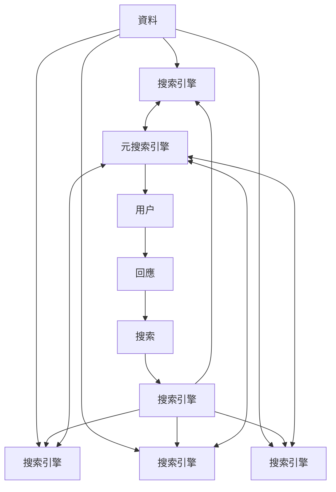

# 單元2

# 旅遊業的趨勢

# 探究重點

● 探討旅遊業與經濟有關的趨勢。  
● 認識旅遊業與社會文化有關的趨勢。  
● 了解旅遊業與環境有關的趨勢。  
● 概述旅遊業與科技有關的趨勢。  
● 探討引進現代資訊科技對旅遊業的影響。

一個國家或地區旅遊業的發展，會受到經濟丶社會文化、環境和科技方面的影響。以下我們將詳細分析旅遊業在這四方面的發展趨勢。

# 1.1 經濟方面

旅遊業發展與經濟周期密切相關。在2019 冠狀病毒病疫情爆發前，國際旅客人數連續多年增長，促進各地旅遊業的蓬勃發展，也為各地帶來可觀的收入。疫情爆發則嚴重衝擊全球旅遊業，國際旅客人數和旅遊業收入大幅下降。

隨着疫情過去，各地區旅遊業持續復甦。以下是聯合國世旅組織《2023 世界旅遊晴雨表》對 2023 年全球旅遊業表現的概述和預測：

• 中東是唯一恢復並超越疫情前水平的地區，國際旅客人次較2019 年增長 22%。  
歐洲是全球最多國際旅客到訪的地區，旅客人次回復至 2019年的 94%。  
非洲的國際旅客人次恢復到疫情前96%。  
美洲的國際旅客人次恢復到疫情前90%。  
• 亞洲和太平洋地區的國際旅客人次恢復較慢，只有 2019 年的 65%。但各區域表現參差，其中南亞回復至疫情前 87%，東北亞僅回復到約55%。  
• 預計國際旅遊業於 2024 年全面復甦到疫情前的水平，國際旅客人次相較2019年會有2%增長。

$\cong \# \mathbb { X } \mathbin { \vrule h e p t 0 . 6 2 / n 0 0 . 0 1 0 . 0 7 } \mathbb { Z } \mathsf { h } / \mathsf { S t o r y } / 2 0 2 4 / 0 1 / 1 1 2 5 9 4 7$

根據聯合國世旅組織的數據，旅遊業在經濟方面同樣復甦顯著，以下是相關估算和分析：

• 國際旅遊收入於 2023 年達到 1.4 兆美元，相當於 2019 年 1.5兆美元的 93%。  
• 旅遊業（包括客運服務）在 2023 年的出口總收入預測為 1.6兆美元，約是2019年1.7兆美元的95%。

. 以旅遊業直接國內生產總值（TDGDP）衡量，2023 年旅遊業為全球經濟貢獻3.3兆美元，佔全球國內生產總值（GDP）的 3%。數據顯示，受惠於國內和國際旅遊業需求的強勁反彈，旅遊業直接國內生產總值接近恢復到疫情前的水平。  
• 多個旅遊目的地的報告反映，主要客源市場的出境旅遊需求表現旺盛，不少目的地甚至超過2019年的水平。

# 旅客旅遊需求增加

全球旅客對旅遊產品的需求越來越多，原因如下：

# A 各地經濟發展和收入上升

雖然全球經濟偶有低潮期，如 2019 冠狀病毒病疫情曾嚴重打擊全球經濟和旅遊業發展，但是隨着疫情過去及各地經濟恢復，全球經濟總體持續向上發展，並帶動旅遊業復甦。人們收入回升和生活水平提高，他們旅遊消費的能力提升，出外旅遊的意欲也增強。各地旅客的旅遊需求因而越來越大。

# B 全球化促進經濟活動

全球化下，跨國經濟活動增加，如貿易和投資。這帶動國與國之間和地區與地區之間的交流合作，令旅遊業迅速發展，例如更多商務旅遊、會展旅遊等。另外，為了促進經濟活動，不少國家和地區都簡化簽證及通關手續，這也便利了各地旅客出遊。

# C 旅遊費用下降和旅遊模式轉變

資訊科技日益發達，一方面降低了航空公司、酒店等旅遊相關行業的營運成本；另一方面減低旅客獲得旅遊資訊的成本，以及方便旅客比較旅遊供應商的價格，使旅遊服務和產品需要維持具競爭力的價格。

natural_image

Side profile of a Southwest Airlines aircraft with blue fuselage and red/gray tail (no visible text or symbols)

▲ 圖 5.44 美國西南航空公司是全球第一家低成本航空公司

此外，一些低成本航空公司、民宿等旅遊產品供應商的出現，更有助整體旅遊費用的下降，吸引旅客增加外遊次數。數據顯示，即使在經濟不景的時期和之後，以提供短途航線為主的低成本航空公司，旅客增長率仍穩定上升。

# 旅遊目的地競爭日增

為了吸引更多旅客，各旅遊目的地都爭相增強吸引力，令旅遊業競爭日趨激烈。

# A 旅遊業投資全球化

隨着經濟全球化，跨地域經濟活動日漸頻繁，資金流通較過去大為加快。為了吸引投資者投入資金於各類旅遊建設丶酒店和景點等，各地政府均推出配合政策，簡化投資程序。不少國家特別是發展中國家，由於資金有限，更積極與已發展國家或跨國企業合作，以加快當地旅遊業發展。

# 例子庫

• 根據世界旅遊組織的報告，旅遊業在 2019 年，於全球共吸引了618 億美元的外地直接投資。

# B 對就業及經濟促進作用大

旅遊業屬勞動密集型產業，吸納大量勞動力。因此，不少國家和地區都大力發展旅遊業，務求為當地創造更多就業機會。加上旅遊業可帶動其他相關行業發展，而透過乘數效應更能促進整體經濟表現，為當地政府和民眾帶來更多收入。這解釋了為何各地會如此積極投資於旅遊業。

# 例子庫

• 根據香港政府統計處數據，本港於 2019 年共有 23 萬多人從事旅遊業，旅遊業的經濟收益超過 986 億港元。

圖 5.45 旅遊業有不少工種可吸納 ▲低技術勞工，如園丁、清潔人員等。  

natural_image

Exterior view of a luxury hotel complex with pink-tinted buildings, palm trees, and landscaped gardens under a clear blue sky (no signage or text visible)

# 1.2 社會文化方面

全球社會結構、生活方式，以至文化的轉變，都對旅遊業發展產生了重大影響。

# 全球人口分布改變

# A 人口增長

雖然全球出生率下降，但世界整體人口仍持續上升。根據聯合國世界人口統計，全球在 2020 年已達到 78 億人。當中印尼、尼日利亞、埃塞俄比亞等發展中國家的升幅比較大。至於擁有世界最多人口的中國和印度，人口在過去數十年一直增長。可見隨着全球整體人口的增長，旅客人數會不斷上揚。

另一方面，歐洲等已發展地區和日本等已發展國家，由於出生率持續處於低水平，預計人口會下降。反之，亞洲、非洲等地區的發展中國家，隨着人口和經濟增長，會是未來國際旅客的重要構成部分。

# 資料室

# 亞洲旅客成為旅遊業增長動力

就全球人口數目分布而言，亞洲是全世界人口最多的大洲。隨着亞洲國家的經濟快速增長，人們消費力增強，出遊次數增多，已成為不少地區旅遊業的主要目標顧客。以中國為例，世界旅遊組織的報告指出，2017 年世界旅遊總支出為 1.3 萬億美

text_image

LOUIS VUITTON

元，而中國旅客的出境旅遊支出達 2 580億美元，佔全球近兩成，位居世界第一，成為推動全球旅遊業發展的重要動力。

圖 5.46 中國旅客在境外的名店排隊購物

natural_image

Group of elderly people outdoors, some holding trip bags and luggage, near a house (no visible text or symbols)

▲ 圖5.47 參加旅行團的銀髮族

# B 人口老化

隨着人類壽命延長，全球老年人口不斷上升。根據聯合國的數字，2020 年全球 60歲或以上的老年人口超過 10 億，約佔世界人口 13%。預計老年人口在未來會進一步增長，長者將成為旅遊業不可忽視的客群。

長者的旅遊需求不比年輕一代少，特別是退休後的「銀髮族」。因此，各地旅遊業界已陸續推出許多適合「銀髮族」的旅遊產品，以爭取商機。

# C 多代同遊

今時今日，越來越多的祖輩會和孫子女一起出遊。由於不同世代通常分開居住，旅遊成為小型家庭聚會的好機會。跨代旅遊讓祖父母與孫子女、其他家族成員有機會共享天倫之樂。

# 例子庫

• 有旅行社會為多代同遊客群提供度身訂做的跨代同遊旅行團，讓他們根據孫子女的年齡安排活動、住宿和餐飲等。  
有旅行社推出適合多代同遊的郵輪旅程套票，讓不同年代旅客可以在郵輪上共度時光，並可根據習慣和興趣選擇餐廳、娛樂活動等。

# D 單親家庭遊

全球多地的離婚率均有上升，導致單親家庭變得較過去普遍。現時，不少旅行社和度假村都有照顧單親家庭的需要，為這些家庭提供適切的服務和產品。

# 例子庫

北美地區的旅行社，會籌辦專為單親家庭而設的旅行團，以一位成人和一位小童收費，為這些家庭提供價格優惠，並在酒店住宿和行程方面，讓單親父母和他們的子女感到自在。

# 提示箱

內地在 1980 至 2010 年代推行計劃生育政策，使獨生子女家庭在內地相當普及。自 2015 年起，內地全面實施一對夫婦可生育兩個孩子的政策；到了 2021 年，更決定實施三孩生育政策。

natural_image

Colorful children's playground with colorful umbrellas and play equipment, surrounded by palm trees and a building (no visible text or symbols)

▲ 圖 5.48 擁有兒童游泳池等設施的酒店，對家庭旅客具有較大吸引力。

# E 獨生子女家庭增多

受到社會觀念改變和生育成本上升等因素影響，獨生子女家庭在已發展國家和地區日漸增多。以英國為例，當地大學人口變化研究中心的專家指出，在 2022 年前，英國有一半以上的家庭成為獨生子女家庭。

由於這些家庭會把重心和資源都放到獨生子女身上，所以他們對與子女的出遊要求也相應提高，希望能給予子女更佳的旅遊體驗。

# 例子庫

獨生子女家庭的父母會較重視酒店有哪些設施可供子女遊玩，如是否有兒童游泳池、兒童遊戲室；會希望旅行團有一些能促進親子互動的節目，如親子興趣班、燒烤晚會等。

# F 遲婚現象

隨着全球社會和經濟發展，婚姻觀念出現改變，如今不少人選擇遲婚。根據聯合國數據顯示，2015 年全球男女性的平均初婚年齡，較十年前晚了最少兩年。遲婚現象更促成單身族旅遊的趨勢。

# G 移民和探親遊

現今各國政府為了吸納人才和資金，以不同的政策吸引專才移民或投資移民。不少人因而選擇到外地定居，並增加了跨國的移民和探親旅遊。

# 例子庫

根據香港保安局數字，2019 年本港約有 7 000 名港人移居外地，估算港人移民的主要國家為澳洲、加拿大及美國。同時，有13 390名人士經各項人才入境計劃取得本港居留權。

# H 受過良好教育的顧客增多

由於世界各地民眾的教育程度普遍提高，他們對旅遊設施和服務的要求也相應提高。加上他們能輕鬆在網絡上獲取各種旅遊資訊，並作出比較，所以會在搜集和分析大量資料後才作出訂購決定。

# 社會結構分布與旅客偏好

按不同的出生年代，大致可劃分出五個世代：老一輩、嬰兒潮一代、X 世代、Y 世代和 Z 世代。各世代的成長背景、價值觀、生活方式、擁有的文化知識和視野等均有不同，以致他們在旅遊偏好上各有分別。

<table><tr><td>世代</td><td>背景和特徵</td><td>旅遊偏好</td></tr><tr><td>老一輩(約1945年之前出生)</td><td>這一代人在經濟大蕭條(1929年)至第二次世界大戰期間長大。成長環境令大部分人務實、勤奮。這一代人重視工作,注重儲蓄,但觀點較保守。他們絕大部分已退休,部分人過着富裕安穩的生活。他們重視安全及保安。這一代人重視忠誠度和承諾。▲圖5.50 長者較喜歡乘坐旅遊觀光巴士</td><td>老年人不太喜歡寒冷的天氣,並尋求悠閒的活動。不少人喜愛參觀賭場,與不同種類人士接觸,以及體驗不同的文化。這一代人與其他世代相比,較傾向長途及海外旅行。他們在財政上較保守,旅行花費較謹慎,偏好比較實惠的方案,未必選擇在旺季出遊。長者行動緩慢或不便,旅行時需要別人的照顧,旅行團的行程安排和酒店的設計,須考慮他們的身體狀況。他們較少使用互聯網搜索旅遊資訊。</td></tr><tr><td>嬰兒潮一代(約1945年至1964年出生)</td><td>這一代人成長在戰後經濟重新發展階段,生活環境艱苦。群體人數眾多,大多努力打拼及儲蓄,並較重視物質和金錢。不少人受惠於經濟起飛而致富,會經常旅遊。這一代人越來越多步入退休年齡,可花更多時間享受人生,參與旅遊活動。他們希望與其他人保持緊密的關係,並喜歡充滿關懷的氣氛。他們不會輕易相信廣告,會要求詳細的資料來了解產品,不會片面相信廣告的圖片和描述。</td><td>這一代人重視健康和保健,喜歡參加醫療旅遊及健康旅遊。以享受生活為主,喜歡參觀博物館、歷史遺跡,以及在旅行團中與當地人作文化交流。他們會尋求一些刺激的活動,如狩獵、釣魚、遠足及追蹤野生動物。他們是富裕的旅客,偏好高質素的旅遊產品和服務,價錢有時是次要考慮。這一代人不太喜歡使用互聯網搜索旅遊資訊或購買旅遊產品。</td></tr><tr><td>X世代(約1964年至1980年出生)</td><td>·X世代經濟條件較上一代好,加上消費主義開始普及,廣告流行,令他們重視金錢和購物。·這一代人較注重工作與生活平衡,不會只拼命工作,會兼顧家庭生活。·教育水平提高,令他們善於適應轉變。·因離婚率上升,部分人或在單親家庭成長。▲圖5.51 喜歡親子旅遊的X世代父母</td><td>·這代人比較喜歡與子女一起出遊,行程中希望有親子活動。·他們傾向使用互聯網來搜索旅遊資訊,對產品價格較為敏感。·追求性價比高的旅遊產品和服務,願意花時間尋找物有所值的產品和服務。·在傳統活動以外,希望行程中增加一些獨特的活動,以得到樂趣和提升旅遊體驗。·這一代人的首選旅遊活動包括到主題公園和海灘遊玩,以及觀看體育比賽、打高爾夫球和網球。</td></tr><tr><td>Y世代(約1980年至1994年出生,又稱「千禧世代」)世代</td><td>·由於生活中物質享受更多,不少人視工作為生活的一部分,並較著重休閒及發掘個人興趣,如旅遊、攝影等。·這代人樂觀、自信,樂意接受改變,喜歡多重任務,但同時缺乏耐性,需要即時回應,並急於追求滿足。·他們引領潮流,熟悉使用科技產品,並勇於嘗試新技術或產品。·這一代人與其他世代相比,較反對主流價值觀,思維和行為較與眾不同。▲圖5.52 體驗跳降落傘的Y世代旅客特徵</td><td>·Y世代的人與其他世代相比,是較活躍的旅客。·這代人普遍使用互聯網搜索旅遊資訊及購買旅遊產品。·他們喜歡在旅行時參與娛樂活動,到主題公園遊玩,到的士高跳舞,以及購物。·不少人追求新穎時尚、新鮮刺激的旅行體驗。·部分人追求奢華享受和高品質產品,亦願意花費很多在玩樂上;部分人喜歡廉價旅遊,對住宿、交通等要求不高。·不少人喜歡自行安排行程,要求交通、款待和住宿都有高效率的服務及設施。旅遊偏好</td></tr><tr><td rowspan="2">Z世代(1994年以後出生,又稱「數碼世代」)</td><td rowspan="2">Z世代的生活相當依賴科技,多以互聯網、社交媒體等接收資訊。他們擅長使用科技產品,並熱愛嘗試新技術或產品。他們追求自由、新鮮感。</td><td>這代人熱衷使用互聯網搜索旅遊資訊及購買旅遊產品。他們追求新鮮刺激的旅行體驗,亦重視視覺享受,方便分享到社交媒體。Z世代的消費能力較Y世代低,會較重視優惠和額外服務。大多傾向自行安排行程,所到和所住的地方都要有網絡供應。</td></tr><tr><td>▲圖5.53 在景點自拍的Z世代旅客</td></tr></table>

# 活動站

# 分析旅客世代和旅遊偏好

請同學分組討論，分析以下旅客屬於哪一世代和有哪些旅遊偏好，並為他們建議三個旅遊活動。

# 旅客一：

36 歲男性，從事金融業，平日多做運動和重視生活品質，計劃前往美國旅遊。

# 旅客二：

女性，剛退休的公務員，丈夫行動不便，二人計劃到日本旅遊。

# 2019冠狀病毒病疫情對旅遊業界的影響

自2019年底起，冠狀病毒病肆虐全球，至2023年才結束。其間各國採取不同防疫措施，包括向其他國家和地區發出外遊警示丶強制隔離入境旅客，甚至封關等。疫情帶來的健康風險亦令旅客減少或停止旅遊，對旅遊業界造成沉重打擊。各行業都各出奇招，回應這次突如其來的旅遊業寒冬。

# A 旅行社受到的影響及回應

# a經營大受打擊

鑑於疫症在多國蔓延，人們外遊的健康風險大，多間旅行社需取消出境團和入境團。在生意大受打擊下，不少旅行社進行裁員，令大批從業員失業。有部分旅行社更因而倒閉。

# b發展本地旅遊團

以往以外遊團為主要收入來源的旅行社，在疫症下積極設計本地遊旅行團 ， 方面滿足本地旅客旅遊的需求，另一方面開拓新收入來源，以支持營運。

# 發展虛擬旅遊

受疫情影響，有部分旅遊社利用虛擬實境科技舉辦線上旅遊，又或舉辦網上導賞團，為旅客帶來全新的旅遊體驗。

# B 航空公司受到的影響及回應

# a面臨倒閉

疫症在全球爆發初期，各地航空公司透過減少航班、員工減薪和裁員等措施，降低營運成本。不少空中服務員等航空業從業員需轉投其他行業。隨着疫情持續，航班未能恢復，一些航空公司更申請破產。國際航空運輸協會（IATA）指出，截至2021年1月，全球已有近40間航空公司倒閉。

# 例子庫

• 香港的國泰航空受 2019 冠狀病毒病疫情打擊，於 2020 年陷入財困，需要香港政府以273億港元入股及貸款即時援助。

natural_image

Woman using VR headset on a sofa with scenic background showing mountains and waterfront (no text or symbols visible)

▲ 圖 5.63 有本港旅行社在疫情期間推出《VR 在家深度遊》，讓旅客可以足不出戶周遊列國。

# b 飛行假期（Flycation)

為了吸引客人，航空公司推出創意活動，提供無需要出入境，原地起飛和原地降落的飛行體驗予旅客，讓他們重温乘搭飛機旅行的感覺。

# 例子庫

疫情期間，香港快運航空推出空中飛行體驗（Flycation)， 吸 引不少熱愛飛行的本地市民參與。

natural_image

Side view of a commercial airplane with purple and white design, no visible text or symbols on the fuselage

圖5.55 香港快運航空曾推出空中飛行體驗（Flycation）

# C 景點受到的影響及回應

# a被迫關閉

為防止人群聚集以減低疫症擴散的風險，不同景點，如主題樂園和博物館等，在疫情嚴重時都需要關閉，令門票收入大減，甚至出現虧損。

# 例子庫

• 香港兩大主題樂園：海洋公園和迪士尼樂園，在 2020 年曾因本地感染個案上升，需三度閉園，損失慘重。

# b 服務革新

不少旅遊目的地或景點均積極面對疫情，趁停業期間進行革新，包括提升產品和服務，如進行設施更新，加強與不同界別的合作，讓旅客在疫情下仍能在本地安心出行。

# 例子庫

台灣有網上預訂旅遊產品平台，與當地捷運公司和貓空纜車、小巨蛋冰上樂園等景點合作，發展網上一站式預購服務和場內電子支付系統，使旅客可享用快速便利且零接觸的購票方式。

text_image

iPhone
App Clip
磁空插车
App Clip
App Clip
臺北市記載新
一目車 FUN

圖5.56旅客利用手機感雁惠屬二維條碼，即可付款。

# c 線上分享

在疫情下，不少景點把一些受旅客歡迎的表演或展覽，改為在網上公演或展示，部分更以免費形式開放。這在與眾同樂之餘，可收宣傳效果。

# 例子庫

• 在疫情期間，百老匯經典音樂劇《歌聲魅影 The Phantom of theOpera》曾開放網上直播。  
• 法國羅浮宮等著名博物館的展覽，在疫情期間，以互動影片或虛擬實境等形式，供大眾在網上參觀。

# 資料室

# 受疫情影響的直接職位與間接職位

2019 冠狀病毒病疫情影響旅遊業，對各地的經濟影響不局限於前線的旅遊業從業員。以航空運輸業為例，客運和貨運都因疫情減少，導致直接（如空中服務員）及間接職位（如為航空公司提供餐飲的公司員工）的需求下降。其他受疫情影響的直接職位與間接職位包括：

直接職位：工作以服務旅客為主。例如：酒店前台部的款接員丶遊客區餐廳的廚師、旅遊景點的場地服務員丶展覽和會議中心的營運主任，以及旅行社的導遊和領隊等。

間接職位：工作為服務本地人和旅客，或為服務旅客的機構和商店製造貨物和提供服務的員工。例如：的士司機丶商店店主及工廠工人（如製造燈飾售賣給酒店的商戶）。

總括而言，受 2019 冠狀病毒病疫情影響，全球旅遊業大受打擊。不過，部分業界趁此機會重整市場策略，例如投入資源開發電子設備系統，將有助加快旅遊業應用資訊科技。

# D 政府的回應

因應旅遊業面對的空前困境，各地政府都積極協助旅遊業界度過難關。以香港為例，政府有以下的應急措施：

text_image

Inmobility at Guam
健康·健康香港
重要教、娱乐旅游和零售网站，每晚请享受健康资讯及养生频道。
夏日
賞你遊
健康·健康香港

▲ 圖 5.67 旅遊發展局推出的「賞你遊」活動宣傳

• 撥款以現金津貼方式幫助業界，包括向每間持牌旅行代理商提供現金津貼，以及向每名以接載旅客為主的旅遊服務巴士司機發放一次過津貼等。  
• 在 2020 年 10 月，政府批准持牌旅行社有條件地舉辦連同工作人員在內，不多於30人的本地遊旅行團。  
• 旅遊發展局撥款推出「賞你遊」和「賞你住」活動，增加旅行社及酒店的生意。

# 旅遊業新趨勢與機遇

疫情影響、新興目的地湧現、科技進步和全球經濟社會變遷等因素，以及不同世代價值觀和旅遊偏好各有分別，旅遊業模式亦不斷演變。旅遊企業需要因應旅遊趨勢，持續創新產品和保持競爭力，才能提升旅遊體驗，滿足不同旅客的需求。

# A 旅遊個性化

年輕一代崇尚自由，個性化的「自由行」使他們可掌控自己的行程。他們會希望旅程的衣丶食丶住和行具有較高彈性，例如可決定在景點的逗留時間，可隨意選擇進餐的餐廳，可花更多時間體驗當地人的生活等。

為了配合年輕一代追求個人化的消費行為，以及利用互聯網找尋、比較、選購旅遊產品和服務的消費模式，網上旅遊服務供應商應運而生，推出多款「自由行套票」，以及可讓旅客自由組合機票、酒店、門票等旅遊產品和服務。

text_image

限時搶購
曾員憑推廣區(GO902)：每位即減$100(每日名額20位，頒滿即止)
推廣區優惠於9月29日至10月9日，每日早上9:30開始
曼谷 3天自由行
• 可選擇入住2014年8月全館開幕酒店，S.Rutchada Lejare Hotel(北京曼谷區)
Rutchada@ak.com，新路Siam Nixam(天安東區)
台北 3天自由行
• 台北人民醫院總計：鄭氏「台北景高女」之稱「周明山」。史維凡愛·羅公泰諾達森莊(寶信興明特點)：約2014年12月9日至12月9日
• 僅寧嘉代亞美回族自治區總計小蘇州1人前看，小人國主國推薦、六福村主國推薦門客
• 僅寧嘉代亞美回族自治區總計大北宮中心酒店、富豪酒店、富豪酒店、六福村等臺成Seoul@Coach接號服務
沖縄 3天自由行
• 僅寧站駐滙淨樓電話酒店
• 民災沖縄台聚園鎮門車座館
峇里島 3天自由行
• 僅寧海橋·若葉崗集达SIM（海2位提人1版）、齊吉省堂室檢照及星地諭音交館
• 僅寧清次戶保貸供給、保險匯店
• 地際次黃道保機巴士報紙及萬圓門車座通線
保有更多Good2Go自由行業景
上海、北京、三亚、杭州、南京、海口、成都、重庆、重庆局

不少旅行社更提供私人組團的服如家庭旅行團、朋友旅行團等，旅客提供度身訂造的旅遊產品和服，包括按旅客要求安排行程和各項動、餐飲等。

# 短線旅遊

由於旅遊變得容易，加上現代人生活節奏快、工作壓力大，現時越來越多旅客喜歡即興「快閃」的三日兩夜悠閒旅遊，以讓身心得到減壓及放鬆。這促使以周邊地區為旅遊目的地的短線旅遊，需求日益增長。

▲ 圖5.58 航空公司推出的3天自由行套票

# C 長者旅遊

隨着人口老化，長者的人口比例提高，「銀髮族」成為受到旅遊業重視的市場。近年，越來越多為「銀髮族」度身訂造的旅行團出現，如強調文化歷史和保健養生的行程，以配合長者的身體狀況，以及他們的旅遊興趣。因此，行程會有較多深度文化交流環節，如到訪傳統村落；健康養生活動，如安排藥膳美食和温泉保健等。另外，有一些「長住旅遊」（LongStay）產品出現，配合長者休息、放鬆的需要。

natural_image

Group of people in white robes meditating on yoga mats on a wooden deck with palm trees and a pool in the background (no text or symbols visible)

▲ 圖5.59 在酒店泳池邊進行瑜伽活動的旅客

# D 養生和度假旅遊

社會整體健康意識日漸提高，如今養生和度假旅遊的參與者不只長者，而且包括很多在職人士。這促進關注改善健康旅遊方式的發展，例如越來越多跨國酒店集團在東南亞地區投資興建温泉和水療度假村、推出健康美食餐單，旅行社在一些旅行團行程中加入瑜伽、探訪長壽村等活動。

# E 生態旅遊

在可持續發展觀念下，旅客對生態旅遊的需求增多。全球各地旅遊目的地亦加快發展生態旅遊，使相關設施和交通配套變得完善，方便旅客前往各處自然景點。

至於特別追求新體驗和願意冒險的旅客，更會到訪各地的熱帶雨林丶沙漠甚至極地，相關的旅遊產品和服務也相應推出市場。

natural_image

Two people walking on a moss-covered wooden boardwalk through a dense forest (no text or symbols visible)

▲ 圖5.60 在森林探險的旅客

# F 文化旅遊

比起走馬看花的行程，很多旅客更喜歡「深度文化遊」，即在目的地逗留更長的時間，與當地人有更多互動，去深入了解當地的文化，如藝術丶古跡和歷史等。現時，不少旅行社專門推出相關的文化旅遊產品和服務。

# G 鄉鎮旅遊

越來越多都市人為了舒緩生活壓力，喜歡選擇到一些鄉村古鎮旅遊，以體驗不一樣的純樸寧靜，及呼吸大自然的新鮮空氣。不少鄉村古鎮為了發展經濟，改善民生，亦積極將當地打造成鄉村旅遊勝地，加強宣傳推廣，促進了鄉村旅遊的發展。

natural_image

Street scene with people riding bicycles along a tree-lined sidewalk, traditional yellow buildings with Chinese flags visible (no signage or text)

▲ 圖5.61 乘坐載客單車遊覽越南會安古城的旅客

# H 郵輪旅遊

人們生活水平提高，開始追求高享受的休閒度假方式，郵輪旅遊就是其中一種。郵輪公司國際協會 (CLIA) 表示，2023 年全球郵輪旅遊有3 170萬乘客，並將持續增長。

natural_image

Exterior view of a colorful amusement park with large green and yellow water slides under a clear blue sky (no signage or text visible)

另一方面，多個國家和地區近年積極發展郵輪旅遊，令郵輪旅遊的價格大眾化。而且，郵輪設施種類更多元化，如提供適合家庭旅客和年輕旅客的娛樂康體設施、潮流玩意，有助郵輪公司進一步擴闊客源。

▲ 圖5.62 郵輪上的水上樂園

# I 活動旅遊

世界各地都有舉辦不同的節慶和文化活動，以吸引四方八面的旅客。例如意大利的威尼斯面具嘉年華、比利時電子音樂節 Tomorrowland等。這些節慶和文化活動不但能帶來經濟效益，而且能促進文化交流，提升當地形象，於是往往得到政府的協助，令活動旅遊的規模越來越大。

natural_image

Crowd gathered in front of a large outdoor festival float with ornate architecture and a central portrait (no visible text or symbols)

圖 5.63 比利時電子音樂節 Tomorrowland 的舞台及觀眾

# J 會獎旅遊

現時，不少公司順應潮流，舉行用來回饋及鼓勵員工的獎勵旅遊。由於會展及獎勵旅遊的旅客消費力高，能為旅遊目的地帶來可觀的旅遊收入，全球多個旅遊目的地都大力爭取這個市場。政府更積極配合相關旅遊企業，增加配套設施和推出簡化政策，以提高當地在會展及獎勵旅遊的競爭力。

# K 商務休閒旅遊

商務休閒旅遊結合了商務和休閒的元素。不少旅客出於商務目的而旅行，但往往希望在商務旅途開始前或結束後，在目的地延長行程，享受休閒時間和進行休閒活動。

text_image

Street photo of tourists visiting a grand building with visible Chinese signage and a red banner overhead

▲ 圖 5.64 參觀美國印第安人國家博物館的遊學團學生

為此，旅行代理商積極開發適合商務休閒旅客的產品和服務，例如聯同航空公司推出優惠套餐；為商務休閒旅客度身設計旅行團，根據他們的喜好和興趣安排活動、景點、導遊服務、特色餐飲等。

# L 學習旅遊

隨着生活水平提高及獨生子女家庭的增加，越來越多父母會安排子女到海外學習，例如參與海外遊學團，或到外地參加短期運動訓練等。於是，很多教育機構和學校都籌辦各式各樣的交流團，令學習旅遊發展迅速。

natural_image

Group of people in wheelchairs outdoors, one person holding a document, no visible text or symbols

▲ 圖 5.65 中環大館為傷健人士團體規劃無障礙路線，並會安排專人指示及協助使用無障礙通道。

# M 無障礙旅遊

很多傷健人士都有像正常人一樣出外旅遊、探索世界的心願。近年來，傷健人士的旅遊需求日漸得到旅遊業界關注。一些旅行社會規劃無障礙旅行團，為傷健人士作出便利和全面的旅遊安排。越來越多旅遊景點、交通工具、酒店和餐廳等，均設有輔助設施，方便傷健人士進出，盡情享受旅遊的樂趣。

# N 太空旅遊

隨着航天科技的進步，遨遊太空不再遙不可及。現時，已有企業積極發展太空旅遊，讓旅客在經過訓練後，乘坐太空船飛上太空，遙望地球，甚至進入國際太空站。

natural_image

Exterior view of a spacecraft in orbit above Earth, showing solar panels and structural components (no visible text or symbols)

▲ 圖 5.66 美國太空探索科技公司（SpaceX）搭載四名太空人的太空船於2024 年9月和國際太空站對接，期間太空人進行首次私人太空漫步。

# O 虛擬實境（VR）在旅遊中的應用

越來越多旅遊企業，如旅行代理商、酒店、景點等，會利用虛擬實境（VR）技術，讓旅客在規劃行程時，已可透過線上虛擬導覽，先行體驗酒店、餐廳、景點環境。主題公園等景點，更會在部分遊戲加入該技術，令遊客獲得沉浸式體驗。

# P 提高旅遊效率的旅遊科技

如今，各地旅遊部門和旅遊企業都不斷引入新科技，以簡化旅遊流程，提高旅客的旅遊體驗。有關內容會在後面的「旅遊業的趨勢 (II)— —科技方面」再加討論。

# 資料室

# 其他旅遊新趨勢

Y世代和Z世代與之前三代的旅遊偏好分別頗大，促成以下一些旅遊業的新趨勢：

natural_image

Family of three waving from a blue car with ocean and hills in the background (no text or symbols visible)

# 公路旅遊

年輕的Y世代和Z世代都崇尚自由的旅遊模式，於是彈性高的公路旅遊受到他們歡迎。自駕遊在歐美流行已久，近年才開始在亞洲普及。

圖 5.65 自駕遊家庭 ▲

# 單獨旅行

隨着資訊科技的發達，智能電話隨身的旅客，無論去到哪處，都可與親朋好友通訊。這令更多人接受獨自踏上旅途。而且，受個人主義影響，不少人享受在不受其他人影響下單獨旅行，以更自主地規劃個人旅程。

# 國際義工之旅

新生代在全球化下，對自身的全球公民身份有更大認同感，亦因為愛冒險等原因，樂於參與落後地區的義工工作。他們一般會自費購買機票，前往當地，經中介聯絡，再到村落進行義務教育或幫助簡單建築工作等。

# 黑暗旅遊

人們會到訪一些曾發生天災人禍的地方觀光，就地體驗曾經活生生的歷史。然而，這種旅遊具爭議性，旅客的好奇心或對死難者造成傷害，例如在景點有失敬的行為。

natural_image

Outdoor gathering with a speaker addressing a crowd in front of a large dome structure (no visible text or symbols)

圖5.66 參加旅行團參觀切爾諾貝爾核電廠的旅客

除了旅遊形式的轉變外，人口結構的轉變亦令旅遊業界增加在科技方面的投入，詳細會在科技趨勢的部分再討論。

# 1.3 環境方面

全球經濟發展下，環境的破壞和資源的過度使用，長遠會嚴重影響旅遊業的發展。

# 環境變化

# A 氣候變化

人類過度使用化石燃料，產生大量温室氣體，當中二氧化碳（CO2）最為顯著。二氧化碳和其他温室氣體的積聚，令全球平均氣温上升，形成全球暖化。各地天氣因而出現明顯轉變，意味氣候產生變化。

這進而影響各地氣温、降水和氣象形成，有機會破壞自然環境，包括全球暖化造成冰川融化、海平面上升，部分島國或被淹沒；超級颱風、特大洪災、旱災等極端天氣出現次數增多，亦會破壞各地環境和生態系統。

# B 自然資源消耗

全球經濟活動加快，以及人口持續增長，加快了各項天然資源的消耗，例如農業對土地養份、水資源的需求大增；工商業對木材、礦產資源丶化石燃料的耗用等。

# C 生物物種減少

全球頻繁的經濟活動和氣候變化，破壞了很多生物的棲息地，如熱帶雨林等非法開墾、極地冰川的消失，加上非法捕獵、過度捕撈和污染等問題，均導致不少物種瀕臨絕種。

natural_image

Aerial view of a forested area with parallel grooves and scattered shrubs, no visible text or symbols.

▲ 圖5.67 無人機拍攝到的非法開墾雨林情況

# 提示箱

可重温課題三：《地理名勝》中的氣候帶和季節性內容 。

# 減緩二氧化碳排放的趨勢

旅遊是氣候變化的載體，而全球旅遊活動與氣候變化之間存在密切的關係。研究指出，旅客運輸尤其是航空運輸，產生大量二氧化碳排放量，加劇温室氣體濃度。

為了減少燃料的使用及二氧化碳的排放，航空業積極推動綠色發展。「綠色飛機」是其中一個發展趨勢：

• 採購低燃油消耗引擎和較輕機身框架的新型飛機，以減少二氧化碳排放。  
• 採用可持續的航空替代燃料，例如生物燃料、再生燃料、氫能等非生物來源燃料，以減少使用傳統化石燃料。  
• 提供更多不停站直達長途航班，減少長途航班要在中途站停留，以降低二氧化碳排放。

此外，航空公司還採用以下措施，以減低二氧化碳的排放：

• 減少著陸後滑行時使用的引擎數量，以節省燃料。  
• 減少航機不必要的載重，例如根據規劃的旅客人數和飛行的距離，為航班計算出最有效率的載水量，以節省燃料。  
向旅客徵收較高的燃油附加費，以減少短途航班的數量。

提高旅客對飛行環境成本的責任意識，鼓勵更多人選擇乘搭環保航空公司的航機。

natural_image

Exterior view of a commercial airplane parked on the tarmac under a partly cloudy sky (no visible text or symbols)

圖 5.70 國 泰 航 空 ▲  
A321neo 客機可減省每年 5 000 噸二氧化碳排放量。

# 3 氣候變化對旅遊業趨勢帶來的影響

在旅客流量的概念中，氣候是影響旅客流量的其中一個因素。不少國家和地區的著名景點，如日韓的櫻花和格陵蘭的冰川，都是氣候的產物。然而，氣候變化的載量可能對部分國家和地區的旅遊業造成負面影響。

氣候變化的載量對旅遊業的負面影響

<table><tr><td>氣候變化的載量</td><td>對環境及生態影響</td><td>對旅遊活動影響</td><td>受影響地區例子</td></tr><tr><td>溫度上升和減少降雪</td><td>高山地區積雪面積減少。高緯度地區(如苔原和兩極)的生態系統會受更大影響。</td><td>高山地區的滑雪季節將會縮短,或因大量旅客集中而面對承載力不足的問題。海拔低的滑雪度假地區,或面對降雪不足的問題,可能要關閉。如以人造雪方式維持經營,則會導致成本上升。</td><td>歐洲、北美洲和南美洲的滑雪熱點</td></tr><tr><td>溫度上升和減少降雨</td><td>因極端高温持續出現,温帶或較高緯度的地區容易形成熱浪。在一些溫暖地區如亞洲內陸地區和地中海,乾旱和缺水問題會更嚴重。熱帶疾病傳播範圍容易擴大,影響生物和人類的健康。乾旱天氣持續,導致山火發生風險增加。全球暖化正衝擊對環境較為敏感的生態系統,如熱帶雨林和珊瑚礁,不少陸地和海洋物種已改變其地域分布、季節活動、遷徙模式、數量等。温度上升會帶來珊瑚白化的風險。</td><td>夏天是傳統旅遊旺季,熱浪等高溫天氣會減低旅客出遊意欲,令旅客人數減少,影響各地旅遊目的地的收入。受到酷熱、疾病和乾旱缺水等影響,旅客會避免前往這些地區,打擊當地旅遊業,如酒店入住率下跌等。自然生態被山火摧毀,景觀短時間難以恢復,旅客會改往其他旅遊目的地。目的地的生態受到破壞,會減低旅客前往的意欲,當地長遠要開拓生態以外的旅遊業新發展方向。</td><td>南歐、西歐和美國西岸(如加州)非洲北部撒哈拉沙漠附近國家澳洲南太平洋島嶼</td></tr></table>

natural_image

Scenic mountain landscape with two brown cabins and a paved road, no visible text or symbols

▲ 圖 5.68 蘇格蘭的滑雪場，在冬季由於山上沒有積雪，無法供旅客滑雪，纜車停駛。

<table><tr><td>氣候變化的載量</td><td>對環境及生態影響</td><td>對旅遊活動影響</td><td>受影響地區例子</td></tr><tr><td>冰川和極地冰蓋融化所引致的海平面上升</td><td>·冰川和極地冰蓋融化,令全球海平面上升。·極地冰面退去,北極熊、海豹等極地生物,因失去棲息處而數量減少。</td><td>·海平面因極地和海冰溶解而上升,沿海低窪地區和島國的海灘可能會受到侵蝕,島國甚至最終被淹沒。·生物多樣性減少,景點吸引力大減。</td><td>馬爾代夫和南太平洋島國北極圈附近的國家</td></tr><tr><td>極端天氣事件增多,如龍捲風、颶風和颶風</td><td>·風暴、颶風、颶風等,會為沿海地區,甚至內陸地區帶來強降雨,並引發洪水災害。·熱帶氣旋會破壞旅遊目的地,尤其沿海地區的旅遊設施,以及會對珊瑚礁帶來傷害。</td><td>·在低緯度地區出現急劇降雨量和洪水的機會增加,影響旅客遊覽戶外景點,部分活動如海上活動更可能需要暫停。·颶風、暴雨等極端天氣既會破壞旅遊景點和設施,也會妨礙旅遊業活動,打擊旅遊業發展。</td><td>美國東岸(如佛羅里達州)、中國台灣和菲律賓及南太平洋島嶼</td></tr></table>

natural_image

Aerial view of a coastal city with dense urban buildings, shipping containers, and harbor facilities (no visible text or symbols)

▲ 圖 5.72 馬爾代夫首都馬累。科學家預計，隨着地球暖化導致印度洋水位逐漸上升，馬爾代夫將於2050年被淹沒。

▲圖 5.73 意大利威尼斯不時受水患影響，旅客要在聖馬可廣場臨時搭建的木橋上行走。

# 環境保育對旅遊業的影響

旅遊業雖有「無煙工業」的稱號，但其對環境的影響非常大。有見及此，不少主張旅客要負起環保責任的旅遊模式出現，以期更大程度達致可持續的旅遊業發展。

# A 生態旅遊

生態旅遊在後頁有詳細介紹。

# B 地質旅遊

地質旅遊讓旅客通過參觀岩石、礦物、化石和地形等自然景觀，了解地質特徵、形成過程和對環境的影響。這種旅遊為旅客提供學習地球科學的機會，增進對地質多樣性的認識，有助維持或提升某地的地理特色。

# C 負責任旅遊

這種旅遊主張以當地社區的利益為大前提，要求每個人丶組織和企業承擔各自的旅遊責任，減少對社會和環境產生負面影響，並協助當地居民做好環境和文化保育。

# D 可持續發展旅遊

可持續發展旅遊即要求平衡目前和未來經濟、社會和環境的影響，以及了解旅客、業界、環境和當地社區的需要，在發展旅遊業的過程中，制訂及遵守相關可持續發展旅遊的守則。

# E 道德旅遊

這種旅遊強調在旅遊中的道德觀念和規範，例如社會公義、人權或環境議題。旅客一般要遵守相關的道德責任，成為良心旅客。例如旅客不要為了個人滿足，而在受保護地區進行攀爬岩石、游泳等活動，以免對自然環境造成損害。

▲圖 5.74 旅客應具有道德觀念，遵守旅遊目的地的規範。  

text_image

不可攀
No Climbing

# 生態旅遊

# A 定義

根據國際生態旅遊學會（The International Ecotourism Soci-ety, TIES）的定義，生態旅遊是「在自然保護區負責任的旅行，顧及環境保育和維護當地人民的福祉，並進行解釋和教育」。

natural_image

Green stylized tree icon with radiating leaves, no text or symbols present

THE INTERNATIONAL ecotourism SOCIETY

▲ 圖5.75 國際生態旅遊學會的標誌

根據聯合國世界旅遊組織的資料，生態旅遊有以下特點：

所有以自然為本的旅遊，旅客的主要動機是對自然以及當地的傳統文化的觀察和欣賞。  
具教育和傳譯的特質。  
一般是由規模較小但專門負責的本地組織舉辦。  
旨在減少對環境和社會文化造成的影響。  
通過以下方式去維持和保護生態旅遊景點的自然地區：

a. 以保育為目的，為東道國社區丶組織和當局產生經濟利益；  
b. 為當地社區提供就業和收入機會；  
c. 提高當地人和旅客對保護自然和文化資產的認識。

natural_image

Group of tourists navigating a lush green wetland path with small boats and water-filled paddies (no visible text or symbols)

由此可見，發展生態旅遊需要不同持份者的投入，而且在旅遊過程中，一般由熟悉當地文化和生態的當地組織和導賞員，與旅客之間的互動，達致宣揚保育的目的。

圖5.76 旅客在越南導賞員的帶領下，遊覽湄公河三角洲。

# B 香港發展生態旅遊的優勢和限制

香港近年積極發展生態旅遊。以下是本港發展生態旅遊方面所擁有的優勢和受到的限制：

<table><tr><td>優勢</td><td>限制</td></tr><tr><td>景點發展潛力大:本港山多海岸線長,擁有獨特的地質和海岸地貌,亦有發展成熟的郊野公園和行山路徑,景點發展潛力大。</td><td>保育意識不足:當局興建的行山徑,有時被指與景觀不相符,或鋪設過多水泥路。不少旅客在參與生態旅遊時,遺下大量垃圾,對野生動物和生態造成負面影響。無論政府或旅客的保育意識均有待提高。</td></tr><tr><td>生物多樣性豐富:香港的生物多樣性豐富,有不少稀有動物棲息,包括以香港命名的香港鬥魚、盧文氏樹蛙和瀕危物種的黑臉琵鷺等,對旅客具有吸引力。</td><td>承受力有限:香港地少人多,而很多港人熱衷生態旅遊,但自然生態景點的承載能力有限,大力發展或令自然景點不勝負荷。若設置參觀人數上限,則會局限景點發展。</td></tr><tr><td>交通網絡方便:與其他地區相比,香港的郊野與市區相當接近,從九龍或港島出發,最遠的郊野公園和行山路徑也不超過1個半小時車程,交通十分方便。</td><td>發展起步較遲:香港於2002至2003年才首次將生態旅遊納入財政預算案,提升設施、研究和發展新的生態旅遊產品,生態旅遊發展的起步較鄰近的日本和台灣地區遲。旅客配套設施和業界的人才培訓等,仍要進一步提高和完善。</td></tr><tr><td>政府政策支持:香港政府早於2017年公布《香港旅遊業發展藍圖》,表示推動生態旅遊,亦加強相關行業員工培訓。未來政府還會在景點配套和法例制度上,加強發展生態旅遊。</td><td></td></tr></table>

圖5.77旅客在風景優美的香港海岸拍照  

natural_image

Beach scene with three people in white suits on a rocky coastline overlooking the sea, no visible text or symbols

natural_image

Mountainous landscape with a stone path leading to a river valley, surrounded by green vegetation and distant mountains (no text or symbols visible)

■圖5.78　有意見認為水泥行山徑破壞生能環境，也令自然風貌失去特色。

# 提示箱

全球分銷系統主要服務旅遊產品供應商和中介機構，而網上旅遊代理商（ 例 如 Booking.com和 TripAdvisor） 直 接服務消費者，頁 185 至189 會詳細討論。

資訊科技在旅遊業的運用日漸普及，由提供旅遊資訊丶交易的進行甚至不同旅遊體驗當中都可看到，為旅客和旅遊業界帶來很多好處。

# 2.1 全球分銷系統 (GDS)

# 何謂全球分銷系統 (GDS) ？

全球分銷系統（Global Distribution System, GDS）是一個網絡系統，統一處理不同旅遊產品的資訊和交易。

不同航空公司、酒店、旅行代理商、汽車租賃公司及郵輪等旅遊產品供應商，都可以加入這個平台，介紹和出售其產品或服務。

全球各地的中介機構（包括旅行代理商或網上旅遊中介），可以利用全球分銷系統查詢產品價格，並「一站式」購買整個旅遊行程中的各項產品。

flowchart

▲ 圖 5.79 AMADEUS、Galileo、Sabre 和 Worldspan 是全球四大分銷系統

# 資料室

# 全球分銷系統的發展

全球分銷系統（GDS）的前身是電腦預訂系統（CRS），用作儲存和搜索旅遊相關信息和進行交易。最初 CRS 是由航空公司開發的資料庫，整合了各國航空公司的計算機銷售系統。後來，隨系統技術成熟，CRS 擴展成供旅行社作銷售渠道的系統，成為 GDS 平台。今時今日，GDS 的旅遊產品預訂和銷售已集合不同國家和地區公司的資訊，規模屬全球性。

# 全球分銷系統(GDS)的功能

# A 訂位服務

簡單來說，GDS 是一個強大的網絡數據庫，供各旅行代理商或網上旅遊中介任何時候使用，以獲取即時產品信息，並根據旅客的要求，為他們預訂和確認不同的旅遊產品。

# 例子庫

GDS可供旅行社查看及預訂的旅遊產品有：

• 單程及來回機票  
• 酒店房間  
• 旅遊保險  
• 餐飲訂座

• 汽車租賃服務  
• 旅行團  
• 機場接送服務  
• 更改行程

• 巴士及火車票  
• 遊輪  
• 主題公園及劇院門票  
• 旅遊路線編排

# 旅行代理商訂位服務流程

1. 各旅遊產品供應商把產品資料（如航空公司的機票票價、酒店客房的房價等）放到GDS系統內。

2. 旅客向旅行代理商提供基本資料和行程要求（如計劃目的地、預期出發日期、人數、預算等） 。

3. 旅行代理商利用 GDS 系統搜索產品資料，為旅客找出適合的方案，再由旅客決定是否購買。

4. 一旦旅客決定購買，旅行代理商會根據旅客提供的個人資料（包括姓名、出生日期丶護照號碼和有效日期丶最終出發日期等），展開訂購程序。所有資料會被 GDS 記錄在旅客紀錄（Passenger Name Record, PNR）內，並分別傳送到各個供應商，訂購有關產品。

5. 經過 GDS 系統確認訂購成功後，旅行代理商會向旅客收取費用，並可從供應商獲取佣金。

natural_image

Illustration of a blue airplane with a red location pin on the ground, no text or symbols present.

航空公司

natural_image

Illustration of a vintage-style camera with brown and beige body, no text or symbols present

觀光服務

natural_image

Illustration of a hotel building with 'HOTEL' signage on the facade (no additional text or symbols)

酒店住宿

natural_image

Illustration of a red car with a traffic light and street sign (no text or symbols)

汽車租賃及火車

natural_image

Illustration of a white cruise ship on blue water with a small boat nearby (no text or symbols)

郵輪

旅行代理商利用GDS系統為旅客提供訂位服務流程示意圖  

flowchart

5.80

1 旅遊產品供應商把產品資料，如航班時間和票價、客房類別和房價等，放到GDS 平台。  
旅客向旅行代理商提供旅行目的地、日期、人數、預算等基本資料和要求。  
旅行代理商利用GDS，替旅客搜尋可供選擇的旅遊產品，為旅客安排行程。  
旅客根據旅行代理商提供的資料，決定是否購買產品。  
旅客決定購買產品，並向旅行代理商提交個人資料，讓代理商訂購。  
⑥ 旅行代理商利用GDS向旅遊產品供應商購買產品，向旅客收取費用，並從代理商得到佣金。

# B 提供基本旅遊信息

GDS 作為一個連繫各產品供應商的平台，擁有龐大的資訊網絡，可向旅行代理商提供各供應商的最新旅遊產品信息。旅行代理商可通過 GDS，在短時間內得到各種旅遊信息，包括票價組合丶全球可提供的航班、鐵路丶郵輪座位數目，以及航空公司丶酒店物業丶旅遊運營商和汽車租借地點的資料等，從而讓旅客迅速取得想要的旅遊信息。

# C 比較產品

由於使用 GDS 搜索資料既容易又清晰，旅遊產品供應商可透過平台，讓旅客了解和比較到不同產品，作出更精明的選擇。

# D 其他增值服務

為了增加競爭力，不同GDS 平台除了不斷增加合作供應商數量外，還會提供一些增值服務去吸引顧客，如為旅客提供專業的旅行建議、給供應商提供信息管理諮詢服務等。

# 全球分銷系統 (GDS) 對旅遊業的好處

GDS 使旅遊業的發展更有效率，為旅遊供應商丶旅行代理商和旅客帶來不少好處。

# A 旅遊供應商

銷售成本下降：供應商透過GDS這個國際通用的系統來銷售，讓消費者選擇自己的產品，而不再需要單靠自己的資源來推廣和銷售，成本因而大減。

推廣範圍更全面：比起使用自己的網站去進行銷售，GDS 會有更多來自各地的旅行代理商瀏覽，令供應商的產品可推廣給更多潛在顧客。

更了解市場情況：參加系統的供應商，可透過系統了解競爭者的產品和售價，以及其他市場信息。這有助供應商調整銷售策略，增加產品銷量，從而促進行業的競爭和發展。

鼓勵出遊增加利潤：GDS系統令訂購旅遊產品和安排行程變得方便快捷，而且平台允許客戶比較票價及存貨量，讓他們以最低成本購買到最合適的旅遊產品。這能夠鼓勵旅客出遊，增加旅遊供應商的整體利潤。

natural_image

Shopping cart carrying a globe on a light blue background (no text or symbols)

▲ 圖5.81 GDS 有助把供應商推廣給全球的顧客

# B 旅行代理商

工作效率提高：GDS提供24小時且「一站式」的訂位服務，就算在繁忙時段亦能同時處理大量交易。這大大提高了旅行代理商為顧客安排行程的效率。同時，透過 GDS 作出行程改動也非常方便，如更改航班出發日期時，價格的更改變成自動化，減省員工處理的時間。

營運成本減少：GDS 除了令訂位工作事半功倍外，代理商亦能從系統中接收到最新的旅遊資訊。這有助代理商減省人手，以及作出即時市場調整和推廣，進一步減低營運成本。

服務質素提高：代理商利用 GDS，能快捷而有效地為旅客提供旅遊信息，以及作有系統的行程安排。這令代理商的服務質素提高，顧客對它們的信心也隨之增加。

# C 旅客

方便購買：GDS 提供全球不同旅遊產品的資訊，旅客可透過旅行社等中介，即時取得大量信息，方便比較產品價格等，作出最合適的旅遊決定。

加快購買決定：GDS 可簡化和加快旅遊業界的訂位流程和行程安排，讓旅客可享受一站式服務，在出發前一次性預訂往返機票、酒店住宿、目的地交通安排等服務，旅遊體驗得到提高。

提供更多的產品訊息：GDS 會整合全球各地的旅遊產品資訊，如目的地景點、住宿及交通運輸等，旅客可即時取得大量信息和選擇。旅客即使在緊迫的時刻，仍能根據信息訂購產品和獲得特別優惠。

text_image

BOOK NOW

出遊成本降低：訂購旅遊產品和行程安排較以往便捷，可減低代理商的營運成本，而客戶能夠比較供應商產品的售價，令供應商的價格需具競爭性。這均有助降低旅遊產品的成本，減省旅客的出遊成本。

▲ 圖5.82 GDS方便旅客享受一站式的服務

# 網絡台

香港國際機場自助登記服務

# 2.2其他資訊科技

# 1 自助式服務科技

# A 航空業

# a自助登機服務

現時很多旅客可在網上預訂機票，以及在網上預辦登機，選擇座位並發出登機證，或到機場換領登機證。世界各地的國

際機場現在設有智能登記櫃枱，讓旅客自行辦理登記、選擇座位及領取登機證。航空公司亦設有旅客自助行李寄存櫃枱，令旅客可以快速完成登機手續。

text_image

Person using smartphone at a transit station gate, with visible digital interface and logo

/ 圖5.83 旅客掃瞄電子登機證

# 資料室

# 電子機票

電子機票是旅客經網站或電話訂購機票後，訂位系統留下的紀錄。一般旅客會印出列有詳細航程和訂位代號的收據作憑證，在出發當日憑護照直接到機場辦理登機手續和寄存行李亦可。旅客可到自助辦理登機專櫃辦理登機，或前往一般登機櫃枱辦理，在取得登機證後便可準備出境。擁有電子機票的乘客若不需托運行李，可在辦理登機手續後，直接出境。

總括而言，電子機票有以下的優缺點：

<table><tr><td>優點</td><td>缺點</td></tr><tr><td>沒有遺失風險:電子機票是電腦記錄,旅客只需出示護照便有預約紀錄,可避免旅客因不小心遺失實體機票而無法登機。</td><td>裝備失靈風險:若旅客的智能手機、平板電腦等裝備失靈,需聯絡航空公司或自行補索。</td></tr><tr><td>節省等候時間:電子機票設有獨立自助櫃枱,可加快登機流程,為旅客節省更多候機時間。</td><td>跨航空公司:跨航空公司的旅程(如轉機或合併航線)因為規則和系統不同,當遇到突發事件,或出現信息延誤,甚至影響旅客的行程。</td></tr><tr><td>節省列印成本:航空公司不用再列印傳統機票,可減少人手和紙本開支。</td><td rowspan="2">未完全取代傳統機票:部分航空公司因軟件設備不足,尚未支援使用電子機票,所以旅客要留意,以免有誤會,影響行程。</td></tr><tr><td>環保:減少列印機票意味減少耗用紙張,有助環境保護。</td></tr></table>

natural_image

Modern airport tarmac with turnstiles and mobile phones (no visible text or symbols)

# b通關及登機

現時不少國家和地區簡化通關程序，旅客如使用智能身份證明文件或護照，可自助出入境。另外，作為旅客離境最後身份確認步驟的登機閘服務，亦將會逐漸以「人臉辨識」系統取代人手檢查。

圖 5.84 已設置具備容貌識別技術的自助登機閘口

# 例子庫

• 香港國際機場的一號客運大樓自 2018 年 8 月起，已設置具備容貌識別技術的自助登機閘口，加快安檢程序。

# c提取行李

目前各地機場均有自助行李提取服務，旅客只需前往負責運送該航班行李的行李輸送帶，自行領取個人行李。航空公司會運用旅客寄存行李時，貼在每件行李上的條碼紙進行追蹤，可避免行李漏失或調包問題。旅客更可透過航空公司的應用程式，實時追蹤託運行李的到達狀況。

natural_image

Purple suitcase on an airport baggage belt in operation, with other luggage displayed (no visible text or symbols)

▲ 圖5.85 機場行李輸送帶上附有條碼紙的行李

# B 其他運輸業

跟航空業一樣，自助購票、付款和通關服務在鐵路丶郵輪甚至巴士等交通工具，都變得越來越普及。

text_image

Recuerde validar su entrada
Remember to validate your ticket
Entrades / Entrades / Tickets

# C 景點

# a自助購票及入場

旅客現時可以透過網上系統購買電子門票，或到旅遊景點的自助售票機購買門票，然後以門票上的二維條碼等電子裝置進入景點。

▲ 圖5.86 旅客在入閘機掃瞄門票上的二維條碼

# 例子庫

• 在一些主題公園，旅客不單可自助購票及進入園區，在景點內的消費都會被自動記錄，亦可在園區內以門票登記快速通道，減省等候使用娛樂設施的時間。

# b自助導賞

因為智能手機、平板電腦等電子設備的普及，部分旅遊熱點，如具歷史意義的文化遺址丶博物館或遊船和城市觀光巴士上的導覽，都逐漸以二維條碼代替傳統導賞機或文字介紹，讓旅客可使用個人電子設備去了解展品和景點的內容。

text_image

Bring
Abraham
Lincoln
to life

圖 5.87 旅客可以掃瞄圖中的二維條碼，聆聽美國前總統林肯的故事。

# 網上社交媒體

社交媒體（社媒）屬於一種網絡平台，可讓全球各地的用戶創作及分享文字、圖像、視頻、音樂等不同資訊，並可互相交流意見、評論觀點等。

今時今日，不少旅客會受到社交媒體的分享影響而作出旅遊決定，或在計劃旅遊目的地時，利用社交媒體作為搜集資料的重要渠道。因此，網上社交媒體的發展，對旅遊業界造成了一些新的趨勢。

text_image

Hand holding smartphone displaying a social media feed with video thumbnails and text overlays, likely for a travel or photography app.

▲ 圖 5.88 旅客在閱讀 Facebook帳戶的旅遊資訊

# A 建立網上旅遊品牌

旅行社或其他旅遊業供應商，針對社交媒體的興起，紛紛在社交媒體平台建立業務。以全球有多人使用的社交媒體Facebook為例，利用其推廣旅遊產品的行業眾多，包括酒店、旅遊品牌及在線旅行社等，並且擁有大量粉絲。可見旅遊業的宣傳不再局限於傳統大眾媒體。

# B 重視客戶服務渠道和客戶互動方式

社交媒體提供平台予公司和客戶（或潛在客戶）互動。網民的意見更足以影響旅遊企業的形象。因此，旅遊企業的公關需善用市場推廣技巧，例如在社交媒體投放廣告，或創建可供分享和點讚的內容，或推出優惠活動，讓網民參與，增加網民好感，從而為企業建立品牌和口碑。

# C 網絡紅人行銷

不少旅遊產品供應商會與旅行博主（Blogger）和旅遊意見領袖（KOL）合作，向對方支付報酬，以換取對方在文章丶短片或相片中提及企業的產品。當有關分享獲得越多瀏覽次數，代表產品曝光率越高。

# 例子庫

不少新開張的酒店和景點，會邀請 Youtuber 免費體驗服務，再拍片分享感受，藉名人效應達到宣傳效果。

natural_image

Woman in pink inflatable raft jumping joyfully by a turquoise poolside with overwater bidders and a swimming boat (no text or symbols visible)

▲ 圖5.89 網紅入住五星級酒店及分享，能夠帶來網絡宣傳效果。

# D 鎖定目標客群

透過記錄用戶在社交媒體上的瀏覽紀錄，社交媒體可為旅遊企業提供「大數據」，高效率地分析消費者的喜好和習慣，從而讓業界了解客群的背景資料，有助旅遊業界設計產品或調整市場策略。

社交媒體亦會因應用戶的瀏覽紀錄，猜測他們有興趣的廣告，進而向用戶發放同類廣告。這使旅遊企業的廣告能更準確讓潛在客戶看到，有助業界推廣產品和服務。

text_image

Hand holding smartphone displaying Instagram app interface with multiple app thumbnails and status bar, background shows pool and building

圖5.90 若社交媒體用戶瀏覽過廉航、酒店等資訊，相關的內容會隨之出現在其社交媒體上。

# E 非主流產品供應商崛起

過往無法在旅遊雜誌刊登廣告的小旅舍丶民宿或當地小型酒店，如今可通過社交媒體與潛在旅客建立聯繫。一些社交媒體用戶亦會尋找或推薦「非主流」的衣食住行體驗，令原本小眾的產品和服務供應商也有宣傳的空間，甚至成為潮流。

text_image

小红书
标记我的生活

圖5.91 內地社交媒體小紅書經常介紹香港小眾景點和餐廳

# 2.3引入現代資訊科技對服務提供者的影響

整體來說，引入現代資訊科技，對旅遊業的服務提供者，包括運輸業和旅遊目的地等，都有不少好處。

# 服務質素提高

# A 節省時間

# a運輸業

運輸業使用現代資訊科技，可大幅減少處理數據、票務、行李等時間，無論企業和旅客都可節省時間，從而有助提升服務質素。

# 例子庫

• 網上預約和選擇座位的服務，令乘客搭乘航班丶巴士丶鐵路或郵輪等安排更流暢。  
• 自助登機手續和自助行李寄存服務等，可減省旅客輪候的時間。

# b旅遊目的地

在現代資訊科技下，旅客可在網上預訂旅遊景點的入場劵，令遊覽過程更便捷。部分網上旅遊中介，更會將不同景點的門票與車票等合併成套票，方便旅客預先訂購。

text_image

KLOOK
KLOOK
KLOOK

▲ 圖 5.92 購自網上旅遊中介「客路」的往返山頂纜車票和凌霄閣摩天台門票

text_image

WELCOME ABOARD
HOME
MUST
PLAN
LIFE SAFES

# B 體驗升級

# a運輸業

特別是在長途交通工具上，現代資訊科技為旅客帶來更優質的娛樂設備，令旅途生色不少。

▲ 圖 5.93 航機經濟客位上的屏幕，為旅客提供娛樂。

# 例子庫

• 航空公司在飛機的座位設置屏幕，供旅客自選影視節目丶音樂或遊戲，在旅途中得到娛樂享受。  
• 現時巴士、火車、郵輪，以至部分飛機，都設有無線上網服務，令旅客可繼續使用電子產品，充實交通時間。

# b旅遊目的地

就不少景點如博物館或主題公園而言，現代資訊科技的引入，如 5G 技術和虛擬實境等，為旅客帶來全新的旅遊體驗。

natural_image

Dinosaur skeleton exhibit in a museum display, showing full skeletal structure and multiple limbs (no visible text or labels)

▲ 圖5.94 日本福井縣立恐龍博物館的恐龍還原模型及模擬影像，為旅客帶來新體驗 。

# 營運效率提升

# A 處理更快更準

# a運輸業

運輸業引入的現代資訊科技系統，可大幅提升運輸效率，並減少人為出錯。機場協同決策數據的分析和外來物偵測系統，更可確保跑道的安全和暢順。

# 例子庫

香港國際機場每日處理大量行李，採用行李條碼識別技術，可大大減低旅客遺失行李的機率；引進無線射頻識別技術，則可有效縮短行李處理的時間。

# b旅遊目的地

旅遊景點透過使用現代資訊科技，可加快入場流程及分流旅客，並因應情況，即時調整營運安排，從而提升服務效率。

# 例子庫

• 電子門票、快速通行證等科技的引入，可分別減少閘門驗票的時間和縮短旅客排隊輪候的時間。  
• 人流數據預測系統，可幫助景點更準確預測高峰期旅客人數，以便營運團隊作出適當安排。

# B 大數據運用

各旅遊產品供應商可透過 GDS 丶自家的數據紀錄系統，以及社交媒體上獲得的數據，掌握顧客的背景丶需求甚至消費模式，從而作出市場回應，提升營運效率。

# 資料室

# 大數據

大數據（Big Data）指數量龐大而無法用常規軟件處理的資料。透過分析大數據，企業可以了解客戶的行為、市場的需求，從而預測未來趨勢，作出商業決策。

近年，旅遊景點開始廣泛運用大數據。例如景區通過大數據，建立旅遊區的數據統計，包括景區人數丶天氣和景區承載量等。管理公司會將提前預約旅客和散客的現場入園數據，在網絡上公布，讓旅客根據有關資料，決定是否在同一段時間內進入該景區。

text_image

陆楼山国家公园
欢迎 津满 赎进 展贴5. 那时请勿 红路, 出开安踏内更改
对边的车站
光标 温深
1.7公里
散杂
1.7公里
0324 可售多档...

▲ 圖5.95 台北陽明山國家公園即時旅遊警示

# C 工具和設施效能改善

# a運輸工具

安全是旅客對旅遊過程中最基本的要求。為了保障乘客安全，航空、鐵路、巴士等運輸業運用了不少新科技，以提升整體交通安全。

另外，運輸業採用設計更快捷、更舒適的交通工具，為旅客帶來更舒服的座位、更寬敞的空間、更高質的享受。

# 例子庫

• 航空業中，新型客機採用更堅固的物料，以及持續更新客機航行和著陸的衞星導航系統。  
• 新型客機空中巴士 A380，提供的座位較其他客機更寬敞，座椅更舒服。頭等、商務乘客甚至有淋浴間、酒吧等設備。

# 資料室

# 空中巴士 A380 停產

空中巴士 A380 於 2007 年正式投入航空業市場，是截至2021 年為止，載客最多的雙層大型客機。雖然空中巴士 A380

深受乘客喜愛，但在全球化廉價航空的競爭下，不少採用 A380 這類雙層客機的航線，載客量不足。最終於2021 年，空中巴士公司完成 A380剩餘的訂單後，全面關閉有關生產線。

▲ 圖 5.96 A380 客機

# b設施用品

各種現代科技的採用，可有效提升旅遊設施或用品的質素，使旅客在旅遊時更安全和更舒適。

# 例子庫

• 納米技術有助製造出優質的產品。旅遊產品上的納米膜還有防水、防紫外線、防刮和自我清潔等功用。  
• 最新的冷空氣循環系統，可為戶內景點提供更新鮮的空氣，從而提升旅客的體驗。

# 對運輸業長遠發展的影響

長遠而言，現代資訊科技不斷進步，將促進運輸業出現新的發展。

# A 投入更多資訊科技提升競爭力

資訊科技的運用，有助運輸企業運用大數據提升服務質素，改善營運效率。為了提升競爭力，航空公司等不同運輸公司，會持續投入更多資訊科技，包括利用互聯網和手機應用程式等，通知乘客航班資料和最新產品資訊。

其次，更多自助化服務和人工智能生物識別科技的引入，可進一步便利乘客，節省他們的時間和優化他們的體驗。

text_image

Person scanning a QR code on a smartphone at a service counter, with visible interface elements and background signage

√5.97向航空公司職員展示電子機票的旅客

text_image

▲ 圖 5.98 自助辦理寄艙行李設備支援支援

艣行李設備越來越普及

# B 旅遊中介角色變得模糊

隨着資訊科技的廣泛使用，旅客可利用互聯網，直接訂購航空公司的機票或鐵路公司的車票。這變相導致旅行社等傳統旅遊中介機構的重要性下降。另外，網上旅遊代理商的出現，使旅遊中介的角色進一步模糊。下一章節我們會再詳細闡釋。

# C 促進企業結盟合作

在資訊科技的配合下，不同運輸企業可更容易整合運作，包括以結盟方式共享資源，如透過代碼共享、共同使用貴賓候機室等，降低成本，增加利潤。

# 例子庫

航空公司會以結盟方式共享資源，而代碼共享（code sharing）是典型的合作模式，即兩間或以上航空公司合併使用同一飛機，接載購買了不同公司機票，但前往相同目的地的旅客。這既可減低航空公司的成本，又有利它們增設航線。  
結盟的航空公司又會透過讓旅客共同使用貴賓候機室等機場設施，降低成本；並會利用聯盟成員的常客計劃，吸引旅客乘搭聯盟成員的航班，入住聯盟成員的酒店等。

text_image

CX 6740 Xiamen Est 22:45
CX 755 Bangkok Cancelled
UA 079 Ho Chi Minh Boarding
UO 4157 Halkou Cancelled
CX 408 Taipei Boarding
AF 8070 Brisbane Final Call
SQ 002 San Francisco Final Call
AI 7204
CX 462 Taipei Cancelled
CX 496 Taipei Cancelled
UA 180 Guam Boarding
TX 071 Istanbul Boarding
XC 6502 Shanghai/FVG
HX 783 Phuket
BA 026 London/LHR
XL 890 Amsterdam
VS 201 London/LHR
AF 185 Paris
AZ 2689
HX 767 Bangkok
BA 028 London/LHR
CX 195 Melbourne
JL 7901 Johannesburg
AX 6120 Los Angeles
23:50 JA 287 Johannesburg
NH 6605 Sydney
23:55 CX 101 London/LHR
23:55 CX 251 London/LHR
00:30 LX 139 Zurich
00:10 CX 293 Rome
JL 7903 Rome
00:20 CX 412 Seoul/CN
00:25 CX 289 Frankfurt
00:30 UA 7997 Seoul/CN
00:35 CX 271 Amsterdam
00:35 EX 381 Dubai
00:45 CX 207 Moscow/CME
00:45 JL 7905 Milan/MXP
00:45 QR 813 Doha
00:50 DL 7916 Seoul/CN
01:00 CX 745 Dubai Est 01:
01:00 AA 6118 San Francisco
01:00 AA 6124 Vancouver
New York/JFK

▲ 圖5.99 香港國際機場航班資訊板上的航班代碼

運輸企業結盟往往不局限於同一交通工具，除了航空公司，還有汽車租賃公司、郵輪公司等。

# 例子庫

在香港國泰航空、日本航空、英國航空、卡塔爾航空等組成的亞洲萬里通計劃下，旅客光顧聯盟的汽車租賃公司（如 Budget）都可累積積分，用作日後交易使用。

# D 低成本航空公司崛起

現代資訊科技的發展，改變了旅客的消費模式和習慣，同時對航空公司的經營方式帶來衝擊，為低成本航空公司的發展帶來機遇，促成其快速成長。下一章節我們會再詳細闡釋。

# 2.4 網上旅遊代理商對旅遊中介的影響

# 網上旅遊代理商的興起

上一章我們提及 GDS 是旅遊服務供應商和代理商之間的交易平台，目標使用者不是一般消費者。不過，有賴自助式服務科技的出現，不同網上旅遊代理商（OTA, Online TouristAgents）湧現，為旅客提供類似的一站式交易平台。

text_image

Traveloka
SkyScan
trivago
Trivago
Hotels.com
priceline
Priceline
Tripadvia
media
Booking
Booking.com
Airbnb
26
Agoda

▲ 圖5.100 不同網上旅遊代理商的應用程式

現在，旅客可以利用網上旅遊代理商的平台，自行搜尋和比較旅遊產品，然後直接向供應商購買，當中不涉及任何中介的協助。

網上旅遊代理商發展迅速，數目眾多，而越來越多自由行旅客偏好通過這些平台購買旅遊產品。於是，吸引了很多供應商在這些平台銷售產品。

# 網上旅遊代理商的特色

網上旅遊代理商雖然也屬於旅遊中介機構，但OTA不同於傳統中介機構，沒有職員幫忙預訂和解釋資料，它是比較大眾化和易於操作的平台，所以很快變得普及，並主要有以下特色：

# A 一站式搜索功能

網上旅遊代理商的平台，為消費者提供一站式搜索功能。消費者只要在平台上選擇目的地和出行日期、行程要求（如出發日期及預計住宿開支）等，網站就會自動搜尋一系列符合其要求的旅遊產品，供消費者選擇和購買。

# 資料室

# 元搜索技術 (Metasearch Engine)

元搜索技術是一種網絡搜索技術，利用元搜索引擎，對多個獨立搜索引擎進行資料整合、篩選、優化，再以清單形式向搜索者顯示。

OTA 透過元搜索技術，幫助消費者同時在不同搜尋引擎進行資料搜尋和比較，為他們節省時間，令購買過程變得輕鬆簡便。

元搜索技術簡易解釋圖  

flowchart

01

# B 低價格為賣點

由於OTA比較旅遊產品的能力高，消費者期望在平台買到相對便宜的產品。因此，不同平台都減收供應商的佣金，以能夠做到最低價格為賣點，吸引消費者使用，擴大市場佔有率。

# C 意見互動平台

除了作為交易平台，OTA 更設有評價旅遊產品的功能，讓透過平台購買了旅遊產品的消費者，可以在使用有關產品和服務後分享感受，供其他有意購買的消費者參考。由於消費者可以互相交流意見，在平台形成新的社群，容易吸引旅客持續使用。

# D 其他功能

為了在眾多OTA競爭者中突圍而出，有些平台推出其他功能，增加吸引力，如累積一定分數可免費兌換住宿和入住 24 小時前可免費取消。

另外，Airbnb 的出現，將共享經濟的概念帶入平台，令住宿地方的供應者不單是企業，還有普羅大眾。旅客更可透過平台聯繫當地人，進而參與社會服務和藝術與設計等活動，獲得當地生活體驗。

text_image

airbnb

▲ 圖5.102 Airbnb 等平台為旅客提供更多住宿選擇

# 網上旅遊代理商對旅遊業的影響

網上旅遊代理商 (OTA) 的出現，對整個旅遊業發展有深遠的影響。

# A 旅客

旅遊方式更多元化：旅客透過 OTA，可接觸到比以往更多的旅遊產品選擇，例如住宿方面，可以入住當地民宿。這使旅客的行程安排可更個人化，有助自由行旅遊成為趨勢。

旅遊成本更具彈性：旅客使用 OTA 進行交易十分方便，快則數分鐘內便完成購買旅遊產品的過程。這造就了「即興旅人」現象出現。另外，旅客可以在平台選購奢華的旅遊產品，又可以乘搭廉航和入住旅館，豐儉由人，極具彈性。

# B 全球分銷系統

壟斷不再：消費者逐漸減少透過旅行代理商購買旅遊產品，作為代理商和供應商之間中介的 GDS，重要性已下降。不同的GDS公司都致力改善自身作業系統，以提高競爭力。

# C 旅遊產品供應商

低成本營運模式出現：OTA 有助減少旅遊產品供應商的宣傳和營運成本，吸引越來越多小本經營的民宿或廉價航空加入旅遊市場。

競爭日益激烈：新競爭者的加入，使傳統旅遊產品供應商面對更大的競爭。由於消費者對價格敏感，所以傳統供應商難以大幅上調收費以增加利潤。加上競爭加劇，供應商必須從產品和服務質素方面提升競爭力。

# D 傳統旅行代理商

逐漸淘汰：隨着越來越多旅客直接透過 OTA 購買旅遊產品，有些供應商甚至不再向旅行代理商支付佣金。這導致不少傳統旅行代理商經營出現困難，甚至倒閉。

轉型發展：為了配合市場變化，一些旅行代理商紛紛作出轉型，或加入OTA行列，或以新運作模式和推出新產品吸引客人。

text_image

手機App預訂
價格至抵
水上預訂全球40萬個酒店
招聘承諾
[三限廣覽] ×3
水安旅遊
SANSO TOURISM
機酒餐廳
車船餐廳
旅行廳
一天玩劇
機旅
酒店
船館
航空餐廳
澳門自由行專區
GET IT ON
Google play
Download on the
App Store

▲ 圖5.103 永安等旅行社推出手機應用程式，讓旅客可透過旗下平台預訂旅遊產品。

# 資訊科技發展下旅遊中介的轉型

# A 傳統旅遊代理商的轉型方式

隨着資訊科技發展，以及旅客消費模式的轉變，傳統旅遊中介面對很大的挑戰，不少以轉型作出回應。

<table><tr><td>挑戰</td><td>回應</td></tr><tr><td>網上旅遊代理商為消費者提供更方便的旅遊產品購買選擇。</td><td>發展網上旅遊產品訂購服務,並由旅遊從業員向消費者提供專業的旅遊意見。</td></tr><tr><td>網上平台的不同旅遊產品,價格透明度高,又容易比較,使消費者對價格更敏感。</td><td>將旅遊產品包裝成不同主題旅遊,如體育旅遊;或開拓新市場,如遊學團和獎勵旅遊,增加產品吸引力。</td></tr><tr><td>旅遊產品供應商直接與消費者交易,不需再與代理商合作。</td><td>業務轉為替旅遊供應商宣傳,從中收取佣金;或開拓新業務,成為旅遊產品供應商,直接向消費者出售產品。</td></tr></table>

natural_image

Exterior view of a modern high-rise office building under clear blue sky (no signage or text visible)

圖 5.104 東瀛遊開設的大阪彩之逸酒店

# 例子庫

香港金怡假期推出海外馬拉松、「一帶一路」等主題化旅行團，以迎合港人新興起的旅遊模式。  
• 香港東瀛遊數年前開始在日本大阪營運新酒店，充分善用商譽將業務多元化。

# B 傳統旅遊代理商的市場價值

雖然大量消費者轉而透過網上旅遊代理商購買旅遊產品，但是時至今日，傳統旅遊代理商在旅遊業中仍有一定市場需求。

• 對不擅長使用互聯網的消費者而言，傳統旅遊代理商始終是一個比較安心的選購旅遊產品途徑。  
• 網上旅遊代理商服務出錯屢見不鮮，難以追究責任，部分消費者寧願使用較傳統的方法購買旅遊產品。  
• 有些消費者難以在五花八門的旅遊產品中作出選擇，需要旅遊代理商的職員提供專業意見。

# 2.5 資訊科技發展對旅客行為及旅遊業營銷的影響

資訊科技的發達無疑很大幅度改善了人類的生活，並對旅客的行為及旅遊業的營銷產生了重大影響。

# 對旅客行為的影響

受到資訊科技發展的影響，旅客行為大致有以下改變：

# A 網上購買旅遊產品

現時各世代的生活已離不開智能電話，其中 Y 世代和 Z 世代尤其熟悉網上購物的流程，加上很多網上旅遊代理商都有開發和優化應用程式，並積極進行市場推廣，使網購旅遊產品變得越來越普遍。

# B 更多即興旅遊

由於網購旅遊產品十分方便，而且網上旅遊資訊豐富，使旅客出遊變得簡單。旅客漸漸不會像過往般，在出發前作大量資料搜集，制定詳細行程，反而更享受無拘束隨心的出行。

# C 網上資訊影響旅遊決定

對於選擇哪些景點、到哪間餐廳點甚麼菜餚的一手資訊，都可在社交媒體上找到。年輕一代亦很願意在社交媒體分享和評價自己所到之處。一些網絡知名旅遊達人的意見，更會形成熱潮，足以左右其他旅客的旅遊決定。另外，不少旅遊網站提供平台予不同旅客交流意見，亦成為人們計劃旅遊時的重要參考。

text_image

Rome Specialty Lodging
Best choice for: 28 Aug 20 - 31 Aug 21 • 3 May 2nd July 2nd August 2nd
Travelers' Choice Small Hotels
Prairie Entertainment
Price per night
Accessories
• Home center
• Hotel
• Hotel
• Shopping places
Dairy +
Hotel
Gee Hotel 7
Address
435
Location
Home
A meaningful Restaurant
$15000000000000000000000000000000000000000000000000000000000000000000000000000000000000000000000

圖5.105 不少旅客選擇酒店住宿前，會瀏覽 TripAdvisor等平台用戶的意見及評分。

# D 「打卡」成為旅遊活動

社交媒體中的「點讚」功能，使「打卡」文化盛行，進而影響旅客選擇景點。旅客在旅遊景點或會只為上傳最具觀賞價值的照片，而忽略了四周的風土文化。部分人旅遊的意義變為換取網絡上的認同感，有些照片可能是為了展示愉悅，以虛假的旅遊經驗拍下。一些人有時為了拍照，更可能妨礙到其他旅客，甚至對當地的文化古跡造成破壞。

natural_image

Man sitting on a large pipeline overlooking the ocean under a clear blue sky (no text or symbols visible)

圖5.106 旅客為了「打卡」，爬上大炮古跡上拍照。

# 對旅遊業界的影響

# A 善用社交媒體推廣

網絡作為時下旅客作出旅遊決定的重要平台，很多旅遊產品供應商或旅遊目的地，都投放更多資源到線上市場推廣。例如在社交媒體進行影響力營銷（Influencer Marketing），有些酒店或旅遊目的地更會免費邀請網絡紅人享用服務，再藉他們上載文章或短片到社交媒體，以收宣傳效果。

# B 更重視品牌形象管理

社交媒體的其中一個特性，是大眾的主觀意見可以對企業的形象產生巨大影響力，所以不少旅遊產品供應商和旅遊目的地，都有留意網民的意見，甚至會主動介入討論。部分企業更會聘請專人或公關，專門負責網上品牌形象管理。

# 2.6 低成本航空公司的發展

低成本航空公司（或稱「廉價航空公司」，下稱「廉航」）在1970年開始出現。進入21世紀，低成本航空公司加速發展，成為國際航空業市場一股新勢力。

# 低成本航空公司的發展概況

# A 定義

低成本航空公司泛指將營運成本控制得比傳統航空公司低的航空公司。它與傳統航空公司（或稱全方位航空公司）主要有以下分別：

• 以低廉的價格為賣點，票價較傳統航空公司顯著便宜；  
• 提供比傳統航空公司少的服務，大部分服務需另外收費。

# B 市場概況

「廉航」在全球市場佔有率持續上升。根據國際航空運輸協會數據，全球「廉航」於 2023 年的載客量超過十億人次，佔國際航空業載客量 35%，當中以亞太地區升幅最大，如印度和東南亞市場，「廉航」市佔率更高達五成。

香港的「廉航」市場起步較遲緩，「廉航」於 2019 年市場佔有率僅約 12%。根據運輸及物流局資料顯示，至 2020 年底為止，共有 16 家「廉航」在本港營運，當中只有「香港快運」（Hong Kong Express） 一家屬本地公司。主要原因之一，是香港國際機場的使用率已飽和，預期 2024年落成的機場第三跑道，可為本地「廉航」市場帶來變化。

廉航在香港和新加坡的市場佔有率（2009至2019年）  

bar

| 年份 | 香港 | 新加坡 |
| :--- | :--- | :----- |
| 2009 | 4    | 20     |
| 2011 | 7    | 25     |
| 2013 | 7    | 31     |
| 2015 | 9    | 31     |
| 2019 | 12   | 40     |

# 低成本航空公司的服務特色

「廉航」和傳統航空公司在服務上有很大的分別，以下是兩者服務特色比較：

<table><tr><td>低成本航空公司</td><td>比較</td><td>傳統航空公司</td></tr><tr><td>票價一般較低除基本座位外,其他服務如行李寄艙、選擇座位和餐飲,都要另外收費</td><td>票價</td><td>票價一般較高一般服務如行李寄艙、選擇座位和餐飲,都已包含在票價內</td></tr><tr><td>對行李體積、重量和數量要求嚴格,超出規定需額外收費</td><td>限制</td><td>對行李體積和重量要求較寬鬆</td></tr><tr><td>分標準和空間較大的商務座位,服務大致相同</td><td>座位</td><td>按服務等級不同,分頭等、商務、特級經濟及經濟位多種</td></tr><tr><td>沒有專用貴賓室,可另外付款使用機場貴賓室可另外付款使用優先登機服務</td><td>機場服務</td><td>設有貴賓室供頭等和商務客位旅客使用頭等和商務客位旅客享有優先登機服務</td></tr><tr><td>多使用較偏遠的小機場,也會使用一些大機場</td><td>機場位置</td><td>使用較接近市區的大機場為主</td></tr><tr><td>多使用機場內較遠的閘口</td><td>登機閘口</td><td>較大型的航空公司,一般使用機場內較近的閘口</td></tr><tr><td>大多不會提供,或要另外收費使用</td><td>機上娛樂設施</td><td>大部分航機有提供視聽娛樂設施</td></tr><tr><td>多採用較少座位的中小型客機,客機型號較舊機隊主要由同一型號的客機組成,以增加調動靈活性,並降低維修成本</td><td>航機型號</td><td>較多採用座位較多的大型、中型客機,客機型號較新機隊由不同型號的客機組成</td></tr><tr><td>短途為主較多為點到點航線,較少轉機航線</td><td>航線特色</td><td>長、中、短途航線都有點到點航線和轉機航線都有</td></tr><tr><td>大、小城市都有部分是較冷門的旅遊目的地</td><td>目的地特色</td><td>多為大城市及主要旅遊城市</td></tr><tr><td>大多是自助式服務,客戶服務熱線為國際線而非地區性</td><td>客戶服務</td><td>重視客戶服務,會在市中心設辦事處,並設有地區客戶服務熱線</td></tr></table>

通過以上比較，可見「廉航」主要有以下特色：

# A 低成本策略

有限度免費服務：「廉航」的服務多以自助式和「分購模式為主。除了座位外，旅客需為附加服務逐項付款（如選擇座位和餐飲）。另外，「廉航」的收費服務越來越多元化，包括無線網絡供應等，而額外收費有助提高整體服務收入。

natural_image

Interior view of a modern airport terminal with high ceiling, service counters, and digital display (no visible text or signage)

▲ 圖 5.108 在香港國際機場營運的「廉航」，乘客一般經二號客運大樓離境。

機場安排：「廉航」一般會使用次級機場或比較遠的閘口，以節省營運成本。「廉航」航線以短途為主，編排比較緊湊，航班在到達目的地後，會被安排回程。這既減省長途機的大額燃油費，又免卻空中服務員留宿的開支。

機種選擇：在機種方面，「廉航」盡量採用單一機種，這能夠降低訓練機組人員的成本。不同客機採用相同型號的零件，亦有助降低維修成本。

# 資料室

# 航班上的空中服務員比例

航空公司無論如何精簡人手，基於安全理由，航班上都不能不設空中服務員。服務員和乘客的人數比例都有參照的標準，但標準各地不同。以香港為例，《1995 年飛航（香港）令》規定航空公司須為飛機每 50 名乘客安排至少一名空服員上機值勤，以維持正常服務。

text_image

Total weight up to 1kg
重量上限是为kg

圖 5.109 「廉航」香港快運2024年5月起的行李規定

<table><tr><td>項目</td><td>輕便飛</td><td>經濟飛</td><td>隨心飛</td><td>無憂飛</td></tr><tr><td>手提行李*</td><td>一件隨身物品</td><td>一件隨身物品 + 一件登機行李</td><td>一件隨身物品</td><td>一件隨身物品 + 一件登機行李</td></tr><tr><td>寄艙行李#</td><td>需收費</td><td>需收費</td><td>一件20公斤寄艙行李</td><td>一件32公斤寄艙行李</td></tr></table>

\* 合計不超過 7 公斤，隨身物品必須放入前方座位下方，需注意尺寸及重量規定（隨身物品不得超過40厘米長x 25厘米寬x 20厘米高，登機行李不得超過56厘米長 x 36 厘米寬 x 23 厘米高）；機場禁區內購買的商品，亦會計算在手提行李內。

# 需注意尺寸及重量規定（寄艙行李的長、寬、高總長不得超過 158 厘米），提早預訂可獲得折扣優惠。

# 提示箱

為提高載客量，「廉航」超賣的情況常見。

# B 市場定位和推廣

市場定位：「廉航」的目標顧客是自由行旅客，所以主要利用網絡平台直接銷售機票，不設門市和不經旅行代理商銷售，以精簡人手和節省成本。

市場推廣：為了更進一步節省成本，「廉航」不時推廣「早鳥優惠」，鼓勵消費者預早購買，以提高載客量，並為載客量低的航班座位推出突擊低價銷售。

# 例子庫

香港低成本航空公司香港快運（HK Express）曾推出 \$1 機票飛東京，又推出\$50、\$68機票飛所有航點，在本港掀起「搶機票的熱潮。

text_image

MEGA SALE!
香港→往所有精彩航點
票價由
HKD
68*
起
50,000機位
以供訂購
*須受有證條款及細則約束。

圖5.110 香港快運的低價銷售廣告

# 低成本航空公司快速發展的因素

「廉航」在全球發展迅速，它的成功與以下幾個因素有關：

# A 供應方面

資訊科技發展：「廉航」的目標客群是懂得使用互聯網購買旅遊產品的一群。資訊科技的發展，令「廉航」可以透過網絡進行直銷和宣傳，不須依賴中介機構，從而節省成本。「廉航」亦善用資訊科技，減省人手和降低營運成本，使票價具有競爭優勢，吸引更多乘客乘搭。

空域使用限制放寬：在全球化下，各地區往來頻繁，各地政府為了促進人員往來，推動經濟發展，都放寬空域使用限制，歡迎其他地區的航空公司開設通往當地的航線。這鼓勵航空業擴展，並有助「廉航」加入市場。

各地政策支持：「廉航」和傳統航空公司的目標客群存在分別，但同樣為航空業帶來可觀的收入。因此，各地政府為促進當地航空業和旅遊業發展，都在政策方面給予「廉航」支持，

text_image

推動了「廉航」的快速發展。
Cresting New Sky Experience.
Vanilla Air

圖 5.111 香 草 航 空（VanillaAir）是日本全日空航空公司全資擁有的低成本航空公司。

# 例子庫

日本政府增加內陸線和設專屬「廉航」的大樓，提高「廉航」競爭力。

資金流動性高：全球金融市場活躍，以及經濟發展蓬勃，便利「廉航」籌集資金，作進一步擴充。

# B 需求方面

旅遊偏好改變：隨着社會改變，人們尤其是較年輕的旅客，喜愛追求另類和新鮮的旅遊體驗。「廉航」正正開拓不少冷門旅遊目的地，滿足旅客的好奇心。同時，越來越多人接受有限度服務的「廉航」，有利「廉航」的發展。

數碼化生活習慣：越來越多旅客習慣透過網絡平台購買旅行產品。利用網絡直銷機票的「廉航」，正好配合時下旅客數碼化的生活習慣，讓旅客根據其需要，在任何時間和地點，選擇所需的航班和服務。

生活水平提高：各地經濟持續發展，亞洲地區發展尤為迅速。更多人有能力出遊，對航空服務的需求增加，這為航空業發展帶來空間。以往未能負擔傳統航空公司機票的年輕人，亦有能力購買「廉航」相較低廉的機票。

氣候變化：全球暖化令部分高緯度的地方變得更宜居，並延長了旅遊季節。這吸引更多旅客出遊，令整體航空服務需求增加，為「廉航」帶來發展空間。

# 航空運輸業的發展趨勢

「廉航」的出現為航空運輸業帶來新景象。在「廉航」不斷努力提高市場佔有率的同時，傳統航空公司亦積極求變，維持競爭力。以下是低成本航空公司和傳統航空公司的發展趨勢：

<table><tr><td></td><td>低成本航空公司</td><td>傳統航空公司</td></tr><tr><td>航線</td><td>·開拓有別於傳統航空公司航線的目的地。</td><td>·利用自身經營優勢,開設更多長途點對點航線。</td></tr><tr><td>座位</td><td>·增加座位的級別,如商務艙座位,甚至設有趟門。</td><td>·增加座位的級別,如特級經濟艙,增加收入。·部分航空公司提升座位空間感,如加闊座位;但部分則收窄經濟艙座位。</td></tr><tr><td>機種</td><td>·購入或租用較新型的客機,以減少維修成本。</td><td>·改用較新款且耗油量較少的客機。</td></tr><tr><td>服務收費</td><td>·為乘客提供更多免費服務,如免費限時使用機上Wi-Fi。</td><td>·仿倣「廉航」調低票價,並提高部分收費,如行李超重和更改機票等。</td></tr><tr><td>客戶關係</td><td>·部分開始參考傳統航空公司實行忠誠客戶計劃,穩定客源。</td><td>·部分削減忠誠客戶計劃的優惠,以降低成本。·提供更好的貴賓室服務予忠誠客戶。</td></tr><tr><td>同業合作</td><td>·成立航空聯盟,整合全球航點,為旅客提供最便宜的機票組合,以及行李直達等服務。·與酒店和汽車租賃公司等組成策略聯盟,增加影響力。</td><td>·收購、入股或成立「廉航」,加入低成本航空市場的競爭。例如國泰航空收購HK Express,澳洲航空旗下有捷星航空。</td></tr></table>

# 資料室

# 航空公司的跨行業合作

跨行業合作對航空公司來說相當普遍。有航空公司就與電影公司合作，將航班打造成電影主題客機。如美國聯合航空以「蜘蛛俠」為主題，推出了蜘蛛俠商務艙護理套裝，還發布了全新飛行安全視頻，由「蜘蛛俠」客串演出，提升航空公司形象。

圖 5.112 美國聯合航空蜘蛛俠商務艙護理套裝 ▲  

natural_image

Product display of children's toys including a red spider blind, pillow, and accessories on white pedestals (no text or symbols visible)

# 練習場

# 選擇題

# 頁 144 至頁 197

1 旅遊業的趨勢 (i)— 經濟社會文化與環境方面  
2 旅遊業的趨勢 (ii)— —科技方面

選取各題最恰當的答案，把英文字母代號填寫在方格內。

1. 以下哪一項對世界旅遊業趨勢的描述 4. 以下哪些是對GDS的正確描述？

是正確的？

（1） 「銀髮族」市場越來越受到重視  
（2） 「大自然旅遊」需求上升  
（3） 「長線旅遊」增長較「短線旅遊」快  
（4） 郵輪旅遊針對高消費旅客

A 只有（1）和（2）  
B 只有（1）和（3）  
C 只有（2）和（4）  
D 只有（3）和（4）

2. 在 2019 冠狀病毒病疫情影響下，以下哪類航空公司受到的打擊最大？

（1） 貨運航空公司  
（2） 私人飛機租賃公司  
（3） 低成本航空公司  
（4） 私營航空公司

A 只有（1）和（2）  
B 只有（1）和（3）  
C 只有（2）和（4）  
D 只有（3）和（4）

3. 以下哪一項對香港生態旅遊發展的描述是正確的？

A 香港市民的生態保育意識高  
B 香港政府支持生態旅遊發展  
C 香港生態旅遊景點交通不便  
D 香港生態旅遊發展較鄰近地區早

（1） 供旅遊產品供應商接觸更多旅遊中介的平台。  
（2） 供旅遊代理商更有效率地為旅客計劃旅遊的系統。  
（3） 讓旅客可直接與旅遊產品供應商交易的平台。 C  
（4） 讓旅客自行整合不同旅遊產品的系統。

A 只有（1）和（2）  
B 只有（1）和（3）  
C 只有（2）和（4）  
D 只有（3）和（4）

5. 以下哪一項是網上代理商對旅遊業影響的正確配對？

# 對象

A 旅客 得到即時顧客服務  
B 傳統旅行代理商 轉型加入OTA 行列  
C 旅遊產品供應商 轉型成為旅行代理商  
D 全球分銷系統 利用社交媒體推廣

6. 就企業營運而言，低成本航空公司較傳統航空公司有哪一項優勢？

A 機場位置較佳  
B 顧客忠誠度較高  
C 購票安排較多元化  
D 航點迎合追求新鮮感的旅客

