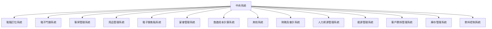
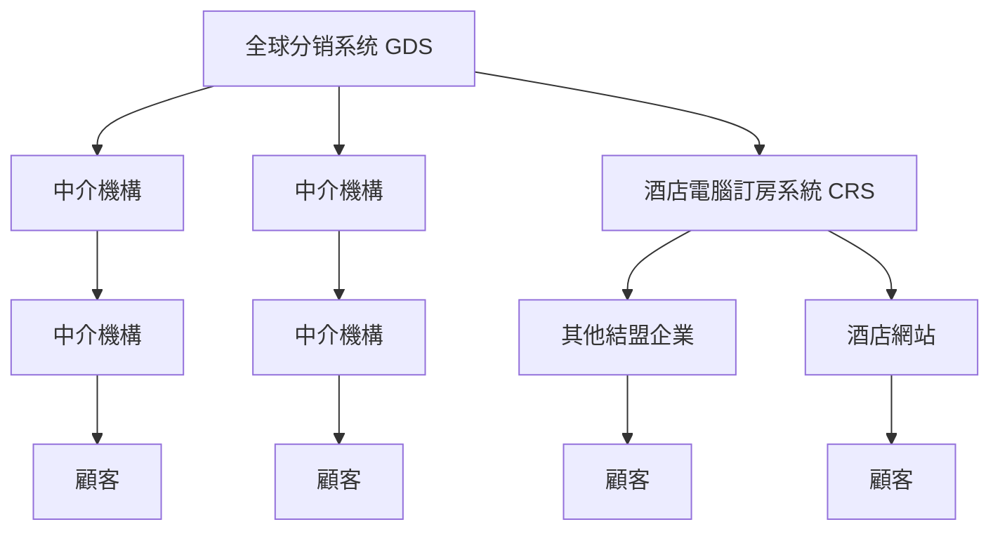
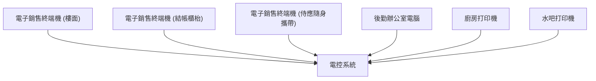

# 單元3

# 款待業的趨勢

# 探究重點

● 探討住宿業與經濟有關的趨勢。  
● 認識住宿業與社會文化有關的趨勢。  
● 了解住宿業與環境有關的趨勢。  
● 概述住宿業與科技有關的趨勢。  
● 探討引進現代資訊科技對住宿業的影響。  
● 探討餐飲業與經濟有關的趨勢。  
● 認識餐飲業與社會文化有關的趨勢。  
● 了解餐飲業與環境有關的趨勢。  
● 概述餐飲業與科技有關的趨勢。  
● 探討引進現代資訊科技對餐飲業的影響。

在上一單元，我們集中討論了經濟丶社會丶文化丶環境和科技如何影響旅遊業的發展，接下來我們會把焦點放在住宿業的趨勢發展。

# 1.1 經濟方面

全球酒店房間需求的變化與全球經濟表現，如國內生產總值（GDP）增長是相關連的，並可從2023年8月前的數據反映：

• 2020年，由於受2019冠狀病毒病疫情打擊，全球GDP萎縮了3.1%，而酒店房間需求出現超過20%的下滑。  
• 2021 年，疫情逐步受控下，全球經濟反彈，GDP 增長率達6.1%，帶動酒店房間需求回升，增幅接近15%。  
• 2022 年，地緣政治因素對全球經濟造成影響，GDP 增速放緩至約3.2%，酒店房間需求同步放緩，僅增長約10%。

整體而言，當全球經濟增速較快時，酒店住宿需求上升，增長明顯；當全球經濟增長減慢時，酒店住宿需求下降，增幅放緩。這些趨勢顯示全球經濟表現會對消費者支出意願和商務活動產生直接影響，繼而左右酒店住宿需求。

# 環球經濟的轉變概況

雖然全球經濟時有波動，但是各地經濟整體發展向好。這帶動人們的消費意欲，追求更高質和更多元的出行體驗，影響住宿業的發展。

# A 民眾收入水平上升

全球各地經濟反覆向好，可反映在民眾人均收入上。從下表可見，亞洲國家和地區的升幅十分明顯，而中國尤其突出。這促進了旅遊業和住宿業的持續發展。

亞洲主要地區人均國民生產總值（GDP）  
（單位：美元）

<table><tr><td>經濟體</td><td>2000 年</td><td>2020 年</td><td>2025 年 (預測)</td></tr><tr><td>新加坡</td><td>23 850</td><td>59 790</td><td>79 170</td></tr><tr><td>中國香港</td><td>25 570</td><td>46 660</td><td>59 130</td></tr><tr><td>日本</td><td>39 170</td><td>40 090</td><td>50 050</td></tr><tr><td>南韓</td><td>12 260</td><td>31 640</td><td>42 720</td></tr><tr><td>中國台灣</td><td>14 840</td><td>28 360</td><td>42 800</td></tr><tr><td>中國內地</td><td>951</td><td>10 510</td><td>16 300</td></tr><tr><td>印度</td><td>451</td><td>1 930</td><td>2 830</td></tr></table>

資料來源：國際貨幣基金組織

# B 金融風暴後的經濟轉變

2008 年由美國引發的金融風暴（又稱金融海嘯），衝擊全球經濟體系，造成環球經濟衰退。這不但影響各國經濟，也對全球旅遊業產生不少深遠影響。不同地區受影響的程度有所不同：

# a對已發展國家的影響

以歐美為首的已發展地區和國家，由於金融業發達，在金融風暴中受到的衝擊巨大。多國民眾財富減少，失業率急升，整體旅遊開支下降，旅客亦傾向選擇短途旅遊和較便宜的住宿。

# b對發展中國家的影響

金融風暴下，已發展國家消費下降造成發展中國家出口貿易減少，經濟同樣受到打擊。發展中國家民眾出遊意欲、旅遊和住宿業需求均減少。不過，中國丶俄羅斯、印度和巴西等國家復甦速度較快，民眾收入增長較已發展國家快。當地民眾的旅遊需求隨着經濟和收入持續向好，使他們佔國際旅客的比率大幅上升。

# 提示箱

可重温課題二：《款待導論》中的酒店及其分類方法、酒店的類型內容。

# 例子庫

《中華人民共和國文化和旅游部 2019 年文化和旅游發展統計公報》顯示，2019 年內地旅遊人數為 60.06 億，比 2018 年增長8.4%；2019 年出境旅遊人數達到 1.55 億人次，比 2018 年增長3.3%。

# 經濟轉變所衍生的不同住宿類型的發展

受惠經濟持續發展，旅遊業和酒店業的需求上升，但競爭日益激烈。與此同時，旅客對旅遊住宿各有要求，有些追求享受，有些重視價格。按價格分類，酒店可細分為：有限服務酒店、精選服務酒店和全服務酒店。

# A 有限服務酒店

• 有限服務酒店最初以酒店沒有餐廳或宴會設施作為界定，通 常只為客人提供基本的設施和服務。  
• 隨着時代演變，有限服務酒店的設施和服務在過去十年已有所擴展。如今，這類酒店可能配備商務中心、小型會議室、健身室、客用洗衣設施、茶水間，甚至游泳池、按摩浴池。不過，有限服務酒店仍不會提供餐飲服務或設施。

這類酒店的目標客群是注重價格及較低預算的商務旅客和休閒旅客，房價普遍較為實惠。

text_image

ibis HOTEL
情心轩

▲圖5.114位於上環的宜必思酒店屬於有限服務酒店

# B 精選服務酒店

• 精選服務酒店是一種介乎有限服務和全服務酒店之間的混合模式，結合了兩者的特點。這類酒店通常提供有限範圍的服務和設施，例如不會像全服務酒店那樣配備多種類型的餐廳或全面的餐飲服務，也不會設置大量會議空間。  
• 客房設施方面，精選服務酒店的標準通常能接近甚至媲美全服務酒店，但房價卻較實惠。

text_image

COURTYARD
Marriott

在 2008 年環球經濟衰退後，隨着商務旅遊預算縮減，市場對精選服務酒店的需求顯著增加。雖然精選服務酒店與有限服務酒店有許多相似之處，但每家酒店提供的具體服務和設施會有所不同。

圖 5.115 位於港島西區的香港萬怡酒店屬於精選服務酒店

# C 全服務酒店

全服務酒店與其他類型酒店最突出的分別，是會為客人和團體提供全面且高水準的餐飲服務。  
. 這類酒店通常提供豐富的設施和服務選項，例如豪華的水療中心、華麗的宴會廳、高級餐廳和特色精品店，以及門僮服務、代客泊車服務、禮賓服務、客房餐飲服務等。  
• 客人能在全服務酒店享受到更多額外的設施和更優質的服務，這是其他類型酒店無法比擬的。

natural_image

Exterior view of a modern glass skyscraper with 'FORCE SEASONS HOTEL' signage on top (no other text or symbols visible)

▲ 圖 5.115 位於港島中環的香港四季酒店屬於全服務酒店

要注意的是，有限服務酒店、精選服務酒店和全服務酒店這三類酒店所提供的設施和服務各有不同。即使同一類別中的酒店，其設施和服務也可能因品牌或定位的不同而存在差異。

# 1.2 社會文化方面

# 人口改變對旅客住宿偏好的影響

上一章我們探討過人口改變對旅遊業的影響，有關趨勢對住宿業亦有一定影響。以下是不同世代旅客在住宿方面的一些偏好：

<table><tr><td>世代</td><td>住宿偏好</td></tr><tr><td>老一輩(約1945年之前出生)</td><td>老一輩傾向選擇安全性和保安程度高的酒店,地點或設施相對次要。即使相隔長時間,仍會光顧同一間酒店。關注酒店環境,包括空氣和水的質素。偏好入住設施能考慮長者身體狀況的酒店。</td></tr><tr><td>嬰兒潮一代(約1945年至1964年出生)</td><td>嬰兒潮一代較關心住宿設施的品牌形象和品質,對舒適度、性價比、設施和服務有所要求。希望酒店傢具舒適,配置按摩花灑,客房提供咖啡機、梳妝鏡和免費的互聯網服務。喜歡能提供機會讓他們欣賞當地文化或與當地居民交流的住宿設施。在酒店停留的時間較長,不希望員工的起居照顧及服務造成過多騷擾。</td></tr><tr><td>X世代(約1964年至1980年出生)</td><td>X世代追求性價比高的住宿產品和服務。對酒店環境和設施有所要求,例如要有名牌床褥、精緻花灑和高清平面電視。喜歡入住具時尚感的酒店,不一定會多次光顧同一個連鎖酒店集團。希望安排寧靜的客房,並能接駁無線上網服務,方便他們休息和工作。</td></tr><tr><td>Y世代(約1980年至1994年出生,又稱「千禧世代」)</td><td>Y世代對酒店品牌的忠誠度較低,願意入住非傳統品牌。要求酒店能提供便捷高效的服務及設施。希望酒店呈現奢華的氛圍,並能讓他們感到受啟發、鼓舞和尊重。希望酒店能提供經濟實惠的快餐、免費上網服務、無線環境及掛牆平面電視。比較喜歡入住方便購物和購買手信的酒店。相對其他世代,互聯網對Y世代的推廣尤其有效。</td></tr><tr><td>Z世代(1994年以後出生,又稱「數碼世代」)</td><td>由於經濟能力有限,Z世代對住宿要求不太高,甚至接受入住當地民宿,或透過網絡平台連繫,到當地陌生人家中借宿。要求酒店能提供便捷高效的服務及設施。希望酒店能提供免費上網服務、無線環境,以及引入自助服務設施。相對其他世代,社交媒體對Z世代的推廣尤其有效。</td></tr></table>

# 生活方式對旅客住宿要求的影響

社會進步令人們的生活方式產生變化，對旅遊住宿體驗的期望更高。現時很多旅客出遊，不只追求舒適的住宿環境，更要配合個人生活習慣和科技發展。

# 提示箱

有關住宿業在科技方面的發展，在本書頁 219至235 會有詳細討論。

# A 追求智能生活方式的住宿

隨着電子產品為人們生活帶來便利，以及人們對電子產品日益依賴，智能生活已十分普及。越來越多旅客期望，由訂購住宿產品到酒店服務，均有自助化服務，甚至享用到更先進的科技，以提高他們的住宿體驗。

natural_image

A couple sleeping in bed, one holding a smartphone, with no visible text or symbols.

▲ 圖5.116 酒店住宿離不開電子產品的旅客

# B 配合健康生活方式的住宿

現代人工作生活壓力大，慢性疾病越來越普遍。與此同時，醫療科技進步，使很多預防疾病的資訊普及。這驅使更多人追求健康生活，提倡健康飲食和保健養生，強調減壓放鬆等，並影響到住宿業的發展。更多水療酒店的出現，就是一個例子。

text_image

SENATOR SPA HOTEL KITCHEN

▲ 圖5.112 西班牙一間市中心水療酒店

# C 高齡旅客的住宿要求

由於醫學昌明，人均預期壽命提高，長者人口將不斷增加。嬰兒潮出生的一代，正逐步進入退休年齡，令銀髮族佔旅客人數比率上升。

因此，住宿業需加入更多「樂齡」設施，以更好地接待高齡客人。例如：

• 房門及水喉等選用更易使用的設計，方便手腳行動不靈活的高齡旅客。  
• 浴室安裝扶手及提供自動沐浴機或於浴缸設高椅，便利有自理困難的長者旅客。  
• 在睡床底部及牆角暗處加裝夜燈，減低長者旅客深夜摸黑上廁所的風險。  
• 酒店內的指示牌和餐牌以更大字體顯示，方便視力不足的長者旅客閱讀。  
• 餐單設計注重健康，口味亦要照顧長者味覺和牙齒退化等生理情況。  
• 防火與保安系統設閃燈訊號，方便有聽覺障礙的年長旅客。  
• 確保有足夠急救醫療設施，特別在郵輪和觀光船上。

natural_image

Interior view of a bathroom shower area with a metal shower unit, water level, and wall-mounted fixtures (no visible text or symbols)

▲ 圖 5.117 在設計上考慮到長者旅客需要的酒店浴室

natural_image

Interior view of a bathroom with a white toilet, metal faucet, and tiled wall (no text or symbols visible)

▲ 圖 5.118 在設計上考慮到長者旅客需要的酒店洗手間

住宿業在服務方面，亦要對長者旅客的需要多加留意。例如：

• 安排職員特別留意高齡旅客入住時的情況，如更迅速提供房間服務，減少他們輪候時間。  
• 協助長者旅客入住、退房時搬運行李。  
• 為對聲音比較敏感的高齡旅客，安排隔音較好或較寧靜的房間。  
• 協助長者旅客在當地旅遊，如安排交通工具和預約餐廳。

natural_image

Interior scene with three people in conversation, one in uniform interacting with a man; background includes decorative wall decor and floral arrangement (no visible text or symbols)

▲ 圖 5.119 一對長者旅客在入住酒店時得到職員的協助

另外，長者重視別人的尊重，在消費上比較小心，所以員工的服務質素和態度亦非常重要。住宿業在服務上應令他們感到物超所值。

在人口老化下，部分酒店聘請長者僱員，讓這些更能了解高齡旅客需要、社會閱歷豐富、處事認真的僱員，接待高齡旅客，從而提高服務質素。

# D 家庭旅客的住宿要求

由於家庭旅遊需求上升，不少酒店開始提供家庭套房予一家人入住。這類家庭套房一般供三至四人入住，並可按客人要求加床。房間通常較為簡單，以騰出空間放置較多的行李。部分酒店房間更會安裝保護設施，如防撞角和電源蓋板，減少兒童受傷機會。

有些親子酒店會提供適合父母和孩子一同享用的設施，如設有滑梯的淺水泳池丶兒童遊樂室丶 STEM 學習房，並會安排烹飪課和篝火晚會等親子活動。更有酒店安排職員在活動房間，替父母看顧孩子，讓旅客可以安心在酒店放鬆身心。

natural_image

Interior view of a modern bedroom with a double-decker bed, patterned wallpaper, and wooden furniture (no visible text or symbols)

▲ 圖5.120 有一張雙人床及一張碌架床的家庭房

# E X世代與Y世代的住宿要求

不少 X 世代和 Y 世代喜愛旅遊，使他們成為海外旅遊的主力消費者。為了迎合這兩代人的生活模式和消費特徵，住宿業方面主要有以下的改變：

# a增加資訊科技設施

• X世代和 Y 世代旅客大多熟悉使用數碼科技產品，住宿企業廣泛利用互聯網進行推銷，以及提供訂房服務。  
• 越來越多住宿企業利用互聯網，簡化旅客入住登記程序，以及提供快速退房服務，迎合X世代和 Y 世代追求便捷的心態。

text_image

THIS HOTEL HAS
Wi-Fi
ACCESS

酒店現時基本上已必備無線上網，供旅客在公共空間和客房使用。一些酒店則不斷提升資訊科技設施，為X世代和 Y 世代旅客帶來新鮮的入住體驗。

圖5.121 不少酒店客房的無線上網服務，需要旅客先輸入酒店提供的密碼。

# 例子庫

有酒店的客房系統，可讓旅客利用智能手機、平板電腦等控制電視顯示屏、冷氣温度，以及訂購餐飲等。

# b強化售後服務

• X世代和Y世代經常使用社交媒體分享個人旅遊體驗，並會對入住過的住宿企業作出評價。因此，現時越來越多酒店會加強售後服務，如收集住客意見，以改善服務，維持口碑。  
• X世代和Y世代對住宿的忠誠度比較低，喜歡嘗試不同酒店或住宿。對於這類曾入住的旅客，酒店企業需要加強推銷新優惠和設施等，以吸引他們再次光顧。

# c重視旅客體驗機會

• 不少X世代和Y世代旅客，重視入住體驗多於奢華的住宿，小眾住宿提供者如民宿等，提供另類和更貼近當地人生活的住宿體驗，便受到他們的歡迎。  
• 部分酒店透過延長早餐時間丶健身中心開放時間，以及舉辦酒店夜間派對丶提供單車租賃和電動車充電站等，配合X世代和Y世代旅客多元的需要。  
• 很多X世代和Y世代旅客，追求時尚有品味的設計，促成更多精品酒店和特色酒店的出現。

# 例子庫

• 有些酒店以無邊際游泳池（Infinity Pool）作賣點，成功吸引 X世代與 Y 世代旅客在社交媒體上分享他們的游泳照，收到不錯的宣傳效果。

natural_image

City skyline with modern skyscrapers reflected in water, no visible text or signage

圖 5.122 馬來西亞吉隆坡一間酒店的無邊際游泳池，吸引不少旅客在社交媒體分享。

# 多元化消費客群與消費要求對住宿業的影響

今時今日，旅客的背景和對住宿的偏好越趨多元化：

• 價格：有些旅客只入住豪華高級酒店，但有些會特意挑選廉價的，以減少旅遊開支。  
• 服務：部分旅客如商務旅客，希望酒店能提供洗衣和會議等服務，所以選擇入住服務周全的酒店；但一些旅客只需要住宿和簡單早餐，偏好有限度服務的酒店。  
• 目的：旅客出遊如目的是悠閒丶放鬆和健康，不會介意花多一點金錢入住度假酒店；但有些旅客喜歡到城市各處觀光，對酒店環境不太重視，可能會選擇市中心的經濟型酒店。

住宿業面對多元化的旅客市場，使很多酒店開始變得更專門化，以服務目標客群，過去嘗試滿足全部旅客的營銷方式，已逐漸消失。

# 2019冠狀病毒病疫情對住宿業界的影響

2019 冠狀病毒病疫情爆發後，迅速蔓延全球各地，對住宿業界產生深遠影響。跟旅遊業一樣，在沒有外地旅客支持下，住宿業進入寒冬。

# A 住宿業受到的影響及回應

# a入住率大跌

受疫情影響，各地實施出入境管制，國際旅客人數大減，住宿業經營大受打擊，入住率急劇下跌。部分酒店及大批賓館要暫時停止營運，甚至結業。很多酒店要求員工放無薪假，或減薪等，以減低經營成本和壓力

# 例子庫

香港 2020 年外地入境旅客人數大減超過九成，酒店入住率因而大跌。同時由於政府實施社交隔離措施和堂食時間限制，酒店餐飲部生意亦大受打擊。結果，酒店業整體收入大減。根據牌照事務處資料，截至2020年9月底，有65間賓館及3間酒店結業。

text_image

RunHotel.hk 分享酒店優惠、訂機費、助應攻略
August 06
【香港酒店 Staycation】住一晚包埋自助餐（或餐飲）的酒店推介 | 食+住優惠
8月至9月份全香港酒店Staycation
優惠大集合（食+住+款）
8月至9月份繳有好多香港酒店推出「住一晚·餐飲」的住宿優惠，其中簡

▲ 圖 5.123 網站推介的「香港酒店 Staycation」

# b 宅度假（Staycation）

在欠缺外地旅客的情況下，酒店業紛紛調整策略，在採取抗疫措施的同時，轉攻本地市場，推出各種「宅度假」優惠，為本地旅客提供住宿連餐飲、水療等度假套票。

這吸引不少本地居民購買，一方面增加了酒店的生意，另一方面讓本地市民即使無法到外地旅遊，也可在本地享受休閒假期，鬆弛身心。

# 資料室

# 豪華露營

在 2019 冠狀病毒病疫情下，更多人選擇到郊外，遠離人群，連帶豪華露營（Glamping）亦非常受歡迎。在香港，大嶼山、西貢、流浮山、長洲等地，都有相關設施供市民體驗另類的宅度假。

# c 開拓月租酒店業務

不少酒店在疫情期間推出月租優惠，以提高入住率。有旅遊網站把握機會，與酒店合作，開拓月租酒店資訊業務，推出住宿連餐飲優惠，平均每日房價遠較一般房價便宜。這些酒店更向月租住客提供無上限無線上網服務，以及每周清理房間服務，吸引不少本身租住私人樓宇的人士和家庭入住。

# d引入新科技

在疫情下，酒店需要更為注重衞生。為了減少員工和旅客的接觸，以及病毒傳播的風險，一些酒店特意引入自助登記入住機、機械人提供送餐服務等。隨着酒店業投入更多資源引入新科技，將為旅客帶來新體驗。

text_image

19
HELLO
Hanging to Your Room
NO. 04

圖 5.124 酒店引入的機器人，可用於迎接客人，將客人、物品送到房間，提供信息，並支援多種語言。

# B 政府的回應

因應住宿業面對的嚴峻環境，各地政府都積極協助住宿業界度過難關。以香港為例，政府有以下的支援措施：

• 香港政府為了減低入境旅客傳播病毒的風險，邀請和安排不同酒店成為指定檢疫酒店，讓抵港人士在隔離期居住，而入住酒店的費用由抵港人士支付。若指定檢疫酒店入住率低於五成，政府會補貼，有助舒緩部分酒店的經營壓力。  
• 香港政府透過「防疫抗疫基金」，向持牌賓館和酒店提供即時援助，包括分別設立「持牌賓館資助計劃」和「酒店業支援計劃」，向每間合資格的賓館最高給予八萬港元資助，每間合資格的酒店最高給予40萬港元資助。

• 香港旅遊發展局為協助酒店業和鼓勵本地消費，推出「賞你住」活動。任何市民於合資格實體零售或實體餐飲商戶消費滿八百港元，便可於網上登記，享有五百港元本地酒店住宿折扣優惠。活動受到香港居民歡迎，一推出隨即滿額，有助提升酒店入住率。

# 1.3 環境方面

在上一個單元，我們提及旅遊本身對環境產生不少影響。根據 2019 年聯合國氣候峰會的報告，全球的碳排放有 8% 來自旅遊業。

當中，資源密集型的住宿業，每日營運都會造成各種資源消耗情況。以酒店為例：

<table><tr><td></td><td>水資源</td><td>能源</td><td>各種廢物</td></tr><tr><td>行政部門</td><td></td><td>辦公室電腦和設備</td><td>文件材料(主要是紙)有害廢棄物(如碳粉)</td></tr><tr><td>技術及設施</td><td>用來冷卻設備的水游泳池池水更替灌溉植被</td><td>冷氣和暖氣系統</td><td>廢水維修和保養用的化學品植物施加的農藥</td></tr><tr><td>餐飲服務</td><td>烹調食用水清潔用水</td><td>烹調燃料裝飾燈光</td><td>食物包裝廚餘(包括有機廢棄物,如多餘的蔬果和剩餘食物)</td></tr><tr><td>客房服務</td><td>沐浴及個人護理房間清潔</td><td>空調、照明、充電和電視</td><td>清潔物品包裝廢棄物(如衛生用品)</td></tr><tr><td>洗滌工作</td><td>洗滌布草(如床單和員工制服)用水</td><td>熨整酒店床單</td><td>清潔物品洗滌用品</td></tr></table>

隨着全球環保意識提高，住宿業在可持續發展的旅遊概念下，在營運方式和服務標準等各方面均需要作出調整，以達致生態環保。

# 網絡台

綠色酒店協會

# 綠色酒店

綠色酒店又稱「環保酒店」或「可持續發展酒店」。「綠色」不是指酒店裝潢或擺飾以綠色或植物為主，而是指酒店運用環保丶健康丶安全和節約的理念去營運。

# A 綠色酒店的特點

• 環保：酒店在經營過程中，儘量減少對環境的污染。  
健康：酒店向客人提供有益身心健康的產品和服務。  
• 安全：強調酒店的公共安全丶消防安全和食品安全。  
• 節約：酒店致力節能減耗，善用水丶電、煤氣等資源。

# 資料室

# 如何成為綠色酒店？

現時有不同環保住宿認證項目，比較多人認識的認證項目有 Green Key Global 丶 Green Globe International 等。不同認證項目的標準不同，但綠色酒店仍有一些共同的認證標準，包括：

• 實現減少碳排放  
• 實現減少耗用能源  
• 實現減少用水  
• 實現減少廢棄物

由於各個認證項目標準不一，所以有網上旅遊代理商推出綠色領袖 (GreenLeaders) 計劃，讓合作的住宿業企業自行匯報它們在可持續發展方面的工作，再由平台委任專家審計和用戶反應回饋，以評定表現，供旅客作多角度參考。

text_image

GREEN KEY
GLOBAL

▲ 圖 5.126 Green Key Global 的標誌

text_image

GREEN
GLOBE

▲ 圖 5.125 Green GlobeInternational 的標誌

# 思考點

住宿業除了有綠色酒店，是否也有綠色民宿？

# B 綠色酒店興起的原因

綠色酒店的興起，除了可以保護環境外，同時有助經營者建立企業形象、提高顧客忠誠度、降低營運成本等，因而受到業界支持。

# a 建立企業形象

全球環境保育意識日漸高，不少旅客會將酒店營運是否環保，作為考慮會否入住的其中一項標準。酒店配合社會的環保要求，既能為企業建立正面形象，也能提高顧客對酒店的滿意度。

圖 5.126 內地旅遊部門會對 酒店進行評審，把綠色酒店評為「金葉級」和「銀葉級」。

text_image

绿色旅游饭店
CHINA GREEN HOTEL
银叶级

全国旅游星级饭店评定委员会
CHINA TOURIST HOTEL STAR-RATING COMMITTEE
3220234

# 例子庫

旅遊網站 Booking.com 於 2017 年公布可持續發展旅遊報告，有65% 受訪旅客表示更願意選擇環保住宿，同時有 46% 受訪者認為自己是環保旅客。

# b 提高客戶忠誠度

根據哈佛商業評論於 2012 年發表的研究報告，超過六成消費者表示會對重視可持續發展的企業有較高忠誠度。因此，綠色酒店透過環保營運理念，可贏得顧客的芳心，提高顧客再次入住的機會。另外，顧客亦樂於將綠色酒店推介給親友，為企業建立口碑。

# c 降低營運成本

水丶電和煤氣等能源開支，佔酒店營運成本的比例不輕。酒店採取節約能源措施，可節省相關開支，提升酒店整體利潤。雖然酒店安裝綠色設施或涉及較大的初始費用，但長遠能減低酒店的營運成本，為企業帶來更多回報。

# d 符合環保法例要求

現時，很多旅遊目的地政府會根據可持續發展的概念，制定指引或立法，要求住宿業符合有關規定。為了配合法例，酒店一般會主動投入資源，在營運中實踐環保。

# 例子庫

• 香港的酒店須像其他企業一樣，遵守《水污染管制條例 》和《廢物處置條例》，妥善處置污水和廢物。  
日本東京實施垃圾分類回收，廢物一般分為 14 類，當地酒店亦需跟隨法例。為了準確將垃圾分類，有酒店員工會隨身攜帶筆記，以便仔細對照確認。

# e 負起社會責任

酒店在營運過程中，需要依賴旅遊目的地的資源，包括水丶電和環境面貌。不少酒店企業的經營者，明白酒店發展與環境的關係，因此願意在營運上負起社會責任，盡量減少業務對環境的影響，使酒店和目的地都能可持續地發展。

▲圖5.127 「酒店業玻璃樽回收計劃」宣傳海報  

text_image

酒店業
玻璃博回收計劃
Glass Container Recycling Programme
for the Hotel Sector

請先倒清後才放入回收桶
Please empty bottles before
putting into recycling bin

不接受再填備供給

碳及碳類
GREEN RED
METHAN LEAVES
ONION GLASS

碳及碳類
GREEN RED
METHAN LEAVES
ONION GLASS

碳及碳類
GREEN RED
METHAN LEAVES
ONION GLASS

碳及碳類
GREEN RED
METHAN LEAVES
ONION GLASS

碳及碳類
GREEN RED
METHAN LEAVES
ONION GLASS

碳及碳類
GREEN RED
METHAN LEAVES
ONION GL Brushes

碳及碳類
GREEN RED
METHAN LEAVES
ONION GL Brushes

碳及碳類
GREEN RED
METHAN LEAVES
ONION GL Brushes

碳及碳類
GREEN RED
METHAN LEAVES
ONION GL Brushes

碳及碳類
GREEN RED
METHAN LEAVES
ONION GL Brushes

碳及碳類
GREEN RED
METHAN LEAVES
ONION GL Blouses

碳及碳類
GREEN RED
METHAN LEAVES
ONION GL Blouses

碳及碳類
GREEN RED
METHAN LEAVES
ONION GL Blouses

碳及碳類
GREEN RED
METHAN LEAVES
ONION GL Blouses

碳及碳類
GREEN RED
METHAN LEAVES
ONION GL Blouses

碳及碳類
GREEN RED
METHAN LEAVES

# 例子庫

香港酒店業協會和環境保護署於 2008 年推出「酒店業玻璃樽回收計劃」，幫助酒店業減少棄置廢物，並以符合環保的方式處理所產生的玻璃樽。該計劃雖然由參與的酒店承擔有關費用，但仍得到近50間酒店的支持。

# f 提高員工歸屬感

發展綠色酒店有助提高企業的環保形象，使員工的歸屬感提升。同時，年青一代的環保意識較高，酒店願意承擔環境保育責任，他們入職的意欲也較大，並對能服務綠色酒店而感到自豪。如此，整體員工的積極性亦較高，對維持酒店的服務質素有正面作用。

text_image

PROTECT OUR ENVIRONMENT
To help preserving the environment, we will only replace the towels you placed on the floor and inside the bathtub. Bed linen will be changed every 3 days. However, we are delighted to change the linens upon your request.
保護環境
為保護環境，我們只會為閣下更廣放在地上及浴盆內的毛巾、保車兩等3天更換一次。
如閣下提出要求，我們亦現樂意為閣下地上全新床單。
The Harbourview
簡景國尚

# C 綠色酒店的營運方式

# a日常營運

為了響應環保，酒店會以減少使用（Reduce）丶物盡其用（Reuse）丶循環再造（Recycle）和替代使用（Replace）的方向進行日常營運：

▲ 圖 5.128 酒店為保護環境，

減少更換布草的告示。

<table><tr><td></td><td>減少使用(Reduce)例子</td><td>物盡其用(Reuse)例子</td></tr><tr><td>整體環境</td><td>設計上利用自然通風和自然光,減少用電。使用反射熱源物料鋪設外牆及天台,減低室內溫度和空調使用量。採用電腦灌溉系統,根據泥土、植物的種類和當天的天氣變化,計算最佳的灌溉方式和水量。</td><td>重用節日裝飾品。安裝熱泵系統,回收空調的熱力來加熱自來水。酒店內的家具或擺設,以蓋房子用剩的木材製成。</td></tr><tr><td>客房服務</td><td>將房內空調溫度預設至環保標準。以固定器皿放置沐浴露、洗髮及護髮露,減少用完即棄的浴室用具。使用低流量/兩段式沖水座廁。使用低流量水龍頭/花灑設備。</td><td>放置提示卡,鼓勵入住多於一晚的客人重用毛巾,減少洗毛巾的用水。減少替長時間入住旅客的房間更換床單次數。使用可重用的浴室用品,如漱口杯。使用可清洗的洗衣袋,不使用膠袋。</td></tr><tr><td>餐飲及設施</td><td>避免使用一次性的餐具和用品,尤其是塑膠餐具。避免使用獨立包裝的調味料,如糖和茄汁包等。</td><td>設計菜式時盡量減少浪費,如盡用食材各部分。回收餐廳廚餘,作堆肥處理。將廚餘製成酵素,用作清潔劑。</td></tr><tr><td>會議和宴會場地</td><td>使用電子屏幕作宣傳和公告,減少使用紙張。為活動策劃人提供合乎環保原則的會議方案。</td><td>重用佈置用品或背景幕板。</td></tr><tr><td>其他設施</td><td>減少不必要的擺設,避免製造廢棄物。安裝自動感應裝置,控制公共場所的電器開關。</td><td>健身室的健身單車連接發電機,讓旅客參與開源節能。</td></tr><tr><td>行政方面</td><td>電子化登記入住,減少使用紙張。</td><td>雙面使用紙張。</td></tr></table>

text_image

PAPER
纸張
CANS
鋁罐
PLASTIC
膠樽

▲ 圖 5.129 酒店在大堂設置的廢物分類回收箱

<table><tr><td></td><td>循環再造(Recycle)例子</td><td>替代使用(Replace)例子</td></tr><tr><td>整體環境</td><td>於酒店放置廢物回收箱,鼓勵顧客回收。使用熱能回收設備。使用水冷散熱系統,將廢氣過濾轉化成新鮮冷或暖空氣;使用熱泵熱水器將水加熱,轉送到泳池。</td><td>使用高效能LED燈泡,代替耗電量較大的燈泡。收集雨水用於中央冷氣的冷卻塔,並利用冷卻塔排放的水作沖廁用途。</td></tr><tr><td>客房服務</td><td>回收客房一次性用肥皂,生產再造肥皂把舊床單用作洗衣袋或其他內部布草用品。</td><td>為客人提供有機認證和天然成分產品,包裝亦採用可生物分解物料。使用公平貿易產品作迎賓禮品,並於客房迷你酒吧供應。</td></tr><tr><td>餐飲及設施</td><td>安裝污水過濾系統,循環再用污水。將洗碗碟機所用的沖洗水,用來沖走碗碟上的食物殘渣。</td><td>使用可重用的盛器和餐具。使用可堆肥物料飲管。設環保餐單,供應可持續發展海鮮、自由放牧肉類及有機蔬果。停止提供魚翅或其他由瀕危絕種動物製作的菜式。購入本地食材。使用有機食材。</td></tr><tr><td>會議和宴會場地</td><td>使用可循環再用的物料搭建佈景。</td><td>使用環保裝飾,如以仿真花代替鮮花。使用獲得環保認證的紙巾和餐巾</td></tr><tr><td>其他設施</td><td>泳池安裝過濾設施,循環再用池水以減少耗水。</td><td>引進電動汽車接送客人。提供單車予客人作觀光用途。</td></tr><tr><td>行政方面</td><td>使用環保紙張和文具。</td><td>以循環再造紙張製作酒店宣傳品。</td></tr></table>

# 例子庫

香港酒店的綠色營運例子：

• 香港唯港薈：安裝肥皂瓶以取代即用即棄沐浴露和洗髮水 ; 電子化登記入住。  
• 香港黃金海岸酒店：用酒店棄用的桌布製造環保床旗的碎布，作藝術活動。  
• 香港迪士尼樂園度假區：進行廚餘回收和園林廢料回收。  
• 富豪國際酒店：盡量購買可回收及環保產品，並建立綠色供應商名單。  
康得思酒店：推出健康菜單和素食選擇，並以本地時令食材決定菜式。

# b員工管理

• 管理層引入節能減碳工作程序及文化，帶領所有員工為環保出一分力。  
• 舉辦環保講座，教導員工如何在日常工作中實踐環保理念。  
• 設立獎勵計劃，表揚對持續節約能源提供創新意念的員工。

# c 旅客教育

• 利用標示牌丶海報或小卡等，提醒和教導旅客節約用水的方法，如重用毛巾。  
推廣酒店的節能減碳措施和設施，增強旅客的環保意識。

總括而言，酒店可以通過減少使用丶物盡其用丶循環再造和替代使用等方面，進行綠色營運。不過，當中或會使成本增加，或要將工序複雜化，甚至為旅客帶來不便，所以酒店必須從中取得平衡，才能帶來長遠性的利益。

text_image

USE ME AGAIN
PLEASE
請繼續使用我吧

Please have been doing the commitment to
Take a commitment to you, I am sure that you want to keep your own
your people just on the back for your own
Thank you.

請勿讓你注意以下第一步：
若要請，請先向該人發出「不動」、「無動」等。
要請入門，請先向該人發出「不動」、「無動」等。
請將此電話寄到本店（地址：台北區北區東）
BAY BRIDGE

▲ 圖5.130 提示旅客重覆使用毛巾的酒店標示牌

natural_image

Shower shower unit with two BAY BRIDGE brand containers on a tiled bathroom (no visible text or symbols on the main objects)

▲ 圖 5.131 使用大劑量沐浴露、洗髮露容器的酒店浴室。

# 住宿業的趨勢(II)2

# 科技方面

本章我們會探討科技演進如何影響住宿業的發展。

# 2.1 酒店資產管理系統 (PMS)

住宿業的日常運作依賴資訊科技支援。隨着科技進步，現時的設備已由早期各部門按需要各自擁有一個系統，變為有數據整合和資料共享的系統。各部門溝通更方便，大大提升營運效率。

# 何謂酒店資產管理系統 (PMS)?

酒店資產管理系統 (PMS, Property Management System) 是一個專為酒店業設計的電腦系統，在實現各個子系統獨立運作的同時，可加強各部門溝通，並供管理層透過中央系統進行有效統一的管理和控制，實現酒店管理的一體化。現時，各酒店均採用PMS，作為管理及控制酒店運作的主要工具。

# A 中央系統

PMS 是酒店的中央核心系統，作為一個資訊交流融合的平台，可將酒店各個子系統結合在一起。管理層因而能夠輕易掌握酒店運作時使用的資料和數據， 進行各類分析和報表，令營運丶規劃和監察更有效率。

PMS 所具備的多語言和多貨幣計算功能，可配合跨國集團的業務工作。因此，大型連鎖酒店集團會將旗下酒店的 PMS 整合，成為一個企業系統。

酒店資產管理系統示意圖  

flowchart

圖 5.132

# B 各部門使用的子系統

PMS 被廣泛應用於酒店各部門，以下是部分子系統的簡介：

<table><tr><td>PMS 子系統</td><td>使用部門</td><td>功能</td></tr><tr><td>電腦訂位系統</td><td rowspan="2">前堂部</td><td>(詳見下一節)</td></tr><tr><td>電子門鎖系統</td><td>管制客房進出減少盜竊事件發生</td></tr><tr><td>客房管理系統</td><td rowspan="2">管家部</td><td>客房分配作清潔客房維修或裝修更新客房狀況,如清潔後可用客房日常管家紀錄</td></tr><tr><td>用品管理系統</td><td>物品存儲管理,供採購部參考</td></tr><tr><td>電子銷售點系統</td><td rowspan="4">餐飲部</td><td>訂位紀錄及座位安排客人訂菜後同步通知廚房酒吧備菜,以及入賬紀錄結賬(即時結賬或記賬到客房賬單)</td></tr><tr><td>宴會管理系統</td><td>預訂宴會房間及設備整合客人餐飲套餐、活動佈置和付款等紀錄</td></tr><tr><td>食譜成本計算系統</td><td>更新餐單項目成本計算製作成本及邊際利潤</td></tr><tr><td>飲料控制系統</td><td>控制各場所飲料消耗情況銷售統計及分析</td></tr><tr><td>財務及會計系統</td><td>財務部/會計部</td><td>製作客房銷售報表統計住客於酒店的各項消費其他商業會計用途結算及支付予旅行代理商及全球分銷系統等的佣金編製財務報表和分析報告</td></tr><tr><td>人力資源管理系統</td><td>人力資源部</td><td>管理人才招聘整合員工資料及處理薪酬紀錄出勤及績效評估</td></tr><tr><td>客戶關係管理系統</td><td>營業及市場推廣部</td><td>客戶數據及消費喜好分析推廣活動和銷售追蹤與客戶互動及客戶支援</td></tr><tr><td>能源管理系統</td><td>工程部</td><td>監控酒店能源使用情況管理和調節空調、智能照明設備</td></tr><tr><td>庫存管理系統</td><td>採購部</td><td>監控庫存情況提供採購和補貨建議庫存盤點</td></tr></table>

natural_image

Illustration of smart home security devices including a tablet, smartphone, and wall-mounted device (no text or symbols visible)

▲ 圖 5.133 酒店資產管理系統對處理訂房、監察客房供應情況等帶來方便。

# 2 酒店資產管理系統(PMS) 的功能

酒店資產管理系統有以下的功能：

# A 對前堂部而言

a 訂房：電腦程式容許多名職員同時進入系統，處理訂房、監察客房供應情況。  
b 登記入住或結帳退房：顧客入住時，職員可從系統快速得知酒店房間狀況，以及取得顧客有關訂房記錄和個人資料，如特別要求，縮短登記時間。系統又能進行特快結帳功能，減少人為計算錯誤。  
c 顧客資訊共享：職員透過系統，可輕易查看和更新入住顧客的資料，例如顧客歷史紀錄、其須支付的房價、逗留天數及信用餘額等。  
d 顧客記帳：顧客在酒店內的一切消費，包括房間內的額外消費，以及於其他部門，如餐廳和水療健身中心的消費，都可透過系統管理及更新交易記錄，直至顧客退房支付帳單為止。

# B 對後勤部門而言

a 客房狀況及管理：前堂部及管家部可隨時登入及更新同一個資料庫，互相提供最準確的客房狀況資料。管家部能透過系統獲得最新的客房資料，安排服務員清潔客房及進行保養工作。  
b 人力資源：人力資源部可透過系統獲取員工資料，如薪金、年資、請假及工傷紀錄。系統的其他功能還包括支薪及編更等，方便人力資源部員工進行日常工作。  
c 銷售及市場推廣：營業及市場推廣部可透過顧客歷史紀錄系統，分析顧客資訊和喜好等，進而集中向目標客群作市場推廣。  
d 會計及財務報告：會計部可透過系統處理複雜的計算工作、編製財務報告及統計資料，例如銷售分析、客房入住情況及損益表等。這方便高層管理人員掌握酒店業績資訊，以及各部門經理了解酒店營運狀況。  
e 存貨及採購：系統記錄不同項目的資料，包括物品價值、數量及位置等，方便酒店職員及早作出訂貨安排。

text_image

DATA
MANAGEMENT

▲ 圖 5.134 PMS 有助協調各部門運作

# 資料室

# 「全方位」的酒店資產管理系統軟件 Opera

由於酒店資產管理系統在酒店營運中扮演資訊樞紐的重要角色，為了方便酒店各部門使用，軟件企業專門開發了一個能兼容不同酒店系統的全方位產品：Opera。Opera 是一款綜合管理軟件，包含有前線部門使用的訂房系統、前台管理系統、銷售及餐飲系統等，以及多個後勤部門使用的系統。該系統能有效協調酒店各部門的運作，提升酒店的整體運營效率，目前已廣泛應用於全球不同類型和規模的酒店。

# PMS的重要性

總括而言，PMS對酒店管理和營運有重大作用。

# A 協調部門運作

酒店日常營運離不開跨部門的分工合作，PMS 可供不同部門共用系統和更新資料，令各部門的溝通更方便，工作更有效率。一些各部門重覆工作的情況，例如資料輸入和部門間資料移交時的覆核程序等，在系統下亦得到避免。

# B 提高服務質素

PMS 在客戶服務方面的幫助十分大。例如在訂位、房間分配、退房等，使客戶服務效率加快，顧客滿意度提高。同時，員工透過系統更快及更準確獲得客戶要求，進而提供更個人化的服務，優化顧客入住體驗。

# C 運作標準化

PMS 令酒店的運作變得標準化。由於系統要求員工須按指定程序執行工作，這可提升服務效率和質素，減少人為錯誤，亦方便管理層監控整個營運過程。

# D 協助決策和規劃

PMS 為酒店收集最新的營運資料，方便管理層進行分析，進行決策和規劃。PMS 同時會儲存和更新顧客資料，有助管理層進行市場推廣，以及完善顧客服務等。

# E 節省營運成本

雖然酒店要投入資金和技術去維持 PMS 的運作，同時要培訓員工使用有關系統，但是系統的使用能提升服務質素，亦能減少重疊的工作及人手，從而減省營運開支，長遠提升酒店的盈利。

# F 品牌建立

PMS 可協助酒店，特別是連鎖集團制訂服務流程和標準、監控服務質素等。這對於酒店提供標準化和高品質的服務，建立優質服務品牌，有很大幫助。

# 提示箱

在上一個單元，我們討論 過 的「 全 球 分 銷 系統」，就是由 CRS 進化而來。

# 2.2 電腦化訂位系統 (CRS)

電腦化訂位系統（CRS, Computer Reservation System）發展至今，已成為旅遊從業人員必備的工具，也是航空公司、酒店及汽車租賃公司等的主要銷售途徑。以下將以住宿業為個案，探討電腦化訂位系統（CRS） 。

# 電腦化訂位系統與酒店訂房系統

現時，電腦化訂位系統已成為酒店業不可或缺的營運工具。酒店會透過電腦訂房系統，統整訂房事務。

酒店的電腦訂房系統，一般會整合同一企業旗下所有酒店的訂房功能，同時連繫其他網上系統，如全球分銷系統（GDS）丶其他結盟企業的 CRS 和網上旅遊代理商等。不少酒店亦設有官方網站，供消費者直接訂購客房。

text_image

HOTEL
SEARCH

系統 24 小時運作，透過記錄訂房者在各平台中輸入的訂房資料，再加以整合，為客人調配合適的客房。酒店職員只需根據有關資料，便可快速完成訂位工作，無須再將顧客姓名丶護照號碼和訂房要求等資料，逐一輸入和比對，大幅節省時間和減少出錯機會。

▲ 圖 5.135 電腦化訂位系統方便旅客 24 小時預訂酒店客房

酒店電腦訂房系統與顧客及其他系統的連繫示意圖  

flowchart

圖 5.136

# 電腦訂房系統的功能

酒店的電腦訂房系統，可為顧客和酒店帶來以下主要功能：

# A 顧客

同時進行不同訂房查詢，獲得最新的酒店客房資訊和售銷情況；  
即時確認訂房丶取消訂房、取得票據等；  
• 保存預訂和瀏覽過的客房歷史紀錄。

# B 酒店

• 提供最新的客房情況、房價查詢、可預訂客房情況、即時訂房等服務；  
• 即時確認客房預訂狀況，以及輸出有關票據；  
• 分配客房，以及顯示需維修或留用的客房；  
處理訂金及結賬；  
• 保存顧客資料，用作分析和製作統計表。

# 2.3 自助式服務科技

自助式服務科技（Self-serviced technologies - SST）指消費者自行透過網路或機器的協助，獲取所需產品或服務。以客為主的住宿業，正引入越來越多自助式服務科技，令經營模式產生很大的改變。

以下將探討酒店業在顧客入住前後和入住期間，所採用的一些自助式服務科技。

# 顧客入住前後的自助式服務科技

# A 自助訂房

• 顧客不需要親身前去酒店，只要體驗網上提供的虛擬導覽，便能輕易獲得全面而具體的酒店資訊，再決定是否訂購客房。  
• 顧客可通過電腦訂房系統，即時預訂酒店房間。酒店可在顧客到達酒店前，按顧客要求，預先分配房間。酒店的入住確認、特別活動及推廣訊息，均可透過系統，向顧客作實時更新 。

natural_image

Hand holding a smartphone next to a golden-handled door handle, with blurred background window (no text or symbols visible)

圖 5.137 旅客使用手機智能房卡進入酒店房間

# B 自助入住及退房

• 顧客可在到達酒店前，利用網上系統完成入住登記程序，在抵埗後直接到禮賓部領取門匙；甚至在到達前預先獲得手機智能房卡（Digital Key System)，在抵達酒店後直上客房，無須再辦理入住手續。  
• 完成網上登記後，顧客可提出特別需要，如預先安排餐飲；與此同時，酒店會為客人預備房間，並按要求提供所需設施和服務。  
• 目前比較普遍的自助入住方式，是顧客使用酒店大堂的自助式入住登記終端機，自行完成登記及取得房卡。  
• 跟入住手續大致一樣，顧客可使用自助式的終端機，自行完成退房手續及交還房卡。如使用手機智能房卡，顧客更只需利用智能手機，即可辦理退房手續。  
• 退房時，顧客甚至無需職員協助，可自行使用手機處理付款事項。

# 資料室

# 手機智能房卡

以往大部分酒店主要是使用 RFID 射頻識別式房卡丶磁條式房卡或鑰匙開啟客房。雖然這些房卡的成本較低，也很方便，但磁條失靈和顧客遺失房卡的問題經常出現。

現時，本港不少酒店如希爾頓、萬豪丶洲際和 W 酒店等，開始使用或試驗使用手機智能房卡，讓客人可以用智能手機替代實體房卡或鑰匙。

手機智能房卡是將智能技術系統與酒店物業管理系統（PMS）連結起來，操作簡單。例如顧客在入住登記後，會收到酒店提供的二維條碼房卡，之後只需下載酒店的應用程式，在有效距離內開啟程式，並按下「觸摸以解鎖」按鈕，房門便會自動打開。

# 顧客入住期間的自助式服務科技

# A 機械人服務

利用機械人代替真人進行送餐和運送房間用品等服務，在酒店業已越見普及。近年，不少酒店更開始使用人工智能（AI)去進行接待、搬運行李等工作。

# 資料室

# 零服務員酒店或成大趨勢？

位於杭州、在2018年開始投入營業的阿里巴巴未來酒店，是一間完全沒有真人服務員的酒店。從辦理入住開始的整個住宿過程，旅客依靠的是電腦化系統及機械人。旅客通過臉部辨識技術或電子身份證完成登記後，就可在酒店內暢通無阻。例

text_image

阿里未来酒店
ALABABA FUTURE
HOTEL
商场

如旅客乘搭電梯、進入房間、使用健身室等設施，全都通過臉部辨識技術辨識身分和啟用服務。旅客在餐廳和酒吧的食品，均由機械人製作及運送，所有消費更會自動記錄，在退房時確認支付即可。

圖 5.138 阿里巴巴 ▲未來酒店

# B 多功能房卡

目前顧客使用的電子房卡，除了用作開啟客房外，還普遍具備泊車和於用膳後記賬等功能。由於房卡已記錄了顧客的資料，顧客在酒店住宿期間的各項消費，都會被記錄下來，無須逐次付款。

# C 連接個人智能手機

除了以上提及的手機智能房卡外，現時很多酒店會透過智能手機與入住的顧客溝通。例如顧客可利用酒店應用程式的聊天室，向酒店職員提出他們的查詢、預訂餐飲、水療等服務。

酒店亦提供手機號碼轉駁服務，讓不在房間的顧客仍可接聽所有客房的來電。顧客也可按手機的快速鍵，直接致電款接部，使個人的智能手機完全代替客房電話。

# D 旅遊資訊終端機

有些酒店會在大堂設置旅遊資訊終端機，方便顧客查詢地圖和前往不同景點的路線。這些終端機亦提供多種禮賓服務，可減少顧客對禮賓部員工的依賴。

# E 客房自助設備

有一些酒店會在客房設置平板電腦等設備，提供以下功能：

• 讓顧客自行上網查找旅遊資訊，包括不同景點與酒店的位置距離和前往方法。  
• 透過電腦系統，調節房間的擺設和設施，如開閉窗簾、開啟電視、調校客房燈光和空調温度等。  
• 旅客甚至可以安排個人化服務，如來電喚醒、餐廳訂位、水療按摩等。

natural_image

Woman smiling while holding a red phone on her cheek, seated in a hotel bedroom with blue bedding and a digital display (no visible text or symbols)

# F 語音控制技術

部分酒店更在客房安裝語音控制系統，讓顧客可利用語音，向各項設施發出指令。客房的各項設施在收到語音指令後，會自動執行工作，如調節燈光和室温等。

▲ 圖5.139 顧客利用語音調節燈光

# G 客房其他設施

客房內的其他設施，亦越來越科技化，例如：

• 保險櫃設狀態感應功能，當顧客不在客房時而保險櫃被打開，系統會自動報警。  
• 客房的管理系統會連接房間內的電視，房客可自行選擇各項客房服務，如來電喚醒和請勿打擾設定。  
• 房間有自動感應器，當客房沒有人時，電源會自動關掉。  
• 顧客可預約商務中心的設備，如電腦或打印機等，直接在客房使用，尤其方便公幹人士。

# 活動站

# 介紹香港酒店的智能化服務

酒店的自助式服務科技日新月異，同學試搜集香港不同酒店的智能化服務，然後在課堂上匯報。

# 3 引入自助式服務科技對酒店的影響

# A 正面影響

• 分流客人：熟悉科技的客人，可利用自助式服務自行辦理入住手續或查詢旅遊資料。這讓款接員可集中處理不熟悉科技客人的需要，提高服務效率。  
• 節省人手：自助式服務涵蓋的範圍越來越廣泛，包括入住登記、客房大小服務，可節省職員人手，降低酒店成本。  
• 改善服務：自助式服務科技一方面為客人提供新鮮的體驗，另一方面可全日 24 小時運作，能提高酒店營運效率，令服務質素提升，有助酒店長遠發展。  
• 增加收入：客人在自助式服務科技的幫助下，能更方便在酒店內點餐和作其他消費。這會增加他們的消費意欲，使酒店的整體收入上升。  
• 提升形象：自助式服務科技為大勢所趨，有關科技的引入能提升酒店形象，吸引新一代的顧客。

# B 負面影響

• 營運成本高：引進自助式服務科技的成本，以及日後保養維修的費用不菲。加上科技日新月異，酒店或需定時更新產品，並向員工提供培訓，造成整體投入成本高昂。  
• 穩定性問題：自助式服務科技有時會出現故障，運作未必穩定，甚至反過來會為顧客帶來不便。酒店亦需要聘請一定數目的技術人員作支援，否則會使酒店無法運作。  
• 保安問題：手機智能房卡存有客房數據，一旦被黑客入侵，或令酒店資產管理系統出現問題，如房門無法開啟。顧客的智能手機遺失，也會成為潛在的安全風險。  
• 責任追究困難：在自助式服務科技下，顧客退房時，沒有管家部查檢。一旦客房內有任何設備受損或遺失，酒店會較難追究責任。

natural_image

Digital illustration of a person using a tablet with fingerprint, human figures, and digital icons (no text or symbols)

▲ 圖5.140 黑客對酒店財產管理系統的安全構成威脅

# 引入自助式服務科技對顧客的影響

# A 正面影響

• 節省時間：自助式服務科技能加快顧客入住登記及退房等流程，節省輪候時間。顧客在入住期間，亦可透過酒店網絡或應用程式，便捷地選用不同服務，減省與職員溝通的時間。  
• 切合個人需要：顧客可自選客房設施和提出服務要求，再經系統處理，或與職員跟進，令整個入住體驗更個人化。  
• 豐富入住體驗：自助式服務科技為顧客帶來嶄新的體驗，如聲控房間燈光和向人工智能機械人傳達指令等，均有助豐富他們的入住體驗。

# B 負面影響

• 技術問題：自助式服務科技依賴網絡和電子設備，一旦網絡和電子設備出現故障，或對顧客造成極大不便，甚至出現

私穩外洩等問題。

科技焦慮：部分顧客，特別是年長顧客未必適應高度科技化的自助式服務。他們或需求助職員，導致他們的入住體驗大打折扣。

服務欠人性化：自助式服務科技中，以機械人或電子設備替代大量真人款待環節，或使酒店服務欠缺人性化，未能令顧客感到賓至如歸。

text_image

Tablet setup with digital payment interface displaying time 07:51, phone, and card with visible text and images

▲ 圖 5.141 長者等旅客或未必懂得使用酒店的電子設備

# 5 自攜設備配合自助式服務科技

# A 自攜設備於酒店的使用

自攜設備（BYOD, Bring Your Own Device）是酒店發展自助式服務科技的新趨勢。酒店容許顧客透過自攜的智能手機或平板電腦等設備，連接酒店內聯網，再直接使用各種服務。例如，顧客可在到達酒店前，登記入住和取得電子門匙；顧客入住後，亦可使用自己的智能手機或平板電腦，調節客房的不同設施。

# B 自攜設備於酒店興起的原因

BYOD 的概念源於近年一些企業鼓勵員工自攜電腦設備回公司工作，並容許他們取用公司的內部數據和資料。據指這有助提高員工的工作效率，亦節省不少商業機構添置電子設備的費用。酒店業有見及此，便引入有關概念。

促成酒店業推行自攜設備的原因，主要有兩個：

• 酒店發展自助式服務科技，購置不同電子器材和設備的成本甚高，由顧客自攜設備，可降低相關開支。  
• 智能手機及平板電腦等電子產品的普及，使人們機不離手，自攜設備更能配合人們的生活習慣。

C 自攜設備對酒店業的好處和局限

<table><tr><td>好處</td><td>局限</td></tr><tr><td>可減少添置各類自助式科技設備的數量,節省大筆購置和維修費用。顧客可用個人電子產品在抵埗前連接酒店內聯網,令酒店可預先掌握顧客需要,營運效率提升。顧客自攜設備,可減少對酒店部分服務的需求,如使用商務中心和電話轉駁服務。由於利用個人設備購買額外服務方便,會增加顧客在酒店消費的機會,如使用客房餐飲服務等。自攜設備方便顧客,特別受到熟悉高科技客群的歡迎,這有助提升酒店形象。</td><td>酒店須在場地安裝穩定和快速的Wi-Fi網絡等配套,才能支援BYOD,會令開支增加。酒店要留心網絡安全和私隱外洩問題,一旦出現事故,或嚴重打擊酒店聲譽。BYOD未能完全取代酒店各部門的服務,酒店要安排人手作支援,未必能令成本大幅下降。顧客的自攜設備可能存在安全問題,如帶有電腦病毒,可能破壞酒店的電腦系統。</td></tr></table>

D 自攜設備對客人的好處和局限

<table><tr><td>好處</td><td>局限</td></tr><tr><td>顧客可直接使用個人電子產品上的應用程式找尋旅遊資訊,不用另行下載到酒店的電子設備。顧客可用自己熟悉的設備,便捷地進行入住登記和預約酒店服務,令住宿體驗得到提高。顧客利用自攜設備進行各項網上消費,不用擔心使用酒店設備會引致個人資料洩露問題。更多自選服務機會,使顧客可享有更個人化的服務,特別符合新一代客群出遊的期望。</td><td>酒店不完善的網絡配套,或會影響顧客的入住體驗。網絡安全和私隱外洩問題依然存在,尤其會引起對科技欠信心客群的擔心。顧客的自攜設備未必達到酒店的技術要求,最後可能只能使用傳統的住宿服務。</td></tr></table>

# 2.4 互聯網對住宿業的影響

互聯網除了影響住宿業的營運，亦在營銷和客務關係上，為住宿業帶來巨大的改變。

# 網上社交媒體對住宿業營運的影響

社交媒體在現今互聯網發展中佔有重要一席位，其用戶的帖文或意見，可對住宿業的營運產生很大影響。

# A 住宿業資訊透明度大增

社交媒體和各種資訊科技的出現，令社會大眾更容易接收到不同住宿業資訊，例如住宿種類及其價格丶推廣計劃和優惠等。消費者可輕易作出比較，再利用網上旅遊平台訂購客房。他們更可隨時依照酒店價格變動，改變選擇。

text_image

Person holding smartphone displaying three digital app interfaces with visible text and icons, including a 'model virtual touch' interface.

由此可見，社交媒體等提供的資訊，增加了住宿業房價和設施的透明度，同時使消費者有更高的議價能力，而住宿業界必須在價格上維持競爭力。

圖 5.142 旅客透過社交媒體等比較酒店客房價格

# B 更嚴謹處理客戶關係和形象管理

社交媒體既是旅客獲取旅遊資訊的重要平台，也是他們分享旅遊感想的地方。不同人的住宿體驗，特別是網絡紅人或知名旅遊網站的評論，更足以影響消費者選擇酒店住宿的決定。

因此，為旅客創造良好的入住體驗，處理好客戶關係，對酒店在社交媒體的宣傳有很大幫助。相反，忽視旅客入住感受及不當處理客戶關係的酒店，很可能會遭到「劣評」，甚至帶來無法預計的負面影響。面對社交媒體帶來的營運壓力，住宿業必須投放更多資源，為旅客提供優質的服務，以及做好網絡形象管理。

# 住宿業運用網上社交媒體協助營運

雖然網上社交媒體為住宿業的營運帶來不少壓力，但企業明白若善加利用網絡，營運可更得心應手。

# A 經營客戶關係

以下是酒店利用網上社交媒體促進客戶關係的例子：

# a電子化的禮賓司服務

一些酒店推出電子化禮賓司服務，由後勤員工透過短訊與顧客溝通。首先是顧客入住前，員工會傳送歡迎短訊；顧客入住後，酒店會因應其要求作出跟進。部分酒店更歡迎顧客在同一訊息群組內，作交流或提出疑問。這使顧客可看到其他顧客與酒店員工的對話，形成短暫的網絡社群。

# 例子庫

香港半島酒店設置了電子 禮 賓 司 PenChat，讓顧客在各通訊軟件如WhatsApp 和微信上，與酒店作 365 天 24 小時即時訊息和互動，以便酒店了解顧客的需要及作出跟進，優化服務。

text_image

THE PENINSULA
HONG KONG
PenChat
pressreader
請掃描以下二級碼或測覽peninsula.com/zhihong-kong/
stayconnected邊接我們的舞時信息互動服務PenChat
及電子報刊閱讀平台PressReader，讓您的住宿體驗更
舒適寫意。

圖 5.143 香港半島酒店給顧客的 Pen-Chat 二維條碼

# b 售後服務及跟進

今時今日，顧客較重視售後服務。酒店透過社交媒體跟進，比傳統紙張問卷和電話跟進更方便。顧客可按自己的意願，隨時反映對酒店服務的意見。

# c 軟性推銷

有些酒店會利用社交媒體，分享企業參與或舉辦的社群活動，如義工活動、環保營運措施等。這有助間接建立酒店品牌形象。一些小型或資金有限的住宿企業，也熱衷使用有關策略。

# d 內容營銷 （Content Marketing）

內容營銷是一種近年興起的廣告策略。不少酒店除了在網上社交媒體提供有用的旅遊資訊外，亦會製造與企業有關的有趣、具價值和分享度高的內容，增加消費者對品牌的好感度。

# 例子庫

有酒店以生動的方式，為旅客提供當地旅遊相關的故事和信息，成功吸引旅客注意丶討論和轉發，收宣傳的效果。  
位於德國法蘭克福的希爾頓酒店，曾在社交媒體上介紹旗下一位難民身分的員工這個故事獲網民大讚，同時增加消費者對酒店的好感。

圖 5.144 希爾頓酒店在社交媒體 Twitter 有關難民身分員工的帖文  

text_image

Video
hiltonnewsroom
3,534 views
hiltonnewsroom If you've ever doubted the power of
dedication and determination, take a look at Ismaeil's
story. One of the 2,700 refuges that Hilton has
supported in Germany, and a
@hilton_frankfurt_city_centre Team Member, see
where his next (surprise) journey will take him. Link in
bio.
View all 28 comments
23 March 2019

# B 改善服務

社交媒體的瀏覽數據和用戶的回應，包括轉載丶評論和點讚，均可供酒店參考，從而改善服務和設施。因此，越來越多酒店設專門的小組進行社交媒體行銷（social media mar-keting)。  
• 面對網絡上的一些抨擊，酒店市場部或公關會作出回應，或直接與評論者聯絡，以修復形象。  
• 對於得到讚賞的服務及設施，酒店會加以宣傳，甚至包裝成推廣重點。

# C 了解競爭對手情報

• 大量酒店資訊在社交媒體上流傳，酒店對競爭對手的宣傳策略和優缺點都一覽無遺，有助他們規劃應對策略。

# D 直接推廣

• 越來越多酒店利用社交媒體宣傳，而這比起傳統手法，如電視廣告和雜誌廣告，成本更低。  
• 酒店會透過社交平台如 Facebook 等，發放不同促銷資訊，接觸潛在旅客。例如有酒店預告，會在社交平台以超低價出售近期空置客房，以提高營業額。  
• 更多旅客傾向在網上預訂房間，酒店需要投入資源，設計更精美和更方便的界面，以吸引顧客使用。

# 活動站

# 設計社交媒體宣傳方案

選擇一間你感興趣的香港酒店，嘗試為它設計一個社交媒體宣傳方案。

（提示：可以是一段短片、一張宣傳海報或一則宣傳文章）

# 住宿業運用網上代理商

網上代理商現時已成為各類酒店丶賓館和民宿的重要銷售平台。由於這些平台方便旅客比較旅遊產品，所以成為比住宿企業自身網站和傳統旅遊代理商更受歡迎的預訂途徑。

住宿業透過網上旅遊代理商銷售產品，有以下好處和缺點：

<table><tr><td>好處</td><td>缺點</td></tr><tr><td>增加企業銷售渠道和曝光率,提升整體銷售額。可推出最後一刻訂房促銷,提高入住率。與其他旅遊產品合作推出優惠的機會增多,有利銷售。迎合自由行和即興旅遊等旅遊趨勢。</td><td>需向平台支付佣金。鼓勵旅客在最後一刻預訂房間,令入住率變得難以預計。更多小型住宿企業可加入市場和進行宣傳,對傳統住宿造成更大競爭。影響與其他中介,如傳統旅遊代理商的合作關係,因網上旅遊代理商的成本更低。</td></tr></table>

# 2.5 網上民宿的發展

隨着互聯網及資訊科技的發展，網上民宿近年興起，成為住宿業發展的一大趨勢。

# 提示箱

有關民宿的定義可參考課題二《款待導論》中提及住宿類型的部分。

# 網上民宿的概況

網上民宿泛指透過網上預訂方式，按日出租的住宅單位或房子，其預訂方式跟預訂酒店房間相似。旅客主要利用網上旅遊代理商（OTA）的平台，篩選和預訂符合個人要求的民宿。

民宿的地理位置丶建築和設計等各式各樣，並能讓旅客體驗當地人的生活文化。正因為這多元化，民宿經營者一般會在平台提供詳細介紹和相片，以及用優惠價錢吸引旅客。旅客亦會閱讀平台上各民宿的評價，作參考之用。

大部分網上民宿都容許旅客在限期前或隨時取消預訂，提高旅客旅程的彈性。OTA 會待整個交易完成後，才向民宿收取佣金。不少OTA會推出新住宿獎勵計劃，減收新加入民宿的佣金，以鼓勵更多民宿使用平台。另外，OTA會提供廣告等服務，方便民宿進行宣傳推廣。

# 資料室

# Airbnb 的房源

Airbnb 是專門提供民宿預訂的平台。世界各地的人都可在平台上短期出租房屋或房間，而旅客可通過平台了解民宿和進行預訂。旅客通常以信用卡預訂，在完成入住後，費用會自動被扣除。

Airbnb 的房源一般分成三種：

natural_image

Person using a tablet with photo thumbnails displayed on the screen, viewed from behind (no visible text or symbols)

整個房源：房客可獨享整個房源，包括臥室、浴室與廚房。房東會在描述中註明自己是否同住在房源內。  
獨立房間：房客擁有自己的獨立臥室，其他區域則與他人共用。  
合住房間：房客會睡在與其他人合用的臥室或公共區域。 C  
▲ 圖 5.145 正在利用 Airbnb 選擇民宿的女士

# 資料室

# Airbnb 的門匙交收

旅客透過 Airbnb 預訂房間後，可透過平台與房東聯絡，商洽住宿要求、入住程序等。一般而言，房東會在旅客入住當天將門匙交到旅客手上，再在旅客退房時檢查房間，並收回門匙。有些房東會將門匙放在特定位置，再透過平台告訴旅客取匙和還匙的地點，全程不會露面。

text_image

airbnb

▲ 圖5.146 Airbnb的門匙交收不同於主流酒店

# 世界各地民宿的發展

傳統上，經營旅館需要符合很多法規，包括建築物安全丶消防安全和衞生環境條例等。然而，目前世界各地營運中的民宿，不少都違法經營。民宿經營者理應確保建築物符合法規，以取得經營權和保障入住旅客安全。

有見民宿在世界各地方興未艾，不少國家和地區，例如巴黎、東京和新加坡等，已制訂規管民宿的政策和制度。日本和台灣等則大力支持民宿發展，更設立一套清晰的經營指引，讓當地民宿經營者跟從，如限制出租時段丶設置地點和房間數目。此外，政府會監管民宿會否對環境造成污染等。

民宿的出現雖然可促進旅遊業發展，但同時為傳統旅館和酒店等住宿業經營者帶來強勁的競爭。就社會整體而言，民宿的發展具爭議性。以香港為例，政府修訂《旅館業條約》，加強規管無牌旅館及市民出租住所。同時，經營民宿存在安全問題和法律責任等，受到社會大眾的關注。

# 3 民宿對旅客的影響

<table><tr><td>正面影響</td><td>負面影響</td></tr><tr><td>住宿費用一般較酒店低,可節省旅客的出遊成本。手續和與房東的溝通在網上完成,較為方便。民宿建築設計、位置或比較本地化,可讓旅客體驗當地人生活。旅客與房東或其他共用房屋的旅客有更多交流機會,增加旅遊體驗。民宿或以整棟房屋形式出租,旅客自由度較大。</td><td>民宿實況與網上資料描述或不相符,可能未能達到旅客要求。旅客與房東的網上溝通,容易因語言等問題而產生誤會。訂房難有保證,民宿安排或臨時有改動,如附加收費等,令旅客大失預算。民宿經營缺乏法律保障,旅客存在人身或財物安全風險。旅客入住時如遇天災或意外等,保險或難以索償。</td></tr></table>

# 民宿對東道國家或地區的影響

<table><tr><td></td><td>正面影響</td><td>負面影響</td></tr><tr><td>居民方面</td><td>· 出租物業予旅客入住,可讓房東賺取額外收入。
· 房東與外地旅客有更多文化交流機會。</td><td>· 民宿附近的民居會受到人流、噪音等滋擾,影響民生。
· 旅客增多,或吸引不法分子到民宿附近聚集,導致當區治安轉差。</td></tr><tr><td>社會方面</td><td>· 吸引更多旅客到附近旅遊,促進當地經濟活動。
· 在旅遊旺季可短暫提供更多住房供應,增加當地承載力。</td><td>· 若過多旅客入住民宿,可能會導致非旅遊區的物價上升,亦可能會使街道變得擁擠。
· 酒店業面對更大競爭,旅客轉投較便宜的住宿,當地住宿業整體收入或減少。
· 更多當地人透過經營民宿賺取收入,會導致當地房價上漲,影響民生。</td></tr></table>

# 選擇題

# 頁 200 至頁 238

1 住宿業的趨勢 (i)— 經濟社會文化與環境方面

2 住宿業的趨勢 (ii)— —科技方面

選取各題最恰當的答案，把英文字母代號填寫在方格內。

1. 以下哪些是酒店爭取更多 Y 世代客群

的可行策略？

（1） 擴大酒廊咖啡廳等公共空間。  
（2） 增加更多科技設施，例如自助服務機。  
（3） 減少房間服務，讓客人有更多空間。  
（4） 在酒店各處增加 AED 設施（自動體外心臟去顫器）。

A 只有（1）和（2）  
B 只有（1）和（3）  
C 只有（2）和（4）  
D 只有（3）和（4）

2. 以下哪些是綠色酒店以「物盡其用」（Reuse）方式營運的常見措施？

（1）重用聖誕節佈置用品  
（2）在大堂放置廢物回收箱  
（3）在走廊安裝自動感應電燈裝置  
（4）減少為旅客替換床單的次數

A 只有（1）和（2）  
B 只有（1）和（4）  
C 只有（2）和（3）  
D 只有（3）和（4）

3. 以下哪一項不是酒店資產管理系統(PMS) 的功能 ?

A 監察客房供應  
B 監督員工服務  
C 採購及貨存管理  
D 推廣酒店產品

4. 酒店的電子門匙可以作以下哪些用途？

（1） 進入指定的客房  
（2） 開啓客房內的夾萬  
（3） 於酒店內作消費記錄  
（4） 於當地用作身分證明

A 只有（1）和（2）  
B 只有（1）和（3）  
C 只有（2）和（4）  
D 只有（3）和（4）

5. 為甚麼有些酒店會積極引入自助式服務科技？

（1）可提升酒店形象  
（2）可令服務更人性化  
（3）可增加旅客新鮮感  
（4）可提高營運效率

A 只有（1）和（3）  
B 只有（2）和（4）  
C 只有（1）、（2）和（4）  
D 只有（1）、（3）和（4）

6. 網上民宿在各地流行。以下哪些是入住旅客可能面對的問題？

（1）建築物未必符合安全規定  
（2）民宿可能會被重覆預訂  
（3）與民宿東主出現溝通困難  
（4）民宿與網上描述有落差

A 只有（1）和（2）  
B 只有（1）、（2）和（3）  
C 只有（1）、（3）和（4）  
D 只有（2）、（3）和（4）

款待業當中，餐飲業的目標顧客包括本地居民丶國內旅客和外國旅客。因此，餐飲業的營運不單會受到環球因素影響，也面對本地經濟丶社會文化和環境發展的影響。

# 3.1 經濟方面

環球經濟和本港經濟持續增長，大部分民眾的收入有所提高，但物價丶租金上漲和勞工短缺等問題湧現，對飲食供應商和消費者產生不同影響。

# 經濟對餐飲業發展的影響

# A 加強成本控制

高昂的租金一直是餐飲業的一大開支，而經濟增長帶動物價、薪金支出上升，亦導致餐飲業經營成本大增。另一方面，屬勞工密集行業的餐飲業，正面對人手短缺問題，需要提高薪金吸引勞工加入。因此，成本控制成為餐飲業調整經營策略的重要考慮。

# a人力資源

香港人力資源管理學會的調查顯示，餐飲業是本港勞工流失率最高的行業之一。為了平衡用更高的薪金吸引勞工投身行業，餐飲企業會用以下方法減少人力需求：

• 引入機器代替人手，如洗碗機和蔬果切割機；  
• 將食物半加工、清洗碗碟等 工序外判給承辦商；  
• 採用半自助式服務，以減少樓面員工人數；  
• 增加兼職（炒散）員工，充分運用人力資源。

natural_image

Interior view of a stainless steel multi-level kitchen appliance showing internal compartments and dish lanes (no text or symbols visible)

▲ 圖 5.147 洗碗機

# b 食材

餐廳在制定餐單時，會透過考慮食材供應丶來價穩定性丶儲存成本及損耗等，來進一步控制成本。例如減少餐單食物選項，方便大量購入；一次性購買大批可存放較長時間的急凍食材等。

# c 能源

餐廳在選擇廚房設備和照明系統時，都以更節省水丶電和煤氣的原則為考慮點。

# d空間運用

為了提高營業額和地盡其用，餐廳會設法善用樓面空間，例如在符合法例要求下，盡量收窄餐桌間的距離，以增加餐桌數目。

# B 餐飲集團市佔率上升

經營餐廳初始成本高，但利潤率可能很低，特別是規模較小的餐飲企業，容易支持不住，結業情況較普遍。相反，大型連鎖餐飲集團會透過規模經濟效益與標準化運作，降低經營成本，令市場佔有率不斷上升，當中以速食餐飲市場情況最顯著。同時，連鎖餐飲集團業務多元化，可分散風險，加上具有品牌效應，使其營運擁有較大優勢。

text_image

大家樂
CAFÉ DE CORAL

▲ 圖5.148 大家樂等連鎖餐飲集團的市佔率較過去提升

# 經濟對消費者飲食偏好的影響

經濟持續發展，一方面使部分人收入水平大幅提高，並追求高品質的飲食享受；另一方面，生活成本上漲，普羅市民生活壓力較大，不少人較重視飲食是否物有所值。這導致本港呈現兩極化的飲食偏好。

# A 中高檔餐廳

較富裕的市民消費力強，造就市場出現不少烹調精緻美食的高級餐廳。這類餐廳亦同時提供優美的環境和高水準的服務，讓客人感受尊貴款待。

# B 速食餐廳

普羅市民對消費開支較為謹慎，外出用膳追求「平丶靚丶正」的美食，以及傾向光顧食物份量足，而且快捷方便的餐廳。 C 這促成很多速食餐廳出現，而這類速食餐廳的翻桌率高，但環境和服務一般不及中高檔餐廳。

圖5.151 本港連鎖速食餐廳譚仔三哥 ▲  

text_image

譚仔三哥
Taise Yi San Qiang
Welcome

natural_image

Two photos of a fast food delivery counter: one showing various prepared dishes with vegetables and meat, the other showing a detailed photo of fried chicken in a container (no visible text or labels)

▲ 圖 5.152 2019 冠狀病毒病疫情令兩餸飯餐廳在香港多區湧現，為市民提供經濟實惠的餐飲選擇。

# 3.2 社會文化方面

社會文化的改變，包括人口和生活方式等，對餐飲市場產生不少影響。

# 人口變化對消費者飲食偏好的影響

承接人口變化對旅遊業影響的討論，我們知道老一輩、嬰兒潮一代丶X世代丶Y世代和Z世代的成長背景和生活習慣各有不同。以下是不同世代消費者在飲食方面的一些偏好：

<table><tr><td>世代</td><td>飲食偏好</td></tr><tr><td>老一輩(約1945年之前出生)</td><td>老一輩通常喜歡自己熟悉的食物,具體食物取決於其文化背景。不少人身體有高血壓、糖尿病等毛病,所以傾向選擇健康養生的食物。許多長者不捨得花費光顧高級餐廳,偏好到價廉物美、氣氛溫馨的家庭式餐館用餐。他們的食量較年輕人少,喜歡光顧餐點份量較小,而且向長者提供折扣優惠的餐廳。</td></tr><tr><td>嬰兒潮一代(約1945年至1964年出生)</td><td>這一代人中教育程度較高的一群,喜歡追求在高級餐廳的享受。嬰兒潮一代的酒類消費較其他世代大,不少人喜好飲酒,視飲酒為休閒、健康活動。越來越多人步入退休年齡,傾向選擇營養健康的食物。不少人已為人祖父母,會選擇具家庭氣氛及較正式的餐廳。</td></tr><tr><td>X世代(約1964年至1980年出生)</td><td>X世代較其他世代更注重餐廳或食物品牌。他們較樂意花費在高級餐酒,視飲酒為高尚享受。這群體中不少人喜歡快餐,特別是漢堡包。他們注重物超所值,喜歡光顧快餐店,以及設有任添沙律吧的中檔餐廳和自助餐。</td></tr><tr><td>Y世代(約1980年至1994年出生,又稱「千禧世代」)</td><td>Y世代在選擇食物時,會更在意價錢,以及會嘗試不同地方的食物。喜歡快餐,但很多人重視健康飲食,關注食物成份。與X世代比較,較少傾向特定品牌的餐廳及食物,但追求餐飲體驗和服務。他們較少飲葡萄酒,更喜愛飲啤酒和烈酒等較便宜的酒類。他們認為葡萄酒應在特別場合或高級餐廳享用,並且主要作為社交用途。</td></tr><tr><td>Z世代(1994年以後出生,又稱「數碼世代」)</td><td>Z世代不少人勇於嘗試地道飲食,越奇特越好。較重視餐廳知名度,包括網絡上的知名度。消費能力較Y世代低,喜歡光顧快餐及特許經營的連鎖店。部分人樂意花費在高級餐飲享受,重視食物外觀,方便分享到社交媒體。</td></tr></table>

# 生活方式對消費者飲食偏好的影響

# A 要求多樣化

由上表可見，不同世代消費者的餐飲偏好各有不同。有些比較看重價錢，性價比高的餐廳會受到這類人青睞；有些追求奢華享受，提供高級服務的餐廳可滿足他們的要求；有些重視健康養生，標榜營養、素食的餐廳能迎合他們的需要。

text_image

無翅婚宴
矜貫湯羹 環保之選
為香錢可得總優勝，美心中當將於2020年起停將魚頭菜式
美心中華
MINI
WHATSPAP 6395 0891

圖5.153美心集團推廣「無翅婚宴」

# B 重視新鮮感

現今消費者的生活水平普遍較以往提高，在要求物有所值的同時，亦很樂意嘗試新的餐廳和菜式。他們會重視餐廳能否帶給他們新鮮感，是否具有鮮明的特色，餐廳要花更多心思才能維持顧客的忠誠度。

# C 可持續發展觀念強烈

受到可持續發展觀念影響，人們越來越認同環保與企業社會責任等觀念，認為在消費過程中應減少對環境造成破壞。不少消費者更身體力行，在飲食等日常生活中，減少對環境的負面影響。他們同時期望餐飲企業能負起社會責任，多採用對環境有幫助的生產和服務方式。

# 例子庫

• 不少消費者會選擇光顧餐飲份量適當的餐廳，部分人更會主動要求減少餐飲份量丶婚宴不安排魚翅等。  
• 很多消費者會留意餐飲企業有否盡社會責任，並主動光顧自發減少廚餘、選用非塑膠類易分解餐具的餐廳。

# D 商務餐飲風氣轉變

社會環保風氣亦影響着商務餐飲文化。近年不少中高級食肆，包括酒店餐飲部的商務酬酢，都少了使用鮑參翅肚、高級洋酒等高價食材作豪華款待，部分更以本地有機食材作取代。大排筵席的聚餐，主辦單位也不再追求量多體面，使剩餘酒菜的情況得到改善。

# E 重視餐飲包裝

互聯網和社交媒體的影響力滲透餐飲業。不少消費者會因為在網絡上看到某餐廳環境獨特、食物賣相吸引，或有很多網絡紅人和明星光顧而支持，餐飲味道未必是他們的首要追求。在環境裝修、餐飲包裝上花更多心思的餐廳，便能迎合這類消費者的喜好。

# 餐飲業與社會文化有關的發展趨勢

# A 市場定位明確

今時今日，消費者要求多樣化，餐廳已無法一一滿足。餐廳必須要有清晰的市場定位，才可專注為目標顧客服務，提供他們喜愛的菜式，制定針對性的推廣策略，以維持目標顧客的忠誠度。

# 例子庫

香港不少餐廳以不同國家和地區的食物烹調方法、文化特色作主題，吸引不同目標顧客，如根據韓國餐廳風格設計的韓式燒烤店、湯底選擇眾多的台式火鍋店等。

text_image

NAMADAEMOON
BBQ
남대문
南5円装箱茶館
TEL:2723 7399

很多餐廳以定價高低、食材優次等作招徠定位。如高級餐飲把消費力高、追求高品質餐飲服務的消費者，視為目標顧客；連鎖茶餐廳把重視餐飲價格多於食材質素的基層市民，視為目標顧客。  
圖 5.154 位於尖沙咀的一間餐廳，以韓式燒烤為主題。

# B 重視品質服務

現今消費者不只要求「吃飽」，而且對飲食有更多追求。餐廳要平衡食物質素丶服務水平和餐廳環境等各方面，務求為顧客帶來更優質的餐飲體驗，才不會被淘汰。

# C 不斷保持新鮮感

餐飲市場的餐廳五花八門，消費者選擇眾多，餐廳面對的競爭更趨激烈。餐廳需要在菜式、服務等方面不斷推陳出新，才能迎合消費者追求新鮮感的心態。

# D 因應商務餐飲消費轉型

隨着高消費的商務酬酢需求下降，不少中高級食肆受到衝擊。部分食肆轉型為爭取婚宴、企業和社團宴會，或與旅行社合作，為旅行團提供用餐。至於一些無法轉型又缺乏生意的食肆，最終結業收場。

# E 增加文化特色賣點

為了增加賣點，迎合重視新鮮感和餐飲包裝的顧客，不少餐廳透過特色的菜式丶裝潢、擺設丶員工制服和招待方式等，建構與別不同的餐飲文化和飲食氛圍。這為顧客帶來更多層次的餐飲體驗，也推動了餐飲業的發展。

natural_image

Person in traditional costume holding a red fan and mask, standing indoors near a large screen (no visible text or symbols)

▲ 圖5.155 有火鍋餐廳會安排川劇變臉表演，增加顧客的娛樂性。

# F 配合綠色飲食

因應不少市民追求健康飲食和可持續發展，越來越多餐廳推出少油、少鹽、少糖的菜式，甚至素食餐單。部分餐廳或會減少每個菜式的份量，或給予主動要求少飯的顧客優惠，以減少造成大量廚餘。

natural_image

Two people dining at a table with steam rising from glassware, in a modern restaurant setting (no visible text or signage)

▲ 圖 5.156 廚師在開放式廚房為顧客製作食物，能增加顧客對食物安全的信心。

# G 強調食物安全

隨着市民大眾對食物安全意識提高，現時有不少餐廳會在宣傳時，標榜食物經過嚴格篩選、得到安全認證，或處理食材的環境衞生。部分餐廳為了提高烹調的透明度，以增加顧客的信心，更會設計開放式廚房，或安裝透明玻璃窗，讓顧客能夠看到廚房製作食物的過程。

# 2019冠狀病毒病疫情對餐飲業界的影響

於 2019 年出現的冠狀病毒疫情，不但對旅遊業造成嚴重衝擊，亦對餐飲業界產生重大影響。

# A 停業及結業

2019 冠狀病毒病疫情嚴重期間，政府限制餐飲處所堂食時間，如曾實施禁晚市的限制令，要求餐廳縮短營業時間。這導致餐廳收入大減，部分餐廳被迫結業。一些餐廳則透過減少員工的工作時數、放無薪假等方式，減省營運成本，務求繼續生存。

酒吧等高危場所，更被政府要求長時間停業。很多酒吧損失慘重。據香港酒吧業協會表示，2020 年底至 2021 年初有 210間酒吧結業，佔全港酒吧總數比例約15%。

# B 增加外賣服務

冠狀病毒病疫情下，市民更多逗留在家中，這促進「宅經濟」發展。隨着越來越多市民透過手機應用程式預訂餐飲，餐飲業界調整運作模式，餐廳紛紛加入 Deliveroo、Foodpanda、Keeta等美食外賣平台，接受市民訂購餐飲。

不少酒店餐飲部亦提供外賣服務，如外賣下午茶甜點套餐，成功吸引一批顧客，增加了餐廳的營業額。

text_image

RT
5759
外賣電

圖5.157單車  
Doliveroo 外賣平台速遞員的外賈

natural_image

White shelf display of various pastries and cakes with a birdcage in the background (no visible text or symbols)

■圖5.158　酒店的外賣下午茶甜點有餐

# 資料室

# 港人外賣餐飲冠絕亞洲？

全球數據分析公司尼爾森在 2020 年發布「消費者在新冠肺炎疫情下何去何從？」報告，指在 11 個亞洲市場中，大多數消費者更重視在家用餐的重要性。香港有 77％受訪者指出會更常在家用餐，南韓和馬來西亞亦有超過六成受訪者如此。

是次研究更發現，消費者對便利性及安全性要求很高，消費者被迫在不影響健康的前提下，重新審視各種飲食渠道的選項。香港消費者位居榜首，有46％的消費者偏好購買外賣食物。至於日本的外送服務，在疫情間幾乎沒有增加，而泰國相當依賴外送服務。可見各地消費者的思維及行為，在疫情下已有所調整。

text_image

Interior photo of a service counter with visible QR code and digital signage, showing staff assisting customers

圖 5.159 餐廳在入口放置體温探測器及「安心出行二維條碼

# C 採取防疫措施

為應對疫情，香港政府對餐飲處所的入座率設有限制，如餐桌之間至少有 1.5 米距離，或設有隔板作分隔；每張餐桌不可多於四人等。同時，餐飲處所內人士，除飲食外必須一直佩戴口罩。餐飲處所亦須為進入人士量度體温，提供消毒潔手液等

及後，政府要求進入餐飲處所的顧客，須使用「安心出行應用程式，作為出行紀錄，以方便疫情追蹤。一些顧客認為相關措施對進食造成不便，減少外出用膳。

# D 政府回應

各地政府在疫情期間，對餐飲業界提供不同的支援。以香港為例，政府設立的「防疫抗疫基金」，有專為餐飲處所而設的資助計劃，為生意受嚴重影響的餐飲處所提供資助。受資助的包括普通食肆、小食食肆、水上食肆及工廠食堂的持牌人，各可按其牌照上所訂明的樓面面積，申請 5 萬元至 25 萬元的一次性資助。

另外，每間按照法例指示須暫停營業的合資格餐飲處所，包括酒吧，可申請10萬元至50萬元的一次性資助。

# 3.3 環境方面

現今社會，人們的環保意識和衞生標準較過去大為提高，連帶飲食消費等生活模式亦隨之改變。不少政府丶國際組織、本地非牟利組織等，都對飲食業提出相關指引和監察，引領餐飲業達致可持續發展。

# 餐飲業在環境方面的問題

餐飲業在環境方面，主要面對兩大問題：

# A 消耗資源

餐飲業在接待顧客和生產食物等過程中，會消耗大量電力、煤氣能源和水資源。

# B 生物廢棄物

餐飲業每天產生很多餐飲垃圾，包括廚餘、廢油煙，以及一次性餐盒、餐杯、餐巾、調味包等消耗物。除了有餐廳的廢棄物外，還有不少是未被使用就已遭消費者棄置的。

# 例子庫

• 有些高級餐廳會將大量食材剩餘部分直接倒進垃圾箱，造成浪費。  
. 根據香港環境保護署的報告，2022年香港人傾倒的都市固體廢物中，有三成是廚餘。  
餐飲業每日準備食材都產生很多廢棄物，如用於製造食物的紙張和紙巾丶用於盛載飲品的塑膠杯丶用於棄置廢物的塑膠袋丶用於包裝食物的保鮮紙和錫紙。

natural_image

Stack of discarded plastic waste bags and plastic containers, no visible text or symbols

▲ 圖 5.160 餐 飲 業每日棄置大量一次性餐具

# 提示箱

廚餘是指食物烹製過程中產生的殘渣和廢料，以及過期或變質的食物。廚餘可以被回收利用。

text_image

ENERGY LABEL
能源標籤
more efficient 效益較高
1
2
3
4
5
less efficient 效益較低
Annual Energy Consumption (kW)(Cooling)
每年耗電量(千瓦小时)(製約)
Based on 1000rpm/inparation
日報年報於2018年6月28日
420
Cooling Capacity (kW) 製冷量(千瓦)
2.54
Refrigerant 製冷劑
R410A
Room Air Conditioner 空調機
Brand 品牌：
Model 型號：
Reference Number / Year 參考編號 / 年份：
Information Provider 資料提供者：
ABC
某基準
HK0224
U1-C180125 / 2018
XYZ
某基準
機電工程署 EMSD

圖 5.160 餐飲業可依據香港機電工程署提供的能源標籤選購高效率冷氣機

# 提示箱

碳足印是指因人類在日常生活中，直接或間接產生的温室氣體排放總量，通常以二氧化碳等量（噸或公斤）表示，用來衡量人類活動對環境的影響。

# 餐飲業與環境有關的發展趨勢

在可持續發展的原則下，餐飲業在不同方面進行節能減排，源頭減廢。這既能支持環保，也可減省成本，提高盈利。

# A 計算能源使用

• 在廚房的高耗能設備安裝獨立分錶，監察設備耗能情況。  
• 檢查及調節電燈的照明度，避免超出足夠水平。  
監察廚房的用水量。

# B 安裝節能設備

• 在廚房使用可預算用水量的洗碗機 。  
• 在餐廳安裝高效率低耗能設備，如高效率冷氣機、LED 燈具等，以減少用電量。  
• 在餐廳安裝減少水使用量的節水設備，如節水型水龍頭、馬桶改裝為二段式沖水等  
• 在餐廳範圍設置能源自動控制設備，如當沒有顧客時，區域的電燈會自動關上

# C 教育員工節能減廢

• 實施獎勵計劃，鼓勵員工減少資源浪費。  
• 讓員工了解公司的節能減廢方案，為員工提供指引。

# D 選購環保食材

• 使用當地食材，縮短食物里程，降低運輸過程中產生的碳足印。  
• 使用當季食材，減少使用肥料及農藥，降低食材生產的碳足印。  
• 使用有機食材，不使用肥料及農藥，減少食材生產的碳足印。  
• 適當購買食材，減少變壞和浪費。

# 資料室

# 可持續採購

可持續採購是指企業在採購過程中，除了考慮成本和品質外，還會負起社會責任，考慮對環境、社會和經濟的影響。可持續採購在飲食業已成為趨勢。這種採購方式會選擇對環境友好的產品，既有助保護環境，又能迎合越來越多關注環保議題的顧客。

# 資料室

# 永續食物（Sustainable Food)

根據聯合國糧食及農業組織（FAO）的定義，永續食物是指對環境的影響較少，但同時提供原有營養保障，照顧到現代及未來世代健康的食物。使用當地食材和當季食材，或食材來自較近的產地，均能減少運輸過程中的碳排放。選用有機食材，亦可減低種植時農藥對大自然和人類健康造成的影響。

# 食物里程（Food Miles)

食物里程是 1990 年由英國學者 Andrea Paxton 提出，用來描述食物從生產地送到消費者餐桌所經過的運輸距離。距離越長，該食物的碳排放越多，對環境造成的影響越大。

# E 食物生產

• 設立中央廚房，集中處理食材，以減少清潔食材用水和烹煮食材燃料的消耗。  
• 減少不必要的盤飾，以免浪費。  
• 提供合宜分量的食物，減低顧客剩餘食物的機會。  
• 善用剩餘食材，減少浪費。

# F 食物貯存

• 做好存貨管理，如監察雪櫃温度及清潔表，避免食物變壞。  
留意採購量，避免貯存過多食材，造成食材過期。  
• 採用「先入先出」原則，減低食物過期的機會。  
• 定期檢查食材，確保食材有合理使用期限。  
• 利用可重複使用的容器盛載食物丶醬汁及飲品，避免使用一次性容器。

# G 餐單設計

• 餐點以多蔬菜少肉製品作配搭。  
• 向顧客推廣少肉多菜的餐點，並減少紅肉餐單。  
• 只提供非選擇性餐單，如套餐和是日精選餐單，避免提供產生較多廚餘的自助餐。  
• 為顧客提供可按份量和價錢作選擇的餐單。  
• 減少或停止提供不太受歡迎的食物，避免食材浪費。

natural_image

Two bowls of mixed vegetables and soup on a wooden board, accompanied by a spoon and fork (no text or symbols visible)

▲ 圖5.161 多菜少肉的菜式

# 資料室

# 肉類生產過程加劇全球暖化

在畜牧業生產過程中，特別是肉類的生產過程，包括繁殖、飼養、屠宰，以至運輸生產，都會直接或間接地排放温室氣體，加劇全球暖化。聯合國政府間氣候變化專門委員會的報告就指出，農業和畜牧業佔温室氣體排放量的四分之一，當中動物產品佔食物生產過程中二氧化碳排放總量的 58%。

# 減少紅肉消耗有助保護環境

根據聯合國糧農組織的數字，在生產過程中，紅肉（例如牛肉、羊肉、豬肉）所排放的温室氣體，較白肉（例如雞肉、鴨肉、鵝肉和魚肉）為多。當中又以牛肉排放的温室氣體最多。為了促進可持續發展，飲食業應提供更多白肉的餐單選擇，讓顧客減少食用紅肉。

# H 剩餘食物處理及棄置

• 把廚餘運送到有機資源回收中心，以轉廢發電；或運送到堆肥廠，以生產有機肥料。  
• 分開收集可生物分解的有機廢棄物，如水果和蔬菜皮，用作動物飼料。 。  
• 宴會等剩餘食物，可轉贈給非牟利團體，幫助基層市民或露宿者。

# I 顧客期望管理

• 餐廳服務時，依顧客要求才提供飲用水。  
• 張貼提示，呼籲顧客惜食，減少浪費。

natural_image

Assorted food items including a cup, cardboard package, and spoon on a dark background (no text or symbols visible)

. 提醒或以優惠鼓勵顧客點選適當份量的食物。  
• 減少使用即棄餐具。如顧客要求，可提供木製飲管或紙飲管替代。  
• 使用可被生物分解的容器包裝外賣食物。

▲ 圖5.162 可被生物分解的容器和餐具

# 餐飲業的趨勢(II)科技方面

科技發展為餐飲業帶來多方面的突破。除了烹調和處理食材的科技產品外，餐飲業界更受惠於高端的電腦程式丶作業系統和發達的互聯網，無論營運丶接待、存貨管理、銷售分析丶市場推廣和客戶服務各方面，質素和效率都得到明顯提升。

# 4.1 電子銷售終端機系統

電子銷售終端機系統 (Point of sale System，簡稱 POS) 是飲食企業最常用的資訊系統，主要用於樓面和廚房。整個系統集處理器、記憶系統及打印機三者功能於一身，並涉及不少電子器材，分別放置在樓面丶結帳櫃枱丶廚房和水吧，以及置於侍應隨身攜帶的儀器。

餐飲業電子銷售點系統示意圖  

flowchart

# 電子銷售終端機的功能

POS具有多種功能，主要包括：

• 座位管理  
• 提供菜單  
• 樓面點餐  
• 廚房及水吧備餐  
櫃枱結帳  
• 列印發票  
• 員工值班編排  
• 食材用品進出管理  
• 銷售分析

電子銷售終端機透過通訊網絡和電腦系統，把餐飲業重要的營運數據集於一身，令企業的營運效率大大提升。

# 電子銷售終端機在不同位置的使用

餐飲企業使用的 POS，一般都具有多重功能，以下是在不同位置使用的例子：

# 座位管理

系統會顯示使用中或空置的餐桌，餐廳可在候餐區展示輪候號碼，供輪候顧客知道，及方便安員工根據系統帶客入座。

# 樓面點餐

侍應會按照顧客的點餐，在終端機輸入所點餐飲的資料丶桌號及烹製要求。有關資料會即時傳送到廚房和收銀櫃枱。

# 廚房及水吧備餐

侍應下單後，系統會將資料傳送到廚房及水吧，並列印出來，讓員工按要求備餐和出菜。

# 櫃枱結帳

侍應下單後，系統會同時將資料輸入收銀處賬本內。顧客離開時，系統可在短時間內結賬。顧客結賬後，系統會更新餐桌為空置，方便餐廳安排下一輪顧客入座。

# 庫存紀錄

系統會將製餐資料與食材庫存對照，管理人員可根據最新的庫存紀錄，通知樓面停止供應食材用畢的菜式，同時安排補購。

# 提示箱

酒店餐飲部的 POS 會將顧客的餐費記錄於客房消費，待顧客退房時才併結帳。

# 手提式點菜系統的使用

現時，部分餐廳已改用手提式點菜機，將 POS 直接連接侍應隨身攜帶的點菜機，讓侍應可在顧客點菜時直接輸入菜單。待侍應向顧客覆述菜單，並確認無誤後，菜單會經無線網絡傳送到廚房丶水吧和收銀櫃枱。

餐廳使用手提式點菜機，可節省原來用於手寫及保管點餐

單的成本和時間。另外，所有點餐單都以電腦打印，可避免手寫點餐單字跡潦草、模糊的問題，提高準確度和服務質素。

natural_image

Close-up of hands using a smartphone to write on a digital screen, with blurred food items in the background (no visible text or symbols)

▲ 圖5.164 使用手提式點菜機的侍應

# 資料室

# 其他餐飲業廣泛使用的資訊系統

除了電子銷售終端機系統外，其他餐飲業廣泛使用的資訊系統還有：

食譜成本計算系統：食材價格容易因不同因素浮動，此時食譜成本計算系統便能自動更新餐單項目的成本。餐廳經理可按照系統預設的標準食譜及每客份量計算成本，更準確地控制製作成本及邊際利潤。  
• 宴會管理系統：此系統可方便酒店進行宴會管理，如會議酒店可使用系統進行宴會房間及設備預訂，以及為客人整合餐飲套餐、活動佈置和付款等紀錄。  
飲料控制系統：用以控制酒店各場所飲料消耗的情況。例如餐廳職員斟取啤酒時，電子儀器可透過對比飲料的總消耗量與銷售點的銷售紀錄，檢視有否過度浪費飲料，甚至是否存在員工欺騙的問題。

# 4.2 自助式服務科技的應用

電子銷售終端機的普及，整合了餐飲業的營運數據，而自助式服務科技的興起和應用，就將點菜的程序進一步簡化。

# 自助點餐系統

餐飲業採用的自助點餐系統，主要指顧客可利用移動裝置，如私人的智能手機或餐廳設置的自助點餐機丶提供的平板電腦等，自行下單，代替侍應落單。

text_image

請在此點餐付款
2卷
1
2
請在此點餐付款
@東亞財源銀行
@東亞財源銀行
@東亞財源銀行

圖 5.165一間連鎖快餐店的自助點餐5.，顧客可使用電子支付。

text_image

請勿將手放置軌道上
飲食/飲食
飲食/飲食
飲食/飲食
飲食/飲食
飲食/飲食
飲食/飲食
飲食/飲食
飲食/飲食
飲食/飲食
飲食/飲食
飲食/飲食
飲食/飲食
飲食/飲食
飲食/飲食
飲食/飲食
飲食/飲食
飲食/飲食
飲食

■圖5.166一間日式壽司店採用的雷子餐牌，可同時供顧客自助點菜。

這種完全由顧客自行選擇產品及下單的消費模式，其實早在網上購物或外賣訂餐時已被廣泛使用，而在實體餐廳應用卻是近年才出現的趨勢。

自助點餐系統為餐廳和顧客帶來以下優缺點：

<table><tr><td>優點</td><td>缺點</td></tr><tr><td>系統可縮短選菜和上菜時間,既加快顧客用餐流程,亦增加餐廳的翻枱率,提升餐廳利潤。可減少餐廳樓面人手,降低餐廳的營運成本。系統可讓顧客按個人要求調整餐點,能滿足顧客的不同需求。減少員工下錯單的機會,改善服務質素,提高顧客的用餐滿意度。</td><td>餐廳少了以服務質素作為賣點的機會,其他餐廳元素,如氣氛和食物品質要提高,才能增加競爭力。抗拒科技的顧客,光顧意欲會減低。或為不熟悉科技的顧客帶來不便,甚至因錯誤、重覆點選等,影響餐廳運作。一些顧客喜歡與侍應互動,自助點菜系統會導致他們失去這方面的樂趣。</td></tr></table>

# 電子餐牌的使用

在單元二「款待業概論」裏，我們了解過餐牌對餐飲企業的重要性。由於餐牌的設計需配合餐廳推廣，以及需要不時更新，製作需時且成本不低，因此不少餐廳已轉用電子餐牌。

現時，電子餐牌可放置在餐桌丶餐廳牆上，又或置入平板電腦的自助點菜系統，供顧客閱覽。

近年，顧客更可透過智能手機、平板電腦等移動工具掃瞄二維條碼，查看餐廳預先上載的菜單，在未入坐前已可預先挑選菜式，並在入座後直接下單。顧客所點選餐飲的資料，會直接傳送到廚房和收銀處。

不少餐廳亦主動將餐單上載到一些網上飲食平台，配合美輪美奐的圖片，增加吸引力之餘，也方便顧客提早預覽。

總括而言，電子餐牌較傳統餐牌有以下優勢和不足：

text_image

SCAN HERE FOR
CONTACTLESS MENU

圖5.166一間掃瞄二維條碼查看餐牌的西餐廳

text_image

Tablet displaying a food restaurant homepage with multiple dishes and promotional text in Chinese

圖 5.167一間日式餐廳的電子餐牌，配有精美圖片。

<table><tr><td>優勢</td><td>不足</td></tr><tr><td>下單方便:就算在餐廳繁忙時間,每枱顧客都可透過電子餐牌的自助點菜系統,快捷地自助選菜和點菜。減少服務差異性:餐廳使用電子餐牌後,不需要侍應替顧客下單,可避免下錯單、送錯菜的問題,確保顧客用餐順利。增加吸引力:電子餐牌可配合照片、文字、語音和錄像素材等,增加菜式吸引力。便於更新內容:電子餐牌不需打印,可隨時配合餐廳需要更新內容,修訂遠較過去容易和便捷。多國語言版本:電子餐牌能提供多國語言版本,便利外籍顧客使用。</td><td>投資和維修成本高:添置和使用電子餐牌設備及系統,餐廳需投入一筆資金,並需要持續支付維修費用。下單需時較長:下單時間或因網絡速度和顧客不熟悉電子餐牌的操作等原因而延長,甚至可能降低翻桌率。為顧客帶來不便:部分顧客或不熟悉電子餐牌及自助點菜系統的操作,如他們要求人手下單,或令他們感到尷尬。降低餐飲享受:一些喜歡與侍應互動的顧客,會希望由侍應推介時令菜式,使用電子餐牌或會降低他們的餐飲享受,令他們感到不滿。</td></tr></table>

# 3 外賣平台服務

外賣平台是一種在線服務，通過雲端 POS 管理系統，將餐廳與顧客連接。顧客可以利用應用程式或直接在餐廳的網站訂購餐點，而訂單會自動發送到餐廳，等到餐廳完成餐點後，平台會安排把餐點送到顧客指定的地點。

近年來，外賣平台服務迅速發展，改變了不少餐廳的經營模式和人們的飲食習慣，為餐廳和顧客帶來好處，但同時有一些缺點。

natural_image

Pink square app icon with a white panda face logo (no text or symbols)

text_image

KeeTa

▲ 圖 5.168 Foodpanda、Keeta 是香港兩大外賣平台

<table><tr><td>對餐廳的好處</td><td>對餐廳的缺點</td></tr><tr><td>增加曝光率及擴大客群:在外賣平台的應用程式列出餐廳,可以增加餐廳曝光率,提高知名度,並接觸更多原本無法接觸的顧客。專注核心業務:餐廳與外賣平台合作,可無需花時間管理送餐服務,只需專注於製作美味食物的核心業務。減省成本開支:使用外賣平台的顧客會直接訂餐和完成支付,餐廳能夠減省樓面人手及收銀工作,降低成本開支。</td><td>需支付佣金費用:加入外賣平台的餐廳,需要向平台支付較高的佣金費用,會削弱利潤。缺乏顧客體驗控制權:餐點的外賣服務由平台負責,一旦食物的溫度、送達時間未能符合顧客期望,顧客很多時會歸咎於餐廳,影響餐廳的形象。加劇市場競爭:任何餐廳都可加入外賣平台,餐廳要面對海量的競爭對手,需要想方法突圍而出,增加吸引力。</td></tr></table>

<table><tr><td>對顧客的好處</td><td>對顧客的缺點</td></tr><tr><td>· 餐飲選擇多:外賣平台有眾多不同種類的餐廳,顧客可按個人口味、預算等選擇。
· 方便快捷省時:外賣平台操作簡易,顧客只需幾個步驟,便可足不出戶完成訂購,節省外出用餐的時間。
· 即時追蹤餐點:外賣平台提供配送進度和追蹤功能,讓顧客可隨時了解訂單狀況。
· 支付方式多:顧客可以利用多種方式支付餐點費用,如信用卡、電子支付等,輕鬆安全。</td><td>· 收費較高:外賣平台的餐點價格普遍較餐廳外賣自取高,顧客需要付出更多金錢享用餐點。
· 服務參差:外賣平台的外賣員以自僱形式工作,服務表現參差,送餐延誤、遺漏餐點等時有發生。
· 食物安全風險:經外賣平台運送的食物,處理過程不當,或運送時間太長,容易滋生細菌,增加食物中毒的風險。</td></tr></table>

# 4.3資訊科技與食物預訂

隨着資訊科技的發展和互聯網的普及，如今消費者可透過智能手機、平板電腦等移動裝置，使用應用程序和網上系統，預訂外送食物或外賣自取食物。

上文提及過 2019 冠狀病毒病疫情下的「宅經濟」，便加速了這種餐飲趨勢的發展。今時今日，供應外送食物服務的餐廳，既有國際連鎖餐飲企業丶本地餐飲企業，也有小本經營的餐廳，提供的菜式相當多元化。

對消費者而言，外送食物的餐廳選擇極多，亦省時方便。不過，相比住家菜，不少餐廳提供的食物中，鈉、脂肪、糖分和卡路里含量通常較高，而營養成分相對偏低，長期食用外送食物，可能對消費者的健康有負面影響。

# 4.4 科技進步對食物生產與運輸的影響

科技進步為餐飲業帶來的好處，還包括促進食品的開發、貯存、處理、製作和運輸的發展。

# 1 加工食物普及

新鮮食物在貯藏過程中，會受到微生物、光線和温度等環境影響而變質，甚至無法食用。生物科技的進步，如高温殺菌法、添加防腐劑和利用放射線等，就促成不同的加工食物出現，令食材的可食用期限得到延長。

現在，人們經常會進食到加工食物。不過，不少科學家懷疑食物添加劑和防腐劑與更多人患上慢性疾病有關。

natural_image

Assorted seafood and fish products in metal cans, including canned meats, fish, and seafood (no visible text or labels)

▲ 圖 5.169 加工食物

# 資料室

# 基因改造食物出現

早在多個世紀前，各地農民已利用傳統雜交方法，令農作物更易成長和產量更多。到了近年，生物科技日益成熟，科學家可挑選和改變生物某些特性的基因，

令農作物外觀更佳丶能抵抗害蟲和具更高營養成份等

在城市的超級市場和餐廳中，不難找到基因改造食物影，如大豆丶粟米丶番茄和馬鈴薯等。

雖然聯合國糧食及農業組織指出，使用生物科技，包括基因改造技術，不會降低食物的安全性，而多地政府亦有監管基因改造食物的研發，但基因改造食物對人類健康的影響，一直受到環保組織和社會大眾的關注。

text_image

等。今時今日，
的蹤
如馬鈴薯▶

圖5.170 經基因改造的番茄和

# 食物流動性全球化

運輸技術和冷藏保鮮技術的發展，使人們不用出國便可吃到世界各地的食物。如今，基本上只要消費者負擔得起，幾乎所有食物均可於 24 小時內，從原產地運到他們所居住的城市。一些餐廳更向消費者宣傳使用高級外地食材，並標榜食材每日新鮮空運直送。

食用進口食材變得普遍，同時引伸一些爭議。首先，環保

和排放二氧化碳，增加全球的碳足跡，進而加劇全球暖化。其次，部分食材或經不正規的途徑進口，一旦不幸發生食物安全事故，責任問題難以追究。

natural_image

Top-down view of a seafood arrangement with crabs, fish, and shrimp around a blackboard (no text or symbols visible)

圖 5.171 本港有一些餐廳以刺身、龍蝦、生蠔等海鮮由外地每日新鮮空運直送為賣點。

# 4.5 互聯網工具的應用及宣傳

現代人在生活不同領域都習慣使用互聯網。以用餐為例，人們由決定餐廳丶決定菜式到用餐後分享經驗，均離不開網絡平台。為了迎合顧客這種消費模式，越來越多餐飲企業利用互聯網作營銷工具，令餐飲業的營運出現了不少變化。

# 活動站

# 選擇餐廳

Openrice 是香港一個頗受歡迎的飲食平台，而《米芝蓮指南》是法國企業旗下公司出版的美食和旅行指南書籍。

明慧正在選擇一間餐廳，為家人慶祝生日。她看到不少 Openrice 用戶在平台上大力推介餐廳 A，同時有很多人評論餐廳 B 服務態度一般。不過，她看到餐廳 A 的米芝蓮飲食評級比餐廳 B 低。如果你是明慧，你會選擇哪一間餐廳呢？為甚麼？

text_image

THE MICHELIN GUIDE
米芝蓮指南
HONG KONG | MACAU | 香港 澳門
MICHELIN

text_image

OpenRice
開飯喇

▲ 圖 5.172 Openrice  
▲ 圖 5.173 米芝蓮指南

今時今日，不少餐飲企業會以 O2O（Online to Offline）的新模式經營，即結合實體「網下」運作與「網上」運作，充分善用互聯網帶來的優勢。

以下我們會從在線廣告丶社交媒體丶移動營銷和電子商貿四方面，了解餐飲業如何應用互聯網去促銷和營運。

# 在線廣告

傳統上，餐飲業界依賴線下廣告，如電視或報章雜誌等作宣傳推廣。不過，傳統的宣傳推廣方式所費不菲，而且隨菜式和市場策略的改變，又要重新下廣告，彈性度不足。在線廣告費用相對便宜，同時為餐飲業界提供更大的宣傳彈性。

# A 自建宣傳

餐飲企業可以在網上主動出擊，建立宣傳網絡。

設立官方宣傳平台：餐飲企業可自行創建官方網站，或在 Facebook 等社交媒體和 Openrice 等餐飲服務平台開設專頁，在擁有掌握權的情況下，上載餐廳的資訊，如最新菜式、優惠推廣丶食材用料和訂位方法等。同時，餐廳可在各自建宣傳平台上，設優惠券供消費者下載，以增加吸引力和作宣傳推廣。  
• 善用內容營銷：跟不少酒店一樣，很多餐飲企業都懂得透過分享與自身有關的故事和資訊，去製造網絡話題或建立品牌形象，增加網上瀏覽人次。例如企業會分享菜式典故丶員工培訓幕後故事和名人試食感受等。

# B 付費宣傳

餐飲企業在互聯網媒體進行付費宣傳十分普遍，例如：

搜索引擎營銷（Search Engine Marketing）：餐廳會向Google等搜尋引擎付費，以獲得其結果頁的更高排名，或在搜尋引擎會連繫到的網頁刊登廣告，增加網上曝光率。

▲ 圖 5.174 搜索引擎 Google  

text_image

mail more
Google
marketing
Google Search
I'm Feeling Lucky

• 視頻營銷（Video Marketing)：為了提高曝光率，餐廳或會將宣傳片剪裁成不同部分，分階段放上 Youtube、Instagram 等網絡平台。一些短片內容或與餐廳食物無關，可能純粹是一個會引起話題的小故事，以吸引年輕一代的顧客。  
• 網上廣告：較直接的做法，就是直接向網絡廣告商付廣告費，在不同網站加入彈出式的廣告或宣傳圖片。

# 社交媒體

社交媒體的其中一個特色，就是用戶的互動和評論可以左右消費者的決定。以餐飲業為例，一間在社交媒體人氣高企的餐廳，獲得了不少網民讚好，能吸引大量消費者光顧；一間在

圖 5.175 網民在社交媒 ▲體的點讚，可對餐廳生意產生很大影響力。  

natural_image

Close-up of hands holding a smartphone with floating social media icons (no text or symbols)

社交媒體被網民揭發食物衞生安全問題的餐廳，必定劣評如潮，短期內生意會受損。因此，相比起餐廳主動的宣傳，社交媒體用戶的推波助瀾可能更具影響力。

有見及此，餐飲企業越來越重視利用社媒作推廣和營銷。網民在社交媒體的點讚，可對餐廳生意產生很大影響力。

# A 社交媒體營銷

• 社交媒體營銷（Social Media Marketing) 是指企業經營社交媒體的策略，包括企業透過社交媒體，向顧客推廣產品或服務信息，以及增加顧客與企業的互動，吸引顧客持續關注甚至分享企業的網站、社交媒體專頁，以至產品或服務。這一方面達到宣傳企業最新資訊的效果，另一方面擴大目標顧客群。例如，餐飲企業會利用一些引人入勝的內容，吸引消費者留意和點讚，甚至令他們在不同的社交媒體分享。這些在社交媒體廣傳的資訊，能提高餐飲企業的知名度。而且，借助第三者的宣傳，比企業的直接宣傳更具說服力。  
• 社交媒體營銷亦可配合傳統宣傳。一些餐廳與電視台合作拍攝節目後，會在社交媒體加強宣傳，增加曝光率，為餐廳進一步創造口碑。

# 例子庫

• 英國名廚哥頓˙霖士 (Gordon Ramsay)參演綜藝節目的短片被上載到社交媒體後，引起熱烈討論，使他在全球走紅，餐廳業務更擴展至亞洲。

# B 線上公共關係

• 時下網民在飲食網站和社交媒體對餐飲企業的點評和訊息轉發，影響力驚人，所以不少餐飲企業都會安排員工監控網絡言論，並在必要時作出回應和處理。大型餐飲企業更會聘請專業線上公關來負責有關工作。透過建立線上公共關係（Online Public Relations)，餐廳可更了解顧客的需求和不滿，以作出改善；當發現對企業失實的傳言，亦可及時澄清，有利維持品牌形象。同時，餐廳可較易得知消費者的口味和競爭者的強弱項，以便調整營銷策略。

# 資料室

# 社群網絡服務網站

社群網絡服務網站（Social Networking Service, SNS）將班志同道合丶擁有相同興趣的人連繫在一起，不同的社交軟件和社交網站都有提供這類平台。餐飲企業可透過加入這類平台，與消費者或潛在消費者直接交流。由兩者在平台的溝通比傳統的單向宣傳更親切和平等，消費者經這類平台接收到訊息後，很多時候會再將訊息發布到個人社交網絡，使訊息更廣泛地傳播開出，最終令餐飲企業得到更佳的宣傳效果。

text_image

Social
Facebook
Instagram
whatsapp
Twitter
YouTube
Telegram
TikTok
Snapchat
WeChat

圖 5.176 Facebook、Instagram、WhatsApp、Twitter、YouTube、Tel-egram、TikTok、Snapchat、WeChat 均屬於社群網絡服務網站。

# 3 移動營銷

• 移動營銷（Mobile Marketing）是一種網絡行銷方式，針對智能手機、平板電腦等移動裝置的普及，透過向顧客提供及時和針對其所在位置的消費資訊，進行促銷活動。  
• 我們平日從智能手機收到的宣傳短訊，就是早期的移動營銷方式。時至今日，移動營銷的方式更多元化，並漸漸被餐飲業廣泛使用。

# A 推播通知

推播通知（Push Notifications）指消費者安裝了企業的應用程式後，就算在沒有開啟程式的情況下，仍可收到企業的「小提示」訊息。有關「小提示」會在消費者的移動工具顯示，讓消費者接收到餐飲企業的最新消息。

一般情況下，消費者會被動地接收到餐飲企業的推播通知。不過當他們感到困擾，或會關掉通知甚至刪掉餐飲企業的相關程式，令企業無法再透過推播通知進行推廣。

text_image

Ceats365

▲ 圖 5.177 不同的餐廳會加盟不同的飲食平台應用程式，以增加曝光率。

# B 應用程式內廣告展示

消費者在使用非餐飲企業的應用程式時，都有機會接收到它們的宣傳訊息。因為餐飲企業可在受歡迎的應用程式購買廣告，當消費者瀏覽有關應用程式，如手機遊戲應用程式達一段時間，廣告便會自動出現，有時錄像廣告的播放時間更可長達數十秒。

# C 二維條碼

餐飲企業會提供二維條碼（QRCodes），供顧客利用智能手機、平板電腦等移動裝置掃瞄，然後直接進入餐廳的網上連結，並進行身分鑑別丶下載餐單及傳輸訂單等。

二維條碼使用方便，除了供顧客了解餐廳菜式或點餐外，更可幫助餐廳推動消費。例如顧客掃瞄二維條碼，可直接下載餐廳的電子優惠券，即時或作下次使用。

會員可按消費金額儲積分，所儲積分可換領優惠券。

text_image

會員
非會員
非會員請填寫以下QRCode使用VGather网页記錄
非會員視頁落單QRCode
Powered by VGather

▲ 圖 5.178 餐廳引入二維條碼點餐

# D 近市場行銷

近市場行銷（Proximity Marketing）是市場營銷中會使用的工具，即透過由流動電話網絡供應商提供的行動定位服務（Lo-cation-Based Service, LBS），讓餐飲企業可向進入餐廳鄰近範圍的消費者發放訊息或廣告。內容包括向消費者提供到達餐廳的方法，如地圖、路徑等；或推廣優惠、餐廳菜式等，以增加餐廳的吸引力。

# 4 電子商貿

電子商貿泛指各種將產品和服務交易電子化的活動。以往餐飲業是實體消費，消費者到餐廳用餐和結賬，不會與網絡拉上關係。然而，隨着資訊科技發展，電子商貿慢慢改變了餐飲企業的營銷手法。

# A 電子優惠券

電子優惠券（E-coupon）與實體優惠券的形式相同，都列有企業資料丶優惠內容和使用條款等。消費者可在社交媒體丶餐飲平台、企業應用程式，或利用二維條碼下載優惠券，然後在消費時，讓餐廳侍應掃瞄條碼，待得到認證後，便可即時取得折扣。

text_image

discount
coupon

▲ 圖5.179 手持電子優惠券的消費者

對消費者，尤其是常用智能手機的年輕一代而言，電子優惠券便於保存，亦可轉予親友使用，比使用實體優惠券更方便。

對餐飲企業而言，製作電子優惠券成本低於傳統印刷的優惠券，要修改所羅列的資料也更容易。而且餐廳可透過電子優惠券，吸引顧客下載餐廳的應用程式，方便日後進行推廣。

# B 訂座服務

電話訂座服務以外，大部分餐廳現時會提供網上訂座服務。

消費者可透過餐廳網頁，或 Openrice 等餐飲資訊及服務平台訂座。有些餐廳更會為網上訂座的顧客提供折扣，或指定信用卡簽帳優惠。這既可增加餐廳的客源，亦可讓餐廳預估入座率，作出準備。

# C 送餐服務

前文我們討論過 2019冠狀病毒病疫情促進餐飲業的外賣送餐服務，這亦受惠於電子商貿的發展，使訂餐較少受時間和空間的限制。消費者只需透過美食外賣平台下單，在提供送餐地址、電話等資料後，便可在預計時間內收到食物。這一方面擴闊了餐飲企業的客源，另一方面為消費者提供更多餐飲選擇。

text_image

22:49
香港
搜尋
搖食頭條
我的積分
P 0 未連結
訂座狂熱賞 最高賞$300
立即訂座
附近餐廳
RESERVED
外賣自取
券
OpenRice
pay
自助餐
火鍋
Food Mall
餐飲筍工
優惠券
中秋送味賞
可換高漲
$180優惠
了解更多
餐飲券
快閃大激賞
消費券
開飯情報 更多
【餐飲優惠專區】雲集OpenRice最新、...
現時於任何一間接受OpenRice Pay收款...
地區
附祈
灣
西環
灣
pay

▲ 圖 5.180 Openrice 等餐飲資訊及服務平台現時的服務多元化，包括訂座、外賣自取、電子優惠券等。

# D 團購服務

團購（Group Buying）即團體購物，是一種受惠於互聯網普及而興起的商貿模式。消費者透過團購網站集合足夠人數，便可以優惠價格購買或使用商戶的物品、優惠券或服務。

不少餐廳近年與團購網站合作，以團購這種薄利多銷的營商手法吸引消費者，增加知名度。消費者通過團購得到優惠，可節省金錢。運作團購網站的公司，則可從中收取佣金。

# 練習場

# 選擇題

# 頁 240 至頁 267

1 餐飲業的趨勢 (i)— 經濟社會文化與環境方面  
2 餐飲業的趨勢 (ii)— —科技方面

選取各題最恰當的答案，把英文字母代號填寫在方格內。

1. 以下哪些有關香港餐飲業近期趨勢的描述是正確的？

（1） 商務餐飲需求增長  
（2） 本地食材供應增加  
（3） 餐飲集團市佔率上升  
（4） 洗碗工序外判承辦商

A 只有（1）和（2）  
B 只有（1）和（4）  
C 只有（2）和（3）  
D 只有（3）和（4）

4. 以下哪些是連鎖餐飲集團用來達到環境可持續發展的慣常做法？

（1） 設中央廚房處理食材  
（2） 提供更多多菜少肉菜式  
（3） 以「先入後出」原則處理食材  
（4） 每天只為餐廳拖地一次

A 只有（1）和（2）  
B 只有（1）和（4）  
C 只有（2）和（3）  
D 只有（3）和（4）

2. 以下哪一項不是餐飲業吸引戰後嬰兒潮一代顧客的慣常做法？

A 推出健康養生菜式  
B 提供家庭聚餐優惠  
C 利用網絡紅人作招徠  
D 強調食物處理環境衞生

3. 在 2019 冠狀病毒病疫情影響下，餐飲業界出現了哪些轉變？

（1） 更多餐廳加入美食外賣平台  
（2）更多酒店餐廳接受電話預約  
（3） 為員工及顧客提供消毒搓手液  
（4） 招聘更多兼職服務員工

A 只有（1）和（2）  
B 只有（1）和（3）  
C 只有（2）和（4）  
D 只有（3）和（4）

5 以下哪些是樓面員工使用電子銷售終端機的主要功用？

（1） 編排值班  
（2）為顧客點餐  
（3） 管理樓面座位  
（4） 分析銷售數據

A 只有（1）和（2）  
B 只有（1）和（4）  
C 只有（2）和（3）  
D 只有（3）和（4）

6. 以下哪一項是餐飲業界利用「推播通知」（Push Notification）的主要目的？

A 為消費者提供團購服務  
B 與消費者進行即時互動溝通  
C 讓消費者下載最新餐廳優惠  
D 向消費者發送最新餐飲信息

# 資料回應題

細閱以下資料，然後回答問題。

# 資料一. 節錄於一篇有關全球旅遊業趨勢的評論文章

受疫情影響，全球旅遊業經歷了翻天覆地的轉變，一些既有的發展更得到加速發展，例如：

• 人手服務和觸控螢幕技術自助機會逐漸被「無接觸式」科技取代。利用生物識別技術完成身份驗證和行程預訂，會大大便利行程。  
人們安全意識提高，大型的團體遊由於多人聚集，會增加病毒感染風險。因此，更多旅客選擇小型的團體遊或個人旅行  
• 大自然旅遊大受歡迎。大多數人選擇加入健康旅遊的行列，以釋放心理壓力，改善身心健康，例如登山、衝浪、露營和温泉等親近大自然的活動。

表格一. 網民對於一些旅遊新趨勢的意見

<table><tr><td>網民一</td><td>科技的應用是大勢所趨,可惜我和太太不懂得如何使用,以後出遊會不會不方便呢?</td></tr><tr><td>網民二</td><td>最近看到很多網紅在社交網站上傳他們行山的照片,拍得很美,我於是也跟着他們的路線行山。可是沿路遊人太多,大大影響了我行山的心情。</td></tr><tr><td>網民三</td><td>我這個人缺乏安全感,什麼生物識別技術......我的身份會不會很容易被盜用?</td></tr><tr><td>網民四</td><td>我不想參加傳統旅行團了,現時我已習慣在網上預訂適合自己和子女的旅遊套票,多方便呢。</td></tr></table>

(a) 旅客按不同的出生年代，大致可劃分出五個世代。根據表格一中四位網民意見，指出哪一個代表老一輩和哪一個代表Z世代，並以例證加以說明。（4分）  
(b) 從旅遊業界角度出發，指出及解釋兩個「無接觸式」科技逐漸被廣泛使用時，會為其發展帶來的負面影響。（2分）

(c) 參考資料，指出及解釋兩個影響旅遊趨勢的外在因素，以例證加以說明。（2分）  
(d) 由旅客的角度出發，指出及解釋在疫情下，兩個網上購買旅遊套票較參與旅行團的優勝之處。（2分）

# 論述題

近年，越來越多香港市民透過外賣平台的應用程式預訂餐飲。餐廳接到訂單後，會製作餐飲，再經由外賣平台聘請的外賣派遞員，將食物送到顧客手上。

(a) 由消費者角度出發，指出他們使用外賣平台應用程式預訂餐飲時的五個關注點。（8分）  
(b) 指出及解釋餐廳透過外賣平台出售餐飲服務的四個好處。（10 分）
