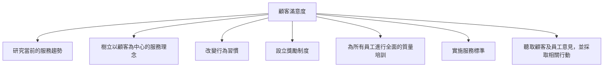
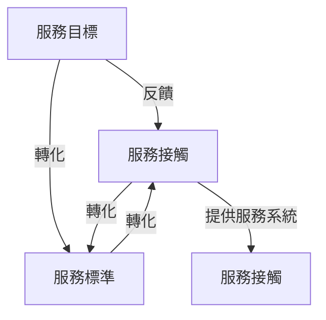
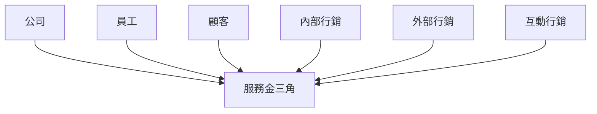
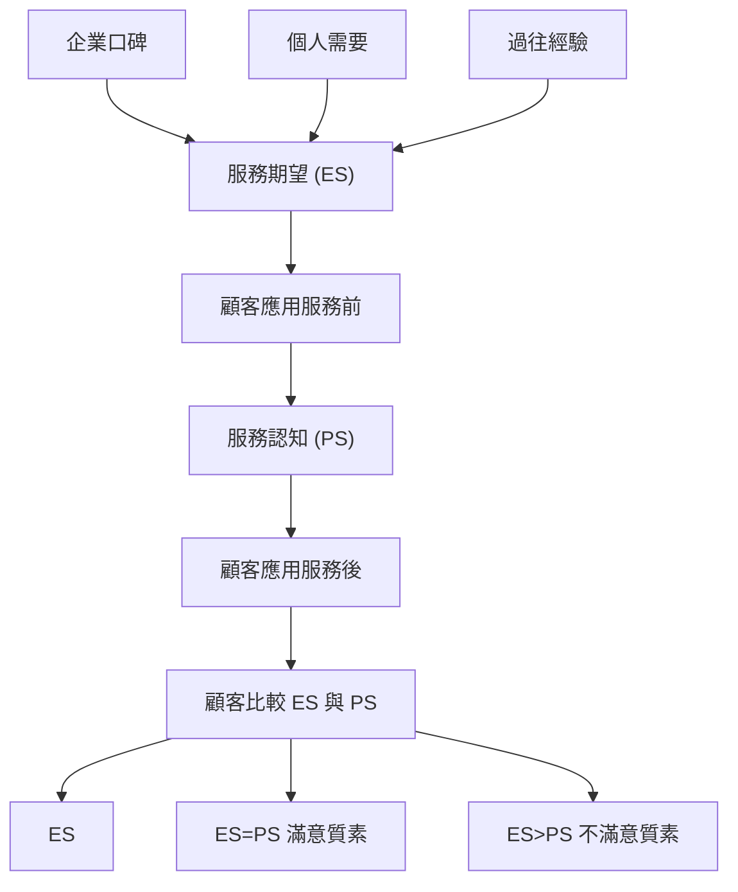
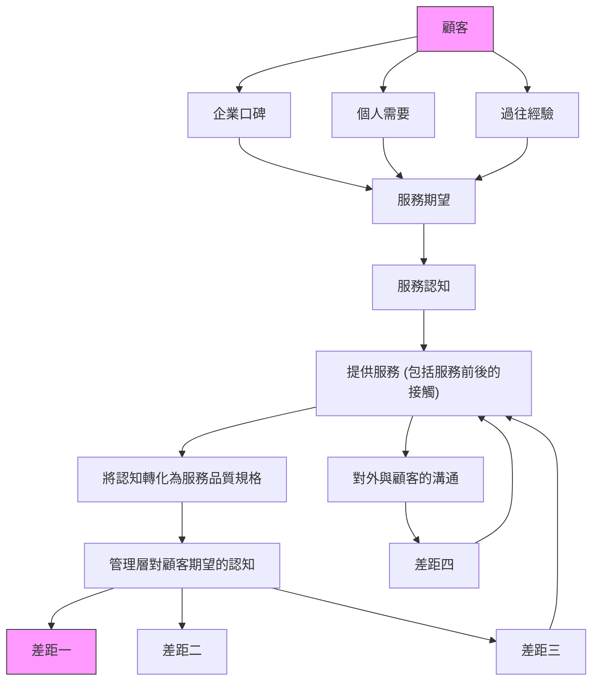

# 單元2

# 客務關係

# 探究重點

認識東方和西方傳統的差異。  
● 說明禮儀在旅遊與款待服務中的角色。  
● 了解基本的行禮禮儀，包括握手丶鞠躬丶擁抱和吻頰。  
認識公司的優質顧客服務及服務承諾。  
● 掌握成功的服務補救政策及其重要性。  
● 探討Parasuraman的服務品質差距模式「Gap Model of Service Quality」，從而了解顧客期望及認知。  
認識處理各種不易取悅顧客的方法，包括憤怒的客人丶不滿意的客人丶猶豫不決的客人丶苛刻或專橫的客人丶粗魯或不顧及他人的客人和喋喋不休的客人。

# 客務關係的文化議題

# 提示箱

全球化下，東西方的文化差異逐漸減少，在些高度國際化的亞洲城市，部分人不一定保留東方傳統思想和行為。

在全球化下，各地之間的交往越趨頻繁，人們對不同國家和地區文化的接受程度越來越高。作為專業的旅遊與款待業從業員，經常要與不同文化丶宗教背景和國籍的人士接觸，對其他地區文化的認識程度比一般人高，才可提供更貼心和優質的顧客服務。

以下讓我們了解東西方文化的差異，以及旅遊與款待服務中的重要禮儀。

# 1.1 東方和西方傳統的差異

各地文化都具有其獨特性。概括而言，包括中東地區在內的亞洲文化，可歸類為東方傳統文化；歐洲丶美洲丶澳洲和新西蘭等地的文化，可歸類為西方傳統文化。

在東西方文化背景成長的人，在價值觀、情感表達、家庭觀念、人際交往、兩性地位、處事方式、工作和生活等方面，均存在差異。

# 1 價值觀

東方社會比較崇尚集體主義，亦重視家庭或社群，認為個人要對家庭、所屬群體承擔責任，個人利益屬次要，甚至可為家庭、所屬群體的利益作出犧牲；西方社會則強調個人主義，雖然家庭和社群對西方人也重要，但個人的價值丶自由和取向更受到重視。

# 情感表達

東方人一般比較內斂，服從性也較強，有時會容易受家庭或長輩的意見影響自己的決定，也較少公開發表個人意見和情感。西方人通常比較直接和開放，而且較獨立自主，較勇於公開表達個人意見和情感。

# 3 家庭觀念

東方社會比較重視家庭成員之間的連繫，亦重孝道，強調長幼有序，多代同堂的大家庭較普及。談及婚嫁時，家庭成員特別是長輩的參與十分常見，假如父母反對，婚事更可能會告吹。在印度、巴基斯坦等個別亞洲地區，父母安排的盲婚啞嫁仍然存在。

natural_image

Family gathering around a dining table in a modern kitchen setting, with decorative red banners and festive decorations in the background (no visible text or symbols on main subjects)

西方社會以核心家庭為主，父母與子女的關係比較平等。父母一般接受子女長大後有自己的生活，亦較為尊重子女在婚嫁等方面的自主權。 C

▲ 圖4.13 東方社會的家庭觀念較重

# 4 人際交往

東方人較重視禮教，與朋友交往較為注重禮尚往來。加上他們較重視感情，因此對於親疏的定義較清晰。西方人則崇尚自由、獨立和願意冒險，在交友上會比較大膽，亦較不拘小節。

至於結識異性，東方人看待約會較為含蓄嚴肅；西方人則較為開放，交往不一定以結婚為大前提。

# 5 兩性地位

在東方社會，男主外丶女主內的思想比較根深柢固。即使如今女性地位較過去提高，但不少女性仍以家庭為重心，婦女整體地位仍不及男性。相對而言，西方社會較強調男女平等，女權主義盛行，女性在事業丶婚姻和家庭等的平衡，都有較大的自主性。

圖4.14 雖然西方女權主義盛行， ▲但男女不平等的現象仍存在。  

natural_image

Wooden seesaw with male and female gender symbols on one side and one on the other, set against a solid blue background (no text or labels)

# 思考點

假如你是旅遊與款待業員工，你比較願意接待東方還是西方的客人？為甚麼？

# 6 處事方式

東方人比較含蓄和禮讓，傾向避免衝突，普遍視爭論為不和諧及破壞關係的行為。他們較願意以文字或私下討論的方式，陳述觀點和解決問題。為了大局，東方人願意稍為讓步，並希望最終能兼顧情理。西方人性格直率，處事比較務實，會通過理性和開放的討論，解決爭議和問題，較能區分情與理。

# 工作與生活

西方人比較強調工作與生活的平衡，工作時會很投入，但到假期他們就會將工作拋諸腦後，盡情享受假期，因為他們認為假期是基本權利。東方人對假期的看法有所不同，他們很多時會將工作安排 丶社會關係和家庭責任等優先於休息，而一邊工作 邊享受假期的情況亦屬普遍。

text_image

CLOSED
SUNDAY

▲ 圖4.15 西方人強調工作與生活平衡，很多店鋪星期日會關門，讓員工享受假期。

# 1.2 禮儀於旅遊與款待服務中的角色

不論甚麼文化背景的顧客，在接觸服務供應商時，都會期望獲得服務員工的尊重和禮待。因此，旅遊與款待企業在提供顧客服務時，對員工的禮儀尤為看重。

# 何謂禮儀？

禮儀（etiquette）一詞原意是指宮廷間的儀式和禮節，現泛指一些不成文而彼此約定俗成的語言（包括書面及口頭）、行為表現和服飾器物，用以表示尊重。不同文化有不同的禮儀，但各地區亦有相似的行為去表達禮儀。

四種常見的禮儀包括：

• 禮賓：在不同交往過程中（如人與人或國與國之間）的行為守則，以相互表示尊重及友好。  
• 儀式：在正式活動或場合（如展覽會開幕或剪綵場合）的言行規範。  
• 禮節：在交際場合中，人們相互問候、致意及祝福等的慣用方法，不同國家和地區有不同形式的禮節。  
• 禮貌：人與人在交往中，透過言談、表情及姿勢等相互表示恭敬和友好的規範。

# 禮儀於旅遊與款待服務中的作用

禮儀是優質服務質素的一個重要元素，顧客視之為基本的尊重。所以，恰當和充分地展示禮儀，可為旅遊與款待業帶來多種正面作用：

• 有助旅客與從業員彼此了解，促進有效溝通。  
• 改善從業員的言行，提升服務質素。  
? 提升旅客滿意度，建立企業形象與口碑。  
• 建立東道國好客友善印象，吸引旅客重臨。

• 有助減少旅客與當地員工、民眾因文化差異造成的誤解和衝突。

# 1.3 基本的行禮禮儀

由於不同人對禮儀的表現拿捏標準不一，旅遊與款待業從業員均需接受訓練，以適當運用禮儀。過於莊重或機械式的接待，會使顧客感覺不舒服甚至反感，而員工過於隨意又會導致顧客感到不被尊重，並質疑企業的服務質素。因此，專業的旅遊與款待從業員應懂得從中作出平衡，表現得體。

# 提示箱

伊斯蘭教教徒除了視用左手握手為不敬外，亦要遵守其他禮儀，如每天向聖城麥加方向祈禱五次丶禁吃豬肉和婦女需穿長袍等。

一般而言，常用的行禮禮儀有以下四種：

# 1 握手

握手是最普遍的非言語行禮禮儀，這簡單的動作也有不少值得注意的地方：

• 習慣用右手：一般西方國家的握手禮並無左右之分，但在伊斯蘭教國家和印度文化中，左手被視為不潔，所以他們只會用右手握手。  
• 握手順序：傳統上，誰應該先主動握手是長幼有序，例如長輩伸手後，晚輩才能伸手相握；上司伸手後，職員才能接握；在頒獎典禮上，也通常是頒獎嘉賓先伸手，才到獲獎者接握。  
• 握手力度：握手力度因雙方性格和熟絡程度而有所不同，但一般而言，力度宜適中，因為力度過重會令對方感覺不舒服，力度太輕又會使人感覺輕浮、欠缺誠意。  
• 男女差異：伊斯蘭教國家和地區的文化中，女性不可與男性有肢體接觸，所以當接待伊斯蘭教徒時，從業員可與女性同行的男性打招呼示好，或者用其他方式與那些女性打招呼，如微笑點頭。

natural_image

Two men in business suits shaking hands, one in traditional Arab attire and the other in a suit (no text or symbols visible)

▲ 圖4.16 用右手握手的阿拉伯人和西方人

# 資料室

# 2019 冠狀病毒病疫情改變握手禮？

在 2019 冠狀病毒病疫情期間，為了減低病毒感染風險，不少人在見面時減少握手，取而代之以輕觸拳頭、觸擊手肘或觸碰腳的方式打招呼。美國防疫衞生專家福奇（Anthony Fauci）更提出人類見面時再也不應握手，理由是這不但能預防冠狀病毒傳播，而且可以大幅降低流行性感冒的傳染。握手作為人類共用的禮儀，會有消失的一天嗎？

natural_image

Two women wearing face masks interacting with an arm in a professional setting (no visible text or symbols)

▲ 圖4.17 觸擊手肘打招呼方式  

natural_image

Portrait of a woman in business attire, hands clasped (no visible text or symbols)

▲ 圖4.18 鞠躬禮一般微微彎腰即可

# 提示箱

擁抱不會用於顧客和陌生的東方人身上。在東方社會，服務員工如要與西方顧客打招呼，只需伸手示意握手便可。

# 2 鞠躬

鞠躬禮一般是東方人服務顧客時，或向上級、長輩表示尊敬的禮儀。向顧客鞠躬時，服務員工通常會雙手交疊放在腹前，身體微微彎腰向前，並連同相應的語言問候。只有在比較莊嚴的場合，才需要雙手貼緊兩旁，作 90 度彎腰鞠躬。

# 3 擁抱

擁抱在西方文化十分普遍。西方人與親友、同事，甚至第一天相識的朋友，不論男女，也會輕輕一擁表示友好。不過，在與異性見面時，應先察看對方是否願意擁抱，並且最好由女性主動示意進行擁抱禮。

natural_image

Two women embracing in a bright indoor setting, with two other people in the background (no visible text or symbols)

▲ 圖4.19 擁抱禮一般輕輕一擁即可

# 提示箱

在選擇使用哪一種行禮禮儀前，應先了解對方的地區、宗教、性別、性格等背景，以免令對方感到冒犯。

# 4 吻頰

吻頰是見面禮的一種，俗稱法式打招呼，在歐美等地比較常見。吻頰禮儀通常先跟對方有良好的眼神接觸，接着靠近對方至適當距離，再輕扶對方手臂，然後以臉頰輕貼對方臉頰，並輕輕發出模擬親吻的聲音。

natural_image

Three people embracing on a city street, one kissing the other's heart (no visible text or symbols)

▲ 圖4.20 吻頰禮一般輕貼對方臉頰，口部發出模擬親吻的聲音。

服務員工接待西方顧客時，只需伸手示意握手，或行鞠躬禮，對方便會感受到尊重。

# 資料室

# 其他行禮禮儀

除了握手禮、鞠躬禮、擁抱禮和吻頰禮，還有些常見的行禮禮儀：

舉手禮：軍人經常使用的禮節。國際上常見的舉手禮方式，是右手五指併攏、手掌伸平，舉至右太陽穴附近位置，然後放下。  
合十禮：印度教或佛教等宗教使用的一種禮儀，以示虔誠和尊敬，常見於亞洲各地，以至亞洲之外的地區。  
吻手禮：西方上層社會常用的禮節。當與貴族婦女見面時，女方先伸出手作下垂式，男則需將對方的手掌托起，輕輕一吻，以表尊敬

圖 4.21 在泰國等信奉佛教的東亞國家，合十禮是常見的行禮禮儀。  

natural_image

Woman in business attire posing with hands clasped (no visible text or symbols)

# 2 公司的顧客服務政策

# 提示箱

現今的顧客服務包括線上和線下，不少企業已善用互聯網加強顧客服務。

越來越多企業意識到待客方式能夠影響顧客對企業的印象，長遠影響利潤。為了增強競爭力，「以顧客為中心」因而成為不少旅遊與款待業及其他行業採用的營運策略。企業一方面努力加強自身與員工的操守和價值觀，另一方面致力提高營銷過程中的服務質素。

以下我們會集中探討優質顧客服務及服務承諾、忠誠度計劃丶關鍵時刻的處理丶服務失誤及補救、處理投訴及問題、服務金三角等與企業提供優質服務有關的政策。

# 2.1 優質顧客服務及服務承諾

# 顧客為中心的概念

1950 年代以來，隨着各地市場經濟發展成熟，競爭變得激烈，市場由供求雙方主導逐漸變為以消費者主導，所以出現以「顧客為中心」的銷售策略。

以「顧客為中心」的企業，會以顧客的要求為中心，通過滿足顧客的需要，獲取利潤。這是一種由以往透過追求市場佔有率而獲得利潤的營銷目標，轉而透過建立顧客忠誠以獲取長期利潤的發展方向。

以「顧客為中心」的企業，會先了解顧客的喜惡，例如透過市場調查、售前及售後顧客意見回饋等，改善及推出能迎合顧客需要的產品和服務。企業亦會在顧客消費前丶消費時和消費後提供相應的顧客服務。

此外，「顧客為中心」的經營模式，需要整個企業文化去配合。企業的架構組織丶營運體系和員工培訓各方面，都需要作出調整，務求令企業上下各級員工都認同，並有能力執行有關服務。

natural_image

Exterior view of a modern high-rise building with distinctive architectural details under a clear blue sky (no signage visible)

▲ 圖 4.22 半島酒店於 1928年開業，是本港一家歷史悠久的酒店。

# 服務承諾及標準

在「顧客服務特點－RATER」我們提及企業對顧客作出明確或隱性的承諾，企業往往需要制定相關的政策，以便全體員工，尤其高級管理層和前線員工，了解具體的承諾和要求，以便提供一致的服務。

企業承諾的內容應當包括：

• 顧客  
• 優質產品  
• 員工  
• 禮貌和其他服務要素  
• 確保物有所值

# 例子庫

半島酒店集團（The Peninsula Hotel）對顧客的承諾：

「近一個世紀以來，半島酒店集團優雅的氣派和貼心服務，為世界各地的客人締造了美好回憶。為堅守『半島承諾』，我們致力於提供超卓的賓客體驗— 推出了一系列專屬禮遇，以確保賓客在入住期間從行程規劃到客房內嬌寵設施都能感到舒適、安全和無阻。」

企業相關的政策包括以下各方面：

制定目標：企業根據自訂的發展方針和優質服務使命，制定各項可達到顧客期望的服務目標要求。  
工作標準化：企業將達成目標要求所需的工作細分，安排好各服務流程，並善用相關技術，使員工的工作標準化。  
評估：企業為各項工作制定可量化與可評分的評估標準，以了解服務質素和成效。  
內部培訓：企業招募具有「以顧客為中心」思維的員工，為他們提供職前培訓和在職培訓。  
• 投入資源：企業投入充足的資源，如資金、人力資源和設施儀器等，以確保服務質素。

為了提供優質顧客服務，企業還需具備以下自身條件：

• 簡單而容易操作的系統；  
• 清晰的操作標準和指引；  
• 員工之間有效的溝通渠道；  
• 完善的培訓程序和賞罰制度。

企業可透過完善的制度和配套，建立企業的顧客服務文化，增加顧客對企業的信心。至於滿意的顧客，會與其他人分享自己良好的體驗，逐漸為企業建立口碑，並為企業帶來更多顧客和生意。

# 3 優質顧客服務使命

為了建立整個企業文化，企業需要有一個明確的優質顧客服務使命，讓每位員工都能參與和執行，使企業所提供的服務更一致。

# 例子庫

知名企業的服務使命例子：

# • 凱悅酒店

「我們關愛每一個人，讓他們發揮絕佳潛力。

隨着我們不斷發展，我們並沒有忽視最重要的因素——人。凱悅是一間由家族成立的公司。它是一個讓同事成為朋友的絕佳工作場所。每一天，我們都在無微不至地關心我們的顧客。關愛是我們業務的核心，也正是這種與眾不同的賓客體驗，令凱悅成為全球最佳酒店品牌之一。 」

# • 麥當勞

「我們的使命是讓每個人都能輕鬆享受美味的感覺。

這就是我們支持社區的獨特方式。我們提供讓人們感覺良好的美味食物，便利的地點和時間丶實惠的價格以及通過努力滿足客戶在速度、選擇和個性化的期望。我們不僅會盡力提供食物，還提供感覺良好的時刻，這些都是消費者所了解和喜愛的。」

# • Outback Steakhouse

「Outback 始終堅持『以人為本』，致力與 Outbacker、顧客、供應商和社區建立良好的關係，並視之為成功的關鍵。我們秉持『No Rules, Just Right』的理念，突破常規，不拘一格，致力滿足不同顧客的需要。

使命的確立能讓顧客認識企業的定位，加上企業相應的政策和監管配合，以及員工的執行，可提高顧客服務的質素。

# 全面優質服務（TQS）

全面優質服務（Total Quality Service）是企業作出的承諾，即確保以「顧客為中心」，設立明確服務標準，並對卓越服務表現進行獎勵。為了留住顧客，企業可以採取以下基於全面優質服務技術的策略：

<table><tr><td>全面優質服務策略</td><td>說明</td></tr><tr><td>珍惜顧客</td><td>·向顧客表達一句簡單的「謝謝!」。這種策略效果明顯,企業和員工可透過口頭或書面形式傳達。</td></tr><tr><td>尋找並解決問題</td><td>·雖然不滿的顧客中,只有少數會投訴,但企業員工要清楚自己提供的服務是否卓越。萬一出現問題,應立即回應。宗旨是主動解決問題,避免顧客作出投訴。
·最佳的方法是向顧客直接查詢服務,作出評價。</td></tr><tr><td>展示競爭優勢</td><td>·向顧客提供好處,令顧客深信入住企業的酒店或參觀企業的景點,是正確的決定。因此,要向顧客展示企業的獨特之處和卓越服務的核心價值。
·例如,很多國際連鎖酒店會在顧客入住後發送感謝電子郵件,並提供特別優惠,藉此邀請對方再次光臨。</td></tr><tr><td>負責解決顧客的問題</td><td>·顧客是否光顧企業,往往取決於企業員工的服務表現。當顧客遇到問題並尋求協助時,作為企業代表的員工,有責任協助解決問題,確保產品或服務的品質達到顧客的期望。</td></tr><tr><td>感謝參與購買過程的「每個人」</td><td>·顧客的孩子、私人助理、秘書,以至委員會等,可能會參與到顧客購買產品或服務的過程。假若他們會影響決定,甚至負責作出決定,企業便應讓他們感受到被重視。</td></tr><tr><td>提高顧客的要求</td><td>·顧客如認為競爭對手的產品或服務,在價格或其認定的價值上不及你的水平,顧客將更加確信選擇與你交易是正確的。
·競爭對手唯一能夠搶走顧客的方式,就是在產品或服務品質上,達到或超越你的標準。</td></tr><tr><td>把握「關鍵時刻」(Moments of Truth)</td><td>·關鍵時刻是指企業在與顧客接觸的過程中,給顧客留下深刻印象的重要時刻。
·關鍵時刻對於企業的發展十分重要,企業必須充分把握每個關鍵時刻,並創造有利條件,以促進企業銷售的增長。</td></tr></table>

# 5 價值觀與操守的重要性

除了政策和制度的配合外，企業和員工的道德操守亦可確保服務質素，因此不少企業對員工的價值觀有一定要求。

# A 企業與員工的道德操守與優質服務

以下是對優質顧客服務最有影響的三項道德操守：

<table><tr><td>道德操守</td><td>說明</td></tr><tr><td>誠信正直</td><td>· 顧客十分重視消費權益。他們如在消費過程中受到欺騙,或遇到員工誠信問題,會不滿及氣憤,除了不再光顧,甚至會到處宣揚有關企業的不是。</td></tr><tr><td>公平招待</td><td>· 顧客都希望在消費過程中,得到與其他顧客平等的待遇,企業和員工不應因顧客的背景、衣著、外貌和年齡等,而給予有差別待遇。</td></tr><tr><td>重視顧客感受</td><td>· 顧客不希望接受機械式的招待,亦不喜歡被員工視作一個消費個案處理,個人感受被忽視。員工對顧客的同理心,並能就顧客的感受作出適切回應,便十分重要。</td></tr></table>

# B 員工操守的重要性

員工的道德操守會影響其服務心態和工作表現，對企業能否提供優質顧客服務有很大影響。因此，道德操守會是企業對員工的基本要求。企業會在合約丶員工守則或在員工培訓過程中，明確列出有關要求，以便員工遵守。

# 例子庫

員工操守例子：

• 員工之間互相尊重，在同事有需要時提供協助；  
• 公平競爭，不可貪污；  
• 保障客戶資料，不向第三者透露；  
• 不會使用公司資產作個人用途；  
• 避免個人利益與公司利益出現衝突；  
• 避免破壞環境；  
• 多參與社會融合活動。

# 6 建立提升顧客滿意度的公司文化

為了提供優質服務，企業在訂立發展方針後，需要建立可以讓顧客滿意的系統和企業文化，並融入日常運作之中。

建立提升顧客滿意度的文化所涉及的工序  

flowchart

圖 4.23

企業可在多方面入手，提升顧客滿意度：

# A 管理方面

• 樹立以顧客為中心的服務理念：管理層建立一套「以顧客為中心」的理念，並以不同方法清晰地傳達給各級員工，讓他們知道有關理念，進而向顧客提供一致而完善的服務。

# 例子庫

由於酒店日常營運忙碌，員工很多時要即時和快速回應顧客要求，而部分員工，如餐飲部員工可能是兼職性質，他們應該在服務時清楚企業的理念，以客為先，才可提供最貼心的服務。

研究當前的服務趨勢：管理層要對行內的發展趨勢有一定了解，留意其他競爭對手的服務新發展，才可與時並進，提供令顧客滿意的服務。

# 例子庫

餐飲業方面，面對社會追求健康飲食的趨勢，不少餐廳因應素食餐廳的出現，慢慢轉用更健康的食材，甚至加入素食餐單，以迎合顧客的需要。

natural_image

Two flight attendants in beige uniforms and red berets with white headscarves, standing side by side (no visible text or symbols)

▲ 圖 4.25 航空公司會為空中服務員設定服務標準

聽取顧客及員工意見，並採取相關行動：管理層擔當決策角色，需要收集前線員工和顧客的意見，不斷修正政策和完善產品。因此不少企業會設立收集意見的機制，如意見收集箱、與前線員工代表定期會面，力求進步。

圖4.24 設立意見收集箱有助收集員工意見  

text_image

SUGGESTIONS
My suggestion is ....

# B 制度方面

• 實施服務標準：企業為各項優質服務設定標準，可讓員工有所參考，從而減少服務差異，增加顧客對企業的信心。

# 例子庫

有日式餐廳的所有員工，會以日文向進入餐廳的顧客打招呼，在顧客離開時同樣以日文歡送，這反映員工清晰及執行公司所訂的制度。

# C 員工方面

選擇以服務為本的員工：員工是企業的代表，特別是前線員工，必須具備服務顧客的質素，才能提供優質的服務，所以由招聘選擇員工開始已是重要一環。  
• 為所有員工進行全面的質量培訓：單有服務顧客的心不足以使員工提供稱心的服務，企業須提供全面的培訓予員工，讓員工學習到提供服務時應有的態度丶技巧和知識。  
• 設立獎勵制度：不論是金錢或其他獎勵，都可起到鼓勵員工的作用，讓員工更投入工作，帶來更優質的服務。員工也會因為自己的努力獲得企業肯定，而對企業有更大歸屬感，更有動力為企業服務。  
• 改變行為習慣：雖然獎勵制度可提高員工士氣，提升服務水平，但是適當的監察可作最後把關，令員工能改變不符合服務標準的行為習慣，並一直保持服務水平。

# 2.2 忠誠度計劃

上文提及不少企業轉為透過建立顧客忠誠，以獲取長期利潤作為發展方向。以下我們會進一步了解不同企業如何透過忠誠度計劃，留住更多的顧客。

# 資料室

# 顧客忠誠度

不同學者為顧客忠誠度定下了各樣的定義。概括而言，顧客忠誠度是消費者對單一品牌或對企業維持長久關係的承諾，並願意做出以下行為：再度購買企業的產品和服務、購買企業其他品牌的產品和服務、向別人推薦企業及拒絕光顧相同競爭者。顧客忠誠度越高，對企業的支持便越強。

# 顧客終身價值

顧客終身價值就是透過顧客為企業帶來的利益總和，包括其光顧所產生的現有價值，以及他們將來繼續支持企業所帶來的利潤。

# 留住顧客的好處

對企業而言，留住「回頭客」對業務有以下好處：

# A 減省成本

著名商業刊物《哈佛商業評論》曾指出，企業吸引新顧客的開支比留住現有顧客的支出高出五至十倍，可見企業將資源投放在留住舊客戶的成本效益較高。  
• 企業較易掌握舊顧客的喜好，例如他們入住酒店時的特別要求均有紀錄。因此，提高顧客忠誠度可節省企業的行政費用和時間，降低整體營運成本。

# B 帶來穩定收入

• 忠誠顧客會因為對企業的熟悉感，或企業忠誠度計劃的吸引力，而選擇多次光顧企業，為企業帶來穩定收入。換言之，企業的顧客忠誠度越高，客源和收入會越穩定。

# C 建立企業形象

• 企業擁有很多忠誠顧客，有助建立優質服務的口碑和形象，令消費者對企業的信心增強。

# D 吸引新顧客

忠誠顧客會主動向其他人推介企業的產品和服務。他們作為使用者，在企業宣傳方面具有較強的說服力。  
• 部分企業的忠誠度計劃會鼓勵舊顧客介紹新顧客入會，以取得更多優惠。這可以為企業帶來更多客源，提升企業整體營業額。

# E 維持市場佔有率

• 忠誠顧客一旦習慣光顧某家企業，市場上同類型的競爭者需花更多心力和資源才可把顧客搶走，所以忠誠度計劃對企業維持市場佔有率有相當大的幫助。

# F 價格敏感度下降

• 根據學者的研究分析，當忠誠顧客習慣了光顧某企業的產品和服務時，他們較能接受企業的價格變動。即使企業產品和服務的收費上漲，他們接受的程度也較新顧客高，可見忠誠顧客的建立能穩定企業的業務。

# G 失誤包容度較高

• 忠誠顧客對企業有一定認識甚至有感情，會對服務失誤有較高的容忍度，認為只是偶爾發生，並相信企業會作出改善和處理。因此，建立顧客忠誠度可省卻企業平息顧客不滿或作出補償的時間和金錢。

圖 4.26 忠誠顧客對企業 ▲失誤的包容度較高  

gauge

| 包容度 | 指标值 |
| :----- | :----- |
| 中     | 低     |
| 中     | 中     |
| 中     | 高     |

text_image

國泰假期精選套票優惠
賺取額外高達2,000「亞洲萬里通」里數
證券和空格易遇及全球，我們現更最廣告地價賣酒店，以實時價格為您提供最佳活期套票組合，對線上口障機器及酒店活期套票，可根據預訂不同黃鐘牌取額外「亞洲萬里通」里數。
• 現在預訂經理黃鐘遊遊客單－額外500個數
• 現在預訂特進黃鐘新華遊遊客單－額外1,000個數
• 現在預訂每號或適用黃鐘遊遊客單－額外2,000個數
請在預訂．請妥善多

搜尋並計劃下次旅程

圖4.27 國泰航空會與酒店結盟，推出套票優惠。

# H 業務發展機會多

• 擁有大量忠誠顧客的企業，由於顧客對企業有信心，可更大膽地推出新產品和服務，成功機會也較高。  
. 有提供忠誠計劃的企業，往往較容易與其他相關行業的企業結成聯盟，進一步擴展業務。

# 例子庫

• 有不少航空公司會與酒店結成聯盟，向常客提供優惠價格，以吸引常客購買對方的產品和服務，而這對雙方的業務都有好處。

# I 提供中肯意見

• 忠誠顧客對企業的產品和服務有一定認識，加上他們是企業的目標顧客，能為企業提供中肯和建設性的意見及提議，有助企業作出改善和進步。

# J 建立數據庫

• 累積忠誠顧客的資料，對改善企業現有產品和服務有很大參考價值。企業可從中分析目標顧客的喜好丶習慣和消費能力，加強自身競爭力。

# 作為忠誠顧客的好處

# 活動站

# 分組討論

試分成小組，討論你們較常光顧學校附近哪一間餐廳，並說明光顧的原因，然後派代表向全班報告。

消費者面對市面上各式各樣的產品，花多眼亂，不會無緣無故便成為某家企業的忠誠顧客。要讓消費者成為忠誠顧客，企業必定會為他們提供各種好處，讓他們在消費過程中獲得最大的滿足感。

text_image

會員優惠
憑會員卡購物
Open promotion of Store Card
75% discount
77
23% OFF
折

▲ 圖 4.28 零食店為忠誠顧客會員提供折扣的宣傳單

# A 更多折扣和優惠

• 為了吸引顧客「回頭」，不少企業會給予忠誠顧客各種優惠和折扣。有時企業只需向忠誠顧客提供一些贈品，已能使他們十分滿足。  
• 從顧客角度，忠誠度計劃下，他們可以不作額外付出，便能從累積消費換取更多優惠和折扣，為消費帶來更大享受。

# B 更佳服務

• 企業及前線員工一般會向常客提供更好的服務，即使忠誠顧客所付費用與新客一樣。

# 例子庫

• 不少航空公司會開放機場貴賓室予飛行常客使用，並讓常客享有優先登機服務。

# C 尊重感及優越感

• 當顧客在企業消費到一定金額時，企業會給予他們獎勵，如會員身份升級到享有較高級別的待遇。過程中，顧客會感到獲得企業的尊重，並產生與別不同的優越感。

# D 節省時間

顧客多次光顧同一家企業，對企業的產品和服務有一定熟悉感，每次消費時不用再重新學習和適應。  
• 常客的資料包括購買紀錄會被企業記錄，當顧客再次消費時，可沿用舊紀錄，從而節省時間去選擇合適的產品和服務。

# 例子庫

• 航空公司會留有經常乘搭航機常客的紀錄，令常客的購票交易和服務更便利。

# E 安心消費

• 顧客對於未曾光顧的企業或多或少會有所質疑。至於光顧過的企業，他們對企業提供的產品或服務質素已建立信任，能增強他們安心消費的信心，相信即使遇到問題，企業和員工也會為他們解決。

# 思考點

你最近有參與簡單積分計劃嗎？有關計劃為何能吸引你參與？

# 3 各種顧客忠誠度計劃

由於建立顧客忠誠度可使企業和顧客達致雙贏，不少企業會使用各種忠誠度計劃去強化顧客服務，維繫與顧客的關係。

顧客忠誠度計劃是透過獎勵計劃保留更多舊有顧客，而常見的忠誠度計劃可分為簡單積分計劃、級別積分計劃和夥伴計劃三類。

# A 簡單積分計劃

這是最常見的忠誠度計劃。消費者每購買若干金額的產品或服務，就可賺取相應積分。當消費者累積足夠積分後，便可轉化成某種折扣丶優惠或免費贈品 。

text_image

小煮意·大賞頭
印花換領日期
延長至4/10
鑑品換領日期
延長至18/10
鑑品換領時間
11am - 8pm
以電子消費滿確定金額即可兌換電子印花，換領人氣廚用具及récolte小家電。
鑑品共6,000份，先到先得，換完即止
電子消費*
每滿$50 =
電子
印花 1個
貨建消費多送 2個電子印花！
100個電子印花
矽牌廚具TT件套裝
récolte 日式小電鍋
(梅花粉紅)
400個電子印花
récolte 氣炸鍋
(香殭自)
500個電子印花
*因出示電子錦券及消費機印發票之本
電子數刻品或信用卡、飲酒藥、Apple Pay、Samsung Pay、Google Pay、Tie & Go、Alloch K、YinChat Pay、八漢達及其他平台支付程式
每張散票品多可獲20個電子印花 | 網級市場散票品多可獲5個電子印花
新規企業發展實性：Homeboard Paper Parts、廣播、Market Parts-1號
圖片訂字表單：請參閱證書及詳情對象 | 計物審查證券內製造品
立即下載
泊食易
收集電子印花
領展
LINK
連繫好生活

▲ 圖4.29 累積印花換取贈品是常見的簡單積分計劃

<table><tr><td>優點</td><td>缺點</td></tr><tr><td>設計和操作簡單。有效鼓勵目標顧客短時間內大量消費,以獲取獎賞。有助提高新品牌知名度和討論度,鼓勵消費者首次光顧。</td><td>消費者或只貪新鮮,未必足以提高他們的忠誠度。積分累積困難度不宜太高,否則對鼓勵目標顧客的消費作用有限。</td></tr></table>

# B 級別積分計劃

級別積分計劃是按照消費者的累積積分數量多寡，將會籍或享用的折扣或優惠進行分級。換句話說，消費者的消費金額越大，所得積分越多，級別便越高。

這類計劃希望隨着顧客對企業的忠誠度提高，增加對他們的獎賞價值，從而鼓勵他們成為企業的回頭客。

# 例子庫

凱悅酒店把會籍分為「探索者會籍」、「冒險家會籍」、「環球家會籍」，按級別給予會員不同的酒店禮遇。

探索者會籍要求累積 5 個會籍認可房晚或賺取 12 500 點基本積分。  
冒險家會籍要求累積 15 個會籍認可房晚或賺取 25 000 點基本積分。  
環球家會籍要求累積 30 個會籍認可房晚或賺取 50 000 點基本積分。 。

text_image

HYATT GOLD PASSPORT
HHONORS
HILTON WORLDWIDE
Lufthansa Miles & More
Lufthansa STAR ALLIANCE
goldpointsplus™
AWARD WORLD MEMBER
PRIORITYCLUB.
REWARDS
Marriott
REWARDS.

圖 4.30 不少航空公司和酒店都以級別積分計劃建立顧客忠誠度

<table><tr><td>優點</td><td>缺點</td></tr><tr><td>·消費者需較長期和持續消費,因此能有效鼓勵顧客累積消費,增加利潤。·能針對消費者追求尊重和優越感的心態,不斷增加消費,以換取更多獎賞和更高級的會籍。</td><td>·升級要求若太難達到,會使這類計劃失去吸引力。·運作較簡單積分計劃複雜,計算成本較高。</td></tr></table>

# C 夥伴計劃

夥伴計劃由兩間或以上的企業聯合提供，在旅遊與款待業十分常見。不少航空公司會與酒店丶餐廳或汽車租賃公司，以至信用卡公司等非競爭企業，合作推出這類獎勵計劃，以吸引消費者透過持續消費累積分數。

# 例子庫

「亞洲萬里通」計劃下，顧客在參與計劃的企業消費，金額均可

轉化成里數。這些里數除了可用來購買機票外，也可互通用於合作夥伴的各項獎勵計劃。

# 亞洲萬里通ASIA MILES

  
圖 4.31 「亞洲萬里通」是國泰航空與其他旅遊與款待企業合作推出的夥伴計劃

<table><tr><td>優點</td><td>缺點</td></tr><tr><td>·夥伴計劃宣傳作用大,與大企業聯盟更可增加知名度。·消費者參與夥伴計劃的意欲大,因更容易消費到某金額,而且優惠使用可能性及機會更多。</td><td>·運作複雜且成本較高,如需投入更多人手去解答會員的問題。·越來越多公司,如航空業的低成本航空公司,提供類似計劃,競爭日大。·企業為控制成本,可能會限制消費者使用積分或里程,如顧客只能購買指定日期的機票,降低計劃吸引力。</td></tr></table>

# 資料室

# 夥伴計劃對航空公司利潤貢獻大

市場往往低估忠誠度計劃對航空公司利潤的重要性。根據金融公司分析家的報告，一家航空公司的忠誠度計劃，佔公司收入可高達 40% 至 50%。理由是夥伴計劃中的積分所能兌換的里程是信用卡公司、酒店、租車公司向航空公司預先購買的，而里程和積分的兌換公式就由航空公司與其它公司協定。如果里程因為各種原因沒被兌換，那航空公司則淨賺里程費。如果里程被兌換成機票，航空公司仍確保有利潤。由於那些不斷積累積分來換取里程的消費者一般收入較高，而且信用評分也較高，他們是航空公司的潛在目標常客，因此夥伴計劃可增加這些潛在常客的忠誠度。

# 2.3 關鍵時刻

之前我們了解過企業所提供的顧客服務，包括消費者在消費前丶消費時和消費後享用的整個服務過程。可是，在過程中，顧客並不會逐一審視企業服務質素的高低，再打出平均分。他們對企業服務質素的印象，可能只集中在過程的某些時刻。對企業而言，能否捉緊這些時刻，以提升顧客的滿意度，是十分重要的。

text_image

Street photo of a restaurant counter with visible menu screens and staff assisting customers

▲ 圖 4.32 顧客點餐可以是服務過程的關鍵時刻

# 甚麼是關鍵時刻?

關 鍵 時 刻 (Moments of Truth，MOT) 是指顧客服務過程中，顧客與企業某些相互交流的時刻，並正面或負面地改變顧客的服務體驗，以及對企業的觀感。這些關鍵時刻可以是顧客與員工丶設施丶產品或服務的接觸。

由於顧客對企業的滿意度和印象主要受這些接觸點影響，所以對企業而言，這些接觸點稱為「關鍵時刻」 。

以光顧快餐店為例，常見的「關鍵時刻」有：

<table><tr><td>關鍵時刻</td><td>顧客與企業的互動</td></tr><tr><td>1. 顧客到達快餐店</td><td>顧客看到快餐店的裝潢和店內秩序</td></tr><tr><td>2. 顧客排隊、點餐和付款</td><td>快餐店服務的速度和職員的態度</td></tr><tr><td>3. 顧客等候出菜部出餐</td><td>快餐店出餐的速度和顧客所點食物是否到齊</td></tr><tr><td>4. 顧客找尋座位</td><td>快餐店的餐桌和座位是否清潔、職員有否提供協助</td></tr><tr><td>5. 顧客進食</td><td>快餐店製作的食物質素和整體環境衛生情況</td></tr><tr><td>6. 顧客使用洗手間</td><td>洗手間的衛生程度和顧客輪候使用的時間</td></tr></table>

# 思考點

對於酒店業而言，甚麼時刻是關鍵時刻呢？

text_image

Street photo with visible store signboards and people interacting at a service counter

▲ 圖4.33 關鍵時刻對顧客評價服務質素起重要作用

# 關鍵時刻的重要性

關鍵時刻對企業有以下重要作用：

• 顧客會在關鍵時刻評價企業的服務質素，如果企業掌握得好，可捉緊顧客的心，令顧客建立忠誠度。  
• 關鍵時刻可推動企業改善服務質素，建立良好形象，甚至改變顧客對企業先入為主或舊有的印象。  
• 重視關鍵時刻的企業，可更有效針對目標顧客的需求，使產品和服務有更大競爭力。

# 資料室

# 關鍵時刻的理論起源

關鍵時刻的理論由北歐航空公司前總裁詹．卡爾森於 1980年代提出。他指出每位顧客在使用航空公司服務的過程中，平均與五位服務人員接觸，而顧客在每次平均短短 15 秒內的接觸，就能決定他們對整家公司的印象。所以，他將企業與顧客接觸的每一個時間點定義為關鍵時刻，並從服務人員的外表、行為和溝通三方面來改善服務質素。

# 2.4 服務失誤及補救

「關鍵時刻」可以出現在顧客和企業的任何一個接觸點上，但企業要在任何時刻都維持高質素的服務甚具挑戰性，因此所有企業都有機會出現服務失誤。

# 服務補救

成功的企業都制定完善的服務補救計劃，以便在服務未達到顧客期望時，能夠及時有效補救服務失誤。否則，企業可能面臨以下問題：

• 顧客認為企業不重視其產品或服務；  
• 顧客感到自己未被企業重視；  
• 忠誠顧客逐漸流失；  
• 顧客的負面口碑損害企業聲譽；  
• 企業失去潛在的回頭客。

顧客的觀感與其情緒息息相關。優質服務的目標在於提升顧客的服務體驗，使其更加重視所享受到的服務，從而成為回頭客。這也意味企業需要持續讓顧客感到滿意，並積極建立和維持顧客的忠誠度。要實現這一點，企業必須糾正錯誤或失誤，而服務補救計劃是不可或缺的。

一名不滿意的顧客往往會將其不愉快的經歷告訴至少九個人，而這九人可能會進一步傳播負面評價。為了避免顧客流失和聲譽受損，企業應採取有效的服務補救措施。

服務補救的效果顯著，不僅能迅速解決問題，還有助於維持顧客忠誠度，實際上物超所值。服務業若能在服務過程中多付出一些努力，就能減少日後吸引新顧客所需的資源，並降低因顧客不滿而對企業聲譽造成的損害。

服務接觸是服務補救的關鍵環節，指的是服務提供者（如旅行社職員、酒店接線員或餐廳服務員）與顧客之間的互動過程，當中可能涉及商品或服務的提供（如機票、預訂或餐飲）。

服務接觸示意圖  

flowchart

圖 4.34

企業若能深入了解並專注於服務接觸，以及其三大支援領域，並將這些轉化為具體的行動指引，即可達到以下效果：

• 維持服務水平，並在需要時實施服務補救；  
• 增強顧客忠誠度；  
• 改進產品和服務；  
• 提升企業在市場的策略性定位。

服務目標、服務的提供和服務標準是影響服務接觸的三大要素。忽略任何一方面均會影響服務品質和服務接觸，並導致顧客體驗欠佳，進而產生不滿。

# 例子庫

• 服務標準（例如航空公司辦理登機手續所需的時間）應有助顧客和員工了解服務期望；  
• 提供服務系統（例如航班能準時抵達）應會使顧客感到滿意；  
• 服務目標（例如安全送達行李）應能讓顧客有愉快的旅遊經歷。

# 處理失誤的補救原則

妥善處理失誤可使顧客重拾對企業的信心，並再次光顧，所以有效處理失誤和作出補救，對企業相當重要。企業一旦出現失誤，進行補救一般要符合以下原則：

text_image

KEEP IN TOUCH
B 真誠

▲ 圖 4.35 企業應與顧客保持溝通，讓對方知道企業正在跟進。

# 迅速

旅遊與款待業中很多失誤都是越快處理，效果越。企業的回應速度，會被顧客視為誠意的表現。因此，企業在接到投訴後，應迅速回應，以免時間過長，令顧客對企業失去信心，甚至不再光顧。

若有一些問題需較長時間才可解決，企業亦應與顧客保持溝通，讓對方知道企業已積極跟進有關個案，以挽回顧客的忠誠度。

#

企業或員工在處理失誤時，需抱有為顧客福祉着想的心態，真誠協助顧客，而非只為減少企業麻煩。若在處理過程中，顧客感到企業只做門面功夫丶推卸責任丶不誠實的欺瞞情況，或會導致問題惡化，甚至對顧客忠誠度造成不可挽救的地步。

# 提示箱

有關與顧客溝通的技巧，會在本課題單元3「溝通技巧」頁 82 至 96 詳細敍述。

# C 良好溝通

企業員工在與顧客溝通時，需掌握良好的溝通技巧，並要清晰丶適時和有禮地表達訊息，以免出現誤會或有態度欠佳的情況。

natural_image

Three women in business attire standing near a white brick wall, one bending forward (no visible text or symbols)

▲ 圖 4.36 員工為犯錯向顧客道歉

# 3 處理失誤的常見程序

處理失誤的常見補救程序，一般包括以下三項：

# A 確認和致歉

企業接到顧客投訴後，應立即回覆顧客，表示已收到有關投訴，以及積極跟進，並就有關投訴致歉。

企業這時的道歉，主要是向顧客有不愉快的消費經歷及不便表示重視和同情，並不一定表示企業在事件上犯了錯。接下來，企業需要就有關個案進行調查，了解事件的來龍去脈。

# B 處理問題

企業了解事件後，應儘快改正錯誤，為顧客解決問題。雖然部分問題未必能立即解決，但是企業要提出替代方案，顯示盡力為顧客解決困難，以及安撫顧客情緒。

即使發現問題不是出於企業自身，企業也應禮貌地向顧客解釋當中的誤會，並提出企業可如何幫助顧客解決問題。

# C 知會丶解決和作出補償

企業一旦有解決方案，應馬上通知顧客，這一般包括賠償或替代方案，以表示為顧客帶來的不便感到抱歉。值得留意的是，很多時補償未必能即時解決問題，但是企業表達誠意的方法，有助維持顧客的忠誠度。

# 服務補救計劃

企業為彌補服務上的失誤，可實施以下服務補救計劃：

• 提供額外服務（補償饋贈）；  
• 對已提供的服務或為未來的服務作出減價；  
• 任何能挽留顧客的方法。

# 例子庫

服務補救措施：

• 餐廳向顧客提供免費飲料、餐點的餐飲券。  
• 酒店向客人贈送一支香檳、免費升級客房、免費交通安排。  
• 旅行社對已提供的服務作出減價、為未來的服務提供折扣。

text_image

excellent
good
average
poor

▲ 圖 4.37 企業從失誤後改進產品和服務，有助改善表現。

# 5 勇於面對失誤的好處

一家成功的企業會從失誤中汲取教訓，完善產品和服務，避免同類問題發生。因此，勇於面對失誤，對企業亦有多個好處：

# A 維持顧客忠誠度

顧客一般明白任何企業都有可能犯下失誤，所以對於處理得當的企業會有較好的印象。市場學學者米歇爾（Stefan Michel）的研究更指出，成功的失誤補救反而可大幅提高顧客忠誠度。因此，顧客不一定會因為企業的失誤而不再光顧，甚至會欣賞企業處理問題的表現，把經驗分享開去，為企業建立口碑。

# B 改進產品和服務

企業可由失誤汲取經驗，改進服務和產品。由於大部分投訴都來自用家，他們的意見尤其寶貴，所以企業一般都重視投訴，並會投放資源跟進和分析，期望從根本解決產品和服務問題，改善企業表現。

# C 減少損失

企業認真和妥善處理投訴，並不斷完善現有處理投訴的機制，可以減少失誤造成的損失，例如減省法律訴訟費和索償所需的時間和金錢。長遠而言，當企業能滿足顧客，降低投訴數目，可減省對外解釋或澄清的費用。

# D 贏得商譽及新顧客

顧客在投訴獲得企業充分重視和處理後，會將自己的經驗分享給別人，為企業商譽作免費推廣。同時，潛在顧客會因為聽到企業的正面訊息，而對企業產生一定信心，並前往光顧。因此，勇於面對失誤的企業，可贏得商譽，吸引更多新顧客。

# E 提供磨練和選拔員工機會

服務失誤為員工提供磨練機會，讓他們從中學習和進步，日後提供更優質的服務，增強企業的競爭力。企業也可從中選拔出有熱誠丶有能力和有潛質的優秀員工，加以培訓，幫助企業進一步發展。

text_image

Customer
Complaint

▲ 圖 4.38 隨着互聯網及社交媒體普及，越來越多顧客使用網絡投訴。

# 2.5 處理投訴及問題

處理投訴可算是企業的日常工作，基於顧客投訴的影響力可以很大，所以企業不會輕率對待，並會完善投訴機制，制定處理原則和程序。

# 正面看待投訴

若接到顧客投訴，企業應將顧客的訴求解讀成尋求與企業溝通。企業可參考以下兩點，正面處理投訴：

# A 意識投訴帶來的好處

企業和員工需明白有效處理投訴，會帶來好處：

• 有助企業明白產品和服務的不足， 並加以改善；  
• 員工可透過處理投訴加強解難能力，而企業可優化處理程序；  
• 為企業提供與顧客建立關係的機會，而成功處理投訴，可提升企業商譽。 。

# B 加強引導投訴

企業可提供多種渠道方便顧客作出投訴，包括官方網站、電話丶電郵和社交媒體等。當顧客有不同渠道作出投訴，有利企業改善欠佳的服務，而這遠比事後作出補救容易得多。  
企業需安排足夠專業人員處理顧客投訴。部分大型企業更會設立專責部門，專門處理有關投訴。

# 投訴管理

不是所有企業都設立專責部門，由專人處理顧客投訴，但大多企業都會有完善的機制讓員工跟從，以更一致和專業的方法處理投訴。例如：

• 訂立內部指引：包括接到投訴後的各項處理程序丶負責員工的職級和權限丶記錄投訴的要求和處理投訴的時限等。  
• 清晰權限分工：明確訂明負責員工擁有哪些處理和解決投訴的權力，讓有關投訴可更快被處理，亦避免員工向顧客作出過多的承諾。  
• 加強培訓工作：為負責員工提供相應的培訓工作，使他們掌握企業的服務使命丶處理投訴的溝通技巧和正確程序等。

# 處理投訴的原則

在了解企業處理投訴的正式程序前，宜先認識處理投訴的原則。

處理投訴的原則

<table><tr><td>1 保持冷靜</td><td>當面對不禮貌、使用粗言穢語的顧客時,員工需保持冷靜,以專業態度處理。</td></tr><tr><td>2 保持禮貌</td><td>在處理投訴時,員工應全程保持禮貌。稱呼顧客的名字是有效且合適的做法。</td></tr><tr><td>3 建立正面的態度</td><td>不要忽略任何投訴。不要將顧客的投訴視為針對個人。不要對投訴反應過於激烈。</td></tr><tr><td>4 表示關心</td><td>員工可透過以下方法,向顧客展示理解和關注:向顧客介紹自己;耐心聆聽顧客的投訴;根據情況,適當回應對方;積極為顧客提供協助。當問題發生時,不是每一位顧客都能冷靜面對,員工可通過觀察其身體語言、聲音等,分辨投訴者的情緒。</td></tr><tr><td>5 澄清並確認你對問題的理解</td><td>為確保正確理解顧客投訴的問題核心,員工應在聆聽後,用自己的語言覆述對方的問題和要求。</td></tr><tr><td>6 評估投訴</td><td>員工需決定採用以下哪種方法處理投訴:親自負責處理所有。向同事尋求援助。根據所收集的資料,評估該投訴是否成立。</td></tr><tr><td>7 作出決定並提出建議</td><td>員工需要決定接下來採取哪種行動。若妥協方案未獲顧客同意,可提出其他解決方案,及就跟進行動向顧客作出解說。</td></tr><tr><td>8 跟進問題</td><td>員工須跟進所採取的行動,方案得到顧客同意後,要確保能夠落實。過程中如有變更,亦要通知顧客。</td></tr></table>

natural_image

Group of four people holding large blue icons including a phone, speech bubble, question mark, and tablet (no text or symbols)

▲ 圖 4.39 電 話 丶 面 對面、網絡和書面是顧客常會採用的投訴方式。

natural_image

Two professionals in a professional meeting, one gesturing while speaking at a desk with documents (no visible text or symbols)

圖 4.40 員工應向顧客小心說明問題

# 處理投訴的常見程序

投訴通常以電話丶面對面、網絡、書面等形式進行。在處理投訴時，負責員工基本上都有既定的程序作依據。

# A 表示關心和重視

• 積極回應：負責員工須以積極態度處理投訴，讓顧客感受到企業很重視其意見，並積極回應和解決問題，而非視投訴為麻煩事，不想處理。  
• 肯定顧客：不論顧客投訴甚麼，負責員工都應耐心傾聽，不胡亂打斷他們的說話。尤其是憤怒的顧客，員工需要先讓他們冷靜下來，才可解決問題。  
• 表達關懷：負責員工不應質疑顧客的投訴，並要表現同情和關注。  
• 表示歉意：負責員工可為企業對顧客帶來的不便表示抱歉，平復顧客的情緒，再解決問題。但小心不要在未查明情況前，將責任歸咎於任何一個部門或其他同事。

# B 澄清問題

查找問題和原因：在安撫顧客後，負責員工要細心聆聽顧客申訴，並巧妙追問，以了解問題的核心，因為顧客很多時未能清楚指出問題核心。及後，員工或需與其他部門溝通，更全面掌握問題和原因。  
小心說明問題：充分掌握情況後，負責員工可向顧客詳細交待實際情況。就算問題的產生是由於顧客的失誤，如未有閱讀產品使用說明書或服務條款，也不要直指對方不是，而要仔細和禮貌解說。

# C 達成解決共識

• 共議解決方案：雙方了解核心問題後，負責員工可帶領顧客商議解決方案。當顧客提出的方案超出員工的權限，員工應向上級請示；有時候顧客提出的方案是企業不允許的，員工就應提出替代方案。

• 說明程序：負責員工要向顧客講解執行方案需進行的程序，以及大約所需時間，並向顧客索取聯絡方法，以便繼續溝通。  
• 加強溝通：由於很多問題未必可即時解決，例如涉及跨部門合作，處理亦需時，所以員工需與顧客保持溝通，表示正跟進個案，減少不必要誤會。

# D 跟進

• 知會顧客：在問題得到處理後，負責員工需通知顧客。  
• 補償優惠：企業通常會盡快作出協定的補償或安排，有時更會向顧客提供額外優惠作驚喜，如贈品或現金劵，以表示重視或表達歉意。  
• 跟進需要：有時負責員工需要在投訴個案完全解決後，再次聯絡顧客，了解顧客情況，以及詢問企業可以再作改進的地方。

總括而言，負責處理投訴的員工在溝通態度丶處事速度和跟進效率方面，都要面面俱圓，才可有效處理投訴。

# 活動站

# 角色代入

酒店前堂部在晚上收到入住客人致電投訴，指他在房務員清潔房間後，發現自己放在房間內的貴重衣服被弄髒了。假如你是酒店前堂經理，你會如何處理有關投訴？試運用處理投訴的常見程序，並在下表逐一說明。

<table><tr><td>處理投訴的常見程序</td><td>說明</td></tr><tr><td>A 表示關心和重視</td><td></td></tr><tr><td>B 澄清問題</td><td></td></tr><tr><td>C 達成解決共識</td><td></td></tr><tr><td>D 跟進</td><td></td></tr></table>

# 2.6 服務金三角

「以顧客為中心」已成為不少企業的服務使命，但企業和員工要滿足顧客的需要，達至優質顧客服務，甚具挑戰性。美國服務業管理的權威卡爾．艾伯修（Carl Albrecht）總結了許多服務企業管理經驗，提出「服務金三角」理論，分析成功企業的優質營銷手法。

# 服務金三角理論

「服務金三角」理論指出「以顧客為中心」的服務，涉及企業丶員工和顧客三個主要持份者，而三個持份者彼此相互聯繫，同時存在外部營銷、內部營銷和互動營銷的關係。

# A「服務金三角」的三個持份者

企業：公司領導層，負責政策制定和監管營運等工作。  
• 員工：主要是所有接觸顧客的前線員工。  
• 顧客：所有使用企業服務的現有顧客及潛在顧客。

「服務金三角」與行銷重點示意圖  

flowchart

圖 4.41

# B 三者相互聯繫及重要性

企業丶員工和顧客三個持份者，擔起構成優質服務的重要角色。

<table><tr><td>持份者</td><td>重要性</td></tr><tr><td>企業</td><td>制定服務標準,作出行政和人手安排,提供所需設備和良好待遇等,令前線員工有更好的發揮,為顧客提供優質服務。</td></tr><tr><td>員工</td><td>直接向顧客提供服務,其工作態度和能力對服務質素有莫大影響。</td></tr><tr><td>顧客</td><td>服務使用者,是「服務金三角」的核心,其服務感受及反應回饋決定了企業和員工提供的服務是否優質。</td></tr></table>

# 企業顧客關係與對外行銷

# A 企業與顧客的關係

<table><tr><td>企業</td><td>顧客</td></tr><tr><td>早在提供服務之前,企業已透過線上或線下的推廣與顧客互動。服務期間或之後,企業會利用公共關係、不同資訊內容及跟進溝通等,影響顧客的期望。同時,企業會積極收集顧客意見,以了解他們的需要。</td><td>顧客選用企業的服務,會向企業提供很多用家意見,不論是以使用時的即時反應、正面回饋或投訴的方式呈現,均會對企業及其服務產生影響。</td></tr></table>

# B 外部行銷策略

外部行銷泛指企業對外部顧客 ／市場需要的行銷行為及營銷策略，以吸引顧客購買。

常見的外部行銷方法有以下幾種：

• 推銷與宣傳活動；  
• 平面或電視廣告；  
• 公共關係；  
• 向顧客直接推銷；  
• 網上傳銷和社交媒體推廣。

# 外部行銷的目的包括：

• 增加企業產品和服務的知名度，吸引顧客消費。  
• 對潛在顧客進行服務價錢與質素的期望管理。  
• 向顧客提供使用服務時的注意事項資訊。  
• 根據消費者反應，了解顧客需要。

# 3 員工顧客關係與互動行銷

A 員工與顧客的關係

<table><tr><td>員工</td><td>顧客</td></tr><tr><td>員工為顧客提供服務和產品,透過自身的知識、能力和態度等,提高顧客對服務的滿意度。企業能否兌現服務承諾,前線員工的角色非常重要。</td><td>顧客對員工的服務也有一定影響。例如他們的讚賞可鼓舞員工士氣,有助員工提供優質的服務;如顧客無理對待員工或在場地搗亂,則會令員工無法維持優質服務,甚至影響其他顧客享用優質服務。</td></tr></table>

# B 互動行銷

互動行銷是指企業前線員工提供服務和產品時，與顧客的互動行為，並讓企業兌現服務承諾。成功的互動營銷既能建立員工與顧客之間的良好關係，亦能提升顧客的滿意度。

常見的互動行銷有以下幾種：

• 員工直接向顧客提供服務；  
• 員工與顧客的各種溝通，如面對面丶電話丶網上連繫等；  
• 員工向顧客展示產品和服務、派發贈品、填表抽獎等。

值得注意的是，員工固然對企業能否提供優質服務起關鍵作用，但企業需要在政策丶工作流程、設施和文化等方面作出配合，才有助員工提供優質服務，使企業兌現服務承諾，並產生成功的互動行銷。

# 企業員工關係與內部行銷

# A 企業與員工的關係

<table><tr><td>企業</td><td>員工</td></tr><tr><td>企業需重視員工,把他們看作內部顧客。因為員工對企業和企業產品的滿意度,會影響他們的歸屬感。如果員工不滿意企業的產品、福利或工作安排等,他們或欠動力為顧客提供優質服務。所以,成功的企業會與員工建立良好關係,令員工即使在工作上遇到難題,也願意堅守崗位,為企業出力,提供讓顧客滿意的服務。</td><td>員工對企業能否提供優質服務有很大影響。前線員工可將顧客意見或企業問題匯報給管理層,有助企業完善政策和工作標準,提升服務質素。因此,員工的回饋對企業十分重要。</td></tr></table>

# 思考點

「會議、獎勵及展覽業務」單元中提及的獎勵旅遊，是內部行銷手法嗎？

# B 內部行銷

內部行銷是企業針對內部顧客 ／營運需要，即員工所進行的內部銷售策略。 。

常見的內部行銷有以下幾種：

加強員工培訓：向員工提供有關企業設施運用、顧客服務技巧等培訓。  
改善員工待遇：為員工提供良好薪酬待遇，加入各種鼓勵員工提供優質服務的措施。  
• 完善工作環境：為員工提供舒適的工作環境，並供應適當設備丶編排更好的營運標準和工作流程，支援員工，以及給予員工處理顧客問題的權力等。  
• 加強內部溝通：建構開明和與時並進的企業文化，定期與員工溝通，了解員工在工作上遇到的難處，分享企業目標和建立團體精神。

# 例子庫

大部分酒店丶航空公司或服裝品牌公司等都會向員工提供優惠，讓員工在購買公司產品時享有較大折扣，一方面增加員工使用企業產品的機會，另一方面提升員工對企業的歸屬感。

# 選擇題

# 頁 3 至頁 51

單元1 1顧客服務的性

單元1 2旅遊與款待服務員工的個人特質

單元2 1客務關係的文化議題

單元2 2公司的顧問服務政策

選取各題最恰當的答案，把英文字母代號填寫在方格內。

1. 超強颱風過後，航空公司管理層立即調配航班，優先接載行程延誤的旅客。這個案說明了顧客服務的哪一個特性？

A 顧客服務的直接性  
B 顧客服務的情緒性  
C 顧客服務的時間性  
D 顧客服務的應變性

2. 某餐廳客人評論：「在點選食材後，會在十分鐘內送上」的服務承諾不能兌現。這是因為當日餐廳廚房網絡出現故障，無法接收到客人的訂單，後來經顧客投訴，員工才發現並嘗試維修網絡，再要求客人重新點餐。這個案中，哪些顧客服務特點沒有滿足？

A 反應性及可靠性  
B 反應性及關懷性  
C 可信性及有形性  
D 可靠性及關懷性

3. 以下哪一組行禮禮儀的例子是恰當的？

# 地區

A 法國  
B 日本  
C 埃及

D 沙特阿拉伯

# 行禮禮儀

親吻客人的嘴唇

以雙手合十狀向客人行禮

和男女客人輕輕擁抱

用右手和當地人握手

4. 以下哪些是「顧客忠誠度計劃」下的適當措施?

（1） 發行會員卡  
（2） 為常客送贈節日禮物  
（3） 記錄客人每次消費要求  
（4） 每日致電客人推廣產品

A 只有（1）和（2）  
B 只有（3）和（4）  
C 只有（1）、（2）和（3）  
D 只有（2）、（3）和（4）

5. 批會員對航空公司提供的購票安排服務感到不滿，投訴後得不到正面回應。該航空公司可能面對以下哪些問題？

（1） 損害員工權益  
（2） 損害企業聲譽  
（3） 流失忠誠顧客  
（4） 失去聯盟會職

A 只有（1）和（2）

C 只有（2）和（3）

B 只有（1）和（4）

D 只有（3）和（4）

6. 以下哪一項有關服務金三角的描述是錯誤的？

A 員工丶公司和顧客的互動決定了服務品質  
B 顧客永遠不會是妥協的一方  
C 對公司而言，外部顧客和內部顧客都是重要的  
D 互動行銷是一種加強員工與顧客  
關係的行銷策略

# 3

# 提升優質顧客服務的挑戰

# 思考點

還記得顧客最為重視的優質服務質素「RATER分別代表甚麼嗎？

優質顧客服務有助旅遊與款待業界維持競爭力，是企業不可忽視的一環。

顧客的滿意度則是衡量企業能否提供優質顧客服務的重要指標。滿意度主要由顧客在享用服務前的期望，以及享用服務後對整個服務的認知，兩者所出現的差距形成。

$\begin{array}{c} \boxed { \begin{array} { c c } { \boxed { \overrightarrow { \mathbf { A } } } \overrightarrow { \mathbf { A } } } & { \overrightarrow { \mathbf { B } } } \\ { \overrightarrow { \mathbf { A } } } & { \overrightarrow { \mathbf { D } } } \end{array} } \succ \begin{array} { c c } { \frac { 3 } { 4 } } \\ { \overrightarrow { \mathbf { D } } } \end{array} \downarrow \frac { 3 } { 5 }  \\ { \sum } & { \mathbf { \mu } \frac { 3 } { 1 5 } \equiv \sqrt { 3 } \pi \int \displaylimits _ { \overrightarrow { \mathbf { D } } } \frac { 3 } { 5 } \equiv \sqrt { 3 } \pi \int \displaylimits _ { \overrightarrow { \mathbf { D } } } \frac { 3 } { 5 } \equiv \sqrt { 3 } \pi \int \displaylimits _ { \overrightarrow { \mathbf { D } } } \frac { 3 } { 5 } \equiv \sqrt { 3 } \pi \int \displaylimits _ { \overrightarrow { \mathbf { D } } } \frac { 3 } { 5 } \equiv \sqrt { 3 } \pi \int \displaylimits _ { \overrightarrow { \mathbf { D } } } \frac { 3 } { 5 } \equiv \sqrt { 3 } \pi \int \displaylimits _ { \overrightarrow { \mathbf { D } } } \frac { 3 } { 5 } \equiv \sqrt { 3 } \pi \int \displaylimits _ { \overrightarrow { \mathbf { D } } } \frac { 3 } { 5 } \equiv \sqrt { 3 } \pi \int \displaylimits _ { \overrightarrow { \mathbf { D } } } \frac { 3 } { 5 } \equiv \sqrt { 3 } \pi \int \displaylimits _ { \overrightarrow { \mathbf { D } } } \frac { 3 } { 5 } \equiv \sqrt { 3 } \pi \int \displaylimits _ { \overrightarrow { \mathbf { D } } } \frac { 3 } { 5 } \equiv \sqrt { 3 } \pi \int \displaylimits _ { \overrightarrow { \mathbf { D } } } \frac { 3 } { 5 } \equiv \sqrt { 3 } \pi \int \displaylimits _ { \overrightarrow { \mathbf { D } } } \frac { 3 } { 5 } \equiv \sqrt { 3 } \pi \left( \left( \frac { 3 } { 5 } \right) \pi \right) \mathrm { d } \Omega \mathrm { d } \lambda } \end{array}$  

text_image

滿意度 = 認知 - 期望

圖 4.42

# 3.1 顧客對服務的期望與認知

# 服務前顧客對服務的期望

顧客在享用服務前，會對企業提供的服務質素有一定的預期想像，即服務期望（Expected Service，簡稱 ES）。這種服務期望主要受到以下三種因素影響：

企業口碑：從親友、傳媒、社交媒體等接收到的企業服務質素訊息。  
• 個人需要：考慮有關服務的描述能否滿足個人需要。  
• 過往經驗：顧客由過往同類服務中得到的服務經驗。

# 例子庫

<table><tr><td>顧客對企業的期望</td><td>顧客對職員的期望</td></tr><tr><td>有適切的產品或服務;獲得合理的價錢;在最適當的時間;正好在最合適的地點;由積極、熱心的職員提供服務。</td><td>能聆聽他們;能理解他們;能關心他們;能迎合他們的個人需要;能靈活地接待他們。</td></tr></table>

# 服務後顧客對服務的認知

顧客享用服務後，便會形成對是次服務的印象和了解，即服務認知（Perceived Service，簡稱 PS） 。

# 服務品質差距

一般而言，當顧客享用服務後，會就是次服務的服務期望（ES）與服務認知（PS）作比較，從而改變他們對企業服務優劣的觀感。

• 服務期望小於服務認知 （ES < PS) → 驚喜質素  
顧客認為實際提供的服務比他預期的更好，他感到相當滿意，而企業向顧客提供的服務屬於優質。  
• 服務期望等於服務認知 (ES = PS) → 滿意質素  
顧客認為實際提供的服務符合他本來的期望，他感到滿意，而企業向顧客提供的服務屬於良好。  
• 服務期望大於服務認知 (ES > PS) → 不滿意質素  
顧客認為實際提供的服務較他期望的差，他感到不滿意，而企業向顧客提供的服務屬於不理想。

服務期望與服務認知關係示意圖  

flowchart

# 達至顧客期望的方法

顧客會期望企業提供的服務能夠滿足他們的需求。為此，現今企業需要不斷提升服務質素和管理水平，包括設法找出顧客的具體需求，再根據這些需求，滿足顧客的期望。以下是一些達至顧客期望的方法：

<table><tr><td>達至顧客期望的方法</td><td>說明</td></tr><tr><td>重視顧客</td><td>·向顧客寄感謝信、生日咭,讓他們感到自己備受重視。·為顧客設想周全。例如當顧客進入時,而你未能放下手上的工作接待,可以向對方微笑,或示意對方坐下稍候,讓顧客知道你已關注他/她。又例如,員工可主動提醒顧客一些他們需要的訊息。</td></tr><tr><td>禮貌待人</td><td>·在服務過程中使用「請」和「謝謝」等基本禮貌用語,絕不可向顧客作出任何粗魯的言行舉止。·即使顧客不一定是對的,員工也應保持禮貌和尊重。·如遇到顧客投訴,員工須保持耐性,並仔細聆聽對方的要求。假若無法解決問題,應請其他員工協助。</td></tr><tr><td>把握時間</td><td>·員工必須有效掌控時間,既不能怠慢正在接待的顧客,也要避免讓等候的客人等得太久。</td></tr><tr><td>服務熱情</td><td>·員工的微笑、熱情接待及積極處理問題的態度,都能向顧客傳達企業具有良好服務質素和員工具備敬業精神的訊息。</td></tr><tr><td>全心投入</td><td>·嘗試從顧客的角度看待問題,理解他們的真正需求。例如,當一位北京客人無法說流利的英語,員工便應安排能說普通話的同事來接待對方。·當顧客來投訴時,員工必須耐心向對方解釋原因,並表達理解與關心,必要時向對方表示歉意。</td></tr></table>

# 5 超出顧客期望：普通與卓越的服務

即使顧客的服務期望與服務認知相符，他們一般仍會期望企業能提供更卓越的服務。因此，成功的企業目標應盡力令顧客的服務認知多於其服務期望，才更易於提高顧客的滿意度。

普通服務與卓越服務的例子

<table><tr><td>普遍水準</td><td>行為/態度</td><td>卓越水準</td></tr><tr><td>留心聆聽顧客的說話。</td><td>專注</td><td>與顧客有較多眼神接觸,並透過說:「是的」、「我明白」、「真可惜」等,表示正在聆聽對方。</td></tr><tr><td>可以說出一次顧客的名字。</td><td>說出顧客的名字</td><td>在對話中可以多次說出顧客的名字。</td></tr><tr><td>留心聆聽顧客的說話。</td><td>聆聽的技巧</td><td>在留心聆聽顧客的說話後,對內容進行總結和確認。</td></tr><tr><td>向顧客表示:「謝謝你,先生/小姐。」</td><td>友善的態度</td><td>向顧客表示:「還有甚麼我可以幫忙的嗎?」</td></tr><tr><td>向顧客表示:「讓我告訴你的士公司的電話號碼。」</td><td>樂於助人</td><td>向顧客表示:「讓我幫你打電話召喚的士。先生/小姐,你希望的士馬上到嗎?。」</td></tr></table>

# 3.2 服務品質差距模式

為了減少顧客在服務期望與服務認知的差距，企業都希望找出導致服務品質出現落差的原因，從而改善服務，強化優點，以爭取更高的顧客滿意度。

美 國 三 位 市 場 學 學 者（A. Parasuraman, V.A. Zeithaml,L.L.Berry）於 1985 年提出「服務品質差距模式」理論，為導致服務品質落差的原因和相互關係，提供了一個分析框架。

「服務品質差距模式」示意圖  

flowchart

4

「服務品質差距模式」將顧客的服務期望與服務認知的差距，歸因於四方面：

• 差距一 服務提供者差距：認識差距  
• 差距二 服務提供者差距：服務設計及標準差距  
• 差距三 服務提供者差距：服務表現差距  
• 差距四 服務提供者差距：溝通差距

natural_image

White ceramic coffee cup with dark chocolate swirl pattern on a wooden table, placed on a white saucer (no text or symbols visible)

▲ 圖 4.45 咖啡店以長枱代替小圓桌，未必符合顧客對店鋪環境的期望。

以上四個差距的出現，便形成差距五，即顧客差距：期望與認知差距。

因此，「服務品質差距模式」的運作重點是：「差距五」（顧客差距）受「差距一、二、三、四」（服務提供者差距）影響。

以下讓我們逐一了解各個差距的意思丶出現原因和縮窄差距的方法。

# 差距一 服務提供者差距：認識差距

# 差距一 = 顧客期望 – 管理層對顧客期望的認知

認識差距指顧客期望與管理層對顧客期望的認知存在差異，即管理層不明白顧客的期望，從而將專注力放在其他地方，導致顧客無法獲得想要的服務。

# 例子庫

• 某連鎖咖啡店其中一間分店，常常有顧客在其社交媒體帳戶留言，指難以等候座位，投訴咖啡店不設訂座。由於顧客習慣在咖啡店看書丶工作和聊天等，翻桌率低，管理層為了解決問題，決定重整咖啡店的店面設計，加設更多長枱代替小圓桌，並將座位與座位之間的距離減少，增加咖啡店可容納的入座人數。然而，改變後的咖啡店，光顧的客人和入座率都大減，口碑亦變差，令分店營業額和利潤下跌。

以上例子反映了咖啡店管理層為了回應顧客期望及提升營業額而作出鋪面革新，然而他們忽視了顧客在咖啡店內需要舒適環境和空間感。因此，翻新後的咖啡店生意不升反跌，口碑沒有改善反而變差。

這便是由於咖啡店管理層沒有準確認識顧客的期望，並專注於增加利潤，結果與顧客的期望出現落差，導致得不償失。

text_image

差距一
顧客期望
認識差距
管理層對顧客
期望的認知

圖 4.46

# A 導致認識差距出現的原因

<table><tr><td>原因</td><td>要點描述</td></tr><tr><td>市場調查不足及不全面</td><td>若市場調查不足,便不能夠取得有關顧客偏好及期望的最新資料,導致分析有誤,錯誤理解顧客的需要和期望。沒有針對服務質素進行市場調查,也會與顧客的期望造成差距。</td></tr><tr><td>缺乏對上溝通</td><td>管理層與顧客之間缺乏溝通,管理層只根據下級提交的文件或不準確的市場報告執行管理工作,於是訂出偏離實況的營銷策略。前線員工與管理層欠缺溝通,或前線員工與管理層有多層之隔,使訊息不流通,最終出現訊息失真或流失,影響政策的訂定及具體執行。</td></tr><tr><td>對建立關係的專注不夠全面</td><td>管理層重視眼前的銷售數量和成本控制多於與顧客建立關係。管理層注重吸引新顧客而非建立顧客的忠誠度,例如為吸引新顧客的注意而傾向將較多資源投放在宣傳及廣告上,沒有將資源和焦點放在留住現有顧客上。</td></tr><tr><td>目標顧客多元</td><td>企業定位或策劃服務時,未有把不同顧客仔細分類。當擁有不同需要而又購買同一服務的顧客出現,管理層便難以透過單一政策照顧各種需要,導致差距的出現。</td></tr><tr><td>不足的服務補救</td><td>管理層對聆聽顧客投訴的支持度不足,甚至視顧客投訴是一件麻煩事,未能把投訴當作了解顧客期望的寶貴資料來源。管理層未能從顧客的角度着想,以至有問題時沒有合適的服務補救方案,造成差距繼續存在。</td></tr></table>

# B 縮窄認識差距的方法

企業要縮窄認識差距，須清楚了解顧客的期望，方法包括：

• 進行市場調查，並作準確分析；  
• 研究顧客投訴個案；  
• 舉辦客戶小組座談；  
• 管理層多到門市，與顧客和前線員工直接交流；  
• 簡化內部行政程序，加強由下而上的溝通；  
• 減少管理層數目，加快決策時間；  
• 有系統及定期處理客戶訊息和員工反思

# 2 差距二 服務提供者差距：服務設計及標準差距

# 差距二 = 管理層對顧客期望的認知 – 服務質素的規範

服務設計及標準差距指管理層對顧客期望的認知與服務質素規範的差距，即提供不合標準的服務。雖然公司的管理層很多時都了解顧客的期望，但由於受資源限制，以致設計出來的產品和服務未能達到顧客所要求的標準。

# 例子庫

某汽車租賃公司新聘請了一位經理，希望他可向公司提出意見，以改善服務。該名經理有見經常有顧客不滿公司的出租汽車比較

破舊，而且在發生事故或汽車零件出現問題後，處理比較麻煩，於是提議公司購入一批全新汽車，以取代舊車，減少意外和維修汽車的費用。不過，這個計劃因花費太大而遭管理層擱置。

text_image

CAR RENTAL

圖 4.47 購入新車花費不少，以致計劃被擱置，產品未能達到顧客的標準。

差距二  

text_image

管理層對顧客
期望的認知
服務設計及
服務質素規範

圖 4.48

A 導致服務設計及標準差距出現的原因

<table><tr><td>原因</td><td>要點描述</td></tr><tr><td>缺乏以顧客為本的服務標準</td><td>管理層未必將顧客的需要作優先考慮,並低估顧客的期望,導致設計的服務標準未能符合顧客需要。例如個案的管理層以營運開支為優先考慮。管理層制定服務質素標準的方式不正規,例如盲目追從同業所訂的服務質素標準,而沒有認真了解自身顧客的需要及期望。</td></tr><tr><td>領導或決策力低</td><td>管理層雖然了解顧客對服務的期望,但決策力不足,無法訂立一套可滿足顧客需要和期望的服務標準,讓員工跟隨。以個案為例,管理層短視地看到購入一批新車的開支,但忽略長遠可減少維修車輛的費用。</td></tr><tr><td>差劣的服務環境</td><td>由於營運成本、發展方向和員工能力等方面的限制,以致設計無法達到服務指標,管理層只好降低服務標準。例如個案的管理層因花費太大而擱置更換汽車的計劃。即使企業有足夠資源,但由於服務環境未能配合工作流程,或服務環境無法讓員工與顧客有效溝通,都會造成服務未能達標。員工適應能力有限,亦會導致企業未能因時調整現有服務水平。</td></tr></table>

# B 縮窄服務設計及標準差距的方法

要服務符合顧客期望，企業除了要定下清晰和針對顧客需要的目標，還要在經營和管理上多下功夫，才能縮窄服務設計及標準的差距。方法包括：

• 管理層須熟悉企業的市場定位和運作實況；  
• 管理層須堅持服務品質，在企業內建立服務品質至上的文化；  
• 管理層清晰將服務標準下達至各部門，並切實執行；  
• 管理層所定的服務品質和目標，必須合理而具挑戰性；  
• 管理層應培訓中層管理人員，領導部門執行優質服務；  
• 管理層要對所有能提高服務品質的方法抱開放態度；  
• 管理層可將有助提高服務品質的工序標準化；  
• 管理層可制定指標，量度服務品質，並定期檢視執行情況。

# 差距三 服務提供者差距：服務表現差距

# 差距三 = 服務質素規範 – 實際所提供的服務質素

服務表現差距指服務質素規範與實際所提供的服務質素之間的差距，即員工未能按企業要求的設計標準提供服務。這種情況下，服務的質素大多取決於員工的能力及其態度。

# 例子庫

• 有顧客在某酒店舉行婚宴，事後投訴宴會部一些員工態度欠佳，又對安排欠缺了解，有員工連燈光調整也拒絕提供協助，並聲

稱要經理作決定，以致場面有點混亂。酒店管理層了解分析後，發現酒店宴會部為了節省成本，聘請大量兼職員工，而未有提供足夠培訓，部分兼職員工亦不清楚自己的職責，所以宴會部難以統一服務質素。

圖 4.49 酒 店 婚 宴 ▲場地有時會聘請大量兼職員工，如員工欠缺培訓和指令，容易出現服務表現差距。  

natural_image

Interior view of a large conference hall with patterned carpet and floral arrangements (no visible text or signage)

差距三  

text_image

服務質素規範
服務表現差距
實際所提供的
服務質素

圖 4.50

# A 出現服務表現差距的原因

<table><tr><td>原因</td><td>要點描述</td></tr><tr><td>人力資源政策不足的問題</td><td>·企業所訂的服務標準過高,以致員工難以配合,特別是個案中部分員工非全職員工,或更難配合企業的服務標準要求。·企業聘請的員工未必有足夠技術、經驗去應付服務要求,而企業又未有提供足夠培訓。·各崗位職責不明確,使員工感到混淆,進而影響服務品質。例如個案中部分員工對宴會安排欠缺了解,顧客簡單的要求也要經理作決定。·企業未能建立內部文化,提高員工士氣,使員工未有盡力提供服務。·企業制定不適當的員工評估與獎罰制度,令員工失去配合企業服務標準的動力。</td></tr><tr><td>季節性的問題</td><td>·服務供應商提供的人手和設施無法應付需求量,造成整體服務水平下跌。·旺季時,由於顧客太多,若服務員工不足,服務供應商的服務質素便會出現明顯下降。</td></tr><tr><td>中介服務問題</td><td>·中介服務有時會衍生問題,影響服務質素和穩定性。例如一些酒店及旅遊企業會將部分服務外判予其他公司,結果令服務質素和穩定性較難控制。</td></tr><tr><td>顧客於其角色上未盡其本分</td><td>·顧客要求的服務隨時間和情況不同而千變萬化,如同樣辦婚宴的顧客,要求亦不一樣。服務供應商不可能在設計時便一一預計。·顧客對其角色及責任缺乏認識,要求超出合約預先議定的內容,會使員工難以配合。例如顧客未有按酒店規定於下午兩時後才登記入住房間,卻責怪酒店效率差,未能於兩點前提供空房。·顧客與顧客之間的互相影響,也會影響服務品質。例如有顧客不滿酒店的服務,在走廊大吵大鬧,便會對其他顧客造成滋擾,導致他們有不愉快的服務體驗。</td></tr></table>

# B 縮窄服務表現差距的方法

由於服務表現差距大多出於員工的能力及其態度，因此縮窄服務表現差距，尤其要從員工的管理入手：

• 企業需吸引優秀的員工加入，組成優秀的服務團隊；  
. 企業需慎選員工，並為員工提供專業培訓和支援；  
企業要建立團隊精神，維持員工之間的和諧關係；  
• 企業應給予前線員工一定決策權，以方便他們順利完成顧客服務工作；  
• 企業宜推廣優質服務文化，讓員工明白其重要性，並在工作中執行；  
• 企業應挽留優秀員工，如公開嘉許他們，以及為他們設立合理的升遷機制。

# 差距四 服務提供者差距：溝通差距

# 差距四 = 實際所提供的服務質素–與顧客的對外溝通

溝通差距指服務提供者實際提供的服務質素，與傳達給顧客有關服務的訊息，兩者之間的差距，即服務提供者未能向顧客兌現在服務前的承諾。

# 例子庫

• 某旅行社向家長推廣一個英國遊學團時，標榜行程豐富，而且有很多機會與當地人交流。有參與的學生在行程結束後，跟父母分

享體驗。家長才發現有些景點只是走馬看花，子女甚至只能在旅遊巴上遠眺景點一眼，與當地人交流的機會也不多。家長於是向旅行社投訴，旅行社解釋是因為部分行程延遲所致。

圖4.51 參加遊學團的學生 ▲  

text_image

8
KXP 35
King with The Prince's Trust
prove young people's lives
Princeton Trust

差距四  

text_image

實際所提供的
服務質素
溝通差距
傳達給顧客有
關服務的訊息

圖 4.52

A 出現溝通差距的原因

<table><tr><td>原因</td><td>要點描述</td></tr><tr><td>無效能的顧客期望管理</td><td>· 顧客對服務期望過高,容易出現差距。 ·企業在顧客享用服務前,未能有效管理顧客期望,以致差距出現。例如個案中,旅行社在推廣遊學團時,沒有讓顧客人對行程可能因實際情況作出變動作心理準備,使他們最後覺得貨不對版。</td></tr><tr><td>誇大的承諾與實際不符</td><td>· 供應商的廣告有時可能過於誇大,但表達的服務及產品與實際有距離,當顧客使用後感到不滿。例如旅行團的單張內容聲稱所提供的住宿為五星級,但顧客發現其入住的酒店評級不如單張所說。 ·銷售人員誇大個人銷售承諾。例如售貨員為了售出更多產品或服務,向顧客過分誇大承諾,當顧客發現實際產品或服務不如期望時,便會有被騙的感覺。</td></tr><tr><td>企業缺乏橫向溝通</td><td>· 各部門之間缺乏溝通。例如市場推廣部沒有把宣傳活動的資訊告知前線部門。當顧客查詢時,前線員工因不知道推廣的細節而無法回應,使顧客出現落差。 ·管理層未能及時或有效向各分店或前線員工說明服務的要求和指引,導致不同分店和員工採用不一樣的服務和程序,影響服務承諾的兌現。例如連鎖酒店的服務或有不同,令慣常在某一酒店使用送餐服務的顧客,可能會因另一家沒有提供此服務而感到不滿。</td></tr></table>

# B 縮窄溝通差距的方法

為了確保服務承諾能得到兌現，縮窄溝通差距，企業可採用以下方法：

• 管理層在制定服務承諾前，與執行部門和員工溝通，確保推行的可行性；  
• 企業需留意宣傳的真實性和手法，如員工特質丶場所設施等，減低顧客誤會的機會，以及管理顧客的期望；

• 企業在制定宣傳內容時，聆聽前線員工的意見，一方面避免宣傳的服務無法提供，另一方面讓員工了解顧客的期望；  
• 如宣傳和服務在多個地方、不同分店進行，企業要確保各處提供的服務具一致性；  
• 企業要不斷檢視宣傳內容，確保承諾可以在不同社會環境下被兌現；  
• 企業可為不同服務設立不同收費，這既可將顧客分類，調整他們的期望，亦可因應不同服務需求，作相應的資源配對，確保服務質素。

# 5 差距五 顧客差距：期望與認知差距

# 差距五 = 顧客期望 – 顧客認知

顧客差距指顧客期望的服務，與接受服務後的認知，兩者之間的差距。前四項差距的出現，會導致差距五的形成，即顧客期望及認知的總差距。

# 總差距 = 差距五：顧客差距

text_image

差距一
差距二
差距三
差距四
認識差距
服務設計及
標準差距
服務表現差距
溝通差距

圖 4.53

顧客的滿意度和對服務品質的??定，取決於這個差距。若顧客在使用服務後，對服務的認知不如預期理想，就代表企業未能提供良好的服務，這樣顧客就會對服務感到不滿。

在市場激烈競爭下，當顧客對服務感到不滿，他們很大機會不再光顧，造成企業的顧客流失。與此同時，由於資訊發達，顧客更容易將其對服務的不滿傳播開去，令企業的服務形象受損。

# 3.3 服務品質差距模式的應用

運用「服務品質差距模式」，服務提供者可在清晰明確的框架下，進行針對性的改善 。

這包括三個階段：

# 辨別差距

服務提供者可就服務品質，逐一分析市場調查丶服務產品設計丶執行實況和各部門溝通等，辨認差距出現的地方，例如是在管理層與前線員工之間，還是員工與顧客之間。

# 找出差距成因

辨認差距出現的地方後，服務提供者需要找出真正的原因，作深入分析，才能有效回應。

# 3 收窄差距

找出差距成因後，服務提供者需要着手進行補救工作，以及針對問題，推出改善措施，從而減低出現差距的機會，提升服務品質。

# 活動站

# 個人服務經驗分享

根據自己體驗過的一次不愉快服務經驗，嘗試從該服務提供者的角度，辨別是次差距丶找出差距成因和提出一個該企業可收窄差距的方法，然後向同學分享。

在大部分情況下，顧客都會客氣和欣然接受員工的服務，員工亦會以專業和誠懇的態度去接待客人。

不過，在旅遊與款待業中，總會有一些不易取悅的顧客，做出令前線員工難堪和生氣的事，這可能與顧客的性格和情緒等有關。儘管不易取悅的顧客或會使員工難以正常提供服務，甚至感到氣餒而辭職，但是員工若有足夠經驗和能力去應對，他們或能從中獲得更多工作滿足感，並得以累積經驗，成為行業精英。

以下我們將不易取悅的顧客分為六類，並嘗試以顧客服務員工的角度，探討一般處理這些顧客的方法。

憤怒的客人  
不滿意的客人  
• 猶豫不決的客人  
苛刻或專橫的客人  
• 粗魯或不顧及他人的客人  
喋喋不休的客人

# 4.1 憤怒的客人

要處理憤怒的客人，要先明白是甚麼惹他們生氣。

有些客人憤怒是因為他們本身的個性比較暴躁和衝動，或他們抗逆能力較低，行程上一遇到不如意的事就會大怒。不過，亦有可能是因為企業在處理上不當，得失了客人，才令他們對企業留下不好的印象。又或是客人希望透過大發雷霆，以提高議價能力，獲得更好的待遇。

不論甚麼情況，當憤怒的客人充滿負面情緒，他們都難以作出理性思考和溝通。要處理這類客人，員工應先安撫他們的情緒，並調整個人情緒，再運用技巧解決問題。

# 表現積極

怒氣沖沖的客人可能只是不懂得如何表達自己的需要，服務員工以正面、積極的態度回應和提供協助，可更快平復他們的情緒。相反，員工以消極的態度回應，只會令客人更憤怒。

# 例子庫

在餐廳內客人催促侍應上菜，侍應如果說：「不好意思要你久等，菜式快準備好了，會馬上為你送上」，會比「請你明白現在是餐廳的繁忙時間，準備需時，你等多一會吧。」為好。雖然兩者都未能承諾客人還要再等多久，但前者表達更積極，較容易令客人接受。

# 2 了解客人憤怒的原因

員工不應忽視客人憤怒的情緒，應透過聆聽和善用發問，了解客人憤怒的真正原因，以及他們的需要。如果不能充分掌握背後原因，員工將很難向客人提供滿意的協助。

其間，員工不應說：「您真的不必這麼氣憤」這類話，應該對客人說：「我明白您的心情，亦很想幫助您解決這個問題，您可以告訴我發生了什麼事情嗎？」

# 3 積極地聆聽

客人生氣時，可能會有一肚氣不吐不快，員工宜耐心聆聽，千萬不要操之過急，更不要打斷客人的申訴。員工可適時作出回應，如點頭和眼神交流，以表示有留心客人說話的內容。只有讓客人將情緒宣泄，他們才會以較理性的態度，去尋求解決方法。

在積極聆聽客人表達意見時，員工可用筆記下客人說話的重點，在適當時候簡述對方的不滿丶原因或要求等。這可進一步讓對方知道員工用心聆聽，同時有助員工釐清對方需要，以有效解決問題。

# 使客人放心

在充分了解客人憤怒的原因和要求後，員工可向客人表明你理解他 / 她生氣的原因，對其遭遇感到同情，並表示願意協助和解決問題。

員工可使用以下言語減輕客人的不安，如說：「我會盡力幫助您解決這個問題」、「我可以向你保證這件事情在兩天內能得到解決」、「請放心，我會優先幫你處理這個問題」。

text_image

我很趕時間！你們航空公司工作效率極低！
AIRLINE

▲ 圖 4.54 因航班延誤而感到憤怒的顧客，針對的其實只是航空公司。

# 保持客觀的態度

面對憤怒的客人，員工或多或少會接收到客人的負面言語，甚至肢體碰撞。專業的員工需保持冷靜，控制好自己的情緒，否則只會硬碰硬，於事無補。

很多時候，顧客只針對企業，並把員工當作企業的代言人，因而把怒火發洩到員工身上，所以員工要意識到這點。員工不必告訴對方這不是你的錯，盡量保持應有的冷靜和理性，這樣才有助解決問題。

假如客人在溝通後仍然非常憤怒，員工應請求上級或其他同事協助。

# 資料室

# 叫你經理出來！

顧客一怒之下，很多時心急解決問題，或要作出投訴，便會衝口而出：「叫你經理出來！」希望找有決策權的經理直接對話。不過，如果員工每一次遇上憤怒的客人都尋求上級介入，上級或會認為該職員無力解決問題，而職員亦會少了很多磨練機會。因此，一般而言，除非顧客情緒極端惡劣，甚至危及他人和自身安全，職員都會先嘗試自行處理客人問題。在處理過程中，職員會將顧客的問題向上級請示和匯報，為顧客提供最可行的解決方法和服務工作。

# 4.2 不滿意的客人

不滿意的客人通常對企業的產品或服務產生不滿，而希望獲得補償或尋求解決方法。這類客人的情緒相對憤怒的客人平靜，較容易作理性溝通。所以，企業只要給予客人足夠的重視和尊重，問題就可容易解決。而且事後這類客人會對企業有更大信心，成為企業的忠誠顧客。

text_image

我訂的明明是海景套房！怎麼安排了山景客房給我？

▲ 圖4.55 客人對酒店的客房安排不滿意

處理不滿意的客人，有以下方法：

# 耐心聆聽

面對這類客人時，員工應耐心聆聽對方的投訴丶不滿原因和要求，適時提問以深入了解情況，並嘗試提供解決方法。對於重視效率丶希望問題盡快獲得解決的客人，這樣可更快完成服務，令對方感到滿意。

# 2 正面回應

員 工 可 使 用 正 面 的 言 語， 如 運 用「 可 以 ……」 丶「是，……」，以展現企業有意尋求共識的誠意。員工要避免使用否定的言語，如「不可以」丶「辦不到」等。

# 例子庫

• 正面語句： 我(我們) 可以這樣處理……

是，我 ( 我們 ) 會馬上……

我很樂意去協助你……

• 負面語句： 我(我們) 不可以這樣處理……

我(我們) 辦不到……

這事可不是我負責的……

# 3 保持積極的態度

當客人訴說不滿時，員工應保持積極的態度，不必強調責任誰屬，也不要讓客人重提不愉快的經歷，更不能指責客人自己也有不對的地方。

員工在聆聽過程中，可嘗試加插一些正面的評語，緩解客人的不滿情緒。之後，員工應嘗試覆述問題及對方要求，讓對方知道員工有細心聆聽，並確保理解正確。接着，員工應設法找出有效的解決方法，以提升處理問題的效率。

# 微笑，介紹自己，給予幫助

為了向客人展現積極的態度，在溝通開始時，員工應展示微笑，並立即自我介紹，以及明確表示願意給予幫助。

在溝通過程中，員工可利用微笑丶點頭丶眼神交流等非語言溝通，以及筆錄重點和回應短句，如「嗯」、「是的」丶「明白」等，表示關注和在意。

# 5 不要找藉口

由與客人溝通開始，員工便應明確表明企業有意解決問題的立場，而非找藉口推卸責任。一般情況下，客人只希望事情能以對他們有利的方式解決。就客人的問題提出解決方法後，員工如發現對方不滿意，需要再作商議，可多詢問以了解對方的想法，尋求共識。員工如單方面提出方法，要求客人同意和接受，只會弄巧反拙。

有時候解決問題需時，員工需與不滿的客人保持聯絡，以跟進處理情況。這既能讓客人感到企業對個案的重視，亦有助改善企業在客人心目中的形象，甚至日後成為長期光顧的客人。

# 4.3 猶豫不決的客人

猶豫不決的客人通常很長時間也拿不定主意，他們可能是因為自身沒有主見丶對企業的產品欠缺信心丶不清楚自己的需要、害怕買錯產品和服務。又或是客人根本沒有購買的意欲，只想得到服務人員的關顧，或了解一下有關產品和服務而已。

text_image

看了十五分鐘還是沒想好呢。

▲ 圖4.56 客人對選擇餐點猶豫不決

無論是甚麼原因，當面對猶豫很久亦未能下決定的客人時，服務人員可利用溝通技巧及個人經驗，向他們提供意見。以下是一些建議的處理方法：

# 保持耐心

很多時候猶豫不決是客人的性格造成，而非刻意為之，所以員工須保持耐性。儘管應付這類客人可能要花上較長的服務時間，甚至因而妨礙其他工作，但員工仍須維持專業形象和服務精神，全程以良好的服務態度，去為客人分析不同選擇的特色，讓對方知道你會隨時提供協助。

# 詢問時利用開放式的問題

員工可採用開放式的問題詢問客人。開放式的問題有助確定客人需要的產品和服務，再給予幫助。例如問他們正期待一個怎樣的假期、假期有多長、預算有多少等，以向對方推介合適的旅遊套票。

# 積極地聆聽

客人的語言和非語言訊息可能反映他們的想法，員工可在聆聽時多加留意，從而分辨客人的喜好。例如在推銷旅遊套票時，當提及某間酒店的入住優惠時，客人身體向前傾，或反映對方想購買經濟一點的套票。

# 活動站

# 評論個案：招待猶如不決的客人

試分析個案，解釋兩位侍應服務的差異。

# 個案一：

在一間高級法國菜餐廳內，陳先生看了餐牌很久，也未點菜。一名侍應以為陳先生看不懂餐牌或是不知道哪款菜式更好，走近他向他詳細推介餐牌上這星期的廚師推介菜式。陳先生表現尷尬，表示他只是在等朋友來才一起點菜。

# 個案二：

在一間高級法國菜餐廳內，陳先生看了餐牌很久，也未點菜。一名侍應走近陳先生，詢問他的需要。陳先生表示他希望等朋友來才一起點菜。侍應馬上詢問他會否需要先點飲品，最後陳先生要了一支有氣礦泉水。

# 引導客人作出決定

沒有主見的客人往往希望有人提供意見，或代為收窄選擇，所以員工可適時提供意見，幫助客人作出決定。然而，員工需根據溝通過程中客人的反應，明白客人的需要後，才提出建議或意見。

在給予客人足夠思考時間後，員工可為客人說出他的需要，以協助對方作出決定。要注意的是，員工是在幫助客人作出決定，而不是替對方做決定。員工切忌把自己的偏好强加於客人身上，以免他們因為不滿意而要求退換產品和服務。

# 資料室

# 客人對產品和服務信心不足的處理方法

假如客人猶豫不決的原因是對企業的產品和服務信心不足，員工通常可採取以下方法應對：

• 確認客人對產品和服務有多大興趣；  
• 展示社會名人對產品的正面評價；  
• 指出競爭者同類產品的缺點；

• 讓顧客認為這是最後購買機會；  
• 展示媒體和社交媒體對產品的正面評價；  
• 指出對服務不滿的投訴機制或索償方法。

text_image

我不理是否過了退貨日期，有沒有收據，總之你一定要退錢給我！

▲ 圖4.57 苛刻專橫的客人

# 4.4 苛刻或專橫的客人

有些客人性格比較苛刻，或難以用道理說服。這可能與他們過往的經驗有關，認為表現得專橫一些才可保障個人權益，甚至取得更大利益。服務人員面對這類客人時，要盡量平衡，在盡可能滿足客人要求的同時，亦要維護企業的利益。

處理苛刻或專橫的客人，有以下方法：

# 保持專業

苛刻或專橫的客人態度不友善，言語表達也可能令人感到不舒服。但作為專業的服務人員，應時刻保持冷靜，與對方溝通時表現有禮，以專業的款待技巧應對，避免作激烈的回應，例如與對方高聲爭論，或用強硬口吻回話。

# 尊重客人

面對苛刻或專橫的客人，員工要對他們保持尊重，包括以温和的語調說話、稱呼客人的姓名丶保持眼神接觸等。留意語氣和態度上的恭敬只是尊重對方作為客人，並不代表要接受他們的所有要求。

如情況必要及環境合適，員工可向客人致歉，讓對方感到受尊重，並盡快尋求解決問題的方法。

# 告訴客人你的能力範圍

當客人提出超出員工能力範圍的要求時，員工要禮貌而堅定地讓客人明白自己的能力範圍，並果斷告訴對方你能夠提供的幫助。面對客人過份的要求，如大額賠償，員工更要以公平原則處理，而不要因為對方比較強勢而屈服，否則只會助長這類利用專橫態度投訴的風氣。

# 維持良好關係

員工要明白客人和企業並非對立關係，所以無論溝通過程對方如何批評企業，員工亦要盡力與客人維持良好關係。例如客人的要求與員工提出的方法相同，員工可稱讚對方，或強調彼此的共識，如：「你的提議很好，我們會照你意思辦好。」

萬一客人提出的要求是員工無法處理的，員工仍可表示嘗試為對方爭取，再提出其他可行的方法，讓客人知道你已盡力提供協助。

# 資料室

# 企業應對苛刻或專橫的客人的方法

面對苛刻或專橫的客人，員工花費的時間和心力相當多，因此企業一般會制定以下方法，以減少這類客人的投訴：

在客人追究前，企業率先主動處理失當事項，如某些航空公司面對航班延誤的問題，會立即向客人道歉和送上現金代用劵；  
安排較高級的行政人員主動介入，配合誠懇有禮的溝通，讓客人大感尊重；  
分派和善親切的服務人員處理苛刻的客人，這類客人面對容易相處的服務人員時，態度通常會較易軟化；  
減少面對面和電話投訴的機會，部分企業現在不設專人接聽投訴或顧客服務熱線，反而鼓勵客人透過官方電郵或網站的渠道表達意見，可白紙黑字清晰記錄客人的訊息，以及在聯絡客人前了解問題。

# 4.5 粗魯及不顧及他人的客人

粗魯或不顧及他人的客人通常會故意冒犯他人或引起他人注意，為的是表現自己或宣泄不滿。他們通常有以下行為：

• 提高說話聲調；  
• 輕視前線員工，動輒要求和管理層對話；  
• 使用粗言穢語；  
• 不按秩序取得服務，如插隊；  
• 在員工想提供幫助時拒絕或加以反駁。

text_image

510
510

▲ 圖4.58 插隊的客人不顧及他人感受

面對這類客人，有以下方法應對：

# 保持專業

面對粗魯或不顧及他人的客人，員工的情緒很難不被影響。但作為專業服務人員，切記要保持冷靜，並以專業服務態度盡量從容應對，控制局面。

至於員工保持適當的笑容，可令對方不會認為你是與他對立，或可緩和氣氛。

# 個案一：

航班延誤，大批乘客滯留在候機室，有一名粗魯的客人向地勤人員大發脾氣，大力拍打枱面。該地勤人員保持微笑，安撫客人情緒。其他地勤人員則把其餘客人請離至另一邊，與發脾氣的客人分開。

# 個案二：

航班延誤，大批乘客滯留在候機室，有一名粗魯的客人向地勤人員大發脾氣，大力拍打枱面。該地勤人員表現害怕，表示希望客人冷靜。其他客人見狀表現不安。

由以上個案可見，員工的冷靜應對態度可減少粗魯的客人對其他顧客的影響，進而有效處理情況。

# 專注所要求的服務

應付粗魯無禮的客人，員工應專注於了解和處理他的要求，而非集中回應他的無禮或破壞行為。例如以上航班延誤的個案中，職員應處理客人延遲上機的情況，而非集中在他的負面說話，和他大力拍打枱面等行為。這樣員工可避免個人情緒受到客人影響，而對方亦明白你不會受到他的粗魯無禮行為影響。

# 3 小心謹慎，別惹誤會

要注意的是，當面對這類客人，員工要避免讓對方誤會你對他有所不滿。假如有其他客人在場，員工一些令他感覺蒙羞的言行，只會導致情況惡化。因此，員工的言行要盡量禮貌和委婉，例如面帶笑容且堅定地強調，處理好當前的客人後，就會盡快處理他 / 她的事情，使粗魯或不顧及他人的客人容易接受。

# 活動站

# 分組討論：應對粗魯的客人

試就以下個案進行分組討論，然後派代表作簡單說明。

# 個案：

你是一名旅遊業款待員，如果你正在接待一位客人，另一位粗魯的客人突然闖進來，高聲打斷你們的談話，要求你先處理他的事宜。你會怎樣做？

# 4.6 喋喋不休的客人

natural_image

Illustration of two people sitting at a desk with a computer and a phone, one waving while the other smiles (no text or symbols present)

喋喋不休的客人會花很多時間與員工談論一些無關產品和服務的事情，如私人生活和過往經歷等。員工與這類客人互動可以很有趣，但可能會導致其他客人的服務要延後，或阻礙員工處理其他事務，間接影響服務質素。

▲ 圖4.59 喋喋不休的客人談得手舞足蹈

應對這類客人，有以下方法：

# 保持熱情、真誠、關注

喋喋不休的客人沒有為難員工的意圖，若服務員工面露不悅或表現得不耐煩，會令客人感到不快。員工應一方面保持微笑、真誠和友善的態度，聆聽客人的分享，另一方面找機會進入與產品和服務有關的正題，避免對方不斷延續話題。

# / 詢問具體及開放式的問題

員工可提出與產品和服務有關的開放式問題，以了解客人的需要，及方便作出合適的推介。例如員工可跟客人說：「您認為這間酒店為何不夠理想？」從中了解客人心目中想要的酒店類型。

# 運用封閉式問題控制局面

當客人表示對產品有興趣後，員工不妨提出封閉式問題，例如直接問顧客：「這間酒店的位置和環境是否適合？」這可加速交易過程，亦提醒客人正在進行消費，以及避免客人不停說東道西。

# 主導談話過程

員工應通過主動的詢問或陳述，掌握對話的主導權，讓客人明白你的意思。

員工協助客人選購產品和服務後，要有技巧地結束對話，避免客人繼續喋喋不休。例如員工可以說：「您剛才說過還要去銀行，銀行快關門了，我也不再耽誤你了。歡迎再次光臨。」客人接收到訊息後，會明白是時候結束談話。

另外，員工做出一些暗示結束的動作，如疊好文件丶與正在等候的下一位客人點頭示意等，也可以讓喋喋不休的客人明白服務工作已完成，你需服務下一位顧客。

留意在客人離開前，員工需有禮貌地道謝，並表示希望再次服務對方，令客人留下美好的消費經歷。

# 資料室

# 「長氣」客是個寶？

雖然喋喋不休的客人會延長服務時間，減慢員工的工作效率，但相對沉默型客人，很多企業和前線員工都比較喜歡喋喋不休的客人，原因如下：

員工較容易從這類客人了解顧客對服務要求和期望，有助日後提供合適的服務。  
客人與員工分享很多自己的事情，可能反映對方對員工的信任，可更易建立友誼，使客人成為企業的忠誠顧客。  
聊天過程中，如客人感到心情舒暢，可能會在員工推銷下購買預先沒有打算購買的產品和服務，令整體銷售額增加。

以上提及的六類不容易處理的客人，需要員工運用良好的溝通技巧、專業知識、耐心的聆聽和服務，才能順利協助客人解決問題。員工在獲得成功感的同時，亦需要放鬆一下，才能帶着更多的服務經驗，以及良好的心理狀態，去接待下一位客人。
